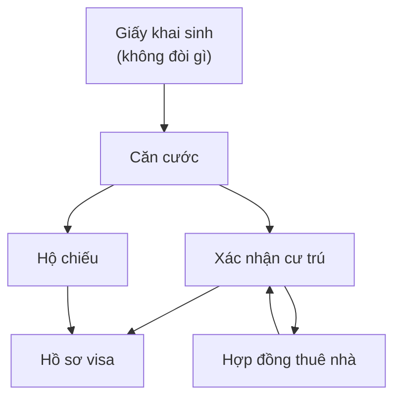
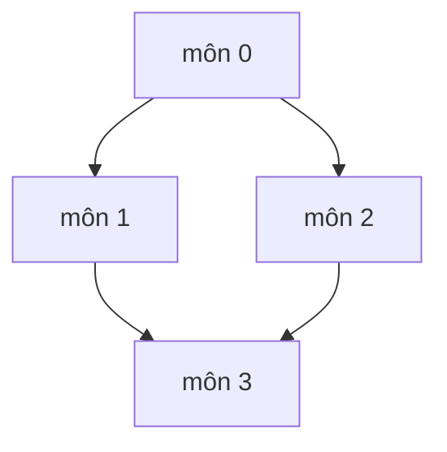

> [!tldr] Đọc nhanh
> - Mỗi môn là một đỉnh. Cặp `[a, b]` nghĩa là "học `b` trước rồi mới học `a`", nên vẽ một mũi tên **từ `b` sang `a`**. Đề hỏi: đồ thị có hướng này có **vòng** không? Không có vòng thì học hết được.
> - [[concepts/in-degree|Thuật toán Kahn]]: đếm xem mỗi môn còn chờ bao nhiêu môn (bậc vào). Môn nào chờ 0 môn thì học ngay; học xong thì trừ số chờ của các môn đứng sau. Cuối cùng **đếm số môn học được**: thiếu môn nào là môn đó kẹt trong vòng.
> - [[concepts/three-color-dfs|DFS ba màu]] cho cùng đáp án: gặp lại một môn **đang trên đường đi** (xám) là có vòng. Chỉ dùng một tập "đã thăm" thì báo nhầm vòng ở hình kim cương.
> - Cả hai cách đều O(V + E). Cách quét đi quét lại mọi môn đúng nhưng chậm: trên chuỗi 2 000 môn nó nhìn 2 000 999 cạnh, Kahn chỉ nhìn 1 999.
> - Bẫy theo ngôn ngữ: DFS đệ quy trong Python **vỡ ngay ở 2 000 môn** (giới hạn đệ quy mặc định là 1 000). Kahn không đệ quy nên không vướng.

> [!info] Bối cảnh
> Bài LeetCode 207 (Medium), thuộc [[posts/2026-11-26-neetcode-topological-sort|ga 3: Sắp xếp topo]] trên **tuyến NeetCode: Đồ thị**, và là bài neo của ga. Ở [[posts/2026-11-26-neetcode-graph-bfs|ga 2]], cạnh đi được cả hai chiều. Ở bài này mỗi cạnh có **một chiều**, và chiều đó là "phải xong trước". Bạn chỉ cần biết vòng lặp, mảng và hàng đợi; mọi thứ khác được giải thích ngay dưới.

> [!abstract]- Từ điển nhanh cho bài này (bấm để mở)
> - **Đỉnh, cạnh có hướng**: đỉnh là một môn; cạnh `b → a` là một mũi tên một chiều, nghĩa là `b` phải xong trước `a`.
> - **Vòng (chu trình)**: đi theo mũi tên mà quay về chỗ cũ, ví dụ `1 → 2 → 3 → 1`. Môn trên vòng chờ nhau mãi, không môn nào bắt đầu được.
> - [[concepts/directed-acyclic-graph|DAG]]: đồ thị có hướng không có vòng. Học hết được mọi môn khi và chỉ khi đồ thị là DAG.
> - [[concepts/in-degree|Bậc vào]]: số mũi tên chỉ vào một đỉnh, tức số môn mà môn đó còn phải chờ.
> - [[concepts/queue|Hàng đợi]]: danh sách vào trước ra trước. Kahn để các môn "học được ngay" vào đây.
> - [[concepts/adjacency-list|Danh sách kề]]: mỗi môn giữ danh sách các môn đứng ngay sau nó.
> - [[concepts/topological-sort|Thứ tự topo]]: một cách xếp mọi môn thành hàng sao cho mọi mũi tên đều chỉ về phía sau. Bài này chỉ hỏi thứ tự đó có tồn tại không; [[problems/course-schedule-ii|Course Schedule II]] bắt in nó ra.
> - **DFS** (duyệt theo chiều sâu): đi theo một mũi tên càng xa càng tốt, hết đường mới quay lại.
> - **Ngăn xếp gọi hàm**: vùng nhớ giữ các lời gọi hàm đang dở. Đệ quy sâu quá thì vùng này đầy, chương trình báo lỗi tràn ngăn xếp.

## Hình dung trước: làm giấy tờ ở phường

Bạn cần làm một loạt giấy tờ. Có giấy làm được ngay. Có giấy đòi nộp kèm giấy khác: muốn làm hộ chiếu phải có căn cước, muốn làm căn cước phải có giấy khai sinh. Bạn cứ làm giấy nào **không còn đòi gì**, làm xong thì gạch nó khỏi danh sách "cần nộp kèm" của các giấy khác, và lặp lại.

Rắc rối chỉ xảy ra khi gặp **vòng luẩn quẩn**: phòng A bảo "mang giấy của phòng B tới", phòng B bảo "mang giấy của phòng A tới". Không giấy nào làm được trước, nên cả hai kẹt mãi. Bài toán hỏi đúng một câu: trong đống giấy tờ này có vòng luẩn quẩn nào không?

| Đời thường | Khái niệm |
|---|---|
| Một loại giấy tờ | Một môn, tức một đỉnh |
| "Muốn làm giấy A phải có giấy B trước" | Cặp `[a, b]`, tức cạnh `b → a` |
| Số giấy còn phải nộp kèm cho giấy A | Bậc vào của A |
| Giấy không còn đòi gì: làm ngay | Bậc vào bằng 0, vào hàng đợi |
| Làm xong giấy B, gạch B khỏi danh sách cần nộp của giấy khác | Trừ bậc vào của các đỉnh đứng sau B |
| Phòng A đòi giấy phòng B, phòng B đòi giấy phòng A | Một vòng: không đỉnh nào trên vòng có bậc vào 0 |
| Cuối ngày đếm số giấy làm được | So số môn học được với `numCourses` |
| Đang chạy đi xin giấy X thì lại bị đòi chính giấy X | DFS gặp lại một đỉnh xám |

Dưới đây là một bộ giấy tờ có cả phần làm được lẫn một vòng luẩn quẩn. Mũi tên chỉ từ giấy phải có trước sang giấy cần nó.



Giấy khai sinh, căn cước và hộ chiếu làm được. Nhưng "xác nhận cư trú" chờ "hợp đồng thuê nhà", và hợp đồng lại chờ xác nhận cư trú: hai giấy này kẹt, kéo theo hồ sơ visa cũng kẹt. Kết luận: **không làm hết được**.

## Vấn đề: học hết được mọi môn không?

Có `numCourses` môn, đánh số từ `0` tới `numCourses − 1`. Mảng `prerequisites` chứa các cặp `[a, b]`, nghĩa là muốn học môn `a` thì phải học xong môn `b` trước. Trả về `true` nếu có cách học hết mọi môn, ngược lại trả `false`. [Đề LC-0207](https://leetcode.com/problems/course-schedule/)

Giới hạn (mình đối chiếu với LeetCode ngày 26/11/2026): `numCourses` từ 1 tới 2 000; có từ 0 tới 5 000 cặp; mọi cặp khác nhau.

Ba điểm dễ trượt ngay từ đề:

| Câu hỏi | Trả lời | Ví dụ |
|---|---|---|
| `[a, b]` là ai trước ai? | `b` trước, `a` sau. Mũi tên vẽ **từ `b` sang `a`**. | `[1, 0]`: học 0 rồi mới học 1 |
| Một môn tự cần chính nó? | Đó là một vòng dài 1. Trả `false`. | `2` môn, `[[1, 1]]` trả `false` |
| Có môn không dính cặp nào? | Học lúc nào cũng được. Đồ thị có thể rời thành nhiều mảnh. | `3` môn, không cặp nào, trả `true` |

## Cơ chế

<figure class="figure-map" style="--ar: 3 / 4">
<div class="frame"><iframe data-archify="../diagrams/neetcode-course-schedule/worked-example.html" title="Course Schedule: Kahn học được một môn rồi kẹt" loading="lazy"></iframe></div>
<figcaption><span><b>Hình 1.</b> Với 4 môn mà 1, 2, 3 chờ nhau thành vòng, Kahn học được môn 0 rồi hàng đợi cạn; đếm được 1 &lt; 4 môn là đủ kết luận có vòng.</span><a href="../diagrams/neetcode-course-schedule/worked-example.html" target="_blank" rel="noopener">Mở toàn màn hình</a></figcaption>
</figure>

<details>
<summary>Đọc từng bước</summary>
<ol>
<li>Bốn môn, các cặp <code>[1,0] [2,1] [3,2] [1,3]</code>. Đếm bậc vào: môn 0 chờ 0 môn, môn 1 chờ 2 môn (0 và 3), môn 2 chờ 1, môn 3 chờ 1. <code>bậc vào = [0, 2, 1, 1]</code></li>
<li>Môn 0 không chờ ai nên vào hàng đợi. <code>hàng đợi: [0]</code></li>
<li>Học môn 0. Môn đứng sau 0 là môn 1, bậc vào của nó giảm từ 2 xuống 1. <code>đã học 1 môn</code></li>
<li>Môn 1 vẫn còn chờ môn 3, nên không ai vào hàng. Hàng đợi cạn. <code>hàng đợi: []</code></li>
<li>Ba môn còn lại chờ nhau thành vòng: 1 chờ 3, 3 chờ 2, 2 chờ 1. Bậc vào của chúng không bao giờ về 0. <code>bậc vào còn lại = [0, 1, 1, 1]</code></li>
<li>Chỉ học được 1 trên 4 môn. <code>1 &lt; 4 → false</code></li>
</ol>
</details>

### Đổi đề thành đồ thị

Mỗi cặp `[a, b]` thành một mũi tên `b → a` trong [[concepts/adjacency-list|danh sách kề]]: `adj[b]` giữ các môn đứng ngay sau `b`. Cùng lúc đó tăng `indegree[a]`, số môn mà `a` còn phải chờ.

```ts
for (const [a, b] of prerequisites) {
  adj[b].push(a) // b xong thì tới lượt a
  indegree[a]++  // a chờ thêm một môn
}
```

Câu hỏi "học hết được không" giờ thành "đồ thị có vòng không". Lý do: nếu có vòng, mỗi môn trên vòng đều chờ một môn khác cũng trên vòng, nên không môn nào bắt đầu được. Nếu không có vòng (một [[concepts/directed-acyclic-graph|DAG]]), luôn có ít nhất một môn không chờ ai, học nó xong thì phần còn lại vẫn không có vòng, cứ thế học hết.

### Cách 1: quét đi quét lại, O(V·(V + E))

Cách tự nhiên nhất, giống cầm danh sách giấy tờ đi một vòng các phòng: mỗi lượt quét mọi môn chưa học, môn nào đã đủ tiên quyết thì học luôn. Một lượt quét mà không học thêm được môn nào thì dừng, rồi so số môn đã học với `numCourses`.

Cách này đúng. Vấn đề là **số lượt quét**. Nếu môn `i` cần môn `i + 1` (môn 1 999 là môn duy nhất học được ngay), lượt đầu quét từ môn 0 tới 1 999 mà chỉ học được môn 1 999. Lượt thứ hai chỉ học được môn 1 998. Phải 2 001 lượt mới xong, mỗi lượt quét lại gần như cả danh sách. File chạy thử đếm được **2 000 999 lần nhìn cạnh** cho 1 999 cạnh.

### Cách 2: Kahn, đếm số môn học được, O(V + E)

Cách 1 phí công vì mỗi lượt phải **đi tìm** môn nào học được. [[concepts/in-degree|Thuật toán Kahn]] (A. B. Kahn, 1962) ghi sổ để khỏi phải tìm: mỗi môn giữ con số "còn chờ bao nhiêu môn". Con số đó về 0 lúc nào thì môn đó vào hàng đợi lúc đó.

1. Đếm bậc vào của mọi môn. Môn nào bằng 0 thì cho vào hàng đợi.
2. Lấy một môn ra khỏi hàng, đếm `taken++`. Với mỗi môn đứng sau nó, trừ bậc vào đi 1; về 0 thì cho vào hàng.
3. Hàng cạn thì dừng. Trả `taken === numCourses`.

Chạy trên ví dụ năm môn `[[1,0],[2,0],[3,1],[3,2],[4,3]]` (môn 3 cần cả 1 và 2):

| Lượt | Lấy ra | Trừ bậc vào | Vào hàng | Đã học |
|---|---|---|---|---|
| bắt đầu | | bậc vào `[0, 1, 1, 2, 1]` | 0 | 0 |
| 1 | 0 | môn 1: 1 → 0, môn 2: 1 → 0 | 1, 2 | 1 |
| 2 | 1 | môn 3: 2 → 1 | | 2 |
| 3 | 2 | môn 3: 1 → 0 | 3 | 3 |
| 4 | 3 | môn 4: 1 → 0 | 4 | 4 |
| 5 | 4 | | | 5 |

Học được 5 trên 5 môn: trả `true`. Thứ tự lấy ra `0, 1, 2, 3, 4` chính là một [[concepts/topological-sort|thứ tự topo]]; bài tiếp theo, [[problems/course-schedule-ii|Course Schedule II]], chỉ cần trả mảng đó thay vì trả `true`.

Vì sao chỉ cần đếm, không cần tìm ra vòng? Một môn chỉ vào hàng khi mọi môn nó chờ đã học xong. Môn trên một vòng luôn chờ một môn khác trên cùng vòng, nên không môn nào trên vòng vào hàng được. Ngược lại, nếu không có vòng thì mọi môn rồi cũng về 0. Vậy "đếm thiếu" và "có vòng" là một.

Mỗi môn vào hàng đúng một lần, mỗi cạnh bị trừ đúng một lần: O(V + E) thời gian, O(V + E) bộ nhớ cho danh sách kề.

### Cách 3: DFS ba màu, O(V + E)

Cách thứ hai để tìm vòng là đi theo mũi tên càng sâu càng tốt, giống chạy đi xin giấy: đang xin giấy X thì phải chạy sang xin giấy Y, đang xin Y lại phải xin Z… Nếu giữa chừng bị đòi **chính giấy X đang xin dở**, đó là vòng luẩn quẩn.

Để nhận ra "đang xin dở", mỗi môn mang một trong ba màu. Đây là [[concepts/three-color-dfs|DFS ba màu]]:

| Màu | Nghĩa | Gặp nó khi đi theo mũi tên thì |
|---|---|---|
| Trắng | chưa đụng tới | đi vào nó |
| Xám | đang trên đường đi hiện tại, chưa xong | **có vòng**, trả `false` |
| Đen | đã đi hết mọi đường từ nó, không thấy vòng | bỏ qua, đã kiểm rồi |

Tại sao cần tới ba màu? Thử chỉ dùng một tập "đã thăm" và coi "gặp lại đỉnh đã thăm" là vòng, trên hình kim cương bốn môn (môn 3 cần cả 1 và 2):



| Bước | Đi tới | Ba màu | Một tập "đã thăm" |
|---|---|---|---|
| 1 | 0 → 1 → 3 | 0, 1, 3 xám; 3 hết đường nên thành đen, rồi 1 đen | thăm 0, 1, 3 |
| 2 | 0 → 2 | 2 xám | thăm 2 |
| 3 | 2 → 3 | 3 **đen**: đã kiểm, bỏ qua | 3 **đã thăm**: báo vòng |
| kết quả | | `true`, đúng | `false`, sai |

Môn 3 được tới bằng hai đường, nhưng hai đường không tạo vòng. Chỉ có đỉnh **xám** (đang nằm trên đường đi hiện tại) mới chứng minh mình đang đi vòng về chỗ cũ. File chạy thử ghi lại đúng lỗi này: `wrongOneVisitedSet` sai 2/8 ca, cả hai đều là ca có hình kim cương.

Thêm một lợi ích của màu đen: một đỉnh đen không bao giờ được đi lại. Mỗi đỉnh và mỗi cạnh được xem một lần, nên DFS ba màu cũng O(V + E).

### Cách 3b: DFS tự giữ ngăn xếp

DFS đệ quy gọn, nhưng mỗi tầng đi sâu là một lời gọi hàm nằm chờ trên ngăn xếp gọi hàm. Chuỗi `0 → 1 → 2 → … → 1 999` sâu 2 000 tầng, và Python mặc định chỉ cho 1 000 tầng. Cách sửa là tự giữ một mảng làm ngăn xếp: mỗi phần tử là một đỉnh, kèm chỉ số `next[u]` cho biết đã xem tới hàng xóm thứ mấy của nó. Logic ba màu giữ nguyên, chỉ có ngăn xếp là mảng của mình thay vì ngăn xếp của hệ thống.

### Kahn hay DFS?

| | Kahn | DFS ba màu |
|---|---|---|
| Ý tưởng | học môn không chờ ai, đếm số môn học được | đi sâu, gặp đỉnh xám là có vòng |
| Cấu trúc phụ | mảng bậc vào, hàng đợi | mảng màu, ngăn xếp (đệ quy hoặc tự giữ) |
| Đệ quy | không | có, trừ khi tự giữ ngăn xếp |
| Cho luôn thứ tự học | có, thứ tự lấy ra | có, lấy thứ tự "xong" rồi đảo ngược |
| Dừng sớm khi thấy vòng | không, chạy hết rồi mới đếm | có, ngay khi gặp đỉnh xám |

Mình chọn Kahn làm mặc định: không đệ quy, dễ giải thích, và bài sau dùng lại gần như nguyên văn.

### Đo trên 2 000 môn

File chạy thử dùng hai đầu vào 2 000 môn. **Chuỗi ngược**: môn `i` cần môn `i + 1`, ca xấu nhất của Cách 1. **Ngẫu nhiên**: 5 000 cặp không có vòng, số môn xáo trộn. Cột "lần nhìn cạnh" đếm số lần một cách xử lý nhìn một cặp tiên quyết; bảy ngôn ngữ ra đúng cùng con số.

| Chuỗi ngược, 1 999 cạnh | Lần nhìn cạnh | TS | Python | Go | Java | PHP | Rust |
|---|---:|---:|---:|---:|---:|---:|---:|
| Cách 1: quét lại, 2 001 lượt | 2 000 999 | 29 ms | 136 ms | 3,6 ms | 5,5 ms | 59 ms | 3,1 ms |
| Cách 2: Kahn | 1 999 | 0,3 ms | 0,3 ms | 0,1 ms | 0,2 ms | 0,1 ms | 0,1 ms |
| Cách 3: DFS đệ quy | 1 999 | 0,1 ms | 0,3 ms | 0,1 ms | 0,1 ms | 0,2 ms | < 0,1 ms |
| Cách 3b: DFS tự giữ ngăn xếp | 1 999 | 0,1 ms | 0,5 ms | 0,1 ms | 0,4 ms | 0,3 ms | 0,1 ms |

| Ngẫu nhiên, 5 000 cạnh | Lần nhìn cạnh | TS | Python | Go | Java | PHP | Rust |
|---|---:|---:|---:|---:|---:|---:|---:|
| Cách 1: quét lại, 10 lượt | 12 033 | 0,4 ms | 1,1 ms | 0,3 ms | 0,2 ms | 0,6 ms | 0,1 ms |
| Cách 2: Kahn | 5 000 | 0,3 ms | 0,7 ms | 0,2 ms | 0,3 ms | 0,4 ms | 0,1 ms |
| Cách 3: DFS đệ quy | 5 000 | 0,3 ms | 0,6 ms | 0,2 ms | 0,2 ms | 0,5 ms | 0,1 ms |
| Cách 3b: DFS tự giữ ngăn xếp | 5 000 | 0,2 ms | 1,0 ms | 0,3 ms | 0,3 ms | 0,6 ms | 0,1 ms |

Ở chuỗi ngược, DFS đệ quy không vấp vì mũi tên chỉ từ môn lớn về môn nhỏ, nên DFS bắt đầu từ môn 0 không đi đâu cả; mỗi lần đi chỉ sâu một tầng. Chiều ngược lại mới làm DFS đi một mạch, xem bảng đệ quy sâu bên dưới. Hai điều đáng nhớ:

- Trên đồ thị ngẫu nhiên, Cách 1 chỉ cần 10 lượt nên trông vô hại. Trên chuỗi ngược nó nhìn cạnh **hơn một nghìn lần** nhiều hơn Kahn. Một cách giải chỉ nhanh trên dữ liệu "dễ" là cách giải có ca xấu.
- Kahn và DFS nhìn mỗi cạnh đúng một lần ở cả hai đầu vào. Số đo thời gian đổi theo máy và lần chạy; cột "lần nhìn cạnh" thì không.

Đệ quy sâu: chuỗi "môn `i + 1` cần môn `i`", nên DFS từ môn 0 đi một mạch hết chuỗi.

| Độ sâu | TS và JS | Python | Go | Java | PHP | Rust |
|---|---|---|---|---|---|---|
| 2 000 tầng, DFS đệ quy | đúng | `RecursionError` | đúng | đúng | đúng | đúng |
| 100 000 tầng, DFS đệ quy | `RangeError` | `RecursionError` | đúng | `StackOverflowError` | đúng | đúng (luồng chính) |
| 100 000 tầng, DFS tự giữ ngăn xếp và Kahn | đúng | đúng | đúng | đúng | đúng | đúng |

Go không vỡ vì ngăn xếp của mỗi goroutine tự nới ra, mặc định tới 1 GB trên máy 64-bit. Ba ngôn ngữ còn lại có trần cố định. PHP không vỡ vì lời gọi hàm PHP nằm trên heap của máy ảo, không phải stack của luồng; riêng máy bật Xdebug thì Xdebug tự chặn ở 512 tầng, nên các file PHP chạy bằng `php -d xdebug.mode=off`. Rust chạy được 100 000 tầng trên luồng chính (stack 8 MB), nhưng cùng hàm đó trên một luồng mới (mặc định 2 MB) thì tràn và cả tiến trình dừng. Đề chỉ cho tối đa 2 000 môn, nên ở LeetCode chỉ Python vấp; nhưng ở dữ liệu thật (một hệ thống build với hàng trăm nghìn bước), cả JavaScript và Java cũng vấp.

## Ví dụ chạy được

Mỗi file chạy cùng 8 ca: hai môn, hai môn chờ nhau, kim cương, ví dụ năm môn, học được một môn rồi kẹt, môn tự cần chính nó, không có tiên quyết, và hai mảnh rời mà mảnh sau có vòng. File còn đối chiếu bốn cách đúng trên 2 000 đồ thị nhỏ ngẫu nhiên (sinh bằng cùng một bộ số giả ngẫu nhiên ở cả bảy ngôn ngữ), đo hai đầu vào 2 000 môn và thử đệ quy sâu. Bên dưới là phần dựng đồ thị, Kahn và DFS ba màu đệ quy; Cách 1, Cách 3b và hai bản sai nằm trong file đầy đủ.

[TypeScript](../code/neetcode-course-schedule/course-schedule.ts) · [Python](../code/neetcode-course-schedule/course_schedule.py) · [Go](../code/neetcode-course-schedule/course_schedule.go) · [Java](../code/neetcode-course-schedule/course-schedule.java) · [JavaScript](../code/neetcode-course-schedule/course-schedule.js) · [PHP](../code/neetcode-course-schedule/course-schedule.php) · [Rust](../code/neetcode-course-schedule/course_schedule.rs)

```ts
// Cặp [a, b] nghĩa là "muốn học a phải học b trước": cạnh đi từ b sang a.
function buildGraph(n: number, prerequisites: number[][]) {
  const adj: number[][] = Array.from({ length: n }, () => [])
  const indegree = new Array<number>(n).fill(0)
  for (const [a, b] of prerequisites) {
    adj[b].push(a)
    indegree[a]++
  }
  return { adj, indegree }
}

// Cách 2: Kahn. Môn có bậc vào 0 thì học được ngay; học xong thì trừ bậc vào
// của các môn đứng sau. Đếm số môn học được. O(V + E).
function canFinishKahn(n: number, prerequisites: number[][]): boolean {
  const { adj, indegree } = buildGraph(n, prerequisites)
  const queue: number[] = []
  for (let c = 0; c < n; c++) if (indegree[c] === 0) queue.push(c)
  let taken = 0
  for (let head = 0; head < queue.length; head++) {
    const u = queue[head]
    taken++
    for (const v of adj[u]) {
      work++
      if (--indegree[v] === 0) queue.push(v)
    }
  }
  return taken === n // thiếu môn nào là môn đó kẹt trong một vòng
}

// Cách 3: DFS ba màu, đệ quy. Trắng = chưa đụng, xám = đang trên đường đi,
// đen = đã xong. Gặp lại một đỉnh xám là có vòng. O(V + E).
const WHITE = 0, GRAY = 1, BLACK = 2
function canFinishDfs(n: number, prerequisites: number[][]): boolean {
  const { adj } = buildGraph(n, prerequisites)
  const color = new Array<number>(n).fill(WHITE)
  const visit = (u: number): boolean => {
    color[u] = GRAY
    for (const v of adj[u]) {
      work++
      if (color[v] === GRAY) return false // quay về đỉnh đang trên đường: vòng
      if (color[v] === WHITE && !visit(v)) return false
    }
    color[u] = BLACK
    return true
  }
  for (let u = 0; u < n; u++) {
    if (color[u] === WHITE && !visit(u)) return false
  }
  return true
}
```
```python
def build_graph(n, prerequisites):
    # Cặp [a, b] nghĩa là "muốn học a phải học b trước": cạnh đi từ b sang a.
    adj = [[] for _ in range(n)]
    indegree = [0] * n
    for a, b in prerequisites:
        adj[b].append(a)
        indegree[a] += 1
    return adj, indegree

# Cách 2: Kahn. Môn có bậc vào 0 thì học được ngay; học xong thì trừ bậc vào
# của các môn đứng sau. Đếm số môn học được. O(V + E).
def can_finish_kahn(n, prerequisites):
    global work
    adj, indegree = build_graph(n, prerequisites)
    queue = deque(c for c in range(n) if indegree[c] == 0)
    taken = 0
    while queue:
        u = queue.popleft()
        taken += 1
        for v in adj[u]:
            work += 1
            indegree[v] -= 1
            if indegree[v] == 0:
                queue.append(v)
    return taken == n  # thiếu môn nào là môn đó kẹt trong một vòng


WHITE, GRAY, BLACK = 0, 1, 2


# Cách 3: DFS ba màu, đệ quy. Trắng = chưa đụng, xám = đang trên đường đi,
# đen = đã xong. Gặp lại một đỉnh xám là có vòng. O(V + E).
def can_finish_dfs(n, prerequisites):
    adj, _ = build_graph(n, prerequisites)
    color = [WHITE] * n

    def visit(u):
        global work
        color[u] = GRAY
        for v in adj[u]:
            work += 1
            if color[v] == GRAY:  # quay về đỉnh đang trên đường: vòng
                return False
            if color[v] == WHITE and not visit(v):
                return False
        color[u] = BLACK
        return True

    return all(color[u] != WHITE or visit(u) for u in range(n))
```
```go
// Cặp [a, b] nghĩa là "muốn học a phải học b trước": cạnh đi từ b sang a.
func buildGraph(n int, prerequisites [][]int) ([][]int, []int) {
	adj := make([][]int, n)
	indegree := make([]int, n)
	for _, p := range prerequisites {
		a, b := p[0], p[1]
		adj[b] = append(adj[b], a)
		indegree[a]++
	}
	return adj, indegree
}

// Cách 2: Kahn. Môn có bậc vào 0 thì học được ngay; học xong thì trừ bậc vào
// của các môn đứng sau. Đếm số môn học được. O(V + E).
func canFinishKahn(n int, prerequisites [][]int) bool {
	adj, indegree := buildGraph(n, prerequisites)
	queue := []int{}
	for c := 0; c < n; c++ {
		if indegree[c] == 0 {
			queue = append(queue, c)
		}
	}
	taken := 0
	for head := 0; head < len(queue); head++ {
		u := queue[head]
		taken++
		for _, v := range adj[u] {
			work++
			indegree[v]--
			if indegree[v] == 0 {
				queue = append(queue, v)
			}
		}
	}
	return taken == n // thiếu môn nào là môn đó kẹt trong một vòng
}

const (
	white = 0
	gray  = 1
	black = 2
)

// Cách 3: DFS ba màu, đệ quy. Trắng = chưa đụng, xám = đang trên đường đi,
// đen = đã xong. Gặp lại một đỉnh xám là có vòng. O(V + E).
func canFinishDfs(n int, prerequisites [][]int) bool {
	adj, _ := buildGraph(n, prerequisites)
	color := make([]int, n)
	var visit func(u int) bool
	visit = func(u int) bool {
		color[u] = gray
		for _, v := range adj[u] {
			work++
			if color[v] == gray { // quay về đỉnh đang trên đường: vòng
				return false
			}
			if color[v] == white && !visit(v) {
				return false
			}
		}
		color[u] = black
		return true
	}
	for u := 0; u < n; u++ {
		if color[u] == white && !visit(u) {
			return false
		}
	}
	return true
}
```
```java
// Cặp [a, b] nghĩa là "muốn học a phải học b trước": cạnh đi từ b sang a.
static List<List<Integer>> buildAdj(int n, int[][] prerequisites, int[] indegree) {
    List<List<Integer>> adj = new ArrayList<>();
    for (int i = 0; i < n; i++) adj.add(new ArrayList<>());
    for (int[] p : prerequisites) {
        adj.get(p[1]).add(p[0]);
        indegree[p[0]]++;
    }
    return adj;
}

// Cách 2: Kahn. Môn có bậc vào 0 thì học được ngay; học xong thì trừ bậc vào
// của các môn đứng sau. Đếm số môn học được. O(V + E).
static boolean canFinishKahn(int n, int[][] prerequisites) {
    int[] indegree = new int[n];
    List<List<Integer>> adj = buildAdj(n, prerequisites, indegree);
    ArrayDeque<Integer> queue = new ArrayDeque<>();
    for (int c = 0; c < n; c++) if (indegree[c] == 0) queue.add(c);
    int taken = 0;
    while (!queue.isEmpty()) {
        int u = queue.poll();
        taken++;
        for (int v : adj.get(u)) {
            work++;
            if (--indegree[v] == 0) queue.add(v);
        }
    }
    return taken == n; // thiếu môn nào là môn đó kẹt trong một vòng
}

static final int WHITE = 0, GRAY = 1, BLACK = 2;

// Cách 3: DFS ba màu, đệ quy. Trắng = chưa đụng, xám = đang trên đường đi,
// đen = đã xong. Gặp lại một đỉnh xám là có vòng. O(V + E).
static boolean canFinishDfs(int n, int[][] prerequisites) {
    List<List<Integer>> adj = buildAdj(n, prerequisites, new int[n]);
    int[] color = new int[n];
    for (int u = 0; u < n; u++) {
        if (color[u] == WHITE && !visit(u, adj, color)) return false;
    }
    return true;
}

static boolean visit(int u, List<List<Integer>> adj, int[] color) {
    color[u] = GRAY;
    for (int v : adj.get(u)) {
        work++;
        if (color[v] == GRAY) return false; // quay về đỉnh đang trên đường: vòng
        if (color[v] == WHITE && !visit(v, adj, color)) return false;
    }
    color[u] = BLACK;
    return true;
}
```
```js
// Cặp [a, b] nghĩa là "muốn học a phải học b trước": cạnh đi từ b sang a.
function buildGraph(n, prerequisites) {
  const adj= Array.from({ length: n }, () => [])
  const indegree = new Array(n).fill(0)
  for (const [a, b] of prerequisites) {
    adj[b].push(a)
    indegree[a]++
  }
  return { adj, indegree }
}

// Cách 2: Kahn. Môn có bậc vào 0 thì học được ngay; học xong thì trừ bậc vào
// của các môn đứng sau. Đếm số môn học được. O(V + E).
function canFinishKahn(n, prerequisites) {
  const { adj, indegree } = buildGraph(n, prerequisites)
  const queue = []
  for (let c = 0; c < n; c++) if (indegree[c] === 0) queue.push(c)
  let taken = 0
  for (let head = 0; head < queue.length; head++) {
    const u = queue[head]
    taken++
    for (const v of adj[u]) {
      work++
      if (--indegree[v] === 0) queue.push(v)
    }
  }
  return taken === n // thiếu môn nào là môn đó kẹt trong một vòng
}

// Cách 3: DFS ba màu, đệ quy. Trắng = chưa đụng, xám = đang trên đường đi,
// đen = đã xong. Gặp lại một đỉnh xám là có vòng. O(V + E).
const WHITE = 0, GRAY = 1, BLACK = 2
function canFinishDfs(n, prerequisites) {
  const { adj } = buildGraph(n, prerequisites)
  const color = new Array(n).fill(WHITE)
  const visit = (u) => {
    color[u] = GRAY
    for (const v of adj[u]) {
      work++
      if (color[v] === GRAY) return false // quay về đỉnh đang trên đường: vòng
      if (color[v] === WHITE && !visit(v)) return false
    }
    color[u] = BLACK
    return true
  }
  for (let u = 0; u < n; u++) {
    if (color[u] === WHITE && !visit(u)) return false
  }
  return true
}
```
```php
// Cặp [a, b] nghĩa là "muốn học a phải học b trước": cạnh đi từ b sang a.
function buildGraph(int $n, array $prerequisites): array
{
    $adj = array_fill(0, $n, []);
    $indegree = array_fill(0, $n, 0);
    foreach ($prerequisites as [$a, $b]) {
        $adj[$b][] = $a;
        $indegree[$a]++;
    }
    return [$adj, $indegree];
}

// Cách 2: Kahn. Môn có bậc vào 0 thì học được ngay; học xong thì trừ bậc vào
// của các môn đứng sau. Đếm số môn học được. O(V + E).
function canFinishKahn(int $n, array $prerequisites): bool
{
    global $work;
    [$adj, $indegree] = buildGraph($n, $prerequisites);
    $queue = [];
    for ($c = 0; $c < $n; $c++) if ($indegree[$c] === 0) $queue[] = $c;
    $taken = 0;
    for ($head = 0; $head < count($queue); $head++) { // giữ chỉ số đầu, không array_shift
        $u = $queue[$head];
        $taken++;
        foreach ($adj[$u] as $v) {
            $work++;
            if (--$indegree[$v] === 0) $queue[] = $v;
        }
    }
    return $taken === $n; // thiếu môn nào là môn đó kẹt trong một vòng
}

const WHITE = 0;
const GRAY = 1;
const BLACK = 2;

// Cách 3: DFS ba màu, đệ quy. Trắng = chưa đụng, xám = đang trên đường đi,
// đen = đã xong. Gặp lại một đỉnh xám là có vòng. O(V + E).
function canFinishDfs(int $n, array $prerequisites): bool
{
    [$adj] = buildGraph($n, $prerequisites);
    $color = array_fill(0, $n, WHITE);
    // $color truyền theo tham chiếu (&): mảng PHP là giá trị, không có & thì mỗi lời gọi sửa một bản sao
    $visit = function (int $u) use (&$visit, &$color, $adj): bool {
        global $work;
        $color[$u] = GRAY;
        foreach ($adj[$u] as $v) {
            $work++;
            if ($color[$v] === GRAY) return false; // quay về đỉnh đang trên đường: vòng
            if ($color[$v] === WHITE && !$visit($v)) return false;
        }
        $color[$u] = BLACK;
        return true;
    };
    for ($u = 0; $u < $n; $u++) {
        if ($color[$u] === WHITE && !$visit($u)) return false;
    }
    return true;
}
```
```rust
// Cặp [a, b] nghĩa là "muốn học a phải học b trước": cạnh đi từ b sang a.
fn build_graph(n: usize, prerequisites: &[[usize; 2]]) -> (Vec<Vec<usize>>, Vec<usize>) {
    let mut adj = vec![Vec::new(); n];
    let mut indegree = vec![0usize; n];
    for &[a, b] in prerequisites {
        adj[b].push(a);
        indegree[a] += 1;
    }
    (adj, indegree)
}

// Cách 2: Kahn. Môn có bậc vào 0 thì học được ngay; học xong thì trừ bậc vào
// của các môn đứng sau. Đếm số môn học được. O(V + E).
fn can_finish_kahn(n: usize, prerequisites: &[[usize; 2]]) -> bool {
    let (adj, mut indegree) = build_graph(n, prerequisites);
    let mut queue: VecDeque<usize> = (0..n).filter(|&c| indegree[c] == 0).collect();
    let mut taken = 0;
    while let Some(u) = queue.pop_front() {
        taken += 1;
        for &v in &adj[u] {
            tick();
            indegree[v] -= 1; // usize: chỉ trừ khi chắc > 0, nếu không bản debug panic
            if indegree[v] == 0 {
                queue.push_back(v);
            }
        }
    }
    taken == n // thiếu môn nào là môn đó kẹt trong một vòng
}

const WHITE: u8 = 0;
const GRAY: u8 = 1;
const BLACK: u8 = 2;

// Cách 3: DFS ba màu, đệ quy. Trắng = chưa đụng, xám = đang trên đường đi,
// đen = đã xong. Gặp lại một đỉnh xám là có vòng. O(V + E).
fn can_finish_dfs(n: usize, prerequisites: &[[usize; 2]]) -> bool {
    let (adj, _) = build_graph(n, prerequisites);
    let mut color = vec![WHITE; n];
    // Hàm lồng thay cho closure: closure đệ quy cần mượn &mut color hai lần, borrow checker không cho.
    fn visit(u: usize, adj: &[Vec<usize>], color: &mut [u8]) -> bool {
        color[u] = GRAY;
        for &v in &adj[u] {
            tick();
            if color[v] == GRAY {
                return false; // quay về đỉnh đang trên đường: vòng
            }
            if color[v] == WHITE && !visit(v, adj, color) {
                return false;
            }
        }
        color[u] = BLACK;
        true
    }
    for u in 0..n {
        if color[u] == WHITE && !visit(u, &adj, &mut color) {
            return false;
        }
    }
    true
}
```

Kết quả chạy `node course-schedule.ts` (sáu bản còn lại in cùng các dòng ca đúng và cùng số lần nhìn cạnh; thời gian và dòng đệ quy sâu khác như bảng trên):

```text
canFinishScan        8/8 ca đúng
canFinishKahn        8/8 ca đúng
canFinishDfs         8/8 ca đúng
canFinishDfsStack    8/8 ca đúng
wrongOneVisitedSet   6/8 ca đúng; sai ở kim cương → false, ví dụ năm môn → false
wrongHasStart        5/8 ca đúng; sai ở học được một môn rồi kẹt → true, môn tự cần chính nó → true, hai mảnh, mảnh sau có vòng → true
ngẫu nhiên: 2000/2000 đồ thị, bốn cách khớp nhau (637 học hết được, 1363 có vòng)
chuỗi 2000 môn, môn i cần môn i+1:
  canFinishScan      true, 2000999 lần nhìn cạnh, 2001 lượt quét, 28.8 ms
  canFinishKahn      true, 1999 lần nhìn cạnh, 0.3 ms
  canFinishDfs       true, 1999 lần nhìn cạnh, 0.1 ms
  canFinishDfsStack  true, 1999 lần nhìn cạnh, 0.1 ms
ngẫu nhiên 2000 môn, 5000 cặp, không vòng:
  canFinishScan      true, 12033 lần nhìn cạnh, 10 lượt quét, 0.4 ms
  canFinishKahn      true, 5000 lần nhìn cạnh, 0.3 ms
  canFinishDfs       true, 5000 lần nhìn cạnh, 0.3 ms
  canFinishDfsStack  true, 5000 lần nhìn cạnh, 0.2 ms
đệ quy sâu, chuỗi môn i+1 cần môn i:
  2000 môn: canFinishDfs true; canFinishDfsStack true; canFinishKahn true
  100000 môn: canFinishDfs lỗi RangeError (tràn ngăn xếp); canFinishDfsStack true; canFinishKahn true
```

## Hiểu lầm và bẫy hay gặp

- **"Có vòng thì phải chỉ ra được vòng."** Không cần. Kahn chỉ đếm: học được ít hơn `numCourses` môn là có vòng. Muốn in vòng ra mới cần thêm sổ ghi "ai dẫn tới ai".
- **DFS chỉ dùng một tập "đã thăm".** Gặp lại một đỉnh đã thăm không có nghĩa là có vòng; đỉnh đó có thể đã kiểm xong từ một đường khác. Bản `wrongOneVisitedSet` trả `false` cho hình kim cương và ví dụ năm môn. Chỉ đỉnh **xám** mới là bằng chứng có vòng.
- **Chỉ hỏi "có môn nào học được ngay không".** Có điểm bắt đầu chưa chắc đi hết. Bản `wrongHasStart` sai 3/8 ca: học được một môn rồi kẹt, môn tự cần chính nó, và hai mảnh rời mà mảnh sau có vòng.
- **Quên môn tự cần chính nó.** Cặp `[1, 1]` là một vòng dài 1. Kahn tự xử lý đúng (môn 1 có bậc vào 1 do chính nó, không bao giờ về 0); DFS ba màu cũng vậy (đi từ 1 gặp lại 1 đang xám).
- **Chỉ chạy DFS từ môn 0.** Đồ thị có thể rời thành nhiều mảnh. Phải thử bắt đầu từ mọi môn còn trắng, nếu không vòng ở mảnh khác sẽ lọt.
- **Vẽ ngược chiều mũi tên.** Ở bài này ngược chiều vẫn ra đáp án đúng, vì đảo mọi mũi tên thì vòng vẫn là vòng. Nhưng thói quen đó sẽ làm sai [[problems/course-schedule-ii|Course Schedule II]], nơi thứ tự học đảo ngược hẳn. Tập vẽ đúng `b → a` ngay từ bài này.
- **Python: DFS đệ quy.** Giới hạn đệ quy mặc định là 1 000, nên chuỗi 2 000 môn ném `RecursionError` ngay trong giới hạn của đề. Nâng `sys.setrecursionlimit` lên quá cao có thể làm sập cả trình thông dịch (ngăn xếp C cũng có hạn). Dùng Kahn với `collections.deque`, hoặc DFS tự giữ ngăn xếp.
- **TypeScript và JavaScript: `queue.shift()`.** Mỗi lần lấy đầu mảng phải dời cả mảng. Giữ một chỉ số `head` chạy dọc mảng như trong file. DFS đệ quy chịu được 2 000 tầng nhưng vỡ `RangeError` ở 100 000.
- **Java: `List<List<Integer>>` và đệ quy.** Mỗi số được bọc thành `Integer`, tốn bộ nhớ hơn `int[]`; với 5 000 cạnh thì không đáng lo. DFS đệ quy ném `StackOverflowError` ở 100 000 tầng với ngăn xếp mặc định.
- **Go: không tràn nhưng vẫn tốn.** Ngăn xếp goroutine tự nới nên đệ quy 100 000 tầng vẫn chạy. Lấy đầu hàng đợi bằng `queue = queue[1:]` thì mảng gốc không được giải phóng cho tới khi hết hàng; dùng chỉ số `head` thì gọn hơn.
- **PHP: mảng là giá trị, closure phải lấy `&$color`.** Viết `use ($color)` thì closure nhận một bản sao lúc tạo ra, mọi lời gọi đệ quy đều thấy mảng toàn trắng, không bao giờ gặp đỉnh xám; trên đồ thị có vòng nó đệ quy mãi cho tới khi PHP báo hết bộ nhớ (lỗi Fatal, không bắt được). Phải `use (&$visit, &$color)`. Ngoài ra Xdebug, nếu bật, chặn đệ quy ở 512 tầng dù chuỗi 2 000 môn hoàn toàn hợp lệ.
- **Rust: closure đệ quy và luồng phụ.** Closure không tự gọi được chính nó khi còn mượn `&mut color`, nên bản Rust viết `visit` thành một `fn` lồng nhận `&mut [u8]`. Tràn stack ở Rust không phải ngoại lệ: tiến trình bị abort. Chuỗi 100 000 môn chạy được trên luồng chính (8 MB) nhưng tràn trên một `thread::spawn` mặc định (2 MB); Kahn với `VecDeque` thì không phụ thuộc stack.

## Câu hỏi tự kiểm tra

> [!question]- Cặp `[3, 5]` nghĩa là gì, và mũi tên vẽ theo chiều nào?
> Muốn học môn 3 phải học xong môn 5 trước. Mũi tên đi từ 5 sang 3, và bậc vào của môn 3 tăng thêm 1.

> [!question]- Kahn kết thúc với `taken = 7`, `numCourses = 10`. Kết luận gì về 3 môn còn lại?
> Ba môn đó không bao giờ về bậc vào 0: mỗi môn hoặc nằm trên một vòng, hoặc đứng sau một môn nằm trên vòng. Đáp án là `false`.

> [!question]- Trong DFS ba màu, đi theo mũi tên gặp một đỉnh đen. Vì sao bỏ qua được mà không bỏ sót vòng nào?
> Đỉnh đen đã được đi hết mọi đường từ nó mà không thấy vòng, và nó không nằm trên đường đi hiện tại. Đi vào nó lần nữa chỉ lặp lại đúng công việc đó, không thể quay về đường hiện tại.

> [!question]- Vì sao trên chuỗi "môn `i` cần môn `i + 1`", Cách 1 cần 2 001 lượt quét?
> Mỗi lượt quét từ môn 0 lên, nhưng chỉ môn có số lớn nhất còn lại là học được, và nó nằm cuối danh sách. Mỗi lượt học thêm đúng một môn: 2 000 lượt học, thêm một lượt cuối để thấy không còn gì học thêm.

> [!question]- Đề có 2 000 môn. Viết DFS đệ quy bằng Python có qua được mọi ca không?
> Không chắc. Một chuỗi 2 000 môn làm DFS sâu 2 000 tầng, vượt giới hạn đệ quy mặc định 1 000 và ném `RecursionError`. Kahn hoặc DFS tự giữ ngăn xếp thì qua.

## Tham khảo

- [LeetCode · Course Schedule](https://leetcode.com/problems/course-schedule/): đề bài và giới hạn đầu vào.
- [Wikipedia · Topological sorting](https://en.wikipedia.org/wiki/Topological_sorting): thuật toán Kahn (1962) và cách dùng DFS để sắp xếp topo.
- [Princeton · Directed graphs](https://algs4.cs.princeton.edu/42digraph/): đồ thị có hướng, phát hiện vòng, thứ tự topo.
- [Princeton · DirectedCycle.java](https://github.com/kevin-wayne/algs4/blob/master/src/main/java/edu/princeton/cs/algs4/DirectedCycle.java): DFS giữ mảng `onStack`, đúng vai trò của màu xám.
- [Python · sys.setrecursionlimit](https://docs.python.org/3/library/sys.html#sys.setrecursionlimit): giới hạn đệ quy và cảnh báo khi nâng quá cao.
- [Go · debug.SetMaxStack](https://pkg.go.dev/runtime/debug#SetMaxStack): trần ngăn xếp mặc định 1 GB trên hệ 64-bit.
