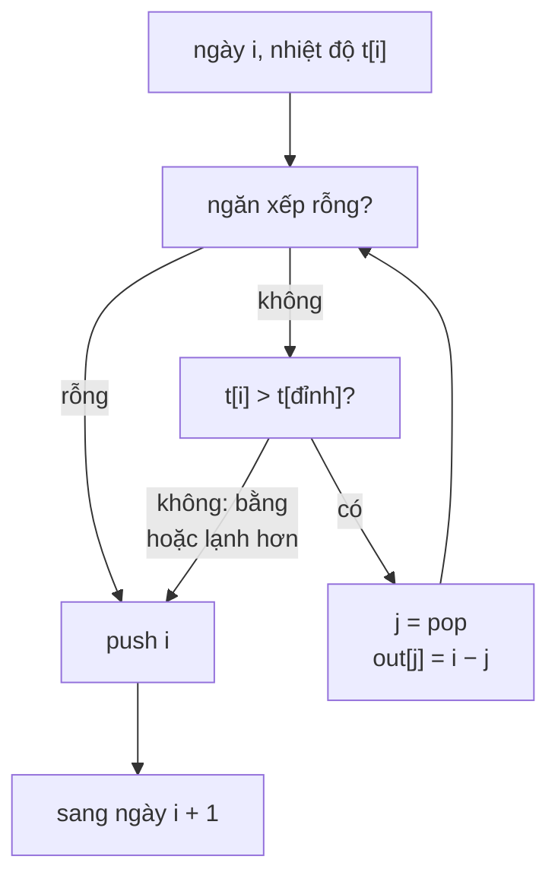

> [!tldr] Đọc nhanh
> - Đề: cho nhiệt độ từng ngày, với mỗi ngày trả số ngày phải chờ tới ngày **ấm hơn** đầu tiên; không có thì 0. Đây là bài "[[concepts/next-greater-element|phần tử lớn hơn kế tiếp]]" gốc.
> - Vét cạn: mỗi ngày đi tới trước tìm. O(n²) khi nhiệt độ giảm dần: 309 ms ở n = 40 000.
> - [[concepts/monotonic-stack|Ngăn xếp đơn điệu]]: giữ chỉ số các ngày **còn chờ**, nhiệt độ giảm dần từ đáy lên đỉnh. Ngày mới ấm hơn đỉnh thì lấy đỉnh ra và ghi đáp án cho nó. Mỗi chỉ số vào một lần, ra tối đa một lần: O(n) dù có `while` trong `for`.
> - Bẫy: dùng `>=` thay cho `>` coi ngày **bằng** nhiệt độ là ấm hơn: `[70, 70, 71]` ra `[1, 1, 0]` thay vì `[2, 1, 0]`.
> - Cách thứ ba: đi từ phải sang và **nhảy theo đáp án** đã tính, không cần ngăn xếp.

> [!info] Bối cảnh
> Bài LeetCode 739, bài neo của [[posts/2026-11-23-neetcode-monotonic-stack|ga 7: Ngăn xếp đơn điệu]] trên **tuyến NeetCode: Mảng và chuỗi**. Nó dùng [[concepts/stack|ngăn xếp]] của [[posts/2026-11-23-neetcode-stack|ga 6]] với một luật thêm: các phần tử trên ngăn xếp luôn xếp theo một chiều. Lời giải có đủ TypeScript, Python, Go, Java và JavaScript. Bạn chỉ cần biết vòng lặp, mảng và ngăn xếp.

> [!abstract]- Từ điển nhanh cho bài này (bấm để mở)
> - **Ngăn xếp (stack)**: chỉ thêm và lấy ở đỉnh, vào sau ra trước. Xem [[concepts/stack|Stack]].
> - **Đơn điệu (monotonic)**: luôn giảm (hoặc luôn tăng) theo một chiều. "Ngăn xếp đơn điệu giảm" nghĩa là đọc từ đáy lên đỉnh, giá trị không tăng.
> - **Phần tử lớn hơn kế tiếp (next greater element)**: với mỗi vị trí, phần tử đầu tiên bên phải lớn hơn nó. Xem [[concepts/next-greater-element|Next Greater Element]].
> - **Phân tích gộp**: đếm tổng số bước của cả thuật toán thay vì nhân số vòng lặp. Xem [[concepts/aggregate-analysis|Aggregate Analysis]].

## Hình dung trước: hàng người chờ nắng

Mỗi sáng có một người ra đứng ngoài sân, cầm tấm thẻ ghi nhiệt độ hôm đó. Ai cũng chờ một ngày **ấm hơn** ngày của mình rồi mới về. Người đến sau đứng **trước mặt** người đến trước, nên chỉ người đứng ngoài cùng nhìn thấy ngày mới.

| Đời thường | Khái niệm |
|---|---|
| Hàng người đang chờ, người mới nhất đứng ngoài cùng | ngăn xếp các ngày chưa có đáp án |
| Người ngoài cùng luôn có thẻ lạnh hơn hoặc bằng người phía sau | ngăn xếp đơn điệu giảm |
| Sáng nay ấm hơn thẻ của người ngoài cùng: người đó về, ghi "chờ k ngày" | `pop` và ghi `out[j] = i − j` |
| Người tiếp theo lộ ra; nếu sáng nay vẫn ấm hơn, cũng về | vòng `while` |
| Sáng nay không ấm hơn người ngoài cùng: thì cũng không ấm hơn ai phía sau, nên mình đứng vào hàng | dừng `while`, `push` ngày hôm nay |
| Hết mùa, những người còn đứng chờ không bao giờ có ngày ấm hơn | đáp án 0 |



## Vấn đề

**Đề (tóm tắt bằng lời của mình):** cho mảng `temperatures` (1 ≤ n ≤ 10⁵, mỗi giá trị 30..100), trả mảng `answer` với `answer[i]` là số ngày phải chờ sau ngày i để có ngày ấm hơn **hẳn**; không có ngày nào như vậy thì 0. Đề gốc: [LeetCode 739](https://leetcode.com/problems/daily-temperatures/).

| Input | Output |
|---|---|
| `[73, 74, 75, 71, 69, 72, 76, 73]` | `[1, 1, 4, 2, 1, 1, 0, 0]` |
| `[30, 40, 50, 60]` | `[1, 1, 1, 0]` |
| `[90, 80, 70]` | `[0, 0, 0]` |
| `[70, 70, 71]` | `[2, 1, 0]` |

Mình từng nghĩ phải "nhìn về phía trước" cho từng ngày. Hóa ra lật ngược câu hỏi thì gọn hơn: thay vì mỗi ngày đi tìm tương lai, để **mỗi ngày mới giải quyết các ngày cũ** đang chờ nó.

## Cơ chế

<figure class="figure-map" style="--ar: 3 / 4">
<div class="frame"><iframe data-archify="../diagrams/neetcode-daily-temperatures/worked-example.html" title="Ngày ấm hơn giải quyết ngày chờ" loading="lazy"></iframe></div>
<figcaption><span><b>Hình 1.</b> Ngày ấm hơn giải quyết ngày chờ.</span><a href="../diagrams/neetcode-daily-temperatures/worked-example.html" target="_blank" rel="noopener">Mở toàn màn hình</a></figcaption>
</figure>

<details>
<summary>Đọc từng bước</summary>
<ol>
<li>Ngày 0 và 1 chưa có ngày ấm hơn. <code>[72, 68, 74, 73]</code></li>
<li>Ngày 2 giải quyết ngày 1. <code>74 &gt; 68, wait = 1</code></li>
<li>Ngày 2 cũng giải quyết ngày 0. <code>74 &gt; 72, wait = 2</code></li>
<li>Hai ngày cuối giữ giá trị 0. <code>[2, 1, 0, 0]</code></li>
</ol>
</details>

### Cách 1, vét cạn: O(n²) ở ca tệ nhất

Với mỗi i, đi `j = i + 1, i + 2, …` tới khi gặp `t[j] > t[i]`. Dữ liệu ngẫu nhiên thì thường gặp sớm, nên nhanh. Dữ liệu **giảm dần** thì không ngày nào gặp, mỗi ngày quét tới cuối: n²/2 phép so sánh.

### Cách 2, ngăn xếp đơn điệu

Giữ một ngăn xếp **chỉ số** của các ngày chưa có đáp án. Đi qua từng ngày i:
1. chừng nào ngăn xếp còn và `t[i] > t[đỉnh]`: lấy đỉnh j ra, ghi `out[j] = i − j`, vì ngày i là ngày ấm hơn **đầu tiên** sau j (mọi ngày giữa j và i đều đã không giải được j);
2. đặt i lên đỉnh.

Sau bước 1, `t[i]` không lớn hơn đỉnh, nên đặt i lên vẫn giữ thứ tự giảm dần (không tăng) từ đáy lên đỉnh. Thứ tự này là lý do bước 1 dừng đúng lúc: nếu ngày i không ấm hơn đỉnh, nó cũng không ấm hơn bất kỳ ngày nào bên dưới.

Phải lưu **chỉ số**, không lưu nhiệt độ: đáp án là một khoảng cách, và nhiệt độ thì tra lại được từ chỉ số.

### Vì sao `while` trong `for` vẫn là O(n)

Đếm theo kiểu [[concepts/aggregate-analysis|phân tích gộp]]: mỗi chỉ số được `push` đúng một lần và `pop` tối đa một lần. Tổng số lần `pop` qua **mọi** vòng `while` không quá n, nên tổng công là O(n). File TypeScript đếm thật: với 10⁶ ngày ngẫu nhiên, 986 082 lần pop cộng 13 918 chỉ số còn lại trên ngăn xếp đúng bằng 10⁶.

### Cách 3, đi từ phải và nhảy theo đáp án

Đi i từ phải sang. Để tìm ngày ấm hơn i, bắt đầu ở `j = i + 1`. Nếu `t[j] ≤ t[i]` thì mọi ngày từ j tới trước ngày ấm hơn của j đều không ấm hơn j, nên cũng không ấm hơn i: nhảy thẳng `j += out[j]`. Nếu `out[j] = 0`, j không có ngày ấm hơn, nên i cũng không. Không cần ngăn xếp: O(1) bộ nhớ phụ, và vẫn O(n) theo cùng lập luận gộp.

### Đo

TypeScript, trung vị:

| n | dữ liệu | vét cạn | ngăn xếp | nhảy từ phải |
|---|---|---|---|---|
| 10 000 | giảm dần | 21,0 ms | 0,15 ms | 0,04 ms |
| 20 000 | giảm dần | 85,0 ms | 0,34 ms | 0,13 ms |
| 40 000 | giảm dần | 317,4 ms | 0,67 ms | 0,19 ms |
| 40 000 | ngẫu nhiên 30..100 | 4,8 ms | 0,62 ms | 0,52 ms |
| 10⁶ | giảm dần | (không chạy) | 19,84 ms | 5,20 ms |
| 10⁶ | ngẫu nhiên | (không chạy) | 16,70 ms | 13,12 ms |

Vét cạn trên dữ liệu giảm dần đi đúng dáng n² (gấp đôi n, gấp khoảng 4 lần thời gian). Trên dữ liệu ngẫu nhiên với chỉ 71 giá trị, ngày ấm hơn thường ở rất gần, nên vét cạn chỉ chậm hơn khoảng 8 lần: test ngẫu nhiên không bắt được ca tệ nhất. Ở 10⁶ ngày giảm dần, ngăn xếp phải giữ cả 10⁶ chỉ số, còn cách nhảy không cấp phát gì, nhanh hơn gần 4 lần.

### Bên dưới năm ngôn ngữ

| | Ngăn xếp | Bẫy riêng |
|---|---|---|
| TypeScript / JavaScript | mảng: `push`, `pop`, `stack[stack.length - 1]` hoặc `stack.at(-1)` | `stack[-1]` là `undefined`, không phải phần tử cuối; `t[undefined]` cũng `undefined` và `x > undefined` là `false`, nên lỗi không nổ ra |
| Python | `list`: `append`, `pop`, `stack[-1]` | `stack[-1]` trên list rỗng ném `IndexError`; viết `while stack and …` |
| Go | slice: `append`, `stack[:len(stack)-1]` | cấp sẵn sức chứa `make([]int, 0, n)` để `append` không phải cấp phát lại |
| Java | `ArrayDeque<Integer>`: `push`, `pop`, `peek` | đóng hộp mọi chỉ số; ngăn xếp bằng `int[]` cùng một con trỏ đỉnh nhanh hơn khoảng 12 lần trong phép đo bên dưới. Tránh `java.util.Stack` (lớp cũ, đồng bộ hóa) |

## Ví dụ chạy được

[TypeScript](../code/neetcode-daily-temperatures/daily-temperatures.ts) · [Python](../code/neetcode-daily-temperatures/daily_temperatures.py) · [Go](../code/neetcode-daily-temperatures/daily_temperatures.go) · [Java](../code/neetcode-daily-temperatures/daily-temperatures.java) · [JavaScript](../code/neetcode-daily-temperatures/daily-temperatures.js)

Mỗi file có vét cạn, ngăn xếp và cách nhảy từ phải, chạy 7 ca. Dưới đây là cách ngăn xếp và cách nhảy.

```ts
// Cách 2, ngăn xếp đơn điệu: giữ CHỈ SỐ các ngày chưa tìm được ngày ấm hơn, nhiệt độ giảm dần từ đáy lên đỉnh.
function monotonicStack(t: number[]): number[] {
  const out = new Array(t.length).fill(0);
  const stack: number[] = [];
  for (let i = 0; i < t.length; i++) {
    while (stack.length > 0 && t[i] > t[stack[stack.length - 1]]) {
      const j = stack.pop()!; // ngày j vừa gặp ngày ấm hơn đầu tiên của nó: ngày i
      out[j] = i - j;
    }
    stack.push(i);
  }
  return out; // các ngày còn trên ngăn xếp không có ngày ấm hơn: giữ 0
}

// Cách 3, đi từ phải và nhảy theo đáp án: không cần ngăn xếp, O(1) bộ nhớ phụ.
function jumpFromRight(t: number[]): number[] {
  const n = t.length;
  const out = new Array(n).fill(0);
  for (let i = n - 2; i >= 0; i--) {
    let j = i + 1;
    while (j < n && t[j] <= t[i]) {
      if (out[j] === 0) { j = n; break; } // j không có ngày ấm hơn, nên i cũng không
      j += out[j]; // nhảy thẳng tới ngày ấm hơn j
    }
    if (j < n) out[i] = j - i;
  }
  return out;
}
```

```python
def monotonic_stack(t: list[int]) -> list[int]:
    out = [0] * len(t)
    stack: list[int] = []  # chỉ số, nhiệt độ giảm dần từ đáy lên đỉnh
    for i, x in enumerate(t):
        while stack and x > t[stack[-1]]:  # stack rỗng là falsy: kiểm trước khi đọc stack[-1]
            j = stack.pop()
            out[j] = i - j
        stack.append(i)
    return out

def jump_from_right(t: list[int]) -> list[int]:
    n = len(t)
    out = [0] * n
    for i in range(n - 2, -1, -1):
        j = i + 1
        while j < n and t[j] <= t[i]:
            if out[j] == 0:
                j = n
                break
            j += out[j]
        if j < n:
            out[i] = j - i
    return out
```

```go
func monotonicStack(t []int) []int {
	out := make([]int, len(t))
	stack := make([]int, 0, len(t)) // cấp sẵn sức chứa: append không phải cấp phát lại
	for i, x := range t {
		for len(stack) > 0 && x > t[stack[len(stack)-1]] {
			j := stack[len(stack)-1]
			stack = stack[:len(stack)-1] // pop bằng cắt slice
			out[j] = i - j
		}
		stack = append(stack, i)
	}
	return out
}

func jumpFromRight(t []int) []int {
	n := len(t)
	out := make([]int, n)
	for i := n - 2; i >= 0; i-- {
		j := i + 1
		for j < n && t[j] <= t[i] {
			if out[j] == 0 {
				j = n
				break
			}
			j += out[j]
		}
		if j < n {
			out[i] = j - i
		}
	}
	return out
}
```

```java
static int[] intArrayStack(int[] t) {
    int[] out = new int[t.length], stack = new int[t.length]; // ngăn xếp bằng mảng int: không đóng hộp Integer
    int top = 0;
    for (int i = 0; i < t.length; i++) {
        while (top > 0 && t[i] > t[stack[top - 1]]) {
            int j = stack[--top];
            out[j] = i - j;
        }
        stack[top++] = i;
    }
    return out;
}

static int[] jumpFromRight(int[] t) {
    int n = t.length;
    int[] out = new int[n];
    for (int i = n - 2; i >= 0; i--) {
        int j = i + 1;
        while (j < n && t[j] <= t[i]) {
            if (out[j] == 0) { j = n; break; }
            j += out[j];
        }
        if (j < n) out[i] = j - i;
    }
    return out;
}
```

```js
function monotonicStack(t) {
  const out = new Array(t.length).fill(0);
  const stack = [];
  for (let i = 0; i < t.length; i++) {
    while (stack.length > 0 && t[i] > t[stack.at(-1)]) { // at(-1): phần tử cuối; stack[-1] là undefined
      const j = stack.pop();
      out[j] = i - j;
    }
    stack.push(i);
  }
  return out;
}

function jumpFromRight(t) {
  const n = t.length;
  const out = new Array(n).fill(0);
  for (let i = n - 2; i >= 0; i--) {
    let j = i + 1;
    while (j < n && t[j] <= t[i]) {
      if (out[j] === 0) { j = n; break; }
      j += out[j];
    }
    if (j < n) out[i] = j - i;
  }
  return out;
}
```


```text
$ node daily-temperatures.ts
bruteForce      7/7 ca đúng
monotonicStack  7/7 ca đúng
jumpFromRight   7/7 ca đúng
popOnEqual      6/7 ca đúng; sai ở [70,70,71] → [1,1,0]

n        dữ liệu      vét cạn   ngăn xếp   nhảy từ phải   (ms, trung vị)
10000    giảm dần        21.0       0.15           0.04
10000    ngẫu nhiên       0.4       0.14           0.11
20000    giảm dần        85.0       0.34           0.13
20000    ngẫu nhiên       1.7       0.30           0.26
40000    giảm dần       317.4       0.67           0.19
40000    ngẫu nhiên       4.8       0.62           0.52
1000000  giảm dần           —      19.84           5.20
1000000  ngẫu nhiên         —      16.70          13.12

n = 1000000 ngẫu nhiên: 986082 lần pop, 13918 chỉ số còn lại trên ngăn xếp (tổng = n)
```

Bản `popOnEqual` dùng `>=`: ngày 0 (70°) bị ngày 1 (cũng 70°) lấy ra với đáp án 1, trong khi ngày ấm hơn thật là ngày 2. Sáu ca còn lại không có hai ngày bằng nhau đứng cạnh, nên bản sai vẫn qua.

File Java có thêm một ngăn xếp bằng mảng `int[]`, rồi đo hai cách (một lần chạy sau 3 vòng khởi động JIT, chỉ nên xem như cỡ độ lớn):

```text
$ java daily-temperatures.java
bruteForce      7/7 ca đúng
monotonicStack  7/7 ca đúng
intArrayStack   7/7 ca đúng
jumpFromRight   7/7 ca đúng

n = 1000000 giảm dần: ArrayDeque<Integer> 13.1 ms, int[] 1.1 ms
```

Python, Go và JavaScript in `7/7 ca đúng` cho cả ba cách. File Python đo thêm ở n = 10⁵ (giới hạn của đề), dữ liệu giảm dần: ngăn xếp 4,8 ms, cách nhảy 4,5 ms.

## Hiểu lầm và bẫy hay gặp

- **"Vòng `while` trong vòng `for` là O(n²)."** Đếm tổng số lần `pop`: không quá n. Xem phép đếm ở trên.
- **Dùng `>=` thay cho `>`.** Đề hỏi ấm hơn **hẳn**. Ngày bằng nhiệt độ phải ở lại ngăn xếp.
- **Lưu nhiệt độ thay vì chỉ số.** Không tính được khoảng cách `i − j`. Lưu chỉ số, tra nhiệt độ bằng `t[j]`.
- **Quên rằng ngày còn trên ngăn xếp có đáp án 0.** Khởi tạo mảng đáp án bằng 0 thì không phải làm gì thêm.
- **Kiểm tra bằng dữ liệu ngẫu nhiên.** Vét cạn chỉ chậm hơn 10 lần trên dữ liệu ngẫu nhiên, nhưng chậm hơn 400 lần trên dữ liệu giảm dần. Ca tệ nhất phải được dựng có chủ đích.
- **JS: `stack[-1]`.** Mảng JS không có chỉ số âm; `stack[-1]` là `undefined` và mọi phép so sánh với nó là `false`, nên vòng `while` không bao giờ chạy và mọi đáp án là 0. Dùng `stack.at(-1)`.

## Câu hỏi tự kiểm tra

> [!question]- Chạy ngăn xếp trên `[50, 40, 45, 60]`, ghi ngăn xếp sau mỗi ngày.
> Ngày 0: `[0]`. Ngày 1 (40 ≤ 50): `[0, 1]`. Ngày 2 (45 > 40): lấy 1, `out[1] = 1`; 45 ≤ 50, ngăn xếp `[0, 2]`. Ngày 3 (60): lấy 2, `out[2] = 1`; lấy 0, `out[0] = 3`; ngăn xếp `[3]`. Đáp án `[3, 1, 1, 0]`.

> [!question]- Vì sao khi ngày i không ấm hơn đỉnh, ta dừng mà không cần xem các ngày bên dưới?
> Ngăn xếp giảm dần từ đáy lên đỉnh, nên mọi ngày bên dưới đều ấm hơn hoặc bằng đỉnh. Không ấm hơn đỉnh thì không ấm hơn ai bên dưới.

> [!question]- Đổi đề: tìm ngày **lạnh hơn** kế tiếp. Đổi gì?
> Đổi dấu so sánh thành `t[i] < t[đỉnh]`; ngăn xếp thành đơn điệu **tăng** từ đáy lên đỉnh.

> [!question]- Ở cách nhảy từ phải, vì sao `out[j] = 0` nghĩa là i cũng không có ngày ấm hơn?
> Ta chỉ tới j khi `t[j] ≤ t[i]` hoặc đang nhảy qua các ngày không ấm hơn i. j không có ngày ấm hơn nghĩa là mọi ngày sau j đều ≤ `t[j]` ≤ `t[i]`.

## Tham khảo

- [LeetCode 739: Daily Temperatures](https://leetcode.com/problems/daily-temperatures/) (đề gốc)
- [Java 21 `ArrayDeque`](https://docs.oracle.com/en/java/javase/21/docs/api/java.base/java/util/ArrayDeque.html) (khuyên dùng thay cho `Stack` khi cần ngăn xếp)
- [MDN: `Array.prototype.at`](https://developer.mozilla.org/en-US/docs/Web/JavaScript/Reference/Global_Objects/Array/at) (chỉ số âm đếm từ cuối)
- Cormen, Leiserson, Rivest, Stein, *Introduction to Algorithms*, chương "Amortized Analysis" (ví dụ ngăn xếp có `MULTIPOP`, cùng lập luận gộp)
