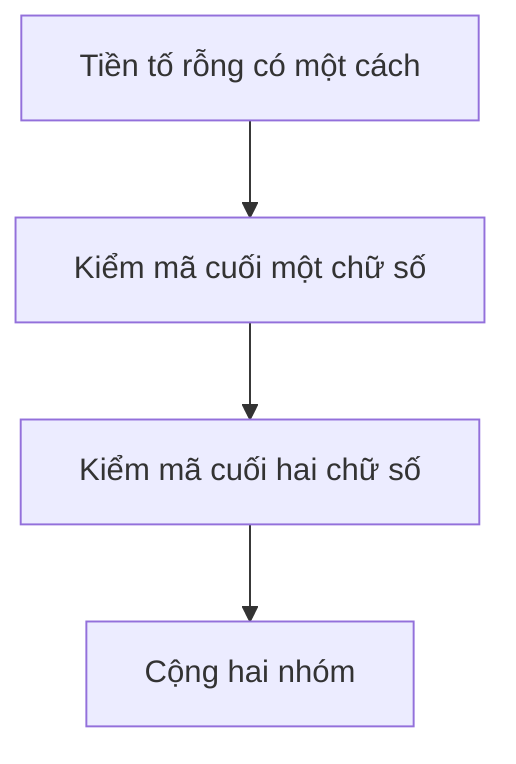

> [!tldr] Đọc nhanh
> - `dp[i]` đếm cách giải mã `i` ký tự đầu. Có thể kết thúc bằng mã một chữ số hoặc hai chữ số.
> - Một chữ số 0 phải đi cùng 1 hoặc 2 ở ngay trước để tạo `10` hoặc `20`.
> - Mỗi bước chỉ đọc hai tiền tố cũ, nên hai biến thay được cả bảng.

> [!info] Bối cảnh
> Bài LeetCode 91, thuộc [[posts/2026-11-27-neetcode-linear-dp|ga 1: Truy hồi một chiều]] trên tuyến NeetCode Quy hoạch động. Bạn chỉ cần biết vòng lặp và mảng để bắt đầu.

> [!abstract]- Từ điển nhanh cho bài này (bấm để mở)
> - Tiền tố là đoạn tính từ đầu chuỗi.
> - Trạng thái DP cho biết mình đang đếm đối tượng nào cho một bài toán con.
> - Mã hai chữ số hợp lệ khi nó từ 10 đến 26.

## Hình dung trước: xé phiếu số thành mã từ điển

Một cuộn vé in `11204`. Mỗi miếng cắt ghi một mã chữ cái. Mình có thể cắt `1 | 1 | 20 | 4` hoặc `11 | 20 | 4`. Cắt `1 | 12 | 04` bị loại vì danh mục không có mã `04`.

| Đời thường | Khái niệm |
| --- | --- |
| Vạch cắt sau i chữ số | Trạng thái dp[i] |
| Mã cuối có một chữ số | Kéo dài một cách của dp[i − 1] |
| Mã cuối có hai chữ số | Kéo dài một cách của dp[i − 2] |



## Vấn đề: đếm số cách tách mã hợp lệ

Chuỗi dài từ 1 đến 100, gồm chữ số thập phân. Mỗi nhóm được ánh xạ từ số 1 đến 26 sang một chữ cái; nhóm không có số 0 ở đầu. Trả số cách phân nhóm hết chuỗi, vừa số nguyên có dấu 32 bit theo đề.

## Cơ chế

### Xét các cách cắt

Đệ quy thử cắt 1 hoặc 2 chữ số hợp lệ ở đầu phần còn lại. Chuỗi toàn `1` cho cây nhánh Fibonacci, O(2ⁿ) là một cận trên, và ngăn xếp sâu O(n). Ghi nhớ số cách theo vị trí biến bài toán thành O(n) thời gian, O(n) bộ nhớ.

### Tính từ trái sang phải

`dp[0] = 1` vì có đúng một cách cắt chuỗi rỗng thành không miếng. Với chữ số cuối khác 0, nối nó vào mỗi cách của `dp[i − 1]`. Nếu hai chữ số cuối hợp lệ, nối cặp đó vào mỗi cách của `dp[i − 2]`. Hai nhóm không trùng vì độ dài mã cuối khác nhau.

Với `11204`, dòng `dp` theo độ dài từ 0 tới 5 là `1, 1, 2, 3, 2, 2`. Khi đọc `0`, nhánh một ký tự mất, chỉ nhánh `20` sống. Khi một tiền tố có 0 cách, vòng lặp có thể dừng ngay. Nếu mới đọc một chữ số khác 0 với tiền tố trước còn hợp lệ, nhánh một chữ số luôn tồn tại. Trường hợp còn lại là một số 0 không ghép được với bên trái, cũng không mở đầu mã cho bên phải.

Mỗi bước giữ hai số đếm cũ thay cả bảng, nên O(n) thời gian và O(1) ô nhớ. Đề chỉ giới hạn **đáp án cuối**. Một tiền tố rất dài vẫn có thể bùng số cách rồi chết ở số 0. Các bản dùng số nguyên cố định chặn mỗi ô ở `2³¹ − 1`, hoặc dùng phép cộng bão hòa. Phép cộng các số không âm giao hoán với chặn trên, nên đáp án cuối còn nguyên khi đề bảo đảm nó vừa miền. Python giữ số nguyên chính xác.

Với 18 ký tự `1`, file TypeScript đếm 10.945 lời gọi đệ quy, so với 18 bước cập nhật DP. 200 chuỗi ngẫu nhiên ngắn cũng khớp giữa hai cách.

## Ví dụ chạy được

[TypeScript](../code/neetcode-decode-ways/decode-count.ts) · [Python](../code/neetcode-decode-ways/decode_count.py) · [Go](../code/neetcode-decode-ways/decode_count.go) · [Java](../code/neetcode-decode-ways/decode-count.java) · [JavaScript](../code/neetcode-decode-ways/decode-count.js) · [PHP](../code/neetcode-decode-ways/decode-count.php) · [Rust](../code/neetcode-decode-ways/decode_count.rs)

Tab hiển thị hàm chính. File tải về còn chạy các cách so sánh trên những ca nhỏ. File TypeScript chạy thêm phép đối chiếu ngẫu nhiên.

```ts
function decodeCount(s: string): number {
  let beforePrevious = 0
  let previous = 1
  for (let i = 0; i < s.length; i++) {
    let current = s[i] === "0" ? 0 : previous
    if (i > 0 && (s[i - 1] === "1" || (s[i - 1] === "2" && s[i] <= "6"))) {
      current += beforePrevious
    }
    if (current === 0) return 0
    beforePrevious = previous
    previous = Math.min(current, 2_147_483_647)
  }
  return previous
}
```

```python
def decode_count(s):
    before_previous, previous = 0, 1
    for i, digit in enumerate(s):
        current = 0 if digit == "0" else previous
        if i > 0 and (s[i - 1] == "1" or (s[i - 1] == "2" and digit <= "6")):
            current += before_previous
        if current == 0:
            return 0
        before_previous, previous = previous, current
    return previous
```

```go
func decodeCount(s string) int {
	beforePrevious, previous := int64(0), int64(1)
	for i := 0; i < len(s); i++ {
		current := int64(0)
		if s[i] != '0' {
			current = previous
		}
		if i > 0 && (s[i-1] == '1' || (s[i-1] == '2' && s[i] <= '6')) {
			current += beforePrevious
		}
		if current == 0 {
			return 0
		}
		beforePrevious, previous = previous, min(current, 2_147_483_647)
	}
	return int(previous)
}
```

```java
static int decodeCount(String digits) {
    long beforePrevious = 0, previous = 1;
    for (int i = 0; i < digits.length(); i++) {
        char digit = digits.charAt(i);
        long current = digit == '0' ? 0 : previous;
        if (i > 0 && (digits.charAt(i - 1) == '1' || (digits.charAt(i - 1) == '2' && digit <= '6'))) {
            current += beforePrevious;
        }
        if (current == 0) return 0;
        if (current > Integer.MAX_VALUE) current = Integer.MAX_VALUE;
        beforePrevious = previous;
        previous = current;
    }
    return (int) previous;
}
```

```js
function decodeCount(s) {
  let beforePrevious = 0
  let previous = 1
  for (let i = 0; i < s.length; i++) {
    let current = s[i] === "0" ? 0 : previous
    if (i > 0 && (s[i - 1] === "1" || (s[i - 1] === "2" && s[i] <= "6"))) {
      current += beforePrevious
    }
    if (current === 0) return 0
    beforePrevious = previous
    previous = Math.min(current, 2_147_483_647)
  }
  return previous
}
```

```php
function decodeCount(string $digits): int {
    $beforePrevious = 0;
    $previous = 1;
    for ($i = 0; $i < strlen($digits); $i++) {
        $digit = $digits[$i];
        $current = $digit === '0' ? 0 : $previous;
        if ($i > 0 && ($digits[$i - 1] === '1' || ($digits[$i - 1] === '2' && $digit <= '6'))) {
            $current += $beforePrevious;
        }
        if ($current === 0) {
            return 0;
        }
        $beforePrevious = $previous;
        $previous = min($current, 2147483647);
    }
    return $previous;
}
```

```rust
fn decode_count(s: &str) -> i32 {
    let bytes = s.as_bytes();
    let (mut before_previous, mut previous) = (0_i32, 1_i32);
    for (i, &digit) in bytes.iter().enumerate() {
        let mut current = if digit == b'0' { 0 } else { previous };
        if i > 0 && (bytes[i - 1] == b'1' || (bytes[i - 1] == b'2' && digit <= b'6')) {
            current = current.saturating_add(before_previous);
        }
        if current == 0 {
            return 0;
        }
        (before_previous, previous) = (previous, current);
    }
    previous
}
```

```text
10/10 ca đúng
201/201 ca đối chiếu; 18 chữ số 1: DFS 10945 lời gọi, DP 18 bước
```

## Hiểu lầm và bẫy hay gặp

- **Đọc `07` thành 7.** Đó là mã có số 0 đứng đầu, kể cả khi parse ra một số trong bảng.
- **Cho `dp[0] = 0`.** Sau mã hợp lệ đầu tiên sẽ không còn đường để đếm.
- **Cộng nhánh hai chữ số khi chỉ kiểm `<= 26`.** Cần đủ hai chữ số và giá tối thiểu 10.
- **Để tràn số đếm tiền tố.** Rust dùng `saturating_add`. Các ngôn ngữ dùng số cố định khác tính với kiểu đủ rộng rồi chặn.

## Câu hỏi tự kiểm tra

> [!question]- Chuỗi `100` có mấy cách?
> 0. Cắt `10` thì còn lại số 0 đứng một mình.

> [!question]- Vì sao `27` có đúng một cách?
> `2` và `7` đều hợp lệ. `27` nằm ngoài từ điển.

## Tham khảo

- [LeetCode 91 · Decode Ways](https://leetcode.com/problems/decode-ways/)
- [MIT 6.006 · Dynamic Programming](https://ocw.mit.edu/courses/6-006-introduction-to-algorithms-spring-2020/resources/lecture-notes/)
