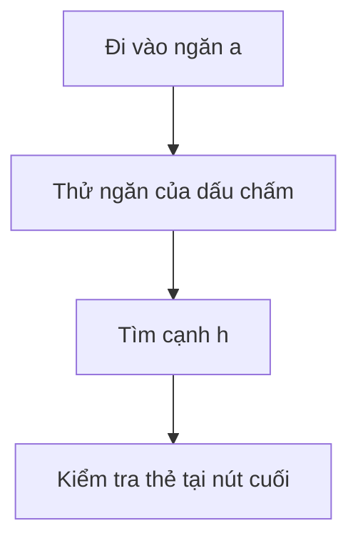

> [!tldr] Đọc nhanh
> - Dấu chấm khớp đúng một chữ. Từ khớp phải có cùng độ dài với mẫu.
> - Cách đối chứng gom các từ theo độ dài và quét đúng nhóm, so từng vị trí cho tới chỗ sai.
> - Trie theo một cạnh khi mẫu cho chữ cụ thể và thử các cạnh có sẵn khi gặp dấu chấm. Hết mẫu thì kiểm tra dấu kết thúc từ.
> - Với `d` dấu chấm, một độ sâu có tối đa `26^d` trạng thái. Đề giới hạn `d ≤ 2`, nhưng chi phí thực còn phụ thuộc tiền tố nào có trong cây.

> [!info] Bối cảnh
> Bài LeetCode 211 (Medium), thuộc [[posts/2026-11-26-neetcode-trie|ga 7: Trie]] trên **tuyến NeetCode: Cấu trúc liên kết**. Ở [[problems/implement-trie-prefix-tree|LeetCode 208]], mỗi bước biết chính xác cần đi chữ nào. Lần này mẫu có thể bỏ ngỏ một chữ, nên mình phải thử nhiều đường rồi dùng phần còn lại của mẫu để chọn. Bạn chỉ cần biết cách đọc một chuỗi từ trái sang phải.

> [!abstract]- Từ điển nhanh cho bài này (bấm để mở)
> - **Tiền tố** là đoạn đầu của từ, như `ap` trong `ape`.
> - **Trie** là cây mà đường từ gốc qua các cạnh tạo thành một tiền tố. Xem [[concepts/trie|Trie]].
> - **Dấu kết thúc từ** (`terminal`) cho biết tiền tố tại nút là một từ đã thêm. Xem [[concepts/terminal-marker|Terminal Marker]].
> - **Ký tự đại diện** ở đây là dấu chấm, khớp đúng một chữ cái. Xem [[concepts/wildcard-branching|Wildcard Branching]].
> - **Cắt nhánh theo tiền tố** là dừng khi phần đầu đã chọn không dẫn đến từ nào. Xem [[concepts/trie-prefix-pruning|Trie Prefix Pruning]].

## Hình dung trước: lần theo ngăn hồ sơ

Tưởng tượng một tủ hồ sơ nhiều tầng. Ở mỗi tầng, nhãn chữ cái dẫn tới ngăn kế tiếp. Một thẻ có thể được đặt ngay tại ngăn đang đứng, trong khi ngăn ấy vẫn mở lối tới những hồ sơ có nhãn dài hơn. Mình cầm phiếu `a.h`, đi theo nhãn `a`, thử từng ngăn ở tầng giữa, rồi tìm ngăn `h` ở tầng cuối.

| Đời thường | Khái niệm |
|---|---|
| Chọn một ngăn có nhãn đã biết | đi theo cạnh của chữ cụ thể |
| Phiếu bỏ ngỏ nhãn của một tầng | thử từng cạnh con có sẵn |
| Một ngăn không có lối cần đi | cắt nhánh theo tiền tố |
| Hết phiếu, tìm tấm thẻ đặt tại chỗ | kiểm tra dấu kết thúc từ |



## Vấn đề: tìm một từ khớp toàn bộ mẫu

Từ điển bắt đầu rỗng và nhận hai thao tác xen kẽ: `addWord(word)` lưu một từ, `search(pattern)` trả về có hay không ít nhất một từ khớp. Mỗi từ hay mẫu dài từ 1 đến 25. Từ đã thêm chỉ chứa chữ thường tiếng Anh, còn mẫu có thể chứa tối đa hai dấu chấm. Tổng số lần gọi hai thao tác tối đa 10.000. [Đề gốc trên LeetCode](https://leetcode.com/problems/design-add-and-search-words-data-structure/)

Với danh sách `ape`, `ash`, `cape`, `caper`, `cave`, `dawn`, `dusk`, mẫu `a.h` khớp `ash`. Mẫu `a.z` thất bại vì hai nhánh này thiếu cạnh đến `z`. Mẫu `ap` cũng thất bại dù mình đi hết được hai cạnh, vì từ đã lưu là `ape`.

## Cơ chế

<figure class="figure-map" style="--ar: 3 / 4">
<div class="frame"><iframe data-archify="../diagrams/neetcode-design-add-and-search-words-data-structure/worked-example.html" title="Dấu chấm thử đúng một cạnh đang có" loading="lazy"></iframe></div>
<figcaption><span><b>Hình 1.</b> Dấu chấm thử đúng một cạnh đang có.</span><a href="../diagrams/neetcode-design-add-and-search-words-data-structure/worked-example.html" target="_blank" rel="noopener">Mở toàn màn hình</a></figcaption>
</figure>

<details>
<summary>Đọc từng bước</summary>
<ol>
<li>Lưu hai từ có chung chữ đầu. <code>&quot;cap&quot;, &quot;cot&quot;</code></li>
<li>Chữ c đầu tiên chọn đúng một nhánh. <code>pattern = &quot;c.t&quot;</code></li>
<li>Dấu chấm thử a rồi o. <code>ca has no t; co → t</code></li>
<li>Nút cot có dấu hết từ. <code>true</code></li>
</ol>
</details>

### Quét nhóm có cùng độ dài

Mình gom từ vào các tập theo độ dài. Khi nhận mẫu dài `L`, mình mở đúng nhóm `L`, rồi so từng từ với mẫu từ đầu tới cuối. Một dấu chấm luôn cho phép đi tiếp một vị trí. Một chữ cụ thể khác chữ trong từ làm dừng lần so đó. Nếu đã so đủ `L` vị trí, kết quả là `true`. Nhóm thiếu hoặc mọi từ đều không khớp thì trả `false`.

Gọi `n_L` là số từ phân biệt trong nhóm dài `L`. Một truy vấn cần tối đa `n_L × L` lần kiểm tra vị trí, với thời gian kỳ vọng `O(1 + n_L·L)` nếu truy cập bảng băm theo độ dài là `O(1)`. Dừng ở ký tự sai đầu tiên giúp giảm việc thực tế. Thêm một từ dài `m` dùng thời gian kỳ vọng `O(m)` tính cả việc băm từ. Tổng dung lượng chữ của các từ phân biệt là `S` nên phần lưu trữ là `O(S)`; một truy vấn dùng `O(1)` bộ nhớ phụ.

### Trie theo từng tiền tố khả dĩ

Mỗi trạng thái tìm kiếm là `(node, index)`. Đường đến `node` có đúng `index` chữ và khớp với `index` vị trí đầu của mẫu. Thêm từ là đi qua hoặc tạo một cạnh cho mỗi chữ, rồi bật `terminal` tại điểm dừng.

| Khi tìm | Bước kế tiếp |
|---|---|
| Đã đọc đủ `L` vị trí | trả cờ `terminal` tại nút hiện thời |
| Gặp chữ cụ thể | theo cạnh đó nếu có, nếu thiếu thì trả `false` ở nhánh này |
| Gặp dấu chấm | thử mỗi cạnh con có sẵn với `index + 1`, dừng ngay khi một nhánh trả `true` |

Ví dụ, với `a.h`, phải đi cạnh `a` trước. Dấu chấm mở hai đường qua `p` hoặc `s`. Đường qua `p` không có cạnh `h`; đường qua `s` có cạnh `h`, và nút `ash` được đánh dấu kết thúc. Một nhánh false chỉ nói rằng đường qua ngăn đó thất bại, nên mình vẫn thử nhánh kế tiếp. Ngăn hồ sơ giúp thấy vì sao thất bại ở nhánh `p` không cho mình kết luận về ngăn `s`.

Bất biến đúng ở gốc vì chưa đọc ký tự nào. Mỗi lần đi cạnh, chữ trên cạnh được mẫu cho phép, nên bất biến giữ được. Với mọi từ khớp, từng cạnh của nó đều nằm trong các lựa chọn được xét khi tìm, nên nếu chưa gặp đáp án trước đó thì quá trình sẽ đến nút kết thúc của từ ấy. Đây là phép tìm tồn tại, vì vậy có thể dừng ở lần thành công đầu tiên. Princeton trình bày cùng quy tắc dấu chấm trong một phép tìm liệt kê mọi từ khớp. [Princeton Algorithms, TrieSET](https://algs4.cs.princeton.edu/code/javadoc/edu/princeton/cs/algs4/TrieSET.html)

### Chi phí phân nhánh

Gọi `A = 26`, `d` là số dấu chấm và `N` là tổng số nút Trie kể cả gốc. Ở độ sâu `i`, mỗi dấu chấm đã đọc tạo tối đa `A` lựa chọn, còn mỗi chữ cụ thể tạo tối đa một. Do đó số trạng thái thực tế `V` không vượt quá cả `N` lẫn `(L + 1)·A^d`. Với bảng con tra kỳ vọng `O(1)` và chỉ duyệt các cạnh đã tạo, thời gian kỳ vọng là `O(V)` trong bảng chữ cái cố định này. Tức là tìm đúng chữ hết `O(L)`, còn tối đa hai dấu chấm có thể tạo tới 676 đường khác nhau tại một độ sâu. Nếu cả hai dấu chấm nằm muộn, những độ sâu trước đó ít rẽ nhánh hơn. Nếu câu hỏi cho phép số dấu chấm tăng theo độ dài mẫu, số tiền tố cần xét có thể tăng theo hàm mũ tới khi chạm giới hạn số nút đã lưu.

Trie thêm từ dài `m` trong thời gian kỳ vọng `O(m)`, lưu `O(N)` nút và cạnh, và tìm sâu dùng `O(L)` ngăn xếp. Các tiền tố dùng chung giúp giảm số nút cần tạo, nhưng từng nút và bảng con có chi phí riêng. Nếu số truy vấn ít hoặc mỗi nhóm độ dài có rất ít từ, phép quét giữ cấu trúc nhỏ và vẫn có thể kết thúc nhanh.

### Đo việc làm trên một mẫu thất bại

Tạo 1.000 từ bốn chữ phân biệt, tất cả bắt đầu bằng `a`. Ba chữ sau là bộ đếm cơ số 26 bắt đầu từ `aaa`. Hỏi `za..` với cả hai cấu trúc.

| Cấu trúc | Đơn vị đếm | Kết quả |
|---|---|---:|
| Quét nhóm dài bốn | một vị trí được kiểm tra trong một từ | 1.000 |
| Trie | một lần vào hàm với cặp nút và chỉ số | 1 |

Cả hai trả `false`. Lượt quét loại từng từ ở chữ đầu. Trie tra đúng một cạnh `z` ở gốc và dừng vì cạnh thiếu, trước khi tới hai dấu chấm. Đơn vị đếm khác nhau, nên mình dùng chúng để thấy chỗ bỏ được việc, không diễn giải thành tỷ lệ thời gian. Mẫu có dấu chấm gần đầu và nhiều tiền tố hợp lệ có thể cho kết quả khác.

## Ví dụ chạy được

Mỗi bản giữ hai cấu trúc độc lập, chạy cùng 12 ca theo thứ tự, rồi tự kiểm tra số đếm của phép đo. Các ca gồm từ điển rỗng, tiền tố chưa là từ, hai dấu chấm, một nhánh thất bại trước nhánh thành công theo thứ tự chèn, đánh dấu một tiền tố sau khi thêm từ dài hơn và thêm trùng một từ.

Tải mã [TypeScript](../code/neetcode-design-add-and-search-words-data-structure/word-dictionary.ts), [Python](../code/neetcode-design-add-and-search-words-data-structure/word_dictionary.py), [Go](../code/neetcode-design-add-and-search-words-data-structure/word_dictionary.go), [Java](../code/neetcode-design-add-and-search-words-data-structure/word-dictionary.java) hoặc [JavaScript](../code/neetcode-design-add-and-search-words-data-structure/word-dictionary.js).

Chạy trực tiếp bằng `node word-dictionary.ts`, `python3 word_dictionary.py`, `go run word_dictionary.go`, `java word-dictionary.java` hoặc `node word-dictionary.js`.

```ts
class LengthDictionary {
  private words = new Map<number, Set<string>>()
  comparisons = 0

  addWord(word: string) {
    let bucket = this.words.get(word.length)
    if (bucket === undefined) {
      bucket = new Set()
      this.words.set(word.length, bucket)
    }
    bucket.add(word)
  }

  search(pattern: string): boolean {
    this.comparisons = 0
    for (const word of this.words.get(pattern.length) ?? []) {
      let index = 0
      for (; index < pattern.length; index++) {
        this.comparisons++
        if (pattern[index] !== "." && pattern[index] !== word[index]) break
      }
      if (index === pattern.length) return true
    }
    return false
  }
}

class TrieNode {
  children = new Map<string, TrieNode>()
  terminal = false
}

class WordDictionary {
  private root = new TrieNode()
  visits = 0

  addWord(word: string) {
    let node = this.root
    for (const char of word) {
      let child = node.children.get(char)
      if (child === undefined) {
        child = new TrieNode()
        node.children.set(char, child)
      }
      node = child
    }
    node.terminal = true
  }

  search(pattern: string): boolean {
    this.visits = 0
    const match = (node: TrieNode, index: number): boolean => {
      this.visits++
      if (index === pattern.length) return node.terminal
      const char = pattern[index]
      if (char !== ".") {
        const child = node.children.get(char)
        return child !== undefined && match(child, index + 1)
      }
      for (const child of node.children.values()) {
        if (match(child, index + 1)) return true
      }
      return false
    }
    return match(this.root, 0)
  }
}

const queries = [
  ["", ".", false],
  ["ape ash cape caper cave dawn dusk", "ape", true],
  ["", "ap", false],
  ["", "a.h", true],
  ["", "a.z", false],
  ["", ".a.e", true],
  ["", "..wk", false],
  ["", "ca..r", true],
  ["", "cap.", true],
  ["", ".a", false],
  ["cap", "cap", true],
  ["cape", "cape", true],
] as const
const scan = new LengthDictionary()
const trie = new WordDictionary()
for (const [added, pattern, expected] of queries) {
  for (const dictionary of [scan, trie]) {
    if (added) for (const word of added.split(" ")) dictionary.addWord(word)
    if (dictionary.search(pattern) !== expected) throw new Error(pattern)
  }
}

const scanProbe = new LengthDictionary()
const trieProbe = new WordDictionary()
for (let value = 0; value < 1000; value++) {
  const word = "a" + String.fromCharCode(
    97 + Math.floor(value / 676),
    97 + Math.floor(value / 26) % 26,
    97 + value % 26,
  )
  scanProbe.addWord(word)
  trieProbe.addWord(word)
}
if (scanProbe.search("za..") || trieProbe.search("za..")) throw new Error("za..")
if (scanProbe.comparisons !== 1000 || trieProbe.visits !== 1) throw new Error("work")
console.log(`${queries.length}/${queries.length} ca đúng`)
console.log(`So sánh khi quét: ${scanProbe.comparisons}, trạng thái Trie: ${trieProbe.visits}`)
```
```python
class LengthDictionary:
    def __init__(self):
        self.words = {}
        self.comparisons = 0

    def add_word(self, word):
        bucket = self.words.get(len(word))
        if bucket is None:
            bucket = set()
            self.words[len(word)] = bucket
        bucket.add(word)

    def search(self, pattern):
        self.comparisons = 0
        for word in self.words.get(len(pattern), ()):
            for actual, expected in zip(word, pattern):
                self.comparisons += 1
                if expected != "." and actual != expected:
                    break
            else:
                return True
        return False


class TrieNode:
    def __init__(self):
        self.children = {}
        self.terminal = False


class WordDictionary:
    def __init__(self):
        self.root = TrieNode()
        self.visits = 0

    def add_word(self, word):
        node = self.root
        for char in word:
            child = node.children.get(char)
            if child is None:
                child = TrieNode()
                node.children[char] = child
            node = child
        node.terminal = True

    def search(self, pattern):
        self.visits = 0

        def match(node, index):
            self.visits += 1
            if index == len(pattern):
                return node.terminal
            char = pattern[index]
            if char != ".":
                child = node.children.get(char)
                return child is not None and match(child, index + 1)
            return any(match(child, index + 1) for child in node.children.values())

        return match(self.root, 0)


queries = [
    ("", ".", False),
    ("ape ash cape caper cave dawn dusk", "ape", True),
    ("", "ap", False),
    ("", "a.h", True),
    ("", "a.z", False),
    ("", ".a.e", True),
    ("", "..wk", False),
    ("", "ca..r", True),
    ("", "cap.", True),
    ("", ".a", False),
    ("cap", "cap", True),
    ("cape", "cape", True),
]
scan = LengthDictionary()
trie = WordDictionary()
for added, pattern, expected in queries:
    for dictionary in (scan, trie):
        for word in added.split():
            dictionary.add_word(word)
        if dictionary.search(pattern) != expected:
            raise AssertionError(pattern)

scan_probe = LengthDictionary()
trie_probe = WordDictionary()
for value in range(1000):
    word = "a" + "".join(chr(97 + digit) for digit in (value // 676, value // 26 % 26, value % 26))
    scan_probe.add_word(word)
    trie_probe.add_word(word)
if scan_probe.search("za..") or trie_probe.search("za.."):
    raise AssertionError("za..")
if (scan_probe.comparisons, trie_probe.visits) != (1000, 1):
    raise AssertionError("work")
print(f"{len(queries)}/{len(queries)} ca đúng")
print(f"So sánh khi quét: {scan_probe.comparisons}, trạng thái Trie: {trie_probe.visits}")
```
```go
package main

import (
	"fmt"
	"strings"
)

type lengthDictionary struct {
	words       map[int]map[string]struct{}
	comparisons int
}

func (d *lengthDictionary) addWord(word string) {
	bucket := d.words[len(word)]
	if bucket == nil {
		bucket = make(map[string]struct{})
		d.words[len(word)] = bucket
	}
	bucket[word] = struct{}{}
}

func (d *lengthDictionary) search(pattern string) bool {
	d.comparisons = 0
	for word := range d.words[len(pattern)] {
		index := 0
		for ; index < len(pattern); index++ {
			d.comparisons++
			if pattern[index] != '.' && pattern[index] != word[index] {
				break
			}
		}
		if index == len(pattern) {
			return true
		}
	}
	return false
}

type trieNode struct {
	children map[byte]*trieNode
	terminal bool
}

type wordDictionary struct {
	root   trieNode
	visits int
}

func (d *wordDictionary) addWord(word string) {
	node := &d.root
	for index := 0; index < len(word); index++ {
		char := word[index]
		child := node.children[char]
		if child == nil {
			if node.children == nil {
				node.children = make(map[byte]*trieNode)
			}
			child = &trieNode{}
			node.children[char] = child
		}
		node = child
	}
	node.terminal = true
}

func (d *wordDictionary) search(pattern string) bool {
	d.visits = 0
	var match func(*trieNode, int) bool
	match = func(node *trieNode, index int) bool {
		d.visits++
		if index == len(pattern) {
			return node.terminal
		}
		char := pattern[index]
		if char != '.' {
			child := node.children[char]
			return child != nil && match(child, index+1)
		}
		for _, child := range node.children {
			if match(child, index+1) {
				return true
			}
		}
		return false
	}
	return match(&d.root, 0)
}

func main() {
	queries := []struct {
		added    string
		pattern  string
		expected bool
	}{
		{"", ".", false},
		{"ape ash cape caper cave dawn dusk", "ape", true},
		{"", "ap", false},
		{"", "a.h", true},
		{"", "a.z", false},
		{"", ".a.e", true},
		{"", "..wk", false},
		{"", "ca..r", true},
		{"", "cap.", true},
		{"", ".a", false},
		{"cap", "cap", true},
		{"cape", "cape", true},
	}
	scan := lengthDictionary{words: make(map[int]map[string]struct{})}
	trie := wordDictionary{}
	for _, query := range queries {
		for _, word := range strings.Fields(query.added) {
			scan.addWord(word)
			trie.addWord(word)
		}
		if scan.search(query.pattern) != query.expected || trie.search(query.pattern) != query.expected {
			panic(query.pattern)
		}
	}

	scanProbe := lengthDictionary{words: make(map[int]map[string]struct{})}
	trieProbe := wordDictionary{}
	for value := 0; value < 1000; value++ {
		word := string([]byte{'a', byte(97 + value/676), byte(97 + value/26%26), byte(97 + value%26)})
		scanProbe.addWord(word)
		trieProbe.addWord(word)
	}
	if scanProbe.search("za..") || trieProbe.search("za..") {
		panic("za..")
	}
	if scanProbe.comparisons != 1000 || trieProbe.visits != 1 {
		panic("work")
	}
	fmt.Printf("%d/%d ca đúng\n", len(queries), len(queries))
	fmt.Printf("So sánh khi quét: %d, trạng thái Trie: %d\n", scanProbe.comparisons, trieProbe.visits)
}
```
```java
import java.util.HashMap;
import java.util.HashSet;
import java.util.Map;
import java.util.Set;

class DictionaryExample {
    static final class LengthDictionary {
        private final Map<Integer, Set<String>> words = new HashMap<>();
        int comparisons;

        void addWord(String word) {
            words.computeIfAbsent(word.length(), length -> new HashSet<>()).add(word);
        }

        boolean search(String pattern) {
            comparisons = 0;
            for (String word : words.getOrDefault(pattern.length(), Set.of())) {
                int index = 0;
                for (; index < pattern.length(); index++) {
                    comparisons++;
                    char expected = pattern.charAt(index);
                    if (expected != '.' && expected != word.charAt(index)) break;
                }
                if (index == pattern.length()) return true;
            }
            return false;
        }
    }

    static final class TrieNode {
        final Map<Character, TrieNode> children = new HashMap<>();
        boolean terminal;
    }

    static final class WordDictionary {
        private final TrieNode root = new TrieNode();
        int visits;

        void addWord(String word) {
            TrieNode node = root;
            for (int index = 0; index < word.length(); index++) {
                node = node.children.computeIfAbsent(word.charAt(index), key -> new TrieNode());
            }
            node.terminal = true;
        }

        boolean search(String pattern) {
            visits = 0;
            return match(root, pattern, 0);
        }

        private boolean match(TrieNode node, String pattern, int index) {
            visits++;
            if (index == pattern.length()) return node.terminal;
            char expected = pattern.charAt(index);
            if (expected != '.') {
                TrieNode child = node.children.get(expected);
                return child != null && match(child, pattern, index + 1);
            }
            for (TrieNode child : node.children.values()) {
                if (match(child, pattern, index + 1)) return true;
            }
            return false;
        }
    }

    record Query(String added, String pattern, boolean expected) {}

    public static void main(String[] args) {
        Query[] queries = {
            new Query("", ".", false),
            new Query("ape ash cape caper cave dawn dusk", "ape", true),
            new Query("", "ap", false),
            new Query("", "a.h", true),
            new Query("", "a.z", false),
            new Query("", ".a.e", true),
            new Query("", "..wk", false),
            new Query("", "ca..r", true),
            new Query("", "cap.", true),
            new Query("", ".a", false),
            new Query("cap", "cap", true),
            new Query("cape", "cape", true),
        };
        LengthDictionary scan = new LengthDictionary();
        WordDictionary trie = new WordDictionary();
        for (Query query : queries) {
            if (!query.added().isEmpty()) {
                for (String word : query.added().split(" ")) {
                    scan.addWord(word);
                    trie.addWord(word);
                }
            }
            if (scan.search(query.pattern()) != query.expected() || trie.search(query.pattern()) != query.expected()) {
                throw new AssertionError(query.pattern());
            }
        }

        LengthDictionary scanProbe = new LengthDictionary();
        WordDictionary trieProbe = new WordDictionary();
        for (int value = 0; value < 1000; value++) {
            String word = new String(new char[] {
                'a',
                (char) ('a' + value / 676),
                (char) ('a' + value / 26 % 26),
                (char) ('a' + value % 26),
            });
            scanProbe.addWord(word);
            trieProbe.addWord(word);
        }
        if (scanProbe.search("za..") || trieProbe.search("za..")) throw new AssertionError("za..");
        if (scanProbe.comparisons != 1000 || trieProbe.visits != 1) throw new AssertionError("work");
        System.out.printf("%d/%d ca đúng%n", queries.length, queries.length);
        System.out.printf("So sánh khi quét: %d, trạng thái Trie: %d%n", scanProbe.comparisons, trieProbe.visits);
    }
}
```
```js
class LengthDictionary {
  words = new Map()
  comparisons = 0

  addWord(word) {
    let bucket = this.words.get(word.length)
    if (bucket === undefined) {
      bucket = new Set()
      this.words.set(word.length, bucket)
    }
    bucket.add(word)
  }

  search(pattern) {
    this.comparisons = 0
    for (const word of this.words.get(pattern.length) ?? []) {
      let index = 0
      for (; index < pattern.length; index++) {
        this.comparisons++
        if (pattern[index] !== "." && pattern[index] !== word[index]) break
      }
      if (index === pattern.length) return true
    }
    return false
  }
}

class TrieNode {
  children = new Map()
  terminal = false
}

class WordDictionary {
  root = new TrieNode()
  visits = 0

  addWord(word) {
    let node = this.root
    for (const char of word) {
      let child = node.children.get(char)
      if (child === undefined) {
        child = new TrieNode()
        node.children.set(char, child)
      }
      node = child
    }
    node.terminal = true
  }

  search(pattern) {
    this.visits = 0
    const match = (node, index) => {
      this.visits++
      if (index === pattern.length) return node.terminal
      const char = pattern[index]
      if (char !== ".") {
        const child = node.children.get(char)
        return child !== undefined && match(child, index + 1)
      }
      for (const child of node.children.values()) {
        if (match(child, index + 1)) return true
      }
      return false
    }
    return match(this.root, 0)
  }
}

const queries = [
  ["", ".", false],
  ["ape ash cape caper cave dawn dusk", "ape", true],
  ["", "ap", false],
  ["", "a.h", true],
  ["", "a.z", false],
  ["", ".a.e", true],
  ["", "..wk", false],
  ["", "ca..r", true],
  ["", "cap.", true],
  ["", ".a", false],
  ["cap", "cap", true],
  ["cape", "cape", true],
]
const scan = new LengthDictionary()
const trie = new WordDictionary()
for (const [added, pattern, expected] of queries) {
  for (const dictionary of [scan, trie]) {
    if (added) for (const word of added.split(" ")) dictionary.addWord(word)
    if (dictionary.search(pattern) !== expected) throw new Error(pattern)
  }
}

const scanProbe = new LengthDictionary()
const trieProbe = new WordDictionary()
for (let value = 0; value < 1000; value++) {
  const word = "a" + String.fromCharCode(
    97 + Math.floor(value / 676),
    97 + Math.floor(value / 26) % 26,
    97 + value % 26,
  )
  scanProbe.addWord(word)
  trieProbe.addWord(word)
}
if (scanProbe.search("za..") || trieProbe.search("za..")) throw new Error("za..")
if (scanProbe.comparisons !== 1000 || trieProbe.visits !== 1) throw new Error("work")
console.log(`${queries.length}/${queries.length} ca đúng`)
console.log(`So sánh khi quét: ${scanProbe.comparisons}, trạng thái Trie: ${trieProbe.visits}`)
```

Cả năm chương trình in cùng kết quả:

```text
12/12 ca đúng
So sánh khi quét: 1000, trạng thái Trie: 1
```

## Hiểu lầm và bẫy hay gặp

- **Thấy một tiền tố là đã thấy từ.** `ap` là một đường hợp lệ sau khi thêm `ape`. Chỉ khi bật `terminal` ở nút `ap` thì `search("ap")` mới trả `true`.
- **Dấu chấm khớp một đoạn dài tùy ý.** Mỗi cạnh tiêu thụ đúng một chữ, kể cả tại dấu chấm. Mẫu `ca.` có ba vị trí, nên sự có mặt của `cape` không đủ.
- **Thử một cạnh ở dấu chấm rồi kết luận.** Chỉ kết thúc cả truy vấn sớm khi nhánh trả `true`. Nếu nhánh qua `p` không khớp `a.h`, nhánh qua `s` vẫn có thể khớp.
- **Python:** `setdefault(char, TrieNode())` tạo đối số `TrieNode()` trước khi gọi, kể cả khi cạnh đã có. Bản này chỉ cấp nút mới sau khi tra thấy cạnh thiếu.
- **Go:** đọc một khóa từ map `nil` cho giá trị không, còn ghi cần khởi tạo map. Mình chỉ tạo bảng con khi cần lưu cạnh đầu tiên.
- **Java:** `HashMap` không cam kết thứ tự lặp. Các nhánh có thể được thử theo thứ tự khác; đáp án vẫn là phép OR của các nhánh.
- **TypeScript và JavaScript:** `word[index]` đọc đơn vị mã UTF-16, còn `for…of` đi theo điểm mã. Các kiểu đếm trùng nhau với ASCII của đề. Khi thiết kế cho bảng chữ cái khác, phải chọn đơn vị ký tự thống nhất với thao tác duyệt và định nghĩa dấu chấm.

## Câu hỏi tự kiểm tra

> [!question]- Sau khi thêm `cape` và `caper`, mẫu `cap` và `cap.` cho kết quả gì?
> `cap` trả false nếu chính từ đó chưa được thêm. `cap.` trả true nhờ `cape` có bốn chữ.

> [!question]- Với mẫu `a..`, mình có thể bỏ những nhánh nào ngay ở gốc?
> Mọi nhánh trừ `a`. Hai dấu chấm chỉ mở rộng sau khi đã đi qua cạnh `a`.

> [!question]- Mẫu dài 6 có hai dấu chấm ở hai vị trí đầu. Tại độ sâu 4, có bao nhiêu tiền tố khác nhau có thể khớp?
> Tối đa `26² = 676`, còn mỗi chữ cố định sau đó chỉ cho mỗi tiền tố một cạnh. Trie chỉ xét những tiền tố có sẵn và có thể dừng ngay sau kết quả true.

## Tham khảo

- [LeetCode 211](https://leetcode.com/problems/design-add-and-search-words-data-structure/) nêu hợp đồng thao tác, bảng chữ cái và giới hạn dấu chấm.
- [Princeton Algorithms, TrieSET](https://algs4.cs.princeton.edu/code/javadoc/edu/princeton/cs/algs4/TrieSET.html) mô tả thao tác tìm mẫu có dấu chấm trên Trie.
- [Python, thứ tự đánh giá đối số](https://docs.python.org/3/reference/expressions.html#calls), [Go, truy cập theo chỉ số](https://go.dev/ref/spec#Index_expressions), [Java, HashMap](https://docs.oracle.com/en/java/javase/21/docs/api/java.base/java/util/HashMap.html) và [ECMAScript, kiểu String](https://tc39.es/ecma262/multipage/ecmascript-data-types-and-values.html#sec-ecmascript-language-types-string-type) giải thích hành vi của các cấu trúc và chuỗi dùng trong mã.
