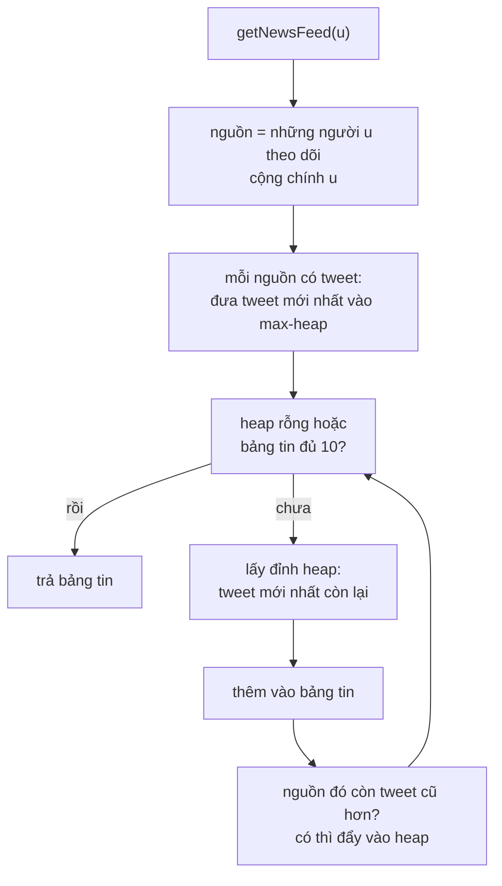

> [!tldr] Đọc nhanh
> - Đề: thiết kế lớp `Twitter` với `postTweet`, `follow`, `unfollow` và `getNewsFeed(userId)`: 10 tweet **mới nhất** của chính người đó và những người họ theo dõi, mới trước cũ sau.
> - Mỗi người giữ một danh sách tweet theo thứ tự đăng, nên danh sách nào cũng đã sắp sẵn. Bảng tin là bài **trộn k danh sách đã sắp** ([[concepts/k-way-merge|K-way Merge]]): đặt tweet mới nhất của mỗi nguồn vào một max-heap, lấy đỉnh ra, rồi đẩy tweet kế trước của đúng nguồn đó vào. Mỗi lần đọc O(F + 10 log F) với F là số nguồn.
> - Thời gian là một **đồng hồ toàn cục** tăng 1 mỗi lần đăng, không phải giờ hệ thống. Lấy `Date.now()` làm thời gian thì các tweet đăng trong cùng 1 ms trùng giờ, và bảng tin ra sai thứ tự ở 5/9 ca.
> - Ba bản sai khác được chạy: quên tweet của chính mình (4/9), cho mỗi người tự theo dõi mình rồi `unfollow(u, u)` xóa luôn (8/9), quên cắt 10 (8/9).
> - Đo: 1 000 lần đọc bảng tin từ 500 nguồn, mỗi nguồn 100 tweet, gom rồi sắp mất 3 592 ms, trộn bằng heap 22 ms. Hệ thống thật như Twitter thì làm ngược lại cho phần lớn người dùng: **đẩy tweet vào bảng tin lúc ghi**, đổi lại một lần đăng của người có 10⁶ người theo dõi tốn 73 ms.

> [!info] Bối cảnh
> Bài LeetCode 355, thuộc [[posts/2026-11-24-neetcode-two-heaps|ga 4: Hai heap và lập lịch]] trên **tuyến NeetCode: Tìm kiếm và heap**. Đây là bài *thiết kế* giống [[problems/time-based-key-value-store|Time Based Key-Value Store]]: không có một hàm duy nhất mà là một lớp, và LeetCode gọi các phương thức xen kẽ. Phần heap dùng lại những gì đã học ở [[posts/2026-11-23-neetcode-heap-top-k|ga 3: Heap và top K]]. Lời giải có đủ TypeScript, Python, Go, Java và JavaScript. Bạn chỉ cần biết mảng, bảng băm và heap.

> [!abstract]- Từ điển nhanh cho bài này (bấm để mở)
> - **Heap**: cây nhị phân lưu trong mảng, phần tử lớn nhất (max-heap) hoặc nhỏ nhất (min-heap) luôn ở đỉnh; thêm và lấy đỉnh O(log n). Xem [[concepts/heap|Heap]].
> - **Bảng băm (hash map)** và **tập băm (hash set)**: tra và thêm trung bình O(1). Ở đây bảng băm tra `userId → danh sách tweet`, tập băm giữ những người một người đang theo dõi. Xem [[concepts/hash-map|Hash Map]], [[concepts/hash-set|Hash Set]].
> - **Trộn k danh sách (k-way merge)**: có k danh sách đã sắp, cần dãy chung đã sắp. Mỗi danh sách đưa phần tử đầu của nó vào heap; heap cho biết phần tử nào đi tiếp. Xem [[concepts/k-way-merge|K-way Merge]].
> - **Bảng tin (news feed, timeline)**: danh sách tweet người dùng thấy khi mở ứng dụng.
> - **Đẩy lúc ghi (fan-out on write)**: khi ai đó đăng, chép tweet vào bảng tin của từng người theo dõi họ. Ngược lại là **đọc lúc cần** (fan-out on read): bảng tin được trộn mỗi lần mở. Xem [[concepts/fan-out-on-write|Fan-out on Write]].

## Hình dung trước: những chồng thư trên bàn

Mỗi người bạn bạn theo dõi có một chồng thư riêng trên bàn, thư mới nhất nằm trên cùng. Bạn muốn đọc 10 lá mới nhất trong tất cả các chồng. Bạn không đổ hết thư ra sàn rồi xếp lại theo ngày; bạn chỉ nhìn lá **trên cùng** của mỗi chồng, cầm lá mới nhất trong số đó, và chồng vừa bị lấy lộ ra lá kế tiếp.

| Đời thường | Khái niệm |
|---|---|
| Mỗi người một chồng thư, lá mới trên cùng | `userId → danh sách tweet`, cũ trước mới sau |
| Chồng thư của chính bạn cũng nằm trên bàn | bảng tin luôn gồm tweet của chính mình |
| Con dấu bưu điện đánh số tăng dần | đồng hồ toàn cục, mỗi tweet một số không trùng |
| Nhìn lá trên cùng của mỗi chồng, cầm lá mới nhất | max-heap chứa tweet mới nhất của mỗi nguồn |
| Lấy một lá thì lá dưới nó lộ ra | lấy đỉnh heap, đẩy tweet kế trước của cùng nguồn |
| Đọc đủ 10 lá thì thôi | dừng khi bảng tin có 10 tweet |
| Đổ hết ra sàn rồi xếp lại | gom rồi sắp: O(T log T) |
| Bưu tá bỏ sẵn một bản sao vào hộp thư của từng người | đẩy lúc ghi (fan-out on write) |



## Vấn đề

**Đề (tóm tắt bằng lời của mình):** cài lớp `Twitter`:

- `postTweet(userId, tweetId)`: người `userId` đăng tweet có mã `tweetId`. Mỗi lần gọi là một tweet mới, mã không trùng.
- `getNewsFeed(userId)`: trả tối đa 10 mã tweet mới nhất trong các tweet của chính `userId` và của những người `userId` đang theo dõi, mới nhất trước.
- `follow(followerId, followeeId)`: `followerId` bắt đầu theo dõi `followeeId`.
- `unfollow(followerId, followeeId)`: bỏ theo dõi.

Ràng buộc: mã người dùng từ 1 tới 500, mã tweet từ 0 tới 10⁴, tổng cộng tối đa 3·10⁴ lần gọi. Đề gốc: [LeetCode 355](https://leetcode.com/problems/design-twitter/).

| Lệnh | Kết quả |
|---|---|
| `postTweet(1, 5)` | |
| `getNewsFeed(1)` | `[5]` |
| `follow(1, 2)` | |
| `postTweet(2, 6)` | |
| `getNewsFeed(1)` | `[6, 5]`: tweet 6 đăng sau nên đứng trước |
| `unfollow(1, 2)` | |
| `getNewsFeed(1)` | `[5]` |

Mình từng nghĩ khó nhất là cấu trúc dữ liệu cho quan hệ theo dõi. Hóa ra phần đó chỉ là một bảng băm của các tập. Chỗ đáng nghĩ là `getNewsFeed`: nó hỏi 10 phần tử lớn nhất (theo thời gian) trong hợp của nhiều danh sách, và mỗi danh sách **đã sắp sẵn** vì tweet được nối vào cuối theo thứ tự đăng. Đó là bài trộn k danh sách, chỉ cần dừng sớm sau 10 phần tử.

## Cơ chế

<figure class="figure-map" style="--ar: 3 / 4">
<div class="frame"><iframe data-archify="../diagrams/neetcode-design-twitter/worked-example.html" title="Trộn đầu các luồng bài viết" loading="lazy"></iframe></div>
<figcaption><span><b>Hình 1.</b> Trộn đầu các luồng bài viết.</span><a href="../diagrams/neetcode-design-twitter/worked-example.html" target="_blank" rel="noopener">Mở toàn màn hình</a></figcaption>
</figure>

<details>
<summary>Đọc từng bước</summary>
<ol>
<li>Lấy bài mới nhất của mỗi người. <code>A: [9, 4]; B: [8, 6]</code></li>
<li>Lấy bài 9 rồi đưa bài 4 của A vào. <code>heap = {8, 4}</code></li>
<li>Lấy bài 8 rồi đưa bài 6 của B vào. <code>heap = {6, 4}</code></li>
<li>Thứ tự mới nhất xuất hiện dần. <code>[9, 8, 6, 4]</code></li>
</ol>
</details>

### Dữ liệu

- Một số nguyên `time` tăng 1 sau mỗi lần đăng. Tweet nào đăng sau có số lớn hơn, không bao giờ trùng.
- `tweets`: bảng băm `userId → [(time, tweetId), …]`. Nối vào cuối, nên danh sách tăng dần theo `time`.
- `follows`: bảng băm `followerId → tập followeeId`. Dùng tập để `follow` hai lần không thêm trùng và `unfollow` là O(1).

Chính mình **không** nằm trong tập `follows`. Lúc đọc, mình cộng thêm `userId` vào danh sách nguồn. Cách này tránh hẳn ca tự theo dõi mình: `follow(u, u)` bị bỏ qua, `unfollow(u, u)` không xóa được gì, và u vẫn luôn thấy tweet của chính u.

### Cách 1, gom rồi sắp: O(T log T) mỗi lần đọc

Nối hết danh sách tweet của mọi nguồn, sắp giảm dần theo `time`, cắt 10. Đúng, ngắn, và đủ qua LeetCode. Nhưng nó sắp **toàn bộ** T tweet của các nguồn để lấy 10 cái, và T tăng mãi theo thời gian.

### Cách 2, trộn k danh sách bằng heap: O(F + 10 log F) mỗi lần đọc

Mỗi danh sách tweet đã tăng dần theo `time`, tức tweet mới nhất nằm ở **cuối**. Ý tưởng của [[concepts/k-way-merge|trộn k danh sách]]:

1. Với mỗi nguồn có tweet, đưa phần tử cuối (tweet mới nhất) vào một **max-heap** theo `time`, kèm theo nguồn và vị trí của nó.
2. Lấy đỉnh heap: đó là tweet mới nhất trong tất cả những tweet chưa lấy. Thêm vào bảng tin.
3. Nếu nguồn của nó còn tweet cũ hơn (vị trí > 0), đẩy tweet ngay trước đó vào heap.
4. Lặp tới khi bảng tin đủ 10 hoặc heap rỗng.

[[concepts/loop-invariant|Bất biến]]: heap chứa đúng một tweet cho mỗi nguồn chưa cạn, và đó là tweet mới nhất **chưa lấy** của nguồn đó. Tweet mới nhất chưa lấy của cả hệ thống phải là tweet mới nhất chưa lấy của một nguồn nào đó, nên nó nằm trong heap, và là đỉnh.

Chi phí: dựng heap từ F phần tử là O(F) nếu dùng [[concepts/heapify|heapify]] (Python), hoặc O(F log F) nếu thêm từng cái. Sau đó tối đa 10 lần lấy đỉnh và 10 lần đẩy vào, mỗi lần O(log F). Không phụ thuộc T: một nguồn có 10⁶ tweet cũng chỉ góp tối đa 10 lần đọc.

Heap ở đây khác [[concepts/size-k-heap|heap k chỗ]] của [[problems/kth-largest-element-in-a-stream|Kth Largest Element in a Stream]]. Ở đó heap giữ k ứng viên tốt nhất của một luồng, đỉnh là ứng viên **yếu** nhất (min-heap). Ở đây heap giữ một "mặt trước" của mỗi danh sách, đỉnh là phần tử **mạnh** nhất cần lấy tiếp (max-heap), và kích thước heap là số nguồn, không phải 10.

### Bản sai 1: quên chính mình

Chỉ đọc từ tập `follows`. Ví dụ của đề hỏi `getNewsFeed(1)` ngay sau khi 1 đăng tweet 5 và chưa theo dõi ai: bản sai trả `[]`. Qua 4/9 ca.

### Bản sai 2: tự theo dõi mình rồi tự bỏ

Một cách "gọn" là cho mỗi người tự nằm trong tập theo dõi của mình ngay từ đầu, rồi đọc thẳng tập đó. Mọi thứ đúng cho tới khi gặp `follow(1, 1)` rồi `unfollow(1, 1)`: lần bỏ theo dõi xóa luôn chính 1 khỏi tập, và 1 không còn thấy tweet của mình. Qua 8/9 ca, hỏng đúng ở ca đó. Dù đề có cho phép tự theo dõi hay không, cài đặt an toàn là bỏ qua `follow(u, u)` và `unfollow(u, u)`.

### Bản sai 3: giờ hệ thống làm thời gian

`Date.now()` trả mili giây. Các lệnh trong một ca thử chạy cách nhau vài micro giây, nên nhiều tweet có **cùng** thời gian. Khi đó thứ tự trong bảng tin do thuật toán sắp quyết định: `Array.prototype.sort` của JS là sắp ổn định, giữ nguyên thứ tự lúc gom, tức tweet **cũ** đứng trước và tweet của người này đứng hết trước người kia. Ví dụ của đề ra `[5, 6]` thay vì `[6, 5]`. Qua 4/9 ca. Đồng hồ toàn cục không có vấn đề này vì mỗi lần đăng tăng 1.

### Bản sai 4: quên cắt 10

Ca có 12 tweet trả cả 12. Qua 8/9 ca.

### Đo

TypeScript, một người theo dõi F nguồn, mỗi nguồn P tweet đăng xen kẽ, 1 000 lần `getNewsFeed`, trung vị 5 lần chạy, ms:

| F nguồn | P tweet mỗi nguồn | T tổng | gom rồi sắp | trộn bằng heap |
|---|---|---|---|---|
| 10 | 100 | 1 000 | 40,4 | 1,08 |
| 100 | 100 | 10 000 | 558,5 | 4,90 |
| 500 | 100 | 50 000 | 3 592,2 | 22,35 |
| 500 | 1 000 | 500 000 | (không chạy) | 26,63 |

- Gom rồi sắp tăng theo T: từ T = 10⁴ lên 5·10⁴ thì gấp khoảng 6,4 lần (T log T).
- Trộn bằng heap tăng theo F, gần như không theo T: hai hàng cuối cùng F = 500, T gấp 10 lần mà thời gian chỉ từ 22,4 lên 26,6 ms.
- Đối chiếu 2 000 chuỗi lệnh ngẫu nhiên (6 người, 60 lệnh mỗi chuỗi): heap và gom rồi sắp cho cùng bảng tin ở mọi lần đọc.

### Ngoài LeetCode: đẩy lúc ghi hay đọc lúc cần

Lời giải trên là **đọc lúc cần**: mỗi lần mở bảng tin thì trộn lại. Ghi rẻ (nối một phần tử), đọc tốn O(F + 10 log F). Cách ngược lại là **đẩy lúc ghi** (fan-out on write): mỗi người có sẵn một bảng tin đã sắp, và khi ai đó đăng, tweet được chép vào bảng tin của từng người theo dõi họ. Đọc chỉ là lấy 10 phần tử cuối; ghi tốn tỉ lệ với số người theo dõi.

| người theo dõi | 1 lần đăng, đẩy lúc ghi | 1 lần đăng, đọc lúc cần |
|---|---|---|
| 100 | 0,011 ms | 0,0002 ms |
| 10 000 | 0,397 ms | 0,0006 ms |
| 1 000 000 | 72,854 ms | 0,0002 ms |

Martin Kleppmann dùng chính bài toán này để mở đầu cuốn *Designing Data-Intensive Applications* (chương 1, mục "Describing Load"): Twitter ban đầu trộn bảng tin lúc đọc, rồi chuyển sang đẩy lúc ghi vào bộ nhớ đệm bảng tin của từng người, vì lượt đọc bảng tin nhiều hơn lượt đăng tweet rất nhiều. Với những tài khoản có rất nhiều người theo dõi, đẩy lúc ghi quá đắt (hàng thứ ba của bảng trên), nên tweet của họ được lấy riêng và trộn vào lúc đọc: một cách lai giữa hai bên. Raffi Krikorian của Twitter trình bày kiến trúc này trong bài nói *Timelines at Scale* (QCon San Francisco 2012).

### Bên dưới năm ngôn ngữ

| | Heap có sẵn | Bẫy riêng |
|---|---|---|
| TypeScript / JavaScript | không có: tự viết max-heap | lưu danh sách theo dõi trong object thường: key số bị đổi thành chuỗi, `Object.keys({2: true})` là `["2"]`, và `map.get("2")` không thấy người dùng số 2 (4/9 ca) |
| Python | `heapq` (min-heap: khóa `-time`), `heapq.merge(..., reverse=True)` | heapq so tuple từng phần tử: hai phần tử cùng khóa thì so tiếp phần tử thứ hai, và một object không có `<` làm `heappush` ném `TypeError`; đồng hồ toàn cục làm khóa không bao giờ trùng |
| Go | `container/heap`: tự cài `Len`, `Less`, `Swap`, `Push`, `Pop` | `map[int]map[int]struct{}`: đọc và `delete` trên map con nil thì được, **ghi** thì panic `assignment to entry in nil map` |
| Java | `PriorityQueue` với comparator | duyệt `PriorityQueue` bằng for-each hoặc in ra **không** theo thứ tự ưu tiên (`[9, 7, 8, 3, 5, 1]`); chỉ `poll()` lần lượt mới đúng; dùng `Integer.compare` thay cho `b[0] - a[0]` |

## Ví dụ chạy được

Lời giải trộn bằng heap trong năm ngôn ngữ ([TypeScript](../code/neetcode-design-twitter/design-twitter.ts) · [Python](../code/neetcode-design-twitter/design_twitter.py) · [Go](../code/neetcode-design-twitter/design_twitter.go) · [Java](../code/neetcode-design-twitter/design-twitter.java) · [JavaScript](../code/neetcode-design-twitter/design-twitter.js)). Bản TypeScript kế thừa phần lưu trữ từ cách gom rồi sắp, nên in cả hai:

```ts
// Max-heap nhỏ gọn theo khóa số: JS/TS không có heap sẵn.
class MaxHeap<T> {
  private a: T[] = [];
  private key: (x: T) => number;
  constructor(key: (x: T) => number) { this.key = key; }
  get size(): number { return this.a.length; }
  push(x: T): void {
    const a = this.a; a.push(x);
    let i = a.length - 1;
    while (i > 0) { // nổi lên
      const p = (i - 1) >> 1;
      if (this.key(a[p]) >= this.key(a[i])) break;
      [a[p], a[i]] = [a[i], a[p]]; i = p;
    }
  }
  pop(): T {
    const a = this.a, top = a[0], last = a.pop()!;
    if (a.length) {
      a[0] = last;
      let i = 0;
      for (;;) { // chìm xuống
        const l = 2 * i + 1, r = l + 1;
        let m = i;
        if (l < a.length && this.key(a[l]) > this.key(a[m])) m = l;
        if (r < a.length && this.key(a[r]) > this.key(a[m])) m = r;
        if (m === i) break;
        [a[m], a[i]] = [a[i], a[m]]; i = m;
      }
    }
    return top;
  }
}

// Cách 1, gom rồi sắp: lấy hết tweet của mình và người mình theo dõi, sắp theo thời gian giảm dần, cắt 10.
// O(T log T) mỗi lần đọc, với T là tổng số tweet của những người đó.
class SortAllTwitter implements TwitterLike {
  protected time = 0; // đồng hồ toàn cục: mỗi tweet một số, không bao giờ trùng
  protected tweets = new Map<number, [number, number][]>(); // userId → [[time, tweetId], …], cũ trước mới sau
  protected follows = new Map<number, Set<number>>(); // followerId → tập followeeId (không chứa chính mình)
  postTweet(userId: number, tweetId: number): void {
    if (!this.tweets.has(userId)) this.tweets.set(userId, []);
    this.tweets.get(userId)!.push([this.time++, tweetId]);
  }
  protected sources(userId: number): number[] {
    return [userId, ...(this.follows.get(userId) ?? [])]; // luôn có chính mình
  }
  getNewsFeed(userId: number): number[] {
    const all: [number, number][] = [];
    for (const u of this.sources(userId)) all.push(...(this.tweets.get(u) ?? []));
    all.sort((x, y) => y[0] - x[0]);
    return all.slice(0, 10).map((t) => t[1]);
  }
  follow(followerId: number, followeeId: number): void {
    if (followerId === followeeId) return; // tự theo dõi mình: bỏ qua, mình vốn đã thấy tweet của mình
    if (!this.follows.has(followerId)) this.follows.set(followerId, new Set());
    this.follows.get(followerId)!.add(followeeId);
  }
  unfollow(followerId: number, followeeId: number): void {
    this.follows.get(followerId)?.delete(followeeId); // chưa theo dõi thì delete không làm gì
  }
}

// Cách 2, trộn k danh sách bằng heap: mỗi nguồn đóng góp tweet mới nhất của nó vào max-heap.
// Lấy đỉnh ra, đẩy tweet kế trước của cùng nguồn vào. O(F + 10 log F) mỗi lần đọc, F = số nguồn.
class HeapMergeTwitter extends SortAllTwitter {
  getNewsFeed(userId: number): number[] {
    // phần tử heap: [time, tweetId, userId, chỉ số trong danh sách của userId]
    const heap = new MaxHeap<[number, number, number, number]>((e) => e[0]);
    for (const u of this.sources(userId)) {
      const list = this.tweets.get(u);
      if (list && list.length) { const i = list.length - 1; heap.push([list[i][0], list[i][1], u, i]); }
    }
    const feed: number[] = [];
    while (heap.size && feed.length < 10) {
      const [, tweetId, u, i] = heap.pop();
      feed.push(tweetId);
      if (i > 0) { const prev = this.tweets.get(u)![i - 1]; heap.push([prev[0], prev[1], u, i - 1]); }
    }
    return feed;
  }
}
```

```python
class Twitter:
    """Trộn k danh sách bằng heap. heapq là min-heap, nên khóa là -time."""

    def __init__(self):
        self.time = 0                       # đồng hồ toàn cục: không bao giờ trùng
        self.tweets = defaultdict(list)     # userId → [(time, tweetId), …], cũ trước mới sau
        self.follows = defaultdict(set)     # followerId → tập followeeId, không chứa chính mình

    def postTweet(self, userId: int, tweetId: int) -> None:
        self.tweets[userId].append((self.time, tweetId))
        self.time += 1

    def getNewsFeed(self, userId: int) -> list[int]:
        heap = []
        for u in self.follows.get(userId, set()) | {userId}:
            lst = self.tweets.get(u)  # .get: đọc defaultdict bằng [] sẽ tạo key rỗng
            if lst:
                t, tid = lst[-1]
                heap.append((-t, tid, u, len(lst) - 1))
        heapq.heapify(heap)
        feed = []
        while heap and len(feed) < 10:
            _, tid, u, i = heapq.heappop(heap)
            feed.append(tid)
            if i > 0:
                t, prev = self.tweets[u][i - 1]
                heapq.heappush(heap, (-t, prev, u, i - 1))
        return feed

    def follow(self, followerId: int, followeeId: int) -> None:
        if followerId != followeeId:  # tự theo dõi mình: bỏ qua
            self.follows[followerId].add(followeeId)

    def unfollow(self, followerId: int, followeeId: int) -> None:
        self.follows[followerId].discard(followeeId)  # discard: không có thì thôi, remove sẽ ném KeyError
```

```go
type tweet struct{ time, id int }

// item của heap: tweet mới nhất chưa lấy của một nguồn, và vị trí của nó trong danh sách nguồn đó.
type item struct{ time, id, user, idx int }

// feedHeap là max-heap theo time: Less trả a > b. container/heap gọi Push/Pop qua con trỏ.
type feedHeap []item

func (h feedHeap) Len() int           { return len(h) }

func (h feedHeap) Less(i, j int) bool { return h[i].time > h[j].time }

func (h feedHeap) Swap(i, j int)      { h[i], h[j] = h[j], h[i] }

func (h *feedHeap) Push(x any)        { *h = append(*h, x.(item)) }

func (h *feedHeap) Pop() any {
	old := *h
	x := old[len(old)-1]
	*h = old[:len(old)-1]
	return x
}

type Twitter struct {
	time    int
	tweets  map[int][]tweet          // userId → tweet, cũ trước mới sau
	follows map[int]map[int]struct{} // followerId → tập followeeId
}

func Constructor() Twitter {
	return Twitter{tweets: map[int][]tweet{}, follows: map[int]map[int]struct{}{}}
}

func (t *Twitter) PostTweet(userId, tweetId int) {
	t.tweets[userId] = append(t.tweets[userId], tweet{t.time, tweetId})
	t.time++
}

func (t *Twitter) GetNewsFeed(userId int) []int {
	h := &feedHeap{}
	add := func(u int) {
		if lst := t.tweets[u]; len(lst) > 0 {
			i := len(lst) - 1
			*h = append(*h, item{lst[i].time, lst[i].id, u, i})
		}
	}
	add(userId)
	for u := range t.follows[userId] { // đọc map nil an toàn: vòng lặp không chạy
		add(u)
	}
	heap.Init(h)
	feed := []int{}
	for h.Len() > 0 && len(feed) < 10 {
		top := heap.Pop(h).(item) // heap.Pop của gói, không phải h.Pop
		feed = append(feed, top.id)
		if top.idx > 0 {
			p := t.tweets[top.user][top.idx-1]
			heap.Push(h, item{p.time, p.id, top.user, top.idx - 1})
		}
	}
	return feed
}

func (t *Twitter) Follow(followerId, followeeId int) {
	if followerId == followeeId {
		return
	}
	if t.follows[followerId] == nil { // ghi vào map con nil sẽ panic: phải tạo trước
		t.follows[followerId] = map[int]struct{}{}
	}
	t.follows[followerId][followeeId] = struct{}{}
}

func (t *Twitter) Unfollow(followerId, followeeId int) {
	delete(t.follows[followerId], followeeId) // delete trên map nil không làm gì
}
```

```java
// Trộn k danh sách bằng PriorityQueue. Mỗi phần tử heap: {time, tweetId, userId, chỉ số}.
static class Twitter {
    private int time = 0; // đồng hồ toàn cục
    private final Map<Integer, List<int[]>> tweets = new HashMap<>(); // userId → [{time, tweetId}], cũ trước mới sau
    private final Map<Integer, Set<Integer>> follows = new HashMap<>();

    public void postTweet(int userId, int tweetId) {
        tweets.computeIfAbsent(userId, k -> new ArrayList<>()).add(new int[]{time++, tweetId});
    }

    public List<Integer> getNewsFeed(int userId) {
        // max-heap theo time; Integer.compare thay cho b[0] - a[0] để không bao giờ tràn số
        PriorityQueue<int[]> heap = new PriorityQueue<>((a, b) -> Integer.compare(b[0], a[0]));
        Set<Integer> sources = new HashSet<>(follows.getOrDefault(userId, Set.of()));
        sources.add(userId);
        for (int u : sources) {
            List<int[]> lst = tweets.get(u);
            if (lst != null && !lst.isEmpty()) {
                int i = lst.size() - 1;
                heap.add(new int[]{lst.get(i)[0], lst.get(i)[1], u, i});
            }
        }
        List<Integer> feed = new ArrayList<>();
        while (!heap.isEmpty() && feed.size() < 10) {
            int[] top = heap.poll();
            feed.add(top[1]);
            if (top[3] > 0) {
                int[] p = tweets.get(top[2]).get(top[3] - 1);
                heap.add(new int[]{p[0], p[1], top[2], top[3] - 1});
            }
        }
        return feed;
    }

    public void follow(int followerId, int followeeId) {
        if (followerId != followeeId) follows.computeIfAbsent(followerId, k -> new HashSet<>()).add(followeeId);
    }

    public void unfollow(int followerId, int followeeId) {
        Set<Integer> s = follows.get(followerId);
        if (s != null) s.remove(followeeId);
    }
}
```

```js
// Max-heap theo phần tử đầu của mảng [time, …].
class MaxHeap {
  constructor() { this.a = []; }
  get size() { return this.a.length; }
  push(x) {
    const a = this.a; a.push(x);
    let i = a.length - 1;
    while (i > 0) {
      const p = (i - 1) >> 1;
      if (a[p][0] >= a[i][0]) break;
      [a[p], a[i]] = [a[i], a[p]]; i = p;
    }
  }
  pop() {
    const a = this.a, top = a[0], last = a.pop();
    if (a.length) {
      a[0] = last;
      let i = 0;
      for (;;) {
        const l = 2 * i + 1, r = l + 1;
        let m = i;
        if (l < a.length && a[l][0] > a[m][0]) m = l;
        if (r < a.length && a[r][0] > a[m][0]) m = r;
        if (m === i) break;
        [a[m], a[i]] = [a[i], a[m]]; i = m;
      }
    }
    return top;
  }
}

// Map và Set giữ key là số. Object thường đổi key thành chuỗi (xem bẫy ở cuối file).
class Twitter {
  constructor() {
    this.time = 0;
    this.tweets = new Map();  // userId → [[time, tweetId], …], cũ trước mới sau
    this.follows = new Map(); // followerId → Set followeeId
  }
  postTweet(userId, tweetId) {
    if (!this.tweets.has(userId)) this.tweets.set(userId, []);
    this.tweets.get(userId).push([this.time++, tweetId]);
  }
  getNewsFeed(userId) {
    const heap = new MaxHeap();
    for (const u of [userId, ...(this.follows.get(userId) ?? [])]) {
      const lst = this.tweets.get(u);
      if (lst && lst.length) { const i = lst.length - 1; heap.push([lst[i][0], lst[i][1], u, i]); }
    }
    const feed = [];
    while (heap.size && feed.length < 10) {
      const [, id, u, i] = heap.pop();
      feed.push(id);
      if (i > 0) { const p = this.tweets.get(u)[i - 1]; heap.push([p[0], p[1], u, i - 1]); }
    }
    return feed;
  }
  follow(a, b) {
    if (a === b) return;
    if (!this.follows.has(a)) this.follows.set(a, new Set());
    this.follows.get(a).add(b);
  }
  unfollow(a, b) { this.follows.get(a)?.delete(b); }
}
```


Python có sẵn `heapq.merge`, nhận nhiều dãy đã sắp và trả một dãy trộn lười. Mỗi danh sách đi từ mới tới cũ (`reversed`), nên cần `reverse=True`; `islice` dừng sau 10 phần tử, phần còn lại không bao giờ được trộn:

```python
class MergeTwitter(Twitter):
    """heapq.merge trộn sẵn các dãy đã sắp; reverse=True vì mỗi dãy đi từ mới tới cũ."""

    def getNewsFeed(self, userId: int) -> list[int]:
        sources = self.follows.get(userId, set()) | {userId}
        streams = [reversed(self.tweets[u]) for u in sources if u in self.tweets]
        merged = heapq.merge(*streams, key=lambda p: p[0], reverse=True)
        return [tid for _, tid in islice(merged, 10)]
```


Bản sai lấy giờ hệ thống làm thời gian:

```ts
// SAI: lấy giờ hệ thống (mili giây) làm thời gian. Các tweet đăng trong cùng 1 ms có cùng thời gian,
// và sort ổn định giữ thứ tự gom: hết tweet của người này rồi mới tới người kia.
class DateNowTwitter extends SortAllTwitter {
  postTweet(userId: number, tweetId: number): void {
    if (!this.tweets.has(userId)) this.tweets.set(userId, []);
    this.tweets.get(userId)!.push([Date.now(), tweetId]);
  }
}
```


File TypeScript chạy sáu cách trên chín ca, đối chiếu ngẫu nhiên, rồi đo:

```text
$ node design-twitter.ts
SortAllTwitter    9/9 ca đúng
HeapMergeTwitter  9/9 ca đúng
NoSelfTwitter     4/9 ca đúng; sai ở: ví dụ của đề → [] [6] []; thấy tweet của chính mình → []; xen kẽ hai người → [21,20]; hơn 10 tweet → [111,109,107,105,103,101]; tự follow rồi tự unfollow → []
SelfInSetTwitter  8/9 ca đúng; sai ở: tự follow rồi tự unfollow → []
DateNowTwitter    4/9 ca đúng; sai ở: ví dụ của đề → [5] [5,6] [5]; thấy tweet của chính mình → [1,2]; xen kẽ hai người → [10,11,20,21]; hơn 10 tweet → [100,102,104,106,108,110,101,103,105,107]; tweet đăng trước khi follow vẫn hiện → [1,2]
NoLimitTwitter    8/9 ca đúng; sai ở: hơn 10 tweet → [111,110,109,108,107,106,105,104,103,102,101,100]

Đối chiếu 2 000 chuỗi lệnh ngẫu nhiên (6 người, 60 lệnh mỗi chuỗi): 0 lần heap khác gom rồi sắp

F nguồn   P tweet/nguồn   T tổng    gom rồi sắp   trộn bằng heap   (ms cho 1 000 lần đọc feed, trung vị 5 lần)
10        100             1000             40.4             1.08
100       100             10000           558.5             4.90
500       100             50000          3592.2            22.35
500       1000            500000              —            26.63

người theo dõi   1 lần đăng, đẩy lúc ghi   1 lần đăng, đọc lúc cần   (ms, trung vị 5 lần)
100                               0.011                   0.0002
10000                             0.397                   0.0006
1000000                          72.854                   0.0002
```

`DateNowTwitter` phụ thuộc đồng hồ: kết quả trên lặp lại ở cả ba lần mình chạy, vì cả ca thử chạy trong cùng một mili giây. Nếu một ca rơi đúng ranh giới hai mili giây, vài tweet sẽ có thời gian khác nhau và số ca sai có thể khác đi; bản sai vẫn là bản sai.

```text
$ python3 design_twitter.py
Twitter       9/9 ca đúng
MergeTwitter  9/9 ca đúng

hai tweet cùng thời gian, phần tử thứ hai là object: TypeError: '<' not supported between instances of 'Tweet' and 'Tweet'
```

```text
$ go run design_twitter.go
Twitter  9/9 ca đúng

đọc map con nil: false
ghi vào map con nil: assignment to entry in nil map
```

```text
$ java design-twitter.java
Twitter  9/9 ca đúng

duyệt PriorityQueue: [9, 7, 8, 3, 5, 1]
poll lần lượt:       [9, 8, 7, 5, 3, 1]
```

```text
$ node design-twitter.js
Twitter              9/9 ca đúng
ObjectFollowsTwitter 4/9 ca đúng; sai ở: ví dụ của đề → [5] [5] [5]; xen kẽ hai người → [11,10]; hơn 10 tweet → [110,108,106,104,102,100]; follow hai lần → [] []; tweet đăng trước khi follow vẫn hiện → []

Object.keys({ 2: true }) = ["2"]
new Map([[2, "x"]]).get("2") = undefined
```

## Hiểu lầm và bẫy hay gặp

- **"Bảng tin chỉ gồm người mình theo dõi."** Đề yêu cầu cả tweet của chính mình. Cộng `userId` vào nguồn lúc đọc, đừng nhét vào tập theo dõi.
- **Tự theo dõi rồi tự bỏ.** Nếu chính mình nằm trong tập theo dõi, `unfollow(u, u)` xóa nó. Bỏ qua `follow`/`unfollow` khi hai mã bằng nhau.
- **Giờ hệ thống làm thời gian.** Nhiều tweet trong cùng 1 ms trùng giờ, thứ tự ra sai. Dùng bộ đếm tăng dần.
- **Sắp toàn bộ mỗi lần đọc.** Đúng, nhưng chi phí tăng theo tổng số tweet. Danh sách đã sắp sẵn, chỉ cần trộn.
- **Max-heap hay min-heap.** Ở đây cần tweet *mới nhất* trước, nên là max-heap theo thời gian (Python: min-heap trên `-time`).
- **Quên cắt 10**, hoặc dừng ở 10 nhưng quên ca có ít hơn 10 tweet: vòng lặp phải dừng cả khi heap rỗng.
- **Unfollow người chưa theo dõi.** Phải là thao tác rỗng: Python `discard` chứ không `remove` (ném `KeyError`), Java kiểm `null` trước khi `remove`, Go `delete` trên map nil an toàn.
- **Java: in `PriorityQueue` để xem thứ tự.** Mảng bên trong là heap, không phải dãy đã sắp.

## Câu hỏi tự kiểm tra

> [!question]- Vì sao danh sách tweet của mỗi người luôn đã sắp, và điều đó cho phép gì?
> Mỗi tweet mới nhận `time` lớn hơn mọi tweet trước và được nối vào cuối, nên danh sách tăng dần theo `time` mà không cần sắp lại. Có k danh sách đã sắp thì lấy 10 phần tử lớn nhất của hợp chỉ cần trộn từ đầu lớn của mỗi danh sách, không cần nhìn các phần tử cũ hơn.

> [!question]- Heap trong `getNewsFeed` chứa bao nhiêu phần tử, và vì sao không bao giờ vượt quá số nguồn?
> Lúc đầu mỗi nguồn có tweet góp đúng một phần tử. Mỗi lần lấy đỉnh ra thì đẩy vào tối đa một phần tử (tweet kế trước của **cùng** nguồn). Nên mỗi nguồn luôn có nhiều nhất một đại diện trong heap: kích thước ≤ F.

> [!question]- Một người theo dõi 500 người, mỗi người đã đăng 10⁴ tweet. Gom rồi sắp và trộn bằng heap tốn bao nhiêu phép so mỗi lần đọc, cỡ chừng?
> Gom rồi sắp: T = 5·10⁶ tweet, sắp khoảng T log₂ T ≈ 5·10⁶ × 22 ≈ 10⁸ phép so. Trộn bằng heap: dựng heap 500 phần tử (khoảng 500 tới 4 500 phép so) cộng 10 lần lấy và đẩy, mỗi lần khoảng 2 log₂ 500 ≈ 18: tổng vài nghìn.

> [!question]- Vì sao `Date.now()` làm bảng tin sai thứ tự, và sai theo hướng nào?
> Nhiều tweet đăng trong cùng một mili giây có cùng thời gian. Sắp ổn định giữ thứ tự gom: tweet cũ trước tweet mới, và tweet của người được gom trước đứng hết trước. Nên bảng tin ra cũ trước mới sau trong cùng một mili giây, ngược với yêu cầu.

> [!question]- Một tài khoản có 10⁷ người theo dõi đăng một tweet. Đẩy lúc ghi tốn gì, và hệ thống thật làm gì?
> Đẩy lúc ghi phải chép tweet vào 10⁷ bảng tin: theo phép đo trên (73 ms cho 10⁶ trong bộ nhớ của một tiến trình), cỡ gần một giây chỉ cho một tweet, chưa tính mạng và lưu trữ. Cách lai: không đẩy tweet của tài khoản rất nhiều người theo dõi, mà lấy riêng và trộn vào lúc đọc, giống chính lời giải trộn k danh sách ở trên.

## Tham khảo

- [LeetCode 355: Design Twitter](https://leetcode.com/problems/design-twitter/) (đề gốc)
- [Python: module `heapq`](https://docs.python.org/3/library/heapq.html) (`heapify`, `heappush`, `merge(..., key=, reverse=)`) và [So sánh dãy](https://docs.python.org/3/tutorial/datastructures.html#comparing-sequences-and-other-types) (tuple so từng phần tử)
- [Go: `container/heap`](https://pkg.go.dev/container/heap) và [Go spec: Map types](https://go.dev/ref/spec#Map_types) (map nil: đọc được, ghi thì panic)
- [Java 21 `PriorityQueue`](https://docs.oracle.com/en/java/javase/21/docs/api/java.base/java/util/PriorityQueue.html) (iterator "không bảo đảm duyệt theo thứ tự nào")
- [MDN: `Map` so với `Object`](https://developer.mozilla.org/en-US/docs/Web/JavaScript/Reference/Global_Objects/Map#objects_vs._maps) và [`Array.prototype.sort`](https://developer.mozilla.org/en-US/docs/Web/JavaScript/Reference/Global_Objects/Array/sort) (sắp ổn định từ ES2019)
- Martin Kleppmann, [*Designing Data-Intensive Applications*](https://dataintensive.net/), O'Reilly 2017, chương 1, mục "Describing Load" (bảng tin Twitter: trộn lúc đọc, đẩy lúc ghi, và cách lai cho tài khoản nhiều người theo dõi)
- Raffi Krikorian, [*Timelines at Scale*](https://www.infoq.com/presentations/Twitter-Timeline-Scalability/), QCon San Francisco 2012
