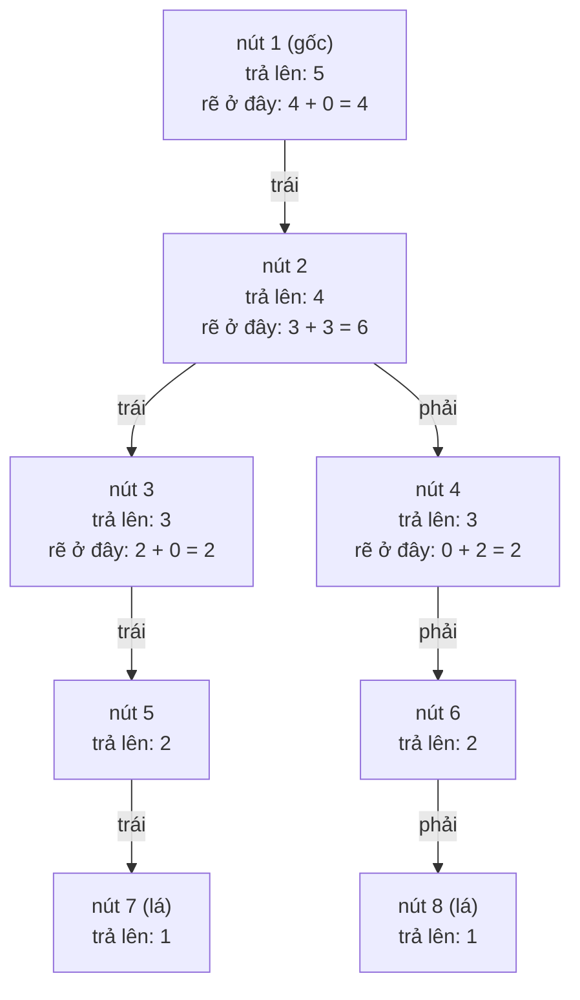
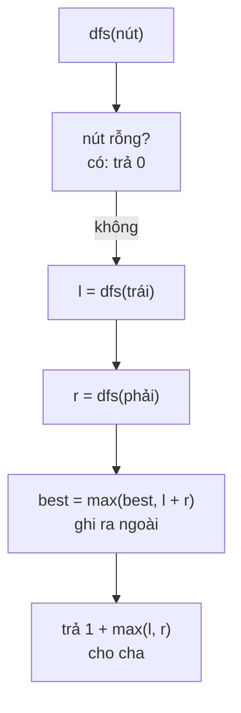

> [!tldr] Đọc nhanh
> - Đề: cho một cây nhị phân, tìm số **cạnh** trên đường đi dài nhất nối hai nút bất kỳ. Đường đó không nhất thiết đi qua gốc.
> - Đường dài nhất luôn "rẽ" ở một nút nào đó: đi xuống trái hết chiều cao cây con trái, đi xuống phải hết chiều cao cây con phải. Nên đáp án là max của `cao(trái) + cao(phải)` trên **mọi** nút, với chiều cao đếm bằng số nút.
> - Cách O(n): một lượt [[concepts/post-order-traversal|hậu thứ tự]]. Hàm đệ quy **trả chiều cao** cho cha, còn đường kính tốt nhất được **ghi vào một biến bên ngoài**. Tính lại chiều cao ở mọi nút cũng đúng, nhưng là O(n²) trên cây lệch: 8 000 nút mất 32 triệu lần ghé nút (489 ms) so với 8 000 lần (0,15 ms).
> - Đề cho tới 10⁴ nút, và một chuỗi lệch 10⁴ nút làm bản đệ quy tràn ngăn xếp ở Node (tối đa 8 939 tầng), Python (996) và Java khi chưa JIT. Bản lặp không có giới hạn này.
> - Bẫy chạy thật: đếm nút thay vì cạnh (lệch 1 ở mọi ca), chỉ xét đường qua gốc, thiếu `nonlocal` trong Python (`UnboundLocalError`), truyền `best` kiểu `int` theo giá trị trong Go và Java (luôn ra 0), biến toàn cục không đặt lại giữa các ca trong JavaScript.

> [!info] Bối cảnh
> Bài LeetCode 543 (Easy), thuộc [[posts/2026-11-25-neetcode-tree-recursion|ga 3: Đệ quy trên cây]] trên **tuyến NeetCode: Cấu trúc liên kết**. Bài này là mỏ neo của ga: nó dùng hàm chiều cao của [[problems/maximum-depth-of-binary-tree|Maximum Depth of Binary Tree]], nhưng ở mỗi nút còn phải ghi lại một thông tin thứ hai không trả được lên cha. Bài cùng ga [[problems/balanced-binary-tree|Balanced Binary Tree]] dùng đúng khung đó, chỉ đổi thông tin thứ hai. Lời giải có đủ TypeScript, Python, Go, Java và JavaScript. Bạn cần biết đệ quy là gì; cây nhị phân được giải thích ngay dưới.

> [!abstract]- Từ điển nhanh cho bài này (bấm để mở)
> - **Cây nhị phân**: mỗi nút có tối đa hai con, trái và phải. Xem [[concepts/binary-tree|Binary Tree]].
> - **Chiều cao** (trong trang này): số nút trên đường dài nhất từ một nút đi thẳng xuống một lá. Cây rỗng cao 0, một nút cao 1.
> - **Đường kính**: số cạnh trên đường đi dài nhất giữa hai nút bất kỳ. Đi qua k nút thì có k − 1 cạnh.
> - **Hậu thứ tự (post-order)**: xử lý hai cây con trước, rồi mới tới nút. Đây là thứ tự duy nhất cho nút dùng được kết quả của con. Xem [[concepts/post-order-traversal|Post-order Traversal]].
> - **Ngăn xếp gọi hàm**: mỗi lời gọi chưa trả về giữ một khung; đệ quy trên cây cao h giữ h khung cùng lúc. Đầy thì `RangeError`, `RecursionError`, `StackOverflowError`. Xem [[concepts/recursion-depth-limit|Recursion Depth Limit]].
> - **Chuỗi lệch**: cây mà mọi nút chỉ có con trái; n nút thì cao n. Đây là cây sâu nhất có thể.

## Hình dung trước: chuyền tin trong sơ đồ tổ chức

Một công ty có sơ đồ tổ chức dạng cây: mỗi quản lý có tối đa hai người báo cáo trực tiếp. Tin chỉ được chuyền giữa sếp và nhân viên trực tiếp. Câu hỏi: hai người nào trong công ty cách nhau nhiều bước chuyền nhất?

Chuỗi chuyền dài nhất đi lên tới một quản lý nào đó rồi rẽ xuống nhánh bên kia. Nên mỗi quản lý chỉ cần biết một con số từ mỗi nhóm dưới mình: "nhánh của tôi sâu bao nhiêu tầng". Có hai con số đó, quản lý tự tính được chuỗi dài nhất rẽ ở chỗ mình, ghi lên bảng chung nếu nó dài hơn số đang ghi, rồi báo lên sếp **một** con số: tầng sâu nhất của nhóm mình. Sếp không cần biết chuỗi rẽ ở chỗ cấp dưới dài bao nhiêu, vì chuỗi đó đã nằm trên bảng.

| Đời thường | Khái niệm |
|---|---|
| Sơ đồ tổ chức, mỗi người tối đa hai cấp dưới | cây nhị phân |
| Một bước chuyền tin | một cạnh |
| "Nhóm của tôi sâu bao nhiêu tầng" báo lên sếp | giá trị trả về: chiều cao |
| Chuỗi rẽ ở một quản lý | `cao(trái) + cao(phải)` tại nút đó |
| Bảng chung ghi chuỗi dài nhất | biến `best` bên ngoài hàm đệ quy |
| Các nhóm báo xong thì quản lý mới tính | hậu thứ tự |
| Mỗi quản lý tự đi đếm lại cả nhóm dưới mình | cách 1, tính lại chiều cao: O(n²) |

Cây dưới đây là một ca trong file chạy thử. Mỗi ô ghi chiều cao nút trả lên cha và đường dài nhất rẽ ở nút đó:



Đường dài nhất là 7 → 5 → 3 → 2 → 4 → 6 → 8, sáu cạnh, rẽ ở nút 2. Đường dài nhất đi qua gốc chỉ có bốn cạnh, vì gốc không có con phải.

## Vấn đề

Đầu vào là gốc của một cây nhị phân có từ 1 tới 10⁴ nút, giá trị mỗi nút trong [−100, 100] (giá trị không ảnh hưởng đáp án). Trả về độ dài, tính bằng số cạnh, của đường đi dài nhất nối hai nút bất kỳ. Một nút thì đáp án là 0. Đề gốc: [LeetCode 543](https://leetcode.com/problems/diameter-of-binary-tree/).

Mình từng nghĩ đường dài nhất phải đi từ lá sâu nhất bên trái, qua gốc, tới lá sâu nhất bên phải. Ca ở hình trên bác bỏ điều đó: gốc chỉ có một con, nên mọi đường qua gốc đều "cụt" một bên. Vậy phải xét chỗ rẽ ở **mọi** nút, và câu hỏi là làm sao xét hết mà không đi lại cây nhiều lần.

## Cơ chế

### Vì sao chỉ cần chiều cao hai bên

Lấy đường dài nhất bất kỳ, và gọi v là nút cao nhất (gần gốc nhất) trên đường đó. Từ v, đường đi xuống tối đa hai nhánh: một vào cây con trái, một vào cây con phải (không thể đi lên, vì v là nút cao nhất). Mỗi nhánh dài nhất có thể là đi thẳng xuống lá sâu nhất của cây con đó, tức là đúng `cao(con)` cạnh tính từ v (một cạnh từ v xuống con, cộng chiều cao của con trừ 1). Nên đường dài nhất rẽ ở v có `cao(trái) + cao(phải)` cạnh, và đáp án là max của đại lượng này trên mọi v.

Với chiều cao tính bằng **số nút**, tổng `cao(trái) + cao(phải)` ra thẳng số **cạnh**. Đây là chỗ dễ lệch 1 nhất của bài: cộng thêm 1 cho chính v là đang đếm nút.

### Cách 1: tính lại chiều cao ở mọi nút

Viết đúng theo định nghĩa: đường kính của cây là max của ba thứ, đường rẽ ở gốc, đường kính cây con trái, đường kính cây con phải.

```ts
// Cách 1: đường kính = max(đi qua nút này, đường kính cây trái, đường kính cây phải).
// height() đi lại cả cây con ở mỗi nút: O(n log n) với cây cân, O(n²) với chuỗi lệch.
function diameterNaive(root: TreeNode | null): number {
  if (root === null) return 0;
  const through = height(root.left) + height(root.right);
  return Math.max(through, diameterNaive(root.left), diameterNaive(root.right));
}
```

Đúng, nhưng mỗi nút gọi `height` trên cả hai cây con, và `height` đi hết cây con đó. Một nút ở độ sâu d bị ghé lại d lần (một lần cho mỗi tổ tiên). Tổng số lần ghé là tổng độ sâu mọi nút: khoảng n log n với cây cân, n(n − 1)/2 với chuỗi lệch. Bộ nhớ thêm O(h) cho ngăn xếp gọi hàm, h là chiều cao cây.

### Cách 2: một lượt hậu thứ tự

Hàm chiều cao vốn đã tính `cao(trái)` và `cao(phải)` ở mỗi nút rồi mới trả về. Chỉ cần nhân lúc có hai số đó, cập nhật đường kính tốt nhất:

```ts
// Cách 2: một lượt hậu thứ tự. dfs trả chiều cao cho cha, còn đường kính tốt nhất ghi vào biến ngoài. O(n).
function diameterOnePass(root: TreeNode | null): number {
  let best = 0;
  const dfs = (node: TreeNode | null): number => {
    if (node === null) return 0;
    const l = dfs(node.left);
    const r = dfs(node.right);
    best = Math.max(best, l + r); // đường đi rẽ ở node: l cạnh xuống trái + r cạnh xuống phải
    return 1 + Math.max(l, r);
  };
  dfs(root);
  return best;
}
```

Hàm có hai đầu ra khác nhau, và đó là ý chính của cả ga:

- **giá trị trả về** là thứ cha cần để tự tính: chiều cao. Cha chỉ nối thêm được **một** nhánh của con vào đường của mình, nên trả `1 + max(l, r)` chứ không phải `l + r`;
- **biến ngoài `best`** giữ thứ cha không dùng được nhưng đáp án cần: đường rẽ ở con.

Mỗi nút được ghé đúng một lần: O(n) thời gian, O(h) bộ nhớ cho ngăn xếp gọi hàm.



### Cách 3: bản lặp, không đệ quy

Cách 2 đệ quy sâu bằng chiều cao cây, và đề cho phép cây cao 10⁴. Bản lặp làm cùng phép tính theo cùng thứ tự con trước cha, nhưng tự giữ thứ tự trong mảng:

1. duyệt tiền thứ tự bằng một [[concepts/stack|ngăn xếp]] tự quản lý, ghi các nút theo thứ tự lấy ra; mỗi nút được ghi trước mọi con cháu của nó;
2. xử lý mảng đó theo thứ tự **ngược**: giờ mỗi nút đứng sau mọi con cháu, nên khi tới nút thì chiều cao hai con đã có trong bảng.

```ts
// Cách 3: cùng phép tính, không đệ quy. Duyệt tiền thứ tự bằng ngăn xếp rồi xử lý theo thứ tự ngược:
// mỗi nút được xử lý sau mọi con cháu của nó. Không giới hạn độ sâu.
function diameterIterative(root: TreeNode | null): number {
  if (root === null) return 0;
  const order: TreeNode[] = [];
  const stack: TreeNode[] = [root];
  while (stack.length > 0) {
    const node = stack.pop()!;
    order.push(node);
    if (node.left !== null) stack.push(node.left);
    if (node.right !== null) stack.push(node.right);
  }
  const h = new Map<TreeNode, number>();
  let best = 0;
  for (let i = order.length - 1; i >= 0; i--) {
    const node = order[i];
    const l = node.left === null ? 0 : h.get(node.left)!;
    const r = node.right === null ? 0 : h.get(node.right)!;
    best = Math.max(best, l + r);
    h.set(node, 1 + Math.max(l, r));
  }
  return best;
}
```

O(n) thời gian, O(n) bộ nhớ (mảng thứ tự và bảng chiều cao), không phụ thuộc chiều cao cây. Cái giá là bảng băm nút → chiều cao, chậm hơn một biến cục bộ trên ngăn xếp (xem phần đo).

| Cách | Thời gian | Bộ nhớ thêm | Ghi chú |
|---|---|---|---|
| Tính lại chiều cao | O(n log n) cây cân, O(n²) chuỗi lệch | O(h) | đúng theo định nghĩa, dễ viết |
| Một lượt hậu thứ tự | O(n) | O(h) | đệ quy sâu h tầng |
| Bản lặp | O(n) | O(n) | không giới hạn độ sâu, cần bảng chiều cao |

Một cách O(n) nữa không cần chiều cao: coi cây như đồ thị vô hướng, BFS từ một nút bất kỳ tới nút xa nhất u, rồi BFS từ u tới nút xa nhất; khoảng cách lần hai là đường kính. Cách này cần con trỏ lên cha hoặc danh sách kề, nên trên cây nhị phân chỉ có con trỏ xuống, hai cách trên gọn hơn. File TypeScript dùng BFS từ **mọi** nút (O(n²), đúng theo định nghĩa) làm đáp án mẫu để đối chiếu.

### Đo

TypeScript, Node 24, trung vị 5 lần. "Ghé" là số lần hàm chiều cao chạm một nút thật.

| Cây | n | Tính lại: ghé | Tính lại | Một lượt: ghé | Một lượt | Bản lặp |
|---|---|---|---|---|---|---|
| chuỗi lệch | 1 000 | 499 500 | 6,54 ms | 1 000 | 0,02 ms | |
| chuỗi lệch | 2 000 | 1 999 000 | 27,9 ms | 2 000 | 0,04 ms | |
| chuỗi lệch | 4 000 | 7 998 000 | 118 ms | 4 000 | 0,07 ms | |
| chuỗi lệch | 8 000 | 31 996 000 | 489 ms | 8 000 | 0,15 ms | |
| ngẫu nhiên | 10⁴ | 153 437 | 1,96 ms | 10⁴ | 0,18 ms | 0,91 ms |
| ngẫu nhiên | 10⁵ | 2 085 711 | 33,9 ms | 10⁵ | 2,19 ms | 10,5 ms |
| ngẫu nhiên | 10⁶ | 24 767 748 | 829 ms | 10⁶ | 83,8 ms | 320 ms |

- Trên chuỗi lệch, số lần ghé của cách 1 đúng bằng n(n − 1)/2: n gấp đôi thì thời gian gấp bốn.
- Trên cây ngẫu nhiên (mỗi nút mới gắn vào một chỗ trống ngẫu nhiên), số lần ghé chia n là 15, 21, 25: đúng dáng n log n, vì độ sâu trung bình tăng theo log n.
- Bản lặp chậm hơn bản đệ quy 4 tới 5 lần ở cây ngẫu nhiên: mỗi nút phải ghi và đọc một `Map`.

Độ sâu đệ quy tối đa của cách 2 trên chuỗi lệch, tìm bằng tìm kiếm nhị phân trên n:

| Runtime | Độ sâu tối đa | Chuỗi 10⁴ nút (giới hạn đề) |
|---|---|---|
| Node 24 (TypeScript, JavaScript) | 8 939 nút | `RangeError` |
| Python 3.12 | 996 nút (giới hạn mặc định 1 000) | `RecursionError`; chạy được sau `sys.setrecursionlimit(20000)` |
| Java 21 | 19 531 lần đo đầu, 29 466 hai lần sau | `StackOverflowError` khi code còn chạy thông dịch, lúc chưa được JIT |
| Go 1.25 | chuỗi 10⁶ nút vẫn chạy: stack goroutine tự nới | chạy |

Con số Java thay đổi theo lần đo vì khung của code thông dịch lớn hơn khung của code đã được JIT biên dịch: trong vòng kiểm tra ca, hàm mới chạy vài lần nên tràn ở 10⁴, còn sau hàng chục lần gọi trong vòng tìm kiếm nhị phân thì chịu được gần 30 000. Mình không kiểm được LeetCode chạy với kích thước ngăn xếp bao nhiêu, nên không biết họ có đưa chuỗi 10⁴ nút vào bộ test hay không; trên máy mình, một bản đệ quy đúng thuật toán vẫn có thể hỏng ở giới hạn của đề.

Bản lặp trên chuỗi 10⁶ nút: 131 ms ở TypeScript, 317 ms ở Python. Go ngược lại: đệ quy 19,4 ms, bản lặp 146 ms, vì stack goroutine nới được còn `map[*TreeNode]int` thì tốn hơn nhiều so với một biến cục bộ.

### Bên dưới năm ngôn ngữ

Khó khăn chung: hàm đệ quy bên trong phải **ghi** vào `best` của hàm bên ngoài. Mỗi ngôn ngữ có cách riêng, và cách sai riêng.

| | Cách giữ `best` | Bẫy |
|---|---|---|
| TypeScript / JavaScript | closure: `let best` trong hàm ngoài, arrow function bên trong ghi thẳng | đặt `best` ở cấp module và quên đặt lại: ca sau nhận max của các ca trước |
| Python | hàm lồng + `nonlocal best` | thiếu `nonlocal`: phép gán biến `best` thành biến cục bộ của hàm trong, đọc trước khi gán ném `UnboundLocalError` |
| Go | closure khai báo trước `var dfs func(*TreeNode) int` rồi mới gán; hoặc truyền `*int` | truyền `best int`: mỗi lời gọi có bản sao, kết quả luôn 0. Viết `dfs := func…` rồi gọi `dfs` bên trong thì không biên dịch được |
| Java | mảng `int[] best = {0}` (hay một field) truyền vào hàm phụ | truyền `int best`: Java truyền giá trị, luôn ra 0. Lambda không được gán biến cục bộ bên ngoài (lỗi biên dịch "effectively final") |

Kiểu số không là vấn đề ở bài này: đường kính không quá 10⁴ − 1, vừa mọi kiểu nguyên.

## Ví dụ chạy được

[TypeScript](../code/neetcode-diameter-of-binary-tree/diameter.ts) · [Python](../code/neetcode-diameter-of-binary-tree/diameter.py) · [Go](../code/neetcode-diameter-of-binary-tree/diameter.go) · [Java](../code/neetcode-diameter-of-binary-tree/diameter.java) · [JavaScript](../code/neetcode-diameter-of-binary-tree/diameter.js)

Mỗi file dựng cây từ mảng theo tầng kiểu LeetCode (`null` là chỗ trống) và chạy 7 ca chung: một nút, hai nút, đường rẽ ở gốc, đường không đi qua gốc (cây ở hình trên), cây đầy 15 nút, giá trị âm, và chuỗi lệch 10⁴ nút (giới hạn đề). File TypeScript đối chiếu thêm 2 000 cây ngẫu nhiên (sinh bằng mulberry32) với BFS từ mọi nút.

Một lượt hậu thứ tự:

```ts
// Cách 2: một lượt hậu thứ tự. dfs trả chiều cao cho cha, còn đường kính tốt nhất ghi vào biến ngoài. O(n).
function diameterOnePass(root: TreeNode | null): number {
  let best = 0;
  const dfs = (node: TreeNode | null): number => {
    if (node === null) return 0;
    const l = dfs(node.left);
    const r = dfs(node.right);
    best = Math.max(best, l + r); // đường đi rẽ ở node: l cạnh xuống trái + r cạnh xuống phải
    return 1 + Math.max(l, r);
  };
  dfs(root);
  return best;
}
```

```python
def diameter_one_pass(root):
    """Cách 2: dfs trả chiều cao; best là biến của hàm ngoài nên hàm trong phải khai báo nonlocal."""
    best = 0

    def dfs(node):
        nonlocal best
        if node is None:
            return 0
        l, r = dfs(node.left), dfs(node.right)
        best = max(best, l + r)
        return 1 + max(l, r)

    dfs(root)
    return best
```

```go
// Cách 2: closure đệ quy phải khai báo trước (var dfs func...) rồi mới gán, để thân hàm gọi được chính nó.
func diameterOnePass(root *TreeNode) int {
	best := 0
	var dfs func(*TreeNode) int
	dfs = func(node *TreeNode) int {
		if node == nil {
			return 0
		}
		l, r := dfs(node.Left), dfs(node.Right)
		best = max(best, l+r) // closure giữ tham chiếu tới best của hàm ngoài
		return 1 + max(l, r)
	}
	dfs(root)
	return best
}
```

```java
// Cách 2: một lượt. Java truyền int theo giá trị, nên best nằm trong mảng một phần tử (hoặc một field).
static int diameterOnePass(TreeNode root) {
    int[] best = {0};
    dfs(root, best);
    return best[0];
}

static int dfs(TreeNode node, int[] best) {
    if (node == null) return 0;
    int l = dfs(node.left, best), r = dfs(node.right, best);
    best[0] = Math.max(best[0], l + r);
    return 1 + Math.max(l, r);
}
```

```js
// Cách 2: một lượt; best nằm trong closure, mỗi lần gọi hàm ngoài có một best mới.
function diameterOnePass(root) {
  let best = 0;
  const dfs = (node) => {
    if (node === null) return 0;
    const l = dfs(node.left), r = dfs(node.right);
    best = Math.max(best, l + r);
    return 1 + Math.max(l, r);
  };
  dfs(root);
  return best;
}
```

Bản lặp, dùng được cho chuỗi 10⁴ nút ở mọi ngôn ngữ:

```ts
function diameterIterative(root: TreeNode | null): number {
  if (root === null) return 0;
  const order: TreeNode[] = [];
  const stack: TreeNode[] = [root];
  while (stack.length > 0) {
    const node = stack.pop()!;
    order.push(node);
    if (node.left !== null) stack.push(node.left);
    if (node.right !== null) stack.push(node.right);
  }
  const h = new Map<TreeNode, number>();
  let best = 0;
  for (let i = order.length - 1; i >= 0; i--) {
    const node = order[i];
    const l = node.left === null ? 0 : h.get(node.left)!;
    const r = node.right === null ? 0 : h.get(node.right)!;
    best = Math.max(best, l + r);
    h.set(node, 1 + Math.max(l, r));
  }
  return best;
}
```

```python
def diameter_iterative(root):
    """Cách 3: tiền thứ tự bằng ngăn xếp, xử lý theo thứ tự ngược: con luôn xong trước cha."""
    if root is None:
        return 0
    order, stack = [], [root]
    while stack:
        node = stack.pop()
        order.append(node)
        if node.left:
            stack.append(node.left)
        if node.right:
            stack.append(node.right)
    h, best = {None: 0}, 0
    for node in reversed(order):
        l, r = h[node.left], h[node.right]
        best = max(best, l + r)
        h[node] = 1 + max(l, r)
    return best
```

```go
// Cách 3: tiền thứ tự bằng ngăn xếp, xử lý ngược. Chiều cao lưu trong map theo con trỏ nút.
func diameterIterative(root *TreeNode) int {
	if root == nil {
		return 0
	}
	order := []*TreeNode{}
	stack := []*TreeNode{root}
	for len(stack) > 0 {
		node := stack[len(stack)-1]
		stack = stack[:len(stack)-1]
		order = append(order, node)
		if node.Left != nil {
			stack = append(stack, node.Left)
		}
		if node.Right != nil {
			stack = append(stack, node.Right)
		}
	}
	h := make(map[*TreeNode]int, len(order)+1) // h[nil] đọc ra 0, đúng chiều cao cây rỗng
	best := 0
	for i := len(order) - 1; i >= 0; i-- {
		node := order[i]
		l, r := h[node.Left], h[node.Right]
		best = max(best, l+r)
		h[node] = 1 + max(l, r)
	}
	return best
}
```

```java
// Cách 3: tiền thứ tự bằng ngăn xếp, xử lý ngược; chiều cao trong IdentityHashMap theo nút.
static int diameterIterative(TreeNode root) {
    if (root == null) return 0;
    List<TreeNode> order = new ArrayList<>();
    Deque<TreeNode> stack = new ArrayDeque<>();
    stack.push(root);
    while (!stack.isEmpty()) {
        TreeNode node = stack.pop();
        order.add(node);
        if (node.left != null) stack.push(node.left);
        if (node.right != null) stack.push(node.right);
    }
    Map<TreeNode, Integer> h = new IdentityHashMap<>();
    int best = 0;
    for (int i = order.size() - 1; i >= 0; i--) {
        TreeNode node = order.get(i);
        int l = node.left == null ? 0 : h.get(node.left);
        int r = node.right == null ? 0 : h.get(node.right);
        best = Math.max(best, l + r);
        h.put(node, 1 + Math.max(l, r));
    }
    return best;
}
```

```js
// Cách 3: tiền thứ tự bằng ngăn xếp, xử lý ngược; không giới hạn độ sâu.
function diameterIterative(root) {
  if (root === null) return 0;
  const order = [], stack = [root];
  while (stack.length > 0) {
    const node = stack.pop();
    order.push(node);
    if (node.left !== null) stack.push(node.left);
    if (node.right !== null) stack.push(node.right);
  }
  const h = new Map([[null, 0]]);
  let best = 0;
  for (let i = order.length - 1; i >= 0; i--) {
    const node = order[i];
    const l = h.get(node.left), r = h.get(node.right);
    best = Math.max(best, l + r);
    h.set(node, 1 + Math.max(l, r));
  }
  return best;
}
```

Kết quả `node diameter.ts`:

```text
diameterNaive       6/7 ca đúng; sai ở chuỗi lệch 10⁴ nút (giới hạn đề) → ném RangeError
diameterOnePass     6/7 ca đúng; sai ở chuỗi lệch 10⁴ nút (giới hạn đề) → ném RangeError
diameterIterative   7/7 ca đúng
wrongCountNodes     0/7 ca đúng; sai ở một nút → 1, hai nút → 2, rẽ ở gốc → 5, không đi qua gốc → 7, cây đầy 15 nút → 7, giá trị âm → 5, chuỗi lệch 10⁴ nút (giới hạn đề) → ném RangeError
wrongThroughRoot    5/7 ca đúng; sai ở không đi qua gốc → 4, chuỗi lệch 10⁴ nút (giới hạn đề) → ném RangeError
wrongGlobalNoReset  5/7 ca đúng; sai ở giá trị âm → 6, chuỗi lệch 10⁴ nút (giới hạn đề) → ném RangeError

đối chiếu với định nghĩa (BFS từ mọi nút): diameterNaive 2000/2000, diameterOnePass 2000/2000, diameterIterative 2000/2000

chuỗi lệch n nút: số lần ghé nút và thời gian trung vị (ms)
n        tính lại: ghé       ms   một lượt: ghé      ms
1000             499500     6.54           1000    0.02
2000            1999000    27.92           2000    0.04
4000            7998000   118.17           4000    0.07
8000           31996000   489.29           8000    0.15

cây ngẫu nhiên n nút: số lần ghé nút và thời gian trung vị (ms)
n        tính lại: ghé       ms   một lượt: ghé      ms    bản lặp ms
10000            153437     1.96          10000    0.18          0.91
100000          2085711    33.90         100000    2.19         10.50
1000000        24767748   829.48        1000000   83.79        320.16

đệ quy một lượt sâu tối đa: 8939 nút
bản lặp, chuỗi lệch 10⁶ nút: 999999 cạnh, 131.45 ms
```

`wrongGlobalNoReset` đúng ở năm ca đầu chỉ vì đáp án các ca đó không giảm dần; tới "giá trị âm" (đáp án 4) nó vẫn giữ số 6 của cây đầy 15 nút chạy ngay trước.

`python3 diameter.py`:

```text
diameter_naive       6/7 ca đúng; sai ở chuỗi lệch 10⁴ nút (giới hạn đề) → ném RecursionError
diameter_one_pass    6/7 ca đúng; sai ở chuỗi lệch 10⁴ nút (giới hạn đề) → ném RecursionError
diameter_iterative   7/7 ca đúng
wrong_no_nonlocal    0/7 ca đúng; sai ở một nút → ném UnboundLocalError, hai nút → ném UnboundLocalError, rẽ ở gốc → ném UnboundLocalError, không đi qua gốc → ném UnboundLocalError, cây đầy 15 nút → ném UnboundLocalError, giá trị âm → ném UnboundLocalError, chuỗi lệch 10⁴ nút (giới hạn đề) → ném RecursionError

giới hạn đệ quy mặc định 1000: diameter_one_pass sâu tối đa 996 nút
sau setrecursionlimit(20000): chuỗi 10⁴ nút → 9999 cạnh
bản lặp, chuỗi lệch 10⁶ nút: 999999 cạnh, 317 ms
```

`go run diameter.go`:

```text
diameterNaive      7/7 ca đúng
diameterOnePass    7/7 ca đúng
diameterIterative  7/7 ca đúng
diameterPointer    7/7 ca đúng
wrongByValue       1/7 ca đúng; sai ở hai nút → 0, rẽ ở gốc → 0, không đi qua gốc → 0, cây đầy 15 nút → 0, giá trị âm → 0, chuỗi lệch 10⁴ nút (giới hạn đề) → 0

chuỗi lệch 10⁶ nút, trung vị 5 lần (ms)
một lượt đệ quy     19.38  (kết quả 999999)
bản lặp            145.62  (kết quả 999999)
```

`java diameter.java`:

```text
diameterNaive      6/7 ca đúng; sai ở chuỗi lệch 10⁴ nút (giới hạn đề) → ném StackOverflowError
diameterOnePass    6/7 ca đúng; sai ở chuỗi lệch 10⁴ nút (giới hạn đề) → ném StackOverflowError
diameterIterative  7/7 ca đúng
wrongByValue       1/7 ca đúng; sai ở hai nút → 0, rẽ ở gốc → 0, không đi qua gốc → 0, cây đầy 15 nút → 0, giá trị âm → 0, chuỗi lệch 10⁴ nút (giới hạn đề) → ném StackOverflowError

đệ quy một lượt sâu tối đa, lần 1: 19531 nút
đệ quy một lượt sâu tối đa, lần 2: 29466 nút
đệ quy một lượt sâu tối đa, lần 3: 29466 nút
```

`node diameter.js`:

```text
diameterNaive       6/7 ca đúng; sai ở chuỗi lệch 10⁴ nút (giới hạn đề) → ném RangeError
diameterOnePass     6/7 ca đúng; sai ở chuỗi lệch 10⁴ nút (giới hạn đề) → ném RangeError
diameterIterative   7/7 ca đúng
wrongGlobalNoReset  5/7 ca đúng; sai ở giá trị âm → 6, chuỗi lệch 10⁴ nút (giới hạn đề) → ném RangeError
```

## Hiểu lầm và bẫy hay gặp

- **"Đường kính đi qua gốc."** Chỉ khi gốc là nút cao nhất của đường dài nhất. Cây ở hình trên có đường dài nhất rẽ ở nút 2; chỉ xét gốc cho 4 thay vì 6.
- **Đếm nút thay vì cạnh.** Với chiều cao đếm bằng nút, `l + r` đã là số cạnh. Cộng thêm 1 thì sai ở **mọi** ca, kể cả cây một nút (ra 1 thay vì 0).
- **Trả `l + r` lên cha.** Cha chỉ nối được một nhánh của con vào đường của mình. Giá trị trả về phải là chiều cao `1 + max(l, r)`; `l + r` chỉ đi vào `best`.
- **"Cách tính lại chiều cao vẫn O(n), vì mỗi lần chỉ đi một cây con."** Mỗi nút bị đi lại một lần cho mỗi tổ tiên: O(n²) trên chuỗi lệch, đo được 32 triệu lần ghé cho 8 000 nút.
- **"Thuật toán đúng thì qua giới hạn đề."** Chuỗi 10⁴ nút nằm trong giới hạn, và làm bản đệ quy tràn ngăn xếp ở Node, Python và Java (khi chưa JIT) trên máy mình. Bản lặp hoặc nâng giới hạn mới an toàn.
- **Python thiếu `nonlocal`.** Có phép gán `best = …` trong hàm trong là Python coi `best` là biến của hàm trong, nên đọc `best` ở vế phải ném `UnboundLocalError`. Chỉ đọc (không gán) thì không cần `nonlocal`, nên lỗi này chỉ lộ khi bắt đầu cập nhật.
- **Go và Java truyền `int` theo giá trị.** Hàm phụ nhận `best int` thì cập nhật bản sao; hàm ngoài luôn thấy 0. Dùng closure, `*int`, `int[]` hoặc một field.
- **JavaScript và biến cấp module.** LeetCode gọi hàm nhiều lần trong cùng một tiến trình. `best` khai báo ngoài hàm mà không đặt lại thì ca sau nhận max của ca trước.

## Câu hỏi tự kiểm tra

> [!question]- Vì sao hàm đệ quy trả chiều cao, chứ không trả đường kính của cây con?
> Cha cần biết nhánh dài nhất đi xuống từ mỗi con để nối với nhánh bên kia; đường kính của cây con không nối tiếp được, vì nó có thể rẽ ở một nút sâu bên dưới và không chạm tới con. Đường kính của cây con vẫn cần cho đáp án, nên nó được ghi vào `best` ngay tại chỗ rẽ.

> [!question]- Với chiều cao tính bằng số nút, ở nút có `l = 3`, `r = 2`, đường rẽ ở đó dài bao nhiêu cạnh, và nút trả gì lên cha?
> Đường rẽ ở đó có 3 + 2 = 5 cạnh (3 cạnh xuống tới lá sâu nhất bên trái, 2 cạnh bên phải). Nút trả 1 + max(3, 2) = 4 lên cha.

> [!question]- Cách tính lại chiều cao ghé tổng cộng bao nhiêu nút trên một chuỗi lệch n nút?
> Nút ở độ sâu d được ghé một lần cho mỗi tổ tiên, tức d lần. Tổng 0 + 1 + … + (n − 1) = n(n − 1)/2. Với n = 8 000 là 31 996 000, khớp số đếm của file TypeScript.

> [!question]- Bản lặp xử lý các nút theo thứ tự ngược của tiền thứ tự. Vì sao thứ tự đó bảo đảm hai con đã có chiều cao khi tới nút cha?
> Trong tiền thứ tự (dùng ngăn xếp), một nút được lấy ra và ghi vào mảng trước khi bất kỳ con cháu nào của nó được đẩy vào ngăn xếp, nên nó đứng trước mọi con cháu. Đảo ngược mảng thì nó đứng sau mọi con cháu.

> [!question]- Có thể tìm đường kính bằng BFS không, và vì sao trang này không dùng?
> Có: BFS từ nút bất kỳ tới nút xa nhất u, rồi BFS từ u; khoảng cách xa nhất lần hai là đường kính. Nhưng BFS trên cây cần đi được cả lên cha, mà nút cây nhị phân chỉ có con trỏ xuống, nên phải dựng thêm danh sách kề O(n). Một lượt hậu thứ tự không cần gì thêm.

## Tham khảo

- [LeetCode 543: Diameter of Binary Tree](https://leetcode.com/problems/diameter-of-binary-tree/) (đề gốc: 1 tới 10⁴ nút, giá trị trong [−100, 100])
- [Python: câu lệnh `nonlocal`](https://docs.python.org/3/reference/simple_stmts.html#the-nonlocal-statement) và [`sys.setrecursionlimit`](https://docs.python.org/3/library/sys.html#sys.setrecursionlimit)
- [Go spec: Function literals](https://go.dev/ref/spec#Function_literals) (closure dùng chung biến của hàm bao quanh)
- [Java Language Specification SE 21, §15.27.2](https://docs.oracle.com/javase/specs/jls/se21/html/jls-15.html#jls-15.27.2) (biến cục bộ dùng trong lambda phải final hoặc effectively final)
- Cormen, Leiserson, Rivest, Stein, *Introduction to Algorithms*, ấn bản 3, bài tập 22.2-8 (đường kính của cây, giải trong O(n))
