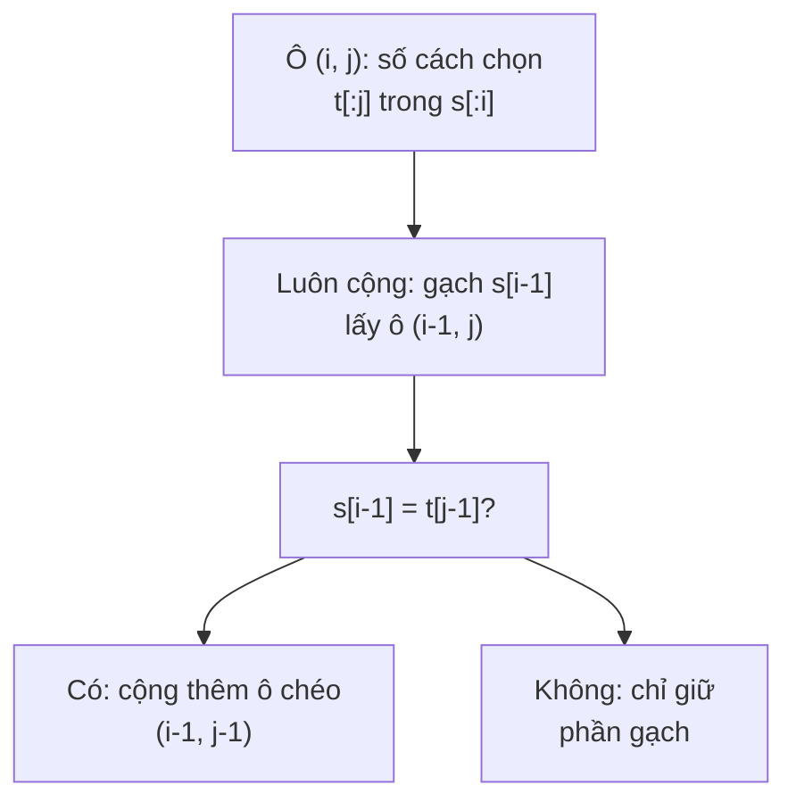

> [!tldr] Đọc nhanh
> - Đếm số tập vị trí trong `s` mà đọc theo thứ tự ra đúng `t`. Hai tập khác nhau ở bất kỳ vị trí nào được tính là hai cách.
> - Ô `ways[i][j]` đếm số cách chọn `t[:j]` trong `s[:i]`. Ký tự `s[i-1]` hoặc bị bỏ qua, hoặc (nếu bằng `t[j-1]`) dùng làm ký tự cuối của `t[:j]`. Hai trường hợp tách rời nên cộng lại.
> - Cùng khuôn [[concepts/two-sequence-dp|DP trên hai chuỗi]] như LCS, nhưng mỗi ô đếm số cách thay vì lấy độ dài lớn nhất.
> - Một hàng là đủ nếu duyệt j **giảm dần**. Các ô ở giữa có thể vượt xa 2^63 dù đáp án nhỏ, nên mình chặn mỗi ô ở 2^31.

> [!info] Bối cảnh
> Đây là bài LeetCode 115 tại [[posts/2026-11-27-neetcode-grid-two-strings|ga DP-05: Lưới và hai chuỗi]] trên **tuyến NeetCode: Quy hoạch động**. Mình hình dung một bảng hiệu dài, và việc gạch bớt chữ để phần còn lại đọc ra một từ cho trước. Bạn chỉ cần biết đọc chuỗi theo chỉ số và chạy vòng lặp lồng nhau.

> [!abstract]- Từ điển nhanh cho bài này (bấm để mở)
> - Dãy con (subsequence) giữ thứ tự nhưng được bỏ qua vị trí, khác đoạn con phải liền nhau.
> - `s[:i]` là tiền tố gồm i ký tự đầu của `s`.
> - [[concepts/recurrence-relation|Công thức truy hồi]] nói ô hiện tại được tính từ những ô nào.
> - [[concepts/rolling-state|Trạng thái cuộn]] chỉ giữ hàng bảng mà bước sau còn đọc.
> - Tràn số (overflow) là khi kết quả phép cộng lớn hơn kiểu số chứa được. Mỗi ngôn ngữ xử lý khác nhau: quay vòng, đổi kiểu hoặc dừng chương trình.
> - Phép cộng bão hòa (saturating addition) cộng rồi kẹp kết quả ở một mức trần.

## Hình dung trước: gạch chữ trên bảng hiệu

Bảng hiệu ghi `banana`. Mình muốn gạch bớt chữ để còn lại `ban`. Chữ `b` chỉ có một chỗ, chữ `a` có ba chỗ, chữ `n` có hai chỗ. Đếm mọi cách giữ lại ba chữ đúng thứ tự: chọn `a` ở vị trí 1 thì `n` có hai chỗ phía sau, chọn `a` ở vị trí 3 thì còn một chỗ, chọn `a` ở vị trí 5 thì hết `n`. Tổng là 3 cách.

| Đời thường | Khái niệm |
|---|---|
| Bảng hiệu dài | Chuỗi `s` |
| Từ muốn giữ lại | Chuỗi `t` |
| Đã đọc i chữ đầu của bảng hiệu, đã khớp j chữ đầu của từ | Ô `ways[i][j]` |
| Gạch chữ đang xét | Bỏ qua `s[i-1]`: lấy `ways[i-1][j]` |
| Giữ chữ đang xét làm chữ thứ j của từ | Dùng `s[i-1] = t[j-1]`: cộng `ways[i-1][j-1]` |
| Từ rỗng giữ được theo đúng một cách: gạch hết | `ways[i][0] = 1` |



## Vấn đề: đếm số cách đọc ra một chuỗi

Cho hai chuỗi `s` và `t`, mỗi chuỗi dài 1–1.000 ký tự, gồm chữ cái tiếng Anh (phân biệt hoa thường). Đếm số cách chọn một tập vị trí trong `s`, đọc theo thứ tự tăng, ra đúng `t`. Đề bảo đảm đáp án vừa một số nguyên có dấu 32 bit. Ví dụ `aaa` và `aa` có 3 cách: giữ vị trí (0, 1), (0, 2) hoặc (1, 2). [Đề gốc LeetCode 115](https://leetcode.com/problems/distinct-subsequences/)

## Cơ chế

### Vét cạn: mỗi chữ của s, giữ hay gạch

Hàm `search(i, j)` đếm số cách khớp `t[j:]` trong `s[i:]`. Khớp hết `t` (j = n) là một cách. Nếu phần còn lại của `s` ngắn hơn phần còn lại của `t` thì không còn cách nào. Ngược lại, luôn thử gạch `s[i]`, và nếu `s[i] == t[j]` thì thử thêm việc giữ nó. Hai nhánh cho hai tập vị trí khác nhau ở `i`, nên cộng chúng không đếm trùng.

Với m = `len(s)`, n = `len(t)`, vét cạn có thể đi tới mọi tập con vị trí của `s`, tức O(2^m) thời gian, O(m) ngăn xếp.

### Ghi nhớ và bảng

`search(i, j)` chỉ phụ thuộc hai hậu tố `s[i:]` và `t[j:]`, nên có (m + 1)(n + 1) trạng thái. Lưu đáp án theo (i, j) cho O(mn) thời gian và bộ nhớ.

Viết từ dưới lên theo tiền tố: `ways[i][0] = 1` với mọi i (từ rỗng), `ways[0][j] = 0` với j > 0, và

```text
ways[i][j] = ways[i-1][j] + (s[i-1] == t[j-1] ? ways[i-1][j-1] : 0)
```

Khác với [[concepts/lcs-table|bảng LCS]] ở hai chỗ. LCS lấy max và đối xứng giữa hai chuỗi, còn ở đây là phép đếm có hướng: chỉ `s` được bỏ ký tự, `t` phải khớp trọn. Vì thế khi ký tự khác nhau, ô chỉ lấy ô trên chứ không lấy ô trái.

### Một hàng, duyệt ngược

Ô (i, j) đọc ô trên (i − 1, j) và ô chéo (i − 1, j − 1), đều thuộc hàng trước. Giữ một mảng `row` dài n + 1. Với mỗi ký tự của `s`, duyệt j từ n về 1: khi cập nhật `row[j]`, ô `row[j-1]` chưa bị ghi ở lượt này nên vẫn là giá trị hàng trước. Duyệt tăng thì `row[j-1]` đã là hàng mới, và một ký tự của `s` sẽ bị dùng hai lần. Đây cùng lý do với ba lô 0/1 ở [[posts/2026-11-27-neetcode-knapsack|ga DP-03]]. Bộ nhớ phụ còn O(n).

### Ô ở giữa lớn hơn đáp án rất nhiều

Đề chỉ bảo đảm **đáp án** vừa 32 bit, không bảo đảm các ô ở giữa. Với `s` là 1.000 chữ `a` và `t` là 499 chữ `a` rồi một chữ `b`, đáp án là 0, nhưng ô `row[100]` sau khi đọc hết `s` bằng C(1000, 100) ≈ 6,4·10^139. Không kiểu số nguyên cố định nào chứa nổi.

Vậy sao vẫn ra đúng? Mọi ô đều không âm, và dọc theo đường mà một ô góp vào đáp án, giá trị chỉ tăng. Ô (i, j) góp vào ô (i + 1, j) qua nhánh gạch, và góp vào ô (i + 1, j + 1) qua nhánh giữ. Mỗi lần góp là cộng thêm một số không âm vào ô sau. Nên một ô có ảnh hưởng tới đáp án thì không thể lớn hơn đáp án. Ô nào lớn hơn 2^31 chắc chắn không góp vào đáp án. Mình kẹp mọi ô ở trần `CAP = 2^31`: giá trị kẹp luôn bằng min(giá trị thật, CAP), và đáp án thật nhỏ hơn CAP nên không đổi. Mỗi file kiểm tra đúng tính chất này với trần nhỏ 3 trên mọi ca vét.

Không có trần, mỗi ngôn ngữ phản ứng khác nhau ở các ô không góp vào đáp án:

| Ngôn ngữ | Không chặn thì ô lớn trở thành gì |
|---|---|
| Python | số nguyên lớn tùy ý, đúng nhưng tốn bộ nhớ hơn |
| TypeScript, JavaScript | số thực, mất độ chính xác sau 2^53 |
| Go (`int`), Java (`int`, `long`) | quay vòng theo modulo 2^64 hoặc 2^32, không báo lỗi |
| PHP | tự đổi sang `float` |
| Rust | bản debug dừng với `attempt to add with overflow`, bản `-O` quay vòng |

Các bản ở đây đều cho đáp án đúng ngay cả khi không chặn, trừ Rust bản debug. Nhưng chúng đúng vì mỗi ngôn ngữ tình cờ không làm hỏng các ô không liên quan, chứ không phải vì mình đã nghĩ tới. Trần 2^31 làm lập luận rõ ràng và giống nhau ở cả bảy ngôn ngữ.

| Cách | Thời gian | Bộ nhớ phụ |
|---|---|---|
| Vét cạn | O(2^m) | O(m) ngăn xếp |
| Ghi nhớ (i, j) | O(mn) | O(mn) |
| Bảng hai chiều | O(mn) | O(mn) |
| Một hàng duyệt ngược | O(mn) | O(n) |

## Ví dụ chạy được

[TypeScript](../code/neetcode-distinct-subsequences/ways.ts) · [Python](../code/neetcode-distinct-subsequences/ways.py) · [Go](../code/neetcode-distinct-subsequences/ways.go) · [Java](../code/neetcode-distinct-subsequences/ways.java) · [JavaScript](../code/neetcode-distinct-subsequences/ways.js) · [PHP](../code/neetcode-distinct-subsequences/ways.php) · [Rust](../code/neetcode-distinct-subsequences/ways.rs)

```ts
function fillRow(s: string, t: string, cap: number) {
    const row: number[] = [1, ...Array(t.length).fill(0)]
    for (const ch of s) {
        // đi ngược để row[j - 1] vẫn là giá trị của hàng trước
        for (let j = t.length; j >= 1; j--) {
            if (ch === t[j - 1]) row[j] = Math.min(row[j] + row[j - 1], cap)
        }
    }
    return row
}
```

```python
def fill_row(s, t, cap):
    row = [1] + [0] * len(t)
    for ch in s:
        # đi ngược để row[j - 1] vẫn là giá trị của hàng trước
        for j in range(len(t), 0, -1):
            if ch == t[j - 1]:
                row[j] = min(row[j] + row[j - 1], cap)
    return row
```

```go
func fillRow(s, t string, limit int) []int {
	row := make([]int, len(t)+1)
	row[0] = 1
	for i := 0; i < len(s); i++ {
		// đi ngược để row[j - 1] vẫn là giá trị của hàng trước
		for j := len(t); j >= 1; j-- {
			if s[i] == t[j-1] {
				row[j] = min(row[j]+row[j-1], limit)
			}
		}
	}
	return row
}
```

```java
static long[] fillRow(String s, String t, long cap) {
    long[] row = new long[t.length() + 1];
    row[0] = 1;
    for (int i = 0; i < s.length(); i++) {
        // đi ngược để row[j - 1] vẫn là giá trị của hàng trước
        for (int j = t.length(); j >= 1; j--) {
            if (s.charAt(i) == t.charAt(j - 1)) row[j] = Math.min(row[j] + row[j - 1], cap);
        }
    }
    return row;
}
```

```js
function fillRow(s, t, cap) {
    const row = [1, ...Array(t.length).fill(0)]
    for (const ch of s) {
        // đi ngược để row[j - 1] vẫn là giá trị của hàng trước
        for (let j = t.length; j >= 1; j--) {
            if (ch === t[j - 1]) row[j] = Math.min(row[j] + row[j - 1], cap)
        }
    }
    return row
}
```

```php
function fillRow(string $s, string $t, int $cap): array {
    $n = strlen($t);
    $row = array_fill(0, $n + 1, 0);
    $row[0] = 1;
    for ($i = 0; $i < strlen($s); $i++) {
        // đi ngược để row[j - 1] vẫn là giá trị của hàng trước
        for ($j = $n; $j >= 1; $j--) {
            if ($s[$i] === $t[$j - 1]) $row[$j] = min($row[$j] + $row[$j - 1], $cap);
        }
    }
    return $row;
}
```

```rust
fn fill_row(s: &str, t: &str, cap: u64) -> Vec<u64> {
    let t = t.as_bytes();
    let mut row = vec![0u64; t.len() + 1];
    row[0] = 1;
    for &ch in s.as_bytes() {
        // đi ngược để row[j - 1] vẫn là giá trị của hàng trước
        for j in (1..=t.len()).rev() {
            if ch == t[j - 1] {
                row[j] = (row[j] + row[j - 1]).min(cap);
            }
        }
    }
    row
}
```

Các tab trích hàm điền một hàng. Đáp án là `row[len(t)]`, với `cap = CAP`. File tải về còn có vét cạn, bản ghi nhớ và bảng hai chiều. 11 ca gồm chữ hoa khác chữ thường, `t` dài hơn `s`, `s` và `t` đều dài 1.000, và ca `a…ab` ở trên. Mỗi file còn so cả bốn cách với một bộ liệt kê mọi tập vị trí, trên mọi `s` gồm `a/b` dài 0–7 và `t` dài 1–3, rồi so bản kẹp ở trần 3 với min(đáp án thật, 3). Dòng cuối đếm số ô của hàng cuối đã chạm trần trong ca `a…ab`.

Bản Python giữ bảng và bản ghi nhớ không chặn, vì số nguyên Python không tràn. Sáu ngôn ngữ còn lại kẹp ở cả ba bản.

```text
11/11 ca đúng
3570/3570 ca đúng (vét mọi tập vị trí)
Hàng cuối: 496/501 ô chạm 2^31, đáp án 0
```

Chạy bằng `node ways.ts`, `python3 ways.py`, `go run ways.go`, `java ways.java`, `node ways.js`, `php ways.php` hoặc `rustc --edition 2021 -O ways.rs -o /tmp/ways && /tmp/ways`.

## Hiểu lầm và bẫy hay gặp

- Mình từng nghĩ "đáp án vừa 32 bit thì dùng `int` là đủ, dùng `long` cho chắc". Các ô ở giữa có thể vượt cả 2^63. Code Java hay Go vẫn ra đúng vì phép cộng quay vòng và ô tràn không góp vào đáp án, nhưng đó là may. Trong C++, tràn số nguyên có dấu là hành vi không xác định.
- Duyệt j tăng dần trong bản một hàng. Với `s = "a"`, `t = "aa"`, duyệt tăng cho `row[2] = 1` vì cùng một chữ `a` được dùng hai lần. Đáp án đúng là 0.
- Quên `ways[i][0] = 1`. Từ rỗng luôn có đúng một cách (gạch hết), và mọi phép đếm đều bắt nguồn từ cột này.
- Khi ký tự khác nhau, lấy thêm ô trái như LCS. Ô trái là bỏ một ký tự của `t`, điều đề không cho phép.
- Python: bản ghi nhớ đệ quy sâu tới 1.000 tầng, vượt giới hạn mặc định của CPython, nên file gọi `sys.setrecursionlimit`. PHP với Xdebug bật sẽ dừng đệ quy sâu quá 512 tầng, nên chạy với `-d xdebug.mode=off`.
- Rust: biên dịch không có `-O` thì bỏ trần là chương trình dừng giữa chừng. Dùng `.min(CAP)` (hoặc `saturating_add`) để hành vi giống nhau ở mọi chế độ.

## Câu hỏi tự kiểm tra

> [!question]- Vì sao cộng hai nhánh "gạch" và "giữ" không đếm trùng?
> Hai nhánh khác nhau ở chỗ vị trí `i - 1` có nằm trong tập chọn hay không, nên không tập vị trí nào thuộc cả hai.

> [!question]- Vì sao ô lớn hơn đáp án không thể ảnh hưởng tới đáp án?
> Mọi ô không âm, và ô nào góp vào ô sau thì ô sau ít nhất bằng nó. Đi dọc đường góp tới đáp án, giá trị không giảm.

> [!question]- Đổi vai trò s và t (đếm t trong s) có đối xứng không?
> Không. Chỉ `s` được bỏ ký tự. Nếu `len(t) > len(s)` thì đáp án là 0.

## Tham khảo

- [LeetCode 115](https://leetcode.com/problems/distinct-subsequences/)
- [Jeff Erickson, Algorithms, chương quy hoạch động](https://jeffe.cs.illinois.edu/teaching/algorithms/book/03-dynprog.pdf)
- [MIT 6.006 (2020), bài giảng 16: chọn bài toán con, có LCS trên hai chuỗi](https://ocw.mit.edu/courses/6-006-introduction-to-algorithms-spring-2020/resources/mit6_006s20_lec16/)
- [Go spec, tràn số nguyên](https://go.dev/ref/spec#Integer_overflow) · [Java JLS 15.18.2](https://docs.oracle.com/javase/specs/jls/se21/html/jls-15.html#jls-15.18.2) · [PHP integer overflow](https://www.php.net/manual/en/language.types.integer.php) · [Rust Book, integer overflow](https://doc.rust-lang.org/book/ch03-02-data-types.html#integer-overflow)
