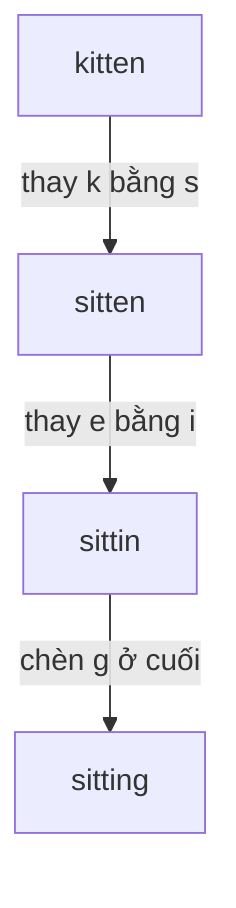
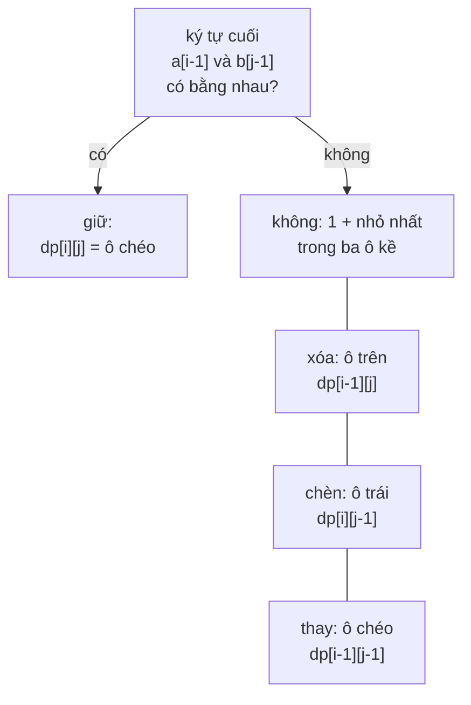

> [!tldr] Đọc nhanh
> - Đặt `dp[i][j]` là số bước ít nhất để biến tiền tố `a[0:i]` thành `b[0:j]`. Đó là một [[concepts/two-sequence-dp|bảng trên hai tiền tố]].
> - Nhìn ký tự cuối của hai tiền tố. Nếu bằng nhau thì giữ và lấy ô chéo. Nếu khác, ba [[concepts/edit-operations|phép sửa]] ứng với ba ô kề: xóa là ô trên, chèn là ô trái, thay là ô chéo.
> - Hàng 0 và cột 0 không phải số 0: biến chuỗi rỗng thành `b[0:j]` cần j lần chèn.
> - Chỉ cần một hàng cộng một biến giữ ô chéo cũ, bộ nhớ còn O(min(m, n)). Muốn in kịch bản sửa thì giữ cả bảng.

> [!info] Bối cảnh
> Đây là bài LeetCode 72 tại [[posts/2026-11-27-neetcode-grid-two-strings|ga DP-05: Lưới và hai chuỗi]] trên **tuyến NeetCode: Quy hoạch động**. Mình hình dung một tấm bảng hiệu ghép từ các miếng chữ rời, cần sửa thành tên mới với ít thao tác nhất. Bạn chỉ cần biết chuỗi, mảng hai chiều và vòng lặp lồng nhau.

> [!abstract]- Từ điển nhanh cho bài này (bấm để mở)
> - Tiền tố `a[0:i]` là i ký tự đầu của `a`; `a[0:0]` là chuỗi rỗng.
> - [[concepts/dp-state|Trạng thái DP]] nói rõ một ô của bảng lưu điều gì.
> - [[concepts/recurrence-relation|Công thức truy hồi]] cho biết ô hiện tại đọc những ô nào.
> - [[concepts/memoization|Ghi nhớ kết quả]] (memoization) lưu đáp án của một trạng thái ngay lần đầu tính.
> - [[concepts/rolling-state|Rolling State]] tái dùng chỗ chứa của hàng cũ khi lượt sau không còn đọc nó.
> - Khoảng cách Levenshtein là tên gốc của con số bài này hỏi: số phép chèn, xóa, thay ít nhất.

## Hình dung trước: sửa bảng hiệu ghép từ miếng chữ

Tấm bảng đang ghi `kitten`, cần thành `sitting`. Mình có ba việc, mỗi việc tốn một lượt: gỡ một miếng chữ, gắn thêm một miếng, hoặc thay một miếng bằng chữ khác. Miếng nào đã đúng chỗ thì để nguyên, không tốn gì. Cách rẻ nhất ở đây là ba lượt.

| Đời thường | Khái niệm |
|---|---|
| Các miếng chữ đang treo | Chuỗi nguồn `word1` |
| Tên mới cần ra | Chuỗi đích `word2` |
| Gỡ một miếng | Xóa, đọc ô trên `dp[i-1][j]` |
| Gắn thêm một miếng | Chèn, đọc ô trái `dp[i][j-1]` |
| Thay một miếng | Thay, đọc ô chéo `dp[i-1][j-1]` |
| Miếng đã đúng chữ | Giữ, ô chéo không cộng thêm |
| Số lượt ít nhất cho phần đầu tấm bảng | `dp[i][j]` |



## Vấn đề: biến chuỗi này thành chuỗi kia với ít bước nhất

Cho hai chuỗi `word1` và `word2`, mỗi chuỗi dài từ 0 đến 500 ký tự, chỉ gồm chữ thường tiếng Anh. Mỗi bước được chèn một ký tự vào bất kỳ đâu, xóa một ký tự, hoặc thay một ký tự bằng ký tự khác. Trả về số bước ít nhất để biến `word1` thành `word2`. Ví dụ, `flaw` thành `lawn` cần 2 bước: xóa `f` rồi chèn `n` ở cuối. [Đề gốc LeetCode 72](https://leetcode.com/problems/edit-distance/)

Mình từng nghĩ chỉ cần so từng vị trí và đếm chỗ khác. Cách đó đúng khi hai chuỗi dài bằng nhau và không ai lệch ai. `pqrst` với `qrstu` khác nhau ở cả năm vị trí, nhưng chỉ cần xóa `p` ở đầu và chèn `u` ở cuối. Một phép chèn hay xóa làm mọi ký tự phía sau trượt đi, nên phải thử cả cách căn lệch.

## Cơ chế

### Vét cạn: thử ba phép ở ký tự đầu tiên khác nhau

Gọi `solve(i, j)` là số bước ít nhất để biến hậu tố `a[i:]` thành `b[j:]`. Nếu `a` đã hết, phải chèn mọi ký tự còn lại của `b`. Nếu `b` đã hết, phải xóa phần còn lại của `a`. Nếu `a[i] == b[j]`, giữ ký tự đó và đi tiếp `solve(i+1, j+1)`. Nếu khác, thử cả ba:

- chèn `b[j]` trước `a[i]`, rồi giải `solve(i, j+1)`;
- xóa `a[i]`, rồi giải `solve(i+1, j)`;
- thay `a[i]` thành `b[j]`, rồi giải `solve(i+1, j+1)`.

Mỗi lời gọi tách tối đa ba nhánh và độ sâu tối đa m + n, nên thời gian có cận trên O(3^(m+n)), ngăn xếp O(m + n). Với hai chuỗi 8 chữ khác hẳn nhau, hàm được gọi 398.593 lần.

### Ghi nhớ: chỉ có (m+1)(n+1) cặp

Các nhánh khác nhau liên tục quay về cùng một cặp (i, j). "Xóa rồi chèn" và "chèn rồi xóa" cùng dẫn tới `(i+1, j+1)`. Kết quả của `solve(i, j)` chỉ phụ thuộc i và j, nên mình lưu nó lần đầu tính. Có (m+1)(n+1) cặp, mỗi cặp làm O(1) việc ngoài các lời gọi con. Thời gian và bộ nhớ là O(mn), ngăn xếp vẫn sâu tới m + n. Cùng cặp chuỗi 8 chữ, số lượt gọi còn 193, tính cả các lượt trả ngay từ bộ nhớ đệm.

### Bảng trên hai tiền tố

Lật hướng nhìn: `dp[i][j]` là số bước ít nhất để biến tiền tố `a[0:i]` thành `b[0:j]`. Biên là `dp[i][0] = i` (xóa hết) và `dp[0][j] = j` (chèn hết). Với một ô bên trong, mình xét ký tự cuối của hai tiền tố. Trong một cách sửa tối ưu, ký tự cuối `a[i-1]` hoặc bị xóa, hoặc thành ký tự cuối `b[j-1]` (giữ hay thay), hoặc `b[j-1]` là chữ chèn mới. Ba khả năng đó vét hết mọi cách sửa:

| Phép | Đọc ô | Phần còn lại phải giải |
|---|---|---|
| Xóa `a[i-1]` | trên `dp[i-1][j]` | `a[0:i-1]` thành `b[0:j]` |
| Chèn `b[j-1]` | trái `dp[i][j-1]` | `a[0:i]` thành `b[0:j-1]` |
| Thay `a[i-1]` bằng `b[j-1]` | chéo `dp[i-1][j-1]` | `a[0:i-1]` thành `b[0:j-1]` |
| Giữ khi `a[i-1] == b[j-1]` | chéo, không cộng 1 | như trên |

Khi hai ký tự cuối bằng nhau, lấy thẳng ô chéo là đủ. Hai ô kề nhau chỉ lệch nhau tối đa 1, vì từ một lời giải của ô này thêm đúng một lần chèn hoặc xóa là ra lời giải của ô kia. Vậy `dp[i-1][j-1]` không bao giờ lớn hơn `dp[i-1][j] + 1` hay `dp[i][j-1] + 1`.



Mỗi ô đọc ô trên, ô trái và ô chéo trên trái, nên điền theo hàng từ trên xuống, trong hàng từ trái sang là đủ thứ tự. Đây là cùng hình dạng với [[concepts/lcs-table|bảng LCS]], chỉ khác công thức ở mỗi ô. Thời gian O(mn), bộ nhớ O(mn). Bảng đầy đủ cho phép lần ngược từ góc `(m, n)` về `(0, 0)` để in kịch bản. Với `kitten` và `sitting`, kịch bản là: thay k→s, giữ i, giữ t, giữ t, thay e→i, giữ n, chèn g.

### Một hàng và một biến chéo

Hàng i chỉ đọc hàng i − 1, nên mình dùng một mảng `row` dài n + 1 và ghi đè dần từ trái sang. Khi tới cột j, `row[j]` vẫn là ô trên (hàng cũ), `row[j-1]` đã là ô trái (hàng mới). Ô chéo `dp[i-1][j-1]` đã bị ghi đè ở bước trước, nên mình cất nó vào biến `diagonal` trước khi ghi. Đổi chỗ hai chuỗi để hàng chạy theo chuỗi ngắn hơn cho bộ nhớ O(min(m, n)); khoảng cách không đổi khi đảo hai chuỗi vì chèn và xóa là nghịch đảo của nhau. Thời gian vẫn O(mn). Cái giá là mất bảng, nên không lần ngược được kịch bản.

## Ví dụ chạy được

[TypeScript](../code/neetcode-edit-distance/operations.ts) · [Python](../code/neetcode-edit-distance/operations.py) · [Go](../code/neetcode-edit-distance/operations.go) · [Java](../code/neetcode-edit-distance/operations.java) · [JavaScript](../code/neetcode-edit-distance/operations.js) · [PHP](../code/neetcode-edit-distance/operations.php) · [Rust](../code/neetcode-edit-distance/operations.rs)

```ts
function minDistance(a: string, b: string): number {
    if (b.length > a.length) [a, b] = [b, a] // hàng dài theo chuỗi ngắn hơn
    const row = Array.from({ length: b.length + 1 }, (_, j) => j)
    for (let i = 1; i <= a.length; i++) {
        let diagonal = row[0] // dp[i-1][j-1]
        row[0] = i
        for (let j = 1; j <= b.length; j++) {
            const above = row[j] // dp[i-1][j], sắp bị ghi đè
            row[j] = a[i - 1] === b[j - 1]
                ? diagonal
                : 1 + Math.min(above, row[j - 1], diagonal)
            diagonal = above
        }
    }
    return row[b.length]
}
```

```python
def min_distance(a, b):
    if len(b) > len(a):
        a, b = b, a  # hàng dài theo chuỗi ngắn hơn
    row = list(range(len(b) + 1))
    for i in range(1, len(a) + 1):
        diagonal = row[0]  # dp[i-1][j-1]
        row[0] = i
        for j in range(1, len(b) + 1):
            above = row[j]  # dp[i-1][j], sắp bị ghi đè
            if a[i - 1] == b[j - 1]:
                row[j] = diagonal
            else:
                row[j] = 1 + min(above, row[j - 1], diagonal)
            diagonal = above
    return row[len(b)]
```

```go
func minDistance(a, b string) int {
	if len(b) > len(a) {
		a, b = b, a // hàng dài theo chuỗi ngắn hơn
	}
	row := make([]int, len(b)+1)
	for j := range row {
		row[j] = j
	}
	for i := 1; i <= len(a); i++ {
		diagonal := row[0] // dp[i-1][j-1]
		row[0] = i
		for j := 1; j <= len(b); j++ {
			above := row[j] // dp[i-1][j], sắp bị ghi đè
			if a[i-1] == b[j-1] {
				row[j] = diagonal
			} else {
				row[j] = 1 + min(above, row[j-1], diagonal)
			}
			diagonal = above
		}
	}
	return row[len(b)]
}
```

```java
static int minDistance(String a, String b) {
    if (b.length() > a.length()) { String t = a; a = b; b = t; } // hàng dài theo chuỗi ngắn hơn
    int[] row = new int[b.length() + 1];
    for (int j = 0; j <= b.length(); j++) row[j] = j;
    for (int i = 1; i <= a.length(); i++) {
        int diagonal = row[0]; // dp[i-1][j-1]
        row[0] = i;
        for (int j = 1; j <= b.length(); j++) {
            int above = row[j]; // dp[i-1][j], sắp bị ghi đè
            row[j] = a.charAt(i - 1) == b.charAt(j - 1)
                    ? diagonal
                    : 1 + Math.min(above, Math.min(row[j - 1], diagonal));
            diagonal = above;
        }
    }
    return row[b.length()];
}
```

```js
function minDistance(a, b) {
    if (b.length > a.length) [a, b] = [b, a] // hàng dài theo chuỗi ngắn hơn
    const row = Array.from({ length: b.length + 1 }, (_, j) => j)
    for (let i = 1; i <= a.length; i++) {
        let diagonal = row[0] // dp[i-1][j-1]
        row[0] = i
        for (let j = 1; j <= b.length; j++) {
            const above = row[j] // dp[i-1][j], sắp bị ghi đè
            row[j] = a[i - 1] === b[j - 1]
                ? diagonal
                : 1 + Math.min(above, row[j - 1], diagonal)
            diagonal = above
        }
    }
    return row[b.length]
}
```

```php
function minDistance(string $a, string $b): int {
    if (strlen($b) > strlen($a)) [$a, $b] = [$b, $a]; // hàng dài theo chuỗi ngắn hơn
    $n = strlen($b);
    $row = range(0, $n);
    for ($i = 1; $i <= strlen($a); $i++) {
        $diagonal = $row[0]; // dp[i-1][j-1]
        $row[0] = $i;
        for ($j = 1; $j <= $n; $j++) {
            $above = $row[$j]; // dp[i-1][j], sắp bị ghi đè
            $row[$j] = $a[$i - 1] === $b[$j - 1]
                ? $diagonal
                : 1 + min($above, $row[$j - 1], $diagonal);
            $diagonal = $above;
        }
    }
    return $row[$n];
}
```

```rust
fn min_distance(word1: String, word2: String) -> i32 {
    let (mut a, mut b) = (word1.as_bytes(), word2.as_bytes());
    if b.len() > a.len() {
        std::mem::swap(&mut a, &mut b); // hàng dài theo chuỗi ngắn hơn
    }
    let mut row: Vec<usize> = (0..=b.len()).collect();
    for i in 1..=a.len() {
        let mut diagonal = row[0]; // dp[i-1][j-1]
        row[0] = i;
        for j in 1..=b.len() {
            let above = row[j]; // dp[i-1][j], sắp bị ghi đè
            row[j] = if a[i - 1] == b[j - 1] {
                diagonal
            } else {
                1 + above.min(row[j - 1]).min(diagonal)
            };
            diagonal = above;
        }
    }
    row[b.len()] as i32
}
```

Các tab trích bản một hàng. File tải về còn có vét cạn, bản ghi nhớ, bảng đầy đủ và hàm lần ngược in kịch bản sửa. 13 ca gồm chuỗi rỗng ở một hoặc cả hai phía, hai chữ đảo chỗ, hai chuỗi lệch nhau một vị trí, và hai chuỗi dài đúng 500 ký tự. Ở mỗi ca, kịch bản lần ngược được kiểm tra lại: ghép các ký tự nó đọc phải ra đúng chuỗi nguồn, ghép các ký tự nó viết phải ra đúng chuỗi đích, và số bước khác "giữ" phải bằng khoảng cách.

Dòng thứ hai đối chiếu cả bốn cách với một BFS chạy thẳng trên các chuỗi, không dùng công thức truy hồi nào. Nó xét mọi cặp chuỗi chỉ gồm `a` và `b`, dài 0–4: 31 chuỗi, 961 cặp. Dòng đếm lượt gọi dùng `aaaaaaaa` và `bbbbbbbb`, nơi không ký tự nào khớp nên vét cạn phải tách đủ ba nhánh ở mọi bước. Đây là số lần đi vào hàm, không phải thời gian chạy.

```text
13/13 ca đúng
961/961 ca đúng (đối chiếu BFS)
Vét cạn: 398593 lượt gọi, memo: 193 lượt gọi
kitten → sitting: thay k→s, giữ i, giữ t, giữ t, thay e→i, giữ n, chèn g
```

## Hiểu lầm và bẫy hay gặp

- Đếm số vị trí khác nhau. Một phép chèn hay xóa làm phần sau trượt đi, nên `pqrst` và `qrstu` chỉ cách 2 bước dù khác ở cả năm vị trí.
- Coi đảo hai chữ kề là một bước. Bài này không có phép đổi chỗ, nên `ab` thành `ba` tốn 2 bước. Phép đổi chỗ thuộc một biến thể khác (Damerau–Levenshtein).
- Suy từ [[concepts/lcs-table|LCS]] bằng công thức m + n − 2·LCS. Công thức đó chỉ đúng khi được chèn và xóa. Với `kitten` và `sitting`, LCS dài 4 nên công thức cho 5, trong khi có phép thay thì chỉ cần 3.
- Khởi tạo hàng 0 và cột 0 bằng 0. Biến `abc` thành chuỗi rỗng cần 3 lần xóa, không phải 0.
- Ở bản một hàng, quên cất ô chéo trước khi ghi đè, hoặc quên đặt `row[0] = i` cho hàng mới. Cả hai đều làm sai các ô phía sau.
- Python: bản ghi nhớ đệ quy sâu tới m + n = 1.000 tầng, chạm giới hạn mặc định 1.000 của `sys.setrecursionlimit`. File nâng giới hạn; bản nộp nên dùng bảng hoặc một hàng.
- PHP: Xdebug mặc định dừng đệ quy ở 512 tầng (`xdebug.max_nesting_level`), nên chạy file bằng `php -d xdebug.mode=off`.
- Java: `Math.min` chỉ nhận hai đối số, phải lồng hai lần. Go từ 1.21 có hàm dựng sẵn `min` nhận nhiều đối số. Rust: phép trừ `b.len() - j` trên `usize` an toàn ở đây vì j không vượt quá độ dài; LeetCode đòi trả `i32` nên phải ép kiểu ở cuối.

## Câu hỏi tự kiểm tra

> [!question]- Vì sao `dp[0][j] = j` chứ không phải 0?
> Biến chuỗi rỗng thành j ký tự đầu của `b` bắt buộc phải chèn đủ j ký tự. Không có cách nào rẻ hơn.

> [!question]- Khi `a[i-1] == b[j-1]`, vì sao lấy thẳng ô chéo mà không cần so với ô trên và ô trái?
> Hai ô kề nhau trong bảng chỉ lệch tối đa 1. Ô chéo không lớn hơn ô trên + 1 hay ô trái + 1, nên phương án giữ luôn rẻ nhất.

> [!question]- Ở bản một hàng, vì sao cần biến `diagonal`?
> Ô chéo `dp[i-1][j-1]` nằm ở `row[j-1]` của hàng cũ, nhưng `row[j-1]` vừa bị ghi giá trị hàng mới. Biến `diagonal` giữ giá trị cũ đó thêm một bước.

> [!question]- Đảo hai chuỗi có làm đổi đáp án không?
> Không. Mỗi phép chèn khi đi xuôi là một phép xóa khi đi ngược, còn phép thay vẫn là phép thay. Vì vậy mình được chọn chuỗi ngắn hơn làm hàng.

## Tham khảo

- [LeetCode 72](https://leetcode.com/problems/edit-distance/)
- [Jeff Erickson, Algorithms, chương 3: edit distance](https://jeffe.cs.illinois.edu/teaching/algorithms/book/03-dynprog.pdf)
- [Wagner và Fischer, The String-to-String Correction Problem (1974)](https://dl.acm.org/doi/10.1145/321796.321811)
- [Python sys.setrecursionlimit](https://docs.python.org/3/library/sys.html#sys.setrecursionlimit) · [Xdebug max_nesting_level](https://xdebug.org/docs/all_settings#max_nesting_level) · [Go min và max](https://go.dev/ref/spec#Min_and_max)
