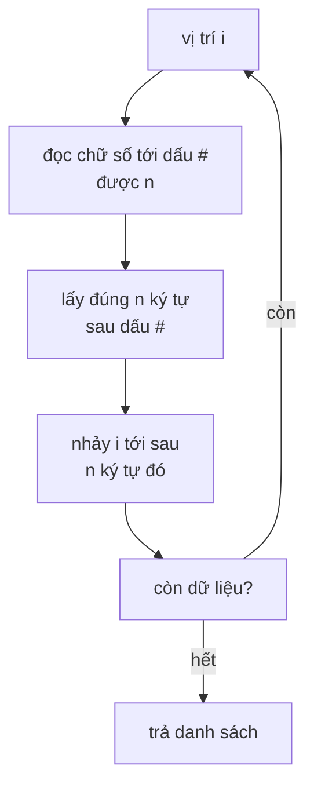

> [!tldr] Đọc nhanh
> - Đề: viết `encode(list) → string` và `decode(string) → list` sao cho `decode(encode(x))` luôn trả lại đúng `x`, với chuỗi chứa **mọi** ký tự.
> - Nối bằng một dấu phân cách hỏng ngay khi chuỗi chứa dấu đó, và không phân biệt được `[]` với `[""]`: 6/9 ca ([[concepts/delimiter-collision|Delimiter Collision]]).
> - [[concepts/escaping|Thoát ký tự]] sửa được: `,` thành `/,`, `/` thành `//`. Đúng, nhưng bộ giải mã phải đọc từng ký tự.
> - [[concepts/length-prefix-encoding|Tiền tố độ dài]]: mỗi chuỗi thành `<độ dài>#<nội dung>`. Bộ giải mã đọc số, rồi **nhảy** qua đúng chừng ấy ký tự mà không nhìn vào trong. Đây là cách của HTTP `Content-Length`.
> - Bẫy riêng: "độ dài" của `"😀"` là 2 trong JS/Java, 1 trong Python, 4 trong Go. Mã hóa và giải mã phải đếm cùng một đơn vị.

> [!info] Bối cảnh
> Bài LeetCode 271 (bài trả phí trên LeetCode, miễn phí trên NeetCode), thuộc [[posts/2026-11-23-neetcode-prefix-suffix-encoding|ga 3: Tiền tố, hậu tố và mã hóa]] trên **tuyến NeetCode: Mảng và chuỗi**. Lời giải có đủ TypeScript, Python, Go, Java và JavaScript. Bạn chỉ cần biết chuỗi, vòng lặp và hàm.

> [!abstract]- Từ điển nhanh cho bài này (bấm để mở)
> - **Mã hóa / giải mã (encode / decode)**: đổi dữ liệu sang một dạng khác để gửi đi, rồi đổi lại. Ở đây: danh sách chuỗi ↔ một chuỗi.
> - **Dấu phân cách (delimiter)**: ký tự đánh dấu chỗ một phần kết thúc, như dấu phẩy trong CSV.
> - **Thoát ký tự (escaping)**: đặt một ký tự đặc biệt trước một ký tự để nói "đây là chữ thường, đừng hiểu theo nghĩa đặc biệt", như `\"` trong chuỗi JSON.
> - **Code point, đơn vị UTF-16, byte**: ba cách đếm độ dài chuỗi. Emoji `😀` là 1 code point, 2 đơn vị UTF-16, 4 byte UTF-8.

## Hình dung trước: gửi nhiều lá thư trong một phong bì

Bạn phải gửi nhiều lá thư trong **một** phong bì, và người nhận phải tách lại đúng từng lá. Các lá thư có thể chứa bất cứ chữ gì, kể cả đúng ký hiệu bạn định dùng để ngăn cách.

| Đời thường | Khái niệm |
|---|---|
| Kẹp một tờ giấy trắng giữa hai lá thư | dấu phân cách |
| Một lá thư lại có tờ giấy trắng kẹp bên trong | chuỗi chứa chính dấu phân cách |
| Đánh dấu tờ giấy trắng nằm trong thư bằng một con tem "không phải ngăn cách" | thoát ký tự |
| Ghi lên đầu mỗi lá "thư này dài 3 trang" | tiền tố độ dài |
| Người nhận đếm đủ 3 trang rồi mới đọc nhãn tiếp theo | giải mã nhảy qua nội dung |
| Người gửi đếm theo tờ, người nhận đếm theo mặt giấy | đếm độ dài khác đơn vị |



## Vấn đề

**Đề (tóm tắt bằng lời của mình):** thiết kế hai hàm. `encode` nhận một danh sách chuỗi và trả một chuỗi; `decode` nhận chuỗi đó và trả lại đúng danh sách ban đầu. Chuỗi đầu vào có thể chứa mọi ký tự ASCII (đề gốc nói 256 ký tự). Không được dùng hàm tuần tự hóa có sẵn như `JSON.stringify`. Đề gốc: [LeetCode 271](https://leetcode.com/problems/encode-and-decode-strings/).

| Input | Mã hóa bằng tiền tố độ dài |
|---|---|
| `["neet", "code"]` | `4#neet4#code` |
| `[]` | `` (chuỗi rỗng) |
| `[""]` | `0#` |
| `["12#ab", "#"]` | `5#12#ab1##` |

Mình từng nghĩ chỉ cần chọn một ký tự "hiếm" làm dấu phân cách. Hóa ra đề nói rõ chuỗi chứa được **mọi** ký tự, nên không có ký tự nào đủ hiếm. Phải có một cách để nội dung không bao giờ bị nhầm với cấu trúc.

## Cơ chế

<figure class="figure-map" style="--ar: 3 / 4">
<div class="frame"><iframe data-archify="../diagrams/neetcode-encode-and-decode-strings/worked-example.html" title="Đọc đúng số ký tự đã ghi" loading="lazy"></iframe></div>
<figcaption><span><b>Hình 1.</b> Đọc đúng số ký tự đã ghi.</span><a href="../diagrams/neetcode-encode-and-decode-strings/worked-example.html" target="_blank" rel="noopener">Mở toàn màn hình</a></figcaption>
</figure>

<details>
<summary>Đọc từng bước</summary>
<ol>
<li>Ghi độ dài rồi tới nội dung. <code>[&quot;a#b&quot;, &quot;&quot;] → 3#a#b0#</code></li>
<li>Đọc số 3 trước dấu phân cách. <code>3#</code></li>
<li>Lấy đúng ba ký tự a#b. <code>a#b</code></li>
<li>Đọc 0 rồi lấy chuỗi rỗng. <code>0# → &quot;&quot;</code></li>
<li>Khôi phục đúng hai chuỗi. <code>[&quot;a#b&quot;, &quot;&quot;]</code></li>
</ol>
</details>

### Cách 1, nối bằng dấu phẩy: sai ở ba kiểu ca

`["a,b", "c"]` mã hóa thành `a,b,c`, và giải mã ra ba chuỗi. Còn `[]` và `[""]` cùng mã hóa thành chuỗi rỗng, nên giải mã không biết nên trả cái nào. Đổi sang ký tự lạ hơn (`\x00`, `π`) chỉ làm lỗi hiếm hơn, không làm nó biến mất.

### Cách 2, thoát ký tự

Chọn một ký tự thoát, ở đây `/`. Khi mã hóa, mỗi `/` trong nội dung thành `//`, mỗi `,` thành `/,`, rồi sau mỗi chuỗi thêm một `,` **kết thúc** (không phải ngăn cách, nên `[""]` thành `,` còn `[]` là chuỗi rỗng). Khi giải mã: gặp `/` thì ký tự kế tiếp là chữ thật; gặp `,` đứng một mình thì một chuỗi vừa xong.

Phải thoát **cả** ký tự thoát. Nếu chỉ thoát dấu phẩy, chuỗi `a/` theo sau là `,` kết thúc sẽ thành `a/,`, và bộ giải mã đọc `/,` là một dấu phẩy thật. JSON làm đúng như vậy: `"` thành `\"`, và `\` thành `\\`.

### Cách 3, tiền tố độ dài

Mỗi chuỗi thành `<độ dài>#<nội dung>`. Bộ giải mã:
1. đọc từ i tới dấu `#` đầu tiên: đó là độ dài n (độ dài chỉ có chữ số, nên dấu `#` đầu tiên luôn là dấu kết thúc phần độ dài);
2. lấy đúng n ký tự sau `#`, **không nhìn vào bên trong**, nên nội dung có `#` hay chữ số cũng không sao;
3. nhảy i tới sau n ký tự đó.

Đây là cùng một ý với tiền tố của ga: ghi thông tin **trước**, để bước sau không phải dò. HTTP/1.1 làm vậy với `Content-Length`, và nhiều giao thức nhị phân ghi độ dài dạng số cố định 4 byte thay cho chữ số và `#`.

| | nối bằng dấu phẩy | thoát ký tự | tiền tố độ dài |
|---|---|---|---|
| Đúng với mọi chuỗi | không | có | có |
| Giải mã | `split` | đọc từng ký tự | nhảy qua nội dung |
| Phân biệt `[]` và `[""]` | không | có | có |
| Độ dài thêm | n − 1 ký tự | tới gấp đôi nếu nội dung đầy ký tự đặc biệt | số chữ số của độ dài + 1, mỗi chuỗi |

### Bên dưới bảy ngôn ngữ: "độ dài" là gì

| | `"😀"` dài | Cắt chuỗi theo |
|---|---|---|
| TypeScript / JavaScript | `length` = 2 (đơn vị UTF-16) | đơn vị UTF-16 |
| Java | `length()` = 2 (đơn vị UTF-16) | đơn vị UTF-16 |
| Python | `len` = 1 (code point) | code point |
| Go | `len` = 4 (byte UTF-8) | byte |
| PHP | `strlen` = 4 (byte); `mb_strlen` = 1 (code point) | byte với `substr`, code point với `mb_substr` |
| Rust | `len()` = 4 (byte UTF-8); `chars().count()` = 1 | byte (cắt giữa ký tự thì panic) |

Trong **cùng** một ngôn ngữ, đếm và cắt dùng cùng một đơn vị, nên tiền tố độ dài luôn đúng. Lỗi xuất hiện khi hai bên dùng hai đơn vị: mã hóa bằng JS rồi giải mã bằng Python, hoặc trong cùng JS mà một bên dùng `length`, bên kia dùng `[...s]` (đếm code point). File TypeScript tái hiện đúng ca đó. Giao thức thật vì vậy luôn định nghĩa độ dài bằng **byte** sau khi mã hóa UTF-8.

## Ví dụ chạy được

[TypeScript](../code/neetcode-encode-and-decode-strings/encode-decode.ts) · [Python](../code/neetcode-encode-and-decode-strings/encode_decode.py) · [Go](../code/neetcode-encode-and-decode-strings/encode_decode.go) · [Java](../code/neetcode-encode-and-decode-strings/encode-decode.java) · [PHP](../code/neetcode-encode-and-decode-strings/encode-decode.php) · [Rust](../code/neetcode-encode-and-decode-strings/encode_decode.rs) · [JavaScript](../code/neetcode-encode-and-decode-strings/encode-decode.js)

Mỗi file có cả ba cách và chạy 9 ca, gồm `[]`, `[""]`, chuỗi chứa `,`, `#`, `/` và emoji. Dưới đây là cách tiền tố độ dài.

```ts
// Cách 3: tiền tố độ dài. Mỗi chuỗi thành "<độ dài>#<nội dung>"; nội dung có "#" hay chữ số cũng không sao.
function lengthEncode(strs: string[]): string {
  return strs.map((s) => `${s.length}#${s}`).join("");
}

function lengthDecode(s: string): string[] {
  const out: string[] = [];
  let i = 0;
  while (i < s.length) {
    const hash = s.indexOf("#", i); // "#" đầu tiên từ i luôn thuộc phần độ dài: độ dài chỉ có chữ số
    const len = Number(s.slice(i, hash));
    out.push(s.slice(hash + 1, hash + 1 + len));
    i = hash + 1 + len; // nhảy qua nội dung, không đọc bên trong
  }
  return out;
}
```

```python
def length_encode(strs: list[str]) -> str:
    return "".join(f"{len(s)}#{s}" for s in strs)  # len của str Python đếm code point

def length_decode(s: str) -> list[str]:
    out, i = [], 0
    while i < len(s):
        h = s.index("#", i)  # "#" đầu tiên từ i thuộc phần độ dài
        n = int(s[i:h])
        out.append(s[h + 1 : h + 1 + n])
        i = h + 1 + n
    return out
```

```go
func lengthEncode(strs []string) string {
	var b strings.Builder
	for _, s := range strs {
		b.WriteString(strconv.Itoa(len(s))) // len của string Go đếm BYTE
		b.WriteByte('#')
		b.WriteString(s)
	}
	return b.String()
}

func lengthDecode(s string) []string {
	out := []string{}
	for i := 0; i < len(s); {
		h := i + strings.IndexByte(s[i:], '#')
		n, _ := strconv.Atoi(s[i:h])
		out = append(out, s[h+1:h+1+n]) // cắt theo byte, khớp với len lúc mã hóa
		i = h + 1 + n
	}
	return out
}
```

```java
static String lengthEncode(List<String> strs) {
    StringBuilder b = new StringBuilder();
    for (String s : strs) b.append(s.length()).append('#').append(s); // length() đếm đơn vị UTF-16, như JS
    return b.toString();
}

static List<String> lengthDecode(String s) {
    List<String> out = new ArrayList<>();
    int i = 0;
    while (i < s.length()) {
        int h = s.indexOf('#', i);
        int n = Integer.parseInt(s.substring(i, h));
        out.add(s.substring(h + 1, h + 1 + n));
        i = h + 1 + n;
    }
    return out;
}
```

```js
function lengthEncode(strs) {
  return strs.map((s) => `${s.length}#${s}`).join(""); // length đếm đơn vị UTF-16
}

function lengthDecode(s) {
  const out = [];
  let i = 0;
  while (i < s.length) {
    const h = s.indexOf("#", i);
    const n = Number(s.slice(i, h));
    out.push(s.slice(h + 1, h + 1 + n)); // slice cũng đếm UTF-16: khớp với lúc mã hóa
    i = h + 1 + n;
  }
  return out;
}
```

```php
function lengthEncode(array $strs): string {
    return implode('', array_map(fn($s) => strlen($s) . '#' . $s, $strs)); // strlen đếm BYTE
}

function lengthDecode(string $s): array {
    $out = []; $i = 0;
    while ($i < strlen($s)) {
        $h = strpos($s, '#', $i);
        $n = (int) substr($s, $i, $h - $i);
        $out[] = substr($s, $h + 1, $n); // substr cũng đếm byte: khớp với lúc mã hóa
        $i = $h + 1 + $n;
    }
    return $out;
}
```

```rust
fn length_encode(strs: &[String]) -> String {
    strs.iter().map(|s| format!("{}#{}", s.len(), s)).collect() // len() đếm byte UTF-8
}

fn length_decode(s: &str) -> Vec<String> {
    let mut out = Vec::new();
    let mut i = 0;
    while i < s.len() {
        let h = i + s[i..].find('#').unwrap();
        let n: usize = s[i..h].parse().unwrap();
        out.push(s[h + 1..h + 1 + n].to_string()); // cắt theo byte; cắt giữa một ký tự thì panic
        i = h + 1 + n;
    }
    out
}
```


```text
$ node encode-decode.ts
join(",")           6/9 ca đúng; sai ở [""] ["a,b","c"] ["a/","/,"]
thoát ký tự         9/9 ca đúng
tiền tố độ dài      9/9 ca đúng
độ dài lệch đơn vị  8/9 ca đúng; sai ở ["😀é","x"]

ví dụ: ["12#ab","#"] → "5#12#ab1##"
"😀".length = 2, [..."😀"].length = 1
```

Dòng thứ tư mã hóa bằng `s.length` (2 cho emoji) nhưng giải mã bằng cách đếm code point (1 cho emoji), nên lấy thừa một ký tự và lệch luôn phần sau. Các file khác in độ dài của emoji theo cách đếm của ngôn ngữ đó: Python `len("😀") = 1, len("😀".encode()) = 4`; Go `len("😀") = 4, utf8.RuneCountInString("😀") = 1`; Java `"😀".length() = 2, codePointCount = 1`; PHP `strlen("😀") = 4, mb_strlen("😀") = 1`; Rust `"😀".len() = 4, "😀".chars().count() = 1`. Cả bảy ngôn ngữ cho `9/9 ca đúng` với thoát ký tự và tiền tố độ dài.

## Hiểu lầm và bẫy hay gặp

- **"Chọn một ký tự hiếm làm dấu phân cách là đủ."** Đề cho phép mọi ký tự. Ký tự hiếm chỉ làm lỗi khó tái hiện hơn.
- **Quên ca `[]` và `[""]`.** Nối bằng dấu phân cách ra cùng một chuỗi rỗng cho cả hai. Tiền tố độ dài cho `""` và `0#`.
- **Thoát dấu phân cách mà quên thoát ký tự thoát.** `["a/", "/,"]` làm bản đó hỏng.
- **Tìm `#` bằng `lastIndexOf` hay `split("#")`.** Nội dung có thể chứa `#`. Chỉ dấu `#` **đầu tiên** tính từ vị trí hiện tại mới chắc chắn thuộc phần độ dài.
- **Java: `split(",")` bỏ các chuỗi rỗng ở cuối.** `"a,,".split(",")` ra `[a]`. Phải truyền `split(",", -1)`.
- **Hai bên đếm độ dài khác đơn vị.** Đúng trong mỗi ngôn ngữ, sai khi nối hai ngôn ngữ với nhau. Định nghĩa độ dài bằng byte UTF-8 nếu dữ liệu đi qua mạng.
- **PHP: trộn hàm byte với hàm `mb_`.** `strlen`/`substr` đếm byte, `mb_strlen`/`mb_substr` đếm ký tự. Mã hóa bằng một loại, giải mã bằng loại kia là đúng lỗi lệch đơn vị ở trên (file PHP in `8/9`). Thoát ký tự thì dùng `strtr` với mảng: nó thay mọi cặp trong một lượt, còn hai lần `str_replace` nối nhau có thể thay lại chính phần vừa sinh ra.
- **Rust: cắt `&str` theo byte.** `s[a..b]` dùng chỉ số byte, khớp với `len()`, nên tiền tố độ dài chạy đúng với emoji. Nhưng nếu độ dài lệch đơn vị và vị trí cắt rơi vào giữa một ký tự nhiều byte, chương trình **panic** thay vì trả rác. Dùng `s.get(a..b)` khi dữ liệu không đáng tin.

## Câu hỏi tự kiểm tra

> [!question]- Mã hóa `["", "#", "3#"]` bằng tiền tố độ dài.
> `0#` + `1##` + `2#3#` = `0#1##2#3#`.

> [!question]- Vì sao bộ giải mã tiền tố độ dài không bị nhầm khi nội dung chứa `#` hay chữ số?
> Nó chỉ tìm `#` trong phần độ dài, rồi lấy đúng n ký tự sau đó mà không đọc chúng. Vị trí tiếp theo luôn là đầu của một độ dài mới.

> [!question]- Ở cách thoát ký tự, vì sao mỗi chuỗi **kết thúc** bằng `,` thay vì các chuỗi **ngăn cách** bằng `,`?
> Để phân biệt `[]` (không có dấu `,` nào) với `[""]` (một dấu `,`). Ngăn cách thì n chuỗi có n − 1 dấu, và cả hai ca đều có 0 dấu.

> [!question]- Một máy chủ Go nhận chuỗi mã hóa từ trình duyệt (JS) có tiền tố độ dài. Chuỗi gốc là `["😀"]`. Chuyện gì xảy ra?
> JS ghi `2#😀` (2 đơn vị UTF-16). Go đọc độ dài 2 rồi cắt 2 byte, trong khi `😀` chiếm 4 byte: ra một chuỗi UTF-8 hỏng và phần còn lại bị đọc lệch. Hai bên phải thống nhất đơn vị, thường là byte UTF-8.

## Tham khảo

- [LeetCode 271: Encode and Decode Strings](https://leetcode.com/problems/encode-and-decode-strings/) (đề gốc; bản miễn phí trên [NeetCode](https://neetcode.io/problems/string-encode-and-decode))
- [RFC 9110, §8.6 Content-Length](https://www.rfc-editor.org/rfc/rfc9110#section-8.6) (độ dài đặt trước nội dung, tính bằng byte)
- [MDN: `String.length`](https://developer.mozilla.org/en-US/docs/Web/JavaScript/Reference/Global_Objects/String/length) (đếm đơn vị UTF-16)
- [The Go Blog: Strings, bytes, runes and characters in Go](https://go.dev/blog/strings) (`len` đếm byte)
- [Java 21 `String.split(String, int)`](https://docs.oracle.com/en/java/javase/21/docs/api/java.base/java/lang/String.html#split(java.lang.String,int)) (limit 0 bỏ chuỗi rỗng ở cuối)
