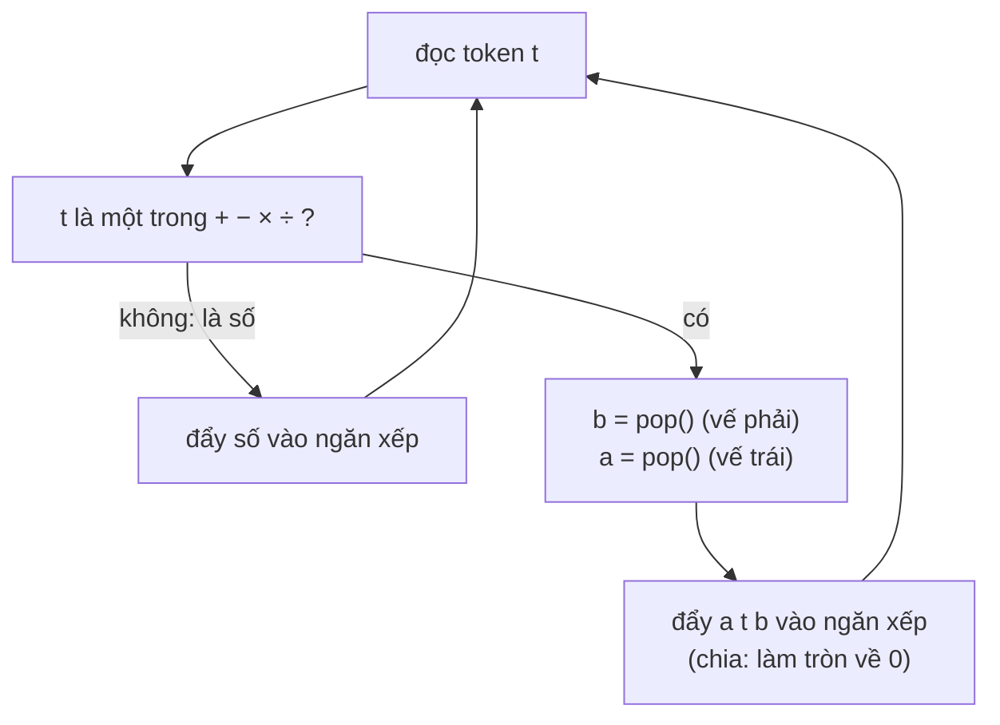

> [!tldr] Đọc nhanh
> - Đề: tính giá trị một biểu thức số nguyên viết theo [[concepts/reverse-polish-notation|ký pháp Ba Lan ngược]] (RPN): toán tử đứng **sau** hai toán hạng, `["2", "1", "+", "3", "*"]` là `(2 + 1) × 3 = 9`. Chia làm tròn **về 0**.
> - Ngăn xếp: gặp số thì đẩy vào; gặp toán tử thì lấy hai số trên đỉnh ra, tính, đẩy kết quả lại. O(n), không cần ngoặc hay thứ tự ưu tiên.
> - Số lấy ra **trước** là vế **phải**. Đảo hai vế thì `-` và `/` sai: bản đó chỉ qua 2/7 ca.
> - Python `//` làm tròn **xuống** (`-7 // 2 = -4`), JS `Math.floor` cũng vậy; đề cần làm tròn về 0 (`-3`). Java, Go chia số nguyên đã làm tròn về 0.
> - Nhận toán tử bằng ký tự đầu thì `"-11"` thành phép trừ. Đệ quy từ cuối cũng đúng, nhưng biểu thức sâu 10⁵ tầng làm tràn ngăn xếp gọi hàm trong JS, Java và Python; Go thì không.

> [!info] Bối cảnh
> Bài LeetCode 150, thuộc [[posts/2026-11-23-neetcode-stack|ga 6: Ngăn xếp]] trên **tuyến NeetCode: Mảng và chuỗi**. Lời giải có đủ TypeScript, Python, Go, Java và JavaScript. Bạn cần biết [[concepts/stack|ngăn xếp]] và bốn phép tính số học.

> [!abstract]- Từ điển nhanh cho bài này (bấm để mở)
> - **Ký pháp Ba Lan ngược (RPN, postfix)**: viết toán tử sau toán hạng. `3 4 -` nghĩa là `3 − 4`. Không cần ngoặc. Xem [[concepts/reverse-polish-notation|Reverse Polish Notation]].
> - **Token**: một phần tử của mảng đầu vào, là một số (có thể âm, như `"-11"`) hoặc một trong `+ - * /`.
> - **Làm tròn về 0 (truncate)**: bỏ phần lẻ. `-3,5` thành `-3`. **Làm tròn xuống (floor)**: về phía âm vô cùng, `-3,5` thành `-4`.
> - **Ngăn xếp gọi hàm (call stack)**: vùng nhớ giữ các lời gọi hàm đang chờ. Đệ quy quá sâu làm nó đầy: `RangeError`, `StackOverflowError`, `RecursionError`.

## Hình dung trước: máy tính bỏ túi kiểu cũ

Một số máy tính bỏ túi đời cũ không có phím ngoặc. Bạn gõ số, bấm Enter để cất nó vào một chồng; bấm phím phép tính thì máy lấy hai số trên cùng ra, tính, rồi đặt kết quả lại lên chồng. Muốn tính `(2 + 1) × 3`, bạn gõ `2 Enter 1 + 3 ×`.

| Đời thường | Khái niệm |
|---|---|
| Gõ một số rồi bấm Enter | gặp token số: đẩy vào ngăn xếp |
| Chồng các số đang chờ | ngăn xếp toán hạng |
| Bấm `−`: máy lấy hai số trên cùng | gặp toán tử: pop hai lần |
| Số trên cùng là số gõ **sau** | số lấy ra trước là vế phải: `a − b` với b là đỉnh |
| Đặt kết quả lại lên chồng | push kết quả |
| Hết phím bấm, trên chồng còn đúng một số | đáp án |



Hết token: phần tử duy nhất còn lại là kết quả.

## Vấn đề

**Đề (tóm tắt bằng lời của mình):** cho mảng `tokens` (1 ≤ độ dài ≤ 10⁴) là một biểu thức RPN hợp lệ, mỗi token là `+`, `-`, `*`, `/` hoặc một số nguyên trong −200..200. Trả giá trị của biểu thức. Phép chia giữa hai số nguyên làm tròn về 0, không có chia cho 0, và mọi kết quả trung gian vừa số nguyên 32 bit. Đề gốc: [LeetCode 150](https://leetcode.com/problems/evaluate-reverse-polish-notation/).

| Input | Output | Vì sao |
|---|---|---|
| `["2","1","+","3","*"]` | `9` | `(2 + 1) × 3` |
| `["4","13","5","/","+"]` | `6` | `4 + 13 / 5 = 4 + 2` |
| `["10","6","9","3","+","-11","*","/","*","17","+","5","+"]` | `22` | `10 × (6 / (12 × −11)) + 17 + 5`, với `6 / −132 = 0` |
| `["7","-2","/"]` | `-3` | `−3,5` làm tròn về 0 |

Mình từng nghĩ khó nhất là phân tích biểu thức. Hóa ra RPN được thiết kế để khỏi phải phân tích: thứ tự token đã là thứ tự tính. Những chỗ sai thật lại nằm ở ba chi tiết nhỏ: thứ tự vế, cách làm tròn, và số âm.

## Cơ chế

<figure class="figure-map" style="--ar: 3 / 4">
<div class="frame"><iframe data-archify="../diagrams/neetcode-evaluate-reverse-polish-notation/worked-example.html" title="Lấy toán hạng phải trước" loading="lazy"></iframe></div>
<figcaption><span><b>Hình 1.</b> Lấy toán hạng phải trước.</span><a href="../diagrams/neetcode-evaluate-reverse-polish-notation/worked-example.html" target="_blank" rel="noopener">Mở toàn màn hình</a></figcaption>
</figure>

<details>
<summary>Đọc từng bước</summary>
<ol>
<li>Đẩy 9 rồi đẩy 4. <code>[9, 4]</code></li>
<li>Gặp dấu trừ thì lấy 4 trước. <code>right = 4, left = 9</code></li>
<li>Đẩy hiệu 9 trừ 4. <code>[5]</code></li>
<li>Thêm 3 rồi nhân với 5. <code>[5, 3] → [15]</code></li>
</ol>
</details>

### Cách 1, ngăn xếp

Duyệt token từ trái sang. Số thì đẩy vào. Toán tử thì `b = pop()`, `a = pop()`, đẩy `a op b`. Cuối cùng ngăn xếp còn đúng một số. Mỗi token vào và ra ngăn xếp tối đa một lần: O(n) thời gian, O(n) bộ nhớ ở ca tệ nhất (`1 2 3 … + + +`).

Vì sao đúng: trong RPN, khi gặp một toán tử, hai **biểu thức con** đứng ngay trước nó đã được tính xong và nằm trên đỉnh ngăn xếp, vế trái nằm dưới vế phải. Đây cũng là cách nhiều máy ảo thực thi mã: JVM và CPython đều là máy ngăn xếp, đẩy toán hạng rồi chạy lệnh cộng trên hai phần tử đỉnh.

### Cách 2, đệ quy từ cuối

Token cuối là toán tử **gốc** của cây biểu thức. Đọc ngược: lấy token cuối; nếu là số thì trả về; nếu là toán tử thì đệ quy lấy vế phải (nằm ngay trước nó), rồi vế trái. Cũng O(n), nhưng độ sâu đệ quy bằng chiều cao cây. Biểu thức `1 1 + 1 + 1 + …` là cây lệch hẳn một bên, cao n.

### Ba chỗ dễ sai

| Sai | Ví dụ | Hậu quả |
|---|---|---|
| Đảo vế: đỉnh làm vế trái | `3 4 -` ra `1` thay vì `-1` | sai mọi `-` và `/`; chỉ qua 2/7 ca |
| Chia làm tròn xuống | `7 -2 /` ra `-4` thay vì `-3` | sai khi thương âm và không chia hết |
| Nhận toán tử bằng ký tự đầu | `"-11"` bị coi là phép trừ | lấy nhầm hai số, ra `NaN` hoặc lỗi |

Chỗ thứ hai lan xa: ở ví dụ dài, `6 / −132` làm tròn xuống ra −1 thay vì 0, và kết quả cuối thành 12 thay vì 22.

### Đo: ngăn xếp tường minh và đệ quy

Biểu thức `1 1 + 1 + …` với n toán tử, TypeScript, trung vị 5 lần:

| số toán tử | ngăn xếp | đệ quy |
|---|---|---|
| 1 000 | 0,29 ms | 0,09 ms |
| 5 000 | 0,22 ms | 0,18 ms |
| 100 000 | 1,32 ms | `RangeError` |
| 1 000 000 | 13,92 ms | `RangeError` |

Ở độ sâu nhỏ, đệ quy còn nhanh hơn vì không cấp phát mảng. Nhưng ngăn xếp gọi hàm của V8 có giới hạn, và 10⁵ tầng vượt qua nó. Đề giới hạn 10⁴ token nên đệ quy vẫn qua LeetCode; với dữ liệu thật không có giới hạn đó, ngăn xếp tường minh mới an toàn. Các ngôn ngữ khác:

| | Đệ quy sâu |
|---|---|
| Python | `RecursionError` ngay ở 5 000 tầng (giới hạn mặc định 1 000) |
| Java | `StackOverflowError` ở 10⁵ tầng (stack mặc định của luồng) |
| Go | chạy được 10⁶ tầng: stack của goroutine tự nới khi cần |

Độ sâu tối đa đo bằng tìm kiếm nhị phân trên n, với biểu thức `1 1 + 1 + …` (n toán tử, sâu n tầng) ([JS](../code/neetcode-evaluate-reverse-polish-notation/recursion-depth.js) · [Java](../code/neetcode-evaluate-reverse-polish-notation/recursion-depth.java) · [Python](../code/neetcode-evaluate-reverse-polish-notation/recursion_depth.py)): Node 24 chịu được **9 765** tầng ở cả ba lần chạy; Java 21 chịu được khoảng **8 600–9 400** tầng ở lần đo đầu (đổi theo lần chạy: 8 593 và 9 375) và **29 473** tầng ở hai lần sau, vì khi code đã được JIT biên dịch, mỗi khung gọi hàm nhỏ hơn; Python 3.12 dừng ở **996** tầng (giới hạn 1 000 trừ vài khung của chính chương trình). Với 10⁴ token, biểu thức sâu tới khoảng 5 000 tầng: JS và Java qua, còn Python **không** qua, nên câu "đệ quy vẫn qua LeetCode" ở trên chỉ đúng với JS và Java. Python phải dùng ngăn xếp tường minh hoặc nâng `sys.setrecursionlimit`.

### Bên dưới năm ngôn ngữ

| | Chia số nguyên | Đọc `"-11"` thành số |
|---|---|---|
| TypeScript / JavaScript | `a / b` là chia số thực: cần `Math.trunc`. `Math.floor` sai với số âm | `Number(t)`; nhận toán tử bằng tập `{"+","-","*","/"}` |
| Python | `//` làm tròn **xuống**; dùng `int(a / b)` (đủ chính xác với số 32 bit) | `int(t)` |
| Go | `/` trên `int` làm tròn về 0 | `strconv.Atoi(t)` |
| Java | `/` trên `int` làm tròn về 0; `Math.floorDiv` làm tròn xuống | `Integer.parseInt(t)`; so chuỗi bằng `equals`, không bằng `==` |

## Ví dụ chạy được

[TypeScript](../code/neetcode-evaluate-reverse-polish-notation/eval-rpn.ts) · [Python](../code/neetcode-evaluate-reverse-polish-notation/eval_rpn.py) · [Go](../code/neetcode-evaluate-reverse-polish-notation/eval_rpn.go) · [Java](../code/neetcode-evaluate-reverse-polish-notation/eval-rpn.java) · [JavaScript](../code/neetcode-evaluate-reverse-polish-notation/eval-rpn.js)

Mỗi file có ngăn xếp và đệ quy, chạy 7 ca gồm `-` và `/` với số âm. Dưới đây là cách ngăn xếp.

```ts
function apply(op: string, a: number, b: number): number {
  switch (op) {
    case "+": return a + b;
    case "-": return a - b;
    case "*": return a * b;
    default: return Math.trunc(a / b); // đề: chia làm tròn về 0. Math.floor(-7 / 2) = -4, Math.trunc = -3
  }
}

// Cách 1: ngăn xếp. Số thì đẩy vào; toán tử thì lấy hai số trên đỉnh, số lấy ra SAU là vế trái.
function evalStack(tokens: string[]): number {
  const st: number[] = [];
  for (const t of tokens) {
    if (OPS.has(t)) { // so cả token với tập toán tử: "-11" không nằm trong tập
      const b = st.pop()!, a = st.pop()!;
      st.push(apply(t, a, b));
    } else st.push(Number(t));
  }
  return st[0];
}
```

```python
def apply(op: str, a: int, b: int) -> int:
    if op == "+":
        return a + b
    if op == "-":
        return a - b
    if op == "*":
        return a * b
    return int(a / b)  # làm tròn về 0; a // b thì làm tròn XUỐNG (về −∞)

def eval_stack(tokens: list[str]) -> int:
    st: list[int] = []
    for t in tokens:
        if t in OPS:  # so cả token: "-11" không nằm trong tập toán tử
            b, a = st.pop(), st.pop()
            st.append(apply(t, a, b))
        else:
            st.append(int(t))
    return st[0]
```

```go
func apply(op string, a, b int) int {
	switch op {
	case "+":
		return a + b
	case "-":
		return a - b
	case "*":
		return a * b
	}
	return a / b // chia số nguyên của Go làm tròn về 0, đúng như đề
}

func evalStack(tokens []string) int {
	st := []int{}
	for _, t := range tokens {
		if isOp(t) {
			a, b := st[len(st)-2], st[len(st)-1]
			st = st[:len(st)-2]
			st = append(st, apply(t, a, b))
		} else {
			n, _ := strconv.Atoi(t) // Atoi đọc được cả "-11"
			st = append(st, n)
		}
	}
	return st[0]
}
```

```java
static int apply(String op, int a, int b) {
    return switch (op) {
        case "+" -> a + b;
        case "-" -> a - b;
        case "*" -> a * b;
        default -> a / b; // chia int của Java làm tròn về 0; Math.floorDiv thì làm tròn xuống
    };
}

static int evalStack(String[] tokens) {
    ArrayDeque<Integer> st = new ArrayDeque<>();
    for (String t : tokens) {
        if (isOp(t)) {
            int b = st.pop(), a = st.pop();
            st.push(apply(t, a, b));
        } else st.push(Integer.parseInt(t));
    }
    return st.pop();
}
```

```js
function apply(op, a, b) {
  if (op === "+") return a + b;
  if (op === "-") return a - b;
  if (op === "*") return a * b;
  return Math.trunc(a / b); // a / b là chia số thực; | 0 cũng làm tròn về 0 nhưng cắt về 32 bit
}

function evalStack(tokens) {
  const st = [];
  for (const t of tokens) {
    if (OPS.has(t)) {
      const b = st.pop(), a = st.pop();
      st.push(apply(t, a, b));
    } else st.push(Number(t));
  }
  return st[0];
}
```


File TypeScript chạy thêm ba bản sai, rồi đo:

```text
$ node eval-rpn.ts
evalStack      7/7 ca đúng
evalRecursive  7/7 ca đúng
evalSwapped    2/7 ca đúng; sai ở [4 13 5 / +] → 4, [10 6 9 3 + -11 * / * 17 + 5 +] → -198, [3 4 -] → 1, [7 -2 /] → 0, [-7 2 /] → 0
evalFloor      4/7 ca đúng; sai ở [10 6 9 3 + -11 * / * 17 + 5 +] → 12, [7 -2 /] → -4, [-7 2 /] → -4
evalFirstChar  4/7 ca đúng; sai ở [10 6 9 3 + -11 * / * 17 + 5 +] → NaN, [7 -2 /] → NaN, [-7 2 /] → NaN

số toán tử   ngăn xếp    đệ quy   (ms, trung vị 5 lần)
1000             0.29        0.09
5000             0.22        0.18
100000           1.32  RangeError
1000000         13.92  RangeError
```

Các file còn lại cho thấy chia và đệ quy sâu trong từng ngôn ngữ:

```text
$ python3 eval_rpn.py
eval_stack     7/7 ca đúng
eval_recursive 7/7 ca đúng
eval_floor_div 4/7 ca đúng; sai ở [10 6 9 3 + -11 * / * 17 + 5 +] → 12, [7 -2 /] → -4, [-7 2 /] → -4

-7 // 2 = -4, int(-7 / 2) = -3
đệ quy 5000 tầng: RecursionError (giới hạn mặc định 1000)
ngăn xếp 5000 tầng: 5001

$ java eval-rpn.java
evalStack      7/7 ca đúng
evalRecursive  7/7 ca đúng
evalFloorDiv   4/7 ca đúng

đệ quy 10⁵ tầng: StackOverflowError
ngăn xếp 10⁵ tầng: 100001

$ go run eval_rpn.go
evalStack      7/7 ca đúng
evalRecursive  7/7 ca đúng

đệ quy 10⁶ tầng: 1000001
```

JavaScript in `7/7 ca đúng` cho cả hai cách.

## Hiểu lầm và bẫy hay gặp

- **Đảo hai vế.** `pop()` đầu tiên trả vế **phải**. Phép `+` và `*` giao hoán nên che lỗi; chỉ `-` và `/` lộ ra.
- **Python: dùng `//` cho phép chia của đề.** `//` làm tròn xuống, đề cần làm tròn về 0. `int(a / b)` đúng với số 32 bit; với số rất lớn, phép chia số thực mất chính xác.
- **JS: quên làm tròn.** `13 / 5` ra `2.6`, và sai số lan qua các phép sau. `Math.trunc`, không phải `Math.floor`.
- **Nhận toán tử bằng ký tự đầu, hay bằng "không phải chữ số".** `"-11"` bắt đầu bằng `-`. So cả token với tập bốn toán tử.
- **Java: so chuỗi bằng `==`.** `t == "+"` so tham chiếu; token đọc từ mảng có thể không phải cùng object với hằng `"+"`. Dùng `equals` hoặc `switch` trên chuỗi.
- **Đệ quy không giới hạn độ sâu.** Qua được giới hạn của đề (≤ 10⁴ token), hỏng trên dữ liệu sâu hơn. Ngăn xếp tường minh không có giới hạn đó.

## Câu hỏi tự kiểm tra

> [!question]- Ghi ngăn xếp sau mỗi token của `["5","1","2","+","4","*","+","3","-"]`, và cho kết quả.
> `5` → `5 1` → `5 1 2` → `+`: `5 3` → `5 3 4` → `*`: `5 12` → `+`: `17` → `17 3` → `-`: `14`. Kết quả 14.

> [!question]- Vì sao bản đảo vế vẫn qua ca `["2","1","+","3","*"]`?
> Biểu thức chỉ có `+` và `*`, hai phép giao hoán: `a + b = b + a`. Đảo vế chỉ lộ ra ở `-` và `/`.

> [!question]- `-7 / 2` trong năm ngôn ngữ, mỗi cách viết, ra bao nhiêu?
> Java, Go (`int`): −3. Python `-7 // 2`: −4, `int(-7 / 2)`: −3. JS `-7 / 2`: −3,5; `Math.trunc`: −3; `Math.floor`: −4.

> [!question]- Viết `(1 + 2) × (3 − 4)` theo RPN.
> `1 2 + 3 4 - *`. Hai biểu thức con được viết trọn trước, toán tử nối chúng đứng sau cùng.

## Tham khảo

- [LeetCode 150: Evaluate Reverse Polish Notation](https://leetcode.com/problems/evaluate-reverse-polish-notation/) (đề gốc)
- [Python reference: Binary arithmetic operations](https://docs.python.org/3/reference/expressions.html#binary-arithmetic-operations) (`//` là chia lấy sàn, làm tròn về −∞)
- [JLS SE 21, §15.17.2 Division Operator /](https://docs.oracle.com/javase/specs/jls/se21/html/jls-15.html#jls-15.17.2) (chia số nguyên làm tròn về 0)
- [Go spec: Integer operators](https://go.dev/ref/spec#Integer_operators) (thương bị cắt về 0)
- [Go FAQ: Why goroutines instead of threads?](https://go.dev/doc/faq#goroutines) (stack của goroutine bắt đầu nhỏ và tự nới khi cần)
- [MDN: `Math.trunc`](https://developer.mozilla.org/en-US/docs/Web/JavaScript/Reference/Global_Objects/Math/trunc)
- [JVM Specification SE 21, §2.6.2 Operand Stacks](https://docs.oracle.com/javase/specs/jvms/se21/html/jvms-2.html#jvms-2.6.2) và [Python: module `dis`](https://docs.python.org/3/library/dis.html) (JVM và CPython tính biểu thức trên một ngăn xếp toán hạng)
