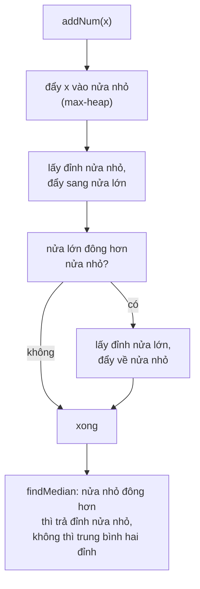

> [!tldr] Đọc nhanh
> - Đề: một luồng số nguyên. `addNum(x)` thêm một số, `findMedian()` trả trung vị của mọi số đã thêm (số chẵn phần tử thì lấy trung bình hai số giữa).
> - [[concepts/two-heaps|Hai heap]]: nửa nhỏ trong **max**-heap, nửa lớn trong **min**-heap. Giữ hai bất biến: mọi số nửa nhỏ ≤ mọi số nửa lớn, và nửa nhỏ bằng hoặc hơn nửa lớn một phần tử. Trung vị là đỉnh nửa nhỏ, hoặc trung bình hai đỉnh. Thêm O(log n), hỏi O(1).
> - Chèn vào mảng đã sắp: tìm chỗ O(log n) nhưng dời phần sau O(n). Đo TypeScript với 2·10⁵ số: 1 367,6 ms so với 50,8 ms của hai heap; dãy giảm dần (lần nào cũng chèn vào đầu) 3 307,8 ms.
> - Bản sai được chạy thật: chia luân phiên không qua heap kia (3/8 ca), không cân lại cỡ (3/8), Python quên đảo dấu (3/8), chia nguyên `(a + b) / 2` trong Go và Java (3/8), comparator `(a, b) -> b - a` của Java với số ở biên `int`.
> - Câu hỏi mở rộng của đề: mọi số trong [0, 100] thì một mảng đếm 101 ô đủ, nhanh hơn hai heap khoảng 3 lần.

> [!info] Bối cảnh
> Bài LeetCode 295 (Hard), bài neo của [[posts/2026-11-24-neetcode-two-heaps|ga 4: Hai heap và lập lịch]] trong **tuyến NeetCode: Tìm kiếm và heap**. Ga trước đã có [[concepts/heap|heap]] và [[concepts/size-k-heap|heap k chỗ]]; ở đây hai heap ghép lại để giữ phần **giữa** của dữ liệu thay vì phần đầu. Khác với [[problems/median-of-two-sorted-arrays|Median of Two Sorted Arrays]] (hai mảng có sẵn, hỏi một lần), ở đây số đến dần và câu hỏi lặp lại sau mỗi số. Lời giải có đủ TypeScript, Python, Go, Java và JavaScript.

> [!abstract]- Từ điển nhanh cho bài này (bấm để mở)
> - **Trung vị (median)**: số đứng giữa khi sắp tăng dần. n lẻ: số ở vị trí n/2 (đếm từ 0, làm tròn xuống). n chẵn: trung bình hai số giữa, có thể ra số lẻ thập phân như 3,5.
> - **Luồng (stream)**: số đến từng cái một, không biết trước có bao nhiêu. Xem [[concepts/running-median|Running Median]].
> - **Heap, đỉnh**: cây nhị phân trong mảng, phần tử ưu tiên nhất ở ô 0. Min-heap: nhỏ nhất ở đỉnh; max-heap: lớn nhất ở đỉnh. Xem [[concepts/heap|Heap]].
> - **Bất biến (invariant)**: điều luôn đúng trước và sau mỗi thao tác. Xem [[concepts/loop-invariant|Loop Invariant]].
> - **Chia nguyên**: phép chia bỏ phần lẻ. `(2 + 3) / 2` trong Go hay Java (kiểu `int`) ra 2, không phải 2,5.

## Hình dung trước: chia lớp thành hai hàng theo chiều cao

Cô giáo muốn biết chiều cao ở giữa lớp, và học sinh vào lớp từng em một. Cô không xếp lại cả lớp mỗi khi có em mới. Cô chia lớp thành hai hàng: **hàng thấp** và **hàng cao**. Trong hàng thấp, em cao nhất đứng đầu; trong hàng cao, em thấp nhất đứng đầu. Hai em đứng đầu hai hàng là hai em ở giữa lớp.

| Đời thường | Khái niệm |
|---|---|
| Hàng thấp, em cao nhất đứng đầu | nửa nhỏ, max-heap |
| Hàng cao, em thấp nhất đứng đầu | nửa lớn, min-heap |
| Ai trong hàng thấp cũng không cao hơn ai trong hàng cao | bất biến 1: max(nhỏ) ≤ min(lớn) |
| Hàng thấp bằng hoặc hơn hàng cao một em | bất biến 2: cỡ lệch tối đa 1 |
| Em mới vào hàng thấp, rồi em cao nhất hàng thấp sang hàng cao | thêm vào nửa nhỏ, chuyển đỉnh sang nửa lớn |
| Hàng cao đông hơn: em thấp nhất hàng cao về hàng thấp | cân lại cỡ |
| Lớp lẻ: em đầu hàng thấp; lớp chẵn: trung bình hai em đầu | `findMedian`, O(1) |
| Xếp lại cả lớp theo chiều cao mỗi khi có em mới | chèn vào mảng đã sắp, O(n) |



## Vấn đề

Giữ mọi số trong một mảng và sắp lại sau mỗi lần thêm: O(n log n) mỗi lần, quá đắt. Khá hơn: giữ mảng **luôn sắp**, tìm chỗ chèn bằng [[concepts/binary-search|chia đôi]] O(log n), rồi chèn. Nhưng chèn vào giữa mảng phải dời mọi phần tử phía sau sang một ô, O(n) mỗi lần, O(n²) cả bài. Đề cho tới 5·10⁴ lần gọi, nên cách này vẫn qua LeetCode; với luồng dài hơn thì không. Đo TypeScript (`splice`), mỗi lần thêm kèm một `findMedian`:

| n | dữ liệu | Chèn mảng đã sắp | Hai heap | Mảng đếm [0, 100] |
|---|---|---|---|---|
| 10⁴ | ngẫu nhiên ±10⁵ | 3,0 ms | 2,5 ms | 0,7 ms |
| 10⁵ | ngẫu nhiên ±10⁵ | 292,8 ms | 24,5 ms | 8,6 ms |
| 2·10⁵ | ngẫu nhiên ±10⁵ | 1 367,6 ms | 50,8 ms | 17,6 ms |
| 10⁶ | ngẫu nhiên ±10⁵ | (không chạy) | 281,7 ms | 87,7 ms |
| 2·10⁵ | giảm dần | 3 307,8 ms | 53,7 ms | |

Trung vị 5 lần, Node 24. Cột mảng đếm dùng cùng dãy số nhưng đưa về [0, 100]. Hai điều đáng để ý. Chèn vào mảng sắp tăng gần 4,7 lần khi n gấp đôi (dáng n²), còn hai heap tăng đúng khoảng gấp đôi. Và dãy giảm dần là ca xấu nhất của chèn: số nào cũng nhỏ nhất nên phải chèn vào đầu và dời **cả** mảng, gấp khoảng 2,4 lần ca ngẫu nhiên (trung bình dời nửa mảng).

Điều cần nhận ra: trung vị chỉ cần biết hai số ở **giữa**, không cần thứ tự của mọi số khác. Heap biết rẻ phần tử ở **đầu** một tập. Vậy chia dữ liệu thành hai tập sao cho "giữa dãy" trở thành "đầu" của mỗi tập.

## Cơ chế

### Hai heap, hai bất biến

Nửa nhỏ là max-heap, đỉnh là số lớn nhất bên dưới ranh giới. Nửa lớn là min-heap, đỉnh là số nhỏ nhất bên trên. Nếu giữ được:

1. mọi số nửa nhỏ ≤ mọi số nửa lớn, và
2. cỡ nửa nhỏ bằng cỡ nửa lớn hoặc hơn đúng 1,

thì khi sắp cả dãy, nửa nhỏ chiếm các vị trí 0 … ⌈n/2⌉ − 1 và đỉnh của nó đứng ở vị trí ⌈n/2⌉ − 1, ngay sát đỉnh nửa lớn. n lẻ: trung vị là đỉnh nửa nhỏ. n chẵn: trung bình hai đỉnh. Hai heap không hề sắp bên trong; chỉ hai đỉnh là cần đúng chỗ.

Thêm một số x theo ba bước, mỗi bước O(log n):

| Bước | Làm gì | Giữ bất biến nào |
|---|---|---|
| 1 | đẩy x vào nửa nhỏ | (chưa) |
| 2 | lấy đỉnh nửa nhỏ, đẩy sang nửa lớn | 1: số vừa chuyển là số lớn nhất nửa nhỏ, nên mọi số còn lại không lớn hơn nó |
| 3 | nếu nửa lớn đông hơn, lấy đỉnh nửa lớn đẩy về nửa nhỏ | 2; và vẫn giữ 1, vì số về là số nhỏ nhất nửa lớn |

Bước 2 nghe thừa khi x rõ ràng nhỏ, nhưng nó làm cho thuật toán không cần nhánh "x thuộc nửa nào": x lớn thì chính x đi sang; x nhỏ thì số lớn nhất cũ của nửa nhỏ đi sang. Chạy dãy 5, 2, 8, 1, 9:

| Thêm | Nửa nhỏ (max-heap) | Nửa lớn (min-heap) | Trung vị |
|---|---|---|---|
| 5 | [5] | [] | 5 |
| 2 | [2] | [5] | (2 + 5) / 2 = 3,5 |
| 8 | [5, 2] | [8] | 5 |
| 1 | [2, 1] | [5, 8] | (2 + 5) / 2 = 3,5 |
| 9 | [5, 2, 1] | [8, 9] | 5 |

Sơ đồ tương tác trong [[posts/2026-11-24-neetcode-two-heaps|post ga]] đi lại từng bước của dãy này.

### Hai bản sai, mỗi bản giữ một bất biến

**Chia luân phiên** (hai heap bằng cỡ thì vào nửa nhỏ, không thì vào nửa lớn, không chuyển qua lại) giữ bất biến 2 nhưng vỡ bất biến 1: số lớn có thể nằm trong nửa nhỏ. Dãy `1, 2, 3`: 1 vào nửa nhỏ, 2 vào nửa lớn, 3 vào nửa nhỏ, nên đỉnh nửa nhỏ là 3 và trung vị trả 3 thay vì 2. Đúng 3/8 ca.

**Không cân lại** (so x với đỉnh nửa nhỏ để chọn nửa, rồi thôi) giữ bất biến 1 nhưng vỡ bất biến 2: với dãy giảm dần mọi số đều vào nửa nhỏ, và trung vị trả mãi số đầu tiên, `[5, 5, 5, 5, 5]` thay vì `[5, 4.5, 4, 3.5, 3]`. Cũng 3/8 ca. Cả hai bản đều qua các ca "một số", "trùng nhau" và "biên đề": ca thử chỉ có số trùng hay quá ngắn thì không bắt được lỗi.

### Câu hỏi mở rộng của đề: số nằm trong [0, 100]

Nếu mọi số nằm trong [0, 100], không cần heap: giữ mảng `cnt` 101 ô, thêm là `cnt[x]++`, O(1). Tìm số thứ k thì đi từ 0 lên, cộng dồn `cnt` tới khi vượt k, O(101). Đo ở trên: 87,7 ms cho 10⁶ số, khoảng 3 lần nhanh hơn hai heap. Nếu 99% số nằm trong [0, 100]: vẫn dùng mảng đếm cho phần trong miền, cộng thêm hai bộ đếm (hoặc hai danh sách) cho số dưới 0 và trên 100. Trung vị gần như chắc chắn rơi vào phần trong miền, vì mỗi phía ngoài miền chỉ có khoảng 1% số.

### Bên dưới năm ngôn ngữ

| | Max-heap | Trung bình hai số | Bẫy riêng |
|---|---|---|---|
| TypeScript / JavaScript | tự viết heap, đẩy số âm | `/` luôn ra số thực | `sort()` không truyền hàm so sánh thì so theo chuỗi: `[10, 6, 2].sort()` ra `[10, 2, 6]` |
| Python | `heapq` chỉ có min-heap: đảo dấu | `/` ra float, `//` làm tròn **xuống** | quên đảo dấu thì "max-heap" thành min-heap; `(-2 + -3) // 2` là −3 |
| Go | `container/heap`, đổi `Less` | `int / int` chia nguyên, cắt về 0 | `(1 + 2) / 2` là 1; đổi sang `float64` **trước** khi chia |
| Java | `PriorityQueue` với `Collections.reverseOrder()` | `int / int` chia nguyên; `/ 2.0` ra `double` | `(a, b) -> b - a` tràn `int`; `a + b` tràn khi cả hai gần `Integer.MAX_VALUE` |

Đề giới hạn số trong [−10⁵, 10⁵], nên `a + b` không tràn ở đây. Bản Java vẫn cộng trong `long` vì comparator và phép cộng thường được chép nguyên sang bài khác. Ca "biên int (ngoài đề)" của file Java cho thấy cả hai: comparator trừ đặt `Integer.MIN_VALUE` lên đỉnh max-heap và trung vị ra −2 147 483 648 thay vì 2 147 483 647, còn `(a + b) / 2` với hai `Integer.MAX_VALUE` ra −1.

## Ví dụ chạy được

[TypeScript](../code/neetcode-find-median-from-data-stream/find-median-stream.ts) · [Python](../code/neetcode-find-median-from-data-stream/find_median_stream.py) · [Go](../code/neetcode-find-median-from-data-stream/find_median_stream.go) · [Java](../code/neetcode-find-median-from-data-stream/find-median-stream.java) · [JavaScript](../code/neetcode-find-median-from-data-stream/find-median-stream.js)

Mỗi file chạy 8 ca (Java thêm ca thứ 9 ở biên `int`): dãy của ví dụ đề `1, 2, 3`, một số, giảm dần, tăng dần, bốn số 7, số âm, một dãy xen kẽ 11 số và bốn số ở biên đề ±10⁵. Sau **mỗi** lần thêm, `findMedian` được so với trung vị tính bằng cách sắp lại. Bản TypeScript còn đối chiếu với 2 000 dãy ngẫu nhiên (mulberry32) và đo ba cách.

```ts
// Min-heap số: cha ở i, hai con ở 2i + 1 và 2i + 2. Max-heap thì đưa vào số âm.
class NumHeap {
  a: number[] = [];
  get size(): number { return this.a.length; }
  peek(): number { return this.a[0]; }
  push(x: number): void {
    const a = this.a;
    a.push(x);
    let i = a.length - 1;
    while (i > 0) { // nổi lên
      const p = (i - 1) >> 1;
      if (a[p] <= a[i]) break;
      [a[p], a[i]] = [a[i], a[p]];
      i = p;
    }
  }
  pop(): number {
    const a = this.a, top = a[0], last = a.pop()!;
    if (a.length > 0) {
      a[0] = last;
      let i = 0; // chìm xuống
      for (;;) {
        const l = 2 * i + 1, r = l + 1;
        let m = i;
        if (l < a.length && a[l] < a[m]) m = l;
        if (r < a.length && a[r] < a[m]) m = r;
        if (m === i) break;
        [a[m], a[i]] = [a[i], a[m]];
        i = m;
      }
    }
    return top;
  }
}

// Cách 2: hai heap. lower là max-heap (lưu số âm) giữ nửa nhỏ, upper là min-heap giữ nửa lớn.
// Bất biến: lower.size = upper.size hoặc upper.size + 1, và max(lower) ≤ min(upper).
class TwoHeapsFinder implements Finder {
  lower = new NumHeap(); // số âm
  upper = new NumHeap();
  addNum(x: number): void {
    this.lower.push(-x);                     // vào nửa nhỏ trước
    this.upper.push(-this.lower.pop());      // số lớn nhất nửa nhỏ sang nửa lớn: giữ max(lower) ≤ min(upper)
    if (this.upper.size > this.lower.size) { // cân lại cỡ: lower được hơn một phần tử
      this.lower.push(-this.upper.pop());
    }
  }
  findMedian(): number {
    if (this.lower.size > this.upper.size) return -this.lower.peek();
    return (-this.lower.peek() + this.upper.peek()) / 2;
  }
}
```

```python
class MedianFinder:
    # lower: max-heap viết bằng heapq trên số âm; upper: min-heap. len(lower) = len(upper) hoặc thêm 1.
    def __init__(self):
        self.lower = []
        self.upper = []

    def addNum(self, x):
        heapq.heappush(self.lower, -x)
        heapq.heappush(self.upper, -heapq.heappop(self.lower))  # số lớn nhất nửa nhỏ sang nửa lớn
        if len(self.upper) > len(self.lower):
            heapq.heappush(self.lower, -heapq.heappop(self.upper))

    def findMedian(self):
        if len(self.lower) > len(self.upper):
            return -self.lower[0]
        return (-self.lower[0] + self.upper[0]) / 2
```

```go
// minHeap cài heap.Interface; maxHeap chỉ đổi Less.
type minHeap []int

func (h minHeap) Len() int           { return len(h) }
func (h minHeap) Less(i, j int) bool { return h[i] < h[j] }
func (h minHeap) Swap(i, j int)      { h[i], h[j] = h[j], h[i] }
func (h *minHeap) Push(x any)        { *h = append(*h, x.(int)) }
func (h *minHeap) Pop() any          { old := *h; x := old[len(old)-1]; *h = old[:len(old)-1]; return x }

type maxHeap struct{ minHeap }

func (h maxHeap) Less(i, j int) bool { return h.minHeap[i] > h.minHeap[j] }

// MedianFinder: lower là max-heap (nửa nhỏ), upper là min-heap (nửa lớn); lower có thể hơn một phần tử.
type MedianFinder struct {
	lower *maxHeap
	upper *minHeap
}

func NewMedianFinder() *MedianFinder { return &MedianFinder{&maxHeap{}, &minHeap{}} }

func (m *MedianFinder) AddNum(x int) {
	heap.Push(m.lower, x)
	heap.Push(m.upper, heap.Pop(m.lower)) // số lớn nhất nửa nhỏ sang nửa lớn
	if m.upper.Len() > m.lower.Len() {
		heap.Push(m.lower, heap.Pop(m.upper))
	}
}

func (m *MedianFinder) FindMedian() float64 {
	if m.lower.Len() > m.upper.Len() {
		return float64(m.lower.minHeap[0])
	}
	return float64(m.lower.minHeap[0]+(*m.upper)[0]) / 2
}
```

```java
// lower: max-heap (nửa nhỏ), upper: min-heap (nửa lớn); lower có thể hơn một phần tử.
static class MedianFinder {
    PriorityQueue<Integer> lower = new PriorityQueue<>(Collections.reverseOrder());
    PriorityQueue<Integer> upper = new PriorityQueue<>();

    void addNum(int x) {
        lower.offer(x);
        upper.offer(lower.poll()); // số lớn nhất nửa nhỏ sang nửa lớn
        if (upper.size() > lower.size()) lower.offer(upper.poll());
    }

    double findMedian() {
        if (lower.size() > upper.size()) return lower.peek();
        return ((long) lower.peek() + upper.peek()) / 2.0; // cộng trong long: không tràn
    }
}
```

```js
// Min-heap số; max-heap thì đưa vào số âm.
class NumHeap {
  constructor() { this.a = []; }
  get size() { return this.a.length; }
  peek() { return this.a[0]; }
  push(x) {
    const a = this.a;
    a.push(x);
    let i = a.length - 1;
    while (i > 0) { // nổi lên
      const p = (i - 1) >> 1;
      if (a[p] <= a[i]) break;
      [a[p], a[i]] = [a[i], a[p]];
      i = p;
    }
  }
  pop() {
    const a = this.a, top = a[0], last = a.pop();
    if (a.length > 0) {
      a[0] = last;
      let i = 0; // chìm xuống
      for (;;) {
        const l = 2 * i + 1, r = l + 1;
        let m = i;
        if (l < a.length && a[l] < a[m]) m = l;
        if (r < a.length && a[r] < a[m]) m = r;
        if (m === i) break;
        [a[m], a[i]] = [a[i], a[m]];
        i = m;
      }
    }
    return top;
  }
}

// Hai heap: lower giữ nửa nhỏ (số âm), upper giữ nửa lớn; lower có thể hơn một phần tử.
class MedianFinder {
  constructor() { this.lower = new NumHeap(); this.upper = new NumHeap(); }
  addNum(x) {
    this.lower.push(-x);
    this.upper.push(-this.lower.pop()); // số lớn nhất nửa nhỏ sang nửa lớn
    if (this.upper.size > this.lower.size) this.lower.push(-this.upper.pop());
  }
  findMedian() {
    if (this.lower.size > this.upper.size) return -this.lower.peek();
    return (-this.lower.peek() + this.upper.peek()) / 2;
  }
}
```


Kết quả `node find-median-stream.ts`, gồm bản chèn mảng sắp, hai bản sai, mảng đếm, đối chiếu ngẫu nhiên và phép đo:

```text
SortedInsert  8/8 ca đúng
TwoHeaps      8/8 ca đúng
Alternate     3/8 ca đúng; sai ở: ví dụ của đề → [1, 1.5, 3]; giảm dần → [5, 4.5, 5, 3.5, 5]; tăng dần → [1, 1.5, 3, 2.5, 5, 3.5]; số âm → [-1, -1.5, -1, -2.5, -1]; xen kẽ → [6, 8, 6, 6, 6, 3, 6, 3, 6, 3, 6]
NoRebalance   3/8 ca đúng; sai ở: ví dụ của đề → [1, 1.5, 1.5]; giảm dần → [5, 5, 5, 5, 5]; tăng dần → [1, 1.5, 1.5, 1.5, 1.5, 1.5]; số âm → [-1, -1, -1, -1, -1]; xen kẽ → [6, 8, 6, 6, 6, 6, 6, 6, 6, 6, 6]
Counting      6/6 ca đúng (chỉ các ca có mọi số trong [0, 100])
đối chiếu ngẫu nhiên: 2000 dãy (61110 lần findMedian), TwoHeaps lệch 0 dãy

n          dữ liệu              chèn mảng sắp   hai heap    đếm [0,100]   (ms, trung vị 5 lần)
10000      ngẫu nhiên ±10⁵          3.0         2.5           0.7
100000     ngẫu nhiên ±10⁵        292.8        24.5           8.6
200000     ngẫu nhiên ±10⁵       1367.6        50.8          17.6
1000000    ngẫu nhiên ±10⁵            —       281.7          87.7
200000     giảm dần              3307.8        53.7
```

Python (`bisect.insort` so với hai heap, và bản quên đảo dấu):

```text
MedianFinder    8/8 ca đúng
InsortFinder    8/8 ca đúng
NoNegateFinder  3/8 ca đúng; sai ở: ví dụ của đề → [1, 1.5, 1]; giảm dần → [5, 4.5, 3, 2.5, 1]; tăng dần → [1, 1.5, 1, 2.0, 1, 2.5]; số âm → [-1, -1.5, -3, -3.5, -5]; xen kẽ → [6, 8.0, 2, 4.0, 2, 1.0, 0, 1.5, 0, 0.0, 0]
(2 + 3) / 2 = 2.5  (2 + 3) // 2 = 2  (-2 + -3) // 2 = -3

n          bisect.insort   hai heap   (ms, trung vị 3 lần)
10000                5.6        4.7
100000             378.4       61.7
300000            5786.5      206.4
1000000                —      737.7
```

Go (chia nguyên, và `int32` tràn):

```text
FindMedian       8/8 ca đúng
findMedianIntDiv 3/8 ca đúng; sai ở: ví dụ của đề → [1 1 2]; giảm dần → [5 4 4 3 3]; tăng dần → [1 1 2 2 3 3]; số âm → [-1 -1 -2 -2 -3]; xen kẽ → [6 8 6 6 6 5 6 5 5 4 3]
int32: (a + b) / 2 = -1  float64(a)+float64(b) / 2 = 2.147483647e+09
10⁶ lần AddNum + FindMedian: 331.5 ms (trung vị 3 lần)
```

Java (comparator trừ và chia nguyên; ca thứ 9 nằm ngoài giới hạn đề):

```text
MedianFinder    9/9 ca đúng
SubtractFinder  8/9 ca đúng; sai ở: biên int (ngoài đề) → [2.147483647E9, -0.5, -2.147483648E9, -0.5]
IntDivFinder    3/9 ca đúng; sai ở: ví dụ của đề → [1.0, 1.0, 2.0]; giảm dần → [5.0, 4.0, 4.0, 3.0, 3.0]; tăng dần → [1.0, 1.0, 2.0, 2.0, 3.0, 3.0]; số âm → [-1.0, -1.0, -2.0, -2.0, -3.0]; xen kẽ → [6.0, 8.0, 6.0, 6.0, 6.0, 5.0, 6.0, 5.0, 5.0, 4.0, 3.0]; biên int (ngoài đề) → [2.147483647E9, 0.0, 2.147483647E9, -1.0]
Integer.MAX_VALUE + Integer.MAX_VALUE = -2; (a, b) -> b - a với a = MIN_VALUE, b = 1: -2147483647
10⁶ lần addNum + findMedian: 280.2 ms (trung vị 3 lần; Integer đóng hộp)
```

JavaScript (`sort()` không truyền hàm so sánh):

```text
MedianFinder      8/8 ca đúng
DefaultSortFinder 7/8 ca đúng; sai ở: xen kẽ → [6, 8, 2, 4, 5, 3.5, 5, 4, 3, 2.5, 2]
```

Python chậm hơn TypeScript ở cả hai cách, nhưng tỉ lệ giống nhau: `bisect.insort` tìm chỗ bằng C và dời bằng `memmove`, vẫn tăng theo n² (378,4 ms ở 10⁵, 5 786,5 ms ở 3·10⁵), còn hai heap tăng tuyến tính (737,7 ms ở 10⁶). Go và Java chạy 10⁶ lần thêm và hỏi trong 331,5 ms và 280,2 ms.

## Hiểu lầm và bẫy hay gặp

- **"Cần một cấu trúc sắp xếp đầy đủ."** Trung vị chỉ cần hai số giữa. Hai heap không sắp gì bên trong mà vẫn đặt đúng hai số đó ở hai đỉnh.
- **Chỉ cân cỡ, không chuyển qua heap kia.** Cỡ đúng nhưng số lớn kẹt trong nửa nhỏ. Bước "đẩy vào nửa nhỏ rồi chuyển đỉnh sang nửa lớn" chính là thứ giữ thứ tự.
- **Nửa nào được hơn một phần tử.** Chọn một và giữ nhất quán. Ở đây nửa nhỏ được hơn, nên n lẻ thì trung vị là đỉnh nửa nhỏ. Cân theo một quy ước mà đọc theo quy ước kia thì mọi lần n lẻ đều đọc nhầm đỉnh.
- **Chia nguyên.** `(a + b) / 2` trong Go và Java mất phần .5; Python `//` làm tròn xuống, nên với số âm còn lệch theo chiều khác Go.
- **Python quên đảo dấu ở một chỗ.** Đẩy `-x` vào mà đọc `lower[0]` không đổi dấu, hoặc chuyển sang nửa lớn mà quên đổi dấu lại: số âm và số dương lẫn lộn. Bọc nửa nhỏ trong vài hàm nhỏ nếu thấy dễ nhầm.
- **Gọi `findMedian` khi chưa có số nào.** Đề hứa có ít nhất một số. Không có lời hứa đó thì cả hai heap rỗng và đọc đỉnh là lỗi.

## Câu hỏi tự kiểm tra

> [!question]- Thêm lần lượt 4, 1, 7, 3 bằng thuật toán ba bước. Hai heap và trung vị sau mỗi lần?
> 4: nhỏ [4], lớn []: 4. 1: 1 vào nhỏ [4, 1], đỉnh 4 sang lớn: nhỏ [1], lớn [4]: 2,5. 7: 7 vào nhỏ rồi sang lớn: lớn [4, 7] đông hơn, 4 về: nhỏ [4, 1], lớn [7]: 4. 3: 3 vào nhỏ [4, 3, 1], đỉnh 4 sang lớn: nhỏ [3, 1], lớn [4, 7]: (3 + 4) / 2 = 3,5.

> [!question]- Vì sao bước "chuyển đỉnh nửa nhỏ sang nửa lớn" giữ được bất biến 1 dù x có thể rất lớn hoặc rất nhỏ?
> Gọi m là đỉnh nửa nhỏ cũ. Sau khi đẩy x, số được chuyển là max(m, x). Mọi số còn lại trong nửa nhỏ không lớn hơn nó, vì nó là đỉnh. Và mọi số còn lại trong nửa nhỏ đều ≤ m ≤ min(nửa lớn) theo bất biến cũ (hoặc chính là x khi x ≤ m), nên chúng cũng không lớn hơn số nào của nửa lớn mới. Bất biến 1 giữ nguyên bất kể x lớn hay nhỏ.

> [!question]- Luồng có thêm thao tác `removeNum(x)` (cửa sổ trượt, LC 480). Hai heap xử lý thế nào?
> Heap không xóa được phần tử ở giữa trong O(log n). Cách thường dùng là **xóa trễ**: ghi x vào một bảng "chờ xóa", điều chỉnh bộ đếm cỡ của nửa chứa x, và chỉ thật sự bỏ x khi nó lên đỉnh. Cách khác là dùng cây cân bằng hoặc một cấu trúc sắp xếp có xóa O(log n).

> [!question]- Với mọi số trong [0, 100], mảng đếm hỏi trung vị mất O(101). Làm sao để O(1)?
> Giữ thêm một con trỏ vào ô đang chứa trung vị và số phần tử đứng trước nó. Mỗi lần thêm x, so x với ô đó rồi dời con trỏ tối đa một bước theo số phần tử ở mỗi bên. Đây chính là ý tưởng hai heap, với hai heap thay bằng hai phía của một mảng đếm.

## Tham khảo

- [LeetCode 295. Find Median from Data Stream](https://leetcode.com/problems/find-median-from-data-stream/) (giới hạn số và hai câu hỏi mở rộng)
- [Python `heapq`](https://docs.python.org/3/library/heapq.html) và [`bisect`](https://docs.python.org/3/library/bisect.html) (`insort`: tìm chỗ O(log n), chèn O(n))
- [Go `container/heap`](https://pkg.go.dev/container/heap)
- [Java 21 `PriorityQueue`](https://docs.oracle.com/en/java/javase/21/docs/api/java.base/java/util/PriorityQueue.html) và [`Collections.reverseOrder`](https://docs.oracle.com/en/java/javase/21/docs/api/java.base/java/util/Collections.html#reverseOrder())
- [MDN `Array.prototype.splice`](https://developer.mozilla.org/en-US/docs/Web/JavaScript/Reference/Global_Objects/Array/splice)
- Cormen, Leiserson, Rivest, Stein, *Introduction to Algorithms*, chương 6 "Heapsort" (hàng đợi ưu tiên bằng heap)
