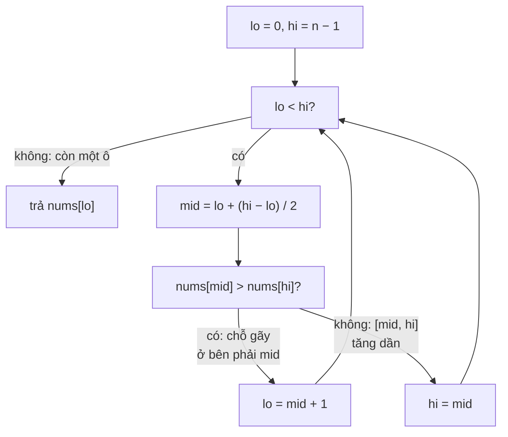

> [!tldr] Đọc nhanh
> - Đề: một mảng tăng dần, các số khác nhau, bị **xoay** ở một chỗ nào đó (`[0,1,2,4,5,6,7]` thành `[4,5,6,7,0,1,2]`). Tìm phần tử nhỏ nhất trong O(log n).
> - Mảng xoay là hai đoạn tăng dần nối nhau. Phần tử nhỏ nhất là chỗ **gãy**: đầu của đoạn thứ hai.
> - [[concepts/binary-search|Chia đôi]] so `nums[mid]` với `nums[hi]`: lớn hơn thì chỗ gãy nằm hẳn bên phải mid (`lo = mid + 1`), không thì mid là chỗ gãy hoặc nằm bên phải chỗ gãy (`hi = mid`). Vòng lặp `while (lo < hi)` dừng khi chỉ còn một ô.
> - Bẫy: so với `nums[lo]` trả **phần tử lớn nhất** trên mảng không xoay; viết `lo <= hi` với `hi = mid` lặp vô hạn.
> - Đo: 10⁷ phần tử, quét 6 988 µs, chia đôi 0,026 µs. Có số trùng (LeetCode 154) thì chia đôi bị ép bỏ từng ô: 10 015 bước ở n = 10⁵.

> [!info] Bối cảnh
> Bài LeetCode 153, bài thứ ba của [[posts/2026-11-23-neetcode-binary-search|ga 1: Tìm kiếm nhị phân trên mảng]] trên **tuyến NeetCode: Tìm kiếm và heap**. Ở [[problems/binary-search|Binary Search]] mảng tăng dần trọn vẹn; ở đây mảng chỉ "tăng dần từng khúc", nên phải hỏi một câu khác để biết bỏ nửa nào. Bài kế tiếp, [[problems/search-in-rotated-sorted-array|Search in Rotated Sorted Array]], dùng chính kết quả của bài này. Lời giải có đủ TypeScript, Python, Go, Java và JavaScript. Bạn chỉ cần biết vòng lặp và mảng.

> [!abstract]- Từ điển nhanh cho bài này (bấm để mở)
> - **Tìm kiếm nhị phân (binary search)**: mỗi bước nhìn ô giữa, rồi bỏ hẳn một nửa không thể chứa đáp án. Xem [[concepts/binary-search|Binary Search]].
> - **Mảng xoay (rotated sorted array)**: mảng tăng dần bị cắt ở một chỗ, đoạn đầu chuyển ra sau. Xem [[concepts/rotated-sorted-array|Rotated Sorted Array]].
> - **Bất biến vòng lặp (loop invariant)**: điều luôn đúng ở đầu mỗi vòng. Ở đây: "phần tử nhỏ nhất nằm trong `[lo, hi]`". Xem [[concepts/loop-invariant|Loop Invariant]].
> - **O(log n)**: mỗi bước chia đôi số ô còn lại; 10⁷ ô chỉ cần khoảng 24 bước. Xem [[concepts/big-o-notation|Big-O]].

## Hình dung trước: dãy nhà bị đánh số lại từ giữa phố

Một con phố có các nhà đánh số tăng dần. Năm nay phường đánh số lại, nhưng bắt đầu từ một căn ở giữa phố: đi từ đầu phố, bạn gặp 40, 50, 60, 70, rồi bỗng 0, 10, 20. Bạn cần tìm căn số nhỏ nhất, và chỉ được hỏi thăm vài nhà.

| Đời thường | Khái niệm |
|---|---|
| Dãy nhà tăng dần, bị đánh số lại từ một căn giữa phố | mảng tăng dần đã bị xoay |
| Chỗ số nhà tụt từ 70 về 0 | chỗ gãy, nơi có phần tử nhỏ nhất |
| Đứng ở căn giữa đoạn còn nghi ngờ, nhìn số nhà | `nums[mid]` |
| So với căn **cuối** đoạn: căn giữa số lớn hơn, nghĩa là chỗ tụt còn ở phía trước | `nums[mid] > nums[hi]` thì `lo = mid + 1` |
| Căn giữa số nhỏ hơn căn cuối: từ đây tới cuối tăng đều, căn nhỏ nhất là căn này hoặc ở phía sau lưng | `hi = mid` |
| Đoạn nghi ngờ chỉ còn một căn | `lo == hi`, trả `nums[lo]` |



## Vấn đề

**Đề (tóm tắt bằng lời của mình):** cho mảng `nums` gồm n số nguyên **khác nhau** (1 ≤ n ≤ 5 000), vốn tăng dần rồi bị xoay từ 1 tới n lần. Trả phần tử nhỏ nhất, với thuật toán O(log n). Đề gốc: [LeetCode 153](https://leetcode.com/problems/find-minimum-in-rotated-sorted-array/).

| Input | Output |
|---|---|
| `[3, 4, 5, 1, 2]` | `1` |
| `[4, 5, 6, 7, 0, 1, 2]` | `0` |
| `[11, 13, 15, 17]` (xoay đủ n lần, như chưa xoay) | `11` |
| `[2, 1]` | `1` |

Mình từng nghĩ chia đôi chỉ dùng được khi mảng tăng dần trọn vẹn. Hóa ra chia đôi chỉ cần một câu hỏi có/không mà câu trả lời **đổi đúng một lần** dọc mảng. Ở đây câu hỏi là "ô này có nhỏ hơn hoặc bằng ô cuối không?": mọi ô của đoạn đầu trả lời "không", mọi ô của đoạn sau trả lời "có", và ô "có" đầu tiên chính là đáp án.

## Cơ chế

### Cách 1, quét: O(n)

Đi hết mảng, giữ số nhỏ nhất. Đúng, nhưng đề đòi O(log n). Quét cũng không dùng gì của cấu trúc "hai đoạn tăng dần".

### Cách 2, chia đôi so với `nums[hi]`

Giữ [[concepts/loop-invariant|bất biến]]: **phần tử nhỏ nhất luôn nằm trong `[lo, hi]`** (cả hai đầu đều tính). Lấy `mid` ở giữa:

| Quan sát | Kết luận | Bước |
|---|---|---|
| `nums[mid] > nums[hi]` | giữa mid và hi có chỗ tụt xuống, nên mid thuộc đoạn đầu; min nằm hẳn bên phải mid | `lo = mid + 1` |
| `nums[mid] < nums[hi]` | `[mid, hi]` tăng dần, nên không ô nào bên phải mid nhỏ hơn mid; min là mid hoặc ở bên trái | `hi = mid` |

Không có ca bằng nhau: các số khác nhau, và `mid < hi` khi `lo < hi` (mid làm tròn xuống). Mỗi bước, đoạn `[lo, hi]` nhỏ đi ít nhất một ô, nên vòng lặp dừng. Khi `lo == hi`, bất biến nói min nằm trong một ô duy nhất đó.

Vì sao `while (lo < hi)` mà không phải `lo <= hi`? Vì nhánh thứ hai **giữ** mid (`hi = mid`, không phải `mid − 1`). Với `lo <= hi`, khi `lo == hi` thì `mid == hi`, nhánh hai đặt lại `hi = mid`, và không gì thay đổi nữa: lặp vô hạn. Quy tắc nhớ: nhánh nào giữ mid thì vòng lặp phải dừng khi còn một ô.

### Cách 3, so với `nums[0]`

Câu hỏi "ô này có nhỏ hơn `nums[0]` không?" cũng đổi đúng một lần, từ "không" sang "có", ở chỗ gãy. Nhưng nếu mảng không xoay thì không ô nào trả lời "có", nên phải kiểm riêng ca `nums[0] <= nums[n − 1]` trước. Cách 2 không cần kiểm riêng, vì ô cuối luôn trả lời "có" cho câu hỏi của nó.

### Vì sao so với `nums[lo]` thì sai

Nghe có vẻ đối xứng: "`nums[mid] >= nums[lo]` thì nửa trái tăng dần, min ở bên phải". Trên mảng không xoay `[11, 13, 15, 17]`, nửa trái luôn tăng dần, nên `lo` cứ đi sang phải và trả `17`, phần tử **lớn nhất**. Gốc của lỗi: `nums[lo]` lớn hơn mọi phần tử của đoạn sau, nhưng khi không có đoạn sau thì so sánh với nó không còn nói gì về vị trí của min. File TypeScript chạy bản sai này: 4/8 ca đúng.

### Có số trùng: LeetCode 154

Nếu cho phép số trùng, `nums[mid] == nums[hi]` không nói được min ở bên nào: `[1, 1, 1, 0, 1]` và `[1, 0, 1, 1, 1]` đều có `nums[mid] == nums[hi] == 1` nhưng 0 nằm ở hai phía khác nhau. Điều duy nhất chắc chắn là bỏ `hi` đi vẫn còn một bản sao của giá trị đó ở `mid`, nên viết `hi--`. Ca tệ nhất mỗi bước chỉ bỏ một ô: O(n).

### Đo

TypeScript, n phần tử tăng dần xoay ở vị trí 0,37·n, trung vị 7 lần:

| n | quét (µs/lần) | chia đôi (µs/lần) |
|---|---|---|
| 1 000 | 6,33 | 0,014 |
| 100 000 | 58,82 | 0,020 |
| 1 000 000 | 610,65 | 0,022 |
| 10 000 000 | 6 987,76 | 0,026 |

Quét tăng gấp 10 khi n gấp 10. Chia đôi gần như đứng yên: từ 10³ lên 10⁷ ô, số bước chỉ tăng từ 10 lên 24. Python cho cùng dáng: `min()` viết bằng C vẫn mất 6 394 µs ở 10⁶ phần tử, còn vòng chia đôi bằng Python mất 0,99 µs.

Số trùng (bản LeetCode 154, đếm số vòng lặp):

| n | một số 0 giữa toàn số 1 | không trùng |
|---|---|---|
| 1 000 | 108 bước | 10 bước |
| 10 000 | 1 012 bước | 14 bước |
| 100 000 | 10 015 bước | 17 bước |

Toàn số 1 nên hầu hết các bước rơi vào nhánh `hi--`: số bước tăng theo n, không theo log n.

### Bên dưới năm ngôn ngữ

| | Tính mid | Bẫy riêng |
|---|---|---|
| TypeScript / JavaScript | `lo + ((hi - lo) >> 1)` hoặc `Math.floor((lo + hi) / 2)` | số là double nên `lo + hi` không tràn ở cỡ mảng thật; `>> 1` ép về int32, chỉ đúng khi chỉ số < 2³¹. `Math.min(...nums)` ném `RangeError` khi mảng quá lớn để trải thành đối số |
| Python | `(lo + hi) // 2` | int không giới hạn, không tràn; `//` làm tròn xuống, kể cả số âm |
| Go | `lo + (hi-lo)/2` | `int` 64 bit trên máy 64 bit, nhưng viết như vậy là thói quen an toàn cho mọi kiểu |
| Java | `(lo + hi) >>> 1` | `int` 32 bit: `(lo + hi) / 2` với lo = 1,5 tỷ, hi = 2 tỷ ra **−397 483 648**; `>>> 1` coi tổng là số không dấu và ra đúng 1 750 000 000. Đây là lỗi từng nằm trong `Arrays.binarySearch` của JDK |

## Ví dụ chạy được

[TypeScript](../code/neetcode-find-minimum-in-rotated-sorted-array/find-min-rotated.ts) · [Python](../code/neetcode-find-minimum-in-rotated-sorted-array/find_min_rotated.py) · [Go](../code/neetcode-find-minimum-in-rotated-sorted-array/find_min_rotated.go) · [Java](../code/neetcode-find-minimum-in-rotated-sorted-array/find-min-rotated.java) · [JavaScript](../code/neetcode-find-minimum-in-rotated-sorted-array/find-min-rotated.js)

Mỗi file có quét, chia đôi so với `nums[hi]` và chia đôi so với `nums[0]`, chạy 8 ca. File TypeScript có thêm hai bản sai, bản có số trùng và phép đo. Dưới đây là hai cách chia đôi.

```ts
// Cách 2, chia đôi so với nums[hi]. Bất biến: phần tử nhỏ nhất luôn nằm trong [lo, hi].
function binaryVsHi(nums: number[]): number {
  let lo = 0, hi = nums.length - 1;
  while (lo < hi) {
    const mid = lo + ((hi - lo) >> 1);
    if (nums[mid] > nums[hi]) lo = mid + 1; // mid ở nửa "cao" bên trái điểm gãy: min nằm hẳn bên phải mid
    else hi = mid; // nums[mid] < nums[hi]: đoạn [mid, hi] tăng dần, min là mid hoặc ở bên trái
  }
  return nums[lo];
}

// Cách 3, tìm điểm gãy bằng cách so với nums[0]: phần tử đầu tiên nhỏ hơn nums[0].
function binaryVsFirst(nums: number[]): number {
  if (nums[0] <= nums[nums.length - 1]) return nums[0]; // không xoay (hoặc xoay đủ vòng): min ở đầu
  let lo = 0, hi = nums.length - 1;
  while (lo < hi) {
    const mid = lo + ((hi - lo) >> 1);
    if (nums[mid] >= nums[0]) lo = mid + 1;
    else hi = mid;
  }
  return nums[lo];
}
```

```python
def binary_vs_hi(nums: list[int]) -> int:
    lo, hi = 0, len(nums) - 1
    while lo < hi:
        mid = (lo + hi) // 2  # int của Python không tràn, nên (lo + hi) // 2 an toàn
        if nums[mid] > nums[hi]:
            lo = mid + 1
        else:
            hi = mid
    return nums[lo]

def binary_vs_first(nums: list[int]) -> int:
    if nums[0] <= nums[-1]:
        return nums[0]
    lo, hi = 0, len(nums) - 1
    while lo < hi:
        mid = (lo + hi) // 2
        if nums[mid] >= nums[0]:
            lo = mid + 1
        else:
            hi = mid
    return nums[lo]
```

```go
func binaryVsHi(nums []int) int {
	lo, hi := 0, len(nums)-1
	for lo < hi {
		mid := lo + (hi-lo)/2 // không viết (lo+hi)/2: với int32 hay mảng rất lớn, tổng có thể tràn
		if nums[mid] > nums[hi] {
			lo = mid + 1
		} else {
			hi = mid
		}
	}
	return nums[lo]
}

func binaryVsFirst(nums []int) int {
	if nums[0] <= nums[len(nums)-1] {
		return nums[0]
	}
	lo, hi := 0, len(nums)-1
	for lo < hi {
		mid := lo + (hi-lo)/2
		if nums[mid] >= nums[0] {
			lo = mid + 1
		} else {
			hi = mid
		}
	}
	return nums[lo]
}
```

```java
static int binaryVsHi(int[] nums) {
    int lo = 0, hi = nums.length - 1;
    while (lo < hi) {
        int mid = (lo + hi) >>> 1; // >>> 1 coi tổng là số không dấu: không âm kể cả khi lo + hi tràn int
        if (nums[mid] > nums[hi]) lo = mid + 1;
        else hi = mid;
    }
    return nums[lo];
}

static int binaryVsFirst(int[] nums) {
    if (nums[0] <= nums[nums.length - 1]) return nums[0];
    int lo = 0, hi = nums.length - 1;
    while (lo < hi) {
        int mid = (lo + hi) >>> 1;
        if (nums[mid] >= nums[0]) lo = mid + 1;
        else hi = mid;
    }
    return nums[lo];
}
```

```js
function binaryVsHi(nums) {
  let lo = 0, hi = nums.length - 1;
  while (lo < hi) {
    const mid = Math.floor((lo + hi) / 2); // số JS là double, (lo + hi) không tràn ở cỡ mảng thật
    if (nums[mid] > nums[hi]) lo = mid + 1;
    else hi = mid;
  }
  return nums[lo];
}

function binaryVsFirst(nums) {
  if (nums[0] <= nums[nums.length - 1]) return nums[0];
  let lo = 0, hi = nums.length - 1;
  while (lo < hi) {
    const mid = Math.floor((lo + hi) / 2);
    if (nums[mid] >= nums[0]) lo = mid + 1;
    else hi = mid;
  }
  return nums[lo];
}
```

Kết quả của file TypeScript:

```text
linearScan          8/8 ca đúng
binaryVsHi          8/8 ca đúng
binaryVsFirst       8/8 ca đúng
wrongVsLo           4/8 ca đúng; sai ở [3,4,5,1,2] → 2 [4,5,6,7,0,1,2] → 2 [11,13,15,17] → 17 [1,2] → 2
wrongLoopCondition  0/8 ca đúng; sai ở [3,4,5,1,2] → lặp vô hạn [4,5,6,7,0,1,2] → lặp vô hạn …

n          quét (µs/lần)   chia đôi (µs/lần)
1000                6.33               0.014
100000             58.82               0.020
1000000           610.65               0.022
10000000         6987.76               0.026

LeetCode 154, số bước vòng lặp
n = 1000    một số khác giữa toàn số 1:    108 bước;  không trùng: 10 bước
n = 10000   một số khác giữa toàn số 1:   1012 bước;  không trùng: 14 bước
n = 100000  một số khác giữa toàn số 1:  10015 bước;  không trùng: 17 bước
```

Bản `wrongLoopCondition` có giới hạn 100 bước để báo "lặp vô hạn" thay vì treo máy: nó treo ở **mọi** ca, kể cả mảng một phần tử, vì vòng cuối luôn là `lo == hi`. File Java in thêm phép tính mid bị tràn:

```text
linearScan     8/8 ca đúng
binaryVsHi     8/8 ca đúng
binaryVsFirst  8/8 ca đúng

(lo + hi) / 2 = -397483648, (lo + hi) >>> 1 = 1750000000
```

Python, Go và JavaScript in `8/8 ca đúng` cho cả ba cách.

## Hiểu lầm và bẫy hay gặp

- **"Chia đôi cần mảng tăng dần."** Chia đôi cần một câu hỏi có/không mà câu trả lời đổi đúng một lần. "`nums[i] <= nums[n − 1]`?" là câu hỏi như vậy trên mảng xoay.
- **So với `nums[lo]`.** Sai trên mảng không xoay: trả phần tử lớn nhất. So với `nums[hi]`, hoặc kiểm riêng ca không xoay rồi so với `nums[0]`.
- **`lo <= hi` cùng với `hi = mid`.** Lặp vô hạn khi `lo == hi`. Nhánh giữ mid thì điều kiện là `lo < hi`.
- **Quên ca xoay đủ n lần.** Mảng trông như chưa xoay; đáp án là `nums[0]`. Đây là ca bản so với `nums[lo]` gãy.
- **Áp nguyên lời giải này cho mảng có số trùng.** Khi `nums[mid] == nums[hi]` phải `hi--`, và độ phức tạp ca tệ nhất thành O(n).
- **Java: `(lo + hi) / 2`.** Tràn khi tổng vượt 2³¹ − 1. Dùng `(lo + hi) >>> 1` hoặc `lo + (hi - lo) / 2`.

## Câu hỏi tự kiểm tra

> [!question]- Chạy cách 2 trên `[5, 6, 7, 1, 2, 3, 4]`, ghi lo, hi, mid mỗi bước.
> lo = 0, hi = 6, mid = 3: `nums[3] = 1 < 4`, `hi = 3`. lo = 0, hi = 3, mid = 1: `6 > 1`, `lo = 2`. lo = 2, hi = 3, mid = 2: `7 > 1`, `lo = 3`. lo = hi = 3, trả `1`.

> [!question]- Vì sao ở nhánh `nums[mid] < nums[hi]` ta viết `hi = mid` chứ không phải `hi = mid − 1`?
> Vì mid có thể chính là phần tử nhỏ nhất (ví dụ mid đứng đúng chỗ gãy). Bỏ mid đi sẽ phá bất biến "min nằm trong `[lo, hi]`".

> [!question]- Sửa cách 2 để trả **chỉ số** của phần tử nhỏ nhất (số lần mảng đã bị xoay). Đổi gì?
> Trả `lo` thay vì `nums[lo]`. Chỉ số của min bằng số vị trí mảng đã xoay sang phải; bài [[problems/search-in-rotated-sorted-array|Search in Rotated Sorted Array]] dùng đúng chỉ số này.

> [!question]- Đổi đề: tìm phần tử **lớn nhất**. Viết lại thế nào cho gọn?
> Phần tử lớn nhất đứng ngay trước min (vòng lại cuối mảng nếu min ở chỉ số 0): `nums[(lo − 1 + n) % n]` sau khi tìm được lo.

## Tham khảo

- [LeetCode 153: Find Minimum in Rotated Sorted Array](https://leetcode.com/problems/find-minimum-in-rotated-sorted-array/) (đề gốc)
- [LeetCode 154: Find Minimum in Rotated Sorted Array II](https://leetcode.com/problems/find-minimum-in-rotated-sorted-array-ii/) (bản có số trùng)
- Joshua Bloch, [Extra, Extra: Read All About It: Nearly All Binary Searches and Mergesorts are Broken](https://research.google/blog/extra-extra-read-all-about-it-nearly-all-binary-searches-and-mergesorts-are-broken/) (Google Research, 2006: lỗi tràn `(low + high) / 2` trong JDK)
