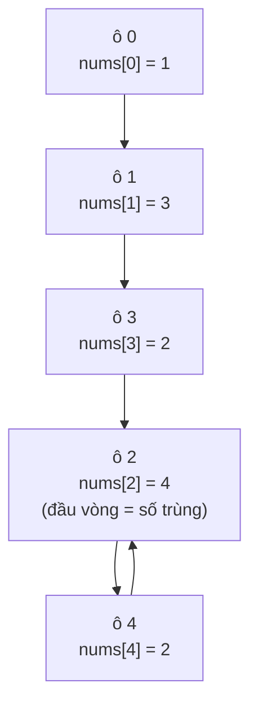

> [!tldr] Đọc nhanh
> - Đề: mảng có n + 1 số, mỗi số nằm trong [1, n], đúng một giá trị bị lặp (có thể lặp nhiều lần). Tìm nó **mà không sửa mảng** và chỉ dùng **O(1) bộ nhớ thêm**. Hai ràng buộc này loại sắp xếp, [[concepts/hash-set|Set]] và mẹo đánh dấu âm.
> - [[concepts/search-on-the-answer|Tìm nhị phân trên giá trị]]: gọi cnt(m) là số phần tử ≤ m. Câu "cnt(m) > m" sai với mọi m nhỏ hơn số trùng và đúng từ số trùng trở đi, nên chia đôi được. O(n log n), O(1) bộ nhớ.
> - Coi mảng là [[concepts/linked-list|danh sách liên kết]]: ô i trỏ tới ô nums[i]. Không ô nào trỏ về ô 0, nên đi từ 0 chắc chắn rơi vào một vòng, và **đầu vòng có hai mũi tên đi vào, tức là số bị lặp**. [[concepts/fast-slow-pointers|Rùa và thỏ]] tìm đầu vòng trong O(n), O(1) bộ nhớ.
> - Kiểm vét cạn mọi mảng hợp lệ với n ≤ 6 (61 497 mảng) và 2 000 mảng ngẫu nhiên: sáu cách đúng không sai mảng nào. Hai bản sai chạy thật: đếm `x < mid` thay vì `x ≤ mid` (5/10 ca), và pha 2 xuất phát từ `nums[0]` thay vì 0 (chỉ đúng khi vòng dài 1, còn lại lặp mãi).
> - O(n) chưa chắc nhanh hơn: ở 4·10⁶ số, Floyd trên chuỗi ô nằm rải rác mất khoảng 1 giây, chậm hơn cả tìm nhị phân O(n log n) đọc mảng tuần tự (228 ms), vì mỗi bước của Floyd là một lần nhảy tới chỗ bất kỳ trong bộ nhớ.

> [!info] Bối cảnh
> Bài LeetCode 287 của [[posts/2026-11-24-neetcode-advanced-linked-list|ga 2: Danh sách liên kết nâng cao]] trong **tuyến NeetCode: Cấu trúc liên kết**. Ở [[posts/2026-11-24-neetcode-linked-list|ga 1]], bài [[problems/linked-list-cycle|Linked List Cycle]] dùng rùa và thỏ để phát hiện vòng và tìm đầu vòng (mở rộng LC 142). Bài này không có nút hay con trỏ nào: chỉ có một mảng số. Mẹo là nhìn mảng như một danh sách liên kết ẩn, rồi dùng lại đúng thuật toán đó. Trang cũng giải lại bằng [[concepts/search-on-the-answer|tìm nhị phân trên đáp án]], kỹ thuật của bài [[problems/koko-eating-bananas|Koko Eating Bananas]]. Lời giải có đủ TypeScript, Python, Go, Java và JavaScript. Bạn chỉ cần biết vòng lặp và mảng.

> [!abstract]- Từ điển nhanh cho bài này (bấm để mở)
> - **Nguyên lý chuồng bồ câu**: nhét n + 1 con chim vào n cái chuồng thì ít nhất một chuồng có hai con. Ở đây: n + 1 số, chỉ n giá trị khả dĩ, nên phải có số trùng.
> - **O(1) bộ nhớ thêm**: ngoài mảng đề cho, chỉ dùng vài biến, không dùng mảng hay Set phụ lớn theo n.
> - **cnt(m)**: số phần tử của mảng nhỏ hơn hoặc bằng m.
> - **Vị từ đơn điệu**: câu hỏi đúng/sai mà khi m tăng thì chỉ đổi từ "sai" sang "đúng" đúng một lần. Xem [[concepts/monotonic-predicate|Monotonic Predicate]].
> - **Đồ thị i → nums[i]**: vẽ mỗi chỉ số 0..n thành một ô, và từ ô i kẻ một mũi tên tới ô nums[i]. Mỗi ô có đúng một mũi tên đi ra, giống mỗi nút danh sách có đúng một `next`.
> - **Đầu vòng**: ô đầu tiên của vòng mà đường đi từ ô 0 chạm vào. Xem [[problems/linked-list-cycle|Linked List Cycle]] cho cách rùa và thỏ tìm nó.
> - **Bit**: chữ số 0/1 trong cách viết nhị phân của một số. Xem [[concepts/bitmask|Bitmask]].

## Hình dung trước: trò truy tìm kho báu với n + 1 tấm phiếu

Một trò chơi có n + 1 cái hộp đánh số 0, 1, …, n. Trong mỗi hộp có một tấm phiếu ghi "đi tới hộp số x", với x từ 1 tới n. Bạn bắt đầu ở hộp 0 và cứ làm theo phiếu. Vì có n + 1 tấm phiếu mà chỉ n đích khác nhau, hai tấm phiếu chắc chắn chỉ tới **cùng một hộp**. Và vì không tấm nào chỉ về hộp 0, bạn sẽ đi một đoạn rồi rơi vào một vòng lòng vòng mãi. Hộp mà bạn bước vào vòng là hộp được hai tấm phiếu cùng chỉ tới: một tấm từ đoạn đường bạn vừa đi, một tấm từ chính vòng. Số của hộp đó là số bị lặp.

| Đời thường | Khái niệm |
|---|---|
| Hộp số i | chỉ số i của mảng |
| Phiếu trong hộp i ghi "tới hộp x" | nums[i] = x, mũi tên i → x |
| Không phiếu nào chỉ về hộp 0 | mọi giá trị trong [1, n], nên ô 0 không có mũi tên đi vào |
| Đoạn đường trước khi lòng vòng | phần đuôi, dài μ |
| Vòng lòng vòng | vòng, dài λ |
| Hộp được hai phiếu cùng chỉ tới | đầu vòng = số bị lặp |
| Hai người đi nhanh chậm khác nhau | rùa và thỏ (Floyd) |

Với `nums = [1, 3, 4, 2, 2]`: 0 → 1 → 3 → 2 → 4 → 2 → 4 → … Đuôi là 0, 1, 3; vòng là 2 → 4 → 2. Hộp 2 được phiếu của hộp 3 (trên đuôi) và phiếu của hộp 4 (trong vòng) cùng chỉ tới, và 2 đúng là số bị lặp.



## Vấn đề

Không có ràng buộc thì bài này dễ: sắp xếp rồi tìm hai số cạnh nhau bằng nhau, hoặc nhớ các số đã gặp trong một Set. Đề cấm cả hai:

- **Không được sửa mảng.** Sắp xếp tại chỗ và mẹo đánh dấu âm đều sửa mảng.
- **Chỉ O(1) bộ nhớ thêm.** Sắp xếp một bản sao tốn O(n), Set tốn O(n).

Đề còn hỏi thêm: chứng minh luôn có số trùng (nguyên lý chuồng bồ câu ở trên), và có giải được trong thời gian tuyến tính không. Ràng buộc: 1 ≤ n ≤ 10⁵, mảng dài n + 1, mỗi phần tử trong [1, n], đúng một giá trị xuất hiện từ hai lần trở lên.

Điều cần để ý: "đúng một giá trị bị lặp" **không** có nghĩa là nó xuất hiện đúng hai lần. `[3, 3, 3, 3, 3]` hợp lệ: 3 xuất hiện năm lần, còn 1, 2, 4 vắng mặt. Mọi lập luận bên dưới phải đúng cả khi số trùng chiếm chỗ của nhiều số vắng.

## Cơ chế

<figure class="figure-map" style="--ar: 3 / 4">
<div class="frame"><iframe data-archify="../diagrams/neetcode-find-the-duplicate-number/worked-example.html" title="Chỗ vào vòng là số bị lặp" loading="lazy"></iframe></div>
<figcaption><span><b>Hình 1.</b> Chỗ vào vòng là số bị lặp.</span><a href="../diagrams/neetcode-find-the-duplicate-number/worked-example.html" target="_blank" rel="noopener">Mở toàn màn hình</a></figcaption>
</figure>

<details>
<summary>Đọc từng bước</summary>
<ol>
<li>Dùng mỗi giá trị làm chỉ số kế. <code>[2, 1, 3, 4, 3]; 0 → 2 → 3 → 4 → 3</code></li>
<li>Tìm một điểm gặp trong vòng. <code>slow = fast = 3</code></li>
<li>Đặt một con trỏ về điểm bắt đầu. <code>first = 0; second = 3</code></li>
<li>Cùng đi hai bước tới cửa vòng. <code>0 → 2 → 3; 3 → 4 → 3</code></li>
<li>Hai đường gặp tại giá trị lặp. <code>duplicate = 3</code></li>
</ol>
</details>

### Ba cách vi phạm ràng buộc

Trước khi tới cách đúng, ba cách quen thuộc cho đáp án đúng nhưng phạm luật. Sắp xếp một bản sao và Set tốn O(n) bộ nhớ. Đánh dấu âm thì O(1) bộ nhớ, nhưng dùng chính mảng làm sổ ghi:

```ts
// Cách 3: đánh dấu âm. Gặp x thì lật dấu nums[x]; ô đã âm nghĩa là x đã gặp. O(1) bộ nhớ nhưng SỬA mảng gốc.
function markNegative(nums: number[]): number {
  for (const v of nums) {
    const x = Math.abs(v);
    if (nums[x] < 0) return x;
    nums[x] = -nums[x];
  }
  return -1;
}
```


Gặp giá trị x thì lật dấu ô `nums[x]`; nếu ô đó đã âm thì x đã gặp rồi. Kết quả đúng ở mọi ca, nhưng sau khi gọi, mảng của người gọi đã khác:

```text
markNegative([1,3,4,2,2]) = 2; mảng sau khi gọi: [1,-3,-4,-2,-2]
```

Nếu đề cho sửa mảng thì đây là cách nhanh nhất (bảng đo bên dưới). Đề không cho, và trong code thật, một hàm "tìm" mà lặng lẽ đổi dữ liệu của người gọi là lỗi khó tìm.

### Cách 4: tìm nhị phân trên giá trị

Không tìm vị trí trong mảng, mà tìm **giá trị** trong khoảng [1, n]. Với mỗi m, đếm cnt(m) = số phần tử ≤ m, rồi hỏi: cnt(m) > m?

Gọi d là số trùng, xuất hiện k ≥ 2 lần, và M là tập các giá trị trong [1, n] vắng mặt. Mảng có n + 1 phần tử = (n − |M|) giá trị khác nhau + (k − 1) bản thừa của d, nên **k − 1 = |M| + 1**.

- **m < d**: các phần tử ≤ m đều khác nhau (chỉ d bị lặp) và nằm trong [1, m], nên cnt(m) ≤ m. Câu hỏi trả lời "sai".
- **m ≥ d**: cnt(m) = (số giá trị có mặt trong [1, m]) + (k − 1) = (m − |M ∩ [1, m]|) + |M| + 1 ≥ m + 1. Câu hỏi trả lời "đúng".

Vậy "cnt(m) > m" là một [[concepts/monotonic-predicate|vị từ đơn điệu]]: sai, sai, …, sai, đúng, đúng, …, và chỗ đổi đầu tiên chính là d. Đây đúng là dạng [[concepts/search-on-the-answer|tìm nhị phân trên đáp án]] của bài [[problems/koko-eating-bananas|Koko Eating Bananas]]: không có mảng đã sắp nào để tìm, chỉ có một câu hỏi đúng/sai đơn điệu theo m.

```ts
// Cách 4: tìm nhị phân trên giá trị. cnt(m) = số phần tử ≤ m; cnt(m) > m đúng từ số trùng trở đi (nguyên lý chuồng bồ câu).
function binaryCount(nums: number[]): number {
  let lo = 1, hi = nums.length - 1;
  while (lo < hi) {
    const mid = (lo + hi) >>> 1;
    let cnt = 0;
    for (const x of nums) if (x <= mid) cnt++;
    if (cnt > mid) hi = mid; else lo = mid + 1;
  }
  return lo;
}
```


Mỗi lần hỏi đọc cả mảng (O(n)), và có khoảng log₂ n lần hỏi, nên tổng O(n log n). Bộ nhớ chỉ là vài biến. Mảng không bị đổi.

### Cách 5: đếm từng bit

Cùng ý tưởng đếm, nhưng đếm theo bit. Với mỗi bit b, so số phần tử của mảng có bit b bật với số giá trị trong 1..n có bit b bật. Hiệu của hai số đếm đó bằng (k − 1)·[bit b của d] − (số giá trị vắng có bit b bật).

- Nếu bit b của d là 0, hiệu ≤ 0.
- Nếu bit b của d là 1, hiệu ≥ (k − 1) − |M| = 1 > 0.

Vậy bit b của d bật đúng khi mảng có **nhiều hơn**. Ghép các bit lại được d.

```ts
// Cách 5: đếm từng bit. Bit b của số trùng bật khi trong nums có nhiều số bật bit b hơn trong 1..n.
function bitCount(nums: number[]): number {
  const n = nums.length - 1;
  let ans = 0;
  for (let b = 0; (1 << b) <= n; b++) {
    const mask = 1 << b;
    let inNums = 0, inRange = 0;
    for (const x of nums) if (x & mask) inNums++;
    for (let v = 1; v <= n; v++) if (v & mask) inRange++;
    if (inNums > inRange) ans |= mask;
  }
  return ans;
}
```


Có khoảng log₂ n bit, mỗi bit đọc mảng một lượt: cũng O(n log n), O(1) bộ nhớ.

### Cách 6: rùa và thỏ trên đồ thị i → nums[i]

Coi mỗi chỉ số i (từ 0 tới n) là một nút, và nums[i] là `next` của nó. Ba sự thật về đồ thị này:

1. **Đi từ ô 0 chắc chắn rơi vào vòng.** Mỗi ô có đúng một mũi tên đi ra (tới nums[i], luôn là một chỉ số hợp lệ vì nums[i] ≤ n). Chỉ có n + 1 ô, nên đi đủ lâu phải gặp lại một ô cũ.
2. **Ô 0 không nằm trong vòng.** Mọi giá trị đều ≥ 1, nên không mũi tên nào đi vào ô 0. Một ô nằm trong vòng thì luôn có mũi tên đi vào từ ô đứng trước nó trong vòng. Vậy đường từ ô 0 có phần đuôi dài μ ≥ 1 trước khi vào vòng.
3. **Đầu vòng là số trùng.** Gọi e là đầu vòng. Vì μ ≥ 1, e có một ô đứng trước p trên đuôi (nums[p] = e). Vì e nằm trong vòng, e còn có một ô đứng trước q trong vòng (nums[q] = e). p nằm ngoài vòng còn q nằm trong vòng, nên p ≠ q. Hai chỉ số khác nhau cùng chứa giá trị e: e là số bị lặp. Đề nói chỉ có một giá trị bị lặp, nên e = d.

Sự thật 2 là lý do phải xuất phát từ **ô 0** chứ không phải ô bất kỳ: xuất phát từ một ô nằm sẵn trong vòng thì không có đuôi, và "đầu vòng" không còn ý nghĩa. Sự thật 3 biến bài toán thành đúng bài LC 142: tìm đầu vòng. Phần còn lại lấy nguyên từ [[problems/linked-list-cycle|Linked List Cycle]]: pha 1 cho rùa đi 1 bước, thỏ đi 2 bước tới khi gặp nhau trong vòng; pha 2 đưa một con về ô 0, cả hai cùng đi 1 bước, chỗ gặp lại là đầu vòng. Trang đó có chứng minh vì sao pha 2 dừng đúng ở đầu vòng.

```ts
// Cách 6: rùa và thỏ trên đồ thị i → nums[i]. Xuất phát từ chỉ số 0 (không ô nào trỏ về 0, nên 0 nằm ngoài vòng).
// Pha 1 tìm một điểm trong vòng; pha 2 đưa một con về 0, cả hai đi 1 bước, chỗ gặp là đầu vòng, tức số trùng.
function floyd(nums: number[]): number {
  let slow = 0, fast = 0;
  do {
    slow = nums[slow];
    fast = nums[nums[fast]];
  } while (slow !== fast);
  let a = 0;
  while (a !== slow) {
    a = nums[a];
    slow = nums[slow];
  }
  return a;
}
```


Pha 1 tốn không quá μ + λ lượt, pha 2 tốn đúng μ lượt, mà μ + λ ≤ n + 1. Vậy O(n) thời gian, O(1) bộ nhớ, và mảng chỉ được đọc.

Ví dụ `[1, 3, 4, 2, 2]` (μ = 3, λ = 2):

| Lượt | rùa | thỏ |
|---|---|---|
| bắt đầu | 0 | 0 |
| 1 | 1 | 3 |
| 2 | 3 | 4 |
| 3 | 2 | 4 |
| 4 | 4 | 4 |

Gặp nhau ở ô 4 sau 4 lượt (bội nhỏ nhất của λ = 2 không nhỏ hơn μ = 3). Pha 2: con từ ô 0 đi 0 → 1 → 3 → 2, con từ ô 4 đi 4 → 2 → 4 → 2. Sau μ = 3 bước, cả hai ở ô 2: đáp án 2.

### Hai bản sai

Đếm `x < mid` thay vì `x ≤ mid`. Vị từ đổi thành "số phần tử nhỏ hơn m lớn hơn m", không còn đổi chiều đúng ở d:

```ts
// SAI: đếm số phần tử < mid thay vì ≤ mid. Vị từ lệch một đơn vị nên dừng sai chỗ.
function wrongCountLess(nums: number[]): number {
  let lo = 1, hi = nums.length - 1;
  while (lo < hi) {
    const mid = (lo + hi) >>> 1;
    let cnt = 0;
    for (const x of nums) if (x < mid) cnt++;
    if (cnt > mid) hi = mid; else lo = mid + 1;
  }
  return lo;
}
```


Bản này sai 5/10 ca thử, và sai 51 014 trên 61 497 mảng vét cạn. Ở `[1, 3, 4, 2, 2]` nó trả 4.

Pha 2 xuất phát từ `nums[0]` thay vì từ 0. Nhiều bài giải viết pha 1 bắt đầu bằng `slow = nums[0]`, rồi pha 2 cũng `slow = nums[0]`; hai pha phải xuất phát từ **cùng một chỗ**. Trộn hai kiểu (pha 1 từ 0, pha 2 từ `nums[0]`) thì con trỏ mới đi trước một bước:

```ts
// SAI: pha 2 đưa con trỏ về nums[0] thay vì về 0. Nó đi trước một bước, nên hai con chỉ gặp nhau khi vòng dài 1.
function wrongResetToFirst(nums: number[]): number {
  let slow = 0, fast = 0;
  do {
    slow = nums[slow];
    fast = nums[nums[fast]];
  } while (slow !== fast);
  let a = nums[0];
  let guard = 0;
  while (a !== slow && guard++ < 4 * nums.length) {
    a = nums[a];
    slow = nums[slow];
  }
  return a === slow ? a : -1;
}
```


Sau s bước, con trỏ mới ở vị trí 1 + s trên đường đi, còn con kia ở t + s với t chia hết cho λ. Khi cả hai đã trong vòng, chúng trùng nhau khi và chỉ khi 1 ≡ t ≡ 0 (mod λ), tức **chỉ khi λ = 1**. Với mọi vòng dài hơn, hai con chạy vòng quanh cách nhau đúng một ô mãi mãi. File chặn bằng một giới hạn số bước và trả −1; bản không có giới hạn thì treo. Đúng 6/10 ca thử qua được, và cả 6 đều có vòng dài 1 (ví dụ `[3, 3, 3, 3, 3]`: 0 → 3 → 3).

Còn một cách đúng nhưng chậm: với mỗi i, `nums.indexOf(nums[i]) !== i` nghĩa là nums[i] đã xuất hiện ở chỗ trước. O(1) bộ nhớ, không sửa mảng, nhưng `indexOf` quét từ đầu mỗi lần nên O(n²): n gấp đôi thì thời gian gấp khoảng 4 (35,7 → 146,5 → 588,8 ms ở n = 10⁴, 2·10⁴, 4·10⁴, khi số trùng nằm cuối mảng).

### Bên dưới năm ngôn ngữ

| | Sắp xếp | Bẫy riêng |
|---|---|---|
| TypeScript / JavaScript | `nums.sort()` sắp tại chỗ và trả về chính mảng đó | `sort()` không truyền hàm so sánh thì so theo chuỗi: `[10, 2, 9, 10].sort()` ra `[10, 10, 2, 9]`. Thứ tự sai, nhưng hai số bằng nhau vẫn đứng cạnh nhau, nên riêng bài này cách "sắp rồi so hai số cạnh nhau" vẫn đúng 11/11 ca |
| Python | `nums.sort()` sửa list của người gọi; `sorted(nums)` tạo bản sao | `binary_count` viết bằng vòng lặp Python chậm hơn Set nhiều lần (845 ms so với 114 ms ở 10⁶), vì mỗi phép so sánh là một lần thông dịch |
| Go | `sort.Ints(nums)` sắp tại chỗ | slice truyền vào hàm vẫn trỏ cùng mảng nền, nên hàm sửa slice là người gọi thấy; muốn an toàn thì `slices.Clone(nums)` trước |
| Java | `Arrays.sort(nums)` sắp tại chỗ | mảng là tham chiếu nên người gọi thấy mảng đã sắp; `HashSet<Integer>` đóng hộp mỗi số thành một object, chậm hơn `int[]` nhiều |

Cả bốn file chạy bản "sắp tại chỗ" và in mảng của người gọi sau khi gọi: lần nào cũng thành `[1, 2, 3, 3, 4]`. Đáp án đúng, nhưng vi phạm đúng điều đề cấm.

### Đo

TypeScript, số trùng xuất hiện 2 lần, mảng xáo ngẫu nhiên, trung vị 5 lần chạy (μ, λ là độ dài đuôi và vòng của đồ thị i → nums[i] với mảng đó):

| n | μ | λ | Sắp bản sao | Set | Đánh dấu âm | Nhị phân | Đếm bit | Floyd |
|---|---|---|---|---|---|---|---|---|
| 10⁵ | 29 655 | 22 106 | 19,03 ms | 4,46 ms | 0,56 ms | 6,33 ms | 7,27 ms | 0,59 ms |
| 10⁶ | 12 575 | 296 622 | 228,48 ms | 56,94 ms | 7,46 ms | 66,75 ms | 87,50 ms | 8,51 ms |

- Ở mảng xáo ngẫu nhiên, Floyd nhanh hơn tìm nhị phân khoảng 8–11 lần, và gần bằng đánh dấu âm (cột này có cả 2,31 ms chép mảng).
- Set dừng ngay khi gặp số trùng lần hai, nên thời gian của nó phụ thuộc vào vị trí số trùng. Floyd phụ thuộc vào μ + λ.

Nhưng Floyd có một điểm yếu mà Big-O không cho thấy: mỗi bước là một lần đọc `nums[x]` với x bất kỳ, tức nhảy tới một chỗ ngẫu nhiên trong bộ nhớ. Tìm nhị phân thì đọc mảng từ đầu tới cuối, đúng kiểu đọc mà CPU đoán trước và nạp sẵn. Thử cùng một hình dạng (đuôi dài n − 1, vòng dài 1), chỉ đổi thứ tự các ô trong bộ nhớ:

| n | Floyd, chuỗi tuần tự | Floyd, chuỗi rải rác | Nhị phân |
|---|---|---|---|
| 10⁶ | 6,72 ms | 50,74 ms | 86,62 ms |
| 4·10⁶ | 22,37 ms | 1 259,33 ms | 227,89 ms |

Cùng số bước, nhưng chuỗi rải rác chậm hơn chuỗi tuần tự 7 lần ở 10⁶ và hơn 50 lần ở 4·10⁶. Ở 4·10⁶, Floyd O(n) thua tìm nhị phân O(n log n). Một lần chạy khác cho 945,83 ms ở ô rải rác 4·10⁶: con số dao động nhưng thứ tự không đổi. Lý do hợp lý nhất là bộ nhớ đệm của CPU: mảng 4·10⁶ số không còn vừa cache, nên mỗi bước nhảy của Floyd phải chờ RAM. Trang này chưa đo trực tiếp số lần trượt cache, nên đó là giải thích, không phải số đo.

Các ngôn ngữ khác, trên mảng xáo ngẫu nhiên (đầu vào khác bảng TypeScript, nên μ, λ khác):

| | n | Set | Nhị phân | Đếm bit | Floyd |
|---|---|---|---|---|---|
| Go | 10⁶ | 30,54 ms | 4,78 ms | 19,03 ms | 29,66 ms |
| Java | 10⁶ | 65,19 ms | 9,81 ms | 27,86 ms | 12,84 ms |
| Python | 10⁶ | 114,1 ms | 845,4 ms | 1 764,9 ms | 248,4 ms |

Go và Java dịch vòng đếm thành mã máy chạy rất nhanh trên mảng tuần tự, nên tìm nhị phân thắng Floyd ở 10⁶. Python thì ngược lại: mỗi phần tử tốn một lần thông dịch, nên cách nào đọc mảng nhiều lượt (nhị phân khoảng 20 lượt, đếm bit khoảng 20 lượt × 2) thua cách đọc ít. Với giới hạn n ≤ 10⁵ của đề, mọi cách đều dưới 1 ms ở Go và Java.

## Ví dụ chạy được

[TypeScript](../code/neetcode-find-the-duplicate-number/find-duplicate.ts) · [Python](../code/neetcode-find-the-duplicate-number/find_duplicate.py) · [Go](../code/neetcode-find-the-duplicate-number/find_duplicate.go) · [Java](../code/neetcode-find-the-duplicate-number/find-duplicate.java) · [JavaScript](../code/neetcode-find-the-duplicate-number/find-duplicate.js) · [PHP](../code/neetcode-find-the-duplicate-number/find-duplicate.php) · [Rust](../code/neetcode-find-the-duplicate-number/find_duplicate.rs)

Mỗi file trong năm bản đầu chạy 10 ca chung: ba ví dụ của đề, `[1, 1]`, số trùng ở đầu, ở cuối, lặp nhiều lần (`[2, 2, 2, 2, 2]`, `[1, 4, 4, 2, 4]`), một vòng tự trỏ, và mảng mười phần tử. File JavaScript thêm `[10, 2, 9, …, 10]` để thử `sort()` theo chuỗi. File TypeScript còn kiểm vét cạn mọi mảng hợp lệ với n từ 1 tới 6 và 2 000 mảng ngẫu nhiên (mulberry32); Go, Java và Python đối chiếu thêm 2 000 hoặc 500 mảng ngẫu nhiên.

Rùa và thỏ:

```ts
// Cách 6: rùa và thỏ trên đồ thị i → nums[i]. Xuất phát từ chỉ số 0 (không ô nào trỏ về 0, nên 0 nằm ngoài vòng).
// Pha 1 tìm một điểm trong vòng; pha 2 đưa một con về 0, cả hai đi 1 bước, chỗ gặp là đầu vòng, tức số trùng.
function floyd(nums: number[]): number {
  let slow = 0, fast = 0;
  do {
    slow = nums[slow];
    fast = nums[nums[fast]];
  } while (slow !== fast);
  let a = 0;
  while (a !== slow) {
    a = nums[a];
    slow = nums[slow];
  }
  return a;
}
```

```python
# Rùa và thỏ trên đồ thị i → nums[i], xuất phát từ chỉ số 0.
def floyd(nums):
    slow = fast = 0
    while True:
        slow = nums[slow]
        fast = nums[nums[fast]]
        if slow == fast:
            break
    a = 0
    while a != slow:
        a = nums[a]
        slow = nums[slow]
    return a
```

```go
// Rùa và thỏ trên đồ thị i → nums[i], xuất phát từ chỉ số 0.
func floyd(nums []int) int {
	slow, fast := 0, 0
	for {
		slow = nums[slow]
		fast = nums[nums[fast]]
		if slow == fast {
			break
		}
	}
	a := 0
	for a != slow {
		a = nums[a]
		slow = nums[slow]
	}
	return a
}
```

```java
// Rùa và thỏ trên đồ thị i → nums[i], xuất phát từ chỉ số 0.
static int floyd(int[] nums) {
    int slow = 0, fast = 0;
    do {
        slow = nums[slow];
        fast = nums[nums[fast]];
    } while (slow != fast);
    int a = 0;
    while (a != slow) {
        a = nums[a];
        slow = nums[slow];
    }
    return a;
}
```

```js
// Rùa và thỏ trên đồ thị i → nums[i], xuất phát từ chỉ số 0.
function floyd(nums) {
  let slow = 0, fast = 0;
  do {
    slow = nums[slow];
    fast = nums[nums[fast]];
  } while (slow !== fast);
  let a = 0;
  while (a !== slow) {
    a = nums[a];
    slow = nums[slow];
  }
  return a;
}
```

```php
<?php
declare(strict_types=1);

function findDuplicate(array $nums): int {
    $slow = $fast = 0;
    do {
        $slow = $nums[$slow];
        $fast = $nums[$nums[$fast]];
    } while ($slow !== $fast);
    $entry = 0;
    while ($entry !== $slow) {
        $entry = $nums[$entry];
        $slow = $nums[$slow];
    }
    return $entry;
}
```

```rust
fn find_duplicate(nums: &[usize]) -> usize {
    let (mut slow, mut fast) = (0, 0);
    loop {
        slow = nums[slow];
        fast = nums[nums[fast]];
        if slow == fast {
            break;
        }
    }
    let mut entry = 0;
    while entry != slow {
        entry = nums[entry];
        slow = nums[slow];
    }
    entry
}
```


Tìm nhị phân trên giá trị:

```ts
// Cách 4: tìm nhị phân trên giá trị. cnt(m) = số phần tử ≤ m; cnt(m) > m đúng từ số trùng trở đi (nguyên lý chuồng bồ câu).
function binaryCount(nums: number[]): number {
  let lo = 1, hi = nums.length - 1;
  while (lo < hi) {
    const mid = (lo + hi) >>> 1;
    let cnt = 0;
    for (const x of nums) if (x <= mid) cnt++;
    if (cnt > mid) hi = mid; else lo = mid + 1;
  }
  return lo;
}
```

```python
# Tìm nhị phân trên giá trị: cnt(m) = số phần tử ≤ m; số trùng là m nhỏ nhất có cnt(m) > m.
def binary_count(nums):
    lo, hi = 1, len(nums) - 1
    while lo < hi:
        mid = (lo + hi) // 2
        cnt = sum(1 for x in nums if x <= mid)
        if cnt > mid:
            hi = mid
        else:
            lo = mid + 1
    return lo
```

```go
// Tìm nhị phân trên giá trị: số trùng là m nhỏ nhất có cnt(m) = số phần tử ≤ m lớn hơn m.
func binaryCount(nums []int) int {
	lo, hi := 1, len(nums)-1
	for lo < hi {
		mid := int(uint(lo+hi) >> 1)
		cnt := 0
		for _, x := range nums {
			if x <= mid {
				cnt++
			}
		}
		if cnt > mid {
			hi = mid
		} else {
			lo = mid + 1
		}
	}
	return lo
}
```

```java
// Tìm nhị phân trên giá trị: số trùng là m nhỏ nhất có cnt(m) = số phần tử ≤ m lớn hơn m.
static int binaryCount(int[] nums) {
    int lo = 1, hi = nums.length - 1;
    while (lo < hi) {
        int mid = (lo + hi) >>> 1;
        int cnt = 0;
        for (int x : nums) if (x <= mid) cnt++;
        if (cnt > mid) hi = mid; else lo = mid + 1;
    }
    return lo;
}
```

```js
// Tìm nhị phân trên giá trị: số trùng là m nhỏ nhất có cnt(m) = số phần tử ≤ m lớn hơn m.
function binaryCount(nums) {
  let lo = 1, hi = nums.length - 1;
  while (lo < hi) {
    const mid = (lo + hi) >>> 1;
    let cnt = 0;
    for (const x of nums) if (x <= mid) cnt++;
    if (cnt > mid) hi = mid; else lo = mid + 1;
  }
  return lo;
}
```


Kết quả chạy:

```text
$ node find-duplicate.ts
sortCopy           10/10 ca đúng
hashSet            10/10 ca đúng
markNegative       10/10 ca đúng
binaryCount        10/10 ca đúng
bitCount           10/10 ca đúng
floyd              10/10 ca đúng
viaIndexOf         10/10 ca đúng
wrongCountLess     5/10 ca đúng; sai ở ví dụ 1 của đề [1,3,4,2,2] → 4, ví dụ 2 của đề [3,1,3,4,2] → 4, ví dụ 3 của đề [3,3,3,3,3] → 4, trùng ở đầu [1,1,2] → 2, toàn số 2 [2,2,2,2,2] → 3
wrongResetToFirst  6/10 ca đúng; sai ở ví dụ 1 của đề [1,3,4,2,2] → -1, ví dụ 2 của đề [3,1,3,4,2] → -1, trùng ba lần [2,5,9,6,9,3,8,9,7,1] → -1, trùng ở cuối [4,3,1,4,2] → -1

markNegative([1,3,4,2,2]) = 2; mảng sau khi gọi: [1,-3,-4,-2,-2]
vét cạn n = 1..6: 61497 mảng hợp lệ; số mảng sai: sortCopy 0, hashSet 0, markNegative 0, binaryCount 0, bitCount 0, floyd 0, viaIndexOf 0, wrongCountLess 51014, wrongResetToFirst 34348
ngẫu nhiên 2000 mảng (n ≤ 2000): số mảng sai: sortCopy 0, hashSet 0, markNegative 0, binaryCount 0, bitCount 0, floyd 0, wrongCountLess 1993, wrongResetToFirst 1790

n          μ        λ      sortCopy   hashSet  markNeg  binaryCnt  bitCount    floyd   (ms, trung vị 5 lần)
100000      29655    22106      19.03      4.46      0.56      6.33      7.27      0.59
1000000     12575   296622     228.48     56.94      7.46     66.75     87.50      8.51
chép mảng 10⁶ phần tử: 2.31 ms (đã nằm trong cột markNeg)

n        viaIndexOf  floyd   (số trùng ở hai ô cuối, ms)
10000          35.7   0.039
20000         146.5   0.084
40000         588.8   0.176

n          floyd tuần tự   floyd ngẫu nhiên   binaryCount   (μ = n − 1, λ = 1, ms)
1000000             6.72              50.74         86.62
4000000            22.37            1259.33        227.89
```

```text
$ python3 find_duplicate.py
hash_set       10/10 ca đúng
binary_count   10/10 ca đúng
bit_count      10/10 ca đúng
floyd          10/10 ca đúng
sort_in_place  10/10 ca đúng

sort_in_place([3, 1, 3, 4, 2]) = 3; mảng của người gọi giờ là [1, 2, 3, 3, 4]
ngẫu nhiên 500 mảng: số mảng sai: hash_set 0, binary_count 0, bit_count 0, floyd 0

n          hash_set   binary_count  bit_count     floyd   (ms, trung vị 5 lần)
100000            3.6       41.5       87.2        4.7
1000000         114.1      845.4     1764.9      248.4
```

```text
$ go run find_duplicate.go
hashSet      10/10 ca đúng
binaryCount  10/10 ca đúng
bitCount     10/10 ca đúng
floyd        10/10 ca đúng
sortInPlace  10/10 ca đúng

sortInPlace([3 1 3 4 2]) = 3; slice của người gọi giờ là [1 2 3 3 4]
ngẫu nhiên 2000 mảng: số mảng sai: hashSet 0, binaryCount 0, bitCount 0, floyd 0

n            hashSet  binaryCount  bitCount    floyd   (ms, trung vị 5 lần)
100000          1.50         0.40      1.59     0.33
1000000        30.54         4.78     19.03    29.66
```

```text
$ java find-duplicate.java
hashSet      10/10 ca đúng
binaryCount  10/10 ca đúng
bitCount     10/10 ca đúng
floyd        10/10 ca đúng
sortInPlace  10/10 ca đúng

sortInPlace([3, 1, 3, 4, 2]) = 3; mảng của người gọi giờ là [1, 2, 3, 3, 4]
ngẫu nhiên 2000 mảng: số mảng sai: binaryCount 0, bitCount 0, floyd 0 (so với hashSet)

n            hashSet  binaryCount  bitCount    floyd   (ms, trung vị 5 lần)
100000          3.46         0.82      2.49     0.29
1000000        65.19         9.81     27.86    12.84
```

```text
$ node find-duplicate.js
hashSet          11/11 ca đúng
binaryCount      11/11 ca đúng
floyd            11/11 ca đúng
sortDefaultCopy  11/11 ca đúng
sortInPlace      11/11 ca đúng

[10, 2, 9, 10].sort() = [10,10,2,9]
sortInPlace([3, 1, 3, 4, 2]) = 3; mảng của người gọi giờ là [1,2,3,3,4]
```

Hai bản bổ sung chạy Floyd với chỉ số làm nút. Mọi giá trị đầu vào hợp lệ đều dùng được làm chỉ số bước tiếp theo. PHP `5/5 ca đúng` · Rust `5/5 ca đúng`.

## Hiểu lầm và bẫy hay gặp

- **"Số trùng xuất hiện đúng hai lần, nên lấy tổng trừ đi 1 + 2 + … + n."** Sai ngay ở `[3, 3, 3, 3, 3]`: tổng là 15, 1 + 2 + 3 + 4 = 10, hiệu 5 không phải đáp án. Mẹo tổng chỉ đúng khi mọi số từ 1 tới n đều có mặt.
- **"Floyd chỉ dùng được cho danh sách có nút và con trỏ."** Nó dùng được cho mọi hàm f mà ta lặp x, f(x), f(f(x)), …; ở đây f(i) = nums[i]. Danh sách liên kết chỉ là một trường hợp.
- **"Xuất phát từ ô nào cũng được."** Phải là ô 0, ô duy nhất chắc chắn nằm ngoài vòng. Xuất phát trong vòng thì không có đuôi và "đầu vòng" không còn là số trùng.
- **Trộn hai cách khởi đầu.** Pha 1 từ 0 thì pha 2 cũng từ 0; pha 1 từ `nums[0]` thì pha 2 cũng từ `nums[0]`. Lệch một bước là treo khi vòng dài hơn 1.
- **"O(n) luôn nhanh hơn O(n log n)."** Ở 4·10⁶ số rải rác, Floyd mất khoảng 1 giây, tìm nhị phân 228 ms. Big-O đếm số bước, không đếm giá của mỗi bước.
- **Sắp xếp "cho nhanh".** Đúng đáp án, nhưng sửa mảng của người gọi trong cả năm ngôn ngữ, và đề cấm điều đó.

## Câu hỏi tự kiểm tra

> [!question]- Vì sao mảng chắc chắn có số trùng?
> n + 1 phần tử mà mỗi phần tử chỉ nhận một trong n giá trị 1..n. Theo nguyên lý chuồng bồ câu, ít nhất hai phần tử cùng giá trị.

> [!question]- Với `[3, 1, 3, 4, 2]`, cnt(1), cnt(2), cnt(3) là bao nhiêu, và tìm nhị phân dừng ở đâu?
> cnt(1) = 1, cnt(2) = 2, cnt(3) = 4. Câu "cnt(m) > m" sai ở 1 và 2, đúng từ 3, nên đáp án là 3.

> [!question]- Vì sao ô 0 không bao giờ nằm trong vòng của đồ thị i → nums[i]?
> Mọi giá trị nằm trong [1, n], nên không ô nào trỏ về ô 0. Một ô trong vòng luôn có ô đứng trước nó trong vòng trỏ tới nó. Ô 0 không có ai trỏ tới, nên không thể nằm trong vòng.

> [!question]- Vì sao đầu vòng là số bị lặp?
> Đầu vòng e có hai ô trỏ tới: một ô trên đuôi (vì đuôi dài ít nhất 1) và một ô trong vòng. Hai ô khác nhau cùng chứa giá trị e, nên e xuất hiện ít nhất hai lần.

> [!question]- Nếu đề cho phép sửa mảng, cách nào nhanh nhất và vì sao vẫn nên cẩn thận?
> Đánh dấu âm: một lượt, O(1) bộ nhớ, và đọc mảng gần như tuần tự. Nhưng nó để lại mảng toàn số âm; nếu hàm khác còn dùng mảng đó thì phải lật dấu lại, và trong code nhiều luồng thì không ai được đọc mảng lúc đang đánh dấu.

## Tham khảo

- [LeetCode 287: Find the Duplicate Number](https://leetcode.com/problems/find-the-duplicate-number/) (đề gốc: 1 ≤ n ≤ 10⁵, mảng dài n + 1, không sửa mảng, O(1) bộ nhớ thêm)
- Donald E. Knuth, *The Art of Computer Programming*, tập 2, mục 3.1, bài tập 6 (thuật toán tìm chu kỳ dùng hai con trỏ, Knuth ghi công cho R. W. Floyd)
- [Linked List Cycle II](https://leetcode.com/problems/linked-list-cycle-ii/) LC 142 (tìm đầu vòng), giải và chứng minh ở trang [[problems/linked-list-cycle|Linked List Cycle]]
- [Python: `list.sort`](https://docs.python.org/3/library/stdtypes.html#list.sort) (sắp tại chỗ, trả `None`)
- [Go: slices, cách dùng và bên trong](https://go.dev/blog/slices-intro) (slice là cửa sổ trên một mảng nền dùng chung)
- [Java `Arrays.sort(int[])`](https://docs.oracle.com/en/java/javase/21/docs/api/java.base/java/util/Arrays.html#sort(int%5B%5D))
- [MDN: `Array.prototype.sort`](https://developer.mozilla.org/en-US/docs/Web/JavaScript/Reference/Global_Objects/Array/sort) (sắp tại chỗ; không có hàm so sánh thì so theo chuỗi UTF-16)
