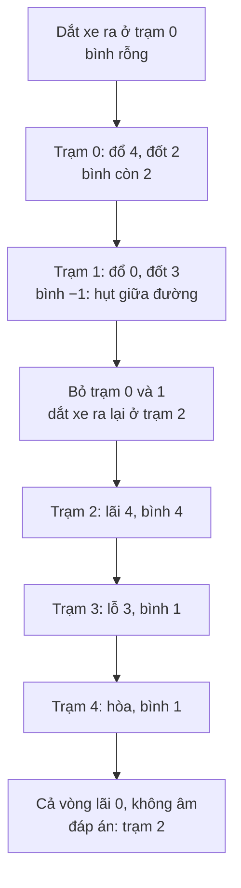
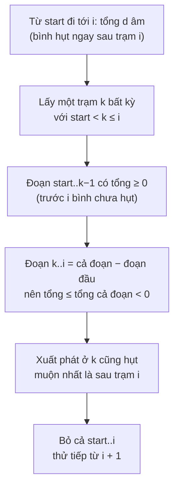
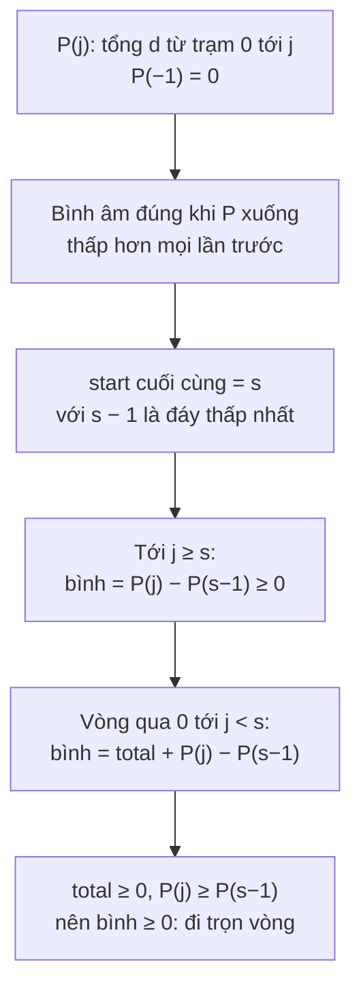

> [!tldr] Đọc nhanh
> - Mỗi trạm i cho một hiệu `d = gas[i] − cost[i]`: đổ được bao nhiêu trừ đi tốn bao nhiêu để tới trạm sau. Bài chỉ xoay quanh dãy hiệu này.
> - Tổng mọi hiệu âm thì không trạm nào đi trọn vòng: trả −1. Tổng không âm thì chắc chắn có một trạm đi được.
> - Đi một lượt từ trạm 0, cộng dồn vào bình. Bình âm ở trạm i thì không trạm nào từ `start` tới i làm điểm xuất phát được, nên nhảy thẳng tới `start = i + 1`. Đây là [[concepts/restart-argument|lập luận xuất phát lại]], cùng một nước đi với [[concepts/kadane-algorithm|Kadane]] trong Maximum Subarray.
> - Nhìn bằng [[concepts/prefix-sum|tổng tiền tố]]: trạm cần tìm nằm ngay sau chỗ tổng tiền tố thấp nhất.
> - Vét cạn O(n²) mất 50.005.000 bước khi n = 10.000; một lượt tham lam O(n) mất 10.000 bước.

> [!info] Bối cảnh
> Đây là bài LeetCode 134 tại [[posts/2026-11-28-neetcode-greedy-array|ga MISC-03: Tham lam trên mảng]] trên **tuyến NeetCode: Kỹ thuật tổng hợp**. Mình hình dung chạy xe máy quanh một con đường vòng quanh hồ, dọc đường có vài trạm xăng. Bạn chỉ cần biết mảng và vòng lặp; đọc [[problems/maximum-subarray|Maximum Subarray]] trước sẽ thấy ngay nước "bỏ đoạn âm" quen thuộc.

> [!abstract]- Từ điển nhanh cho bài này (bấm để mở)
> - Mảng vòng (circular array): đi hết phần tử cuối thì quay lại phần tử đầu. Chỉ số trạm kế tiếp của j là `(j + 1) % n`.
> - [[concepts/greedy-choice|Lựa chọn tham lam]]: ở mỗi bước chọn ngay một quyết định cục bộ và không bao giờ quay lại xét lại, rồi chứng minh rằng quyết định đó không làm mất đáp án.
> - [[concepts/prefix-sum|Tổng tiền tố]] P(j) là tổng các phần tử từ đầu mảng tới j. Tổng một đoạn bằng hiệu của hai tổng tiền tố.
> - "Bình" (`tank`) là lượng xăng đang có, tính từ trạm xuất phát hiện tại.

## Hình dung trước: chạy xe quanh hồ

Con đường quanh hồ có năm trạm, đánh số 0 đến 4. Ở mỗi trạm mình được đổ miễn phí một lượng xăng cố định, rồi đoạn đường tới trạm kế tiếp đốt một lượng xăng cố định. Bình xuất phát rỗng. Mình muốn biết nên dắt xe ra ở trạm nào để chạy trọn một vòng về đúng chỗ cũ mà không lần nào phải đẩy bộ.

Mình không thử từng trạm. Mình xuất phát ở trạm 0 và chạy. Hễ hụt xăng giữa đoạn sau trạm i, mình kết luận cả đoạn vừa đi là đoạn "lỗ": không trạm nào trên đó làm điểm xuất phát được. Mình dắt xe tới trạm i + 1 và coi như bắt đầu lại với bình rỗng. Chạy hết dãy trạm một lần, mình xem tổng xăng cả vòng có đủ bù tổng quãng đường không.

| Đời thường | Khái niệm |
|---|---|
| Lượng xăng đổ ở trạm i | `gas[i]` |
| Xăng đốt trên đoạn từ trạm i tới trạm sau | `cost[i]` |
| Lãi hoặc lỗ của trạm i | `d = gas[i] − cost[i]` |
| Xăng trong bình kể từ lúc dắt xe ra | `tank` |
| Hụt xăng giữa đường sau trạm i | `tank < 0` tại i |
| Dắt xe tới trạm sau, bình rỗng | `start = i + 1`, `tank = 0` |
| Cả vòng đủ xăng hay không | `total ≥ 0` |

Với `gas = [4, 0, 5, 1, 2]` và `cost = [2, 3, 1, 4, 2]`, dãy hiệu là `[2, −3, 4, −3, 0]`:



## Vấn đề: trạm nào chạy trọn vòng

Có n trạm xăng nằm trên một vòng tròn, đánh số 0 đến n − 1. Hai mảng cùng độ dài n: `gas[i]` là lượng xăng đổ được ở trạm i, `cost[i]` là lượng xăng cần để đi từ trạm i tới trạm i + 1 (từ trạm n − 1 thì về trạm 0). Bình không giới hạn và rỗng lúc xuất phát. Trả về chỉ số trạm xuất phát để đi trọn một vòng theo chiều tăng chỉ số, hoặc −1 nếu không trạm nào làm được. Giới hạn: 1 ≤ n ≤ 10⁵, mỗi giá trị từ 0 đến 10⁴. Đề hứa rằng nếu có đáp án thì đáp án là duy nhất. Ví dụ của mình: `gas = [1, 6, 2]`, `cost = [3, 1, 4]` cho đáp án 1. [Đề gốc LeetCode 134](https://leetcode.com/problems/gas-station/)

Lần đầu mình đoán trạm xuất phát là trạm "lãi" nhiều nhất, tức `d` lớn nhất. Với dãy hiệu `[4, −5, −1, 3]` (`gas = [4, 0, 0, 3]`, `cost = [0, 5, 1, 0]`), trạm lãi nhất là trạm 0, nhưng xuất phát ở đó thì bình còn 4 rồi tụt xuống −1 ngay đoạn sau. Đáp án duy nhất là trạm 3: bình đi 3, 7, 2, 1. Một trạm lãi lớn vô dụng nếu ngay sau nó là một đoạn lỗ còn lớn hơn. Cái cần nhìn là cả đoạn đường, không phải từng trạm.

## Cơ chế

### Vét cạn: thử xuất phát ở từng trạm

Với mỗi trạm s, mô phỏng: bình bắt đầu bằng 0, đi qua n trạm `s, s + 1, …` (lấy chỉ số theo `% n`), cộng `d` của trạm vào bình, hụt thì dừng và thử trạm sau. Trạm đầu tiên đi trọn vòng là đáp án. Mỗi lần thử tốn tối đa n bước, nên tổng là O(n²) thời gian và O(1) bộ nhớ. Với n = 10⁵ là tới 5·10⁹ bước, quá chậm. Mình giữ cách này làm trọng tài trong file chạy.

Cái phí của vét cạn: khi xuất phát ở s và hụt ở i, nó quay lại thử s + 1, s + 2, … dù đã đi qua các trạm đó và biết bình ở đó ra sao.

### Tham lam một lượt: xuất phát lại ngay sau chỗ hụt

Đi một lượt từ trạm 0 với hai biến cộng dồn: `total` là tổng mọi `d`, `tank` là xăng tính từ `start`. Bình âm ở i thì đặt `start = i + 1`, `tank = 0`. Hết lượt, `total < 0` thì trả −1, còn không thì trả `start`. Thời gian O(n), bộ nhớ O(1).

Hai điều cần chứng minh. Thứ nhất, nhảy từ `start` sang i + 1 không bỏ sót đáp án. Đây là [[concepts/restart-argument|lập luận xuất phát lại]]:



Nói theo kiểu chạy xe: tới trạm k mình luôn có bình không âm. Xuất phát ở k là tới k với bình rỗng, tức chỉ tệ hơn hoặc bằng. Đã hụt với bình đó thì với bình rỗng càng hụt.

Thứ hai, nếu `total ≥ 0` thì `start` cuối cùng chắc chắn đi trọn vòng, kể cả đoạn vòng qua trạm 0 mà vòng lặp chưa hề mô phỏng. Cách dễ thấy nhất là nhìn [[concepts/prefix-sum|tổng tiền tố]] P(j) = d[0] + … + d[j], với P(−1) = 0, như độ cao trên một con đèo:



Bình tính từ `start` bằng P(i) − P(start − 1). Nó âm đúng khi P(i) xuống thấp hơn mốc P(start − 1), và mốc đó lại là đáy thấp nhất tính tới lúc ấy. Vậy mỗi lần xuất phát lại là một lần P lập đáy mới, và `start` cuối cùng nằm ngay sau đáy thấp nhất của cả dãy. Đứng ở đáy, mọi điểm còn lại đều cao hơn hoặc bằng; đoạn vòng qua trạm 0 còn được cộng thêm `total ≥ 0`. Ngược lại, `total < 0` thì đi trọn vòng từ đâu cũng hết `total` xăng, nên không trạm nào làm được.

Truy vết với dãy hiệu `[2, −3, 4, −3, 0]` ở phần Hình dung trước:

| i | d | total | tank | start |
|---|---|---|---|---|
| 0 | 2 | 2 | 2 | 0 |
| 1 | −3 | −1 | −1, đặt lại 0 | 2 |
| 2 | 4 | 3 | 4 | 2 |
| 3 | −3 | 0 | 1 | 2 |
| 4 | 0 | 0 | 1 | 2 |

`total = 0` không âm, nên đáp án là 2. Tổng tiền tố là `2, −1, 3, 0, 0`; đáy thấp nhất −1 nằm ở trạm 1, và trạm 2 ngay sau nó.

Về tính duy nhất: lập luận trên chỉ cho biết `start` là **một** điểm xuất phát đi được. Đề hứa chỉ có một, nên đó là đáp án. Khi không có lời hứa đó (ví dụ mọi `d` bằng 0, trạm nào cũng đi được), cách tham lam trả trạm ngay sau lần đầu chạm đáy, còn vét cạn trả trạm nhỏ nhất đi được; hai số có thể khác nhau mà cả hai đều đúng. Vì vậy phần đối chiếu trong file chạy kiểm tra "trạm trả về đi trọn vòng" thay vì so bằng nhau.

So với [[concepts/kadane-algorithm|Kadane]] ở [[problems/maximum-subarray|Maximum Subarray]]: cả hai cộng dồn một đoạn và vứt cả đoạn khi tổng chạy âm, vì một đoạn đầu âm chỉ kéo phần sau xuống. Khác ở chỗ giữ lại gì. Kadane giữ tổng lớn nhất từng thấy; ở đây chỉ cần nhớ chỗ xuất phát lại cuối cùng, còn câu hỏi "có đủ không" do `total` trả lời. Đoạn `start..n − 1` mà tham lam giữ lại chính là hậu tố có tổng lớn nhất, khi `total ≥ 0`: hậu tố đó bằng `total − P(start − 1)` với P(start − 1) nhỏ nhất. Đây là một [[concepts/greedy-choice|lựa chọn tham lam]] đúng nghĩa: bỏ một đoạn ngay khi thấy nó lỗ, không bao giờ quay lại.

### Tổng tiền tố: tìm đáy trực tiếp

Từ hình trên, có thể viết thẳng: tính P(i) lần lượt, nhớ chỉ số lần đầu P đạt giá trị thấp nhất (so với mốc P(−1) = 0, so sánh `<` chặt). Nếu P(n − 1) = `total` âm thì trả −1, còn không thì trả chỉ số đó cộng 1. Vẫn O(n) và O(1). File chạy kiểm tra cách này luôn ra **đúng cùng chỉ số** với cách tham lam, trên cả 7.380 vòng đối chiếu.

| Cách | Thời gian | Bộ nhớ phụ | Ghi chú |
|---|---|---|---|
| Vét cạn từ mọi trạm | O(n²) | O(1) | Trọng tài; 5·10⁹ bước khi n = 10⁵ |
| Tham lam một lượt | O(n) | O(1) | Cách chính; bình âm thì `start = i + 1` |
| Đáy tổng tiền tố | O(n) | O(1) | Cùng kết quả với tham lam, nhìn theo độ cao |

### Đo: vét cạn và tham lam

Mình dựng một vòng n = 10.000 trạm sao cho vét cạn rơi vào trường hợp xấu nhất: mọi trạm lãi 1, trừ trạm n − 2 lỗ n và trạm cuối lãi 2. Xuất phát ở trạm s < n − 2 nào cũng chạy được tới trạm n − 2 rồi mới hụt, nên vét cạn tốn n(n + 1)/2 = 50.005.000 bước trước khi tìm ra đáp án 9999. Tham lam đi đúng 10.000 bước. Mỗi ngôn ngữ đo một lần trên máy mình:

| Ngôn ngữ | Vét cạn | Tham lam |
|---|---|---|
| TypeScript (Node) | 80,3 ms | 0,02 ms |
| Python | 3.958,7 ms | 0,70 ms |
| Go | 46,3 ms | 0,01 ms |
| Java | 68,9 ms | 0,01 ms |
| JavaScript (Node) | 80,3 ms | 0,04 ms |
| PHP | 834,7 ms | 0,20 ms |
| Rust | 36,1 ms | 0,01 ms |

Ở n = 10⁵, giới hạn của đề, vét cạn cần khoảng 100 lần số bước: cỡ vài giây với Go hay Rust, vài phút với Python. Tham lam vẫn chỉ là 10⁵ bước.

## Ví dụ chạy được

[TypeScript](../code/neetcode-gas-station/circuit.ts) · [Python](../code/neetcode-gas-station/circuit.py) · [Go](../code/neetcode-gas-station/circuit.go) · [Java](../code/neetcode-gas-station/circuit.java) · [JavaScript](../code/neetcode-gas-station/circuit.js) · [PHP](../code/neetcode-gas-station/circuit.php) · [Rust](../code/neetcode-gas-station/circuit.rs)

```ts
// Cách chính: một lượt, bình âm ở i thì bỏ mọi trạm từ start tới i, đặt start = i + 1
function canCompleteCircuit(gas: number[], cost: number[], counter = { steps: 0 }): number {
    let total = 0 // tổng gas - cost của cả vòng
    let tank = 0 // xăng còn lại tính từ start
    let start = 0
    for (let i = 0; i < gas.length; i++) {
        const d = gas[i] - cost[i]
        total += d
        tank += d
        counter.steps++
        if (tank < 0) {
            start = i + 1 // không trạm nào trong [start, i] đi qua được i
            tank = 0
        }
    }
    return total < 0 ? -1 : start // tổng không âm thì start chắc chắn đi trọn vòng
}
```

```python
# Cách chính: một lượt, bình âm ở i thì bỏ mọi trạm từ start tới i, đặt start = i + 1
def can_complete_circuit(gas, cost, counter=None):
    total = 0  # tổng gas - cost của cả vòng
    tank = 0  # xăng còn lại tính từ start
    start = 0
    for i in range(len(gas)):
        d = gas[i] - cost[i]
        total += d
        tank += d
        if counter is not None:
            counter["steps"] += 1
        if tank < 0:
            start = i + 1  # không trạm nào trong [start, i] đi qua được i
            tank = 0
    return -1 if total < 0 else start  # tổng không âm thì start chắc chắn đi trọn vòng
```

```go
// Cách chính: một lượt, bình âm ở i thì bỏ mọi trạm từ start tới i, đặt start = i + 1
func canCompleteCircuit(gas, cost []int, steps *int64) int {
	total := 0 // tổng gas - cost của cả vòng
	tank := 0  // xăng còn lại tính từ start
	start := 0
	for i := range gas {
		d := gas[i] - cost[i]
		total += d
		tank += d
		*steps++
		if tank < 0 {
			start = i + 1 // không trạm nào trong [start, i] đi qua được i
			tank = 0
		}
	}
	if total < 0 {
		return -1
	}
	return start // tổng không âm thì start chắc chắn đi trọn vòng
}
```

```java
// Cách chính: một lượt, bình âm ở i thì bỏ mọi trạm từ start tới i, đặt start = i + 1
static int canCompleteCircuit(int[] gas, int[] cost) {
    int total = 0; // tổng gas - cost của cả vòng
    int tank = 0; // xăng còn lại tính từ start
    int start = 0;
    for (int i = 0; i < gas.length; i++) {
        int d = gas[i] - cost[i];
        total += d;
        tank += d;
        steps++;
        if (tank < 0) {
            start = i + 1; // không trạm nào trong [start, i] đi qua được i
            tank = 0;
        }
    }
    return total < 0 ? -1 : start; // tổng không âm thì start chắc chắn đi trọn vòng
}
```

```js
// Cách chính: một lượt, bình âm ở i thì bỏ mọi trạm từ start tới i, đặt start = i + 1
function canCompleteCircuit(gas, cost, counter = { steps: 0 }) {
    let total = 0 // tổng gas - cost của cả vòng
    let tank = 0 // xăng còn lại tính từ start
    let start = 0
    for (let i = 0; i < gas.length; i++) {
        const d = gas[i] - cost[i]
        total += d
        tank += d
        counter.steps++
        if (tank < 0) {
            start = i + 1 // không trạm nào trong [start, i] đi qua được i
            tank = 0
        }
    }
    return total < 0 ? -1 : start // tổng không âm thì start chắc chắn đi trọn vòng
}
```

```php
// Cách chính: một lượt, bình âm ở i thì bỏ mọi trạm từ start tới i, đặt start = i + 1
function canCompleteCircuit(array $gas, array $cost): int {
    global $steps;
    $total = 0; // tổng gas - cost của cả vòng
    $tank = 0; // xăng còn lại tính từ start
    $start = 0;
    $n = count($gas);
    for ($i = 0; $i < $n; $i++) {
        $d = $gas[$i] - $cost[$i];
        $total += $d;
        $tank += $d;
        $steps++;
        if ($tank < 0) {
            $start = $i + 1; // không trạm nào trong [start, i] đi qua được i
            $tank = 0;
        }
    }
    return $total < 0 ? -1 : $start; // tổng không âm thì start chắc chắn đi trọn vòng
}
```

```rust
// Cách chính: một lượt, bình âm ở i thì bỏ mọi trạm từ start tới i, đặt start = i + 1
fn can_complete_circuit(gas: &[i32], cost: &[i32], steps: &mut u64) -> i32 {
    let mut total = 0; // tổng gas - cost của cả vòng
    let mut tank = 0; // xăng còn lại tính từ start
    let mut start = 0;
    for i in 0..gas.len() {
        let d = gas[i] - cost[i]; // i32, không phải u32: hiệu có thể âm
        total += d;
        tank += d;
        *steps += 1;
        if tank < 0 {
            start = i + 1; // không trạm nào trong [start, i] đi qua được i
            tank = 0;
        }
    }
    if total < 0 { -1 } else { start as i32 } // tổng không âm thì start chắc chắn đi trọn vòng
}
```

Các tab trích cách tham lam một lượt; dòng tăng `steps` chỉ để đếm cho phép đo. File tải về còn có vét cạn, cách đáy tổng tiền tố, bản sai bỏ kiểm tra tổng và hàm `completes` mô phỏng một điểm xuất phát. Bảy ca kiểm tra tự dựng gồm một trạm vừa đủ, một trạm thiếu, đáp án ở giữa, đáp án ở trạm cuối, tổng thiếu đúng 1 và trạm có `gas = 0`. Mỗi ca, cả ba cách phải ra đúng đáp án mong đợi.

Dòng thứ hai đối chiếu trên mọi vòng 1–4 trạm với `gas`, `cost` lấy trong {0, 1, 2}: 7.380 vòng. Một vòng tính là đúng khi tham lam và đáy tổng tiền tố ra cùng chỉ số, trả −1 đúng lúc vét cạn trả −1, và trạm trả về đi trọn vòng khi mô phỏng. Dòng thứ ba chạy bản sai trên cùng 7.380 vòng. Dòng cuối là phép đo ở trên (đây là số của TypeScript).

```text
7/7 ca đúng
7380/7380 ca đúng (đối chiếu vét cạn)
Bỏ kiểm tra tổng: sai 3055/7380 ca
n = 10000, đáp án 9999/9999: vét cạn 50005000 bước (80.3 ms), tham lam 10000 bước (0.02 ms)
```

Cả bảy ngôn ngữ in đúng ba dòng đầu và cùng số bước ở dòng cuối; chỉ thời gian khác nhau, như bảng ở phần Cơ chế.

## Hiểu lầm và bẫy hay gặp

- Chọn trạm có `gas[i]` hoặc `d` lớn nhất. Với `[4, −5, −1, 3]` trạm lãi nhất là 0, đáp án lại là 3.
- Nghĩ rằng hụt ở i thì phải thử lại từ `start + 1`. Cách đó vẫn đúng nhưng quay về O(n²). Lập luận xuất phát lại cho phép nhảy thẳng tới i + 1.
- Quên kiểm tra `total`. Không có nó, hàm không bao giờ trả −1: dòng thứ ba ở trên cho thấy nó sai đúng 3.055/7.380 vòng, tức mọi vòng thiếu xăng. Tệ hơn, khi bình hụt ở trạm cuối nó trả `n`, một chỉ số không tồn tại: `gas = [2]`, `cost = [3]` cho 1.
- Đặt lại khi `tank <= 0` thay vì `< 0`. Bình về đúng 0 vẫn đi tiếp được. Với `gas = [5]`, `cost = [5]`, bản `<=` đặt `start = 1` và trả 1, trong khi đáp án là 0.
- Lo rằng phải mô phỏng thêm đoạn vòng qua trạm 0 (chạy vòng lặp 2n lần) để chắc `start` đi trọn vòng. Không cần: `total ≥ 0` và lập luận đáy thấp nhất đã lo phần đó.
- So kết quả tham lam với vét cạn bằng `==` trên dữ liệu tự sinh. Khi có nhiều trạm đi được (mọi `d` bằng 0), hai cách có thể trả hai trạm khác nhau mà đều đúng. Lời hứa "duy nhất" chỉ là của đề.
- Rust: khai báo bình kiểu `u32` hoặc `usize` vì `gas`, `cost` đều không âm. Hiệu `gas[i] − cost[i]` lại có thể âm. Bản debug panic với `attempt to subtract with overflow`; bản `-O` tắt kiểm tra tràn số nên quấn vòng: `0 + 1 − 3` thành 4294967294, bình không bao giờ "âm" và hàm trả sai. Dùng `i32` hoặc `i64`.
- Java: tổng xăng tối đa là 10⁵ · 10⁴ = 10⁹, vừa trong `int`. Nhưng bộ đếm bước của vét cạn ở n = 10⁵ là khoảng 5·10⁹, vượt `Integer.MAX_VALUE` (2.147.483.647) và tràn âm âm thầm, nên file dùng `long`.
- Python, PHP: vét cạn chỉ ở n = 10⁴ đã mất 3,96 s và 0,83 s. Ở n = 10⁵ thì quá thời gian chắc chắn. Bài này không có đường tắt bằng thư viện: phải dùng cách một lượt.

## Câu hỏi tự kiểm tra

> [!question]- Vì sao `total ≥ 0` là đủ để có đáp án, không chỉ là cần?
> Lấy s ngay sau chỗ tổng tiền tố thấp nhất. Từ s, bình ở mỗi trạm bằng độ cao hiện tại trừ độ cao đáy, cộng thêm `total` khi đã vòng qua trạm 0. Cả hai phần đều không âm.

> [!question]- Bình hụt ở trạm i khi xuất phát ở `start`. Vì sao xuất phát ở một trạm k nằm giữa cũng hụt?
> Đoạn `start..k−1` có tổng không âm (chưa hụt lần nào), nên đoạn `k..i` có tổng không lớn hơn tổng cả đoạn `start..i`, vốn đã âm.

> [!question]- Với dãy hiệu `[−1, 3, −4, 2, 1]`, cách tham lam trả gì?
> `total = 1`. Bình: −1 (đặt lại, start = 1), 3, −1 (đặt lại, start = 3), 2, 3. Đáp án là 3. Tổng tiền tố là `−1, 2, −2, 0, 1`, đáy −2 ở trạm 2, khớp với trạm 3.

> [!question]- Cách tham lam ở đây giống và khác Kadane ở đâu?
> Giống: cộng dồn và vứt cả đoạn khi tổng chạy âm. Khác: Kadane giữ tổng lớn nhất từng thấy, còn ở đây chỉ giữ chỗ xuất phát lại cuối cùng và để `total` quyết định có đáp án hay không.

## Tham khảo

- [LeetCode 134](https://leetcode.com/problems/gas-station/)
- [Wikipedia: Maximum subarray problem (Kadane)](https://en.wikipedia.org/wiki/Maximum_subarray_problem) · [Wikipedia: Prefix sum](https://en.wikipedia.org/wiki/Prefix_sum)
- [Rust Book: Integer Overflow](https://doc.rust-lang.org/book/ch03-02-data-types.html#integer-overflow) · [Java Language Specification §4.2.2: Integer Operations](https://docs.oracle.com/javase/specs/jls/se21/html/jls-4.html#jls-4.2.2)
