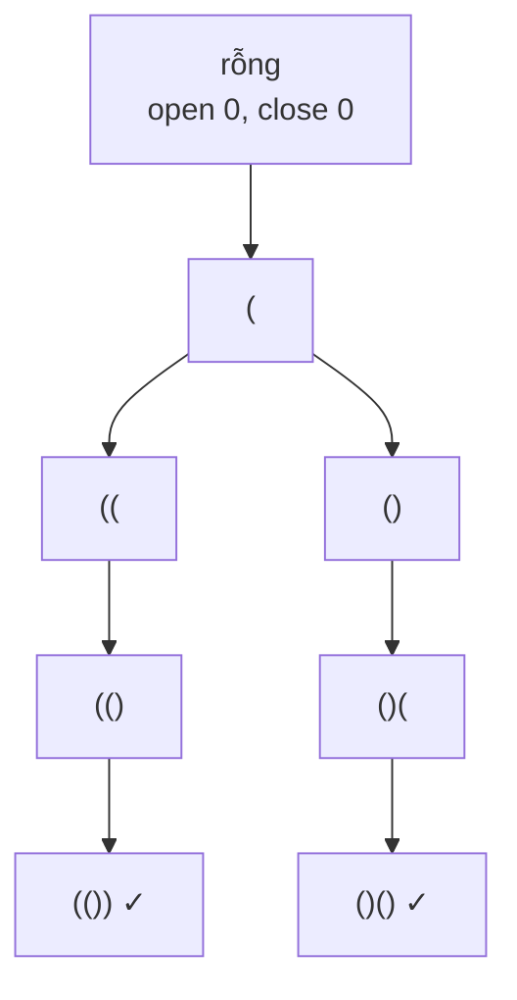

> [!tldr] Đọc nhanh
> - Đề: cho n, trả **mọi** chuỗi gồm n cặp ngoặc `()` đóng mở đúng. n = 3 có 5 chuỗi.
> - Số đáp án là [[concepts/catalan-number|số Catalan]] C(n): 1, 2, 5, 14, 42, … , 1430 ở n = 8. Nó tăng gần như 4ⁿ, nên không cách nào nhanh hơn việc in hết đáp án.
> - Sinh cả 2²ⁿ chuỗi rồi lọc: ở n = 10 chỉ 16 796 trên 1 048 576 chuỗi là hợp lệ, phí 98% công.
> - [[concepts/backtracking|Quay lui]] với hai điều kiện: thêm `(` khi số mở còn dưới n, thêm `)` khi số đóng còn **ít hơn số mở**. Mọi nhánh được đi đều dẫn tới ít nhất một đáp án, nên không phí bước nào.
> - Chuỗi đang dựng là một [[concepts/stack|ngăn xếp]]: thêm ký tự, thử, rồi bỏ ra. Ba bẫy: điều kiện `close < n` (0/8 ca), Go giữ chung mảng nền (1/8), Java quên `setLength` (1/8).

> [!info] Bối cảnh
> Bài LeetCode 22, thuộc [[posts/2026-11-23-neetcode-stack|ga 6: Ngăn xếp]] trên **tuyến NeetCode: Mảng và chuỗi**. Ba bài kia của ga dùng ngăn xếp làm cấu trúc dữ liệu; bài này dùng nó ngầm, qua ngăn xếp gọi hàm của đệ quy. Lời giải có đủ TypeScript, Python, Go, Java và JavaScript. Bạn chỉ cần biết hàm đệ quy và chuỗi.

> [!abstract]- Từ điển nhanh cho bài này (bấm để mở)
> - **Chuỗi ngoặc hợp lệ**: đọc từ trái sang, số `)` không bao giờ vượt số `(`, và cuối cùng hai số bằng nhau. Xem [[problems/valid-parentheses|Valid Parentheses]].
> - **Quay lui (backtracking)**: thử một lựa chọn, đi tiếp, rồi **gỡ** lựa chọn đó để thử cái khác. Xem [[concepts/backtracking|Backtracking]].
> - **Cây lựa chọn**: mỗi nút là một tiền tố đang dựng, mỗi nhánh là một ký tự thêm vào.
> - **Ngăn xếp gọi hàm (call stack)**: chỗ máy nhớ các lời gọi hàm đang dở. Đệ quy sâu k tầng dùng k ô.
> - **Số Catalan**: dãy 1, 1, 2, 5, 14, 42, … đếm rất nhiều cấu trúc lồng nhau. Xem [[concepts/catalan-number|Catalan Number]].

## Hình dung trước: xếp hàng vào rạp với vé đôi

Rạp chỉ cho vào theo cặp: người đi trước cầm vé `(`, bạn đi cùng cầm vé `)`, và bạn đi cùng không được vào trước người dẫn mình. Có n cặp. Người soát vé muốn biết mọi thứ tự vào cửa có thể xảy ra.

| Đời thường | Khái niệm |
|---|---|
| Một người dẫn bước vào (còn người dẫn chưa vào) | thêm `(` khi `open < n` |
| Một bạn đi cùng bước vào (đã có người dẫn đang chờ) | thêm `)` khi `close < open` |
| Bạn đi cùng mà chưa có người dẫn nào chờ | chuỗi hỏng, như `")("` |
| Ghi lại một thứ tự, rồi cho người cuối lùi ra thử người khác | quay lui: thêm, thử, bỏ ra |
| Viết hết mọi hàng 2n người bất kỳ rồi mới loại hàng sai | sinh 2²ⁿ chuỗi rồi lọc |
| Số thứ tự hợp lệ | số Catalan C(n) |



Cây cho n = 2. Ở gốc chỉ có một nhánh `(`: nhánh `)` bị cắt vì `close < open` sai (0 < 0). Ở `((`, số mở đã bằng n nên chỉ còn nhánh `)`. Không nhánh nào dẫn vào ngõ cụt.

## Vấn đề

**Đề (tóm tắt bằng lời của mình):** cho số nguyên n (1 ≤ n ≤ 8), trả danh sách mọi chuỗi dài 2n gồm n ký tự `(` và n ký tự `)` đóng mở đúng. Thứ tự trong danh sách không quan trọng. Đề gốc: [LeetCode 22](https://leetcode.com/problems/generate-parentheses/).

| n | Output |
|---|---|
| 1 | `["()"]` |
| 2 | `["(())", "()()"]` |
| 3 | `["((()))", "(()())", "(())()", "()(())", "()()()"]` |

Mình từng nghĩ đây là bài về ngăn xếp theo nghĩa "đẩy ngoặc vào, lấy ra". Hóa ra không có ngăn xếp nào được khai báo; thứ đóng vai ngăn xếp là chuỗi đang dựng và chồng lời gọi đệ quy.

## Cơ chế

<figure class="figure-map" style="--ar: 3 / 4">
<div class="frame"><iframe data-archify="../diagrams/neetcode-generate-parentheses/worked-example.html" title="Chỉ đóng khi còn dấu mở chưa ghép" loading="lazy"></iframe></div>
<figcaption><span><b>Hình 1.</b> Chỉ đóng khi còn dấu mở chưa ghép.</span><a href="../diagrams/neetcode-generate-parentheses/worked-example.html" target="_blank" rel="noopener">Mở toàn màn hình</a></figcaption>
</figure>

<details>
<summary>Đọc từng bước</summary>
<ol>
<li>Bắt đầu với dấu mở. <code>n = 2, &quot;(&quot;</code></li>
<li>Đóng ngay là một lựa chọn hợp lệ. <code>&quot;()&quot; → &quot;()()&quot;</code></li>
<li>Mở thêm cũng là một lựa chọn. <code>&quot;((&quot; → &quot;(())&quot;</code></li>
<li>Hai nhánh đều dùng đủ hai cặp. <code>[&quot;(())&quot;, &quot;()()&quot;]</code></li>
</ol>
</details>

### Có bao nhiêu đáp án

Số chuỗi n cặp ngoặc hợp lệ là số Catalan `C(n) = (2n)! / ((n+1)! · n!)`, dãy [A000108](https://oeis.org/A000108) trong OEIS. File TypeScript in mười giá trị đầu cạnh số chuỗi bất kỳ dài 2n:

| n | 1 | 2 | 3 | 4 | 5 | 6 | 7 | 8 | 9 | 10 |
|---|---|---|---|---|---|---|---|---|---|---|
| C(n) | 1 | 2 | 5 | 14 | 42 | 132 | 429 | 1 430 | 4 862 | 16 796 |
| 2²ⁿ | 4 | 16 | 64 | 256 | 1 024 | 4 096 | 16 384 | 65 536 | 262 144 | 1 048 576 |

C(n) tăng xấp xỉ `4ⁿ / (n^1,5 · √π)`. Đầu ra đã lớn cỡ đó, và mỗi chuỗi dài 2n ký tự, nên mọi lời giải đều tốn ít nhất O(n · C(n)). Câu hỏi chỉ là phí thêm bao nhiêu.

### Cách 1, sinh hết rồi lọc

Duyệt mọi số từ 0 tới 2²ⁿ − 1, đọc từng bit thành `(` hoặc `)`, giữ chuỗi nào cân bằng. Đúng, nhưng tỉ lệ chuỗi giữ lại là C(n) / 4ⁿ: 1,6% ở n = 10, và giảm dần khi n tăng.

### Cách 2, quay lui với hai điều kiện

Dựng chuỗi từ trái sang, mỗi bước chọn thêm `(` hoặc `)`:
- thêm `(` khi `open < n`: còn người dẫn chưa vào;
- thêm `)` khi `close < open`: có ngoặc mở đang chờ được đóng.

Hai điều kiện này giữ đúng bất biến của [[problems/valid-parentheses|Valid Parentheses]]: tại mọi tiền tố, số đóng không vượt số mở. Hơn nữa, mọi tiền tố thỏa hai điều kiện đều **còn hoàn thành được** (cứ thêm `)` cho tới khi đủ), nên quay lui không bao giờ đi vào nhánh chết. Số nút của cây chỉ gấp một hằng số nhỏ lần số lá, tức O(n · C(n)) tổng cộng.

Chữ "quay lui" nằm ở bước gỡ: sau khi thử nhánh `(`, phải bỏ `(` ra trước khi thử nhánh `)`. Chuỗi đang dựng vì vậy chỉ được sửa ở **một đầu**: đúng là một ngăn xếp.

### Cách 3, ngăn xếp tự quản

Đệ quy dùng ngăn xếp gọi hàm. Có thể thay bằng một ngăn xếp tường minh chứa bộ ba `(chuỗi, open, close)`: lấy một trạng thái ra, đủ 2n ký tự thì ghi nhận, chưa thì đẩy các trạng thái con vào. Cùng một cây, cùng số nút, chỉ khác chỗ nhớ.

### Đo

TypeScript, trung vị 3 lần:

| n | C(n) | sinh hết rồi lọc | quay lui | ngăn xếp tự quản |
|---|---|---|---|---|
| 8 | 1 430 | 2,7 ms | 0,5 ms | 1,0 ms |
| 10 | 16 796 | 46,0 ms | 5,7 ms | 1,9 ms |
| 12 | 208 012 | 737,2 ms | 74,0 ms | 32,9 ms |
| 14 | 2 674 440 | (không chạy) | 1 127,2 ms | 506,7 ms |

Sinh hết rồi lọc chậm gấp khoảng 10 lần quay lui, và khoảng cách đó nới dần theo `4ⁿ / C(n)`. Bản quay lui chậm hơn bản ngăn xếp tự quản vì mỗi lá gọi `cur.join("")` để dựng chuỗi từ mảng ký tự; bản ngăn xếp nối chuỗi ngắn (`s + ")"`), mà V8 làm rất rẻ. Ở n = 14, cả hai chủ yếu tốn thời gian tạo 2,67 triệu chuỗi đầu ra.

Python, cùng máy:

| n | sinh hết rồi lọc | quay lui, list + join | quay lui, nối chuỗi | ngăn xếp tự quản |
|---|---|---|---|---|
| 8 | 9,8 ms | 0,6 ms | 0,5 ms | 0,6 ms |
| 10 | 184,0 ms | 7,4 ms | 5,7 ms | 6,9 ms |
| 12 | 3 232,2 ms | 93,5 ms | 74,2 ms | 90,8 ms |

Nối chuỗi `s + "("` tạo một chuỗi mới mỗi bước, nhưng chuỗi chỉ dài tối đa 2n = 24 ký tự, nên rẻ hơn việc `"".join(cur)` ở mỗi lá. Lời khuyên "đừng nối chuỗi trong vòng lặp" đúng với chuỗi **dài**, không đúng ở đây.

### Bên dưới năm ngôn ngữ

| | Chuỗi đang dựng | Bẫy riêng |
|---|---|---|
| TypeScript / JavaScript | chuỗi bất biến, `s + "("` là chuỗi mới; hoặc mảng ký tự rồi `join` | không có: chuỗi mới không ảnh hưởng nhánh khác |
| Python | `str` bất biến: nối chuỗi; hoặc `list` + `"".join` | giới hạn đệ quy mặc định 1 000 tầng, ở đây chỉ cần 2n + 1 |
| Go | `[]byte` với `append` và cắt `buf[:len(buf)-1]` | giữ lại chính `buf` thay vì `string(buf)`: mọi kết quả trỏ vào cùng một mảng nền |
| Java | một `StringBuilder` dùng chung, gỡ bằng `setLength` | quên `setLength`: ký tự của nhánh trước nằm lại |

## Ví dụ chạy được

[TypeScript](../code/neetcode-generate-parentheses/generate-parentheses.ts) · [Python](../code/neetcode-generate-parentheses/generate_parentheses.py) · [Go](../code/neetcode-generate-parentheses/generate_parentheses.go) · [Java](../code/neetcode-generate-parentheses/generate-parentheses.java) · [JavaScript](../code/neetcode-generate-parentheses/generate-parentheses.js)

Mỗi file kiểm n = 1..8: đủ C(n) chuỗi, không trùng, chuỗi nào cũng dài 2n và hợp lệ (ba điều đó cùng nhau nghĩa là đúng tập đáp án). Dưới đây là cách quay lui.

```ts
// Cách 2: quay lui. Chỉ thêm "(" khi còn dưới n ngoặc mở, chỉ thêm ")" khi số đóng còn ít hơn số mở.
function backtrack(n: number): string[] {
  const out: string[] = [];
  const cur: string[] = []; // chuỗi đang dựng là một ngăn xếp: thêm ký tự, thử, rồi bỏ đi
  const go = (open: number, close: number) => {
    if (cur.length === 2 * n) { out.push(cur.join("")); return; }
    if (open < n) { cur.push("("); go(open + 1, close); cur.pop(); }
    if (close < open) { cur.push(")"); go(open, close + 1); cur.pop(); }
  };
  go(0, 0);
  return out;
}
```

```python
def backtrack(n: int) -> list[str]:
    out, cur = [], []  # cur là list: append/pop O(1); str bất biến nên không "pop" được
    def go(open_: int, close: int) -> None:
        if len(cur) == 2 * n:
            out.append("".join(cur))
            return
        if open_ < n:
            cur.append("(")
            go(open_ + 1, close)
            cur.pop()
        if close < open_:
            cur.append(")")
            go(open_, close + 1)
            cur.pop()
    go(0, 0)
    return out
```

```go
func backtrack(n int) []string {
	out := []string{}
	buf := make([]byte, 0, 2*n)
	var gen func(open, close int)
	gen = func(open, close int) {
		if len(buf) == 2*n {
			out = append(out, string(buf)) // string(buf) SAO CHÉP các byte; buf còn bị sửa tiếp
			return
		}
		if open < n {
			buf = append(buf, '(')
			gen(open+1, close)
			buf = buf[:len(buf)-1] // bỏ ký tự vừa thêm: cắt slice, không cấp phát
		}
		if close < open {
			buf = append(buf, ')')
			gen(open, close+1)
			buf = buf[:len(buf)-1]
		}
	}
	gen(0, 0)
	return out
}
```

```java
static List<String> backtrack(int n) {
    List<String> out = new ArrayList<>();
    go(new StringBuilder(), 0, 0, n, out);
    return out;
}

static void go(StringBuilder sb, int open, int close, int n, List<String> out) {
    if (sb.length() == 2 * n) { out.add(sb.toString()); return; } // toString sao chép nội dung
    if (open < n) {
        sb.append('(');
        go(sb, open + 1, close, n, out);
        sb.setLength(sb.length() - 1); // bỏ ký tự vừa thêm: StringBuilder là MỘT bộ đệm dùng chung
    }
    if (close < open) {
        sb.append(')');
        go(sb, open, close + 1, n, out);
        sb.setLength(sb.length() - 1);
    }
}
```

```js
function backtrack(n) {
  const out = [];
  const go = (s, open, close) => { // chuỗi JS bất biến: s + "(" là chuỗi mới, nhánh khác không bị ảnh hưởng
    if (s.length === 2 * n) { out.push(s); return; }
    if (open < n) go(s + "(", open + 1, close);
    if (close < open) go(s + ")", open, close + 1);
  };
  go("", 0, 0);
  return out;
}
```


File TypeScript chạy thêm bản dùng `close < n`, rồi in bảng Catalan và đo:

```text
$ node generate-parentheses.ts
generateAllFilter  8/8 ca đúng
backtrack          8/8 ca đúng
explicitStack      8/8 ca đúng
wrongCloseLtN      0/8 ca đúng; sai ở n = 1, 2, 3, 4, 5, 6, 7, 8

wrongCloseLtN(2) = ["(())","()()","())(",")(()",")()(","))(("]
backtrack(3)     = ["((()))","(()())","(())()","()(())","()()()"]

n    C(n)      2^(2n)
1    1         4
2    2         16
3    5         64
4    14        256
5    42        1024
6    132       4096
7    429       16384
8    1430      65536
9    4862      262144
10   16796     1048576

n    sinh hết rồi lọc   quay lui   ngăn xếp tự quản   (ms, trung vị 3 lần)
8                 2.7        0.5                1.0
10               46.0        5.7                1.9
12              737.2       74.0               32.9
14                  —     1127.2              506.7
```

Với `close < n`, `)` được thêm cả khi chưa có ngoặc mở nào chờ. Kết quả là mọi cách xếp n ký tự `(` và n ký tự `)`: 6 chuỗi ở n = 2, trong đó 4 chuỗi hỏng. Bản sai hỏng cả ở n = 1 (`")("`), nên test nhỏ nhất cũng bắt được.

File Go giữ lại chính slice `buf` thay vì sao chép:

```text
$ go run generate_parentheses.go
backtrack         8/8 ca đúng
explicitStack     8/8 ca đúng
backtrackAliased  1/8 ca đúng

backtrackAliased(3) = ["()()()" "()()()" "()()()" "()()()" "()()()"]
```

Năm kết quả cùng trỏ vào một mảng nền 6 byte, nên cuối cùng đều mang nội dung của lá sau cùng. Đúng 5 phần tử, không lỗi, không panic; chỉ test kiểm "không trùng" mới bắt được. Bản sai qua n = 1 vì khi đó chỉ có một kết quả. File Java quên `setLength`:

```text
$ java generate-parentheses.java
backtrack      8/8 ca đúng
explicitStack  8/8 ca đúng
forgetUndo     1/8 ca đúng

forgetUndo(2) = [(()), (()))]
```

Sau nhánh `((…))`, các ký tự cũ còn trong bộ đệm, nên nhánh `()…` bắt đầu từ `(())` thay vì `(`. Python in `8/8 ca đúng` cho cả bốn cách (sinh hết rồi lọc, quay lui list + join, quay lui nối chuỗi, ngăn xếp tự quản); JavaScript in `8/8 ca đúng` cho hai cách.

## Hiểu lầm và bẫy hay gặp

- **Điều kiện đóng là `close < n`.** Phải là `close < open`. Đếm đủ n ký tự `)` không có nghĩa là thứ tự đúng.
- **"Quay lui là thử hết rồi bỏ cái sai."** Đó là cách 1. Quay lui tốt cắt nhánh **trước khi** đi vào; ở bài này mọi nhánh còn lại đều dẫn tới đáp án.
- **Ghi nhận bộ đệm thay vì bản sao.** Go (`buf` thay vì `string(buf)`), Java (giữ `sb` thay vì `sb.toString()`), Python (giữ `cur` thay vì `"".join(cur)`): mọi kết quả là cùng một object, bị sửa tiếp sau khi ghi.
- **Quên gỡ lựa chọn khi dùng bộ đệm chung.** Java `StringBuilder`, Go `[]byte`, mảng ký tự trong TS: thêm vào thì phải bỏ ra sau khi thử. Dùng chuỗi bất biến (`s + "("`) thì không cần gỡ.
- **"Phải tối ưu xuống dưới O(4ⁿ)."** Không được: đầu ra đã có C(n) chuỗi, tăng cỡ 4ⁿ / n^1,5. Tối ưu chỉ là bớt phần phí ngoài đầu ra.

## Câu hỏi tự kiểm tra

> [!question]- Ở tiền tố `"(()"` với n = 3, những ký tự nào được thêm tiếp?
> open = 2, close = 1. `(` được (2 < 3), `)` được (1 < 2). Cả hai nhánh đều dẫn tới đáp án: `"(()(…"` và `"(())…"`.

> [!question]- Vì sao quay lui với hai điều kiện không bao giờ đi vào ngõ cụt?
> Mọi tiền tố có `close ≤ open ≤ n` đều hoàn thành được: thêm hết `(` còn lại rồi thêm `)` cho tới đủ. Nên nhánh nào được phép đi cũng có ít nhất một lá là đáp án.

> [!question]- Trong Go, `out = append(out, string(buf))` khác `saved = append(saved, buf)` ở đâu?
> `string(buf)` sao chép các byte sang một chuỗi mới. `buf` là slice, tức một tham chiếu tới mảng nền; giữ nó lại thì mọi phần tử đã lưu cùng thấy những lần sửa sau.

> [!question]- n = 8 có bao nhiêu đáp án, và sinh hết rồi lọc phải xét bao nhiêu chuỗi?
> C(8) = 1 430 đáp án; 2¹⁶ = 65 536 chuỗi phải xét, tức giữ lại khoảng 2,2%.

## Tham khảo

- [LeetCode 22: Generate Parentheses](https://leetcode.com/problems/generate-parentheses/) (đề gốc)
- [OEIS A000108: Catalan numbers](https://oeis.org/A000108) (dãy 1, 1, 2, 5, 14, …, công thức và tiệm cận)
- Donald E. Knuth, *The Art of Computer Programming*, tập 4A, mục 7.2.1.6 "Generating all trees" (liệt kê các chuỗi ngoặc lồng nhau)
- [The Go Blog: Go Slices: usage and internals](https://go.dev/blog/slices-intro) (slice là tham chiếu tới một mảng nền)
- [Java 21 `StringBuilder`](https://docs.oracle.com/en/java/javase/21/docs/api/java.base/java/lang/StringBuilder.html) (`setLength`, `toString` trả chuỗi mới)
- [Python: `sys.getrecursionlimit`](https://docs.python.org/3/library/sys.html#sys.getrecursionlimit) (giới hạn đệ quy mặc định)
