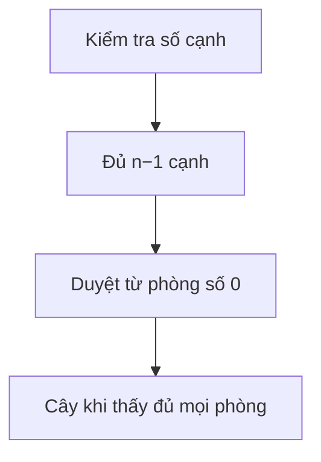

> [!tldr] Đọc nhanh
> - Cây với `n` đỉnh có đúng `n−1` cạnh, nhưng riêng số cạnh chưa đủ.
> - Khi đã có đúng số cạnh, DFS kiểm tra liên thông hoặc [[concepts/disjoint-set-union|Union-Find]] kiểm tra mọi cạnh đều gộp được.
> - Ca tam giác đứng cạnh một cặp đỉnh nối nhau bắt được lỗi chỉ kiểm số cạnh.

> [!info] Bối cảnh
> Bài LeetCode 261, thuộc [[posts/2026-11-27-neetcode-union-find|ga 4: Union-Find]] trên [[series/neetcode-grph|tuyến NeetCode: Đồ thị]]. Ví dụ dùng đồ thị nhỏ; bạn chỉ cần biết mảng và vòng lặp.

> [!abstract]- Từ điển nhanh cho bài này (bấm để mở)
> - Cạnh vô hướng nối hai đỉnh theo cả hai chiều.
> - [[concepts/connected-component|Thành phần liên thông]] là một nhóm tối đa các đỉnh đi tới được nhau.
> - [[concepts/disjoint-set-union|DSU]] duy trì các nhóm bằng phép tìm gốc và phép gộp. DFS là duyệt theo chiều sâu.

## Hình dung trước: mạng dây giữa các phòng

Mình nối các phòng bằng dây hai chiều. Mỗi phòng phải đi theo dây tới được mọi phòng khác, và mỗi cặp phòng chỉ có một đường đi đơn. Một vòng dây trong ba phòng và một đoạn dây nối hai phòng khác vẫn có đúng bốn dây cho năm phòng, nhưng hệ thống chưa thông.

| Đời thường | Khái niệm |
|---|---|
| Phòng | Đỉnh |
| Dây đi hai chiều | Cạnh vô hướng |
| Đến được mọi phòng | Liên thông |
| Có hai đường đi đơn giữa một cặp phòng | Có chu trình |



## Vấn đề: nhận ra một cây

Đồ thị có `n` đỉnh đánh số từ 0 tới `n−1`. Bản công khai trên NeetCode quy định `1 ≤ n ≤ 2000`, có tối đa 5.000 cạnh hai chiều, không lặp và không nối một đỉnh với chính nó.

Ví dụ `n=5`, `edges=[[0,1],[1,2],[0,2],[3,4]]`. Có đúng `n−1` cạnh nhưng `{0,1,2}` tạo vòng và không tới được `{3,4}`. Đáp án là `false`.

## Cơ chế

### Cách 1. Kiểm số cạnh, rồi duyệt

Một cây có `n−1` cạnh. Một đồ thị liên thông có thể dựng một cây khung bằng cách giữ đúng một cạnh đưa DFS tới mỗi đỉnh mới. Cây khung đã dùng `n−1` cạnh. Nếu đầu vào cũng chỉ có bấy nhiêu cạnh và DFS thấy đủ `n` đỉnh, mọi cạnh đều thuộc cây khung, nên không thể có vòng. Thời gian O(V + E), bộ nhớ phụ O(V + E) với danh sách kề.

### Cách 2. Kiểm tra mọi cạnh đều nối hai nhóm

Sau khi kiểm `E = V−1`, thử gộp hai đầu mỗi cạnh. Nếu có lần thất bại, cạnh này khép vòng. Nếu mọi lần đều thành công, số nhóm từ `V` giảm đúng `V−1` lần, còn một nhóm. Hai tính chất của cây đều đã được chứng minh. Thời gian O(V + E α(V)) khấu hao, bộ nhớ phụ O(V). Trên nhánh đếm cạnh sai, cả hai bản trả về ngay, trước khi dựng cấu trúc dữ liệu.

## Ví dụ chạy được

[TypeScript](../code/neetcode-graph-valid-tree/solve.ts) · [Python](../code/neetcode-graph-valid-tree/solve.py) · [Go](../code/neetcode-graph-valid-tree/solve.go) · [Java](../code/neetcode-graph-valid-tree/solve.java) · [JavaScript](../code/neetcode-graph-valid-tree/solve.js) · [PHP](../code/neetcode-graph-valid-tree/solve.php) · [Rust](../code/neetcode-graph-valid-tree/solve.rs)

Các tab hiện phần lời giải. File tải về có đủ các cách và bộ kiểm tra tự chạy.

```ts
import assert from "node:assert/strict";

type Edge = readonly [number, number];

class DisjointSet {
  private parent: number[];
  private size: number[];
  count: number;

  constructor(n: number) {
    this.parent = Array.from({ length: n }, (_, i) => i);
    this.size = new Array<number>(n).fill(1);
    this.count = n;
  }

  find(node: number): number {
    while (node !== this.parent[node]) {
      this.parent[node] = this.parent[this.parent[node]];
      node = this.parent[node];
    }
    return node;
  }

  union(a: number, b: number): boolean {
    let ra = this.find(a);
    let rb = this.find(b);
    if (ra === rb) return false;
    if (this.size[ra] < this.size[rb]) [ra, rb] = [rb, ra];
    this.parent[rb] = ra;
    this.size[ra] += this.size[rb];
    this.count--;
    return true;
  }
}

function treeByDsu(n: number, edges: readonly Edge[]): boolean {
  if (edges.length !== n - 1) return false;
  const ds = new DisjointSet(n);
  return edges.every(([a, b]) => ds.union(a, b));
}
```

```python
class DisjointSet:
    def __init__(self, n):
        self.parent = list(range(n))
        self.size = [1] * n
        self.count = n

    def find(self, node):
        while node != self.parent[node]:
            self.parent[node] = self.parent[self.parent[node]]
            node = self.parent[node]
        return node

    def union(self, a, b):
        ra, rb = self.find(a), self.find(b)
        if ra == rb:
            return False
        if self.size[ra] < self.size[rb]:
            ra, rb = rb, ra
        self.parent[rb] = ra
        self.size[ra] += self.size[rb]
        self.count -= 1
        return True


def tree_by_dsu(n, edges):
    if len(edges) != n - 1:
        return False
    ds = DisjointSet(n)
    return all(ds.union(a, b) for a, b in edges)
```

```go
package main

import "fmt"

type edge [2]int

type disjointSet struct {
	parent, size []int
	count        int
}

func newDisjointSet(n int) *disjointSet {
	ds := &disjointSet{make([]int, n), make([]int, n), n}
	for i := range ds.parent {
		ds.parent[i], ds.size[i] = i, 1
	}
	return ds
}

func (ds *disjointSet) find(node int) int {
	for node != ds.parent[node] {
		ds.parent[node] = ds.parent[ds.parent[node]]
		node = ds.parent[node]
	}
	return node
}

func (ds *disjointSet) union(a, b int) bool {
	ra, rb := ds.find(a), ds.find(b)
	if ra == rb {
		return false
	}
	if ds.size[ra] < ds.size[rb] {
		ra, rb = rb, ra
	}
	ds.parent[rb] = ra
	ds.size[ra] += ds.size[rb]
	ds.count--
	return true
}

func treeByDsu(n int, edges []edge) bool {
	if len(edges) != n-1 {
		return false
	}
	ds := newDisjointSet(n)
	for _, e := range edges {
		if !ds.union(e[0], e[1]) {
			return false
		}
	}
	return true
}
```

```java
class Solve {
    static final class DisjointSet {
        private final int[] parent;
        private final int[] size;
        int count;

        DisjointSet(int n) {
            parent = new int[n];
            size = new int[n];
            count = n;
            for (int i = 0; i < n; i++) {
                parent[i] = i;
                size[i] = 1;
            }
        }

        int find(int node) {
            while (node != parent[node]) {
                parent[node] = parent[parent[node]];
                node = parent[node];
            }
            return node;
        }

        boolean union(int a, int b) {
            int ra = find(a), rb = find(b);
            if (ra == rb) return false;
            if (size[ra] < size[rb]) {
                int swap = ra;
                ra = rb;
                rb = swap;
            }
            parent[rb] = ra;
            size[ra] += size[rb];
            count--;
            return true;
        }
    }

    static boolean treeByDsu(int n, int[][] edges) {
        if (edges.length != n - 1) return false;
        var ds = new DisjointSet(n);
        for (int[] e : edges) {
            if (!ds.union(e[0], e[1])) return false;
        }
        return true;
    }
}
```

```javascript
import assert from "node:assert/strict";

class DisjointSet {
  parent;
  size;
  count;

  constructor(n) {
    this.parent = Array.from({ length: n }, (_, i) => i);
    this.size = new Array(n).fill(1);
    this.count = n;
  }

  find(node) {
    while (node !== this.parent[node]) {
      this.parent[node] = this.parent[this.parent[node]];
      node = this.parent[node];
    }
    return node;
  }

  union(a, b) {
    let ra = this.find(a);
    let rb = this.find(b);
    if (ra === rb) return false;
    if (this.size[ra] < this.size[rb]) [ra, rb] = [rb, ra];
    this.parent[rb] = ra;
    this.size[ra] += this.size[rb];
    this.count--;
    return true;
  }
}

function treeByDsu(n, edges) {
  if (edges.length !== n - 1) return false;
  const ds = new DisjointSet(n);
  return edges.every(([a, b]) => ds.union(a, b));
}
```

```php
<?php
declare(strict_types=1);

final class DisjointSet
{
    private array $parent;
    private array $size;
    public int $count;

    public function __construct(int $n)
    {
        $this->parent = range(0, $n - 1);
        $this->size = array_fill(0, $n, 1);
        $this->count = $n;
    }

    public function find(int $node): int
    {
        while ($node !== $this->parent[$node]) {
            $this->parent[$node] = $this->parent[$this->parent[$node]];
            $node = $this->parent[$node];
        }
        return $node;
    }

    public function union(int $a, int $b): bool
    {
        [$ra, $rb] = [$this->find($a), $this->find($b)];
        if ($ra === $rb) {
            return false;
        }
        if ($this->size[$ra] < $this->size[$rb]) {
            [$ra, $rb] = [$rb, $ra];
        }
        $this->parent[$rb] = $ra;
        $this->size[$ra] += $this->size[$rb];
        $this->count--;
        return true;
    }
}

function treeByDsu(int $n, array $edges): bool
{
    if (count($edges) !== $n - 1) {
        return false;
    }
    $ds = new DisjointSet($n);
    foreach ($edges as [$a, $b]) {
        if (!$ds->union($a, $b)) {
            return false;
        }
    }
    return true;
}
```

```rust
type Edge = [usize; 2];

struct DisjointSet {
    parent: Vec<usize>,
    size: Vec<usize>,
    count: usize,
}

impl DisjointSet {
    fn new(n: usize) -> Self {
        Self {
            parent: (0..n).collect(),
            size: vec![1; n],
            count: n,
        }
    }

    fn find(&mut self, mut node: usize) -> usize {
        while node != self.parent[node] {
            self.parent[node] = self.parent[self.parent[node]];
            node = self.parent[node];
        }
        node
    }

    fn union(&mut self, a: usize, b: usize) -> bool {
        let mut ra = self.find(a);
        let mut rb = self.find(b);
        if ra == rb {
            return false;
        }
        if self.size[ra] < self.size[rb] {
            std::mem::swap(&mut ra, &mut rb);
        }
        self.parent[rb] = ra;
        self.size[ra] += self.size[rb];
        self.count -= 1;
        true
    }
}

fn tree_by_dsu(n: usize, edges: &[Edge]) -> bool {
    if edges.len() != n - 1 {
        return false;
    }
    let mut ds = DisjointSet::new(n);
    edges.iter().all(|&[a, b]| ds.union(a, b))
}
```

Kết quả chạy của mỗi file:

```text
10/10 ca đúng
```

## Hiểu lầm và bẫy hay gặp

- Đếm cạnh rồi trả `true` sẽ lọt ví dụ tam giác kèm một dây riêng.
- Nếu chỉ dò vòng, một rừng rời rạc cũng qua. Ở đây điều kiện `n−1` cạnh là phần còn lại của chứng minh.
- Với `n=1` và `edges=[]`, một đỉnh tự tạo thành cây. Không cần một cạnh để nối nó với chính mình.
- Rust dùng `usize` cho chỉ số và phép trừ `n−1`. Đề bảo đảm `n≥1`, nên phép trừ an toàn.

## Câu hỏi tự kiểm tra

> [!question]- Đủ số cạnh nhưng DFS không thấy hết đỉnh thì sao?
> Đồ thị rời rạc, nên không là cây. Ví dụ tam giác và cạnh riêng có đúng số cạnh nhưng thiếu đường nối hai cụm.

> [!question]- Vì sao bỏ kiểm tra `ds.count === 1` vẫn đúng?
> Đã kiểm đúng `n−1` cạnh và mỗi cạnh phải gộp thành công. Từ `n` nhóm giảm `n−1` lần, kết quả buộc bằng 1.

## Tham khảo

- [LeetCode](https://leetcode.com/problems/graph-valid-tree/)
- [NeetCode](https://neetcode.io/problems/valid-tree/question)
- [Sedgewick and Wayne, Weighted Quick Union](https://github.com/kevin-wayne/algs4/blob/master/src/main/java/edu/princeton/cs/algs4/WeightedQuickUnionUF.java)
- [Robert Tarjan, Efficiency of a Good But Not Linear Set Union Algorithm](https://doi.org/10.1145/321879.321884)
