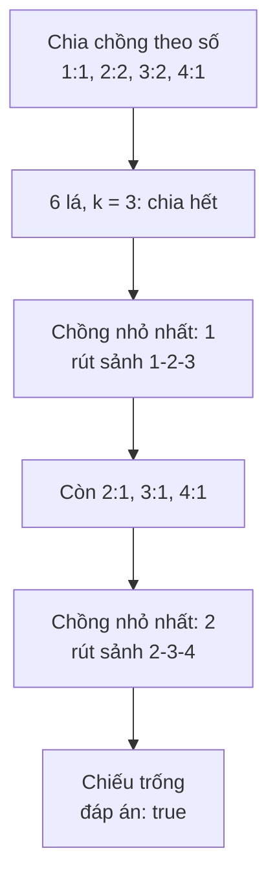
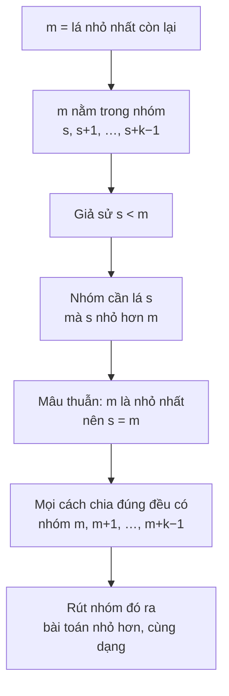

> [!tldr] Đọc nhanh
> - Đề hỏi: chia được tay bài thành các nhóm đúng k lá, mỗi nhóm là k số liên tiếp, hay không. Số lá không chia hết cho k thì trả `false` ngay.
> - Nước tham lam: lá nhỏ nhất còn lại không có lá nào nhỏ hơn để đứng trước nó, nên nó **chỉ có thể** là lá mở nhóm. Mở nhóm `x, x+1, …, x+k−1` ở đó, thiếu lá nào thì trả `false`. Đây là [[concepts/smallest-first-grouping|gom nhóm từ lá nhỏ nhất]].
> - Cần một bảng [[concepts/frequency-counting|đếm tần suất]] (một [[concepts/hash-map|hash map]] giá trị → số lá) để biết lá nào còn, và một lần sắp xếp để biết lá nào nhỏ nhất.
> - Nhanh hơn: xử lý mỗi **giá trị** một lần. Còn c lá x thì cả c lá đều phải mở nhóm, nên trừ c khỏi x … x+k−1 trong một lượt.
> - Đo trên máy mình với 200.000 lá, 1.000 giá trị khác nhau, k = 10: theo từng lá 200.000 bước, theo từng giá trị 1.000 bước; nhanh hơn từ 4,7 lần (Rust) tới 16 lần (PHP).

> [!info] Bối cảnh
> Đây là bài LeetCode 846, bài neo của [[posts/2026-11-28-neetcode-greedy-grouping|ga MISC-04: Tham lam theo nhóm]] trên **tuyến NeetCode: Kỹ thuật tổng hợp**. LeetCode 1296 (Divide Array in Sets of K Consecutive Numbers) là cùng một bài, đổi tên biến và nới giới hạn. Mình hình dung dọn bài tiến lên trên chiếu thành các sảnh. Bạn chỉ cần biết mảng, vòng lặp và sắp xếp; ga trước, [[posts/2026-11-28-neetcode-greedy-array|ga MISC-03: Tham lam trên mảng]], cho thấy cách chứng minh một nước tham lam không làm mất đáp án.

> [!abstract]- Từ điển nhanh cho bài này (bấm để mở)
> - Sảnh (straight): trong bài tây, một dãy lá có số liên tiếp, ví dụ 5-6-7. Ở đây "sảnh" là một nhóm đúng k số liên tiếp.
> - [[concepts/frequency-counting|Đếm tần suất]]: đi qua mảng một lần, ghi mỗi giá trị xuất hiện bao nhiêu lần. Ở đây là `count[x]` = số lá x còn trên chiếu.
> - [[concepts/hash-map|Hash map]]: bảng tra khóa → giá trị trong O(1) trung bình. Dùng nó thay vì mảng đếm vì giá trị lá tới 10⁹.
> - [[concepts/greedy-choice|Lựa chọn tham lam]]: chọn ngay một quyết định cục bộ, không quay lại, rồi chứng minh quyết định đó không làm mất đáp án.
> - [[concepts/sort-then-scan|Sắp rồi quét]]: sắp xếp trước để một lượt quét từ trái sang phải gặp các giá trị theo thứ tự tăng dần.

## Hình dung trước: dọn bài thành sảnh

Ván tiến lên vừa xong, mình gom bài trên chiếu và muốn xếp hết thành các sảnh đúng 3 lá, không thừa lá nào. Mình không thử ghép lung tung. Mình chia bài thành từng chồng theo số, rồi nhìn chồng có số **nhỏ nhất**. Lá ở chồng đó không thể đứng giữa hay cuối một sảnh, vì sảnh đó sẽ cần một lá nhỏ hơn, mà trên chiếu không còn lá nào nhỏ hơn. Vậy nó phải là lá đầu sảnh. Mình rút một lá ở chồng đó và một lá ở mỗi chồng kế tiếp. Có chồng nào trống thì chịu thua: không xếp được.

| Đời thường | Khái niệm |
|---|---|
| Lá bài trên chiếu | phần tử của `hand` |
| Chồng các lá cùng số x | `count[x]` |
| Sảnh đúng k lá liên tiếp | một nhóm `x, x+1, …, x+k−1` |
| Chồng có số nhỏ nhất còn lá | lá nhỏ nhất còn lại, phải mở nhóm |
| Một chồng trống giữa sảnh | `count[v] = 0`: trả `false` |
| Đếm lá thấy không chia hết cho k | `n % k ≠ 0`: dừng sớm |
| Chồng nhỏ nhất có c lá, mở c sảnh một lúc | cách theo từng giá trị: trừ c khỏi k chồng |

Với tay bài `[3, 2, 2, 1, 4, 3]` và k = 3, các chồng là 1:1, 2:2, 3:2, 4:1:



## Vấn đề: chia được thành các sảnh không

Cho một mảng số nguyên `hand` (mỗi số là một lá bài) và một số `k` (LeetCode gọi là `groupSize`). Hỏi có sắp lại được toàn bộ các lá thành những nhóm, mỗi nhóm đúng k lá mang k giá trị liên tiếp, hay không. Mỗi lá phải nằm trong đúng một nhóm. Giới hạn: 1 ≤ n ≤ 10⁴, 0 ≤ giá trị lá ≤ 10⁹, 1 ≤ k ≤ n. Bản 1296 cho n tới 10⁵ và giá trị từ 1. Ví dụ của mình: `[12, 10, 11, 13, 11, 12]` với k = 3 chia được thành 10-11-12 và 11-12-13; `[3, 3, 4, 4, 5, 6]` với k = 3 thì không. [Đề gốc LeetCode 846](https://leetcode.com/problems/hand-of-straights/)

Lần đầu mình định đi theo thứ tự đề cho: gặp lá nào còn trên chiếu thì mở sảnh từ lá đó đi lên. Với `[2, 3, 1]`, k = 3, cách này mở sảnh ở 2 và đòi 2-3-4, thiếu 4, nên trả `false`. Đáp án lại là `true`: 1-2-3. Lá 2 không phải lá đầu sảnh, vì còn lá 1 nhỏ hơn. Lá đầu sảnh chỉ chắc chắn là lá **nhỏ nhất**, nên phải sắp xếp trước.

## Cơ chế

### Trọng tài: thử mọi cách ghép

Lấy một lá còn lại bất kỳ, gọi là x. Lá này nằm trong một nhóm nào đó, và nhóm đó bắt đầu ở một trong k giá trị `x−k+1, …, x`. Thử từng khả năng: đủ lá thì rút nhóm, gọi đệ quy cho phần còn lại, không thành thì trả lá lại. Cách này không giả định gì về lá nhỏ nhất, nên mình dùng nó làm trọng tài để kiểm tra các cách nhanh. Mỗi tầng có tới k nhánh và có tới n/k tầng, nên thời gian là hàm mũ; chỉ chạy được trên tay bài nhỏ.

### Vì sao lá nhỏ nhất phải mở nhóm



Nói cách khác, quanh lá nhỏ nhất không có lựa chọn nào: nhóm của nó bị ép. Rút nhóm đó không làm mất đáp án, vì đáp án nào cũng chứa nó. Thiếu một lá trong `m … m+k−1` thì không cách chia nào tồn tại. Đây là điểm khác với các bài tham lam ở [[posts/2026-11-28-neetcode-greedy-array|ga MISC-03]]: ở đó phải chứng minh một lựa chọn "không tệ hơn" các lựa chọn khác, còn ở đây lựa chọn là duy nhất.

### Cách 1: theo từng lá

Đếm `count`, sắp `hand` tăng dần, rồi duyệt từng lá x trong mảng đã sắp. `count[x] = 0` nghĩa là lá này đã bị rút vào một nhóm trước đó, bỏ qua. Còn thì x đang là lá nhỏ nhất còn lại (mọi lá nhỏ hơn đã hết), nên trừ 1 ở mỗi `x, x+1, …, x+k−1`; gặp 0 thì trả `false`.

Người ta hay ghi độ phức tạp là O(n log n + n·k), vì mỗi lá có thể kéo theo k lần trừ. Đếm kỹ thì chỉ lá mở nhóm mới kéo theo k lần trừ, và mỗi lần trừ ăn đúng một lá, nên cả lượt có không quá n lần trừ. Thời gian là O(n log n) cho bước sắp, cộng O(n) thao tác trên hash map. Bộ nhớ O(n) cho bản sao đã sắp và bảng đếm.

### Cách 2: theo từng giá trị

Ở cách 1, chồng x có c lá thì vòng lặp gặp x đúng c lần, và mỗi lần làm lại cùng một việc: trừ 1 ở k chồng. Cả c lá x đều phải mở nhóm (lập luận ở trên áp dụng c lần liền), nên có thể trừ c ở mỗi chồng `x … x+k−1` trong một lượt, với điều kiện chồng đó còn ít nhất c lá. Vì vậy chỉ cần sắp các **khóa** của `count`, tức d giá trị khác nhau, thay vì cả n lá.

Truy vết với `[1, 1, 2, 2, 2, 3, 3, 3, 4]`, k = 3:

| x | c = count[x] | Trừ c ở | count sau bước | Kết quả |
|---|---|---|---|---|
| 1 | 2 | 1, 2, 3 | 1:0, 2:1, 3:1, 4:1 | hai nhóm 1-2-3 |
| 2 | 1 | 2, 3, 4 | 1:0, 2:0, 3:0, 4:0 | một nhóm 2-3-4 |
| 3 | 0 | (bỏ qua) | không đổi | |
| 4 | 0 | (bỏ qua) | không đổi | `true` |

Đếm mất O(n), sắp khóa mất O(d log d), và số lần trừ là (số giá trị mở nhóm) × k, không quá n. Tổng O(n + d log d), bộ nhớ O(d).

### Cách 3: hàng các nhóm đang mở

Cách này không tra `count[x+1]`, `count[x+2]`… mà chỉ đi qua các giá trị theo thứ tự tăng, mỗi giá trị một lần. Nó nhớ `open`, số nhóm đang chờ lá kế tiếp, và một hàng đợi ghi số nhóm mới mở tại từng giá trị. Tại giá trị x có c lá:

- có nhóm đang mở mà x không liền sau giá trị trước: các nhóm đó không bao giờ đủ, trả `false`;
- c < `open`: không đủ lá x cho mọi nhóm đang chờ, trả `false`;
- còn lại thì `open` lá x nối vào các nhóm cũ, c − `open` lá dư mở nhóm mới; ghi số đó vào hàng và đặt `open = c`;
- hàng đã có k mục thì các nhóm mở từ giá trị x−k+1 vừa đủ k lá: bớt số đó khỏi `open`.

Hết các giá trị mà `open = 0` thì mọi nhóm đã đóng. Với cùng tay bài trên, hàng lần lượt là `[2]`, `[2, 1]`, `[2, 1, 0]` (đủ 3 mục: đóng 2 nhóm, `open` = 1), rồi `[1, 0, 0]` (đóng 1 nhóm, `open` = 0). Thời gian vẫn O(n + d log d), nhưng mỗi giá trị chỉ tốn một bước, và cách này chạy được trên một luồng cặp (giá trị, số lá) đã sắp mà không cần tra ngược.

| Cách | Thời gian | Bộ nhớ phụ | Ghi chú |
|---|---|---|---|
| Trọng tài thử mọi nhóm | hàm mũ | O(n) | Không giả định lá nhỏ nhất; chỉ dùng để đối chiếu |
| Cách 1: theo từng lá | O(n log n) | O(n) | Sắp cả n lá; tối đa n lần trừ |
| Cách 2: theo từng giá trị | O(n + d log d) | O(d) | Sắp d khóa; trừ c một lần |
| Cách 3: hàng nhóm đang mở | O(n + d log d) | O(d) | Một bước mỗi giá trị, không tra ngược |

### Đo: theo từng lá và theo từng giá trị

Hai cách chỉ khác nhau rõ khi có nhiều lá trùng. Mình dựng tay bài n = 200.000 lá: lá thứ i có giá trị `(i · 7919) % 1000`, tức 1.000 giá trị khác nhau, mỗi giá trị 200 lá, xáo trộn. k = 10. Đáp án là `true` (100 dải 10 giá trị, mỗi dải 200 nhóm). Cỡ này vượt giới hạn 10⁴ của đề, mình chọn to để thời gian đủ lớn mà đo. "Bước" là số lần trừ trong vòng lặp trong. Mỗi ngôn ngữ đo một lần trên máy mình, thời gian gồm cả bước đếm và sắp:

| Ngôn ngữ | Theo từng lá | Theo từng giá trị |
|---|---|---|
| TypeScript (Node) | 31,8 ms | 2,2 ms |
| Python | 46,9 ms | 5,3 ms |
| Go | 15,7 ms | 1,3 ms |
| Java | 25,1 ms | 2,9 ms |
| JavaScript (Node) | 29,3 ms | 2,1 ms |
| PHP | 41,8 ms | 2,6 ms |
| Rust | 5,6 ms | 1,2 ms |

Theo từng lá làm 200.000 lần trừ và sắp 200.000 số; theo từng giá trị làm 1.000 lần trừ và sắp 1.000 khóa. Phần còn lại của cách 2 gần như chỉ là bước đếm 200.000 lá vào hash map, việc mà cả hai cách đều phải làm. Tay bài không có lá trùng (d = n) thì hai cách làm cùng số lần trừ, và khác biệt chỉ còn ở hằng số; mình không đo trường hợp đó.

## Ví dụ chạy được

[TypeScript](../code/neetcode-hand-of-straights/straights.ts) · [Python](../code/neetcode-hand-of-straights/straights.py) · [Go](../code/neetcode-hand-of-straights/straights.go) · [Java](../code/neetcode-hand-of-straights/straights.java) · [JavaScript](../code/neetcode-hand-of-straights/straights.js) · [PHP](../code/neetcode-hand-of-straights/straights.php) · [Rust](../code/neetcode-hand-of-straights/straights.rs)

```ts
// Cách 2, theo từng giá trị: c lá x cùng mở c nhóm, trừ c khỏi x..x+k-1 trong một lần
function isNStraightByValue(hand: number[], k: number, counter = { steps: 0 }): boolean {
    if (hand.length % k !== 0) return false
    const count = countOf(hand)
    const keys = [...count.keys()].sort((a, b) => a - b) // chỉ sắp các giá trị khác nhau
    for (const x of keys) {
        const c = count.get(x)!
        if (c === 0) continue
        for (let v = x; v < x + k; v++) {
            counter.steps++
            const have = count.get(v) ?? 0
            if (have < c) return false // không đủ lá v cho c nhóm
            count.set(v, have - c)
        }
    }
    return true
}
```

```python
# Cách 2, theo từng giá trị: c lá x cùng mở c nhóm, trừ c khỏi x..x+k-1 trong một lần
def is_n_straight_by_value(hand, k, counter=None):
    if len(hand) % k != 0:
        return False
    count = Counter(hand)
    for x in sorted(count):  # chỉ sắp các giá trị khác nhau
        c = count[x]
        if c == 0:
            continue
        for v in range(x, x + k):
            if counter is not None:
                counter["steps"] += 1
            have = count[v]
            if have < c:
                return False  # không đủ lá v cho c nhóm
            count[v] = have - c
    return True
```

```go
// Cách 2, theo từng giá trị: c lá x cùng mở c nhóm, trừ c khỏi x..x+k-1 trong một lần
func isNStraightByValue(hand []int, k int, steps *int) bool {
	if len(hand)%k != 0 {
		return false
	}
	count := countOf(hand)
	keys := make([]int, 0, len(count))
	for x := range count {
		keys = append(keys, x) // thứ tự duyệt map là ngẫu nhiên, nên phải sắp
	}
	slices.Sort(keys) // chỉ sắp các giá trị khác nhau
	for _, x := range keys {
		c := count[x]
		if c == 0 {
			continue
		}
		for v := x; v < x+k; v++ {
			*steps++
			if count[v] < c {
				return false // không đủ lá v cho c nhóm
			}
			count[v] -= c
		}
	}
	return true
}
```

```java
// Cách 2, theo từng giá trị: c lá x cùng mở c nhóm, trừ c khỏi x..x+k-1 trong một lần
static boolean isNStraightByValue(int[] hand, int k) {
    if (hand.length % k != 0) return false;
    TreeMap<Integer, Integer> count = new TreeMap<>(countOf(hand)); // khóa đã sắp, chỉ các giá trị khác nhau
    for (int x : new ArrayList<>(count.keySet())) {
        int c = count.get(x);
        if (c == 0) continue;
        for (int v = x; v < x + k; v++) {
            steps++;
            int have = count.getOrDefault(v, 0);
            if (have < c) return false; // không đủ lá v cho c nhóm
            count.put(v, have - c);
        }
    }
    return true;
}
```

```js
// Cách 2, theo từng giá trị: c lá x cùng mở c nhóm, trừ c khỏi x..x+k-1 trong một lần
function isNStraightByValue(hand, k, counter = { steps: 0 }) {
    if (hand.length % k !== 0) return false
    const count = countOf(hand)
    const keys = [...count.keys()].sort((a, b) => a - b) // chỉ sắp các giá trị khác nhau
    for (const x of keys) {
        const c = count.get(x)
        if (c === 0) continue
        for (let v = x; v < x + k; v++) {
            counter.steps++
            const have = count.get(v) ?? 0
            if (have < c) return false // không đủ lá v cho c nhóm
            count.set(v, have - c)
        }
    }
    return true
}
```

```php
// Cách 2, theo từng giá trị: c lá x cùng mở c nhóm, trừ c khỏi x..x+k-1 trong một lần
function isNStraightByValue(array $hand, int $k): bool {
    global $steps;
    if (count($hand) % $k !== 0) return false;
    $count = countOf($hand);
    $keys = array_keys($count);
    sort($keys); // chỉ sắp các giá trị khác nhau
    foreach ($keys as $x) {
        $c = $count[$x];
        if ($c === 0) continue;
        for ($v = $x; $v < $x + $k; $v++) {
            $steps++;
            $have = $count[$v] ?? 0;
            if ($have < $c) return false; // không đủ lá v cho c nhóm
            $count[$v] = $have - $c;
        }
    }
    return true;
}
```

```rust
// Cách 2, theo từng giá trị: c lá x cùng mở c nhóm, trừ c khỏi x..x+k-1 trong một lần
fn is_n_straight_by_value(hand: &[i32], k: i32, steps: &mut u64) -> bool {
    if hand.len() % k as usize != 0 {
        return false;
    }
    let mut count = count_of(hand);
    let mut keys: Vec<i32> = count.keys().copied().collect();
    keys.sort_unstable(); // chỉ sắp các giá trị khác nhau
    for x in keys {
        let c = count[&x];
        if c == 0 {
            continue;
        }
        for v in x..x + k {
            *steps += 1;
            match count.get_mut(&v) {
                Some(have) if *have >= c => *have -= c,
                _ => return false, // không đủ lá v cho c nhóm
            }
        }
    }
    true
}
```

Các tab trích cách 2; dòng tăng `steps` chỉ để đếm cho phép đo. File tải về còn có hàm đếm `countOf`, trọng tài thử mọi nhóm, cách 1, cách 3 và một bản sai bỏ bước sắp xếp. Mười ca tự dựng gồm tay bài xáo trộn, lá trùng, hai nhóm chồng lên nhau (1-2-3 và 2-3-4), thiếu một lá ở giữa, n không chia hết cho k, k = 1, giá trị quanh 10⁹ và giá trị 0. Mỗi ca, cả bốn hàm phải ra đúng đáp án mong đợi.

Dòng thứ hai đối chiếu với trọng tài trên mọi tay bài dùng các giá trị 0 … 4, mỗi giá trị 0 … 3 lá, với k = 1 … 5: 1.023 tay bài × 5 = 5.115 ca. Lá được đưa vào theo thứ tự tăng rồi xoay nửa sau lên trước, để đầu vào không sẵn thứ tự. Dòng thứ ba chạy bản bỏ sắp xếp trên cùng 5.115 ca. Dòng cuối là phép đo ở trên (đây là số của TypeScript).

```text
10/10 ca đúng
5115/5115 ca đúng (đối chiếu trọng tài)
Bỏ sắp xếp: sai 86/5115 ca
n = 200000, k = 10, kết quả true/true: theo từng lá 200000 bước (31.8 ms), theo từng giá trị 1000 bước (2.2 ms)
```

Cả bảy ngôn ngữ in đúng ba dòng đầu và cùng số bước ở dòng cuối; chỉ thời gian khác nhau, như bảng ở phần Cơ chế.

## Hiểu lầm và bẫy hay gặp

- Mở nhóm theo thứ tự đề cho thay vì từ lá nhỏ nhất. Bản bỏ sắp xếp sai 86/5.115 ca, toàn là trả `false` khi đáp án là `true`: `[2, 3, 1]` với k = 3 là một ví dụ. Nó không bao giờ trả `true` sai, vì đã trả `true` thì nó thật sự đã ghép xong.
- Nghĩ rằng lá nhỏ nhất "nên" mở nhóm vì như vậy có lợi. Không phải chuyện có lợi: nó **buộc** phải mở nhóm. Hiểu đúng chỗ này thì không cần thử cách khác.
- Quên kiểm tra `n % k`. Kết quả vẫn đúng (thế nào cũng thiếu lá ở nhóm cuối), nhưng mất cơ hội trả lời ngay mà không cần đếm và sắp. Kiểm tra này chỉ là điều kiện cần: `[1, 2, 4, 5, 6, 7]` có 6 lá, k = 3, vẫn `false`.
- Ở cách 2, lấy c từ bảng đếm ban đầu, ví dụ duyệt một bản chụp `sorted(count.items())` trong Python. Phải đọc `count[x]` ngay lúc tới x, sau khi các nhóm trước đã trừ. Với `[1, 1, 2, 2, 2, 3, 3, 3, 4]`, k = 3, bản chụp cho x = 2 con số 3 cũ, trong khi chồng 2 chỉ còn 1 lá, nên hàm trả `false` dù đáp án là `true`.
- Đặt k làm số nhóm thay vì số lá mỗi nhóm. Đề hỏi nhóm k lá; số nhóm là n / k.
- TypeScript, JavaScript: `sort()` không truyền hàm so sánh sẽ so như chuỗi. `[10, 9, 11].sort()` cho `[10, 11, 9]`, nên cách 1 mở nhóm ở 10 và đòi 10-11-12. Luôn dùng `sort((a, b) => a - b)`.
- Python: `Counter` trả 0 cho khóa thiếu mà không thêm khóa, nên `count[v]` an toàn. `defaultdict(int)` thì thêm khóa khi đọc; nếu vừa duyệt `count` vừa đọc như vậy, Python báo `dictionary changed size during iteration`. Code duyệt `sorted(count)`, một danh sách chép ra, nên không gặp lỗi này.
- Go: thứ tự duyệt `range` trên map không được đặc tả và đổi giữa các lần chạy. Lấy khóa ra rồi phải sắp, không thì cách 2 có thể bắt đầu ở một giá trị không nhỏ nhất.
- Java: `HashMap.get` trả `null` khi thiếu khóa, gán vào `int` sẽ ném `NullPointerException`. Dùng `getOrDefault(v, 0)`. So hai `Integer` lấy từ map bằng `==` là so tham chiếu, chỉ trùng hợp đúng với số từ −128 tới 127; ở đây mình so với `int` nên Java mở hộp trước.
- PHP: `sort($sorted)` sắp tại chỗ và trả `true`, không trả mảng; viết `$sorted = sort($hand)` là mất mảng. Mảng PHP truyền theo giá trị, nên sắp bản sao không đụng mảng của người gọi.
- Rust: `hand.len() % k as usize` đúng vì `as` ưu tiên cao hơn `%`. Dùng `count[&v]` cho khóa có thể thiếu sẽ panic; code dùng `get_mut` và `match` để thiếu khóa thì trả `false`.

## Câu hỏi tự kiểm tra

> [!question]- Vì sao lá nhỏ nhất còn lại phải là lá mở nhóm, chứ không chỉ "nên" là lá mở nhóm?
> Nếu nhóm của nó bắt đầu ở s < m thì nhóm đó cần lá s, nhỏ hơn lá nhỏ nhất còn lại: vô lý. Nên mọi cách chia đúng đều chứa nhóm `m … m+k−1`.

> [!question]- Với `[1, 2, 2, 3, 3, 4]` và k = 3, cách 2 làm những bước nào?
> count = 1:1, 2:2, 3:2, 4:1. x = 1, c = 1: trừ 1 ở 1, 2, 3 → 2:1, 3:1. x = 2, c = 1: trừ 1 ở 2, 3, 4 → hết. x = 3, 4: c = 0, bỏ qua. Đáp án `true`.

> [!question]- Cách 1 vì sao chỉ làm không quá n lần trừ, dù mỗi lá có thể kéo theo k lần trừ?
> Chỉ lá mở nhóm mới kéo theo k lần trừ, và mỗi lần trừ rút đúng một lá khỏi chiếu. Có n lá nên có tối đa n lần trừ; các lá đã bị rút chỉ tốn một lần kiểm tra `count[x] = 0`.

> [!question]- Ở cách 3, khi nào phải trả `false` dù chồng hiện tại có đủ lá?
> Khi còn nhóm đang mở (`open > 0`) mà giá trị hiện tại không liền sau giá trị trước. Các nhóm đó cần đúng giá trị bị thiếu, nên không bao giờ đủ k lá.

## Tham khảo

- [LeetCode 846: Hand of Straights](https://leetcode.com/problems/hand-of-straights/) · [LeetCode 1296: Divide Array in Sets of K Consecutive Numbers](https://leetcode.com/problems/divide-array-in-sets-of-k-consecutive-numbers/)
- [Python docs: collections.Counter](https://docs.python.org/3/library/collections.html#collections.Counter) · [Java 21 API: HashMap](https://docs.oracle.com/en/java/javase/21/docs/api/java.base/java/util/HashMap.html)
- [The Go Programming Language Specification: For statements with range clause](https://go.dev/ref/spec#For_range) · [MDN: Array.prototype.sort()](https://developer.mozilla.org/en-US/docs/Web/JavaScript/Reference/Global_Objects/Array/sort)
- [Java SE 21 JLS §5.1.7: Boxing Conversion](https://docs.oracle.com/javase/specs/jls/se21/html/jls-5.html#jls-5.1.7)
- [PHP manual: sort](https://www.php.net/manual/en/function.sort.php)
- [The Rust Reference: expression precedence](https://doc.rust-lang.org/reference/expressions.html#expression-precedence)
