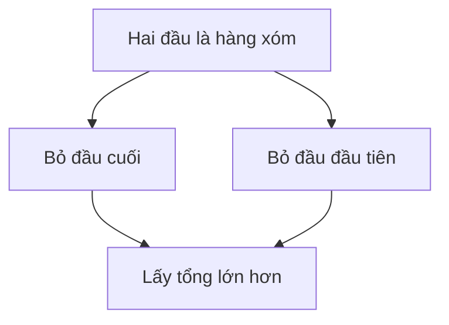

> [!tldr] Đọc nhanh
> - Hai đầu mảng trở thành hàng xóm khi đặt trên vòng.
> - Mỗi lựa chọn hợp lệ bỏ ít nhất một trong hai đầu, nên giải hai đoạn `[0,n−1)` và `[1,n)` rồi lấy max.
> - Tách ca một ô. Dùng biên chỉ số để cả hai lượt giữ bộ nhớ phụ O(1).

> [!info] Bối cảnh
> Bài LeetCode 213, thuộc [[posts/2026-11-27-neetcode-linear-dp|ga 1: Truy hồi một chiều]] trên [[series/neetcode-dp|tuyến NeetCode: Quy hoạch động]]. Mình dùng mảng điểm để theo dõi trạng thái; bạn chỉ cần biết chỉ số mảng.

> [!abstract]- Từ điển nhanh cho bài này (bấm để mở)
> - Tiền tố là đoạn bắt đầu từ đầu phạm vi đang xét.
> - Trạng thái DP là kết quả của một bài toán con có nghĩa rõ ràng.
> - Biên loại trừ `end` nằm ngay sau vị trí cuối được xét.

## Hình dung trước: chọn quầy quanh quảng trường

Nếu đem hàng quầy của [[problems/house-robber|House Robber]] uốn quanh một quảng trường, quầy đầu bỗng kề quầy cuối. Mình nghĩ tới hai cách đóng quầy để biến vòng thành một hàng. Đóng quầy cuối trong lượt thứ nhất. Đóng quầy đầu trong lượt thứ hai. Phương án tối ưu của vòng sẽ xuất hiện ở ít nhất một lượt, vì nó đã bỏ một đầu.

| Đời thường | Khái niệm |
|---|---|
| Quầy đầu liền quầy cuối | Cạnh nối hai đầu của vòng |
| Đóng quầy cuối | Đoạn `[0,n−1)` |
| Đóng quầy đầu | Đoạn `[1,n)` |
| Chọn phương án có nhiều điểm hơn | Lấy max của hai lượt |



## Vấn đề: chọn giá trị tối đa trên một vòng

Cho `n` vị trí trên vòng, với `1 ≤ n ≤ 100` và mỗi điểm từ 0 đến 1.000. Trả tổng điểm lớn nhất của một tập vị trí không kề nhau, tính cả quan hệ giữa đầu và cuối khi có từ hai vị trí.

Mảng `[9,1,1,9]` cho 10. Hai đầu có tổng 18 nhưng dùng chung cạnh, nên một phương án hợp lệ là chọn ô 0 và ô 2.

## Cơ chế

### Cách 1. Cắt vòng rồi thử mọi lựa chọn

Một nghiệm hợp lệ chung không lấy đồng thời vị trí 0 và `n−1`. Nếu bỏ `n−1`, nghiệm nằm trong `[0,n−1)`. Nếu bỏ 0, nghiệm nằm trong `[1,n)`. Một nghiệm bỏ cả hai đầu được xét hai lần cũng ổn. Ngược lại, nghiệm hợp lệ trong mỗi đoạn chắc chắn hợp lệ trên vòng vì đầu còn lại vắng mặt. Vậy lấy max hai nghiệm tốt nhất là đúng.

Trên mỗi đoạn mình có thể đệ quy chọn lấy hoặc bỏ như bài tuyến tính. Hai đoạn làm số lời gọi tăng thêm hệ số hằng số. Cận đơn giản vẫn là O(2ⁿ) thời gian và O(n) ngăn xếp. Với 28 ô bằng 3, mỗi đoạn 27 ô sinh 1.028.457 lời gọi, tổng 2.056.914. Cả hai cách dưới chỉ tính 54 bước cập nhật và trả 42.

### Cách 2. Cắt vòng rồi lập bảng

Với mỗi đoạn, đi từ đầu đoạn đến cuối đoạn. Công thức `best[k] = max(best[k−1], best[k−2] + value)` chọn giữa bỏ ô hiện tại và lấy nó rồi cách một ô. Hai lần lập bảng tốn O(n) thời gian và O(n) bộ nhớ phụ.

### Cách 3. Cắt vòng rồi giữ hai kết quả

Bản nén chỉ giữ hai kết quả cũ, rồi dịch cặp biến khi tính xong bước mới. Truyền biên vào hàm để dùng chung mảng `nums`. Hai lượt cộng lại O(n) thời gian, O(1) bộ nhớ phụ. Với một ô, trả giá trị ô đó trước khi dựng hai đoạn.

## Ví dụ chạy được

[TypeScript](../code/neetcode-house-robber-ii/solve.ts) · [Python](../code/neetcode-house-robber-ii/solve.py) · [Go](../code/neetcode-house-robber-ii/solve.go) · [Java](../code/neetcode-house-robber-ii/solve.java) · [JavaScript](../code/neetcode-house-robber-ii/solve.js) · [PHP](../code/neetcode-house-robber-ii/solve.php) · [Rust](../code/neetcode-house-robber-ii/solve.rs)

Các tab hiện phần lời giải. File tải về có đủ các cách và bộ kiểm tra tự chạy.

```ts
import assert from "node:assert/strict";

type RangeSolver = (nums: number[], start: number, end: number) => number;

function rolling(nums: number[], start: number, end: number): number {
  let twoBack = 0;
  let oneBack = 0;
  for (let i = start; i < end; i++) {
    const best = Math.max(oneBack, twoBack + nums[i]);
    twoBack = oneBack;
    oneBack = best;
  }
  return oneBack;
}

function table(nums: number[], start: number, end: number): number {
  const best = new Array<number>(end - start + 2).fill(0);
  for (let i = start; i < end; i++) {
    const j = i - start;
    best[j + 2] = Math.max(best[j + 1], best[j] + nums[i]);
  }
  return best[end - start + 1];
}

function brute(nums: number[], i: number, end: number): number {
  if (i >= end) return 0;
  return Math.max(brute(nums, i + 1, end), nums[i] + brute(nums, i + 2, end));
}

function rob(nums: number[], solve: RangeSolver): number {
  if (nums.length === 1) return nums[0];
  return Math.max(solve(nums, 0, nums.length - 1), solve(nums, 1, nums.length));
}
```

```python
def rolling(nums, start, end):
    two_back = one_back = 0
    for i in range(start, end):
        two_back, one_back = one_back, max(one_back, two_back + nums[i])
    return one_back


def table(nums, start, end):
    best = [0] * (end - start + 2)
    for i in range(start, end):
        j = i - start
        best[j + 2] = max(best[j + 1], best[j] + nums[i])
    return best[-1]


def brute(nums, i, end):
    if i >= end:
        return 0
    return max(brute(nums, i + 1, end), nums[i] + brute(nums, i + 2, end))

def rob(nums, solve):
    if len(nums) == 1:
        return nums[0]
    return max(solve(nums, 0, len(nums) - 1), solve(nums, 1, len(nums)))
```

```go
package main

import "fmt"

type rangeSolver func([]int, int, int) int

func rolling(nums []int, start, end int) int {
	twoBack, oneBack := 0, 0
	for i := start; i < end; i++ {
		twoBack, oneBack = oneBack, max(oneBack, twoBack+nums[i])
	}
	return oneBack
}

func table(nums []int, start, end int) int {
	best := make([]int, end-start+2)
	for i := start; i < end; i++ {
		j := i - start
		best[j+2] = max(best[j+1], best[j]+nums[i])
	}
	return best[len(best)-1]
}

func brute(nums []int, i, end int) int {
	if i >= end {
		return 0
	}
	return max(brute(nums, i+1, end), nums[i]+brute(nums, i+2, end))
}

func rob(nums []int, solve rangeSolver) int {
	if len(nums) == 1 {
		return nums[0]
	}
	return max(solve(nums, 0, len(nums)-1), solve(nums, 1, len(nums)))
}
```

```java
class Solve {
    interface RangeSolver {
        int solve(int[] nums, int start, int end);
    }

    static int rolling(int[] nums, int start, int end) {
        int twoBack = 0;
        int oneBack = 0;
        for (int i = start; i < end; i++) {
            int best = Math.max(oneBack, twoBack + nums[i]);
            twoBack = oneBack;
            oneBack = best;
        }
        return oneBack;
    }

    static int table(int[] nums, int start, int end) {
        int[] best = new int[end - start + 2];
        for (int i = start; i < end; i++) {
            int j = i - start;
            best[j + 2] = Math.max(best[j + 1], best[j] + nums[i]);
        }
        return best[best.length - 1];
    }

    static int brute(int[] nums, int i, int end) {
        if (i >= end) return 0;
        return Math.max(brute(nums, i + 1, end), nums[i] + brute(nums, i + 2, end));
    }

    static int rob(int[] nums, RangeSolver solve) {
        if (nums.length == 1) return nums[0];
        return Math.max(solve.solve(nums, 0, nums.length - 1), solve.solve(nums, 1, nums.length));
    }
}
```

```javascript
import assert from "node:assert/strict";

function rolling(nums, start, end) {
  let twoBack = 0;
  let oneBack = 0;
  for (let i = start; i < end; i++) {
    const best = Math.max(oneBack, twoBack + nums[i]);
    twoBack = oneBack;
    oneBack = best;
  }
  return oneBack;
}

function table(nums, start, end) {
  const best = new Array(end - start + 2).fill(0);
  for (let i = start; i < end; i++) {
    const j = i - start;
    best[j + 2] = Math.max(best[j + 1], best[j] + nums[i]);
  }
  return best[end - start + 1];
}

function brute(nums, i, end) {
  if (i >= end) return 0;
  return Math.max(brute(nums, i + 1, end), nums[i] + brute(nums, i + 2, end));
}

function rob(nums, solve) {
  if (nums.length === 1) return nums[0];
  return Math.max(solve(nums, 0, nums.length - 1), solve(nums, 1, nums.length));
}
```

```php
<?php
declare(strict_types=1);

function rolling(array $nums, int $start, int $end): int
{
    $twoBack = 0;
    $oneBack = 0;
    for ($i = $start; $i < $end; $i++) {
        [$twoBack, $oneBack] = [$oneBack, max($oneBack, $twoBack + $nums[$i])];
    }
    return $oneBack;
}

function table(array $nums, int $start, int $end): int
{
    $best = array_fill(0, $end - $start + 2, 0);
    for ($i = $start; $i < $end; $i++) {
        $j = $i - $start;
        $best[$j + 2] = max($best[$j + 1], $best[$j] + $nums[$i]);
    }
    return $best[count($best) - 1];
}

function brute(array $nums, int $i, int $end): int
{
    if ($i >= $end) {
        return 0;
    }
    return max(brute($nums, $i + 1, $end), $nums[$i] + brute($nums, $i + 2, $end));
}

function rob(array $nums, callable $solve): int
{
    if (count($nums) === 1) {
        return $nums[0];
    }
    return max($solve($nums, 0, count($nums) - 1), $solve($nums, 1, count($nums)));
}
```

```rust
type RangeSolver = fn(&[i32], usize, usize) -> i32;

fn rolling(nums: &[i32], start: usize, end: usize) -> i32 {
    let (mut two_back, mut one_back) = (0, 0);
    for &value in &nums[start..end] {
        (two_back, one_back) = (one_back, one_back.max(two_back + value));
    }
    one_back
}

fn table(nums: &[i32], start: usize, end: usize) -> i32 {
    let mut best = vec![0; end - start + 2];
    for (j, &value) in nums[start..end].iter().enumerate() {
        best[j + 2] = best[j + 1].max(best[j] + value);
    }
    best[best.len() - 1]
}

fn brute(nums: &[i32], i: usize, end: usize) -> i32 {
    if i >= end {
        return 0;
    }
    brute(nums, i + 1, end).max(nums[i] + brute(nums, i + 2, end))
}

fn rob(nums: &[i32], solve: RangeSolver) -> i32 {
    if nums.len() == 1 {
        return nums[0];
    }
    solve(nums, 0, nums.len() - 1).max(solve(nums, 1, nums.len()))
}
```

Kết quả chạy của mỗi file:

```text
20/20 ca đúng
```

## Hiểu lầm và bẫy hay gặp

- Hai lượt cắt có thể cùng bỏ cả hai đầu. Mỗi lượt chỉ ép bỏ một đầu, cho phép tối ưu chọn hoặc bỏ đầu còn lại.
- `n=1` cần ca riêng. Nếu cắt hai đầu theo công thức, cả hai đoạn đều rỗng.
- `slice` của JavaScript và lát cắt danh sách Python tạo bản sao. Truyền chỉ số giữ bộ nhớ phụ O(1).

## Câu hỏi tự kiểm tra

> [!question]- Vì sao không chạy đúng một lượt bỏ ô cuối?
> Phương án tốt nhất có thể cần ô cuối. Với `[1,2,9]`, bỏ ô cuối chỉ còn tối đa 2.

> [!question]- Cặp đoạn nào dùng khi có hai ô?
> Một đoạn chứa ô đầu, đoạn kia chứa ô cuối. Kết quả là điểm lớn hơn của hai ô.

## Tham khảo

- [LeetCode](https://leetcode.com/problems/house-robber-ii/)
- [MIT 6.006, Lecture 19, Memoization and Bottom-up DP](https://ocw.mit.edu/courses/6-006-introduction-to-algorithms-fall-2011/resources/mit6_006f11_lec19_orig/)
