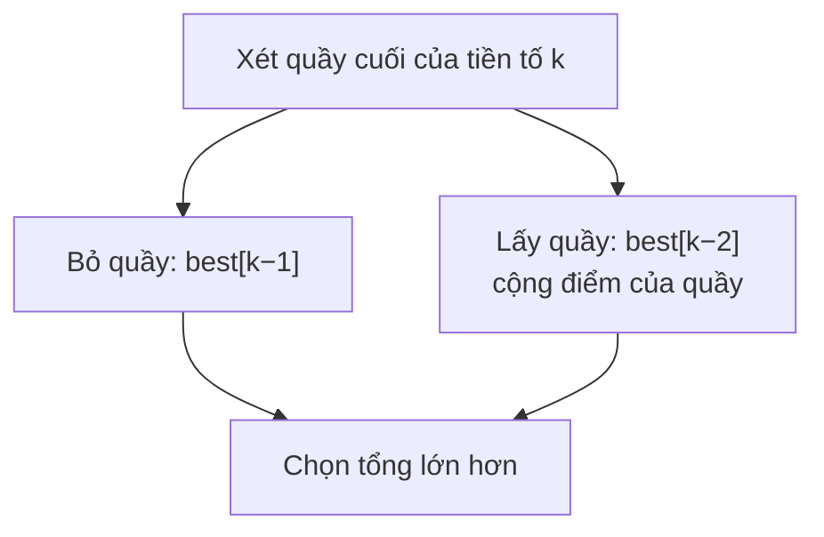

> [!tldr] Đọc nhanh
> - Mỗi vị trí có hai lựa chọn. Bỏ nó giữ kết quả trước đó, còn lấy nó buộc bỏ liền trước.
> - Viết `best[k]` là tổng lớn nhất trong `k` vị trí đầu, rồi dùng `best[k]=max(best[k−1], best[k−2]+value)`.
> - Lưu hai kết quả cũ là đủ. Chọn tham lam theo vị trí có điểm cao nhất có thể bỏ lỡ hai vị trí cộng lại tốt hơn.

> [!info] Bối cảnh
> Bài LeetCode 198, thuộc [[posts/2026-11-27-neetcode-linear-dp|ga 1: Truy hồi một chiều]] trên [[series/neetcode-dp|tuyến NeetCode: Quy hoạch động]]. Mình dùng mảng điểm để theo dõi trạng thái; bạn chỉ cần biết chỉ số mảng.

> [!abstract]- Từ điển nhanh cho bài này (bấm để mở)
> - Tiền tố là đoạn bắt đầu từ đầu phạm vi đang xét.
> - Trạng thái DP là kết quả của một bài toán con có nghĩa rõ ràng.
> - Biên loại trừ `end` nằm ngay sau vị trí cuối được xét.

## Hình dung trước: chọn các quầy trên một hàng

Mình có một hàng quầy phát phiếu điểm. Hai quầy liền nhau dùng chung một lượt nhận, nên mình chỉ được lấy phiếu ở các quầy cách nhau ít nhất một vị trí. Nếu lấy quầy cuối, mình được cộng điểm của nó vào kết quả tốt nhất trước quầy hàng xóm. Nếu bỏ, cứ dùng kết quả của hàng ngắn hơn.

| Đời thường | Khái niệm |
|---|---|
| Hàng đầu có k quầy | Trạng thái `best[k]` |
| Bỏ quầy vừa xét | Dùng `best[k−1]` |
| Lấy phiếu quầy vừa xét | Cộng điểm quầy vào `best[k−2]` |
| Chọn tổng lớn hơn | Công thức truy hồi |



## Vấn đề: chọn giá trị tối đa trên một hàng

Cho mảng `nums` dài từ 1 đến 100, mỗi giá trị từ 0 đến 400. Chọn một tập chỉ số không chứa hai chỉ số kề nhau và trả tổng lớn nhất. Ví dụ `[8,11,8]` cho 16, vì hai đầu cộng lại hơn một ô giữa.

## Cơ chế

### Cách 1. Rẽ hai nhánh

Hàm `brute(i)` hỏi phần từ chỉ số `i` tới cuối. Nếu bỏ vị trí đó, đi tới `i+1`. Nếu lấy, cộng nó rồi đi tới `i+2`. Hai nhánh phủ mọi cách chọn và chạm cùng hậu tố nhiều lần. Một cận đơn giản là O(2ⁿ) thời gian, O(n) ngăn xếp.

### Cách 2. Lập bảng tiền tố

`best[k]` là phương án tốt nhất trên `k` vị trí đầu. `best[0]=0` và `best[1]=nums[0]`. Với `k≥2`, phương án tối ưu hoặc bỏ vị trí mới (dùng `best[k−1]`), hoặc lấy nó (dùng `best[k−2]+nums[k−1]`). Hai lựa chọn bao hết mọi phương án hợp lệ. Mình dùng hai ô 0 ở đầu bảng trong file để vòng lặp áp dụng cùng công thức cho ô đầu tiên. Thời gian O(n), bộ nhớ phụ O(n).

### Cách 3. Giữ hai kết quả

Trước khi xử lý ô kế tiếp, `oneBack` là kết quả của tiền tố đã xét, `twoBack` là kết quả khi bỏ riêng ô cuối của tiền tố đó khỏi phạm vi. Tính kết quả mới từ cả hai rồi mới dịch biến. Thời gian O(n), bộ nhớ phụ O(1).

Với 28 ô đều bằng 3, mình đếm được 1.664.079 lời gọi ở cây đệ quy, tính cả lời gọi gặp biên. Bản giữ hai kết quả chỉ cập nhật 28 lần. Cả hai trả 42.

## Ví dụ chạy được

[TypeScript](../code/neetcode-house-robber/solve.ts) · [Python](../code/neetcode-house-robber/solve.py) · [Go](../code/neetcode-house-robber/solve.go) · [Java](../code/neetcode-house-robber/solve.java) · [JavaScript](../code/neetcode-house-robber/solve.js) · [PHP](../code/neetcode-house-robber/solve.php) · [Rust](../code/neetcode-house-robber/solve.rs)

Các tab hiện phần lời giải. File tải về có đủ các cách và bộ kiểm tra tự chạy.

```ts
import assert from "node:assert/strict";

type RangeSolver = (nums: number[], start: number, end: number) => number;

function rolling(nums: number[], start: number, end: number): number {
  let twoBack = 0;
  let oneBack = 0;
  for (let i = start; i < end; i++) {
    const best = Math.max(oneBack, twoBack + nums[i]);
    twoBack = oneBack;
    oneBack = best;
  }
  return oneBack;
}

function table(nums: number[], start: number, end: number): number {
  const best = new Array<number>(end - start + 2).fill(0);
  for (let i = start; i < end; i++) {
    const j = i - start;
    best[j + 2] = Math.max(best[j + 1], best[j] + nums[i]);
  }
  return best[end - start + 1];
}

function brute(nums: number[], i: number, end: number): number {
  if (i >= end) return 0;
  return Math.max(brute(nums, i + 1, end), nums[i] + brute(nums, i + 2, end));
}

function rob(nums: number[], solve: RangeSolver): number {
  return solve(nums, 0, nums.length);
}
```

```python
def rolling(nums, start, end):
    two_back = one_back = 0
    for i in range(start, end):
        two_back, one_back = one_back, max(one_back, two_back + nums[i])
    return one_back


def table(nums, start, end):
    best = [0] * (end - start + 2)
    for i in range(start, end):
        j = i - start
        best[j + 2] = max(best[j + 1], best[j] + nums[i])
    return best[-1]


def brute(nums, i, end):
    if i >= end:
        return 0
    return max(brute(nums, i + 1, end), nums[i] + brute(nums, i + 2, end))

def rob(nums, solve):
    return solve(nums, 0, len(nums))
```

```go
package main

import "fmt"

type rangeSolver func([]int, int, int) int

func rolling(nums []int, start, end int) int {
	twoBack, oneBack := 0, 0
	for i := start; i < end; i++ {
		twoBack, oneBack = oneBack, max(oneBack, twoBack+nums[i])
	}
	return oneBack
}

func table(nums []int, start, end int) int {
	best := make([]int, end-start+2)
	for i := start; i < end; i++ {
		j := i - start
		best[j+2] = max(best[j+1], best[j]+nums[i])
	}
	return best[len(best)-1]
}

func brute(nums []int, i, end int) int {
	if i >= end {
		return 0
	}
	return max(brute(nums, i+1, end), nums[i]+brute(nums, i+2, end))
}

func rob(nums []int, solve rangeSolver) int {
	return solve(nums, 0, len(nums))
}
```

```java
class Solve {
    interface RangeSolver {
        int solve(int[] nums, int start, int end);
    }

    static int rolling(int[] nums, int start, int end) {
        int twoBack = 0;
        int oneBack = 0;
        for (int i = start; i < end; i++) {
            int best = Math.max(oneBack, twoBack + nums[i]);
            twoBack = oneBack;
            oneBack = best;
        }
        return oneBack;
    }

    static int table(int[] nums, int start, int end) {
        int[] best = new int[end - start + 2];
        for (int i = start; i < end; i++) {
            int j = i - start;
            best[j + 2] = Math.max(best[j + 1], best[j] + nums[i]);
        }
        return best[best.length - 1];
    }

    static int brute(int[] nums, int i, int end) {
        if (i >= end) return 0;
        return Math.max(brute(nums, i + 1, end), nums[i] + brute(nums, i + 2, end));
    }

    static int rob(int[] nums, RangeSolver solve) {
        return solve.solve(nums, 0, nums.length);
    }
}
```

```javascript
import assert from "node:assert/strict";

function rolling(nums, start, end) {
  let twoBack = 0;
  let oneBack = 0;
  for (let i = start; i < end; i++) {
    const best = Math.max(oneBack, twoBack + nums[i]);
    twoBack = oneBack;
    oneBack = best;
  }
  return oneBack;
}

function table(nums, start, end) {
  const best = new Array(end - start + 2).fill(0);
  for (let i = start; i < end; i++) {
    const j = i - start;
    best[j + 2] = Math.max(best[j + 1], best[j] + nums[i]);
  }
  return best[end - start + 1];
}

function brute(nums, i, end) {
  if (i >= end) return 0;
  return Math.max(brute(nums, i + 1, end), nums[i] + brute(nums, i + 2, end));
}

function rob(nums, solve) {
  return solve(nums, 0, nums.length);
}
```

```php
<?php
declare(strict_types=1);

function rolling(array $nums, int $start, int $end): int
{
    $twoBack = 0;
    $oneBack = 0;
    for ($i = $start; $i < $end; $i++) {
        [$twoBack, $oneBack] = [$oneBack, max($oneBack, $twoBack + $nums[$i])];
    }
    return $oneBack;
}

function table(array $nums, int $start, int $end): int
{
    $best = array_fill(0, $end - $start + 2, 0);
    for ($i = $start; $i < $end; $i++) {
        $j = $i - $start;
        $best[$j + 2] = max($best[$j + 1], $best[$j] + $nums[$i]);
    }
    return $best[count($best) - 1];
}

function brute(array $nums, int $i, int $end): int
{
    if ($i >= $end) {
        return 0;
    }
    return max(brute($nums, $i + 1, $end), $nums[$i] + brute($nums, $i + 2, $end));
}

function rob(array $nums, callable $solve): int
{
    return $solve($nums, 0, count($nums));
}
```

```rust
type RangeSolver = fn(&[i32], usize, usize) -> i32;

fn rolling(nums: &[i32], start: usize, end: usize) -> i32 {
    let (mut two_back, mut one_back) = (0, 0);
    for &value in &nums[start..end] {
        (two_back, one_back) = (one_back, one_back.max(two_back + value));
    }
    one_back
}

fn table(nums: &[i32], start: usize, end: usize) -> i32 {
    let mut best = vec![0; end - start + 2];
    for (j, &value) in nums[start..end].iter().enumerate() {
        best[j + 2] = best[j + 1].max(best[j] + value);
    }
    best[best.len() - 1]
}

fn brute(nums: &[i32], i: usize, end: usize) -> i32 {
    if i >= end {
        return 0;
    }
    brute(nums, i + 1, end).max(nums[i] + brute(nums, i + 2, end))
}

fn rob(nums: &[i32], solve: RangeSolver) -> i32 {
    solve(nums, 0, nums.len())
}
```

Kết quả chạy của mỗi file:

```text
17/17 ca đúng
```

## Hiểu lầm và bẫy hay gặp

- Không cập nhật `twoBack` trước khi tính tổng mới. Nếu dùng giá trị đã dịch, mình có thể tính cả hai quầy liền nhau.
- Mảng `[8,11,8]` cũng là phản ví dụ cho việc lấy ô cao nhất còn trống. Lấy 11 khóa mất hai ô 8.
- Chỉ số dừng `end` trong file là biên loại trừ. Khi bước lấy nhảy quá biên, đệ quy trả 0.
- Python, Go và PHP có thể gán cặp vì vế phải lấy giá trị cũ trước. Java dùng biến tạm `best`.

## Câu hỏi tự kiểm tra

> [!question]- Với tiền tố [8,11,8], công thức dùng hai tổng nào ở bước cuối?
> Bỏ ô cuối giữ 11, lấy ô cuối dùng 8 của tiền tố dài một rồi cộng thêm 8, nên chọn 16.

> [!question]- Muốn in danh sách vị trí đã chọn, giữ hai biến có đủ?
> Hai biến đủ để trả tổng. Để khôi phục lựa chọn, có thể giữ bảng tiền tố rồi đi lùi và xem bước nào dùng nhánh bỏ hay lấy.

## Tham khảo

- [LeetCode](https://leetcode.com/problems/house-robber/)
- [MIT 6.006, Lecture 19, Memoization and Bottom-up DP](https://ocw.mit.edu/courses/6-006-introduction-to-algorithms-fall-2011/resources/mit6_006f11_lec19_orig/)
