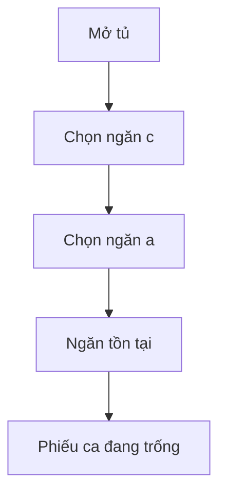
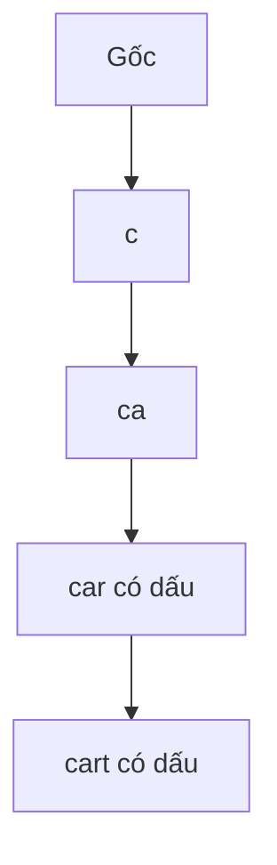

> [!tldr] Đọc nhanh
> - Tập từ tra được một từ nguyên vẹn, còn truy vấn tiền tố phải thử nhiều ứng viên nếu chưa có chỉ mục.
> - Trie chia sẻ các bước đi của những từ cùng tiền tố. Cả hai phép tra có thể dùng cùng một hàm đi từ gốc.
> - `search` đòi dấu hết từ ở nút đến. `startsWith` chỉ đòi đường đi tồn tại.
> - Bảng con thưa lưu cạnh đang dùng. Mảng 26 ô đổi bộ nhớ lấy phép truy cập chỉ số trực tiếp.

> [!info] Bối cảnh
> Đây là bài LeetCode 208, thuộc [[posts/2026-11-26-neetcode-trie|ga 7: Trie]] trên **tuyến NeetCode: Cấu trúc liên kết**. Mình xây mục lục cho những từ được thêm dần, với hai câu hỏi “có đúng từ này không?” và “có từ nào bắt đầu thế này không?”. Mình chỉ cần chuỗi chữ thường và thao tác đi từ một nút sang nút con.

> [!abstract]- Từ điển nhanh cho bài này (bấm để mở)
> - **Tiền tố** là phần đầu của một từ, có thể dài bằng cả từ đó.
> - [[concepts/trie|Trie]] là cây mà các nhãn cạnh từ gốc đến một nút ghép thành một tiền tố.
> - [[concepts/terminal-marker|Dấu hết từ]] là cờ cho biết tiền tố ở nút hiện tại đã được chèn như một từ.
> - **Bảng con thưa** chỉ có mục cho những cạnh tồn tại. **Mảng con cố định** dành một ô cho mỗi chữ có thể xuất hiện.

## Hình dung trước: mục lục ngăn kéo

Mình xếp phiếu từ trong tủ, mỗi tầng mở một ngăn theo một chữ. Hai phiếu cùng bắt đầu bằng `ca` dùng chung hai ngăn đầu. Ở ngăn `car` mình có thể đặt một phiếu từ đầy đủ và vẫn để ngăn nhỏ `t` cho `cart`.

| Đời thường | Khái niệm |
|---|---|
| Lật từng phiếu và đọc đầu dòng | Tập từ với phép quét tiền tố |
| Đi chung các ngăn mang cùng dãy nhãn | Chia sẻ đường đi trong trie |
| Phiếu đặt ngay tại ngăn đang mở | Dấu hết từ |
| Mỗi tầng có sẵn 26 ô, hoặc chỉ lắp những ô có đồ | Mảng cố định hoặc bảng con thưa |



## Vấn đề: lưu từ rồi tra đúng nghĩa

Một đối tượng `Trie` bắt đầu rỗng. `insert(word)` thêm từ. `search(word)` kiểm tra từ đó đã có mặt, còn `startsWith(prefix)` kiểm tra có ít nhất một từ đã lưu bắt đầu bằng tiền tố ấy. Đề cho mỗi chuỗi dài 1–2.000 ký tự, chỉ gồm `a` đến `z`, với tối đa 30.000 lượt gọi ba thao tác cộng lại. [Đề LeetCode 208](https://leetcode.com/problems/implement-trie-prefix-tree/)

Sau khi thêm `cart`, `startsWith("car")` trả `true` và `search("car")` trả `false`. Thêm `car` thì cả hai trả `true`. Thêm tiếp `cab` sẽ tạo nhánh ở `ca`, nơi có thể rẽ sang `r` hoặc `b`.

## Cơ chế

### Tập từ và phép quét

Lưu các từ nguyên vẹn trong một tập băm. Chèn và tra chính xác đều sử dụng một khóa chuỗi. Với tiền tố, duyệt các khóa và dừng khi gặp từ có phần đầu khớp. Cách này nhỏ gọn khi phần lớn lệnh tra chính xác. Nếu mọi từ đều trượt, một truy vấn tiền tố phải xem đủ N từ.

### Cùng một lượt đi, hai điều kiện kết quả

Bắt đầu ở gốc. Sau khi đọc k chữ, nút hiện tại ứng với đúng k chữ đầu đã đọc. Khi chèn, nếu cạnh kế tiếp chưa tồn tại thì tạo nó. Khi tra, cạnh thiếu đủ để kết luận tiền tố không có trong chỉ mục. Đây là [[concepts/trie-prefix-pruning|cắt nhánh theo tiền tố]] ở trường hợp mỗi vị trí chỉ có một chữ cần thử.

Cuối `insert`, bật `terminal` ở nút cuối. Với `cart` rồi `car`, lần chèn sau đi qua các cạnh cũ và chỉ cần bật thêm một cờ ở `car`. Nút đó vẫn có cạnh `t` xuống `cart`. Chèn `car` thêm lần nữa cho cùng trạng thái.



| Trạng thái sau khi tra | `search` | `startsWith` |
|---|---|---|
| Gặp cạnh thiếu | Sai | Sai |
| Đến nút chưa có dấu | Sai | Đúng |
| Đến nút có dấu | Đúng | Đúng |

Bất biến được giữ vì mỗi nút có tối đa một cạnh con cho một chữ. Với đề chỉ chèn, mỗi đường đang có được tạo khi chèn một từ, nên bất kỳ nút nào tới được sau một tiền tố không rỗng đều có một từ đã lưu ở chính nó hoặc ở phía dưới. Cây có thể dùng cả giá trị đi kèm để nhận biết nút được chèn, như mẫu của Princeton. Ở đây chỉ cần một cờ Boolean. [Princeton Algorithms, TrieST](https://raw.githubusercontent.com/kevin-wayne/algs4/master/src/main/java/edu/princeton/cs/algs4/TrieST.java)

### Chọn cách lưu cạnh

Gọi m là độ dài chuỗi truy vấn hoặc chèn, N là số từ khác nhau, S là tổng độ dài các từ khác nhau, và P là số tiền tố khác nhau không rỗng. Bảng sau tính vùng dữ liệu được giữ lại giữa các thao tác, chưa kể chuỗi đầu vào được người gọi giữ riêng.

| Cách | Chèn và tra từ | Tra tiền tố | Dữ liệu giữ lại |
|---|---|---|---|
| Tập từ | O(m) kỳ vọng nếu tính cả băm chuỗi và tính gộp khi tăng bảng | O(N·m) xấu nhất | O(S) để lưu các từ, cộng N mục tập |
| Trie thưa | O(m) với phép tra và ghi bảng con kỳ vọng O(1) | O(m), dừng ngay khi thiếu cạnh | Θ(P + 1) nút và P cạnh cùng chi phí cấu trúc bảng |
| Trie mảng | O(m) với bảng chữ cái 26 chữ cố định | O(m) | 26(P + 1) ô chứa tham chiếu con |

Nếu bảng chữ cái có σ chữ, tạo mỗi nút mảng tốn Θ(σ) để cấp và khởi tạo ô. Một lần chèn thêm r nút mất Θ(m + σr). Trie mảng tránh băm khi tìm cạnh, nhưng ở những nút có một con hoặc không con thì hầu hết ô để trống. Trie thưa giữ mục cho cạnh thật và chịu chi phí riêng của từng bảng băm. Các số ô và mục cho thấy cấu trúc, còn số byte và hiệu năng phụ thuộc runtime và phân bố từ. Chuẩn ECMAScript mô tả thời gian truy cập trung bình của `Map` dưới tuyến tính theo số mục. O(1) kỳ vọng ở bảng trên dùng mô hình bảng băm thông thường. [ECMAScript, Map Objects](https://tc39.es/ecma262/multipage/keyed-collections.html#sec-map-objects) · [Java HashMap](https://docs.oracle.com/en/java/javase/21/docs/api/java.base/java/util/HashMap.html)

Bản TypeScript và JavaScript chèn 676 từ có dạng `a` + hai chữ thường rồi tra tiền tố `z`. Tập thử 676 từ. Mỗi trie thử đúng một cạnh từ gốc. Hai loại lượt thử đo lượng công việc của truy vấn, chưa tính chi phí xây chỉ mục và không quy đổi trực tiếp thành thời gian chạy.

## Ví dụ chạy được

Mỗi file chạy 11 ca trên từng cách trong ba cách. Các ca bao gồm kho rỗng, chèn lặp, tiền tố đi tới nút trong, cạnh thiếu và từ 2.000 ký tự. TypeScript và JavaScript còn kiểm con số cho truy vấn trượt ở gốc.

```typescript
import assert from "node:assert/strict"

class WordSet {
  private words = new Set<string>()
  lastChecks = 0

  insert(word: string) {
    this.words.add(word)
  }

  search(word: string) {
    return this.words.has(word)
  }

  startsWith(prefix: string) {
    this.lastChecks = 0
    for (const word of this.words) {
      this.lastChecks++
      if (word.startsWith(prefix)) return true
    }
    return false
  }
}

class TrieNode {
  private children: Map<string, TrieNode> | (TrieNode | undefined)[]
  terminal = false

  constructor(dense: boolean) {
    this.children = dense ? Array<TrieNode | undefined>(26).fill(undefined) : new Map()
  }

  get(letter: string) {
    return Array.isArray(this.children)
      ? this.children[letter.charCodeAt(0) - 97]
      : this.children.get(letter)
  }

  set(letter: string, child: TrieNode) {
    if (Array.isArray(this.children)) this.children[letter.charCodeAt(0) - 97] = child
    else this.children.set(letter, child)
  }
}

class Trie {
  private root: TrieNode
  private dense: boolean
  lastChecks = 0

  constructor(dense: boolean) {
    this.dense = dense
    this.root = new TrieNode(dense)
  }

  insert(word: string) {
    let node = this.root
    for (const letter of word) {
      let child = node.get(letter)
      if (!child) {
        child = new TrieNode(this.dense)
        node.set(letter, child)
      }
      node = child
    }
    node.terminal = true
  }

  search(word: string) {
    return this.walk(word)?.terminal === true
  }

  startsWith(prefix: string) {
    return this.walk(prefix) !== undefined
  }

  private walk(text: string) {
    this.lastChecks = 0
    let node = this.root
    for (const letter of text) {
      this.lastChecks++
      const child = node.get(letter)
      if (!child) return undefined
      node = child
    }
    return node
  }
}

const indexes = [new WordSet(), new Trie(false), new Trie(true)]
const longWord = "z".repeat(2000)
let cases = 0
for (const index of indexes) {
  const check = (actual: boolean, expected: boolean) => {
    assert.equal(actual, expected)
    cases++
  }
  check(index.startsWith("ca"), false)
  index.insert("cart")
  index.insert("car")
  index.insert("cab")
  index.insert("car")
  check(index.search("car"), true)
  check(index.search("cart"), true)
  check(index.search("cab"), true)
  check(index.search("ca"), false)
  check(index.startsWith("ca"), true)
  check(index.startsWith("cat"), false)
  check(index.startsWith("carton"), false)
  index.insert(longWord)
  check(index.search(longWord), true)
  check(index.search(longWord.slice(0, -1)), false)
  check(index.startsWith(longWord.slice(0, -1)), true)
}

const probes = [new WordSet(), new Trie(false), new Trie(true)]
const letters = "abcdefghijklmnopqrstuvwxyz"
for (const index of probes) {
  for (const second of letters) {
    for (const third of letters) index.insert("a" + second + third)
  }
  assert.equal(index.startsWith("z"), false)
}
assert.deepEqual(probes.map((index) => index.lastChecks), [676, 1, 1])
console.log(`${cases}/33 ca đúng`)
console.log(`Lượt thử tiền tố: ${probes.map((index) => index.lastChecks).join(", ")}`)
```
```python
class WordSet:
    def __init__(self):
        self.words = set()

    def insert(self, word):
        self.words.add(word)

    def search(self, word):
        return word in self.words

    def starts_with(self, prefix):
        return any(word.startswith(prefix) for word in self.words)


class TrieNode:
    def __init__(self, dense):
        self.children = [None] * 26 if dense else {}
        self.terminal = False

    def get(self, letter):
        if isinstance(self.children, list):
            return self.children[ord(letter) - ord("a")]
        return self.children.get(letter)

    def set(self, letter, child):
        key = ord(letter) - ord("a") if isinstance(self.children, list) else letter
        self.children[key] = child


class Trie:
    def __init__(self, dense):
        self.dense = dense
        self.root = TrieNode(dense)

    def insert(self, word):
        node = self.root
        for letter in word:
            child = node.get(letter)
            if child is None:
                child = TrieNode(self.dense)
                node.set(letter, child)
            node = child
        node.terminal = True

    def search(self, word):
        node = self.walk(word)
        return node is not None and node.terminal

    def starts_with(self, prefix):
        return self.walk(prefix) is not None

    def walk(self, text):
        node = self.root
        for letter in text:
            node = node.get(letter)
            if node is None:
                return None
        return node


def check_index(index):
    assert not index.starts_with("ca")
    for word in ("cart", "car", "cab", "car"):
        index.insert(word)
    assert index.search("car")
    assert index.search("cart")
    assert index.search("cab")
    assert not index.search("ca")
    assert index.starts_with("ca")
    assert not index.starts_with("cat")
    assert not index.starts_with("carton")
    long_word = "z" * 2000
    index.insert(long_word)
    assert index.search(long_word)
    assert not index.search(long_word[:-1])
    assert index.starts_with(long_word[:-1])


if __name__ == "__main__":
    for index in (WordSet(), Trie(False), Trie(True)):
        check_index(index)
    print("33/33 ca đúng")
```
```go
package main

import (
	"fmt"
	"strings"
)

type index interface {
	insert(string)
	search(string) bool
	startsWith(string) bool
}

type wordSet map[string]struct{}

func (words wordSet) insert(word string) {
	words[word] = struct{}{}
}

func (words wordSet) search(word string) bool {
	_, found := words[word]
	return found
}

func (words wordSet) startsWith(prefix string) bool {
	for word := range words {
		if strings.HasPrefix(word, prefix) {
			return true
		}
	}
	return false
}

type trieNode struct {
	sparse   map[byte]*trieNode
	dense    *[26]*trieNode
	terminal bool
}

func newNode(dense bool) *trieNode {
	if dense {
		return &trieNode{dense: new([26]*trieNode)}
	}
	return &trieNode{sparse: make(map[byte]*trieNode)}
}

func (node *trieNode) get(letter byte) *trieNode {
	if node.dense != nil {
		return node.dense[letter-'a']
	}
	return node.sparse[letter]
}

func (node *trieNode) set(letter byte, child *trieNode) {
	if node.dense != nil {
		node.dense[letter-'a'] = child
	} else {
		node.sparse[letter] = child
	}
}

type trie struct {
	root  *trieNode
	dense bool
}

func (t trie) insert(word string) {
	node := t.root
	for i := 0; i < len(word); i++ {
		letter := word[i]
		child := node.get(letter)
		if child == nil {
			child = newNode(t.dense)
			node.set(letter, child)
		}
		node = child
	}
	node.terminal = true
}

func (t trie) search(word string) bool {
	node := t.walk(word)
	return node != nil && node.terminal
}

func (t trie) startsWith(prefix string) bool {
	return t.walk(prefix) != nil
}

func (t trie) walk(text string) *trieNode {
	node := t.root
	for i := 0; i < len(text); i++ {
		node = node.get(text[i])
		if node == nil {
			return nil
		}
	}
	return node
}

func main() {
	indexes := []index{wordSet{}, trie{newNode(false), false}, trie{newNode(true), true}}
	cases := 0
	check := func(actual, expected bool) {
		cases++
		if actual != expected {
			panic(fmt.Sprintf("Sai ca %d", cases))
		}
	}
	for _, lookup := range indexes {
		check(lookup.startsWith("ca"), false)
		for _, word := range []string{"cart", "car", "cab", "car"} {
			lookup.insert(word)
		}
		check(lookup.search("car"), true)
		check(lookup.search("cart"), true)
		check(lookup.search("cab"), true)
		check(lookup.search("ca"), false)
		check(lookup.startsWith("ca"), true)
		check(lookup.startsWith("cat"), false)
		check(lookup.startsWith("carton"), false)
		longWord := strings.Repeat("z", 2000)
		lookup.insert(longWord)
		check(lookup.search(longWord), true)
		check(lookup.search(longWord[:1999]), false)
		check(lookup.startsWith(longWord[:1999]), true)
	}
	fmt.Printf("%d/33 ca đúng\n", cases)
}
```
```java
import java.util.HashMap;
import java.util.HashSet;
import java.util.Map;
import java.util.Set;

class PrefixIndex {
    interface Index {
        void insert(String word);
        boolean search(String word);
        boolean startsWith(String prefix);
    }

    static class WordSet implements Index {
        private final Set<String> words = new HashSet<>();

        public void insert(String word) {
            words.add(word);
        }

        public boolean search(String word) {
            return words.contains(word);
        }

        public boolean startsWith(String prefix) {
            for (String word : words) {
                if (word.startsWith(prefix)) return true;
            }
            return false;
        }
    }

    static class TrieNode {
        private final Map<Character, TrieNode> sparse;
        private final TrieNode[] dense;
        boolean terminal;

        TrieNode(boolean useArray) {
            sparse = useArray ? null : new HashMap<>();
            dense = useArray ? new TrieNode[26] : null;
        }

        TrieNode get(char letter) {
            return dense == null ? sparse.get(letter) : dense[letter - 'a'];
        }

        void set(char letter, TrieNode child) {
            if (dense == null) sparse.put(letter, child);
            else dense[letter - 'a'] = child;
        }
    }

    static class Trie implements Index {
        private final TrieNode root;
        private final boolean dense;

        Trie(boolean dense) {
            this.dense = dense;
            root = new TrieNode(dense);
        }

        public void insert(String word) {
            TrieNode node = root;
            for (int i = 0; i < word.length(); i++) {
                char letter = word.charAt(i);
                TrieNode child = node.get(letter);
                if (child == null) {
                    child = new TrieNode(dense);
                    node.set(letter, child);
                }
                node = child;
            }
            node.terminal = true;
        }

        public boolean search(String word) {
            TrieNode node = walk(word);
            return node != null && node.terminal;
        }

        public boolean startsWith(String prefix) {
            return walk(prefix) != null;
        }

        private TrieNode walk(String text) {
            TrieNode node = root;
            for (int i = 0; i < text.length(); i++) {
                node = node.get(text.charAt(i));
                if (node == null) return null;
            }
            return node;
        }
    }

    static int cases;
    static void check(boolean actual, boolean expected) {
        cases++;
        if (actual != expected) throw new AssertionError("Sai ca " + cases);
    }

    public static void main(String[] args) {
        Index[] indexes = {new WordSet(), new Trie(false), new Trie(true)};
        for (Index index : indexes) {
            check(index.startsWith("ca"), false);
            for (String word : new String[]{"cart", "car", "cab", "car"}) {
                index.insert(word);
            }
            check(index.search("car"), true);
            check(index.search("cart"), true);
            check(index.search("cab"), true);
            check(index.search("ca"), false);
            check(index.startsWith("ca"), true);
            check(index.startsWith("cat"), false);
            check(index.startsWith("carton"), false);
            String longWord = "z".repeat(2000);
            index.insert(longWord);
            check(index.search(longWord), true);
            check(index.search(longWord.substring(0, 1999)), false);
            check(index.startsWith(longWord.substring(0, 1999)), true);
        }
        System.out.printf("%d/33 ca đúng%n", cases);
    }
}
```
```javascript
import assert from "node:assert/strict"

class WordSet {
  words = new Set()
  lastChecks = 0

  insert(word) {
    this.words.add(word)
  }

  search(word) {
    return this.words.has(word)
  }

  startsWith(prefix) {
    this.lastChecks = 0
    for (const word of this.words) {
      this.lastChecks++
      if (word.startsWith(prefix)) return true
    }
    return false
  }
}

class TrieNode {
  children
  terminal = false

  constructor(dense) {
    this.children = dense ? Array(26).fill(undefined) : new Map()
  }

  get(letter) {
    return Array.isArray(this.children)
      ? this.children[letter.charCodeAt(0) - 97]
      : this.children.get(letter)
  }

  set(letter, child) {
    if (Array.isArray(this.children)) this.children[letter.charCodeAt(0) - 97] = child
    else this.children.set(letter, child)
  }
}

class Trie {
  root
  dense
  lastChecks = 0

  constructor(dense) {
    this.dense = dense
    this.root = new TrieNode(dense)
  }

  insert(word) {
    let node = this.root
    for (const letter of word) {
      let child = node.get(letter)
      if (!child) {
        child = new TrieNode(this.dense)
        node.set(letter, child)
      }
      node = child
    }
    node.terminal = true
  }

  search(word) {
    return this.walk(word)?.terminal === true
  }

  startsWith(prefix) {
    return this.walk(prefix) !== undefined
  }

  walk(text) {
    this.lastChecks = 0
    let node = this.root
    for (const letter of text) {
      this.lastChecks++
      const child = node.get(letter)
      if (!child) return undefined
      node = child
    }
    return node
  }
}

const indexes = [new WordSet(), new Trie(false), new Trie(true)]
const longWord = "z".repeat(2000)
let cases = 0
for (const index of indexes) {
  const check = (actual, expected) => {
    assert.equal(actual, expected)
    cases++
  }
  check(index.startsWith("ca"), false)
  index.insert("cart")
  index.insert("car")
  index.insert("cab")
  index.insert("car")
  check(index.search("car"), true)
  check(index.search("cart"), true)
  check(index.search("cab"), true)
  check(index.search("ca"), false)
  check(index.startsWith("ca"), true)
  check(index.startsWith("cat"), false)
  check(index.startsWith("carton"), false)
  index.insert(longWord)
  check(index.search(longWord), true)
  check(index.search(longWord.slice(0, -1)), false)
  check(index.startsWith(longWord.slice(0, -1)), true)
}

const probes = [new WordSet(), new Trie(false), new Trie(true)]
const letters = "abcdefghijklmnopqrstuvwxyz"
for (const index of probes) {
  for (const second of letters) {
    for (const third of letters) index.insert("a" + second + third)
  }
  assert.equal(index.startsWith("z"), false)
}
assert.deepEqual(probes.map((index) => index.lastChecks), [676, 1, 1])
console.log(`${cases}/33 ca đúng`)
console.log(`Lượt thử tiền tố: ${probes.map((index) => index.lastChecks).join(", ")}`)
```

```text
33/33 ca đúng
Lượt thử tiền tố: 676, 1, 1
```

Dòng thứ hai chỉ do TypeScript và JavaScript in. Tải file [TypeScript](../code/neetcode-implement-trie-prefix-tree/prefix-index.ts), [Python](../code/neetcode-implement-trie-prefix-tree/prefix_index.py), [Go](../code/neetcode-implement-trie-prefix-tree/prefix_index.go), [Java](../code/neetcode-implement-trie-prefix-tree/prefix-index.java) hoặc [JavaScript](../code/neetcode-implement-trie-prefix-tree/prefix-index.js). Chạy theo thứ tự bằng `node prefix-index.ts`, `python3 prefix_index.py`, `go run prefix_index.go`, `java prefix-index.java` và `node prefix-index.js`.

## Hiểu lầm và bẫy hay gặp

- **Dùng lá để nhận biết từ hoàn chỉnh.** `car` và `cart` có thể cùng tồn tại. Khi đó `car` đã có dấu hết từ và vẫn có con.
- **Chèn gọi hàm tìm rồi tự tạo luôn ở cả truy vấn.** Hàm `walk` chỉ đọc và dừng ở cạnh thiếu. Nhờ vậy, một lượt tra trượt không tự thêm tiền tố vào trie.
- **Python tạo các nút con bằng phép nhân danh sách.** `[None] * 26` ổn vì đây là các ô trống. `[TrieNode(...)] * 26` sao chép cùng một tham chiếu vào mọi ô, khiến các nhánh chia sẻ sai nút. [Python, Built-in Types](https://docs.python.org/3/library/stdtypes.html#common-sequence-operations)
- **Go dùng chỉ số byte cho mọi bảng chữ cái.** `word[i]` trả về byte. Bản này hợp lệ vì đề giới hạn `a`–`z`. Java và JavaScript dùng mã ký tự ở cùng phạm vi để tính ô 0–25. Với văn bản Unicode, phải xác định đơn vị ký tự và quy tắc chuẩn hóa trước khi lập chỉ mục. [Go, Index expressions](https://go.dev/ref/spec#Index_expressions)
- **Đệ quy là mặc định khi dùng cây.** Mỗi truy vấn thông thường chỉ đi một đường, nên vòng lặp giữ O(1) trạng thái phụ và tránh độ sâu 2.000 khung hàm cho từ dài nhất.

## Câu hỏi tự kiểm tra

> [!question]- Sau khi chỉ chèn `cart`, vì sao `startsWith("car")` đúng?
> Cạnh `c`, `a`, `r` đều có. `search("car")` vẫn sai vì cờ ở nút `car` chưa bật.

> [!question]- Sau khi chèn `cart`, chèn `car` tạo mấy cạnh?
> 0. Nó đi qua ba cạnh cũ rồi bật dấu tại nút `car`.

> [!question]- Có 10.000 từ đều mở đầu bằng `c`. Tra `z` trong trie thử bao nhiêu cạnh?
> Một cạnh ở gốc. Vừa thiếu cạnh `z` thì dừng.

> [!question]- Khi nào nên cân nhắc mảng con?
> Khi có bảng chữ cái nhỏ, cố định và muốn tra bằng chỉ số trực tiếp. Chọn dựa trên số cạnh có thật ở mỗi nút và số byte của runtime.

## Tham khảo

- [LeetCode 208](https://leetcode.com/problems/implement-trie-prefix-tree/) cho hợp đồng ba thao tác và giới hạn đầu vào.
- [Princeton Algorithms, TrieST](https://raw.githubusercontent.com/kevin-wayne/algs4/master/src/main/java/edu/princeton/cs/algs4/TrieST.java) minh họa mảng con theo bảng chữ cái và giá trị ở điểm cuối.
- [ECMAScript, Map Objects](https://tc39.es/ecma262/multipage/keyed-collections.html#sec-map-objects) và [Java HashMap](https://docs.oracle.com/en/java/javase/21/docs/api/java.base/java/util/HashMap.html) mô tả đặc tính tra trong bảng.
- [Python, Built-in Types](https://docs.python.org/3/library/stdtypes.html#common-sequence-operations) và [Go, Index expressions](https://go.dev/ref/spec#Index_expressions) giải thích tham chiếu lặp trong danh sách và đánh chỉ số chuỗi.
