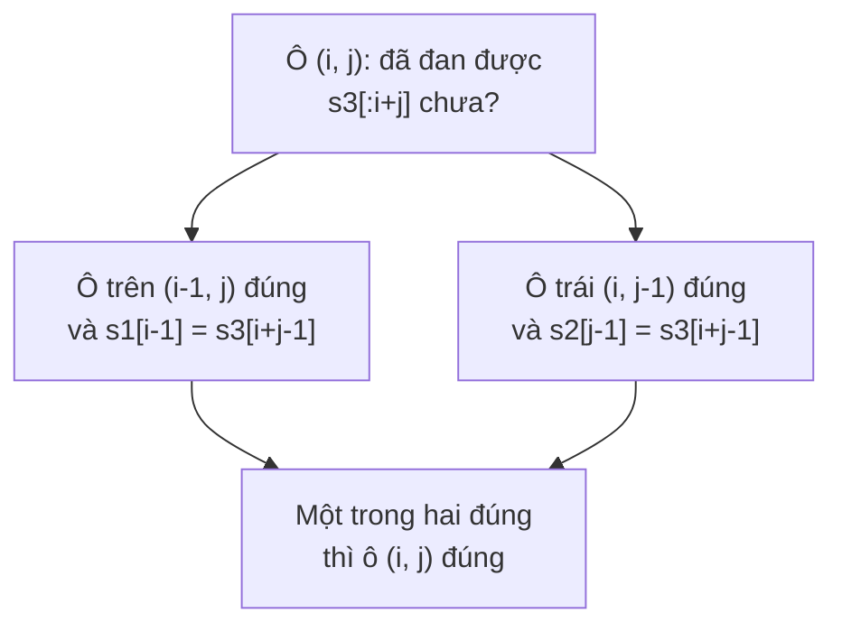

> [!tldr] Đọc nhanh
> - Mỗi ký tự của `s3` phải lấy từ đầu phần còn lại của `s1` hoặc của `s2`. Đã dùng i ký tự của `s1` và j ký tự của `s2` thì vị trí tiếp theo trong `s3` luôn là i + j.
> - Vì thế cặp (i, j) là [[concepts/dp-state|trạng thái]] đủ dùng. Đây là một bảng [[concepts/two-sequence-dp|DP trên hai chuỗi]], mỗi ô hỏi `s1[:i]` và `s2[:j]` có đan thành `s3[:i+j]` không.
> - Ô (i, j) đúng khi ô trên đúng và ký tự `s1[i-1]` khớp, hoặc ô trái đúng và `s2[j-1]` khớp. Giống [[concepts/grid-path-dp|đường đi trên lưới]], chỉ khác là mỗi bước phải khớp một ký tự.
> - Kiểm tra độ dài trước. Một hàng [[concepts/rolling-state|cuộn]] dài `len(s2) + 1` đủ cho cả bảng, đúng yêu cầu bộ nhớ phụ của đề.

> [!info] Bối cảnh
> Đây là bài LeetCode 97 tại [[posts/2026-11-27-neetcode-grid-two-strings|ga DP-05: Lưới và hai chuỗi]] trên **tuyến NeetCode: Quy hoạch động**. Mình hình dung hai xấp bài được xáo kiểu đan (riffle) thành một xấp. Bạn chỉ cần biết đọc chuỗi theo chỉ số và chạy vòng lặp lồng nhau.

> [!abstract]- Từ điển nhanh cho bài này (bấm để mở)
> - `s[:i]` là tiền tố gồm i ký tự đầu của `s`. Tiền tố rỗng có i = 0.
> - [[concepts/dp-state|Trạng thái DP]] là bộ chỉ số đủ để nói phần còn lại của bài toán trông thế nào.
> - [[concepts/memoization|Ghi nhớ kết quả]] (memoization) lưu đáp án của một trạng thái ở lần hỏi đầu, các lần sau đọc lại.
> - [[concepts/rolling-state|Trạng thái cuộn]] chỉ giữ hàng bảng mà bước sau còn đọc, ghi đè lên hàng cũ.
> - Đan xen (interleave) là trộn hai dãy thành một mà không đảo thứ tự bên trong từng dãy.

## Hình dung trước: xáo đan hai xấp bài

Mình chia bộ bài thành hai xấp, rồi thả dần từng lá từ đáy hai xấp xuống bàn để thành một xấp mới. Lá nào rơi trước tùy tay, nhưng trong mỗi xấp thì thứ tự không đổi. Nhìn xấp mới, câu hỏi là nó có thể đến từ hai xấp ban đầu theo cách đó không. Ở mỗi bước, mình chỉ cần biết mỗi tay đã thả bao nhiêu lá.

| Đời thường | Khái niệm |
|---|---|
| Xấp tay trái, xấp tay phải | `s1`, `s2` |
| Xấp mới trên bàn | `s3` |
| Tay trái đã thả i lá, tay phải đã thả j lá | Trạng thái (i, j), lá tiếp theo ở vị trí i + j |
| Thả lá tiếp theo của tay trái | Đi xuống một hàng: (i, j) → (i + 1, j) |
| Thả lá tiếp theo của tay phải | Sang phải một cột: (i, j) → (i, j + 1) |
| Hai thứ tự thả khác nhau cùng dừng ở (i, j) | Một ô dùng chung trong bảng |



## Vấn đề: ba chuỗi, một câu hỏi đúng hay sai

Cho ba chuỗi chữ thường tiếng Anh: `s1` và `s2` dài 0–100 ký tự, `s3` dài 0–200. Trả `true` nếu có thể tạo `s3` bằng cách trộn mọi ký tự của `s1` và `s2`, mỗi ký tự dùng đúng một lần, và thứ tự các ký tự của `s1` (cũng như của `s2`) vẫn giữ nguyên trong `s3`. Đề gốc nói theo kiểu cắt hai chuỗi thành các đoạn rồi xếp xen kẽ, nhưng hai đoạn liền nhau cùng một chuỗi luôn gộp được thành một đoạn, nên hai cách nói là một. Ví dụ, `s1 = "ab"`, `s2 = "cd"`: `acdb` là đan xen hợp lệ, còn `badc` thì không vì `b` đứng trước `a`. Đề có thêm yêu cầu mở rộng: chỉ dùng O(`len(s2)`) bộ nhớ phụ. [Đề gốc LeetCode 97](https://leetcode.com/problems/interleaving-string/)

## Cơ chế

### Vét cạn: thử cả hai tay ở mỗi bước

Gọi m = `len(s1)`, n = `len(s2)`. Nếu m + n khác `len(s3)` thì trả `false` ngay, vì mỗi ký tự phải dùng đúng một lần. Sau đó hàm `search(i, j)` nhìn ký tự `s3[i+j]`. Nếu nó bằng `s1[i]`, thử `search(i + 1, j)`. Nếu nó bằng `s2[j]`, thử `search(i, j + 1)`. Chạm (m, n) nghĩa là đã đan xong.

Khi hai chuỗi có nhiều ký tự giống nhau, cả hai nhánh đều mở ở gần như mọi bước. Số đường đi từ (0, 0) tới (m, n) là C(m + n, m), nên vét cạn tốn O(2^(m+n)) thời gian trong trường hợp xấu nhất và O(m + n) ngăn xếp.

### Ghi nhớ theo cặp (i, j)

Nhiều nhánh vét cạn dừng ở cùng một (i, j). Ví dụ, thả "trái, phải" hay "phải, trái" đều về (1, 1). Phần còn lại của bài chỉ phụ thuộc vào `s1[i:]`, `s2[j:]` và `s3[i+j:]`, tức là chỉ phụ thuộc i và j. Lưu kết quả của `search(i, j)` theo cặp đó, kể cả kết quả `false`. Có (m + 1)(n + 1) trạng thái, mỗi trạng thái làm O(1) việc, nên tổng là O(mn) thời gian và O(mn) bộ nhớ.

Phép đo bên dưới dùng `s1 = s2 = "aaaaaaaaaa"` và `s3` gồm 19 chữ `a` rồi một chữ `b`. Mọi nhánh đều khớp tới cuối rồi mới hỏng. Vét cạn đi vào hàm 520.675 lần, bản ghi nhớ đi vào 219 lần (tính cả những lần đọc lại từ bộ nhớ đệm).

### Điền bảng từ trên xuống, trái sang phải

Đặt `ok[i][j]` là "`s1[:i]` và `s2[:j]` đan được thành `s3[:i+j]`". Ô (0, 0) đúng vì ba tiền tố rỗng. Ký tự cuối của `s3[:i+j]` là `s3[i+j-1]`, và nó phải là ký tự cuối của một trong hai tiền tố:

- lấy từ `s1`: cần `ok[i-1][j]` và `s1[i-1] == s3[i+j-1]`;
- lấy từ `s2`: cần `ok[i][j-1]` và `s2[j-1] == s3[i+j-1]`.

Ô (i, j) chỉ đọc ô trên và ô trái, nên duyệt hàng tăng dần, trong hàng duyệt cột tăng dần là đủ. Đây đúng là khuôn [[concepts/grid-path-dp|DP trên lưới]] của Unique Paths, chỉ khác phép cộng số đường được thay bằng phép OR có điều kiện khớp ký tự. Thời gian O(mn), bộ nhớ O(mn).

### Một hàng là đủ

Khi tính hàng i, mình chỉ cần hàng i − 1 (ô trên) và các ô đã tính của hàng i (ô trái). Giữ một mảng `row` dài n + 1 và duyệt j tăng dần. Ngay trước khi ghi `row[j]`, ô đó còn giữ giá trị của hàng i − 1, tức ô trên. Còn `row[j-1]` vừa được ghi ở lượt này, tức ô trái. Bộ nhớ phụ còn O(n) = O(`len(s2)`), đúng yêu cầu mở rộng. Nếu đổi vai `s1` và `s2` sao cho chuỗi ngắn hơn nằm theo cột thì còn O(min(m, n)).

| Cách | Thời gian | Bộ nhớ phụ |
|---|---|---|
| Vét cạn | O(2^(m+n)) | O(m + n) ngăn xếp |
| Ghi nhớ (i, j) | O(mn) | O(mn) |
| Bảng hai chiều | O(mn) | O(mn) |
| Một hàng cuộn | O(mn) | O(n) |

## Ví dụ chạy được

[TypeScript](../code/neetcode-interleaving-string/weave.ts) · [Python](../code/neetcode-interleaving-string/weave.py) · [Go](../code/neetcode-interleaving-string/weave.go) · [Java](../code/neetcode-interleaving-string/weave.java) · [JavaScript](../code/neetcode-interleaving-string/weave.js) · [PHP](../code/neetcode-interleaving-string/weave.php) · [Rust](../code/neetcode-interleaving-string/weave.rs)

```ts
function interleaveRow(s1: string, s2: string, s3: string) {
    const m = s1.length, n = s2.length
    if (m + n !== s3.length) return false
    const row: boolean[] = Array(n + 1).fill(false)
    for (let i = 0; i <= m; i++) {
        for (let j = 0; j <= n; j++) {
            if (i === 0 && j === 0) {
                row[j] = true
                continue
            }
            // row[j] còn giữ hàng i - 1 (ô trên), row[j - 1] đã là hàng i (ô trái)
            const fromTop = i > 0 && row[j] && s1[i - 1] === s3[i + j - 1]
            const fromLeft = j > 0 && row[j - 1] && s2[j - 1] === s3[i + j - 1]
            row[j] = fromTop || fromLeft
        }
    }
    return row[n]
}
```

```python
def interleave_row(s1, s2, s3):
    m, n = len(s1), len(s2)
    if m + n != len(s3):
        return False
    row = [False] * (n + 1)
    for i in range(m + 1):
        for j in range(n + 1):
            if i == 0 and j == 0:
                row[j] = True
                continue
            # row[j] còn giữ hàng i - 1 (ô trên), row[j - 1] đã là hàng i (ô trái)
            from_top = i > 0 and row[j] and s1[i - 1] == s3[i + j - 1]
            from_left = j > 0 and row[j - 1] and s2[j - 1] == s3[i + j - 1]
            row[j] = from_top or from_left
    return row[n]
```

```go
func interleaveRow(s1, s2, s3 string) bool {
	m, n := len(s1), len(s2)
	if m+n != len(s3) {
		return false
	}
	row := make([]bool, n+1)
	for i := 0; i <= m; i++ {
		for j := 0; j <= n; j++ {
			if i == 0 && j == 0 {
				row[j] = true
				continue
			}
			// row[j] còn giữ hàng i - 1 (ô trên), row[j - 1] đã là hàng i (ô trái)
			fromTop := i > 0 && row[j] && s1[i-1] == s3[i+j-1]
			fromLeft := j > 0 && row[j-1] && s2[j-1] == s3[i+j-1]
			row[j] = fromTop || fromLeft
		}
	}
	return row[n]
}
```

```java
static boolean interleaveRow(String s1, String s2, String s3) {
    int m = s1.length(), n = s2.length();
    if (m + n != s3.length()) return false;
    boolean[] row = new boolean[n + 1];
    for (int i = 0; i <= m; i++) {
        for (int j = 0; j <= n; j++) {
            if (i == 0 && j == 0) {
                row[j] = true;
                continue;
            }
            // row[j] còn giữ hàng i - 1 (ô trên), row[j - 1] đã là hàng i (ô trái)
            boolean fromTop = i > 0 && row[j] && s1.charAt(i - 1) == s3.charAt(i + j - 1);
            boolean fromLeft = j > 0 && row[j - 1] && s2.charAt(j - 1) == s3.charAt(i + j - 1);
            row[j] = fromTop || fromLeft;
        }
    }
    return row[n];
}
```

```js
function interleaveRow(s1, s2, s3) {
    const m = s1.length, n = s2.length
    if (m + n !== s3.length) return false
    const row = Array(n + 1).fill(false)
    for (let i = 0; i <= m; i++) {
        for (let j = 0; j <= n; j++) {
            if (i === 0 && j === 0) {
                row[j] = true
                continue
            }
            // row[j] còn giữ hàng i - 1 (ô trên), row[j - 1] đã là hàng i (ô trái)
            const fromTop = i > 0 && row[j] && s1[i - 1] === s3[i + j - 1]
            const fromLeft = j > 0 && row[j - 1] && s2[j - 1] === s3[i + j - 1]
            row[j] = fromTop || fromLeft
        }
    }
    return row[n]
}
```

```php
function interleaveRow(string $s1, string $s2, string $s3): bool {
    $m = strlen($s1);
    $n = strlen($s2);
    if ($m + $n !== strlen($s3)) return false;
    $row = array_fill(0, $n + 1, false);
    for ($i = 0; $i <= $m; $i++) {
        for ($j = 0; $j <= $n; $j++) {
            if ($i === 0 && $j === 0) {
                $row[$j] = true;
                continue;
            }
            // row[j] còn giữ hàng i - 1 (ô trên), row[j - 1] đã là hàng i (ô trái)
            $fromTop = $i > 0 && $row[$j] && $s1[$i - 1] === $s3[$i + $j - 1];
            $fromLeft = $j > 0 && $row[$j - 1] && $s2[$j - 1] === $s3[$i + $j - 1];
            $row[$j] = $fromTop || $fromLeft;
        }
    }
    return $row[$n];
}
```

```rust
fn interleave_row(s1: &str, s2: &str, s3: &str) -> bool {
    let (a, b, c) = (s1.as_bytes(), s2.as_bytes(), s3.as_bytes());
    let (m, n) = (a.len(), b.len());
    if m + n != c.len() {
        return false;
    }
    let mut row = vec![false; n + 1];
    for i in 0..=m {
        for j in 0..=n {
            if i == 0 && j == 0 {
                row[j] = true;
                continue;
            }
            // row[j] còn giữ hàng i - 1 (ô trên), row[j - 1] đã là hàng i (ô trái)
            let from_top = i > 0 && row[j] && a[i - 1] == c[i + j - 1];
            let from_left = j > 0 && row[j - 1] && b[j - 1] == c[i + j - 1];
            row[j] = from_top || from_left;
        }
    }
    row[n]
}
```

Các tab trích bản một hàng. File tải về còn có vét cạn, bản ghi nhớ và bảng hai chiều. 13 ca gồm chuỗi rỗng, sai độ dài, nhánh tham lam bị kẹt (`ab`, `ac` đan thành `acab`) và chuỗi dài đúng giới hạn 100 + 100 = 200. Mỗi file còn so cả bốn cách với một bộ liệt kê mọi cách chọn vị trí trong `s3` cho `s1`, trên mọi `s1`, `s2` gồm `a/b` dài 0–3 và mọi `s3` dài bằng hoặc hơn một ký tự so với tổng.

```text
13/13 ca đúng
21675/21675 ca đúng (vét mọi cách chia)
Vét cạn: 520675 lượt gọi, memo: 219 lượt gọi
```

Chạy bằng `node weave.ts`, `python3 weave.py`, `go run weave.go`, `java weave.java`, `node weave.js`, `php weave.php` hoặc `rustc --edition 2021 -O weave.rs -o /tmp/weave && /tmp/weave`.

## Hiểu lầm và bẫy hay gặp

- Mình từng nghĩ cứ lấy từ `s1` khi khớp, không khớp mới lấy từ `s2`. Với `s1 = "ab"`, `s2 = "ac"`, `s3 = "acab"`, lấy `a` từ `s1` thì bước sau cần `c` mà `s1` còn `b`, `s2` còn `a`, nên kẹt. Lấy `a` từ `s2` trước thì đan được. Khi cả hai cùng khớp, phải giữ cả hai khả năng.
- Thêm chỉ số k của `s3` vào trạng thái là thừa. Luôn có k = i + j, nên bảng ba chiều chỉ tốn thêm bộ nhớ.
- Bỏ bước kiểm tra độ dài. Khi `s3` ngắn hơn m + n, chỉ số `i + j` có thể vượt cuối `s3`. Go và Rust dừng chương trình vì truy cập ngoài mảng. TypeScript và JavaScript trả `undefined` và so sánh lặng lẽ ra sai. Khi `s3` dài hơn, bảng có thể trả `true` cho phần đầu mà quên phần thừa.
- Bản một hàng của bài này duyệt j **tăng dần**, vì ô trái phải là giá trị của hàng hiện tại. [[problems/distinct-subsequences|Distinct Subsequences]] thì ngược lại: ô chéo phải là của hàng trước nên phải duyệt giảm dần. Chép nhầm chiều là sai mà không báo lỗi.
- Bộ nhớ đệm phải phân biệt "chưa tính" với "đã tính và ra `false`". Java dùng `Boolean[][]` với `null` là chưa tính, vì `boolean[][]` mặc định `false`. PHP dùng `isset`, hàm này trả `true` cho giá trị `false` đã lưu (chỉ `null` mới bị coi là thiếu), còn `empty($cache[$key])` thì coi `false` là chưa có.

## Câu hỏi tự kiểm tra

> [!question]- Vì sao (i, j) là đủ, không cần biết ký tự nào đã lấy từ đâu?
> Phần việc còn lại là đan `s1[i:]` với `s2[j:]` thành `s3[i+j:]`. Ba hậu tố này chỉ phụ thuộc i và j, nên mọi đường cùng tới (i, j) có cùng tương lai.

> [!question]- Hàng 0 và cột 0 của bảng nghĩa là gì?
> Hàng 0 là chưa lấy ký tự nào của `s1`: `ok[0][j]` đúng khi `s2[:j] == s3[:j]`. Cột 0 tương tự với `s1`.

> [!question]- Muốn bộ nhớ O(min(m, n)) thì làm gì?
> Đổi vai hai chuỗi để chuỗi ngắn hơn nằm theo cột, rồi dùng một hàng dài bằng chuỗi đó cộng một.

## Tham khảo

- [LeetCode 97](https://leetcode.com/problems/interleaving-string/)
- [Jeff Erickson, Algorithms, chương quy hoạch động](https://jeffe.cs.illinois.edu/teaching/algorithms/book/03-dynprog.pdf)
- [MIT 6.006 (2020), bài giảng 16: DP trên hai dãy](https://ocw.mit.edu/courses/6-006-introduction-to-algorithms-spring-2020/resources/mit6_006s20_lec16/)
- [Go spec, truy cập chỉ số ngoài phạm vi](https://go.dev/ref/spec#Index_expressions) · [PHP isset](https://www.php.net/manual/en/function.isset.php)
