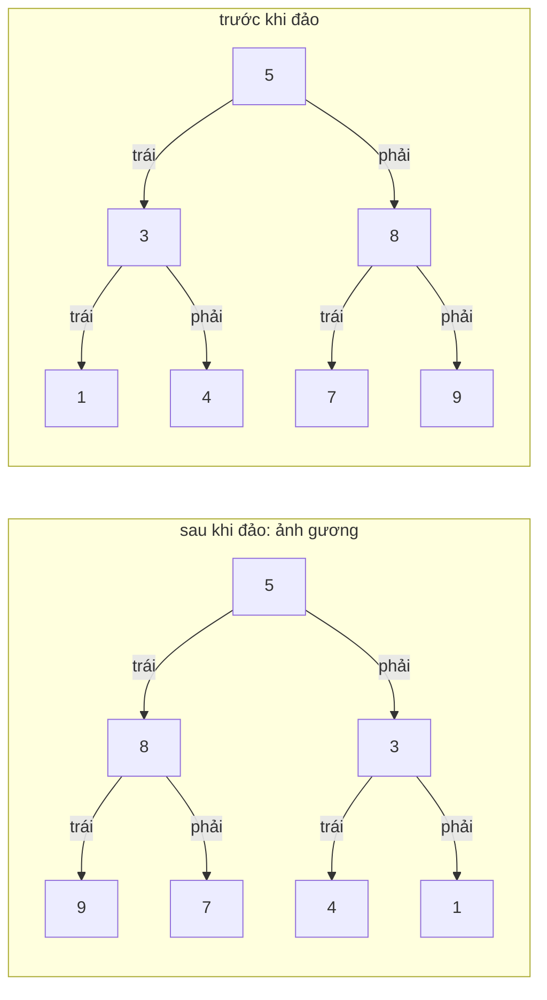
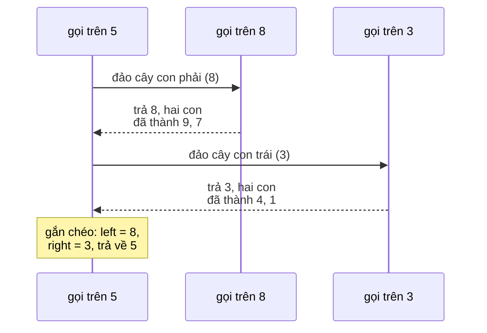

> [!tldr] Đọc nhanh
> - Đề: cho gốc của một [[concepts/binary-tree|cây nhị phân]], biến nó thành ảnh gương của chính nó (ở mọi nút, con trái và con phải đổi chỗ), rồi trả về gốc. Cây có 0 tới 100 nút.
> - Lời giải: ghé **mọi nút đúng một lần** và đổi hai con của nút đó. Ghé theo thứ tự nào cũng được (đệ quy, ngăn xếp, hàng đợi), miễn là mỗi nút được đổi đúng một lần. O(n) thời gian; bộ nhớ thêm O(h) cho đệ quy và ngăn xếp, với h là chiều cao cây.
> - Bẫy lớn nhất là viết phép đổi thành hai câu gán `root.left = f(root.right); root.right = f(root.left)`: câu sau đọc `root.left` đã bị ghi đè, nên cây con trái cũ mất hẳn. Bản sai này đúng 2/8 ca, chỉ ở cây rỗng và cây một nút.
> - Python, Go và JavaScript có gán nhiều giá trị một lúc (vế phải tính xong mới gán), nên viết một dòng là đúng; Java phải dùng biến tạm. JavaScript viết không chấm phẩy thì dòng `[a, b] = [b, a]` bị nối vào dòng trên và ném `ReferenceError`.
> - Ở giới hạn đề (100 nút), mọi cách đều dưới 0,1 ms. Với chuỗi lệch 10⁵ nút, bản đệ quy tràn ngăn xếp ở Node, Python và Java; Go thì không.

> [!info] Bối cảnh
> Bài LeetCode 226 (Easy) của [[posts/2026-11-25-neetcode-tree-recursion|ga 3: Đệ quy trên cây]] trên **tuyến NeetCode: Cấu trúc liên kết**. Đây là bài cây đầu tiên của tuyến: hai ga trước làm việc trên danh sách liên kết, nơi mỗi nút có một mũi tên `next`; ở đây mỗi nút có hai mũi tên `left` và `right`. Bạn chỉ cần biết hàm gọi lại chính nó là gì. Lời giải có đủ TypeScript, Python, Go, Java và JavaScript. Bài cùng ga [[problems/maximum-depth-of-binary-tree|Maximum Depth of Binary Tree]] dùng cùng khung đi khắp cây nhưng **trả về** một con số, còn bài này chỉ **sửa** cây tại chỗ.

> [!abstract]- Từ điển nhanh cho bài này (bấm để mở)
> - **Cây nhị phân (binary tree)**: mỗi nút có một giá trị và tối đa hai con, `left` và `right`; nút trên cùng là gốc, nút không có con là lá. Xem [[concepts/binary-tree|Binary Tree]].
> - **Cây con**: một nút cùng mọi nút bên dưới nó. Cây con trái của gốc là cả nhánh bắt đầu từ `root.left`.
> - **Chiều cao h**: số nút trên đường dài nhất từ gốc xuống lá. Cây cân đối 10⁶ nút cao khoảng 20; cây lệch thành chuỗi thì cao bằng số nút.
> - **Đệ quy**: hàm gọi lại chính nó trên một phần nhỏ hơn của bài, ở đây là trên cây con. Mỗi lời gọi chưa xong giữ một khung trên [[concepts/stack|ngăn xếp]] gọi hàm; quá sâu thì chương trình dừng. Xem [[concepts/recursion-depth-limit|Recursion Depth Limit]].
> - **Mảng theo tầng**: cách LeetCode viết cây, đọc từ trên xuống, trái sang phải, `null` là chỗ trống. `[2, 1, 3]` là gốc 2, con trái 1, con phải 3.
> - **BFS (duyệt theo tầng)**: thăm hết tầng 1, rồi tầng 2, … bằng một hàng đợi vào trước ra trước.

## Hình dung trước: soi sơ đồ tổ chức vào gương

Một công ty treo sơ đồ tổ chức trên tường: giám đốc ở trên, mỗi trưởng phòng có tối đa hai phó phòng đứng dưới, bên trái và bên phải. Đặt một tấm gương bên cạnh: trong gương, ở **mọi** cấp, người bên trái thành bên phải và ngược lại. Không ai đổi cấp, không ai đổi sếp; chỉ có trái và phải đổi chỗ.

Muốn vẽ lại sơ đồ trong gương bằng tay, bạn đi từng ô một, và ở mỗi ô chỉ làm một việc: đổi chỗ hai ô con. Đi từ trên xuống hay từ dưới lên đều được, miễn là không ô nào bị bỏ sót và không ô nào bị đổi hai lần.

| Đời thường | Khái niệm |
|---|---|
| Sơ đồ tổ chức | cây nhị phân |
| Một ô và mọi ô dưới nó | một cây con |
| Đổi chỗ hai ô con của một ô | `left, right = right, left` |
| Đi hết mọi ô, mỗi ô một lần | duyệt cây, O(n) |
| Giao cho mỗi trưởng phòng tự soi nhánh của mình rồi báo lên | đệ quy |
| Danh sách ô còn phải đi, ghi trên tờ giấy | ngăn xếp hoặc hàng đợi tự quản |
| Vẽ ô bên phải xong rồi chép đè lên ô bên trái, quên mất ô trái cũ | bẫy hai câu gán nối tiếp |



Viết theo mảng tầng: `[5, 3, 8, 1, 4, 7, 9]` thành `[5, 8, 3, 9, 7, 4, 1]`. Mỗi tầng đọc ngược lại, đúng như soi gương.

## Vấn đề

Đầu vào là gốc của một cây nhị phân có từ 0 tới 100 nút, mỗi giá trị trong khoảng [−100, 100]. Đầu ra là gốc của cây sau khi đảo, mà ở mọi nút con trái và con phải đã đổi chỗ. Sửa ngay trên cây đã cho là được; không cần tạo cây mới. Đề gốc: [LeetCode 226](https://leetcode.com/problems/invert-binary-tree/).

Lần đầu mình nghĩ phải "lật" cả cây theo một cách phức tạp nào đó, kiểu đổi nút ở tầng 3 bên trái với nút ở tầng 3 bên phải. Hóa ra không cần nhìn xa như vậy: nếu ở **mỗi** nút, hai con đổi chỗ cho nhau, thì cả cây tự thành ảnh gương. Nút 1 (trái của trái) đi sang phải của phải vì nó được đổi hai lần ở hai tầng khác nhau: một lần khi 3 đổi chỗ với 8, một lần khi 1 đổi chỗ với 4.

## Cơ chế

<figure class="figure-map" style="--ar: 3 / 4">
<div class="frame"><iframe data-archify="../diagrams/neetcode-invert-binary-tree/worked-example.html" title="Đổi con trái và con phải tại mỗi nút" loading="lazy"></iframe></div>
<figcaption><span><b>Hình 1.</b> Đổi con trái và con phải tại mỗi nút.</span><a href="../diagrams/neetcode-invert-binary-tree/worked-example.html" target="_blank" rel="noopener">Mở toàn màn hình</a></figcaption>
</figure>

<details>
<summary>Đọc từng bước</summary>
<ol>
<li>Đọc hai con của gốc. <code>8: left = 3; right = 9</code></li>
<li>Đổi vị trí của hai con. <code>8: left = 9; right = 3</code></li>
<li>Tại 3, con trái 1 chuyển sang phải. <code>3: left = null; right = 1</code></li>
<li>Giữ nguyên giá trị từng nút. <code>[8, 9, 3, null, null, null, 1]</code></li>
</ol>
</details>

### Cách 1: đệ quy

Một cây rỗng đảo xong vẫn rỗng. Một cây khác rỗng thì: đảo cây con phải, đảo cây con trái, rồi gắn chéo, cái đã đảo từ bên phải về bên trái và ngược lại.

```ts
// Cách 1: đệ quy. Đảo hai cây con rồi gắn chéo. Gán phá cấu trúc tính cả vế phải trước khi gán,
// nên không cần biến tạm. O(n) thời gian, O(h) ngăn xếp gọi hàm.
function invertRecursive(root: TreeNode | null): TreeNode | null {
  if (root === null) return null;
  [root.left, root.right] = [invertRecursive(root.right), invertRecursive(root.left)];
  return root;
}
```

Đây là khung của cả ga: hàm nhận một cây, tin rằng lời gọi trên cây con đã làm xong việc của cây con, rồi chỉ lo phần việc ở nút hiện tại. Trong bản này hai cây con được đảo trước, nút hiện tại đổi sau, tức là thứ tự [[concepts/post-order-traversal|hậu thứ tự]]. Đổi trước rồi mới đảo hai con (tiền thứ tự) cũng đúng.

Mỗi nút được gọi đúng một lần, mỗi lần làm O(1) việc, nên tổng O(n). Bộ nhớ thêm là độ sâu của chuỗi lời gọi đang dở, tức chiều cao h: khoảng log₂ n với cây cân đối, n với cây lệch thành chuỗi.



### Cách 2: ngăn xếp tự quản

Không dùng ngăn xếp gọi hàm thì tự giữ một [[concepts/stack|ngăn xếp]] các nút còn phải xử lý. Lấy một nút ra, đổi hai con của nó, đẩy hai con (nếu có) vào. Thứ tự thăm không quan trọng, vì việc ở mỗi nút không phụ thuộc kết quả của nút khác.

```ts
// Cách 2: ngăn xếp tự quản. Thứ tự thăm không quan trọng: mỗi nút chỉ cần được đổi hai con đúng một lần.
function invertStack(root: TreeNode | null): TreeNode | null {
  const stack: TreeNode[] = root === null ? [] : [root];
  while (stack.length > 0) {
    const node = stack.pop()!;
    const tmp = node.left;
    node.left = node.right;
    node.right = tmp;
    if (node.left !== null) stack.push(node.left);
    if (node.right !== null) stack.push(node.right);
  }
  return root;
}
```

Ngăn xếp không bao giờ giữ quá khoảng h + 1 nút cùng lúc (mỗi tầng trên đường đang đi để lại tối đa một nút anh em chờ), nên bộ nhớ vẫn O(h), nhưng nằm trên heap của chương trình chứ không trên ngăn xếp gọi hàm, nên không tràn khi cây lệch sâu.

### Cách 3: BFS theo tầng

Thay ngăn xếp bằng hàng đợi thì các nút được thăm theo tầng. Kết quả như nhau.

```ts
// Cách 3: BFS theo tầng bằng hàng đợi (mảng + chỉ số đầu, vì shift() là O(n)).
function invertBfs(root: TreeNode | null): TreeNode | null {
  const queue: TreeNode[] = root === null ? [] : [root];
  for (let head = 0; head < queue.length; head++) {
    const node = queue[head];
    const tmp = node.left;
    node.left = node.right;
    node.right = tmp;
    if (node.left !== null) queue.push(node.left);
    if (node.right !== null) queue.push(node.right);
  }
  return root;
}
```

Hàng đợi phải giữ cả một tầng cùng lúc. Tầng cuối của cây đầy đủ chứa khoảng n/2 nút, nên bộ nhớ thêm là O(n), không phải O(h). Bản mảng + chỉ số đầu ở trên còn giữ lại mọi nút đã đi qua, nên mảng dài đúng n phần tử.

| Cách | Thời gian | Bộ nhớ thêm | Tràn khi cây lệch sâu? |
|---|---|---|---|
| Đệ quy | O(n) | O(h) trên ngăn xếp gọi hàm | có, trừ Go |
| Ngăn xếp tự quản | O(n) | O(h) trên heap | không |
| BFS theo tầng | O(n) | O(n) (cả tầng rộng nhất) | không |

### Ba bản sai

**Hai câu gán nối tiếp.** Cách viết tự nhiên nhất khi chưa quen gán bộ:

```ts
// SAI: hai câu gán nối tiếp. Câu thứ hai đọc root.left lúc đã bị ghi đè, nên đảo lại chính cây con phải:
// hai con cùng trỏ vào cây con phải cũ, cây con trái cũ mất hẳn.
function wrongOverwrite(root: TreeNode | null): TreeNode | null {
  if (root === null) return null;
  root.left = wrongOverwrite(root.right);
  root.right = wrongOverwrite(root.left);
  return root;
}
```

Câu 1 đặt `root.left` thành cây con phải đã đảo. Câu 2 đọc `root.left`, mà lúc này là chính cây con phải đó, đảo nó thêm lần nữa (về lại như cũ) và gắn vào bên phải. Kết quả: hai con cùng trỏ vào **một** cây con, và cây con trái cũ không còn ai giữ. Với `[2, 1, 3]` bản này trả `[2, 3, 3]`; với cây 7 nút trả `[5, 8, 8, 9, 9, 9, 9]`. Nó đúng 2/8 ca: cây rỗng và cây một nút, đúng hai ca mà một bài kiểm tra vội thường thử. Cả năm ngôn ngữ đều cho đúng kết quả sai này (đã chạy).

Cách sửa: tính cả hai vế trước khi gán. Python `root.left, root.right = f(root.right), f(root.left)`, Go `root.Left, root.Right = f(root.Right), f(root.Left)` và JavaScript `[root.left, root.right] = [f(root.right), f(root.left)]` đều tính hết vế phải rồi mới gán. Java không có cách viết đó, nên cất một bên vào biến tạm trước.

**Đổi ở giữa (trung thứ tự).** Ai đã thấy duyệt trung thứ tự (trái, gốc, phải) có thể viết: đảo bên trái, đổi hai con, đảo bên phải. Nhưng sau khi đổi, "bên phải" là cây con trái cũ, vừa được đảo xong; nó bị đảo lần hai và trở về như cũ, còn cây con phải cũ không được đảo lần nào. File TypeScript chạy bản này: 4/8 ca, đúng ở mọi cây chỉ có tối đa hai tầng và sai ở cả bốn cây sâu hơn, ví dụ `[5, 3, 8, 1, 4, 7, 9]` ra `[5, 8, 3, 7, 9, 1, 4]`. Muốn đổi ở giữa thì lần gọi thứ hai phải lại là `root.left`.

**JavaScript không chấm phẩy.** Bản ngăn xếp viết theo phong cách bỏ dấu chấm phẩy:

```js
const node = stack.pop()
[node.left, node.right] = [node.right, node.left]
```

Quy tắc tự chèn dấu chấm phẩy (ASI) của JavaScript chỉ chèn khi dòng sau không thể nối tiếp dòng trên. Dòng bắt đầu bằng `[` thì nối được: máy đọc thành `const node = stack.pop()[node.left, node.right] = [...]`, dùng `node` ngay trong câu khai báo nó, nên ném `ReferenceError: Cannot access 'node' before initialization`. Đúng 1/8 ca, chỉ cây rỗng (vòng lặp không chạy lần nào). Phong cách không chấm phẩy luôn đặt `;` ở đầu những dòng bắt đầu bằng `[` hoặc `(`.

### Bên dưới bảy ngôn ngữ

| | Đổi hai con | Bẫy riêng |
|---|---|---|
| TypeScript / JavaScript | `[a.left, a.right] = [a.right, a.left]` | bỏ chấm phẩy trước dòng `[` → `ReferenceError`; `queue.shift()` là O(n), dùng chỉ số đầu |
| Python | `a.left, a.right = a.right, a.left` | `list.pop(0)` là O(n), dùng `collections.deque`; đệ quy quá 1 000 tầng là `RecursionError` |
| Go | `a.Left, a.Right = a.Right, a.Left` | không có `null`, kiểm `root == nil` trước khi đọc `root.Left` |
| Java | biến tạm | không có gán bộ; `ArrayDeque` không nhận `null` (xem [[problems/maximum-depth-of-binary-tree\|bài 104]]) |
| PHP | `[$a->left, $a->right] = [$a->right, $a->left]` | object truyền theo handle nên đổi tại chỗ là đổi trên cây gốc; máy có Xdebug chặn đệ quy ở 512 tầng (`-d xdebug.mode=off`) |
| Rust | `std::mem::swap(&mut b.left, &mut b.right)` | phải mượn `borrow_mut()` trên `RefCell`; mượn hai lần cùng lúc làm chương trình panic lúc chạy, không phải lúc biên dịch |

### Đo

Đề chỉ có 100 nút, nên ở giới hạn đề cả ba cách đều dưới 0,1 ms. Để thấy chỗ khác nhau, mình đo thêm hai loại cây lớn: cây đầy đủ 2²⁰ − 1 = 1 048 575 nút (cao 20) và chuỗi lệch trái d nút (cao d). Trung vị 5 lần, đơn vị ms:

Cây đầy đủ 10⁶ nút:

| Ngôn ngữ | Đệ quy | Ngăn xếp | BFS |
|---|---|---|---|
| TypeScript | 8,45 | 6,58 | 16,81 |
| Python | 54,24 | 68,53 | 66,32 |
| Go | 3,79 | 2,92 | 27,82 |
| Java | 3,00 | 6,36 | 12,18 |

Chuỗi lệch trái 10⁵ nút:

| Ngôn ngữ | Đệ quy | Ngăn xếp | BFS |
|---|---|---|---|
| TypeScript | `RangeError` | 0,61 | 1,55 |
| Python | `RecursionError` (từ 1 000 nút) | 6,71 | 5,50 |
| Go | 1,32 | 0,34 | 0,75 |
| Java | `StackOverflowError` | 0,61 | 0,56 |

- Trên cây cân đối, cả ba cách cùng O(n) và chênh nhau trong khoảng 2 tới 10 lần. BFS chậm nhất ở TypeScript, Go và Java vì hàng đợi phải phình tới hàng trăm nghìn phần tử (cấp phát lại nhiều lần), trong khi ngăn xếp không bao giờ quá vài chục phần tử.
- Python ngược lại: đệ quy nhanh nhất (54 ms), vì mỗi vòng lặp tự viết bằng Python tốn thêm thao tác `append`/`pop` trên list.
- Trên chuỗi 10⁵ nút, bản đệ quy chết ở mọi ngôn ngữ trừ Go. Python chết ngay từ 1 000 nút. Ngưỡng cụ thể của từng ngôn ngữ được đo trong [[problems/maximum-depth-of-binary-tree|Maximum Depth of Binary Tree]].

## Ví dụ chạy được

[TypeScript](../code/neetcode-invert-binary-tree/invert-tree.ts) · [Python](../code/neetcode-invert-binary-tree/invert_tree.py) · [Go](../code/neetcode-invert-binary-tree/invert_tree.go) · [Java](../code/neetcode-invert-binary-tree/invert-tree.java) · [JavaScript](../code/neetcode-invert-binary-tree/invert-tree.js) · [PHP](../code/neetcode-invert-binary-tree/invert-tree.php) · [Rust](../code/neetcode-invert-binary-tree/invert_tree.rs)

Mỗi file dựng cây từ mảng theo tầng, chạy 8 ca chung (cây rỗng, một nút, chỉ có con trái, ba nút, cây đủ 3 tầng, chuỗi trái, cây lệch hai bên, giá trị âm và 0), rồi đối chiếu 2 000 cây ngẫu nhiên (mulberry32, tới 40 nút) với một "gương" độc lập: viết cây gốc theo thứ tự phải, gốc, trái phải ra đúng chuỗi của cây đã đảo viết theo thứ tự trái, gốc, phải.

Đệ quy:

```ts
// Cách 1: đệ quy. Đảo hai cây con rồi gắn chéo. Gán phá cấu trúc tính cả vế phải trước khi gán,
// nên không cần biến tạm. O(n) thời gian, O(h) ngăn xếp gọi hàm.
function invertRecursive(root: TreeNode | null): TreeNode | null {
  if (root === null) return null;
  [root.left, root.right] = [invertRecursive(root.right), invertRecursive(root.left)];
  return root;
}
```

```python
# Cách 1: đệ quy. Gán bộ: Python tính xong cả vế phải rồi mới gán, nên không cần biến tạm.
def invert_recursive(root):
    if root is None:
        return None
    root.left, root.right = invert_recursive(root.right), invert_recursive(root.left)
    return root
```

```go
// Cách 1: đệ quy. Gán nhiều giá trị: Go tính xong cả vế phải rồi mới gán.
func invertRecursive(root *TreeNode) *TreeNode {
	if root == nil {
		return nil
	}
	root.Left, root.Right = invertRecursive(root.Right), invertRecursive(root.Left)
	return root
}
```

```java
// Cách 1: đệ quy. Java không có gán bộ, nên cất kết quả vào biến tạm trước khi gán.
static TreeNode invertRecursive(TreeNode root) {
    if (root == null) return null;
    TreeNode left = invertRecursive(root.left);
    root.left = invertRecursive(root.right);
    root.right = left;
    return root;
}
```

```js
// Cách 1: đệ quy, gán phá cấu trúc: vế phải được tính xong hết rồi mới gán.
function invertRecursive(root) {
  if (root === null) return null;
  [root.left, root.right] = [invertRecursive(root.right), invertRecursive(root.left)];
  return root;
}
```

```php
// Cách 1: đệ quy. Gán phá cấu trúc: PHP dựng xong mảng vế phải rồi mới gán.
function invertRecursive(?TreeNode $root): ?TreeNode
{
    if ($root === null) return null;
    [$root->left, $root->right] = [invertRecursive($root->right), invertRecursive($root->left)];
    return $root;
}
```

```rust
// Cách 1: đệ quy. take() lấy hai con ra khỏi nút (để lại None), đảo từng con, rồi gắn chéo.
fn invert_recursive(root: Node) -> Node {
    if let Some(n) = &root {
        let mut b = n.borrow_mut();
        let (l, r) = (b.left.take(), b.right.take());
        b.left = invert_recursive(r);
        b.right = invert_recursive(l);
    }
    root
}
```

Ngăn xếp tự quản:

```ts
// Cách 2: ngăn xếp tự quản. Thứ tự thăm không quan trọng: mỗi nút chỉ cần được đổi hai con đúng một lần.
function invertStack(root: TreeNode | null): TreeNode | null {
  const stack: TreeNode[] = root === null ? [] : [root];
  while (stack.length > 0) {
    const node = stack.pop()!;
    const tmp = node.left;
    node.left = node.right;
    node.right = tmp;
    if (node.left !== null) stack.push(node.left);
    if (node.right !== null) stack.push(node.right);
  }
  return root;
}
```

```python
# Cách 2: ngăn xếp tự quản; thứ tự thăm không quan trọng.
def invert_stack(root):
    stack = [root] if root else []
    while stack:
        node = stack.pop()
        node.left, node.right = node.right, node.left
        if node.left:
            stack.append(node.left)
        if node.right:
            stack.append(node.right)
    return root
```

```go
// Cách 2: ngăn xếp tự quản là một slice.
func invertStack(root *TreeNode) *TreeNode {
	if root == nil {
		return nil
	}
	stack := []*TreeNode{root}
	for len(stack) > 0 {
		node := stack[len(stack)-1]
		stack = stack[:len(stack)-1]
		node.Left, node.Right = node.Right, node.Left
		if node.Left != nil {
			stack = append(stack, node.Left)
		}
		if node.Right != nil {
			stack = append(stack, node.Right)
		}
	}
	return root
}
```

```java
// Cách 2: ngăn xếp tự quản (ArrayDeque dùng như ngăn xếp: push/pop ở đầu).
static TreeNode invertStack(TreeNode root) {
    if (root == null) return null;
    Deque<TreeNode> stack = new ArrayDeque<>();
    stack.push(root);
    while (!stack.isEmpty()) {
        TreeNode node = stack.pop();
        TreeNode tmp = node.left;
        node.left = node.right;
        node.right = tmp;
        if (node.left != null) stack.push(node.left);
        if (node.right != null) stack.push(node.right);
    }
    return root;
}
```

```js
// Cách 2: ngăn xếp tự quản.
function invertStack(root) {
  const stack = root === null ? [] : [root];
  while (stack.length > 0) {
    const node = stack.pop();
    [node.left, node.right] = [node.right, node.left];
    if (node.left !== null) stack.push(node.left);
    if (node.right !== null) stack.push(node.right);
  }
  return root;
}
```

```php
// Cách 2: ngăn xếp tự quản; thứ tự thăm không quan trọng.
function invertStack(?TreeNode $root): ?TreeNode
{
    $stack = $root === null ? [] : [$root];
    while ($stack) {
        $node = array_pop($stack);
        [$node->left, $node->right] = [$node->right, $node->left];
        if ($node->left !== null) $stack[] = $node->left;
        if ($node->right !== null) $stack[] = $node->right;
    }
    return $root;
}
```

```rust
// Cách 2: ngăn xếp tự quản; std::mem::swap đổi hai con tại chỗ.
fn invert_stack(root: Node) -> Node {
    let mut stack: Vec<Rc<RefCell<TreeNode>>> = root.iter().cloned().collect();
    while let Some(n) = stack.pop() {
        let mut b = n.borrow_mut();
        let b = &mut *b;
        std::mem::swap(&mut b.left, &mut b.right);
        stack.extend(b.left.iter().cloned());
        stack.extend(b.right.iter().cloned());
    }
    root
}
```

Kết quả `node invert-tree.ts`:

```text
invertRecursive  8/8 ca đúng
invertStack      8/8 ca đúng
invertBfs        8/8 ca đúng
wrongOverwrite   2/8 ca đúng; sai ở chỉ có con trái → [1], ba nút → [2,3,3], cây đủ 3 tầng → [5,8,8,9,9,9,9], chuỗi trái thành chuỗi phải → [1], lệch hai bên → [1,3,3,5,5,5,5], giá trị âm và 0 → [0]
wrongInOrder     4/8 ca đúng; sai ở cây đủ 3 tầng → [5,8,3,7,9,1,4], chuỗi trái thành chuỗi phải → [1,null,2,3], lệch hai bên → [1,3,2,null,5,null,4], giá trị âm và 0 → [0,null,-1,-2,-3]

ngẫu nhiên: invertRecursive 2000/2000, invertStack 2000/2000, invertBfs 2000/2000

Cây đầy đủ 1048575 nút, trung vị 5 lần (ms)
invertRecursive      8.45
invertStack          6.58
invertBfs           16.81

Chuỗi lệch trái d nút, trung vị 5 lần (ms)
d          đệ quy   ngăn xếp        BFS
1000           0.01       0.00       0.00
10000          0.13       0.03       0.05
100000   RangeError       0.61       1.55
```

`python3 invert_tree.py`:

```text
invert_recursive  8/8 ca đúng
invert_stack      8/8 ca đúng
invert_bfs        8/8 ca đúng
wrong_overwrite   2/8 ca đúng; sai ở chỉ có con trái → [1], ba nút → [2, 3, 3], cây đủ 3 tầng → [5, 8, 8, 9, 9, 9, 9], chuỗi trái thành chuỗi phải → [1], lệch hai bên → [1, 3, 3, 5, 5, 5, 5], giá trị âm và 0 → [0]

ngẫu nhiên: invert_recursive 2000/2000, invert_stack 2000/2000, invert_bfs 2000/2000

Cây đầy đủ 1048575 nút, trung vị 5 lần (ms)
invert_recursive     54.24
invert_stack         68.53
invert_bfs           66.32

Chuỗi lệch trái d nút, trung vị 5 lần (ms)
d                đệ quy   ngăn xếp        BFS
500                0.05           0.03           0.03
1000     RecursionError           0.08           0.06
100000   RecursionError           6.71           5.50
```

`go run invert_tree.go`:

```text
invertRecursive  8/8 ca đúng
invertStack      8/8 ca đúng
invertBfs        8/8 ca đúng
wrongOverwrite   2/8 ca đúng; sai ở chỉ có con trái → [1], ba nút → [2,3,3], cây đủ 3 tầng → [5,8,8,9,9,9,9], chuỗi trái thành chuỗi phải → [1], lệch hai bên → [1,3,3,5,5,5,5], giá trị âm và 0 → [0]

ngẫu nhiên: invertRecursive 2000/2000, invertStack 2000/2000, invertBfs 2000/2000

Cây đầy đủ 1048575 nút, trung vị 5 lần (ms)
invertRecursive      3.79
invertStack          2.92
invertBfs           27.82

Chuỗi lệch trái d nút, trung vị 5 lần (ms)
d            đệ quy   ngăn xếp        BFS
1000             0.01       0.00       0.01
100000           1.32       0.34       0.75
1000000         13.86       3.03      35.49
```

`java invert-tree.java`:

```text
invertRecursive  8/8 ca đúng
invertStack      8/8 ca đúng
invertBfs        8/8 ca đúng
wrongOverwrite   2/8 ca đúng; sai ở chỉ có con trái → [1], ba nút → [2,3,3], cây đủ 3 tầng → [5,8,8,9,9,9,9], chuỗi trái thành chuỗi phải → [1], lệch hai bên → [1,3,3,5,5,5,5], giá trị âm và 0 → [0]

ngẫu nhiên: invertRecursive 2000/2000, invertStack 2000/2000, invertBfs 2000/2000

Cây đầy đủ 1048575 nút, trung vị 5 lần (ms)
invertRecursive      3.00
invertStack          6.36
invertBfs           12.18

Chuỗi lệch trái d nút, trung vị 5 lần (ms)
d                đệ quy   ngăn xếp        BFS
1000                 0.01           0.00           0.01
10000                0.10           0.05           0.05
100000      StackOverflow           0.61           0.56
```

`node invert-tree.js`:

```text
invertRecursive  8/8 ca đúng
invertStack      8/8 ca đúng
invertBfs        8/8 ca đúng
wrongNoSemicolon 1/8 ca đúng; sai ở một nút → ném ReferenceError, chỉ có con trái → ném ReferenceError, ba nút → ném ReferenceError, cây đủ 3 tầng → ném ReferenceError, chuỗi trái thành chuỗi phải → ném ReferenceError, lệch hai bên → ném ReferenceError, giá trị âm và 0 → ném ReferenceError

wrongNoSemicolon([1]): ReferenceError: Cannot access 'node' before initialization
```

`php -d xdebug.mode=off invert-tree.php`:

```text
invertRecursive  8/8 ca đúng
invertStack      8/8 ca đúng
invertBfs        8/8 ca đúng
wrongOverwrite   2/8 ca đúng; sai ở chỉ có con trái → [1], ba nút → [2,3,3], cây đủ 3 tầng → [5,8,8,9,9,9,9], chuỗi trái thành chuỗi phải → [1], lệch hai bên → [1,3,3,5,5,5,5], giá trị âm và 0 → [0]

ngẫu nhiên: invertRecursive 2000/2000, invertStack 2000/2000, invertBfs 2000/2000
```

`rustc --edition 2021 -O invert_tree.rs && ./invert_tree`:

```text
invert_recursive 8/8 ca đúng
invert_stack     8/8 ca đúng
invert_bfs       8/8 ca đúng
wrong_overwrite  2/8 ca đúng; sai ở chỉ có con trái → [1], ba nút → [2,3,3], cây đủ 3 tầng → [5,8,8,9,9,9,9], chuỗi trái thành chuỗi phải → [1], lệch hai bên → [1,3,3,5,5,5,5], giá trị âm và 0 → [0]

ngẫu nhiên: invert_recursive 2000/2000, invert_stack 2000/2000, invert_bfs 2000/2000
```

PHP và Rust không đo thời gian; hai file chỉ kiểm đúng sai và đối chiếu ngẫu nhiên (bộ sinh số riêng của từng ngôn ngữ, nên cây ngẫu nhiên khác với bốn file kia).

## Hiểu lầm và bẫy hay gặp

- **"Phải đổi nút trái xa nhất với nút phải xa nhất."** Không cần nhìn xa: đổi hai con ở mọi nút là đủ, vị trí xa tự đúng vì nút đó được đổi ở mỗi tầng nó đi qua.
- **Hai câu gán nối tiếp.** Câu sau đọc giá trị câu trước vừa ghi đè; cây con trái cũ mất, hai con trỏ vào cùng một cây con. Dùng gán bộ hoặc biến tạm.
- **Đổi ở giữa theo trung thứ tự.** Sau khi đổi, bên phải là cây con vừa đảo xong; gọi tiếp trên `root.right` đảo nó lần hai. Đổi trước (tiền thứ tự) hoặc sau (hậu thứ tự) thì đúng.
- **"Phải tạo cây mới."** Đề cho sửa tại chỗ và trả lại chính gốc đó. Tạo cây mới cũng đúng nhưng tốn n nút.
- **Bỏ chấm phẩy trong JavaScript.** Dòng bắt đầu bằng `[` bị nối vào dòng trên.
- **"Đệ quy trên cây luôn an toàn vì cây chỉ sâu log n."** Chỉ đúng với cây cân đối. Đề không hứa cây cân đối; một chuỗi lệch sâu bằng số nút.
- **PHP: tưởng `$node` là bản sao.** Object trong PHP đi theo handle: `$node = array_pop($stack)` vẫn trỏ vào nút thật, nên đổi con trên `$node` là đổi trên cây. Chỉ mảng mới được chép khi gán (copy-on-write).
- **Rust: giữ một `borrow()` rồi gọi `borrow_mut()` trên cùng nút.** Trình biên dịch không bắt được; `RefCell` panic `already borrowed` lúc chạy. Lấy hai con ra bằng `take()` (hoặc `mem::swap`) trong một lần mượn `borrow_mut()` duy nhất.

## Câu hỏi tự kiểm tra

> [!question]- Vì sao đổi hai con ở mọi nút lại cho đúng ảnh gương của cả cây?
> Ảnh gương của một cây là: gốc giữ nguyên, bên trái là ảnh gương của cây con phải, bên phải là ảnh gương của cây con trái. Đổi hai con ở gốc lo phần "bên trái là cây con phải"; làm cùng việc đó ở mọi nút bên dưới lo phần "ảnh gương của" cây con. Đó chính là định nghĩa đệ quy, và mỗi nút được xử lý đúng một lần.

> [!question]- Với `root.left = f(root.right); root.right = f(root.left)`, cây `[2, 1, 3]` thành gì, và nút 1 đi đâu?
> Câu 1 đặt bên trái là nút 3. Câu 2 đọc bên trái (giờ là 3), đảo nó (một nút thì vẫn là 3) và đặt vào bên phải. Kết quả `[2, 3, 3]`, hai con cùng là một nút 3; nút 1 không còn biến nào giữ nên bị thu gom.

> [!question]- Bản ngăn xếp và bản BFS thăm nút theo thứ tự khác nhau. Vì sao kết quả vẫn như nhau?
> Việc ở mỗi nút (đổi hai con của nó) không phụ thuộc việc ở nút khác: đổi ở nút cha chỉ đổi chỗ hai cây con, không đổi nội dung bên trong. Nên chỉ cần mỗi nút được đổi đúng một lần, theo thứ tự nào cũng được.

> [!question]- Với cây đầy đủ 10⁶ nút, ngăn xếp tự quản giữ tối đa khoảng bao nhiêu nút cùng lúc, còn hàng đợi BFS thì sao?
> Ngăn xếp: khoảng chiều cao cộng một vài nút, tức vài chục, vì mỗi tầng trên đường đang đi để lại tối đa một nút anh em. Hàng đợi: cả tầng cuối, khoảng 5 · 10⁵ nút. Đó là lý do BFS chậm hơn ở TypeScript, Go và Java trong phần đo.

> [!question]- Trong Python, nếu viết `node.left, node.right = node.right, node.left` thì có bị lỗi ghi đè như hai câu gán không?
> Không. Python tính xong cả bộ ở vế phải (`(node.right, node.left)`) rồi mới gán lần lượt từ trái sang phải, nên giá trị cũ đã được giữ trước khi bị ghi đè.

## Tham khảo

- [LeetCode 226: Invert Binary Tree](https://leetcode.com/problems/invert-binary-tree/) (đề gốc: 0 tới 100 nút, giá trị trong [−100, 100])
- [Python: câu lệnh gán](https://docs.python.org/3/reference/simple_stmts.html#assignment-statements) (vế phải được tính trước, rồi gán từng đích từ trái sang phải)
- [Go: câu lệnh gán](https://go.dev/ref/spec#Assignment_statements) (gán nhiều giá trị tiến hành theo hai pha: tính toán hạng, rồi gán)
- [ECMAScript: quy tắc tự chèn dấu chấm phẩy](https://tc39.es/ecma262/#sec-rules-of-automatic-semicolon-insertion)
- [Java `ArrayDeque`](https://docs.oracle.com/en/java/javase/21/docs/api/java.base/java/util/ArrayDeque.html) ("Null elements are prohibited")
- Bài cùng ga: [[problems/maximum-depth-of-binary-tree|Maximum Depth of Binary Tree]] (đo ngưỡng đệ quy của từng ngôn ngữ), và [[problems/reverse-linked-list|Reverse Linked List]] (cùng câu chuyện tràn ngăn xếp trên danh sách)
