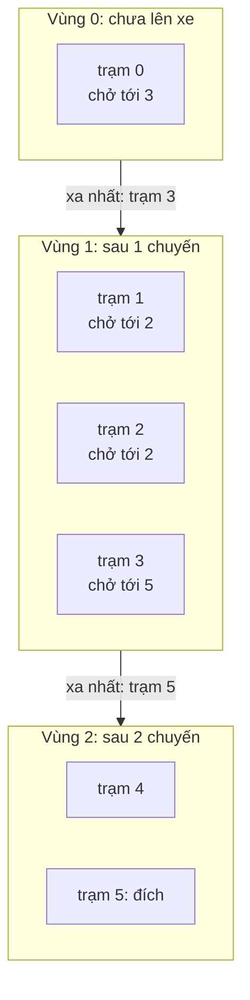
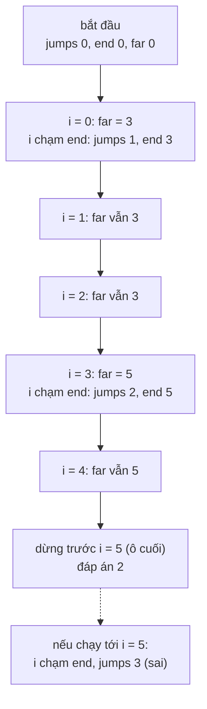

> [!tldr] Đọc nhanh
> - Mọi chỉ số tới được sau tối đa k bước luôn là một đoạn liền `[0, r]`, vì đứng ở ô nào tới được thì cũng tới được mọi ô ở giữa. Vậy các tầng BFS trên mảng này là những cửa sổ nối tiếp nhau: đó là [[concepts/jump-layers|lớp nhảy]].
> - Quét i từ trái sang, giữ `end` là mép phải của lớp hiện tại và `far` là [[concepts/farthest-reach|tầm xa nhất]] mà các ô đã quét với tới. Khi i chạm `end`, lớp hiện tại đã xong: cộng một bước và đặt `end = far`. O(n) thời gian, O(1) bộ nhớ.
> - Vòng lặp dừng ở n − 2. Chạy tới cả ô cuối thì đếm thừa một bước mỗi khi ô cuối trùng đúng mép một lớp: sai 1.584 trên 3.056 mảng nhỏ, và `[0]` ra 1 thay vì 0.
> - Tham lam "từ chỗ đứng nhảy xa nhất" là sai: `[2, 4, 1, 1, 1, 1]` ra 4 bước thay vì 2. Cái cần tham là chọn ô *trong lớp* mở ra xa nhất, không phải bước dài nhất.
> - Trên n = 10.000, mọi ô bằng 1.000: DP làm 9.499.500 lượt cập nhật, lớp nhảy chạy 9.999 vòng.

> [!info] Bối cảnh
> Đây là bài LeetCode 45 tại [[posts/2026-11-28-neetcode-greedy-array|ga MISC-03: Tham lam trên mảng]] trên **tuyến NeetCode: Kỹ thuật tổng hợp**. Bài anh em [[problems/jump-game|Jump Game]] chỉ hỏi có tới được ô cuối không; bài này hỏi tới được bằng ít bước nhất là bao nhiêu. Bạn chỉ cần biết mảng và vòng lặp; biết sơ về [[concepts/breadth-first-search|duyệt theo chiều rộng]] thì càng dễ thấy vì sao cách giải đúng.

> [!abstract]- Từ điển nhanh cho bài này (bấm để mở)
> - Bước nhảy: đứng ở ô i, mình được nhảy tới bất kỳ ô nào từ i + 1 đến i + `nums[i]`. Một lần nhảy là một bước, dù dài hay ngắn.
> - [[concepts/greedy-choice|Lựa chọn tham lam]]: mỗi lúc chọn cái trông tốt nhất ngay lúc đó và không bao giờ quay lại xét lại. Tham lam chỉ đúng khi chứng minh được lựa chọn đó không làm mất đáp án tốt nhất.
> - DP (quy hoạch động): ghi đáp án cho từng bài con, ở đây là "số bước ít nhất để tới ô j", rồi dựng đáp án lớn từ các ô đó.
> - BFS (duyệt theo chiều rộng): thăm mọi đỉnh cách điểm xuất phát 1 bước, rồi mọi đỉnh cách 2 bước, và cứ thế. Đỉnh được thăm ở tầng k thì đường ngắn nhất tới nó dài đúng k.
> - Cửa sổ `[l, r]`: một đoạn chỉ số liền nhau, từ l đến r.

## Hình dung trước: đi nhờ xe dọc quốc lộ

Dọc một quốc lộ có các trạm đánh số 0, 1, 2… Ở mỗi trạm có một tài xế chở được tối đa vài trạm, và dừng ở trạm nào trong tầm đó cũng được. Mình đứng ở trạm 0, muốn tới trạm cuối với ít lần lên xe nhất. Cách khôn là không vội lên chiếc chở xa nhất ngay trước mặt. Mình xét cả **vùng** những trạm đã tới được bằng cùng số chuyến, hỏi từng tài xế trong vùng chở xa nhất tới đâu. Chỗ xa nhất ấy là mép của vùng kế tiếp, tới được bằng thêm đúng một chuyến.

| Đời thường | Khái niệm |
|---|---|
| Trạm thứ i dọc quốc lộ | Chỉ số i |
| Tài xế ở trạm i chở tối đa `nums[i]` trạm | Bước nhảy dài tối đa `nums[i]` |
| Một lần lên xe | Một bước nhảy |
| Vùng các trạm tới được sau đúng k chuyến | Lớp k, cửa sổ `[l, r]` |
| Hỏi mọi tài xế trong vùng ai chở xa nhất | `far = max(far, i + nums[i])` |
| Đã hỏi hết vùng mà đích còn ở phía trước | `i == end`: `jumps++`, `end = far` |
| Đã đứng ở trạm cuối thì không lên xe nữa | Vòng lặp dừng trước ô n − 1 |

Với sáu trạm `[3, 1, 0, 2, 0, 1]`, các vùng như sau:



Trạm 2 có tài xế không chở được ai (`nums[2] = 0`), nhưng không sao: vùng 1 vẫn có trạm 3 mở ra tới trạm 5. Đáp án là 2 chuyến.

## Vấn đề: ít bước nhảy nhất tới ô cuối

Cho mảng `nums` dài từ 1 đến 10.000, mỗi `nums[i]` từ 0 đến 1.000. Đứng ở ô i thì được nhảy tới bất kỳ ô nào trong khoảng i + 1 đến i + `nums[i]`. Bắt đầu ở ô 0, trả về số bước ít nhất để tới ô n − 1. Đề bảo đảm luôn tới được. Ví dụ `[1, 1, 1, 1]` cần 3 bước, còn `[4, 0, 0, 0, 0]` chỉ cần 1. [Đề gốc LeetCode 45](https://leetcode.com/problems/jump-game-ii/)

Lần đầu mình viết tham lam theo kiểu dễ nghĩ nhất: đứng đâu thì nhảy xa nhất có thể từ đó. Với `[2, 4, 1, 1, 1, 1]`, mình nhảy từ ô 0 sang ô 2, rồi lết từng ô một: 4 bước. Đường đúng là nhảy ngắn sang ô 1 (giá trị 4) rồi một phát tới ô 5: 2 bước. Bước dài nhất lúc này không phải bước mở ra xa nhất cho lần sau.

## Cơ chế

### Một sự thật nhỏ: chỗ tới được luôn là một đoạn liền

Nếu tới được ô i thì tới được mọi ô từ i + 1 đến i + `nums[i]`. Vậy tập các ô tới được sau tối đa k bước không bao giờ có lỗ: nó luôn là `[0, r_k]`. Đây là chỗ bài này khác một đồ thị bất kỳ, và cả ba cách dưới đây đều dựa vào nó, nhất là cách thứ ba. Cũng vì vậy mà khi đề bảo đảm tới được ô cuối, mọi ô trên đường đều tới được.

### DP O(n²): số bước ít nhất tới từng ô

Đặt `best[j]` là số bước ít nhất để tới ô j, với `best[0] = 0` và mọi ô khác là vô cực. Duyệt i từ trái sang. Khi tới ô i, mọi ô có thể nhảy tới i đều nằm bên trái nên `best[i]` đã chốt. Ô i đẩy `best[i] + 1` sang mọi ô nó với tới: `best[i + k] = min(best[i + k], best[i] + 1)`.

Mỗi ô có tới `nums[i]` lượt cập nhật, nên thời gian là O(n · max(nums)), xấu nhất O(n²) nếu không có giới hạn 1.000. Bộ nhớ O(n). Với n = 10.000 và mọi ô bằng 1.000, đó là 9.499.500 lượt cập nhật.

### BFS tường minh trên các chỉ số

Coi mỗi chỉ số là một đỉnh, có cạnh từ i tới i + 1, …, i + `nums[i]`. Mọi cạnh dài như nhau (một bước), nên BFS từ đỉnh 0 cho đúng số bước ít nhất: tầng của ô n − 1 chính là đáp án. Cần hàng đợi và mảng `dist`. Số cạnh vẫn là tổng các `nums[i]`, nên cũng 9.499.500 cạnh trên phép đo trên; nhưng mỗi ô chỉ vào hàng đợi một lần.

### Lớp nhảy: BFS không cần hàng đợi, O(n) và O(1)

Vì mỗi tầng BFS là một đoạn liền, mình không cần hàng đợi để biết tầng nào chứa ô nào. Tầng 0 là `[0, 0]`. Nếu tầng k kết thúc ở `end`, tầng k + 1 kết thúc ở `far`, là max của `i + nums[i]` trên mọi i ≤ `end`. Ba biến đủ dùng:

- `end`: mép phải của lớp hiện tại;
- `far`: chỗ xa nhất mà các ô đã quét với tới;
- `jumps`: số lớp đã đóng lại.

Quét i từ 0. Mỗi ô cập nhật `far`. Khi `i == end`, mình đã quét xong cả lớp hiện tại, nên `far` lúc này đúng là mép của lớp sau. Đếm thêm một bước và đặt `end = far`. Như vậy `jumps` tăng đúng một lần mỗi khi BFS bước sang tầng mới, tức `jumps` là số tầng của BFS. Đây là [[concepts/greedy-choice|lựa chọn tham lam]] đúng: mình không chọn ô để nhảy tới trước, chỉ ghi nhận "lớp sau xa tới đâu"; ô cụ thể nào cho tầm xa đó không cần biết.

**Vì sao dừng ở n − 2.** `jumps++` ở `i == end` nghĩa là "đích còn nằm ngoài lớp này, cần thêm một bước". Nếu i đã là n − 1 thì mình đã đứng ở đích, không cần bước nào nữa. Vòng lặp chạy tới n − 2 bảo đảm mỗi lần `i == end` xảy ra thì `end < n − 1`, tức đích thật sự còn ở phía trước. Cho chạy tới n − 1 thì mỗi khi ô cuối trùng đúng mép một lớp, vòng lặp đếm thêm một bước thừa. Với `[0]`, i = 0 là ô cuối và cũng là `end`, nên ra 1 thay vì 0. Một cách sửa khác là thoát vòng lặp ngay khi `end ≥ n − 1`.

Lần theo `[3, 1, 0, 2, 0, 1]`:



| Cách | Thời gian | Bộ nhớ phụ | Ghi chú |
|---|---|---|---|
| Thử mọi đường nhảy (đệ quy) | Mũ | O(n) | Trọng tài trong file chạy, chỉ dùng cho mảng ngắn |
| DP số bước tới từng ô | O(n · max(nums)), xấu nhất O(n²) | O(n) | 9.499.500 lượt trên phép đo |
| BFS tường minh | O(n · max(nums)) | O(n) | Hàng đợi và `dist` |
| Lớp nhảy | O(n) | O(1) | 9.999 vòng trên phép đo |
| Nhảy xa nhất từ chỗ đứng | O(n) | O(1) | Sai: 548/3.056 mảng nhỏ |

## Ví dụ chạy được

[TypeScript](../code/neetcode-jump-game-ii/layers.ts) · [Python](../code/neetcode-jump-game-ii/layers.py) · [Go](../code/neetcode-jump-game-ii/layers.go) · [Java](../code/neetcode-jump-game-ii/layers.java) · [JavaScript](../code/neetcode-jump-game-ii/layers.js) · [PHP](../code/neetcode-jump-game-ii/layers.php) · [Rust](../code/neetcode-jump-game-ii/layers.rs)

```ts
// Cách chính: lớp nhảy. [.., end] là lớp hiện tại, far là chỗ xa nhất lớp sau với tới
function jump(nums: number[], counter: Counter = { ops: 0 }): number {
    let jumps = 0
    let end = 0
    let far = 0
    for (let i = 0; i < nums.length - 1; i++) { // dừng trước ô cuối
        counter.ops++
        far = Math.max(far, i + nums[i])
        if (i === end) { // đi hết lớp hiện tại: phải nhảy thêm một bước
            jumps++
            end = far
        }
    }
    return jumps
}
```

```python
# Cách chính: lớp nhảy. [.., end] là lớp hiện tại, far là chỗ xa nhất lớp sau với tới
def jump(nums, counter=None):
    jumps = end = far = 0
    for i in range(len(nums) - 1):  # dừng trước ô cuối
        if counter is not None:
            counter["ops"] += 1
        far = max(far, i + nums[i])
        if i == end:  # đi hết lớp hiện tại: phải nhảy thêm một bước
            jumps += 1
            end = far
    return jumps
```

```go
// Cách chính: lớp nhảy. [.., end] là lớp hiện tại, far là chỗ xa nhất lớp sau với tới
func jump(nums []int, ops *int) int {
	jumps, end, far := 0, 0, 0
	for i := 0; i < len(nums)-1; i++ { // dừng trước ô cuối
		*ops++
		far = max(far, i+nums[i])
		if i == end { // đi hết lớp hiện tại: phải nhảy thêm một bước
			jumps++
			end = far
		}
	}
	return jumps
}
```

```java
// Cách chính: lớp nhảy. [.., end] là lớp hiện tại, far là chỗ xa nhất lớp sau với tới
static int jump(int[] nums) {
    int jumps = 0, end = 0, far = 0;
    for (int i = 0; i < nums.length - 1; i++) { // dừng trước ô cuối
        ops++;
        far = Math.max(far, i + nums[i]);
        if (i == end) { // đi hết lớp hiện tại: phải nhảy thêm một bước
            jumps++;
            end = far;
        }
    }
    return jumps;
}
```

```js
// Cách chính: lớp nhảy. [.., end] là lớp hiện tại, far là chỗ xa nhất lớp sau với tới
function jump(nums, counter = { ops: 0 }) {
    let jumps = 0
    let end = 0
    let far = 0
    for (let i = 0; i < nums.length - 1; i++) { // dừng trước ô cuối
        counter.ops++
        far = Math.max(far, i + nums[i])
        if (i === end) { // đi hết lớp hiện tại: phải nhảy thêm một bước
            jumps++
            end = far
        }
    }
    return jumps
}
```

```php
// Cách chính: lớp nhảy. [.., end] là lớp hiện tại, far là chỗ xa nhất lớp sau với tới
function jump(array $nums, int &$ops = 0): int {
    $jumps = 0;
    $end = 0;
    $far = 0;
    for ($i = 0; $i < count($nums) - 1; $i++) { // dừng trước ô cuối
        $ops++;
        $far = max($far, $i + $nums[$i]);
        if ($i === $end) { // đi hết lớp hiện tại: phải nhảy thêm một bước
            $jumps++;
            $end = $far;
        }
    }
    return $jumps;
}
```

```rust
// Cách chính: lớp nhảy. [.., end] là lớp hiện tại, far là chỗ xa nhất lớp sau với tới
fn jump(nums: &[i32], ops: &mut usize) -> usize {
    let (mut jumps, mut end, mut far) = (0, 0, 0);
    for i in 0..nums.len() - 1 { // dừng trước ô cuối
        *ops += 1;
        far = far.max(i + nums[i] as usize);
        if i == end { // đi hết lớp hiện tại: phải nhảy thêm một bước
            jumps += 1;
            end = far;
        }
    }
    jumps
}
```

Các tab trích cách lớp nhảy; dòng tăng `ops` chỉ để đếm cho phép đo. File tải về còn có DP, BFS tường minh, hai bản sai (chạy tới ô cuối, nhảy xa nhất từ chỗ đứng) và trọng tài thử mọi đường nhảy. Tám ca tự soạn gồm mảng một phần tử (cả `[0]`), ô 0 giữa đường và một bước nhảy dài cuối mảng. Mỗi ca, DP, BFS, lớp nhảy và trọng tài phải cùng ra đáp án mong đợi.

Dòng thứ hai đối chiếu ba cách đúng với trọng tài trên mọi mảng dài 1–6, giá trị 0–3, mà ô cuối tới được: 3.056 mảng. Dòng ba và bốn đếm số mảng hai bản sai trả lời sai. Dòng cuối là phép đo trên n = 10.000, mọi ô bằng 1.000 (giới hạn lớn nhất của đề), đếm số thao tác trong vòng lặp trong.

```text
8/8 ca đúng
3056/3056 ca đúng (đối chiếu vét mọi đường nhảy)
Cho vòng lặp chạy tới ô cuối: sai 1584/3056 ca, [0] cho 1 thay vì 0
Luôn nhảy xa nhất từ chỗ đang đứng: sai 548/3056 ca, [2,4,1,1,1,1] cho 4 thay vì 2
n = 10000, mọi ô 1000: 10/10/10 bước; DP 9499500 lượt cập nhật, BFS 9499500 cạnh, lớp nhảy 9999 vòng
```

Cả bảy ngôn ngữ in đúng năm dòng này. Mình cũng bấm giờ riêng trên cùng mảng lớn đó (trung bình 5 lần, sau một lần chạy làm nóng): Node 24 mất khoảng 20 ms cho DP, 16 ms cho BFS và 0,1 ms cho lớp nhảy; Python 3.12 mất khoảng 715 ms cho DP, 154 ms cho BFS và 0,8 ms cho lớp nhảy. Tỉ lệ khoảng 200 đến 900 lần, khớp với 9,5 triệu so với 10 nghìn thao tác.

## Hiểu lầm và bẫy hay gặp

- Tham lam theo bước dài nhất từ chỗ đứng. Như dòng thứ tư ở trên, nó sai 548 trên 3.056 mảng, và có khi còn kẹt ở một ô 0 dù đích tới được: `[2, 3, 0, 0]` nhảy thẳng vào ô 2 rồi đứng im, trong khi 0 → 1 → 3 chỉ mất 2 bước. Cái cần tham là tầm xa của cả lớp, không phải độ dài của một bước.
- Cho vòng lặp chạy tới ô cuối. Mỗi khi ô cuối trùng mép một lớp, kết quả thừa một bước. Mảng một phần tử là ca dễ quên nhất.
- Đếm bước ở chỗ `far` tăng thay vì ở chỗ `i == end`. `far` có thể tăng nhiều lần trong cùng một lớp, nhưng cả lớp đó chỉ tốn một bước.
- Nghĩ rằng phải biết mình nhảy tới ô nào. Lớp nhảy chỉ đếm số lớp; nếu đề hỏi cả đường đi thì ghi thêm ô cho `far` lớn nhất ở mỗi lớp.
- Java, Go: khởi tạo DP bằng `Integer.MAX_VALUE` hay `math.MaxInt` rồi tính `best[i] + 1` sẽ tràn số thành số âm, và `min` chọn ngay số âm đó. Với bài này mọi ô đều tới được nên điều đó không xảy ra, nhưng đem DP sang bài có ô không tới được là dính. File Java dùng n làm "vô cực"; Go dùng `math.MaxInt32` trên `int` 64 bit.
- PHP: `PHP_INT_MAX + 1` không tràn mà thành số thực `9.2233720368548E+18`, rồi phép so `===` với số nguyên luôn sai. File PHP bỏ qua ô chưa tới được trước khi cộng.
- Rust: `usize::MAX + 1` làm chương trình dừng (panic) khi build debug và lặng lẽ quay về 0 khi build `-O`. File Rust kiểm tra `UNREACHABLE` trước khi cộng. `nums.len() - 1` cũng là phép trừ trên `usize`; nó an toàn ở đây chỉ vì đề bảo đảm n ≥ 1.
- JavaScript, TypeScript: BFS dùng `queue.shift()` thì mỗi lần lấy ra tốn O(độ dài hàng đợi), vì mọi phần tử phải dời lên. File dùng chỉ số `head` chạy dọc mảng thay vì `shift`.
- Python: DP 9,5 triệu lượt `min` mất gần một giây, dễ vượt giới hạn thời gian trên LeetCode. BFS nhanh hơn (khoảng 154 ms) vì không gọi `min`, còn lớp nhảy dưới 1 ms.

## Câu hỏi tự kiểm tra

> [!question]- Vì sao các ô tới được sau tối đa k bước luôn là một đoạn liền?
> Vì tới được ô i thì tới được mọi ô từ i + 1 đến i + `nums[i]`, không có ô nào ở giữa bị bỏ qua. Bắt đầu từ `[0, 0]`, mỗi bước chỉ nối dài đoạn về bên phải.

> [!question]- Với `[1, 3, 0, 0, 5, 0, 0, 1]`, các lớp là gì và đáp án bao nhiêu?
> Lớp 0 là `[0]`, lớp 1 là `[1]`, lớp 2 là `[2, 4]` (ô 1 với tới ô 4), lớp 3 là `[5, 7]` (ô 4 với tới ô 9, cắt ở ô 7). Ô 7 nằm ở lớp 3, nên đáp án là 3.

> [!question]- Nếu viết vòng lặp tới n − 1 thì phải thêm điều kiện gì để vẫn đúng?
> Thoát vòng lặp ngay khi `end ≥ n − 1`, trước khi xét `i == end` của lượt kế tiếp. Khi đó không còn lượt nào đếm bước thừa.

> [!question]- Nếu đề không bảo đảm tới được ô cuối thì lớp nhảy cần đổi gì?
> Khi `i == end` mà `far` vẫn bằng `end`, lớp sau rỗng: không đi tiếp được, trả về −1. Đó cũng chính là câu hỏi của [[problems/jump-game|Jump Game]].

## Tham khảo

- [LeetCode 45](https://leetcode.com/problems/jump-game-ii/)
- [Jeff Erickson, Algorithms, chương 8: đường đi ngắn nhất, có BFS](https://jeffe.cs.illinois.edu/teaching/algorithms/book/08-sssp.pdf) · [chương 4: thuật toán tham lam](https://jeffe.cs.illinois.edu/teaching/algorithms/book/04-greedy.pdf)
- [Java, phép cộng số nguyên tràn](https://docs.oracle.com/javase/specs/jls/se21/html/jls-15.html#jls-15.18.2) · [Go, tràn số nguyên](https://go.dev/ref/spec#Integer_overflow) · [PHP, tràn số nguyên](https://www.php.net/manual/en/language.types.integer.php#language.types.integer.overflow) · [MDN, Array.prototype.shift](https://developer.mozilla.org/en-US/docs/Web/JavaScript/Reference/Global_Objects/Array/shift)
