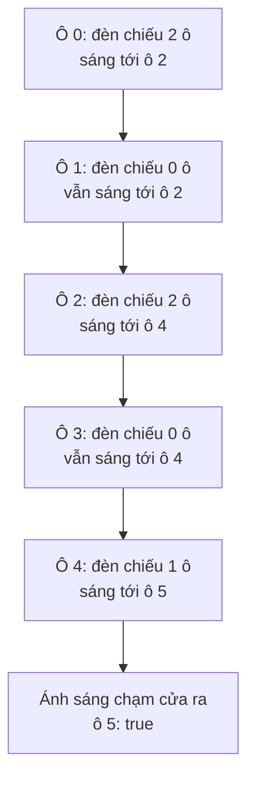
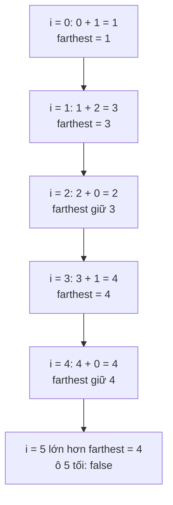

> [!tldr] Đọc nhanh
> - Mình từng nghĩ phải thử từng đường nhảy, hóa ra chỉ cần một con số: [[concepts/farthest-reach|chỉ số xa nhất tới được]] (`farthest`). Các ô tới được luôn là một khúc liền từ 0 tới `farthest`, không bao giờ có lỗ.
> - Quét từ trái sang phải. Gặp ô `i > farthest` là kẹt; còn không thì nới `farthest` thành `max(farthest, i + nums[i])`. O(n) thời gian, O(1) bộ nhớ.
> - Cách ngược cũng O(n): đặt đích ở ô cuối, đi lùi và dời đích về ô `i` mỗi khi `i + nums[i]` chạm tới đích.
> - Quay lui thử mọi đường thì bùng nổ: 262.144 lượt gọi với n = 20. Ghi nhớ và bảng DP hạ xuống O(n²), nhưng trên mảng xấu nhất n = 10.000 bảng DP vẫn đi 49.985.001 bước, còn tham lam đi 10.000 bước.

> [!info] Bối cảnh
> Đây là bài LeetCode 55 tại [[posts/2026-11-28-neetcode-greedy-array|ga MISC-03: Tham lam trên mảng]] trên **tuyến NeetCode: Kỹ thuật tổng hợp**. Mình hình dung một đường hầm tối có cột đèn ở mỗi ô, và hỏi ánh sáng có lan được tới cửa ra không. Bạn chỉ cần biết mảng và vòng lặp; phần quay lui và ghi nhớ dùng thêm hàm đệ quy.

> [!abstract]- Từ điển nhanh cho bài này (bấm để mở)
> - Tham lam (greedy) là ra quyết định dựa trên thông tin cục bộ và không bao giờ quay lại sửa. Phần khó là chứng minh [[concepts/greedy-choice|lựa chọn tham lam]] đó không làm mất đáp án.
> - `farthest` là chỉ số xa nhất mình đã chắc chắn nhảy tới được, tính từ những ô đã đi qua.
> - [[concepts/backtracking|Quay lui]] thử một lựa chọn, đi sâu, thất bại thì quay về thử lựa chọn khác.
> - [[concepts/memoization|Ghi nhớ]] (memoization) lưu kết quả của một trạng thái để lần sau hỏi lại thì trả ngay, không tính lại.
> - [[concepts/dp-state|Trạng thái DP]] ở bài này là một chỉ số i, với câu hỏi "từ ô i có tới được ô cuối không".

## Hình dung trước: đường hầm có cột đèn

Đường hầm chia thành các ô, mỗi ô có một cột đèn. Khi mình đứng lên ô i, đèn ở đó bật và chiếu sáng `nums[i]` ô phía trước. Mình chỉ được bước trên ô đang sáng. Cứ đi tới, mỗi cột đèn mới có thể đẩy mép sáng ra xa hơn. Nếu mình đi tới mép sáng mà ô kế tiếp vẫn tối, mình kẹt. Nếu ánh sáng chạm cửa ra ở ô cuối, mình ra được.

Điều mấu chốt: phần sáng luôn là một khúc liền từ ô 0 tới mép sáng. Đèn chiếu cả dải trước nó chứ không chiếu nhảy cóc, nên không bao giờ có ô tối kẹp giữa hai ô sáng.

| Đời thường | Khái niệm |
|---|---|
| Đường hầm chia ô | Mảng `nums` |
| Cột đèn ở ô i chiếu `nums[i]` ô phía trước | Bước nhảy dài tối đa từ i |
| Khúc đường đang sáng | Các ô tới được, luôn là `0..farthest` |
| Mép sáng xa nhất | `farthest` |
| Ô kế tiếp vẫn tối | `i > farthest`: trả `false` |
| Ánh sáng chạm cửa ra | `farthest >= n − 1`: trả `true` |

Với đường hầm `[2, 0, 2, 0, 1, 0]`, mình đi như sau:



Hai cột đèn chiếu 0 ô không làm mình kẹt, vì mép sáng đã vượt qua chúng từ trước.

## Vấn đề: từ ô đầu có tới được ô cuối không

Cho mảng `nums` dài từ 1 tới 10.000, mỗi phần tử là số nguyên từ 0 tới 100.000. Mình đứng ở ô 0. Đứng ở ô i thì được nhảy tới bất kỳ ô nào trong `i + 1 .. i + nums[i]`, tức một bước dài từ 1 tới `nums[i]`. Trả `true` nếu có cách tới ô cuối (chỉ số n − 1), ngược lại trả `false`. Ví dụ `[2, 3, 0, 0, 1]` cho `true` nhờ đường 0 → 1 → 4, còn `[1, 0, 1]` cho `false` vì ô 1 chiếu 0 ô. [Đề gốc LeetCode 55](https://leetcode.com/problems/jump-game/)

Lần đầu mình viết "mỗi lượt nhảy bước dài nhất có thể". Với `[2, 3, 0, 0, 1]`, ô 0 nhảy 2 bước tới ô 2, mà ô 2 chiếu 0 ô, nên hàm trả `false`. Trong khi nhảy ngắn 1 bước tới ô 1 thì ô 1 chiếu thẳng tới ô 4. Bước dài nhất không phải lựa chọn an toàn. Thứ an toàn để tham lam là **mép sáng**, không phải chỗ mình đặt chân.

## Cơ chế

### Quay lui: thử mọi đường nhảy

Hàm `dfs(i)` trả lời "từ ô i có tới ô cuối không". Nếu i là ô cuối thì đúng. Còn không, thử từng bước từ `nums[i]` xuống 1 và gọi `dfs(i + step)`; một nhánh đúng là đủ. Không có gì ngăn cùng một ô bị hỏi đi hỏi lại qua nhiều đường khác nhau.

Mảng xấu nhất mình dùng là `[n − 2, n − 3, …, 1, 0, 0]`: ô nào cũng nhảy vừa chạm ô số 0 ở vị trí n − 2, nên mọi đường đều kẹt và hàm phải thử hết. Gọi T(i) là số lượt gọi bắt đầu từ i, ta có T(i) = 1 + T(i + 1) + … + T(n − 2) và T(n − 2) = 1, nên T(i) = 2^(n − 2 − i). Với n = 20 là 2¹⁸ = 262.144 lượt gọi. Thời gian O(2ⁿ), bộ nhớ O(n) cho ngăn xếp gọi hàm.

### Ghi nhớ: mỗi ô chỉ tính một lần

Thêm mảng `memo`: 0 là chưa biết, 1 là tới đích được, 2 là kẹt. Lần thứ hai hỏi cùng một ô thì trả ngay. Mỗi ô được tính đầy đủ đúng một lần, và mỗi lần quét tối đa n bước, nên thời gian O(n²), bộ nhớ O(n) cho `memo` cộng O(n) tầng đệ quy. Trên cùng mảng xấu nhất n = 20, số lượt gọi tụt từ 262.144 xuống 172.

### Bảng DP từ dưới lên

Bỏ đệ quy: `good[n − 1] = true`, rồi đi i từ n − 2 về 0. `good[i]` đúng nếu có j trong `i + 1 .. i + nums[i]` mà `good[j]` đúng; gặp j đầu tiên thì dừng. Vẫn O(n²) thời gian, O(n) bộ nhớ, nhưng không còn rủi ro tràn ngăn xếp. Trên mảng xấu nhất, ô i quét n − 2 − i ô mà không gặp ô tốt nào, tổng cộng (n − 1)(n − 2)/2 bước: 49.985.001 bước khi n = 10.000.

### Tham lam xuôi: giữ mép xa nhất

Đây là cách chính. `farthest = 0`. Đi i từ 0 sang phải:

1. Nếu `i > farthest`, ô i nằm ngoài khúc tới được: trả `false`.
2. Ngược lại, `farthest = max(farthest, i + nums[i])`.
3. Nếu `farthest >= n − 1`: trả `true`.

Vì sao một con số là đủ? Mình cần chứng minh: **nếu tới được ô j thì tới được mọi ô k < j.** Xét một đường tới j: 0 = p₀ < p₁ < … < pₘ = j (mọi bước nhảy đều sang phải). Ô k nằm trong một khoảng (pₜ, pₜ₊₁]. Ô pₜ tới được, và từ đó nhảy được tới pₜ₊₁, nghĩa là `nums[pₜ] ≥ pₜ₊₁ − pₜ ≥ k − pₜ`. Vì được chọn bước dài bất kỳ từ 1 tới `nums[pₜ]`, mình nhảy thẳng từ pₜ tới k. Vậy tập ô tới được không có lỗ: nó luôn là một khúc `0..R`.

Khi đã biết tập đó là một khúc, chỉ cần biết mép phải R. Vòng lặp duy trì bất biến "`farthest` là mép phải của khúc tới được, tính từ các ô 0..i − 1". Ô i được dùng để nới mép chỉ khi `i ≤ farthest`, tức chắc chắn tới được. Gặp `i > farthest` thì mọi ô bên trái đã góp hết phần của chúng mà vẫn không với tới i, nên không ô nào ở bên phải có thể tới được nữa. Đây là lý do lựa chọn tham lam ở đây an toàn: mình không chọn đường đi, mình chỉ giữ một bản tóm tắt không đánh mất thông tin nào cần cho câu hỏi.

Chạy trên `[1, 2, 0, 1, 0, 3]`, một mảng cho `false` dù ô cuối có số 3:



Số 3 ở ô 5 không bao giờ được cộng, vì mình không bao giờ đứng được lên ô đó.

### Tham lam ngược: dời đích sang trái

Cách này đi từ phải sang trái. `goal = n − 1`. Với i từ n − 2 về 0: nếu `i + nums[i] >= goal` thì đặt `goal = i`. Cuối cùng trả `goal == 0`.

`goal` luôn là ô trái nhất đã biết là tới đích được, trong các ô từ i + 1 trở đi. Ô i tới đích được khi và chỉ khi nó nhảy tới được một ô tốt nào đó bên phải. Ô tốt gần nhất bên phải là `goal`, và mọi ô tốt khác đều xa hơn. Vì i nhảy được tới mọi ô trong `i + 1 .. i + nums[i]`, chỉ cần so với ô tốt gần nhất. Đây là bản [[concepts/dp-state|trạng thái DP]] `good[i]` đã nén lại còn một số.

| i | `nums[i]` | `i + nums[i]` | `goal` sau bước này |
|---|---|---|---|
| bắt đầu | | | 5 |
| 4 | 0 | 4 | 5 |
| 3 | 1 | 4 | 5 |
| 2 | 0 | 2 | 5 |
| 1 | 2 | 3 | 5 |
| 0 | 1 | 1 | 5 |

Với `[1, 2, 0, 1, 0, 3]`, không ô nào chạm được ô 5, `goal` đứng yên ở 5, nên kết quả là `false`, khớp với cách xuôi.

| Cách | Thời gian | Bộ nhớ phụ | Ghi chú |
|---|---|---|---|
| Quay lui | O(2ⁿ) | O(n) ngăn xếp | 262.144 lượt gọi khi n = 20 |
| Ghi nhớ từ trên xuống | O(n²) | O(n) + O(n) ngăn xếp | 172 lượt gọi khi n = 20; đệ quy sâu n tầng |
| Bảng DP từ dưới lên | O(n²) | O(n) | 49.985.001 bước khi n = 10.000 |
| Tham lam xuôi | O(n) | O(1) | Cách chính; 10.000 bước |
| Tham lam ngược | O(n) | O(1) | Luôn quét hết mảng |

## Ví dụ chạy được

[TypeScript](../code/neetcode-jump-game/reach.ts) · [Python](../code/neetcode-jump-game/reach.py) · [Go](../code/neetcode-jump-game/reach.go) · [Java](../code/neetcode-jump-game/reach.java) · [JavaScript](../code/neetcode-jump-game/reach.js) · [PHP](../code/neetcode-jump-game/reach.php) · [Rust](../code/neetcode-jump-game/reach.rs)

```ts
// Tham lam xuôi: các ô tới được luôn là một khúc liền 0..farthest
function canJump(nums: number[], counter = { steps: 0 }): boolean {
    let farthest = 0
    for (let i = 0; i < nums.length; i++) {
        counter.steps++
        if (i > farthest) return false // ô i nằm ngoài khúc tới được: kẹt
        farthest = Math.max(farthest, i + nums[i])
        if (farthest >= nums.length - 1) return true
    }
    return true
}

// Tham lam ngược: dời đích về ô trái nhất đã biết là tới đích được
function canJumpGoal(nums: number[]): boolean {
    let goal = nums.length - 1
    for (let i = nums.length - 2; i >= 0; i--) {
        if (i + nums[i] >= goal) goal = i // từ i nhảy tới goal, nên i thành đích mới
    }
    return goal === 0
}
```

```python
# Tham lam xuôi: các ô tới được luôn là một khúc liền 0..farthest
def can_jump(nums, counter=None):
    farthest = 0
    for i in range(len(nums)):
        if counter is not None:
            counter["steps"] += 1
        if i > farthest:
            return False  # ô i nằm ngoài khúc tới được: kẹt
        farthest = max(farthest, i + nums[i])
        if farthest >= len(nums) - 1:
            return True
    return True


# Tham lam ngược: dời đích về ô trái nhất đã biết là tới đích được
def can_jump_goal(nums):
    goal = len(nums) - 1
    for i in range(len(nums) - 2, -1, -1):
        if i + nums[i] >= goal:
            goal = i  # từ i nhảy tới goal, nên i thành đích mới
    return goal == 0
```

```go
// Tham lam xuôi: các ô tới được luôn là một khúc liền 0..farthest
func canJump(nums []int, steps *int) bool {
	farthest := 0
	for i := range nums {
		*steps++
		if i > farthest {
			return false // ô i nằm ngoài khúc tới được: kẹt
		}
		farthest = max(farthest, i+nums[i])
		if farthest >= len(nums)-1 {
			return true
		}
	}
	return true
}

// Tham lam ngược: dời đích về ô trái nhất đã biết là tới đích được
func canJumpGoal(nums []int) bool {
	goal := len(nums) - 1
	for i := len(nums) - 2; i >= 0; i-- {
		if i+nums[i] >= goal {
			goal = i // từ i nhảy tới goal, nên i thành đích mới
		}
	}
	return goal == 0
}
```

```java
// Tham lam xuôi: các ô tới được luôn là một khúc liền 0..farthest
static boolean canJump(int[] nums) {
    int farthest = 0;
    for (int i = 0; i < nums.length; i++) {
        steps++;
        if (i > farthest) return false; // ô i nằm ngoài khúc tới được: kẹt
        farthest = Math.max(farthest, i + nums[i]);
        if (farthest >= nums.length - 1) return true;
    }
    return true;
}

// Tham lam ngược: dời đích về ô trái nhất đã biết là tới đích được
static boolean canJumpGoal(int[] nums) {
    int goal = nums.length - 1;
    for (int i = nums.length - 2; i >= 0; i--) {
        if (i + nums[i] >= goal) goal = i; // từ i nhảy tới goal, nên i thành đích mới
    }
    return goal == 0;
}
```

```js
// Tham lam xuôi: các ô tới được luôn là một khúc liền 0..farthest
function canJump(nums, counter = { steps: 0 }) {
    let farthest = 0
    for (let i = 0; i < nums.length; i++) {
        counter.steps++
        if (i > farthest) return false // ô i nằm ngoài khúc tới được: kẹt
        farthest = Math.max(farthest, i + nums[i])
        if (farthest >= nums.length - 1) return true
    }
    return true
}

// Tham lam ngược: dời đích về ô trái nhất đã biết là tới đích được
function canJumpGoal(nums) {
    let goal = nums.length - 1
    for (let i = nums.length - 2; i >= 0; i--) {
        if (i + nums[i] >= goal) goal = i // từ i nhảy tới goal, nên i thành đích mới
    }
    return goal === 0
}
```

```php
// Tham lam xuôi: các ô tới được luôn là một khúc liền 0..farthest
function canJump(array $nums): bool {
    global $steps;
    $farthest = 0;
    $n = count($nums);
    for ($i = 0; $i < $n; $i++) {
        $steps++;
        if ($i > $farthest) return false; // ô i nằm ngoài khúc tới được: kẹt
        $farthest = max($farthest, $i + $nums[$i]);
        if ($farthest >= $n - 1) return true;
    }
    return true;
}

// Tham lam ngược: dời đích về ô trái nhất đã biết là tới đích được
function canJumpGoal(array $nums): bool {
    $goal = count($nums) - 1;
    for ($i = count($nums) - 2; $i >= 0; $i--) {
        if ($i + $nums[$i] >= $goal) $goal = $i; // từ i nhảy tới goal, nên i thành đích mới
    }
    return $goal === 0;
}
```

```rust
// Tham lam xuôi: các ô tới được luôn là một khúc liền 0..farthest
fn can_jump(nums: &[i32], steps: &mut u64) -> bool {
    let mut farthest = 0;
    for i in 0..nums.len() {
        *steps += 1;
        if i > farthest {
            return false; // ô i nằm ngoài khúc tới được: kẹt
        }
        farthest = farthest.max(i + nums[i] as usize);
        if farthest >= nums.len() - 1 {
            return true;
        }
    }
    true
}

// Tham lam ngược: dời đích về ô trái nhất đã biết là tới đích được
fn can_jump_goal(nums: &[i32]) -> bool {
    let mut goal = nums.len() - 1;
    for i in (0..nums.len() - 1).rev() {
        if i + nums[i] as usize >= goal {
            goal = i; // từ i nhảy tới goal, nên i thành đích mới
        }
    }
    goal == 0
}
```

Các tab trích hai cách tham lam; dòng tăng `steps` chỉ để đếm cho phép đo. File tải về còn có quay lui, ghi nhớ, bảng DP, hai bản sai và một trọng tài độc lập: nó lan tập ô tới được lặp đi lặp lại cho tới khi không đổi nữa, không dùng chung dòng nào với năm cách kia. Mười một ca kiểm tra gồm mảng một phần tử, ô 0 bằng 0, số 0 nằm giữa nhưng đã bị vượt qua, mảng cần nhảy ngắn mới tới, và mảng xấu nhất n = 10. Mỗi ca phải cho cùng một đáp án ở cả năm cách và ở trọng tài.

Dòng thứ hai đối chiếu trên mọi mảng dài 1–6 với phần tử từ 0 tới 3: 5.460 mảng. Hai dòng kế tiếp chấm hai bản sai trên mười một ca. Ba dòng cuối là phép đo trên mảng xấu nhất.

```text
11/11 ca đúng
5460/5460 ca đúng (đối chiếu trọng tài lan tập)
Bản quên kiểm tra i > farthest: 6/11 ca đúng
Bản nhảy bước dài nhất: 10/11 ca đúng
n = 20, mảng tệ nhất: quay lui 262144 lượt gọi, ghi nhớ 172 lượt gọi
n = 10000, mảng tệ nhất: bảng DP 49985001 bước, tham lam 10000 bước
Thời gian n = 10000: bảng DP 47.0 ms, tham lam 0.011 ms
```

Đó là bản TypeScript. Sáu dòng đầu giống hệt nhau ở cả bảy ngôn ngữ. Dòng thời gian thì khác theo ngôn ngữ; đây là một lượt chạy trên máy mình (bảng DP chạy một lần, tham lam lấy trung bình 100 lần):

| Ngôn ngữ | Bảng DP O(n²) | Tham lam O(n) | Tỉ lệ |
|---|---|---|---|
| TypeScript (Node 24) | 47,0 ms | 0,011 ms | khoảng 4.300 lần |
| Python 3.12 | 1.102,7 ms | 1,107 ms | khoảng 1.000 lần |
| Go 1.25 | 19,9 ms | 0,005 ms | khoảng 4.000 lần |
| Java 21 | 20,5 ms | 0,006 ms | khoảng 3.400 lần |
| JavaScript (Node 24) | 47,4 ms | 0,011 ms | khoảng 4.300 lần |
| PHP 8.2 | 386,5 ms | 0,212 ms | khoảng 1.800 lần |
| Rust (`rustc -O`) | 11,1 ms | 0,008 ms | khoảng 1.400 lần |

Số bước chênh nhau khoảng 5.000 lần (49.985.001 so với 10.000), và thời gian đi theo đúng cỡ đó. Ở Python, một lượt bảng DP đã mất hơn một giây cho một mảng duy nhất.

## Hiểu lầm và bẫy hay gặp

- Nghĩ rằng gặp số 0 là kẹt. Số 0 chỉ làm kẹt khi `farthest` dừng đúng ở ô đó. `[2, 0, 0]` vẫn cho `true` vì ô 0 chiếu thẳng tới ô cuối.
- Mỗi lượt nhảy bước dài nhất. Bản này qua 10/11 ca và chỉ sai ở `[2, 3, 0, 0, 1]`: nhảy dài từ ô 0 rơi vào ô 2 chiếu 0 ô, trong khi nhảy ngắn tới ô 1 mới là đường ra. Thứ mình tham lam là mép sáng, không phải chỗ đặt chân.
- Quên kiểm tra `i > farthest` và cứ cộng `i + nums[i]` cho mọi ô. Bản này chỉ qua 6/11 ca: `[0, 1]` cho `true` vì nó cộng cả ô 1, ô mà mình không bao giờ đứng lên được.
- Ở bản ngược, so `i + nums[i] >= n − 1` thay vì `>= goal`. Câu đó chỉ hỏi ô i có nhảy thẳng tới ô cuối không, nên `[1, 1, 1, 1]` thành `false`.
- Python: bản ghi nhớ từ trên xuống đệ quy sâu tới n tầng, mà giới hạn mặc định là 1.000. Mình chạy `can_jump_memo([1] * 10000)` và nhận `RecursionError`. Có thể nâng bằng `sys.setrecursionlimit`, nhưng bảng DP từ dưới lên hoặc tham lam thì không cần.
- JavaScript, TypeScript: cùng mảng `[1, …, 1]` dài 10.000, bản ghi nhớ của Node 24 ném `RangeError: Maximum call stack size exceeded`. Ở bản JS nó lúc qua lúc không tùy JIT đã tối ưu hàm hay chưa (mình thấy hỏng ở 9.000 nhưng qua ở 10.000 trong cùng một lượt), nên đừng dựa vào nó.
- Java: một bản ghi nhớ y hệt, chạy bằng `java` với ngăn xếp mặc định, ném `StackOverflowError` ở độ sâu 10.000 trên máy mình. Có thể tăng bằng `-Xss`, nhưng cách lặp vẫn an toàn hơn.
- PHP: Xdebug khi bật sẽ dừng chương trình khi đệ quy quá `xdebug.max_nesting_level` (mặc định 512), nên mình chạy với `php -d xdebug.mode=off`. Go thì tự nới ngăn xếp của goroutine nên không gặp chuyện này.
- Rust: `i + nums[i]` không biên dịch được vì `i` là `usize` còn `nums[i]` là `i32`; phải viết `i + nums[i] as usize`. Đi lùi bằng `while i >= 0` với `usize` cũng hỏng: điều kiện luôn đúng, và trừ `i` xuống dưới 0 sẽ panic ở bản debug. Dùng `(0..n - 1).rev()`.

## Câu hỏi tự kiểm tra

> [!question]- Vì sao các ô tới được luôn là một khúc liền từ 0?
> Nếu tới được ô j thì mọi ô k < j cũng tới được: trên đường tới j có một bước nhảy từ pₜ vượt qua k, và vì bước dài được chọn tùy ý từ 1 tới `nums[pₜ]`, mình nhảy thẳng từ pₜ tới k.

> [!question]- Chạy tham lam ngược trên `[3, 1, 0, 0]`: `goal` dừng ở đâu?
> Bắt đầu `goal = 3`. Ô 2: 2 + 0 = 2 < 3. Ô 1: 1 + 1 = 2 < 3. Ô 0: 0 + 3 = 3 ≥ 3, nên `goal = 0` và kết quả là `true`.

> [!question]- Bản ghi nhớ chỉ tính mỗi ô một lần, sao vẫn O(n²)?
> Mỗi lần tính một ô, vòng lặp thử tới `nums[i]` bước, có thể tới n. n ô nhân n bước là O(n²). Tham lam bỏ được vòng trong vì chỉ cần biết mép phải của khúc tới được.

> [!question]- Nếu đề hỏi số lần nhảy ít nhất, `farthest` một mình có đủ không?
> Không. Cần chia các ô thành từng lớp theo số lần nhảy, như [[concepts/jump-layers|các lớp nhảy]] trong [[problems/jump-game-ii|Jump Game II]]. Bài này chỉ hỏi có tới hay không, nên một con số là đủ.

## Tham khảo

- [LeetCode 55](https://leetcode.com/problems/jump-game/)
- [Jeff Erickson, Algorithms, chương 4: thuật toán tham lam](https://jeffe.cs.illinois.edu/teaching/algorithms/book/04-greedy.pdf)
- [Python sys.setrecursionlimit](https://docs.python.org/3/library/sys.html#sys.setrecursionlimit) · [Java, tùy chọn -Xss](https://docs.oracle.com/en/java/javase/21/docs/specs/man/java.html) · [Xdebug max_nesting_level](https://xdebug.org/docs/develop#max_nesting_level) · [Go FAQ, ngăn xếp goroutine](https://go.dev/doc/faq#goroutines)
