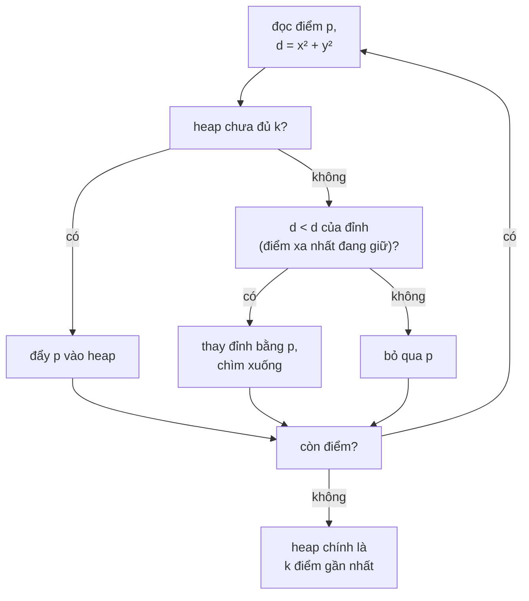

> [!tldr] Đọc nhanh
> - Đề: cho n điểm trên mặt phẳng và số k, trả k điểm gần gốc `(0, 0)` nhất, thứ tự nào cũng được. Đề hứa đáp án duy nhất (không hòa ở ranh giới).
> - So sánh `x² + y²` thay cho khoảng cách thật: căn bậc hai đồng biến nên không đổi thứ tự, và bỏ nó thì toàn số nguyên. Sắp xếp bằng `Math.hypot` chậm gần gấp đôi (967 ms so với 527 ms trên 10⁶ điểm).
> - Mẫu "top k": giữ một **max-heap k chỗ**. Đỉnh là điểm xa nhất trong k điểm đang giữ; điểm mới gần hơn đỉnh thì thay đỉnh. O(n log k), bộ nhớ O(k). Ngược chiều (min-heap k chỗ) thì giữ lại k điểm **xa** nhất: sai 6/8 ca.
> - [[concepts/quickselect|Quickselect]] chia mảng quanh một chốt tới khi k điểm gần nhất nằm ở đầu: trung bình O(n). Trên 10⁶ điểm với k = 1000: sắp xếp 504 ms, max-heap 67 ms, quickselect 110 ms trong TypeScript; Go: sắp xếp 179 ms, max-heap 2 ms.
> - Hai giới hạn số học ngoài đề: Java `x * x + y * y` tràn `int` khi toạ độ vượt 32 767 (`[40000, 40000]` thành điểm gần nhất); JavaScript mất đơn vị cuối khi `x² + y²` vượt 2⁵³.

> [!info] Bối cảnh
> Bài LeetCode 973 thuộc [[posts/2026-11-23-neetcode-heap-top-k|ga 3: Heap và top K]] trong **tuyến NeetCode: Tìm kiếm và heap**. Bài trước của ga, [[problems/last-stone-weight|Last Stone Weight]], dùng heap để lấy lớn nhất lặp lại. Bài này dùng heap theo cách khác: giữ một nhóm k ứng viên tốt nhất, và đỉnh heap là ứng viên **tệ nhất** trong nhóm đó. Lời giải có đủ TypeScript, Python, Go, Java và JavaScript.

> [!abstract]- Từ điển nhanh cho bài này (bấm để mở)
> - **Heap, max-heap, min-heap**: cây nhị phân trong mảng, lớn nhất (hoặc nhỏ nhất) ở đỉnh, thêm và lấy đỉnh O(log n). Xem [[concepts/heap|Heap]] và bài [[problems/last-stone-weight|Last Stone Weight]].
> - **Top k**: chọn k phần tử tốt nhất theo một tiêu chí mà không cần xếp hạng toàn bộ. Bài anh em: [[problems/kth-largest-element-in-an-array|Kth Largest Element in an Array]].
> - **Quickselect**: như quicksort nhưng chỉ đệ quy vào một phía của chốt. Xem [[concepts/quickselect|Quickselect]].
> - **Đồng biến**: a < b thì f(a) < f(b). Căn bậc hai đồng biến trên số không âm, nên so `x² + y²` cho cùng kết quả như so khoảng cách.
> - **2⁵³**: số nguyên lớn nhất mà số thực 64 bit (kiểu `number` của JS) còn biểu diễn được mọi số nguyên tới nó.

## Hình dung trước: chọn k quán ăn gần nhà trong cả nghìn quán

Bạn có danh bạ một nghìn quán ăn với toạ độ, và muốn ghi ra ba quán gần nhà nhất. Bạn không xếp hạng cả nghìn quán. Bạn cầm một tờ giấy ba dòng và luôn để ý quán **xa nhất** trên tờ giấy đó. Đọc tới quán mới: nếu nó gần hơn quán xa nhất trên giấy, gạch quán xa nhất đi và ghi quán mới vào; không thì bỏ qua. Đọc hết danh bạ, tờ giấy là đáp án.

| Đời thường | Khái niệm |
|---|---|
| Danh bạ quán ăn | mảng `points`, n điểm |
| Khoảng cách tới nhà | `x² + y²` (không cần căn) |
| Tờ giấy ba dòng | heap k chỗ |
| Luôn để ý quán xa nhất trên giấy | max-heap: đỉnh là điểm xa nhất đang giữ |
| Quán mới gần hơn quán xa nhất: gạch và ghi | thay đỉnh, chìm xuống, O(log k) |
| Quán mới xa hơn: bỏ qua | không đụng heap, O(1) |
| Xếp hạng cả nghìn quán rồi lấy ba quán đầu | sắp xếp toàn bộ, O(n log n) |



## Vấn đề

Cách thẳng nhất: sắp xếp n điểm theo khoảng cách rồi lấy k điểm đầu. O(n log n), đúng, và qua LeetCode (n ≤ 10⁴). Nhưng nó làm thừa: nó xếp hạng cả n − k điểm mà ta sẽ bỏ đi. Khi k nhỏ so với n (10 quán gần nhất trong một triệu), phần lớn công sắp xếp là vô ích.

Có hai hướng bớt việc. Heap k chỗ chỉ giữ thứ tự của k ứng viên: O(n log k). Quickselect chỉ cần **ranh giới** giữa k điểm gần nhất và phần còn lại, không cần thứ tự bên trong mỗi phía: trung bình O(n).

## Cơ chế

### Bỏ căn bậc hai

Khoảng cách thật là `√(x² + y²)`. Vì căn bậc hai đồng biến trên số không âm, `√a < √b` khi và chỉ khi `a < b`. So `x² + y²` cho đúng cùng thứ tự, toàn số nguyên, và không tốn phép căn. Không chỉ nhanh hơn: tránh số thực thì tránh luôn câu hỏi "hai khoảng cách bằng nhau thật hay chỉ bằng nhau sau khi làm tròn". Đo trong TypeScript trên 10⁶ điểm: sắp xếp bằng `x² + y²` mất 527 ms, bằng `Math.hypot` mất 967 ms.

### Max-heap k chỗ: đỉnh là ứng viên tệ nhất

Mẫu top k hay làm người mới bối rối ở chiều của heap. Ta muốn k điểm **gần** nhất, nhưng dùng **max**-heap. Lý do: heap là nơi ta quyết định ai bị loại, và người bị loại phải là ứng viên tệ nhất trong nhóm, tức điểm **xa** nhất. Max-heap đặt điểm đó ở đỉnh, nên so sánh và thay thế đều ở đỉnh.

```ts
// Max-heap giữ k điểm gần nhất đã thấy; đỉnh là điểm XA nhất trong số đó, bị thay khi có điểm gần hơn. O(n log k).
function maxHeapK(points: P[], k: number): P[] {
  const key = keys(points), h = new IndexHeap(key, true);
  for (let i = 0; i < points.length; i++) {
    if (h.size < k) h.push(i);
    else if (key[i] < key[h.top()]) { h.a[0] = i; h.siftDown(0); }
  }
  return h.a.map((i) => points[i]);
}
```


Mỗi điểm tốn tối đa một lần chìm xuống trong heap cỡ k: O(log k). Tổng O(n log k), bộ nhớ O(k). Heap chỉ giữ chỉ số; khoảng cách tính một lần vào `Float64Array` để mỗi lần so sánh chỉ là đọc mảng.

**Bản sai: heap ngược chiều.** Viết min-heap k chỗ thì đỉnh là điểm **gần** nhất đang giữ. Điểm mới so với đỉnh, và điểm gần nhất bị đẩy ra trước. Kết quả là k điểm xa nhất:

```ts
// SAI: dùng min-heap k chỗ (ngược chiều). Đỉnh là điểm GẦN nhất, nên nó bị đẩy ra trước; heap giữ lại k điểm xa nhất.
function wrongMinHeapK(points: P[], k: number): P[] {
  const key = keys(points), h = new IndexHeap(key, false);
  for (let i = 0; i < points.length; i++) {
    if (h.size < k) h.push(i);
    else if (key[i] > key[h.top()]) { h.a[0] = i; h.siftDown(0); }
  }
  return h.a.map((i) => points[i]);
}
```


Sai 6/8 ca; ví dụ đầu của đề `[[1, 3], [-2, 2]]`, k = 1 ra `[1, 3]` thay vì `[-2, 2]`. Hai ca qua là hai ca có k = n hoặc chỉ có một điểm, nơi heap giữ tất cả.

### Hai cách đúng khác: min-heap cả mảng, quickselect

**Min-heap của cả n điểm.** Dựng heap từ dưới lên tốn O(n) (xem [[problems/last-stone-weight|Last Stone Weight]]), rồi lấy đỉnh k lần, O(k log n). Tổng O(n + k log n), bộ nhớ O(n). Với k nhỏ, nó gần như tuyến tính; với k lớn, max-heap k chỗ thắng vì heap nhỏ hơn.

**Quickselect.** Chọn một chốt ngẫu nhiên, chia mảng thành ba phần `< chốt`, `= chốt`, `> chốt`. Nếu k rơi vào phần `<`, chỉ cần làm tiếp ở đó; nếu vượt qua phần `=`, làm tiếp ở phần `>`; nếu rơi vào phần `=`, xong. Mỗi vòng bỏ hẳn một phía, nên trung bình tổng công việc là n + n/2 + n/4 + … ≈ 2n.

```ts
// Quickselect: chia mảng quanh một chốt ngẫu nhiên tới khi k điểm gần nhất nằm ở đầu. Trung bình O(n), tệ nhất O(n²).
function quickselect(points: P[], k: number): P[] {
  const key = keys(points), idx = points.map((_, i) => i);
  let lo = 0, hi = idx.length - 1;
  while (lo < hi) {
    const pivot = key[idx[lo + Math.floor(Math.random() * (hi - lo + 1))]];
    // chia ba phần: < chốt | = chốt | > chốt
    let lt = lo, i = lo, gt = hi;
    while (i <= gt) {
      const d = key[idx[i]];
      if (d < pivot) { [idx[lt], idx[i]] = [idx[i], idx[lt]]; lt++; i++; }
      else if (d > pivot) { [idx[i], idx[gt]] = [idx[gt], idx[i]]; gt--; }
      else i++;
    }
    if (k <= lt) hi = lt - 1; // k điểm gần nhất nằm hết trong phần "<"
    else if (k > gt + 1) lo = gt + 1; // cần thêm từ phần ">"
    else break; // ranh giới k rơi vào phần "= chốt": xong
  }
  return idx.slice(0, k).map((i) => points[i]);
}
```


Chia ba phần quan trọng khi nhiều điểm cùng khoảng cách: chia hai phần với nhiều giá trị bằng chốt có thể bỏ được rất ít mỗi vòng. Ca tệ nhất của quickselect vẫn là O(n²), khi chốt liên tục rơi vào đầu mút; chọn chốt ngẫu nhiên làm điều đó cực kỳ khó xảy ra, nhưng không loại trừ. Quickselect cũng đảo thứ tự mảng (ở đây là mảng chỉ số), và k điểm trả về không theo thứ tự khoảng cách.

| Cách | Thời gian | Bộ nhớ thêm | Khi nào chọn |
|---|---|---|---|
| Sắp xếp | O(n log n) | O(n) hoặc O(log n) | n nhỏ, cần k điểm **đã xếp** |
| Max-heap k chỗ | O(n log k) | O(k) | k ≪ n, hoặc dữ liệu đến dần (dòng dữ liệu) |
| Min-heap cả mảng | O(n + k log n) | O(n) | có sẵn `heapify`, k nhỏ |
| Quickselect | trung bình O(n), tệ nhất O(n²) | O(n) cho mảng chỉ số | có cả mảng trong bộ nhớ, k bất kỳ |

Max-heap k chỗ có một lợi thế mà quickselect không có: nó không cần thấy cả mảng cùng lúc. Điểm đến từng cái một (một dòng dữ liệu không biết trước độ dài), heap vẫn luôn giữ đúng k điểm gần nhất đã thấy. Bài [[problems/kth-largest-element-in-a-stream|Kth Largest Element in a Stream]] cùng ga dựa đúng vào điều này.

### Giới hạn số học: Java và JavaScript

Đề cho toạ độ trong `[-10⁴, 10⁴]`, nên `x² + y²` tối đa 2 · 10⁸, vừa `int` 32 bit. Ngoài giới hạn đó, hai ngôn ngữ hỏng theo hai kiểu khác nhau.

**Java: tràn `int`.** Toạ độ vượt 32 767 thì `x * x + y * y` có thể vượt 2³¹ − 1. File Java chạy với `[40000, 40000]` và `[1, 1]`, k = 1:

```text
dist2([40000, 40000]) bằng int = -1094967296, bằng long = 3200000000
maxHeapK(k = 1) trả [40000, 40000], maxHeapKLong trả [1, 1]
```

Khoảng cách âm làm điểm xa nhất thành gần nhất. Chú ý: hàm so sánh `(a, b) -> dist2(b) - dist2(a)` **không** phải chỗ hỏng; hiệu hai số không âm luôn vừa `int`. Chỗ hỏng là chính `dist2`. Ép sang `long` trước khi nhân: `(long) x * x`.

**JavaScript: vượt 2⁵³.** `number` của JS là số thực 64 bit, chính xác mọi số nguyên tới 2⁵³ ≈ 9 · 10¹⁵. Toạ độ cỡ 10⁸ đẩy `x² + y²` qua mốc đó, và hai khoảng cách khác nhau 1 thành bằng nhau:

```text
x = 94906266: x² + 0 = 9007199326062756, x² + 1 = 9007199326062756, bằng nhau? true
BigInt: 9007199326062756 và 9007199326062757
sortAll([[94906266,1], [94906266,0]], 1) trả [94906266,1], điểm xa hơn
```

Sắp xếp coi hai điểm hòa và giữ thứ tự ban đầu, nên trả điểm xa hơn. Muốn đúng ở cỡ đó thì so bằng `BigInt`. Python không có cả hai vấn đề: `int` không giới hạn. Go dùng `int` 64 bit, an toàn tới toạ độ khoảng 2 · 10⁹.

### Bên dưới năm ngôn ngữ

| | Heap | Top k có sẵn | Bẫy riêng |
|---|---|---|---|
| TypeScript / JavaScript | tự viết | không | `x² + y²` mất chính xác khi vượt 2⁵³; `sort` gọi hàm so sánh khoảng 2n log n lần, mỗi lần tính lại khoảng cách |
| Python | `heapq` (min-heap) | `heapq.nsmallest(k, points, key=…)` | đổi dấu cho max-heap; tuple `(d, x, y)` so tiếp `x`, `y` khi `d` hòa, nên không lỗi; `nsmallest` chậm như `sorted` khi k lớn |
| Go | `container/heap` | không | `heap.Fix(&h, 0)` sau khi thay đỉnh, thay vì Pop rồi Push |
| Java | `PriorityQueue<int[]>` | không | `x * x + y * y` tràn `int` khi toạ độ > 32 767; thêm rồi `poll()` khi vượt k là heap k + 1 chỗ, vẫn O(n log k) |

### Đo

TypeScript, n = 10⁶ điểm, toạ độ ngẫu nhiên trong `[-10⁴, 10⁴]`, trung vị 5 lần chạy:

| k | Sắp xếp | Max-heap k chỗ | Min-heap cả mảng | Quickselect |
|---|---|---|---|---|
| 10 | 527 ms | 66 ms | 85 ms | 95 ms |
| 1 000 | 504 ms | 67 ms | 85 ms | 110 ms |
| 100 000 | 506 ms | 129 ms | 122 ms | 118 ms |
| 500 000 | 510 ms | 200 ms | 270 ms | 126 ms |

Sắp xếp không đổi theo k: nó luôn làm hết việc. Max-heap rẻ khi k nhỏ và tăng dần theo log k. Min-heap cả mảng tăng mạnh ở k = 500 000 vì phải lấy đỉnh nửa triệu lần trong heap một triệu phần tử. Quickselect gần như phẳng theo k. Một phần đáng kể của mỗi con số là tính mảng khoảng cách cho 10⁶ điểm, chung cho cả ba cách heap và quickselect.

Các ngôn ngữ khác, cùng dữ liệu kiểu đó:

| | k = 10 | k = 1 000 | k = 100 000 |
|---|---|---|---|
| Go, sắp xếp (`slices.SortFunc`) | 180 ms | 179 ms | 179 ms |
| Go, max-heap k chỗ | 2 ms | 2 ms | 52 ms |
| Python, `sorted` | 287 ms | 288 ms | 316 ms |
| Python, `heapq.nsmallest` | 62 ms | 68 ms | 357 ms |
| Python, heap k chỗ tự viết | 66 ms | 80 ms | 356 ms |

(Python lấy trung vị 3 lần, Go 5 lần.) Ở Go, heap k chỗ nhanh hơn sắp xếp gần 90 lần với k nhỏ, vì hầu hết điểm chỉ tốn một phép so sánh với đỉnh rồi bị bỏ qua. Ở Python, `nsmallest` thắng `sorted` khi k nhỏ nhưng thua khi k = 100 000; tài liệu `heapq` nói đúng điều này: với k lớn, dùng `sorted()` hiệu quả hơn. JavaScript với k = 1 000: sắp xếp 452 ms, quickselect 53 ms.

## Ví dụ chạy được

[TypeScript](../code/neetcode-k-closest-points-to-origin/k-closest.ts) · [Python](../code/neetcode-k-closest-points-to-origin/k_closest.py) · [Go](../code/neetcode-k-closest-points-to-origin/k_closest.go) · [Java](../code/neetcode-k-closest-points-to-origin/k-closest.java) · [JavaScript](../code/neetcode-k-closest-points-to-origin/k-closest.js)

Mỗi file chạy 8 ca: hai ví dụ của đề, một điểm, hai điểm cùng khoảng cách nằm trong đáp án, k = n, toạ độ âm, toạ độ ở biên 10⁴, và một ca năm điểm. Đáp án được so sau khi sắp xếp, vì đề chấp nhận mọi thứ tự.

```ts
// Max-heap giữ k điểm gần nhất đã thấy; đỉnh là điểm XA nhất trong số đó, bị thay khi có điểm gần hơn. O(n log k).
function maxHeapK(points: P[], k: number): P[] {
  const key = keys(points), h = new IndexHeap(key, true);
  for (let i = 0; i < points.length; i++) {
    if (h.size < k) h.push(i);
    else if (key[i] < key[h.top()]) { h.a[0] = i; h.siftDown(0); }
  }
  return h.a.map((i) => points[i]);
}
```

```python
# Max-heap k chỗ: heapq là min-heap, nên lưu -khoảng cách. Đỉnh h[0] là điểm XA nhất trong k điểm đang giữ.
def max_heap_k(points, k):
    h = []
    for x, y in points:
        d = -(x * x + y * y)
        if len(h) < k:
            heapq.heappush(h, (d, x, y))
        elif d > h[0][0]:  # gần hơn điểm xa nhất đang giữ
            heapq.heapreplace(h, (d, x, y))  # lấy đỉnh ra rồi đẩy vào, một lần chìm xuống
    return [[x, y] for _, x, y in h]

def via_nsmallest(points, k):
    return heapq.nsmallest(k, points, key=lambda p: p[0] * p[0] + p[1] * p[1])
```

```go
// farHeap: Less dùng > nên đỉnh là điểm XA nhất trong k điểm đang giữ.
type farHeap []item

func (h farHeap) Len() int           { return len(h) }
func (h farHeap) Less(i, j int) bool { return h[i].d > h[j].d }
func (h farHeap) Swap(i, j int)      { h[i], h[j] = h[j], h[i] }
func (h *farHeap) Push(x any)        { *h = append(*h, x.(item)) }
func (h *farHeap) Pop() any {
	old := *h
	x := old[len(old)-1]
	*h = old[:len(old)-1]
	return x
}

func maxHeapK(points [][]int, k int) [][]int {
	h := make(farHeap, 0, k)
	for _, p := range points {
		d := dist2(p)
		if h.Len() < k {
			heap.Push(&h, item{d, p})
		} else if d < h[0].d {
			h[0] = item{d, p} // thay đỉnh rồi cho chìm xuống: một lần O(log k)
			heap.Fix(&h, 0)
		}
	}
	out := make([][]int, len(h))
	for i, it := range h {
		out[i] = it.p
	}
	return out
}
```

```java
// Max-heap k chỗ: đỉnh là điểm xa nhất đang giữ. Trừ hai số không âm thì không tràn, nên b - a an toàn ở đây.
static int[][] maxHeapK(int[][] points, int k) {
    PriorityQueue<int[]> pq = new PriorityQueue<>((a, b) -> dist2(b) - dist2(a));
    for (int[] p : points) {
        pq.add(p);
        if (pq.size() > k) pq.poll(); // vượt k thì bỏ điểm xa nhất
    }
    return pq.toArray(new int[0][]);
}
```

```js
// Quickselect chia ba phần quanh chốt ngẫu nhiên, đổi chỗ ngay trên bản sao của mảng điểm.
function quickselect(points, k) {
  const a = [...points];
  let lo = 0, hi = a.length - 1;
  while (lo < hi) {
    const pivot = dist2(a[lo + Math.floor(Math.random() * (hi - lo + 1))]);
    let lt = lo, i = lo, gt = hi;
    while (i <= gt) {
      const d = dist2(a[i]);
      if (d < pivot) { [a[lt], a[i]] = [a[i], a[lt]]; lt++; i++; }
      else if (d > pivot) { [a[i], a[gt]] = [a[gt], a[i]]; gt--; }
      else i++;
    }
    if (k <= lt) hi = lt - 1;
    else if (k > gt + 1) lo = gt + 1;
    else break;
  }
  return a.slice(0, k);
}
```


Kết quả `node k-closest.ts` (phần ca thử):

```text
sortAll       8/8 ca đúng
maxHeapK      8/8 ca đúng
minHeapAll    8/8 ca đúng
quickselect   8/8 ca đúng
wrongMinHeapK 2/8 ca đúng; sai ở k=1 [[1,3],[-2,2]] → [[1,3]], k=2 [[3,3],[5,-1],[-2,4]] → [[-2,4],[5,-1]]

ngẫu nhiên (toạ độ -5..5, nhiều điểm hòa): bốn cách khớp nhau ở 2000/2000 bộ
```

Ca ngẫu nhiên dùng toạ độ nhỏ để có nhiều điểm hòa ở ranh giới; khi hòa, nhiều đáp án cùng hợp lệ, nên file so dãy khoảng cách đã sắp thay vì so điểm. `python3 k_closest.py` cho `sort_all`, `via_nsmallest`, `max_heap_k` đều 8/8 và `forgot_negate` 2/8; Go, Java (cả bản `int` lẫn `long`) và JavaScript đều 8/8.

## Hiểu lầm và bẫy hay gặp

- **"Tìm k nhỏ nhất thì dùng min-heap."** Dùng min-heap cho **cả mảng** thì đúng (lấy đỉnh k lần). Heap **k chỗ** thì phải ngược chiều: max-heap, vì đỉnh là người bị loại.
- **"Phải tính căn để có khoảng cách thật."** So `x² + y²` cho cùng thứ tự, nhanh hơn và toàn số nguyên.
- **"Quickselect luôn O(n)."** Trung bình O(n); tệ nhất O(n²). Chốt ngẫu nhiên làm ca tệ nhất rất hiếm, không phải không thể.
- **"Đáp án phải xếp theo khoảng cách."** Đề chấp nhận mọi thứ tự. Heap và quickselect trả k điểm không theo thứ tự; muốn có thứ tự thì sắp k điểm đó, thêm O(k log k).
- **Java: `x * x + y * y` trong `int`.** Vừa với giới hạn đề, tràn khi toạ độ vượt 32 767. Hàm so sánh bằng phép trừ không phải nguyên nhân.
- **JavaScript với số lớn.** Bình phương vượt 2⁵³ thì hai khoảng cách khác nhau có thể bằng nhau.

## Câu hỏi tự kiểm tra

> [!question]- Vì sao heap k chỗ cho bài "k gần nhất" phải là max-heap?
> Heap là nơi quyết định ai bị loại khi có ứng viên mới. Người bị loại phải là điểm xa nhất trong nhóm đang giữ, nên điểm đó phải ở đỉnh: max-heap theo khoảng cách.

> [!question]- n = 10⁶, k = 5. Max-heap k chỗ làm khoảng bao nhiêu phép so sánh trong heap?
> Mỗi điểm so một lần với đỉnh. Chỉ điểm gần hơn đỉnh mới làm heap chìm xuống, tối đa ⌊log₂ 5⌋ = 2 tầng. Với dữ liệu ngẫu nhiên, càng về sau càng ít điểm lọt qua, nên tổng chỉ hơn n một chút.

> [!question]- Dữ liệu đến từng điểm một từ mạng, không biết khi nào hết, và lúc nào cũng phải trả lời được "k điểm gần nhất tới giờ". Chọn cách nào?
> Max-heap k chỗ: nó xử lý từng điểm khi điểm tới, bộ nhớ O(k), và đáp án luôn là nội dung heap. Quickselect và sắp xếp cần cả mảng.

> [!question]- Java, toạ độ tới 10⁵. Sửa `dist2` thế nào cho đúng?
> `(long) x * x + (long) y * y`. Ép kiểu phải xảy ra **trước** phép nhân; `(long) (x * x)` đã tràn rồi mới ép.

## Tham khảo

- [LeetCode 973: K Closest Points to Origin](https://leetcode.com/problems/k-closest-points-to-origin/) (đề gốc, giới hạn toạ độ, đáp án duy nhất)
- [Python `heapq`](https://docs.python.org/3/library/heapq.html) (`nsmallest`, và ghi chú dùng `sorted()` khi k lớn)
- [Go `container/heap`](https://pkg.go.dev/container/heap) (`heap.Fix` sau khi đổi một phần tử)
- [Java `PriorityQueue`](https://docs.oracle.com/en/java/javase/21/docs/api/java.base/java/util/PriorityQueue.html)
- [ECMAScript: kiểu Number](https://tc39.es/ecma262/#sec-ecmascript-language-types-number-type) (số thực 64 bit IEEE 754, số nguyên an toàn tới 2⁵³)
- C. A. R. Hoare, "Algorithm 65: Find", *Communications of the ACM* 4(7), 1961 (quickselect)
