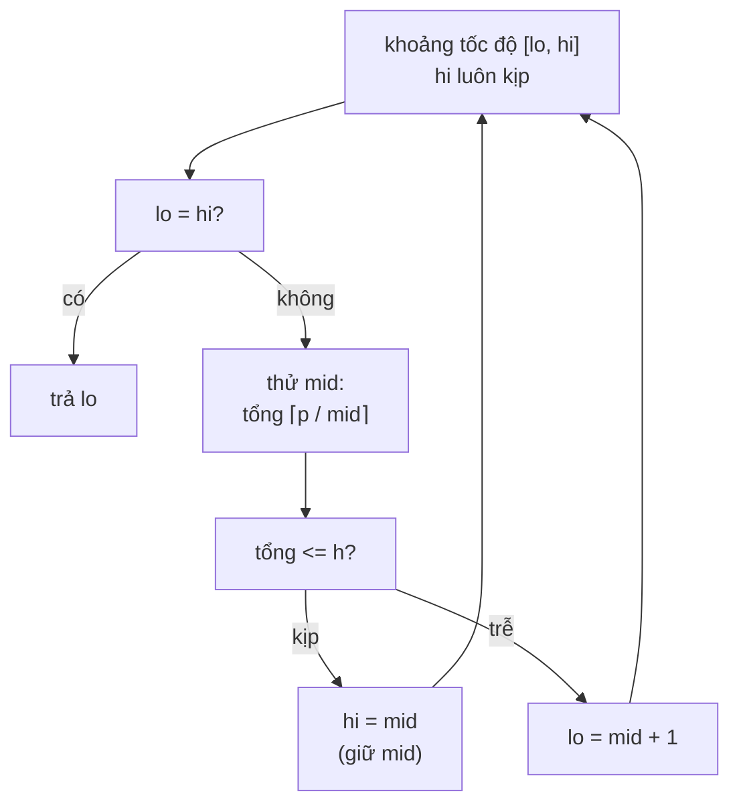

> [!tldr] Đọc nhanh
> - Đề: n đống chuối, Koko ăn k quả mỗi giờ, mỗi giờ chỉ ăn ở một đống (đống còn ít hơn k thì giờ đó ăn hết đống rồi nghỉ). Tìm k **nhỏ nhất** để ăn hết trong h giờ.
> - Không có mảng nào để tìm. Đáp án nằm trong `[1, max(piles)]`, và câu hỏi "tốc độ k có kịp không?" chỉ đổi từ "trễ" sang "kịp" đúng một lần khi k tăng ([[concepts/monotonic-predicate|vị từ đơn điệu]]). Vậy tìm nhị phân trên chính tốc độ: [[concepts/search-on-the-answer|tìm kiếm nhị phân trên đáp án]]. O(n log max).
> - Một đống p quả mất ⌈p / k⌉ giờ: [[concepts/ceiling-division|chia làm tròn lên]], viết `(p + k − 1) / k` để không đi qua số thực.
> - Ba bản sai được chạy thật: chia làm tròn xuống (5/10 ca), kịp mà gán `hi = mid − 1` (6/10), và `lo = 0` (đúng trong JS nhờ `Infinity`, ném lỗi chia cho 0 trong Python và Java).
> - Java: thử từ k = 1 và cộng giờ vào `int` thì tổng tràn thành số âm và k = 1 "kịp". Đặt `hi = Integer.MAX_VALUE` rồi tính `(lo + hi) / 2` thì `mid` âm.

> [!info] Bối cảnh
> Bài LeetCode 875, bài neo của [[posts/2026-11-23-neetcode-binary-search-answer|ga 2: Tìm kiếm nhị phân trên đáp án]] trong **tuyến NeetCode: Tìm kiếm và heap**. [[posts/2026-11-23-neetcode-binary-search|Ga 1]] tìm nhị phân trên một mảng đã sắp; ở đây không có mảng, chỉ có một khoảng số và một phép thử. Lời giải có đủ TypeScript, Python, Go, Java và JavaScript. Bạn cần biết khuôn [[concepts/binary-search|tìm kiếm nhị phân]] của ga 1, không cần gì thêm.

> [!abstract]- Từ điển nhanh cho bài này (bấm để mở)
> - **⌈x⌉ (làm tròn lên)**: số nguyên nhỏ nhất không nhỏ hơn x. ⌈7 / 4⌉ = 2, ⌈8 / 4⌉ = 2. Xem [[concepts/ceiling-division|Ceiling Division]].
> - **Vị từ (predicate)**: hàm trả đúng hoặc sai, ở đây "tốc độ k có ăn kịp trong h giờ không". Xem [[concepts/monotonic-predicate|Monotonic Predicate]].
> - **Cận dưới (lower bound)**: vị trí đầu tiên thỏa điều kiện; ở đây là tốc độ đầu tiên kịp giờ. Xem [[concepts/lower-bound|Lower Bound]].
> - **Khoảng nửa mở, bất biến**: xem [[concepts/half-open-interval|Half-open Interval]] và [[concepts/loop-invariant|Loop Invariant]].
> - **Tràn số (overflow)**: kết quả vượt kiểu số nguyên chứa nó và quay vòng thành số sai. Xem [[concepts/midpoint-overflow|Midpoint Overflow]].

## Hình dung trước: đọc kịp chồng sách mượn trước hạn trả

Bạn mượn thư viện bốn cuốn dày 3, 6, 7 và 11 chương, phải trả sau 8 ngày. Mỗi ngày bạn đọc tối đa k chương và chỉ đọc một cuốn; cuốn còn ít hơn k chương thì đọc xong cuốn đó rồi nghỉ, không mở cuốn mới. Muốn nhàn nhất, bạn tìm k nhỏ nhất vẫn trả kịp. Không ai thử k = 1, 2, 3… Bạn thử một nhịp vừa phải: kịp thì thử chậm hơn, trễ thì thử nhanh hơn.

| Đời thường | Khái niệm |
|---|---|
| Mỗi cuốn sách | một đống chuối `piles[i]` |
| Số chương đọc mỗi ngày | tốc độ `k` |
| Số ngày đọc xong một cuốn: 7 chương, 4 chương/ngày là 2 ngày | `⌈p / k⌉` |
| "Đọc nhịp này có trả kịp không?" | vị từ `feasible(k)`: tổng giờ `<= h` |
| Nhịp nhanh hơn thì chắc chắn vẫn kịp | tính đơn điệu |
| Nhịp nhanh nhất cần xét: một cuốn một ngày | `hi = max(piles)` |
| Nhịp chậm nhất vẫn kịp | đáp án: cận dưới trên khoảng tốc độ |



## Vấn đề

Cách thẳng nhất là thử k = 1, 2, 3… và dừng ở tốc độ đầu tiên kịp. Mỗi lần thử đọc cả n đống, và đáp án có thể tới `max(piles)` = 10⁹, nên ca tệ nhất là 10⁹ · 10⁴ phép tính. Đo với n = 1 000 đống và h = 2 000: đáp án 331 mất 0,4 ms, đáp án 33 125 mất 32,7 ms, tăng đúng theo đáp án. Với đống tới 10⁹, đáp án là 340 737 701; ngoại suy từ hai số trên, thử lần lượt sẽ mất khoảng 5–6 phút (không chạy).

Không có mảng nào đã sắp ở đây, nhưng có một thứ tự: nếu tốc độ k kịp thì k + 1 cũng kịp, vì mỗi đống mất không nhiều giờ hơn. Dọc theo k = 1, 2, …, max, câu trả lời có dạng "trễ, trễ, …, trễ, kịp, kịp, …, kịp". Tìm chữ "kịp" đầu tiên là bài [[concepts/lower-bound|cận dưới]] của ga 1, chỉ khác là "mảng" giờ là một hàm tính khi cần.

## Cơ chế

### Từ cận dưới sang tìm trên đáp án

Bất biến, viết trước khi code:

> Mọi tốc độ nhỏ hơn `lo` đều trễ; tốc độ `hi` kịp.

| Câu hỏi | Suy ra từ bất biến |
|---|---|
| Khởi tạo? | `lo = 1`: chưa biết gì về tốc độ nhỏ hơn 1, và không có tốc độ nào nhỏ hơn. `hi = max(piles)`: mỗi đống mất đúng 1 giờ, tổng n giờ, và đề hứa `h >= n`, nên chắc chắn kịp. |
| Lặp tới khi nào? | Khi `lo < hi`. Lúc `lo == hi`, tốc độ đó kịp và mọi tốc độ nhỏ hơn đều trễ: đó là đáp án. |
| `mid` kịp? | `mid` có thể chính là đáp án, nên **giữ** nó: `hi = mid`. |
| `mid` trễ? | Mọi tốc độ `<= mid` đều trễ (đơn điệu): `lo = mid + 1`. |
| Có chắc dừng? | `mid < hi` vì `mid` làm tròn xuống, nên cả hai nhánh đều co khoảng. |

Khoảng này đóng `[lo, hi]` nhưng lặp với `lo < hi`, giống bài Find Minimum ở ga 1: một nhánh giữ `mid` lại thì điều kiện lặp phải là `<`. Chạy ví dụ của đề `[3, 6, 7, 11]`, h = 8:

```text
k=6: 6 giờ kịp → k=3: 10 giờ trễ → k=5: 8 giờ kịp → k=4: 8 giờ kịp → đáp án 4 (4 lần kiểm tra)
```

Khoảng tới 10⁹ chỉ cần 30 lần thử, vì 2³⁰ ≈ 1,07 · 10⁹. Mỗi lần thử O(n), tổng O(n log max).

### Chia làm tròn lên mà không dùng số thực

Đống p quả với tốc độ k mất ⌈p / k⌉ giờ. Phép chia nguyên làm tròn xuống, nên cần một mẹo: `(p + k − 1) / k`. Cộng thêm k − 1 đẩy mọi số dư khác 0 lên đủ một bậc, còn p chia hết cho k thì không đổi. Python viết `-(-p // k)`, vì `//` của Python làm tròn xuống cả với số âm, nên đổi dấu hai lần thành làm tròn lên.

`Math.ceil(p / k)` có ổn không? Nó đi qua số thực 64 bit. File JavaScript thử 10⁶ cặp với p, k tới 10⁹ (một nửa có p chia hết cho k): không lệch cặp nào, vì khoảng cách từ p / k tới số nguyên gần nhất ít nhất là 1 / k, lớn hơn nhiều so với sai số làm tròn của số thực. Nhưng p vượt 2⁵³ thì hỏng: Python in `math.ceil((2**53 + 1) / 1) = 9007199254740992`, thiếu 1. Trong JS, `2 ** 53 + 1` thậm chí không biểu diễn được. Đề giới hạn 10⁹ nên không chạm tới, nhưng cách số nguyên đúng ở mọi cỡ số. Xem [[concepts/ceiling-division|Ceiling Division]].

### Bản sai thứ nhất: chia làm tròn xuống

Viết `Math.floor(p / k)` thay cho làm tròn lên: đống 7 quả với k = 4 tính 1 giờ thay vì 2. Tổng giờ bị đếm thiếu, tốc độ quá chậm cũng "kịp", và đáp án nhỏ hơn thật. Ví dụ của đề ra 3 thay vì 4; sai 5/10 ca. Không ca nào ra lớn hơn đáp án thật: đếm thiếu giờ chỉ làm tốc độ có vẻ kịp sớm hơn.

### Bản sai thứ hai: kịp mà vẫn gán `hi = mid − 1`

Thói quen từ bài 704 ("thấy `mid` không phải đáp án thì bỏ nó"). Nhưng ở đây `mid` kịp **có thể** là đáp án. Bỏ nó thì khi `mid` đúng là tốc độ nhỏ nhất, khoảng còn lại chỉ toàn tốc độ trễ, và vòng lặp trả một tốc độ trễ. Sai 6/10 ca, ví dụ `[30, 11, 23, 4, 20]`, h = 6 ra 22 thay vì 23. Ví dụ đầu của đề vẫn qua, nên chỉ chạy ví dụ của đề thì không thấy lỗi.

### Bản sai thứ ba: `lo = 0`

Ai đó đặt `lo = 0` cho "chắc". Khi đáp án là 1, khoảng sẽ co về `[0, 1]`, `mid = 0`, và phép tính giờ chia cho 0. Ba ngôn ngữ phản ứng khác nhau:

| | `p / 0` | Kết quả |
|---|---|---|
| TypeScript / JavaScript | `Infinity`, không ném lỗi | `Infinity > h` nên `lo = 1`: **đúng** 10/10, một cách tình cờ |
| Python | `ZeroDivisionError` | 8/10 ca, hỏng ở `[1]` h = 1 và `[1, 1]` h = 5 |
| Java | `ArithmeticException: / by zero` | 8/10 ca, cùng hai ca |

Code JS này đúng chỉ nhờ `Infinity`; dịch nó sang Python hay Java là lộ lỗi. Tốc độ 0 không có nghĩa trong đề, nên `lo = 1`.

### Tổng giờ có tràn `int` không?

Đề cho tới 10⁴ đống, mỗi đống tới 10⁹. Ở k = 1, tổng giờ tới 10¹³, vượt `int` 32 bit (tối đa 2 147 483 647). Go và Python không lo: `int` của Go là 64 bit trên máy 64 bit, `int` của Python không giới hạn. Java và C# thì phải chọn.

**Thử lần lượt với `int` thì sai thật.** Ba đống 805 306 368 quả, h = 10⁹, đáp án 3. Ở k = 1, tổng là 2 415 919 104, quay vòng thành −1 879 048 192, nhỏ hơn h, nên k = 1 "kịp". Cả Java (`int`) và Go (`int32`) in ra đúng con số đó và trả 1.

**Tìm nhị phân với `int` thì không tràn**, và mình thấy điều này khá bất ngờ. File Java chạy bản cộng vào `int` trên 10⁵ bộ ngẫu nhiên sát giới hạn đề: lệch bản `long` ở 0 bộ. Lý do: `lo >= 1` và `hi >= k*` (đáp án), nên `mid >= k* / 2`. Tổng giờ ở `mid` không quá `2 · S / k* + n`, với S là tổng số chuối, mà `S / k* <= h`. Vậy tổng giờ không quá `2h + n <= 2 · 10⁹ + 10⁴`, vẫn dưới 2³¹ − 1. Lập luận đúng nhưng mong manh: đổi `lo` thành 0, đổi giới hạn đề, hay đổi sang thử lần lượt là gãy. Dùng `long` cho tổng thì khỏi phải chứng minh.

**`hi = Integer.MAX_VALUE` cho "chắc ăn"** là bẫy khác: `(1 + Integer.MAX_VALUE) / 2` tràn thành −1 073 741 824 ([[concepts/midpoint-overflow|tràn điểm giữa]] của ga 1). Với tốc độ âm, phép tính giờ ra số nhỏ, `mid` "kịp", `hi` thành số âm và vòng lặp thoát với `lo = 1`. Sai 8/10 ca.

### Bên dưới năm ngôn ngữ

| | ⌈p / k⌉ | Tổng giờ | Thư viện | Bẫy riêng |
|---|---|---|---|---|
| TypeScript / JavaScript | `Math.floor((p + k - 1) / k)` hoặc `Math.ceil(p / k)` | `number` (double), chính xác tới 2⁵³ | không có | chia cho 0 ra `Infinity`, không ném lỗi; `Math.max(...piles)` truyền mỗi phần tử thành một đối số: 10⁵ phần tử chạy được, 2 · 10⁵ ném `RangeError` trên Node 24 (đề chỉ tới 10⁴) |
| Python | `-(-p // k)` | `int` không giới hạn | `bisect_left(range(1, m + 1), True, key=…)` (3.10+) | `math.ceil(p / k)` sai khi p > 2⁵³; `range` cho `bisect` đọc từng phần tử khi cần, không tạo danh sách |
| Go | `(p + k - 1) / k` | `int` 64 bit | `sort.Search(n, f)` | `sort.Search` tìm trên `[0, n)`, nên chỉ số `i` ứng với tốc độ `i + 1` |
| Java | `(p + k - 1) / k` | nên là `long` | không có cho hàm; `Arrays.binarySearch` chỉ cho mảng | `int` tràn khi thử lần lượt; `p + k - 1` vừa `int` chỉ vì p, k ≤ 10⁹; `/ 0` ném `ArithmeticException` |

### Đo

TypeScript, n = 1 000 đống, h = 2 000, trung vị 5 lần chạy:

| Đống tới | Đáp án | Thử lần lượt | Tìm nhị phân |
|---|---|---|---|
| 1 000 | 331 | 0,4 ms | 0,013 ms |
| 10 000 | 3 326 | 3,6 ms | 0,016 ms |
| 100 000 | 33 125 | 32,7 ms | 0,019 ms |
| 10⁹ | 340 737 701 | (không chạy) | 0,035 ms |

Thử lần lượt tăng đúng theo đáp án, gấp 10 lần mỗi hàng. Tìm nhị phân gần như phẳng: số lần thử chỉ tăng từ 10 lên 30.

Python, cùng cỡ với đống tới 10⁹: vòng lặp viết tay và `bisect_left` với `key` đều mất 0,76 ms. Khác bài 704, ở đây `bisect` không nhanh hơn: thời gian nằm trong 30 lần tính tổng giờ bằng Python, không nằm trong vòng lặp tìm kiếm.

## Ví dụ chạy được

[TypeScript](../code/neetcode-koko-eating-bananas/koko-eating.ts) · [Python](../code/neetcode-koko-eating-bananas/koko_eating.py) · [Go](../code/neetcode-koko-eating-bananas/koko_eating.go) · [Java](../code/neetcode-koko-eating-bananas/koko-eating.java) · [JavaScript](../code/neetcode-koko-eating-bananas/koko-eating.js)

Mỗi file chạy 10 ca: ba ví dụ của đề, một đống, đáp án 1, đống 10⁹ chia đôi, h chỉ kém tổng số chuối 1 (đáp án 2), và ca ba đống 805 306 368 làm tràn `int`. Python và Go có thêm bản dùng thư viện chuẩn.

```ts
// Số giờ để ăn hết với tốc độ k: mỗi đống mất ⌈p / k⌉ giờ. Chia làm tròn lên bằng số nguyên.
function hoursNeeded(piles: number[], k: number): number {
  let hours = 0;
  for (const p of piles) hours += Math.floor((p + k - 1) / k);
  return hours;
}

// Tìm nhị phân trên đáp án: "ăn tốc độ k có kịp không?" sai rồi đúng đúng một lần khi k tăng.
// Bất biến: hi luôn kịp; mọi tốc độ nhỏ hơn lo đều không kịp. Khoảng [lo, hi] thu về một ô.
function minEatingSpeed(piles: number[], h: number): number {
  let lo = 1, hi = Math.max(...piles); // tốc độ max(piles) ăn mỗi đống trong 1 giờ, luôn kịp vì h >= n
  while (lo < hi) {
    const mid = lo + Math.floor((hi - lo) / 2);
    if (hoursNeeded(piles, mid) <= h) hi = mid; // mid kịp: có thể chính là đáp án, giữ lại
    else lo = mid + 1; // mid không kịp: mọi tốc độ <= mid đều không kịp
  }
  return lo;
}
```

```python
def hours_needed(piles: list[int], k: int) -> int:
    # -(-p // k) là ⌈p / k⌉ tính bằng số nguyên: // làm tròn xuống, đổi dấu hai lần thành làm tròn lên
    return sum(-(-p // k) for p in piles)

def min_eating_speed(piles: list[int], h: int) -> int:
    lo, hi = 1, max(piles)
    while lo < hi:  # bất biến: hi luôn kịp, mọi tốc độ < lo đều trễ
        mid = (lo + hi) // 2
        if hours_needed(piles, mid) <= h:
            hi = mid  # mid kịp, có thể là đáp án
        else:
            lo = mid + 1
    return lo

def via_bisect(piles: list[int], h: int) -> int:
    # range(1, max+1) không tạo danh sách: bisect chỉ đọc vài phần tử qua chỉ số.
    # key biến mỗi tốc độ thành False (trễ) hoặc True (kịp); bisect_left tìm True đầu tiên.
    speeds = range(1, max(piles) + 1)
    return speeds[bisect_left(speeds, True, key=lambda k: hours_needed(piles, k) <= h)]
```

```go
// Số giờ với tốc độ k. int của Go là 64 bit trên máy 64 bit, nên tổng 10⁴ · 10⁹ không tràn.
func hoursNeeded(piles []int, k int) int {
	hours := 0
	for _, p := range piles {
		hours += (p + k - 1) / k // ⌈p / k⌉ bằng số nguyên
	}
	return hours
}

func minEatingSpeed(piles []int, h int) int {
	lo, hi := 1, slices.Max(piles)
	for lo < hi { // bất biến: hi luôn kịp, mọi tốc độ < lo đều trễ
		mid := lo + (hi-lo)/2
		if hoursNeeded(piles, mid) <= h {
			hi = mid
		} else {
			lo = mid + 1
		}
	}
	return lo
}

// sort.Search(n, f) trả i nhỏ nhất trong [0, n) có f(i) đúng; ở đây chỉ số i ứng với tốc độ i + 1.
func viaSortSearch(piles []int, h int) int {
	return sort.Search(slices.Max(piles), func(i int) bool { return hoursNeeded(piles, i+1) <= h }) + 1
}
```

```java
// Tổng giờ để trong long: n tới 10⁴ đống, mỗi đống tới 10⁹, nên ở tốc độ 1 tổng tới 10¹³, vượt int.
static long hoursNeeded(int[] piles, int k) {
    long hours = 0;
    for (int p : piles) hours += (p + k - 1) / k; // p + k - 1 <= 2·10⁹ - 1, vẫn vừa int
    return hours;
}

static int minEatingSpeed(int[] piles, int h) {
    int lo = 1, hi = Arrays.stream(piles).max().getAsInt();
    while (lo < hi) { // bất biến: hi luôn kịp, mọi tốc độ < lo đều trễ
        int mid = lo + (hi - lo) / 2;
        if (hoursNeeded(piles, mid) <= h) hi = mid;
        else lo = mid + 1;
    }
    return lo;
}
```

```js
// Hai cách tính ⌈p / k⌉: qua số thực (Math.ceil) hoặc chỉ bằng số nguyên.
const ceilFloat = (p, k) => Math.ceil(p / k);

const ceilInt = (p, k) => Math.floor((p + k - 1) / k);

function hoursNeeded(piles, k) {
  let hours = 0;
  for (const p of piles) hours += ceilInt(p, k);
  return hours;
}

function minEatingSpeed(piles, h) {
  let lo = 1, hi = Math.max(...piles);
  while (lo < hi) { // bất biến: hi luôn kịp, mọi tốc độ < lo đều trễ
    const mid = (lo + hi) >>> 1;
    if (hoursNeeded(piles, mid) <= h) hi = mid;
    else lo = mid + 1;
  }
  return lo;
}
```


Kết quả `node koko-eating.ts`, gồm ba bản sai:

```text
linearScan      9/9 ca đúng
minEatingSpeed  10/10 ca đúng
wrongFloorDiv   5/10 ca đúng; sai ở [3,6,7,11] h=8 → 3, [30,11,23,4,20] h=5 → 12, [30,11,23,4,20] h=6 → 11, [1000000000] h=2 → 333333334, [7] h=3 → 2
wrongDropMid    6/10 ca đúng; sai ở [30,11,23,4,20] h=6 → 22, [1000000000] h=2 → 499999999, [312884470] h=312884469 → 1, [805306368,805306368,805306368] h=1000000000 → 2
loFromZero      10/10 ca đúng

ngẫu nhiên: tìm nhị phân khớp thử lần lượt ở 2000/2000 bộ
```

(`linearScan` bỏ ca đáp án lớn hơn 1 000, vì thử tới 5 · 10⁸ quá lâu.)

Java, gồm hai lỗi số học:

```text
minEatingSpeed  10/10 ca đúng
sumInInt        10/10 ca đúng
hugeHi          2/10 ca đúng; sai ở [3, 6, 7, 11] h=8 → 1, [30, 11, 23, 4, 20] h=5 → 1, …
loFromZero      8/10 ca đúng; sai ở [1] h=1 → ArithmeticException, [1, 1] h=5 → ArithmeticException

[805306368 ×3], h = 10⁹: linearInt trả 1 (đúng là 3)
(1 + Integer.MAX_VALUE) / 2 = -1073741824
ngẫu nhiên: tổng int lệch tổng long ở 0/100000 bộ
```

Python in `ZeroDivisionError` cho `lo_from_zero` và cặp `math.ceil` sai ở 2⁵³ + 1; Go in tổng `int32` là `-1879048192`; JavaScript in `Math.ceil(p / k) lệch cách số nguyên ở 0/1000000 cặp`.

## Hiểu lầm và bẫy hay gặp

- **"Tìm kiếm nhị phân cần một mảng đã sắp."** Nó cần một câu hỏi có/không đổi chiều một lần. Khoảng `[1, max]` với phép thử "kịp giờ" là đủ; không cần tạo mảng tốc độ.
- **Kịp mà gán `hi = mid − 1`.** `mid` kịp có thể là đáp án. Giữ nó (`hi = mid`) và lặp với `lo < hi`.
- **Chia làm tròn xuống.** Đếm thiếu giờ, đáp án ra nhỏ hơn thật.
- **`lo = 0`.** JS che lỗi chia cho 0 bằng `Infinity`; Python và Java ném lỗi.
- **`hi` quá lớn "cho chắc".** `hi = 10⁹` vẫn đúng (chỉ thêm vài lần thử), nhưng `Integer.MAX_VALUE` cùng `(lo + hi) / 2` làm `mid` âm.
- **Tổng giờ trong `int`.** Thử lần lượt thì tràn thật. Tìm nhị phân thì không tràn nhờ một lập luận về `mid >= k* / 2`, nhưng dùng `long` an toàn hơn và không tốn gì.
- **Quên rằng h có thể rất lớn.** Với h ≥ tổng số chuối, đáp án là 1. Khoảng `[1, max]` xử lý tự nhiên, không cần ca riêng.

## Câu hỏi tự kiểm tra

> [!question]- Vì sao `hi = max(piles)` luôn kịp?
> Với tốc độ max, mỗi đống mất đúng 1 giờ, tổng n giờ. Đề hứa `piles.length <= h`, nên n ≤ h. Tốc độ lớn hơn max không giúp gì thêm, vẫn 1 giờ mỗi đống.

> [!question]- `[30, 11, 23, 4, 20]`, h = 6. Tốc độ 23 cần bao nhiêu giờ? Còn 22?
> 23: ⌈30/23⌉ + 1 + 1 + 1 + 1 = 2 + 4 = 6 giờ, kịp. 22: ⌈30/22⌉ + 1 + ⌈23/22⌉ + 1 + 1 = 2 + 1 + 2 + 1 + 1 = 7 giờ, trễ. Đáp án 23.

> [!question]- Câu hỏi "tốc độ k kịp không" có thật sự đơn điệu? Chứng minh trong một câu.
> Với k' > k, mỗi đống mất ⌈p / k'⌉ ≤ ⌈p / k⌉ giờ, nên tổng giờ không tăng; kịp ở k thì kịp ở k'.

> [!question]- Đổi đề: tìm tốc độ **lớn nhất** mà Koko vẫn **không** kịp. Sửa code thế nào?
> Đó là tốc độ ngay trước đáp án: `minEatingSpeed − 1`. Nếu muốn viết thẳng, tìm "trễ cuối cùng" bằng `mid` làm tròn **lên** (`lo + (hi − lo + 1) / 2`) và `lo = mid` khi trễ, như ga 1 đã nói.

## Tham khảo

- [LeetCode 875: Koko Eating Bananas](https://leetcode.com/problems/koko-eating-bananas/) (đề gốc và giới hạn)
- [Python `bisect`](https://docs.python.org/3/library/bisect.html) (tham số `key`, từ 3.10)
- [Go `sort.Search`](https://pkg.go.dev/sort#Search) (tìm `i` nhỏ nhất làm `f(i)` đúng)
- [Java Language Specification SE 21, §15.17.2 Division Operator](https://docs.oracle.com/javase/specs/jls/se21/html/jls-15.html#jls-15.17.2) (chia nguyên cắt về 0, `/ 0` ném `ArithmeticException`)
- Joshua Bloch, [Nearly All Binary Searches and Mergesorts are Broken](https://research.google/blog/extra-extra-read-all-about-it-nearly-all-binary-searches-and-mergesorts-are-broken/), Google Research blog, 2006 (`(lo + hi) / 2` tràn)
