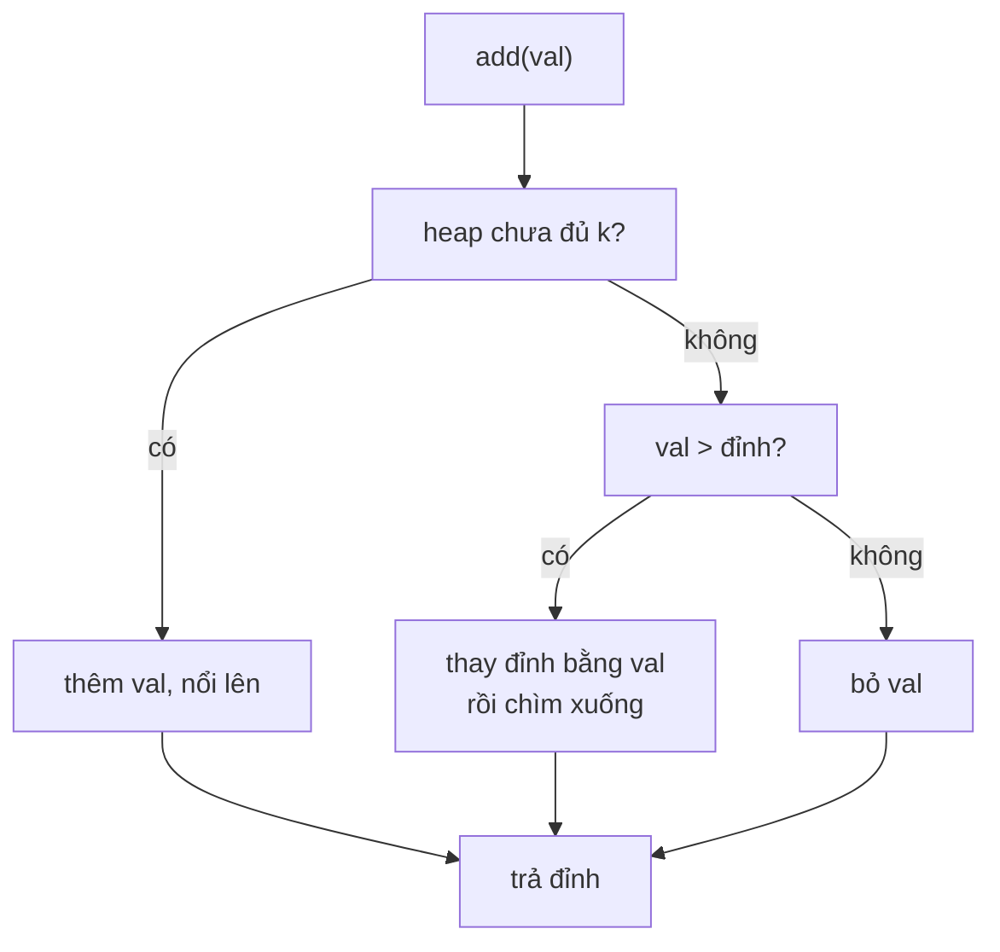

> [!tldr] Đọc nhanh
> - Đề: một luồng số đi vào từng số một. Sau mỗi lần `add(val)`, trả số lớn thứ k của mọi số đã thấy.
> - Giữ một **min-heap** không quá k phần tử: heap chứa k số lớn nhất đã thấy, và đỉnh (số nhỏ nhất trong k số đó) chính là số lớn thứ k. Số mới nhỏ hơn đỉnh thì bỏ, O(1); lớn hơn thì thay đỉnh rồi cho chìm xuống, O(log k). Xem [[concepts/size-k-heap|Size-K Heap]].
> - Sắp lại cả mảng mỗi lần thêm cũng đúng, nhưng đo với 10⁴ số ban đầu và 10⁴ lần thêm: 1 562,8 ms so với 0,24 ms.
> - Bốn bản sai được chạy thật: max-heap k chỗ (1/8 ca), quên bỏ bớt khi heap quá k (0/8), gọi thẳng `h.Push` thay cho `heap.Push(h, …)` trong Go (0/8), và `sort()` không truyền hàm so sánh trong JS (3/7).
> - Dựng heap từ n số có sẵn bằng [[concepts/heapify|heapify]] chỉ O(n): với 10⁶ số giảm dần, 999 988 lần đổi chỗ so với 17 951 445 khi thêm lần lượt.

> [!info] Bối cảnh
> Bài LeetCode 703, bài neo của [[posts/2026-11-23-neetcode-heap-top-k|ga 3: Heap và top K]] trong **tuyến NeetCode: Tìm kiếm và heap**. [[concepts/heap|Heap]] đã xuất hiện một lần ở bài [[problems/top-k-frequent-elements|Top K Frequent Elements]]; trang này mở nó ra: heap nằm trong mảng thế nào, nổi lên và chìm xuống ra sao, và vì sao top k **lớn** nhất lại cần heap **nhỏ**. Lời giải có đủ TypeScript, Python, Go, Java và JavaScript. Không cần biết gì về heap trước.

> [!abstract]- Từ điển nhanh cho bài này (bấm để mở)
> - **Luồng (stream)**: dữ liệu đến từng phần tử một, không biết trước có bao nhiêu và không xem lại được toàn bộ cho rẻ.
> - **Heap (đống)**: cây nhị phân lưu trong mảng, mỗi cha không lớn hơn hai con (min-heap) nên phần tử nhỏ nhất luôn ở ô 0. Xem [[concepts/heap|Heap]].
> - **Đỉnh (top)**: ô 0 của heap. Đọc đỉnh tốn O(1).
> - **Nổi lên, chìm xuống (sift up, sift down)**: cách sửa heap sau khi thêm hoặc thay đỉnh. Xem [[concepts/sift-up-sift-down|Sift Up and Sift Down]].
> - **Heapify**: dựng heap từ một mảng có sẵn trong O(n). Xem [[concepts/heapify|Heapify]].
> - **Hàm so sánh (comparator)**: hàm nhận hai phần tử, trả số âm, 0 hoặc dương để nói phần tử nào đứng trước.

## Hình dung trước: đội tuyển ba người của câu lạc bộ

Câu lạc bộ cờ giữ một đội tuyển đúng ba người mạnh nhất. Mỗi khi có người mới đến xin vào, ban huấn luyện không xếp hạng lại cả câu lạc bộ. Họ chỉ cho người mới đấu với **người yếu nhất trong đội**: thắng thì vào thay, thua thì về. Người yếu nhất trong đội ba người chính là "người mạnh thứ ba" của cả câu lạc bộ, và để biết ngay người đó là ai, họ luôn đứng ở cửa phòng.

| Đời thường | Khái niệm |
|---|---|
| Đội tuyển đúng ba người | heap không quá k = 3 phần tử |
| Người yếu nhất trong đội đứng ở cửa | đỉnh của min-heap |
| Người mạnh thứ ba của câu lạc bộ | số lớn thứ k = đỉnh |
| Người mới thua người ở cửa: về | `val <= đỉnh`: bỏ, O(1) |
| Người mới thắng: vào thay, rồi đội xếp lại để người yếu nhất ra cửa | thay đỉnh, chìm xuống, O(log k) |
| Xếp hạng lại cả câu lạc bộ mỗi lần có người mới | sắp lại cả mảng mỗi lần `add` |
| Đội giữ ba người **yếu** nhất, người mạnh nhất đứng cửa | bản sai: max-heap k chỗ |



## Vấn đề

Cách thẳng nhất là giữ mọi số đã thấy trong một mảng, mỗi lần `add` thì sắp lại và đọc ô thứ k tính từ cuối. Mỗi lần thêm tốn O(n log n) với n là số phần tử đã thấy, dù chỉ cần biết một số. Đề cho tới 10⁴ số ban đầu và 10⁴ lần `add`; đo với k = 100, 1 000 lần thêm đã mất 105,7 ms, 10⁴ lần mất 1 562,8 ms.

Điều cần nhận ra: số lớn thứ k chỉ phụ thuộc vào **k số lớn nhất**. Một số đã rơi khỏi top k thì không bao giờ quay lại được (luồng chỉ thêm, không xóa), nên vứt nó đi được. Còn lại câu hỏi: giữ k số đó trong cấu trúc nào để mỗi lần thêm vừa biết ngay số yếu nhất, vừa thay nó nhanh.

## Cơ chế

<figure class="figure-map" style="--ar: 3 / 4">
<div class="frame"><iframe data-archify="../diagrams/neetcode-kth-largest-element-in-a-stream/worked-example.html" title="Giữ đúng k số lớn nhất" loading="lazy"></iframe></div>
<figcaption><span><b>Hình 1.</b> Giữ đúng k số lớn nhất.</span><a href="../diagrams/neetcode-kth-largest-element-in-a-stream/worked-example.html" target="_blank" rel="noopener">Mở toàn màn hình</a></figcaption>
</figure>

<details>
<summary>Đọc từng bước</summary>
<ol>
<li>Khởi tạo heap chứa ba số. <code>k = 3; {4, 7, 9}</code></li>
<li>Thêm 6 và lấy số nhỏ nhất ra. <code>evict 4; {6, 7, 9}</code></li>
<li>Thêm 2 thì nó bị loại ngay. <code>evict 2; {6, 7, 9}</code></li>
<li>Gốc heap là số lớn thứ ba. <code>6</code></li>
</ol>
</details>

### Min-heap k chỗ

Heap giữ k số lớn nhất đã thấy. Mỗi số mới chỉ cần so với **số yếu nhất** trong k số đó: lớn hơn thì nó vào top k và đẩy số yếu nhất ra; không lớn hơn thì nó không vào. Muốn số yếu nhất nằm ngay ở đỉnh để so trong O(1) thì heap phải là **min**-heap. Và vì heap có đúng k số lớn nhất, số nhỏ nhất của nó là số lớn thứ k: đáp án luôn là đỉnh.

Chạy ví dụ của đề, k = 3, `nums = [4, 5, 8, 2]`, rồi thêm 3, 5, 10, 9, 4:

| Bước | Heap (mảng) | Đỉnh trả về |
|---|---|---|
| nạp 4, 5, 8 | `[4, 5, 8]` | |
| nạp 2: 2 < 4, bỏ | `[4, 5, 8]` | |
| add 3: 3 < 4, bỏ | `[4, 5, 8]` | 4 |
| add 5: 5 > 4, thay đỉnh | `[5, 5, 8]` | 5 |
| add 10: thay đỉnh, 10 chìm xuống đổi với 5 | `[5, 10, 8]` | 5 |
| add 9: thay đỉnh, 9 chìm xuống đổi với 8 | `[8, 10, 9]` | 8 |
| add 4: 4 < 8, bỏ | `[8, 10, 9]` | 8 |

Sơ đồ tương tác của [[posts/2026-11-23-neetcode-heap-top-k|post ga]] đi lại đúng các bước này.

### Heap nằm trong mảng

Không cần nút và con trỏ. Ô i có cha ở `(i − 1) >> 1`, hai con ở `2i + 1` và `2i + 2`; tính chất heap là mỗi cha không lớn hơn con. Hai thao tác giữ tính chất đó ([[concepts/sift-up-sift-down|Sift Up and Sift Down]]):

- **Nổi lên** khi thêm: đặt số mới ở cuối mảng, còn nhỏ hơn cha thì đổi chỗ với cha.
- **Chìm xuống** khi thay hoặc lấy đỉnh: còn lớn hơn **con nhỏ hơn** thì đổi chỗ với con đó. Đổi với con lớn hơn sẽ đặt nó lên trên con nhỏ, phá tính chất heap.

Cây có k phần tử cao ⌊log₂ k⌋, nên mỗi thao tác tốn O(log k). Toàn bài: O(n log k) để nạp, O(log k) mỗi lần `add`, bộ nhớ O(k).

### Bản sai thứ nhất: max-heap k chỗ

"Tìm số **lớn** thì dùng max-heap" là phản xạ tự nhiên, và cũng là thói quen trong Python: `heapq` chỉ có min-heap nên người ta đảo dấu để có max-heap. Áp vào đây thì sai chiều. Khi quá k phần tử, max-heap bỏ số **lớn** nhất, nên giữ lại k số **nhỏ** nhất, và đỉnh là số lớn nhất trong k số nhỏ nhất: số **nhỏ** thứ k. Bản này đúng 1/8 ca (ca "số trùng", nơi mọi số bằng nhau), ví dụ của đề trả `[4, 4, 4, 4, 4]` thay vì `[4, 5, 5, 8, 8]`.

### Bản sai thứ hai: quên bỏ bớt

Thêm mọi số vào min-heap mà không giới hạn k chỗ thì đỉnh là số nhỏ nhất của **cả luồng**, không phải số lớn thứ k: 0/8 ca, ví dụ của đề trả `[2, 2, 2, 2, 2]`. Kèm theo, heap phình tới n phần tử và mỗi lần thêm tốn O(log n) thay vì O(log k).

### Dựng heap từ mảng có sẵn: heapify O(n)

Lời giải ở trên nạp `nums` bằng cách thêm từng số. Có cách nhanh hơn để dựng heap từ n số có sẵn: [[concepts/heapify|heapify]] của Floyd (1964). Coi cả mảng là một cây, rồi cho chìm từng ô từ cha cuối cùng `n/2 − 1` ngược về ô 0. Một nửa số ô là lá, không phải chìm; một phần tư chìm tối đa một tầng; một phần tám tối đa hai tầng… Số ô ở độ cao h không quá n/2ʰ⁺¹, nên tổng số lần đổi chỗ không vượt Σ h · n/2ʰ⁺¹ = n. Thêm lần lượt thì ngược lại: phần lớn số ô nằm ở tầng dưới, và mỗi số mới có thể nổi lên tận gốc.

| n | n lần thêm | heapify (Floyd) |
|---|---|---|
| 10⁵ số ngẫu nhiên | 3,3 ms, 128 344 lần đổi | 1,9 ms, 74 416 lần đổi |
| 10⁶ số ngẫu nhiên | 41,4 ms, 1 280 862 lần đổi | 18,2 ms, 743 538 lần đổi |
| 10⁶ số giảm dần (ca xấu nhất của việc thêm) | 17 951 445 lần đổi | 999 988 lần đổi |

Với số ngẫu nhiên, thêm lần lượt chỉ tốn trung bình khoảng 1,3 lần đổi mỗi số (số mới thường dừng sớm), nên heapify chỉ nhanh hơn khoảng hai lần. Ca giảm dần mới cho thấy khoảng cách O(n log n) so với O(n): gấp gần 18 lần. Trong Python, `heapq.heapify` trên 10⁶ số mất 25,6 ms, còn 10⁶ lần `heappush` mất 50,6 ms. Ở bài này `nums` có tối đa 10⁴ số nên khác biệt nhỏ; bản Python và Go vẫn dùng heapify rồi bỏ bớt tới k, vì viết cũng gọn như thêm lần lượt.

### Bên dưới bảy ngôn ngữ

| | Heap có sẵn | Mặc định | Bẫy riêng |
|---|---|---|---|
| TypeScript / JavaScript | không có | phải tự viết | `arr.sort()` không truyền hàm so sánh thì so theo **chuỗi**: `[4, 5, 8, 2, 10].sort()` ra `[10, 2, 4, 5, 8]` |
| Python | `heapq` (hàm trên `list`) | chỉ có min-heap | đảo dấu để có max-heap; `heapq.heapreplace` thay đỉnh trong một lần chìm |
| Go | `container/heap` (bạn cài `heap.Interface`) | do `Less` quyết định | `Push`, `Pop` phải nhận con trỏ; phải gọi `heap.Push(h, x)`, không phải `h.Push(x)` |
| Java | `PriorityQueue` | min-heap | max-heap bằng `Collections.reverseOrder()`; comparator `(a, b) -> b - a` tràn `int` |
| PHP | `SplMinHeap`, `SplMaxHeap`, `SplPriorityQueue` | `SplPriorityQueue` lấy ưu tiên **cao** ra trước | `SplMinHeap` không có "thay đỉnh": `extract()` rồi `insert()`. Phần tử cùng ưu tiên trong `SplPriorityQueue` ra theo thứ tự không bảo đảm |
| Rust | `std::collections::BinaryHeap` | max-heap | bọc `Reverse(x)` để có min-heap; `peek_mut()` sửa đỉnh rồi tự chìm khi ra khỏi phạm vi; `peek()` trả `Option` |

Ba bẫy được chạy thật:

- **Go, gọi thẳng `h.Push(val)`.** Phương thức `Push` bạn viết chỉ `append` vào cuối slice; việc nổi lên nằm trong hàm `heap.Push` của gói. Gọi thẳng thì phần tử mới nằm ở cuối mà không nổi lên, đỉnh sai từ lần thêm đầu tiên: 0/8 ca.
- **Go, `Push` và `Pop` nhận giá trị thay vì con trỏ.** Nếu cả hai đều nhận giá trị thì kiểu vẫn thỏa `heap.Interface` và biên dịch được, nhưng `append` chỉ đổi bản sao: sau `heap.Push(v, 1)` heap vẫn là `[2 5 8]`, còn `heap.Pop(v)` trả 2 mà độ dài vẫn 3. (Ngược lại, khi `Push`, `Pop` nhận con trỏ như đúng cách mà bạn truyền `h` thay vì `&h`, trình biên dịch chặn ngay: `IntHeap does not implement heap.Interface (method Pop has pointer receiver)`.)
- **Java, comparator `(a, b) -> b - a`.** Với `Integer.MIN_VALUE`, 5 và `Integer.MAX_VALUE`, `5 - Integer.MIN_VALUE` tràn thành −2 147 483 643, và "max-heap" trả `peek() = -2147483648`. `Integer.compare(b, a)` trả đúng 2 147 483 647. Đề này giới hạn số trong [−10⁴, 10⁴] nên không chạm tới, nhưng đây là lỗi kinh điển khi chép comparator sang bài khác.

### Đo

10⁴ số ban đầu, k = 100, trung vị 5 lần, Node 24:

| Số lần `add` | Sắp lại mỗi lần | Min-heap k chỗ |
|---|---|---|
| 1 000 | 105,7 ms | 0,32 ms |
| 10 000 | 1 562,8 ms | 0,24 ms |

Cột heap gần như không đổi theo số lần `add`, vì với số ngẫu nhiên hầu hết số mới nhỏ hơn đỉnh và bị bỏ sau một phép so sánh; thời gian chủ yếu là nạp 10⁴ số ban đầu. Ca xấu nhất của heap là luồng **tăng dần**: số nào cũng lớn hơn đỉnh, lần nào cũng phải chìm. 10⁴ lần `add` như vậy mất 1,29 ms với k = 100 và 1,55 ms với k = 5 000: vẫn rất nhỏ, và tăng chậm theo log k.

## Ví dụ chạy được

[TypeScript](../code/neetcode-kth-largest-element-in-a-stream/kth-largest-stream.ts) · [Python](../code/neetcode-kth-largest-element-in-a-stream/kth_largest_stream.py) · [Go](../code/neetcode-kth-largest-element-in-a-stream/kth_largest_stream.go) · [Java](../code/neetcode-kth-largest-element-in-a-stream/kth-largest-stream.java) · [JavaScript](../code/neetcode-kth-largest-element-in-a-stream/kth-largest-stream.js) · [PHP](../code/neetcode-kth-largest-element-in-a-stream/kth-largest-stream.php) · [Rust](../code/neetcode-kth-largest-element-in-a-stream/kth_largest_stream.rs)

Mỗi file chạy 7 hoặc 8 ca: ví dụ của đề, một luồng nhiều số 7 trùng, `nums` rỗng với k = 1, `nums` ít hơn k (đề cho phép k = `nums.length + 1`), số trùng, số âm, và (trừ JS) một luồng ngẫu nhiên 200 + 500 số với k = 50, đáp án lấy bằng cách sắp lại mỗi lần.

```ts
// Min-heap viết tay: JS/TS không có heap sẵn. Cha ở i, hai con ở 2i + 1 và 2i + 2.
class MinHeap {
  a: number[] = [];
  swaps = 0; // đếm số lần đổi chỗ, để so heapify với n lần push
  get size(): number { return this.a.length; }
  peek(): number { return this.a[0]; }
  push(x: number): void {
    const a = this.a;
    a.push(x);
    let i = a.length - 1;
    while (i > 0) { // nổi lên: đổi với cha khi nhỏ hơn cha
      const p = (i - 1) >> 1;
      if (a[p] <= a[i]) break;
      [a[p], a[i]] = [a[i], a[p]]; this.swaps++;
      i = p;
    }
  }
  pop(): number {
    const a = this.a, top = a[0], last = a.pop()!;
    if (a.length > 0) { a[0] = last; this.siftDown(0); }
    return top;
  }
  siftDown(i: number): void { // chìm xuống: đổi với con nhỏ hơn khi lớn hơn nó
    const a = this.a, n = a.length;
    for (;;) {
      const l = 2 * i + 1, r = l + 1;
      let m = i;
      if (l < n && a[l] < a[m]) m = l;
      if (r < n && a[r] < a[m]) m = r;
      if (m === i) return;
      [a[m], a[i]] = [a[i], a[m]]; this.swaps++;
      i = m;
    }
  }
  // Floyd: dựng heap từ mảng có sẵn bằng cách cho chìm từ cha cuối cùng về gốc. O(n).
  static heapify(xs: number[]): MinHeap {
    const h = new MinHeap();
    h.a = xs.slice();
    for (let i = (h.a.length >> 1) - 1; i >= 0; i--) h.siftDown(i);
    return h;
  }
}

// Min-heap k chỗ: heap chỉ giữ k số lớn nhất đã thấy; số nhỏ nhất trong k số đó (đỉnh) là số lớn thứ k.
class KthLargest implements Stream {
  heap = new MinHeap();
  k: number;
  constructor(k: number, nums: number[]) {
    this.k = k;
    for (const x of nums) this.add(x);
  }
  add(val: number): number {
    if (this.heap.size < this.k) this.heap.push(val);
    else if (val > this.heap.peek()) { // mạnh hơn ứng viên yếu nhất: thay nó
      this.heap.a[0] = val;
      this.heap.siftDown(0);
    }
    return this.heap.peek();
  }
}
```

```python
class KthLargest:
    # heapq chỉ có min-heap: phần tử nhỏ nhất ở self.h[0]. Giữ k số lớn nhất, đỉnh là số lớn thứ k.
    def __init__(self, k: int, nums: list[int]):
        self.k = k
        self.h = nums[:]
        heapq.heapify(self.h)  # O(n)
        while len(self.h) > k:
            heapq.heappop(self.h)

    def add(self, val: int) -> int:
        if len(self.h) < self.k:
            heapq.heappush(self.h, val)
        elif val > self.h[0]:
            heapq.heapreplace(self.h, val)  # pop rồi push trong một lần chìm
        return self.h[0]
```

```go
// IntHeap thỏa heap.Interface: Len, Less, Swap (của sort.Interface) cùng Push và Pop.
type IntHeap []int

func (h IntHeap) Len() int           { return len(h) }

func (h IntHeap) Less(i, j int) bool { return h[i] < h[j] } // < là min-heap

func (h IntHeap) Swap(i, j int)      { h[i], h[j] = h[j], h[i] }

// Push và Pop đổi độ dài slice nên phải nhận con trỏ.
func (h *IntHeap) Push(x any) { *h = append(*h, x.(int)) }

func (h *IntHeap) Pop() any {
	old := *h
	n := len(old)
	x := old[n-1]
	*h = old[:n-1]
	return x
}

type KthLargest struct {
	k int
	h *IntHeap
}

func Constructor(k int, nums []int) KthLargest {
	h := IntHeap(slices.Clone(nums))
	heap.Init(&h) // O(n)
	for h.Len() > k {
		heap.Pop(&h)
	}
	return KthLargest{k, &h}
}

func (s *KthLargest) Add(val int) int {
	if s.h.Len() < s.k {
		heap.Push(s.h, val)
	} else if val > (*s.h)[0] {
		(*s.h)[0] = val
		heap.Fix(s.h, 0) // cho đỉnh mới chìm xuống
	}
	return (*s.h)[0]
}
```

```java
// PriorityQueue mặc định là min-heap: peek() trả phần tử nhỏ nhất.
static class KthLargest {
    private final int k;
    private final PriorityQueue<Integer> pq = new PriorityQueue<>();
    KthLargest(int k, int[] nums) {
        this.k = k;
        for (int x : nums) add(x);
    }
    int add(int val) {
        if (pq.size() < k) pq.offer(val);
        else if (val > pq.peek()) { pq.poll(); pq.offer(val); }
        return pq.peek();
    }
}
```

```js
// Min-heap k chỗ trên một mảng: cha ở i, hai con ở 2i + 1 và 2i + 2.
class KthLargest {
  constructor(k, nums) {
    this.k = k;
    this.h = [];
    for (const x of nums) this.add(x);
  }
  add(val) {
    const h = this.h;
    if (h.length < this.k) {
      h.push(val);
      let i = h.length - 1; // nổi lên
      while (i > 0 && h[(i - 1) >> 1] > h[i]) {
        const p = (i - 1) >> 1;
        [h[p], h[i]] = [h[i], h[p]];
        i = p;
      }
    } else if (val > h[0]) {
      h[0] = val;
      let i = 0; // chìm xuống
      for (;;) {
        const l = 2 * i + 1, r = l + 1;
        let m = i;
        if (l < h.length && h[l] < h[m]) m = l;
        if (r < h.length && h[r] < h[m]) m = r;
        if (m === i) break;
        [h[m], h[i]] = [h[i], h[m]];
        i = m;
      }
    }
    return h[0];
  }
}
```

```php
// Min-heap k chỗ: SplMinHeap giữ k số lớn nhất đã thấy; đỉnh (top) là số lớn thứ k.
final class KthLargest implements Stream
{
    private SplMinHeap $heap;
    public function __construct(private int $k, array $nums)
    {
        $this->heap = new SplMinHeap();
        foreach ($nums as $x) $this->add($x);
    }
    public function add(int $val): int
    {
        if ($this->heap->count() < $this->k) $this->heap->insert($val);
        elseif ($val > $this->heap->top()) { // mạnh hơn ứng viên yếu nhất: thay nó
            $this->heap->extract(); // SplMinHeap không có "thay đỉnh": lấy ra rồi thêm vào
            $this->heap->insert($val);
        }
        return $this->heap->top();
    }
}
```

```rust
// Min-heap k chỗ. BinaryHeap của Rust là max-heap; bọc Reverse để số nhỏ nhất nằm ở đỉnh.
struct KthLargest {
    k: usize,
    heap: BinaryHeap<Reverse<i32>>,
}

impl KthLargest {
    fn new(k: i32, nums: Vec<i32>) -> Self {
        let mut s = KthLargest { k: k as usize, heap: BinaryHeap::with_capacity(k as usize + 1) };
        for x in nums {
            s.add(x);
        }
        s
    }
}

impl Stream for KthLargest {
    fn add(&mut self, val: i32) -> i32 {
        if self.heap.len() < self.k {
            self.heap.push(Reverse(val));
        } else if let Some(mut top) = self.heap.peek_mut() {
            // peek_mut cho sửa đỉnh tại chỗ; khi `top` ra khỏi phạm vi, heap tự cho nó chìm xuống một lần.
            if val > top.0 {
                *top = Reverse(val);
            }
        }
        self.heap.peek().unwrap().0 // đề hứa luôn có đủ k số khi gọi add, nên đỉnh tồn tại
    }
}
```


Kết quả `node kth-largest-stream.ts`, gồm bản sắp lại mỗi lần, hai bản sai và hai phép đo:

```text
SortEachAdd        8/8 ca đúng
KthLargest         8/8 ca đúng
NoTrimKthLargest   0/8 ca đúng; sai ở: ví dụ của đề → [2, 2, 2, 2, 2]; nhiều số 7 trùng → [2, 2, 2, 2]; nums rỗng, k = 1 → [-3, -3, -4, -4, -4]; nums thiếu một số → [-1, -1, -2, -4, -4]; số trùng → [5, 1, 1]; k bằng cả luồng → [1, 0]; số âm → [-20, -30, -30]; ngẫu nhiên 200 + 500 số, k = 50
MaxHeapKthLargest  1/8 ca đúng; sai ở: ví dụ của đề → [4, 4, 4, 4, 4]; nhiều số 7 trùng → [7, 7, 7, 7]; nums rỗng, k = 1 → [-3, -3, -4, -4, -4]; nums thiếu một số → [0, 0, -1, -2, -2]; k bằng cả luồng → [3, 2]; số âm → [-10, -20, -20]; ngẫu nhiên 200 + 500 số, k = 50

Đo: 10⁴ số ban đầu + n lần add, k = 100 (trung vị 5 lần)
n add       sắp lại mỗi lần   min-heap k chỗ
1000             105.7 ms          0.32 ms
10000           1562.8 ms          0.24 ms
luồng tăng dần, 10⁴ add: min-heap k = 100 mất 1.29 ms, k = 5 000 mất 1.55 ms

Đo: dựng heap n phần tử ngẫu nhiên (trung vị 5 lần)
n            n lần push              heapify (Floyd)
100000         3.3 ms,   128344 lần đổi     1.9 ms,    74416 lần đổi
1000000       41.4 ms,  1280862 lần đổi    18.2 ms,   743538 lần đổi
dãy giảm dần, n = 10⁶: push 17951445 lần đổi, heapify 999988 lần đổi
```

Python (bản đảo dấu sai, và heapify so với `heappush`):

```text
KthLargest         8/8 ca đúng
NegatedKthLargest  1/8 ca đúng; sai ở: ví dụ của đề → [4, 4, 4, 4, 4]; nhiều số 7 trùng → [7, 7, 7, 7]; nums rỗng, k = 1 → [-3, -3, -4, -4, -4]; nums thiếu một số → [0, 0, -1, -2, -2]; k bằng cả luồng → [3, 2]; số âm → [-10, -20, -20]; ngẫu nhiên 200 + 500 số, k = 50

n = 10⁶: heapify 25.6 ms, 10⁶ lần heappush 50.6 ms
nlargest(3, [4, 5, 8, 2]) = [8, 5, 4]
```

Go (gọi thẳng `Push`, và `Push`/`Pop` nhận giá trị):

```text
KthLargest     8/8 ca đúng
addDirectPush  0/8 ca đúng; sai ở: [ví dụ của đề → [3 5 5 8 4] nhiều số 7 trùng → [2 7 7 8] nums rỗng, k = 1 → [-3 -2 -4 0 4] nums thiếu một số → [0 -1 -2 -4 1] số trùng → [5 1 5] k bằng cả luồng → [1 0] số âm → [-10 -30 -5] ngẫu nhiên 200 + 500 số, k = 50]

ValHeap: sau Push(1): [2 5 8], độ dài 3; Pop trả 2, heap còn [5 8 2], độ dài 3
```

Java (`Collections.reverseOrder()` và comparator tràn số):

```text
KthLargest         8/8 ca đúng
ReverseKthLargest  1/8 ca đúng; sai ở: ví dụ của đề → [4, 4, 4, 4, 4]; nhiều số 7 trùng → [7, 7, 7, 7]; nums rỗng, k = 1 → [-3, -3, -4, -4, -4]; nums thiếu một số → [0, 0, -1, -2, -2]; k bằng cả luồng → [3, 2]; số âm → [-10, -20, -20]; ngẫu nhiên 200 + 500 số, k = 50

max-heap bằng b - a, peek() = -2147483648; bằng Integer.compare(b, a), peek() = 2147483647
vì 5 - Integer.MIN_VALUE = -2147483643
```

JavaScript (`sort()` không truyền hàm so sánh):

```text
KthLargest             7/7 ca đúng
DefaultSortKthLargest  3/7 ca đúng; sai ở: ví dụ của đề → [4, 5, 5, 5, 5]; nhiều số 7 trùng → [7, 7, 7, 7]; nums rỗng, k = 1 → [-3, -3, -4, 0, 4]; số âm → [-20, -30, -30]

[4, 5, 8, 2, 10].sort() = [10,2,4,5,8]
```

PHP (`php kth-largest-stream.php`) và Rust (`rustc --edition 2021 -O kth_largest_stream.rs`): bản đúng 8/8 ca, bản sai lấy max-heap thay min-heap (`SplPriorityQueue` trong PHP, `BinaryHeap<i32>` quên `Reverse` trong Rust) 1/8 ca, sai đúng các ca như `MaxHeapKthLargest` của TS. PHP in thêm `ba phần tử cùng ưu tiên 1, thêm a, b, c, lấy ra: a, c, b`; Rust in `heap rỗng: peek() = None`.

## Hiểu lầm và bẫy hay gặp

- **"Tìm số lớn thì dùng max-heap."** Cho số **lớn nhất** thì đúng. Cho số lớn **thứ k** thì cần min-heap k chỗ: đỉnh phải là số yếu nhất trong top k, vì đó là số bị so và bị thay.
- **Quên bỏ bớt khi heap quá k.** Đỉnh thành số nhỏ nhất của cả luồng, và heap phình ra.
- **Lấy đỉnh rồi mới thêm.** Đúng, nhưng chìm một lần và nổi một lần. Thay đỉnh rồi chìm một lần (`heapreplace`, `heap.Fix(h, 0)`) chỉ đi một đường.
- **So `>=` hay `>` với đỉnh.** Cả hai đều đúng: số bằng đỉnh thay vào hay không thì heap vẫn chứa cùng các giá trị. `>` đỡ một lần chìm.
- **`nums` có ít hơn k số.** Đề cho phép (k tới `nums.length + 1`) và hứa có đủ k số khi cần trả lời. Nạp mà không kiểm tra "đã đủ k chưa" thì đọc đỉnh của heap thiếu là sai; cả bảy bản đều nhận hết khi heap chưa đủ.
- **JS: `sort()` mặc định.** So theo chuỗi, nên `10` đứng trước `2`. Luôn truyền `(a, b) => a - b`.
- **PHP: tưởng `SplPriorityQueue` là min-heap.** Nó lấy ưu tiên cao nhất ra trước, nên `extract()` để bỏ bớt lại bỏ số lớn nhất: 1/8 ca. Dùng `SplMinHeap`, hoặc đảo dấu ưu tiên.
- **Rust: quên `Reverse`.** `BinaryHeap<i32>` là max-heap, cũng 1/8 ca. `BinaryHeap<Reverse<i32>>` cho min-heap, và `peek_mut()` thay đỉnh trong một lần chìm như `heapreplace` của Python.

## Câu hỏi tự kiểm tra

> [!question]- k = 2, `nums = [5]`, rồi thêm 1, 7, 3. Heap và kết quả sau mỗi lần thêm?
> Nạp xong: heap `[5]`, chưa đủ 2. Thêm 1: còn chỗ, nhận và nổi lên: `[1, 5]`, trả 1. Thêm 7: 7 > 1, thay đỉnh rồi chìm: `[7, 5]` thành `[5, 7]`, trả 5. Thêm 3: 3 < 5, bỏ, trả 5.

> [!question]- Vì sao heapify chỉ O(n) trong khi mỗi lần chìm có thể tốn O(log n)?
> Chỉ ô gần gốc mới chìm xa, và ô gần gốc rất ít. Một nửa số ô là lá (chìm 0 tầng), một phần tư chìm tối đa 1 tầng, một phần tám tối đa 2 tầng. Tổng Σ h · n/2ʰ⁺¹ hội tụ về n.

> [!question]- Muốn số **nhỏ** thứ k của một luồng thì dùng heap gì?
> Max-heap k chỗ: giữ k số nhỏ nhất, đỉnh là số lớn nhất trong đó, tức số nhỏ thứ k. Số mới nhỏ hơn đỉnh thì thay đỉnh. Đây chính là bản "sai" của bài này, đúng cho bài ngược lại.

> [!question]- Nếu luồng có thêm thao tác xóa một số bất kỳ, min-heap k chỗ còn dùng được không?
> Không: số đã bị bỏ vì rơi khỏi top k có thể phải quay lại khi một số trong top k bị xóa, mà heap đã quên nó. Cần giữ mọi số, ví dụ trong một cây cân bằng có đếm số phần tử, hoặc hai heap có xóa trễ.

## Tham khảo

- [LeetCode 703. Kth Largest Element in a Stream](https://leetcode.com/problems/kth-largest-element-in-a-stream/)
- [Python `heapq`](https://docs.python.org/3/library/heapq.html) (min-heap, `heapify`, `heapreplace`, `nlargest`)
- [Go `container/heap`](https://pkg.go.dev/container/heap) (ví dụ `IntHeap`, `heap.Push`, `heap.Fix`)
- [Java 21 `PriorityQueue`](https://docs.oracle.com/en/java/javase/21/docs/api/java.base/java/util/PriorityQueue.html) và [`Integer.compare`](https://docs.oracle.com/en/java/javase/21/docs/api/java.base/java/lang/Integer.html#compare(int,int))
- [MDN `Array.prototype.sort`](https://developer.mozilla.org/en-US/docs/Web/JavaScript/Reference/Global_Objects/Array/sort) (mặc định so theo chuỗi UTF-16)
- Robert W. Floyd, "Algorithm 245: Treesort 3", *Communications of the ACM* 7(12), 1964 (dựng heap từ dưới lên)
- Cormen, Leiserson, Rivest, Stein, *Introduction to Algorithms*, chương 6 "Heapsort" (Build-Max-Heap và chứng minh O(n))
