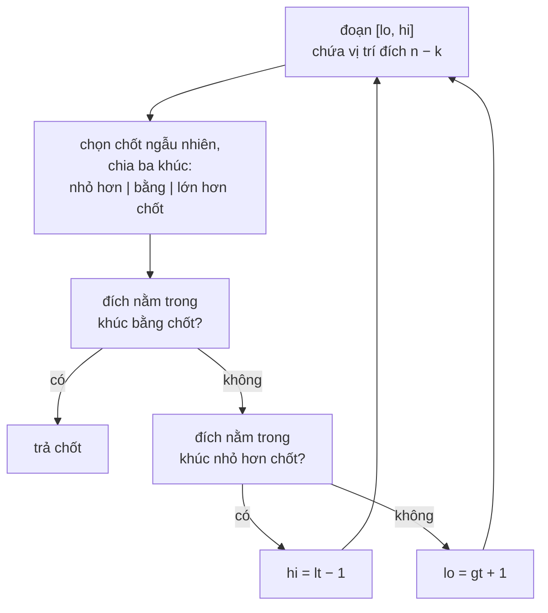

> [!tldr] Đọc nhanh
> - Đề: cho mảng `nums` và số k, trả phần tử lớn thứ k **theo thứ tự đã sắp**, tính cả phần tử trùng. Đề gợi ý: làm được mà không cần sắp xếp không?
> - Ba hướng: giữ một [[concepts/heap|min-heap]] k phần tử lớn nhất đã thấy, đỉnh là đáp án, O(n log k); [[concepts/quickselect|quickselect]] phân hoạch rồi chỉ đi vào một phía, O(n) trung bình; và vì giá trị chỉ trong [−10⁴, 10⁴], đếm theo giá trị, O(n + 20 001).
> - Đo với n = 10⁵, k = n / 2: quickselect chốt ngẫu nhiên kiểu Lomuto mất 1,2 ms trên mảng ngẫu nhiên nhưng **2 441 ms** trên mảng toàn số bằng nhau. Chốt ngẫu nhiên không cứu được: không phần tử nào nhỏ hơn chốt, nên mỗi vòng chỉ bớt 1 phần tử.
> - Sửa bằng [[concepts/three-way-partition|phân hoạch ba phần]] (nhỏ hơn, bằng, lớn hơn chốt): 0,5 ms trên cùng mảng đó. Phân hoạch Hoare cũng ổn: 0,4 ms.
> - Bốn bẫy ngôn ngữ được chạy thật: `sort()` của JS so sánh chuỗi (`[10, 9, 1].sort()` ra `[1, 10, 9]`), Go gọi `h.Push` thay cho `heap.Push`, Java so sánh bằng `b - a` tràn `int`, và `heapq.nlargest` của Python chậm gấp 3,5 lần `sorted` khi k = n / 2.

> [!info] Bối cảnh
> Bài LeetCode 215, thuộc [[posts/2026-11-23-neetcode-heap-top-k|ga 3: Heap và top K]] trong **tuyến NeetCode: Tìm kiếm và heap**. Bài [[problems/top-k-frequent-elements|Top K Frequent Elements]] ở tuyến Mảng và chuỗi đã dùng heap và quickselect trên tần suất; ở đây chúng chạy thẳng trên giá trị, nên dễ thấy chỗ quickselect gãy. Lời giải có đủ TypeScript, Python, Go, Java và JavaScript. Bạn chỉ cần biết mảng và vòng lặp.

> [!abstract]- Từ điển nhanh cho bài này (bấm để mở)
> - **Heap**: cây nhị phân cất trong mảng, cha ở i, hai con ở 2i + 1 và 2i + 2; phần tử nhỏ nhất (min-heap) luôn ở ô 0. Thêm thì **nổi lên**, lấy đỉnh thì **chìm xuống**, mỗi việc O(log n). Xem [[concepts/heap|Heap]].
> - **Hàng đợi ưu tiên (priority queue)**: kiểu dữ liệu "lấy ra phần tử ưu tiên nhất"; heap là cách cài đặt phổ biến. Xem [[concepts/heap|Heap]].
> - **Phân hoạch (partition)**: chọn một phần tử làm **chốt** (pivot), dồn phần tử nhỏ hơn chốt sang trái, lớn hơn sang phải. Đây là bước lõi của quicksort.
> - **Quickselect**: phân hoạch như quicksort nhưng chỉ đi tiếp vào phía chứa vị trí cần tìm. Xem [[concepts/quickselect|Quickselect]].
> - **Phân hoạch ba phần**: chia làm ba khúc nhỏ hơn, bằng, lớn hơn chốt. Xem [[concepts/three-way-partition|Three-way Partition]].
> - **Ngăn xếp gọi hàm (call stack)**: vùng nhớ giữ các lời gọi hàm đang chờ; đệ quy quá sâu làm nó đầy và ném `RangeError`.

## Hình dung trước: chọn người đứng thứ k trong một cuộc thi

Ban tổ chức một cuộc thi có 10 000 bài dự thi, cần biết điểm của người **đứng thứ 50**: mức điểm sàn để vào vòng sau. Không ai xếp hạng đủ 10 000 bài chỉ để đọc một con số. Có hai cách gọn hơn.

Cách thứ nhất: kê một hàng **50 ghế** trên sân khấu. Ghế gần cửa luôn dành cho người điểm thấp nhất trong hàng. Mỗi bài mới đến, nếu điểm cao hơn người ở ghế cửa thì người đó bị mời xuống và người mới vào hàng. Chấm hết 10 000 bài, người ở ghế cửa chính là người thứ 50.

Cách thứ hai: rút đại một bài làm **mốc**, chia các bài còn lại thành phe "cao hơn mốc" và "thấp hơn mốc". Nếu phe cao hơn có đúng 49 bài thì mốc là người thứ 50. Nếu nhiều hơn, người thứ 50 nằm trong phe cao hơn; bỏ hẳn phe thấp hơn và chia tiếp. Nếu ít hơn, làm ngược lại.

| Đời thường | Khái niệm |
|---|---|
| Hàng 50 ghế, ghế cửa dành cho người thấp điểm nhất | min-heap k phần tử, đỉnh `h[0]` |
| Người mới cao điểm hơn người ở ghế cửa thì thế chỗ | `push(x)` rồi `pop()` khi heap quá k |
| Bài rút đại làm mốc | chốt (pivot) |
| Chia phe cao hơn, thấp hơn mốc | phân hoạch |
| Bỏ hẳn phe không chứa người thứ 50 | quickselect chỉ đi vào một phía |
| Rất nhiều bài **bằng điểm** mốc, không biết xếp vào phe nào | bẫy của phân hoạch hai phần |
| Thêm phe thứ ba "bằng điểm mốc" | phân hoạch ba phần |



## Vấn đề

Phần tử lớn thứ k là phần tử ở vị trí `n − k` khi mảng xếp tăng dần (đếm từ 0). Sắp xếp rồi lấy ra là đúng và gọn: O(n log n). Với n = 10⁵ thì vậy là đủ nhanh trên LeetCode. Nhưng sắp xếp làm nhiều hơn cần: nó xếp đúng chỗ **mọi** phần tử, trong khi ta chỉ cần một. Mà sắp xếp bằng so sánh không thể nhanh hơn O(n log n) ([[concepts/sorting-lower-bound|cận dưới của sắp xếp]]), nên muốn nhanh hơn phải làm ít việc hơn.

Ví dụ thứ hai của đề cho thấy một chi tiết: `[3, 2, 3, 1, 2, 4, 5, 5, 6]`, k = 4, đáp án là **4**. Xếp giảm dần: 6, 5, 5, 4. Hai số 5 tính là hai vị trí. Ai bỏ trùng trước ("giá trị khác nhau lớn thứ 4") sẽ ra 3.

## Cơ chế

<figure class="figure-map" style="--ar: 3 / 4">
<div class="frame"><iframe data-archify="../diagrams/neetcode-kth-largest-element-in-an-array/worked-example.html" title="Giữ phân đoạn chứa hạng cần tìm" loading="lazy"></iframe></div>
<figcaption><span><b>Hình 1.</b> Giữ phân đoạn chứa hạng cần tìm.</span><a href="../diagrams/neetcode-kth-largest-element-in-an-array/worked-example.html" target="_blank" rel="noopener">Mở toàn màn hình</a></figcaption>
</figure>

<details>
<summary>Đọc từng bước</summary>
<ol>
<li>Đổi lớn thứ hai sang chỉ số 3. <code>[9, 2, 6, 6, 4], n - k = 3</code></li>
<li>Chia quanh chốt 6. <code>[2, 4] / [6, 6] / [9]</code></li>
<li>Chỉ số 3 nằm trong vùng bằng chốt. <code>equal range = [2, 3]</code></li>
<li>Trả chốt 6. <code>6</code></li>
</ol>
</details>

### Cách 1: min-heap giữ k phần tử lớn nhất

Bất biến: sau khi đọc i phần tử, heap chứa đúng k phần tử lớn nhất trong i phần tử đó (hoặc tất cả, nếu i < k). Đỉnh là phần tử **nhỏ nhất** trong nhóm đó, tức người yếu nhất trong top k. Phần tử mới lớn hơn đỉnh thì thay đỉnh; không lớn hơn thì không thể lọt top k. Đọc hết mảng, đỉnh là phần tử lớn thứ k.

Thấy "lớn nhất" mà dùng max-heap là phản xạ dễ hiểu, và nó cũng đúng: đổ cả n phần tử vào max-heap rồi lấy ra k − 1 lần. Nhưng heap khi đó chứa n phần tử, tốn O(n) bộ nhớ và O(n + k log n) thời gian. Min-heap k chỗ chỉ tốn O(k) bộ nhớ, và chạy được trên **dòng dữ liệu** chưa biết độ dài, đúng thứ bài [[problems/kth-largest-element-in-a-stream|Kth Largest Element in a Stream]] cần.

Mỗi phần tử tốn một lần `push` và có thể một lần `pop`, mỗi lần O(log k): tổng O(n log k). Với k nhỏ thì gần như O(n). Với k = n / 2 thì log k ≈ log n, không hơn sắp xếp là bao.

### Cách 2: quickselect

Hoare công bố thuật toán này năm 1961 với tên FIND, cùng lúc với quicksort. Phân hoạch đoạn `[lo, hi]` quanh một chốt, chốt rơi vào đúng vị trí `p` của nó trong mảng đã sắp. Nếu `p` là vị trí đích thì xong. Nếu không, đích nằm hẳn ở một phía, bỏ phía kia. Trung bình mỗi vòng bớt một nửa, nên tổng việc là n + n/2 + n/4 + … ≈ 2n: **O(n) trung bình**.

Tệ nhất là O(n²): khi chốt luôn là phần tử lớn nhất (hoặc nhỏ nhất) của đoạn, mỗi vòng chỉ bớt đúng 1 phần tử. Chọn chốt cố định là phần tử cuối thì mảng đã sắp gây ra đúng trường hợp đó.

Có hai cách phân hoạch kinh điển, và chúng khác nhau đúng ở chỗ xử lý giá trị bằng chốt:

| | Lomuto | Hoare |
|---|---|---|
| Cách chạy | một con trỏ quét trái sang phải, dồn phần tử `< chốt` về đầu | hai con trỏ đi từ hai đầu vào giữa, đổi chỗ cặp đứng sai phía |
| Giá trị bằng chốt | tất cả về **một** phía | con trỏ dừng ở cả hai phía, giá trị bằng chốt chia **đều** |
| Kết quả | chốt đứng đúng chỗ `p` | ranh giới `j`: `[lo, j]` ≤ chốt ≤ `[j + 1, hi]`, chốt chưa chắc ở `j` |
| Mảng toàn số bằng nhau | mỗi vòng bớt 1: O(n²) | mỗi vòng bớt một nửa: O(n) |

```ts
// Phân hoạch Lomuto với chốt a[hi]: dồn mọi phần tử < chốt sang trái, đặt chốt ngay sau chúng, trả vị trí chốt.
function lomuto(a: number[], lo: number, hi: number): number {
  const pivot = a[hi];
  let i = lo;
  for (let j = lo; j < hi; j++) {
    if (a[j] < pivot) { [a[i], a[j]] = [a[j], a[i]]; i++; }
  }
  [a[i], a[hi]] = [a[hi], a[i]];
  return i;
}

// Cách 3c: quickselect với phân hoạch Hoare. Hai con trỏ đi từ hai đầu và dừng ở phần tử BẰNG chốt,
// nên giá trị bằng nhau bị chia đều sang hai phía thay vì dồn về một phía.
function quickselectHoare(nums: number[], k: number): number {
  const a = [...nums], target = a.length - k;
  let lo = 0, hi = a.length - 1;
  while (lo < hi) {
    const pivot = a[lo + Math.floor(Math.random() * (hi - lo + 1))];
    let i = lo - 1, j = hi + 1;
    for (;;) {
      do i++; while (a[i] < pivot);
      do j--; while (a[j] > pivot);
      if (i >= j) break;
      [a[i], a[j]] = [a[j], a[i]];
    }
    // Sau vòng này: mọi phần tử trong [lo, j] <= chốt <= mọi phần tử trong [j + 1, hi].
    if (target <= j) hi = j; else lo = j + 1;
  }
  return a[lo];
}
```


### Mảng toàn số bằng nhau: chốt ngẫu nhiên không cứu được

Lời khuyên quen thuộc là "chọn chốt ngẫu nhiên để tránh O(n²)". Điều đó đúng với mảng đã sắp, nhưng không đúng với mảng có nhiều giá trị trùng. Trong mảng toàn số 42, chốt nào cũng là 42, Lomuto không thấy phần tử nào `< 42`, nên chốt luôn về mép trái và đoạn chỉ bớt 1. Đổi `<` thành `<=` thì chốt luôn về mép phải: vẫn bớt 1.

Trường hợp này không hiếm. Đề cho n tới 10⁵ nhưng giá trị chỉ có 20 001 khả năng, nên một mảng 10⁵ phần tử **chắc chắn** có giá trị trùng (nguyên lý chuồng bồ câu), và một input toàn giá trị bằng nhau là hoàn toàn hợp lệ. Đo `quickselectRandom` trên mảng toàn số bằng nhau, k = n / 2:

| n | Thời gian |
|---|---|
| 10 000 | 28,2 ms |
| 20 000 | 100,3 ms |
| 40 000 | 345,0 ms |

Nhân đôi n thì thời gian gấp khoảng 3,4–3,6 lần, gần với mức gấp 4 của O(n²). Ở n = 10⁵ là 2,4 giây.

**Sửa**: chia làm ba khúc. Thuật toán "cờ Hà Lan" của Dijkstra làm việc đó trong một lượt với ba con trỏ: `[lo, lt)` nhỏ hơn chốt, `[lt, i)` bằng chốt, `(gt, hi]` lớn hơn chốt, còn `[i, gt]` chưa xét. Nếu vị trí đích rơi vào khúc bằng chốt thì trả chốt ngay. Mảng toàn số bằng nhau chỉ cần một lượt.

```ts
// Cách 3d: quickselect phân hoạch ba phần (cờ Hà Lan): [lo, lt) < chốt, [lt, gt] = chốt, (gt, hi] > chốt.
// Vị trí đích rơi vào khúc "bằng chốt" là xong ngay, nên mảng toàn giá trị bằng nhau chỉ cần một lượt.
function quickselect3Way(nums: number[], k: number): number {
  const a = [...nums], target = a.length - k;
  let lo = 0, hi = a.length - 1;
  for (;;) {
    const pivot = a[lo + Math.floor(Math.random() * (hi - lo + 1))];
    let lt = lo, i = lo, gt = hi;
    while (i <= gt) {
      if (a[i] < pivot) { [a[lt], a[i]] = [a[i], a[lt]]; lt++; i++; }
      else if (a[i] > pivot) { [a[i], a[gt]] = [a[gt], a[i]]; gt--; }
      else i++;
    }
    if (target < lt) hi = lt - 1;
    else if (target > gt) lo = gt + 1;
    else return pivot;
  }
}
```


### Bẫy độ sâu đệ quy

Quickselect hay được viết đệ quy, vì nó giống quicksort. Nhưng nó chỉ gọi đệ quy vào **một** phía, nên vòng lặp `while` thay được hoàn toàn, và nên thay. Bản đệ quy trên mảng toàn số bằng nhau đi sâu đúng n − k tầng. Đo bằng tìm nhị phân trên n (Node 24, k = 1): chạy được tới **n = 4 687**, còn n = 10⁵ thì `RangeError: Maximum call stack size exceeded`. Con số này thấp hơn nhiều so với 9 765 tầng đo ở bài [[problems/evaluate-reverse-polish-notation|Evaluate Reverse Polish Notation]], có lẽ vì mỗi khung gọi hàm ở đây giữ nhiều tham số và biến hơn.

Thư viện C++ tránh cả hai bẫy: `std::nth_element` được yêu cầu chạy O(n) **trung bình**, và các bản cài đặt phổ biến dùng introselect của Musser (1997): quickselect bình thường, nhưng nếu đệ quy quá sâu thì chuyển sang một thuật toán có bảo đảm tệ nhất.

### Cách 3: đếm theo giá trị

Đề cho `−10⁴ ≤ nums[i] ≤ 10⁴`. Chỉ có 20 001 giá trị khả dĩ, nên đếm số lần xuất hiện của mỗi giá trị vào một mảng 20 001 ô, rồi đi từ giá trị lớn nhất xuống, trừ dần k. Khi k về ≤ 0, giá trị đang đứng là đáp án. O(n + 20 001), không so sánh nào, không phụ thuộc dạng input. Đây là ý của [[concepts/bucket-sort|bucket sort]], và nó không vi phạm cận dưới O(n log n) vì không sắp bằng so sánh. Đổi lại, nó chỉ dùng được khi khoảng giá trị nhỏ.

### Bên dưới năm ngôn ngữ

| | Heap có sẵn | Sắp xếp | Bẫy riêng |
|---|---|---|---|
| TypeScript / JavaScript | không có, phải tự viết | `sort()` **so sánh chuỗi** nếu không truyền hàm: `[10, 9, 1].sort()` ra `[1, 10, 9]`, `[-1, -2, -3].sort()` giữ nguyên | `Int32Array.from(nums).sort()` thì sắp theo số |
| Python | `heapq`, chỉ min-heap, làm việc trên `list` | `sorted()` so sánh số | `heapq.nlargest(k, nums)` tiện nhưng chậm khi k gần n: tài liệu `heapq` khuyên dùng `sorted()` khi k lớn |
| Go | `container/heap`: tự khai báo kiểu thỏa `heap.Interface` | `slices.Sort` | gọi phương thức `h.Push(x)` thay cho hàm `heap.Push(h, x)`: chỉ append, không nổi lên |
| Java | `PriorityQueue`, mặc định min-heap | `Arrays.sort(int[])`: Dual-Pivot Quicksort | max-heap với `(a, b) -> b - a` tràn `int` khi giá trị trải rộng; dùng `Collections.reverseOrder()` hoặc `Integer.compare` |

Bẫy Go đáng nói kỹ: `container/heap` không phải một kiểu heap, mà là các hàm làm việc trên kiểu của bạn. Kiểu của bạn phải có phương thức `Push` (chỉ append) và `Pop` (chỉ cắt phần tử cuối), và **hàm** `heap.Push` gọi phương thức đó rồi mới cho phần tử nổi lên. Gọi thẳng phương thức thì heap mất tính chất heap mà không báo lỗi gì: file Go chạy bản đó, đúng 5/10 ca.

Bẫy Java cũng im lặng: `(a, b) -> b - a` đúng với mọi input của đề (giá trị tới 10⁴), nhưng với `[Integer.MIN_VALUE, 1, Integer.MAX_VALUE, -5]` thì `1 - Integer.MIN_VALUE` tràn thành −2 147 483 647, so sánh đảo chiều, và "max-heap" trả `-2147483648` làm phần tử lớn nhất.

### Đo

TypeScript, n = 10⁵, k = n / 2 (vị trí khó nhất cho heap), giá trị trong [−10⁴, 10⁴], trung vị 5 lần (ô có * chạy 1 lần), mili giây:

| Cách | Ngẫu nhiên | Đã sắp tăng | Toàn bằng nhau |
|---|---|---|---|
| sắp xếp | 18,1 | 1,1 | 1,2 |
| min-heap k phần tử | 7,2 | 4,6 | 0,7 |
| quickselect, chốt cuối, Lomuto | 1,2 | 612,0* | 2 107,6* |
| quickselect, chốt ngẫu nhiên, Lomuto | 1,2 | 0,6 | 2 440,7* |
| quickselect, Hoare | 1,0 | 0,4 | 0,4 |
| quickselect, ba phần | 1,5 | 2,6 | 0,5 |
| đếm theo giá trị | 0,2 | 0,2 | 0,2 |

Ba điều đáng để ý:

- Sắp xếp mảng đã sắp chỉ mất 1,1 ms, nhanh hơn 16 lần so với mảng ngẫu nhiên. `Array.prototype.sort` của V8 là TimSort: nó nhận ra các đoạn đã có thứ tự và chỉ trộn chúng.
- Mảng "đã sắp" ở đây có trùng (10⁵ phần tử trên 20 001 giá trị, mỗi giá trị khoảng 5 lần), nên chốt cuối tệ ở cả hai lý do: 612 ms.
- Đếm thắng mọi nơi, vì khoảng giá trị nhỏ. Không có giới hạn đó, quickselect ba phần hoặc Hoare là lựa chọn an toàn.

Python, n = 10⁵, ngẫu nhiên, trung vị 5 lần, mili giây:

| Cách | k = 10 | k = n / 2 |
|---|---|---|
| `sorted` | 12,0 | 14,4 |
| heap k phần tử (`heapreplace`) | 1,4 | 11,8 |
| `heapq.nlargest` | 0,8 | 51,0 |
| quickselect ba phần | 12,3 | 20,7 |
| đếm theo giá trị | 2,6 | 2,9 |

Ở Python, quickselect viết tay thua `sorted`, vì `sorted` chạy bằng C còn mỗi bước của quickselect là một lệnh Python. `heapq.nlargest` nhanh nhất khi k nhỏ nhưng chậm gấp 3,5 lần `sorted` khi k = n / 2.

## Ví dụ chạy được

[TypeScript](../code/neetcode-kth-largest-element-in-an-array/kth-largest.ts) · [Python](../code/neetcode-kth-largest-element-in-an-array/kth_largest.py) · [Go](../code/neetcode-kth-largest-element-in-an-array/kth_largest.go) · [Java](../code/neetcode-kth-largest-element-in-an-array/kth-largest.java) · [JavaScript](../code/neetcode-kth-largest-element-in-an-array/kth-largest.js) · [PHP](../code/neetcode-kth-largest-element-in-an-array/kth-largest.php) · [Rust](../code/neetcode-kth-largest-element-in-an-array/kth_largest.rs)

Mỗi file trong năm bản đầu chạy 10 ca: hai ví dụ của đề, một phần tử, toàn số bằng nhau, toàn số âm, hai biên giá trị, mảng đã sắp tăng, mảng sắp giảm với k = n, `[10, 9, 1]` (bẫy so sánh chuỗi) và `[2, -1, 10, -20]`.

Min-heap k phần tử. TypeScript và JavaScript không có heap sẵn nên tự viết; Go phải khai báo kiểu cho `container/heap`:

```ts
// Min-heap trên mảng: cha ở i, hai con ở 2i + 1 và 2i + 2; phần tử nhỏ nhất luôn ở a[0].
class MinHeap {
  a: number[] = [];
  get size(): number { return this.a.length; }
  peek(): number { return this.a[0]; }
  push(x: number): void {
    const a = this.a;
    a.push(x);
    let i = a.length - 1;
    while (i > 0) { // nổi lên: đổi chỗ với cha khi nhỏ hơn cha
      const p = (i - 1) >> 1;
      if (a[p] <= a[i]) break;
      [a[p], a[i]] = [a[i], a[p]];
      i = p;
    }
  }
  pop(): number {
    const a = this.a, top = a[0], last = a.pop()!;
    if (a.length > 0) {
      a[0] = last;
      let i = 0;
      for (;;) { // chìm xuống: đổi chỗ với con nhỏ hơn khi lớn hơn nó
        const l = 2 * i + 1, r = l + 1;
        let m = i;
        if (l < a.length && a[l] < a[m]) m = l;
        if (r < a.length && a[r] < a[m]) m = r;
        if (m === i) break;
        [a[m], a[i]] = [a[i], a[m]];
        i = m;
      }
    }
    return top;
  }
}

// Cách 2: giữ min-heap k phần tử lớn nhất đã thấy. Đỉnh là phần tử yếu nhất trong top k,
// nên khi duyệt xong, đỉnh chính là phần tử lớn thứ k. O(n log k) thời gian, O(k) bộ nhớ.
function heapOfK(nums: number[], k: number): number {
  const h = new MinHeap();
  for (const x of nums) {
    h.push(x);
    if (h.size > k) h.pop(); // bỏ phần tử nhỏ nhất: nó không thể lọt top k
  }
  return h.peek();
}
```

```python
def heap_of_k(nums: list[int], k: int) -> int:
    # heapq chỉ có min-heap: đỉnh h[0] là nhỏ nhất. Giữ k phần tử lớn nhất đã thấy.
    h = nums[:k]
    heapq.heapify(h)  # O(k)
    for x in nums[k:]:
        if x > h[0]:
            heapq.heapreplace(h, x)  # lấy đỉnh ra rồi đẩy x vào, một lần chìm xuống
    return h[0]

def via_nlargest(nums: list[int], k: int) -> int:
    # nlargest trả k phần tử lớn nhất, xếp giảm dần; phần tử cuối là phần tử lớn thứ k.
    return heapq.nlargest(k, nums)[-1]
```

```go
// container/heap không phải một kiểu heap có sẵn: ta tự khai báo một kiểu thỏa heap.Interface
// (Len, Less, Swap của sort.Interface, cộng Push và Pop), rồi gọi các hàm của package heap trên nó.
type IntHeap []int

func (h IntHeap) Len() int           { return len(h) }
func (h IntHeap) Less(i, j int) bool { return h[i] < h[j] } // < là min-heap
func (h IntHeap) Swap(i, j int)      { h[i], h[j] = h[j], h[i] }
func (h *IntHeap) Push(x any)        { *h = append(*h, x.(int)) } // chỉ thêm vào cuối, không nổi lên
func (h *IntHeap) Pop() any {
	old := *h
	x := old[len(old)-1]
	*h = old[:len(old)-1]
	return x
}

// Giữ min-heap k phần tử lớn nhất. Phải gọi heap.Push / heap.Pop của package, không gọi h.Push / h.Pop.
func heapOfK(nums []int, k int) int {
	h := &IntHeap{}
	for _, x := range nums {
		heap.Push(h, x) // heap.Push gọi h.Push rồi cho phần tử mới nổi lên
		if h.Len() > k {
			heap.Pop(h)
		}
	}
	return (*h)[0]
}
```

```java
// PriorityQueue mặc định là min-heap: peek() là phần tử nhỏ nhất. Giữ k phần tử lớn nhất đã thấy.
static int heapOfK(int[] nums, int k) {
    PriorityQueue<Integer> pq = new PriorityQueue<>(k + 1);
    for (int x : nums) {
        pq.offer(x);
        if (pq.size() > k) pq.poll();
    }
    return pq.peek();
}

// Max-heap đúng cách: Collections.reverseOrder(), rồi lấy ra k - 1 lần.
static int maxHeapPoll(int[] nums, int k) {
    PriorityQueue<Integer> pq = new PriorityQueue<>(Collections.reverseOrder());
    for (int x : nums) pq.offer(x);
    for (int i = 1; i < k; i++) pq.poll();
    return pq.peek();
}
```

```js
function sortThenPick(nums, k) {
  const a = [...nums].sort((x, y) => x - y);
  return a[a.length - k];
}

// Mảng kiểu (typed array) sắp theo số ngay cả khi không truyền hàm so sánh.
function typedSort(nums, k) {
  const a = Int32Array.from(nums).sort();
  return a[a.length - k];
}
```

```php
<?php
declare(strict_types=1);

function findKthLargest(array $nums, int $k): int
{
    $top = new SplMinHeap();
    foreach ($nums as $num) {
        if ($top->count() < $k) {
            $top->insert($num);
        } elseif ($num > $top->top()) {
            $top->extract();
            $top->insert($num);
        }
    }
    return $top->top();
}
```

```rust
use std::cmp::Reverse;
use std::collections::BinaryHeap;

fn find_kth_largest(nums: &[i32], k: usize) -> i32 {
    let mut top: BinaryHeap<_> = nums[..k].iter().copied().map(Reverse).collect();
    for &num in &nums[k..] {
        let mut smallest = top.peek_mut().unwrap();
        if num > smallest.0 {
            *smallest = Reverse(num);
        }
    }
    top.peek().unwrap().0
}
```


Quickselect phân hoạch ba phần, cùng một khuôn ở năm ngôn ngữ:

```ts
// Cách 3d: quickselect phân hoạch ba phần (cờ Hà Lan): [lo, lt) < chốt, [lt, gt] = chốt, (gt, hi] > chốt.
// Vị trí đích rơi vào khúc "bằng chốt" là xong ngay, nên mảng toàn giá trị bằng nhau chỉ cần một lượt.
function quickselect3Way(nums: number[], k: number): number {
  const a = [...nums], target = a.length - k;
  let lo = 0, hi = a.length - 1;
  for (;;) {
    const pivot = a[lo + Math.floor(Math.random() * (hi - lo + 1))];
    let lt = lo, i = lo, gt = hi;
    while (i <= gt) {
      if (a[i] < pivot) { [a[lt], a[i]] = [a[i], a[lt]]; lt++; i++; }
      else if (a[i] > pivot) { [a[i], a[gt]] = [a[gt], a[i]]; gt--; }
      else i++;
    }
    if (target < lt) hi = lt - 1;
    else if (target > gt) lo = gt + 1;
    else return pivot;
  }
}
```

```python
def quickselect_3way(nums: list[int], k: int) -> int:
    # Phân hoạch ba phần quanh chốt ngẫu nhiên; vị trí đích rơi vào khúc "bằng chốt" là xong.
    a, target = nums[:], len(nums) - k
    lo, hi = 0, len(a) - 1
    while True:
        pivot = a[random.randint(lo, hi)]
        lt, i, gt = lo, lo, hi
        while i <= gt:
            if a[i] < pivot:
                a[lt], a[i] = a[i], a[lt]
                lt += 1
                i += 1
            elif a[i] > pivot:
                a[i], a[gt] = a[gt], a[i]
                gt -= 1
            else:
                i += 1
        if target < lt:
            hi = lt - 1
        elif target > gt:
            lo = gt + 1
        else:
            return pivot
```

```go
func quickselect3Way(nums []int, k int) int {
	a, target := slices.Clone(nums), len(nums)-k
	lo, hi := 0, len(a)-1
	for {
		pivot := a[lo+rand.Intn(hi-lo+1)]
		lt, i, gt := lo, lo, hi
		for i <= gt {
			switch {
			case a[i] < pivot:
				a[lt], a[i] = a[i], a[lt]
				lt++
				i++
			case a[i] > pivot:
				a[i], a[gt] = a[gt], a[i]
				gt--
			default:
				i++
			}
		}
		if target < lt {
			hi = lt - 1
		} else if target > gt {
			lo = gt + 1
		} else {
			return pivot
		}
	}
}
```

```java
static int quickselect3Way(int[] nums, int k) {
    int[] a = nums.clone();
    int target = a.length - k, lo = 0, hi = a.length - 1;
    while (true) {
        int pivot = a[lo + RNG.nextInt(hi - lo + 1)];
        int lt = lo, i = lo, gt = hi;
        while (i <= gt) {
            if (a[i] < pivot) { int t = a[lt]; a[lt] = a[i]; a[i] = t; lt++; i++; }
            else if (a[i] > pivot) { int t = a[gt]; a[gt] = a[i]; a[i] = t; gt--; }
            else i++;
        }
        if (target < lt) hi = lt - 1;
        else if (target > gt) lo = gt + 1;
        else return pivot;
    }
}
```

```js
function quickselect3Way(nums, k) {
  const a = [...nums], target = a.length - k;
  let lo = 0, hi = a.length - 1;
  for (;;) {
    const pivot = a[lo + Math.floor(Math.random() * (hi - lo + 1))];
    let lt = lo, i = lo, gt = hi;
    while (i <= gt) {
      if (a[i] < pivot) { [a[lt], a[i]] = [a[i], a[lt]]; lt++; i++; }
      else if (a[i] > pivot) { [a[i], a[gt]] = [a[gt], a[i]]; gt--; }
      else i++;
    }
    if (target < lt) hi = lt - 1;
    else if (target > gt) lo = gt + 1;
    else return pivot;
  }
}
```


Kết quả `node kth-largest.ts` (phần đúng/sai và đối chiếu ngẫu nhiên; bảng đo ở trên):

```text
sortThenPick      10/10 ca đúng
heapOfK           10/10 ca đúng
quickselectLast   10/10 ca đúng
quickselectRandom 10/10 ca đúng
quickselectHoare  10/10 ca đúng
quickselect3Way   10/10 ca đúng
countingPick      10/10 ca đúng
wrongDefaultSort  6/10 ca đúng; sai ở [-1,-2,-3] k=1 → -3, [1,2,3,4,5,6,7,8,9,10] k=3 → 7, [10,9,1] k=1 → 9, [2,-1,10,-20] k=2 → 10
wrongDistinct     8/10 ca đúng; sai ở [3,2,3,1,2,4,5,5,6] k=4 → 3, [7,7,7,7] k=2 → undefined
[10, 9, 1].sort() = [1,10,9]

ngẫu nhiên, 20000 mảng: lệch sắp xếp ở heapOfK 0, quickselectLast 0, quickselectRandom 0, quickselectHoare 0, quickselect3Way 0, countingPick 0

quickselect đệ quy, mảng toàn bằng nhau: chạy được tới n = 4687; n = 100000 → RangeError
```

Hai bản sai: quên hàm so sánh sai 4/10 ca, kể cả mảng 1..10 (vì `"10" < "2"` theo chuỗi); bỏ trùng sai ví dụ 2 của đề và trả `undefined` khi mảng toàn số bằng nhau (chỉ còn một giá trị khác nhau, không có giá trị thứ 2). Đối chiếu 20 000 mảng ngẫu nhiên (nửa có giá trị trong [−5, 5] để có nhiều trùng): sáu cách đúng lệch 0 lần.

Go, bẫy `h.Push`:

```text
sortThenPick     10/10 ca đúng
heapOfK          10/10 ca đúng
quickselect3Way  10/10 ca đúng
countingPick     10/10 ca đúng
wrongMethodPush  5/10 ca đúng; sai ở [3 2 1 5 6 4] k=2 → 4, [-1 -2 -3] k=1 → -3, [10 9 8 7 6 5 4 3 2 1] k=10 → 10, [10 9 1] k=1 → 1, [2 -1 10 -20] k=2 → -20
```

Java, bẫy `b - a`:

```text
maxHeapSubtract  10/10 ca đúng

[-2147483648, 1, 2147483647, -5], k = 1:
  maxHeapPoll     → 2147483647
  maxHeapSubtract → -2147483648
  1 - Integer.MIN_VALUE = -2147483647
```

JavaScript in `[10, 9, 1].sort() = [1,10,9]`, `[-1, -2, -3].sort() = [-1,-2,-3]` và `Int32Array.from([10, 9, 1]).sort() = [1,9,10]`. Python in bảng đo ở trên; cả năm cách đúng 10/10.

PHP dùng `SplMinHeap`. Rust bọc mỗi số bằng `Reverse` và dùng `peek_mut` để thay đỉnh rồi sửa heap. PHP in `6/6 ca đúng` và Rust in `6/6 ca đúng`.

## Hiểu lầm và bẫy hay gặp

- **"Chốt ngẫu nhiên thì quickselect luôn O(n) kỳ vọng."** Chỉ khi các giá trị khác nhau. Với nhiều giá trị trùng, phân hoạch Lomuto vẫn O(n²): 2,4 giây ở n = 10⁵. Dùng phân hoạch ba phần hoặc Hoare.
- **Lớn nhất thì dùng max-heap.** Đúng nhưng tốn O(n) bộ nhớ. Min-heap k chỗ, đỉnh là người yếu nhất trong top k, là cách chuẩn.
- **Bỏ trùng trước khi chọn.** Đề tính cả phần tử trùng: ví dụ 2 ra 4, không phải 3.
- **`sort()` không có hàm so sánh trong JS.** So sánh chuỗi; sai cả với số âm lẫn số nhiều chữ số.
- **Quickselect đệ quy.** Đệ quy chỉ một nhánh, đổi sang vòng lặp là xong; bản đệ quy tràn ngăn xếp ở n ≈ 4 700 trên mảng toàn số bằng nhau.
- **Quickselect sửa mảng gốc.** Nó đổi chỗ phần tử tại chỗ. Các file ở đây sao chép trước (`[...nums]`, `clone`); nếu bỏ bước sao chép để tiết kiệm bộ nhớ, hàm gọi phải biết mảng của mình bị xáo.
- **`heapq.nlargest` luôn nhanh nhất.** Chỉ khi k nhỏ; với k = n / 2 nó chậm gấp 3,5 lần `sorted`.

## Câu hỏi tự kiểm tra

> [!question]- Vì sao heap giữ top k là **min**-heap chứ không phải max-heap?
> Thứ cần hỏi mỗi bước là "phần tử mới có lọt top k không?", tức so với người **yếu nhất** trong top k. Min-heap đặt người đó ở đỉnh, so sánh O(1), thay thế O(log k).

> [!question]- Chạy quickselect ba phần trên `[3, 2, 3, 1, 2, 4, 5, 5, 6]`, k = 4, với chốt 3. Ba khúc là gì, và vòng sau làm gì?
> Vị trí đích là 9 − 4 = 5. Ba khúc: nhỏ hơn 3 là {2, 1, 2} (vị trí 0–2), bằng 3 là {3, 3} (vị trí 3–4), lớn hơn 3 là {4, 5, 5, 6} (vị trí 5–8). Đích 5 nằm trong khúc lớn hơn, nên `lo = 5` và tiếp tục trên {4, 5, 5, 6}, tìm phần tử nhỏ nhất của khúc đó: 4.

> [!question]- Vì sao phân hoạch Hoare không sụp trên mảng toàn số bằng nhau, còn Lomuto thì sụp?
> Hai con trỏ của Hoare dừng khi gặp phần tử **bằng** chốt (`a[i] < pivot` và `a[j] > pivot` đều sai), nên chúng đổi chỗ và gặp nhau ở giữa: đoạn bị chia đôi. Lomuto chỉ dồn phần tử `< chốt`, và không có phần tử nào như vậy, nên chốt về mép và đoạn chỉ bớt 1.

> [!question]- Cách đếm theo giá trị O(n) có mâu thuẫn với cận dưới O(n log n) của sắp xếp không?
> Không. Cận dưới đó chỉ áp dụng cho thuật toán chỉ so sánh hai phần tử với nhau. Đếm dùng chính giá trị làm chỉ số mảng, một thao tác ngoài mô hình so sánh, và chỉ làm được vì khoảng giá trị nhỏ.

> [!question]- Đề đổi: giá trị trong toàn khoảng `int`, n tới 10⁷, và bộ nhớ hạn hẹp. Chọn cách nào?
> Đếm không còn dùng được (khoảng giá trị 2³²). Sắp xếp tốn O(n log n). Quickselect ba phần (hoặc Hoare), viết bằng vòng lặp, chạy tại chỗ trên mảng gốc nếu được phép sửa: O(n) trung bình, O(1) bộ nhớ thêm. Nếu k nhỏ, min-heap k chỗ cũng tốt: O(n log k) và O(k) bộ nhớ.

## Tham khảo

- [LeetCode 215: Kth Largest Element in an Array](https://leetcode.com/problems/kth-largest-element-in-an-array/) (đề gốc và giới hạn)
- C. A. R. Hoare, "Algorithm 65: Find", *Communications of the ACM* 4(7), 1961, tr. 321–322 (quickselect gốc)
- Cormen, Leiserson, Rivest, Stein, *Introduction to Algorithms*, chương 9 "Medians and Order Statistics" (quickselect ngẫu nhiên O(n) kỳ vọng, và thuật toán O(n) tệ nhất)
- David R. Musser, "Introspective Sorting and Selection Algorithms", *Software: Practice and Experience* 27(8), 1997 (introselect)
- Edsger W. Dijkstra, *A Discipline of Programming*, 1976, chương 14 "The problem of the Dutch national flag" (phân hoạch ba phần)
- [Python `heapq`](https://docs.python.org/3/library/heapq.html) (min-heap, `heapreplace`, và lời khuyên dùng `sorted()` khi k lớn)
- [Go `container/heap`](https://pkg.go.dev/container/heap) (`heap.Interface`, ví dụ `IntHeap`)
- [Java `PriorityQueue`](https://docs.oracle.com/en/java/javase/21/docs/api/java.base/java/util/PriorityQueue.html) (min-heap theo thứ tự tự nhiên)
- [MDN `Array.prototype.sort`](https://developer.mozilla.org/en-US/docs/Web/JavaScript/Reference/Global_Objects/Array/sort) (mặc định đổi phần tử thành chuỗi)
- [cppreference `std::nth_element`](https://en.cppreference.com/w/cpp/algorithm/nth_element) (độ phức tạp trung bình O(n))
