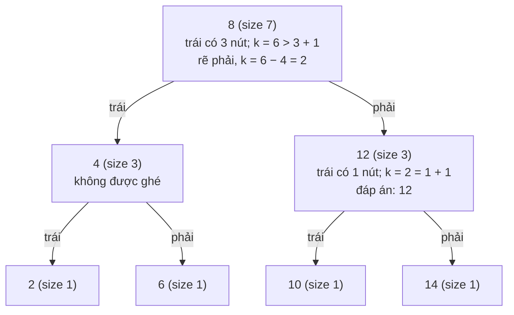
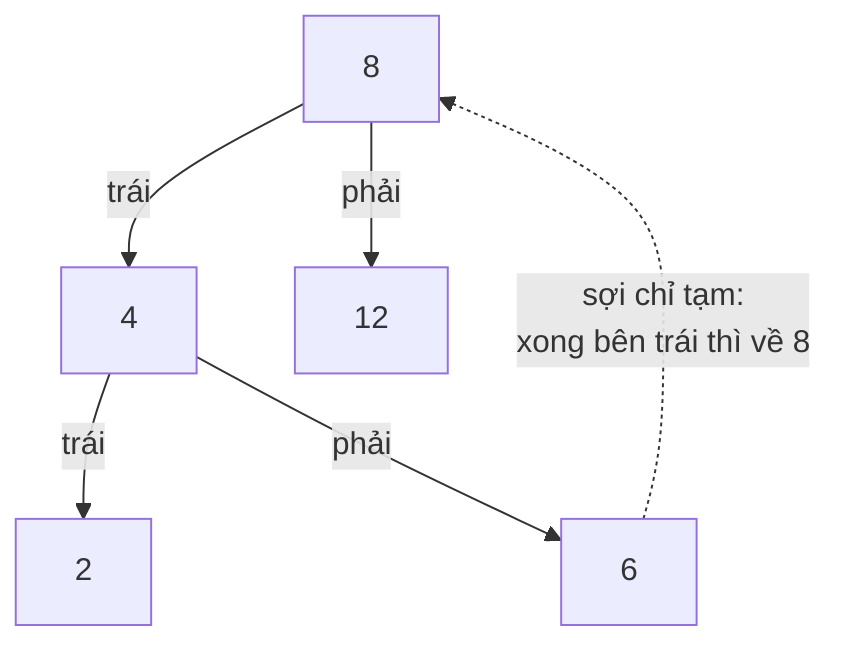
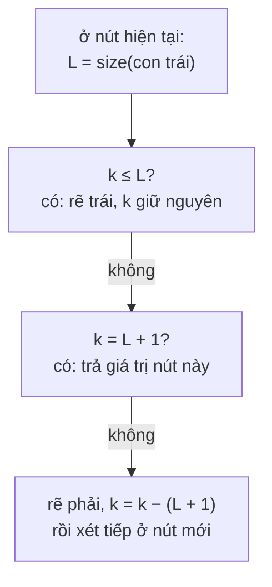

> [!tldr] Đọc nhanh
> - Đề: cho gốc một [[concepts/binary-search-tree|cây nhị phân tìm kiếm]] và số k, trả giá trị nhỏ thứ k (đếm từ 1).
> - Ý chính: [[concepts/in-order-traversal|duyệt trung thứ tự]] (trái, nút, phải) trên cây tìm kiếm đi qua các giá trị **theo thứ tự tăng**. Nút thứ k được thăm chính là đáp án, nên không cần sắp xếp, và cũng không cần đi hết cây.
> - Dừng ở nút thứ k tốn O(h + k): đi xuống h tầng tới nút nhỏ nhất, rồi thăm k nút. Trên cây cân 10⁶ nút với k = 1, bản dùng [[concepts/stack|ngăn xếp]] xong dưới 1 µs, còn duyệt hết cây mất khoảng 22 ms và sắp xếp mất khoảng 115 ms.
> - Morris duyệt không cần ngăn xếp (O(1) bộ nhớ) bằng cách mượn tạm con trỏ phải làm "sợi chỉ" quay về. Cái giá: phải đi tiếp tới khi gỡ hết chỉ, nên với k = 1 nó vẫn đi khoảng nửa cây. Dừng ngay ở nút thứ k thì đáp án đúng nhưng cây bị để lại có vòng.
> - Câu hỏi phụ (cây bị chèn, xóa liên tục, hỏi k nhiều lần): mỗi nút nhớ cỡ cây con của mình, và mỗi câu hỏi chỉ đi một đường từ gốc, O(h). 2 000 câu hỏi trên cây 10⁵ nút: khoảng 2,4 giây bằng ngăn xếp, 0,6 ms bằng size.

> [!info] Bối cảnh
> Bài LeetCode 230 (Medium), thuộc [[posts/2026-11-25-neetcode-binary-search-tree|ga 4: Cây nhị phân tìm kiếm]] trên **tuyến NeetCode: Cấu trúc liên kết**. Cùng ga có [[problems/lowest-common-ancestor-of-a-binary-search-tree|Lowest Common Ancestor of a BST]] (dùng tính chất "trái nhỏ, phải lớn" để chọn đúng một nhánh) và [[problems/validate-binary-search-tree|Validate Binary Search Tree]] (kiểm tra chính tính chất đó). Bài này dùng hệ quả quan trọng nhất của tính chất ấy: đọc cây theo trung thứ tự là đọc một dãy đã sắp xếp. Bạn chỉ cần biết [[concepts/binary-tree|cây nhị phân]] là gì và đã quen với đệ quy.

> [!abstract]- Từ điển nhanh cho bài này (bấm để mở)
> - **Cây nhị phân tìm kiếm (BST)**: cây nhị phân mà ở mọi nút, mọi giá trị trong cây con trái nhỏ hơn nút, mọi giá trị trong cây con phải lớn hơn nút. Xem [[concepts/binary-search-tree|Binary Search Tree]].
> - **Trung thứ tự (in-order)**: thăm cây con trái, rồi nút, rồi cây con phải. Xem [[concepts/in-order-traversal|In-order Traversal]].
> - **h (chiều cao)**: số tầng của cây. Cây cân n nút cao khoảng log₂ n; một chuỗi lệch n nút cao n.
> - **Ngăn xếp tự quản lý**: một mảng mình tự đẩy, tự lấy, thay cho ngăn xếp gọi hàm của đệ quy. Xem [[concepts/stack|Stack]].
> - **Giới hạn độ sâu đệ quy**: mỗi lời gọi hàm chiếm một khung trên ngăn xếp gọi hàm; quá sâu thì chương trình ném lỗi. Xem [[concepts/recursion-depth-limit|Recursion Depth Limit]].
> - **Sợi chỉ (thread) của Morris**: con trỏ `right` đang rỗng của một nút, được trỏ tạm về một nút tổ tiên để biết đường quay lại, rồi gỡ đi.
> - **size của nút**: số nút trong cây con có gốc là nút đó (tính cả nó).

## Hình dung trước: tìm trạm thứ k trong khu hang có biển chỉ đường

Một khu hang có nhiều ngã ba. Mỗi ngã ba là một trạm mang một số hiệu, và người đào hang tuân theo đúng một luật: rẽ trái luôn gặp số nhỏ hơn trạm hiện tại, rẽ phải luôn gặp số lớn hơn. Bạn cần tìm trạm có số nhỏ thứ k.

- **Đếm theo thứ tự:** cứ rẽ trái tới khi hết đường, đó là trạm số nhỏ nhất. Đếm nó, quay lại ngã ba trước, đếm ngã ba đó, rồi thăm nhánh phải của nó theo cùng cách. Đếm đủ k thì dừng.
- **Ghi sổ:** để quay lại được, bạn ghi tên các ngã ba đã đi qua vào sổ tay; quay lại là gạch dòng cuối.
- **Buộc dây thay sổ:** không mang sổ thì ở trạm cuối mỗi nhánh trái, bạn buộc một sợi dây dẫn về ngã ba phía trên. Đi theo dây là quay về được, tới nơi thì tháo dây. Ra về khi dây còn buộc thì người sau đi vòng mãi.
- **Biển chỉ đường:** nếu mỗi ngã ba có biển "nhánh trái có 37 trạm", bạn không cần đếm từng trạm: k ≤ 37 thì rẽ trái, k = 38 thì chính là trạm này, còn lại thì rẽ phải và trừ k đi 38.

| Đời thường | Khái niệm |
|---|---|
| Luật đào hang: trái nhỏ, phải lớn | tính chất cây nhị phân tìm kiếm |
| Rẽ trái tới khi hết đường | nút nhỏ nhất, cuối đường trái |
| Đếm trạm theo thứ tự | duyệt trung thứ tự, dãy tăng |
| Đếm đủ k thì về | dừng sớm, O(h + k) |
| Sổ tay ghi ngã ba đã qua | ngăn xếp (tự quản lý hoặc của đệ quy) |
| Buộc dây rồi tháo dây | sợi chỉ của Morris, O(1) bộ nhớ |
| Ra về khi dây còn buộc | Morris dừng sớm: cây bị để lại có vòng |
| Biển "nhánh trái có 37 trạm" | trường size, mỗi câu hỏi O(h) |

Cây dưới đây là cây 7 nút trong file chạy thử, mỗi nút ghi size của nó, và đường đi khi hỏi k = 6 bằng biển chỉ đường. Trung thứ tự của cây là 2, 4, 6, 8, 10, 12, 14, nên đáp án là 12:



## Vấn đề

Đầu vào là gốc của một cây nhị phân tìm kiếm có n nút và một số nguyên k, với 1 ≤ k ≤ n ≤ 10⁴ và giá trị mỗi nút trong [0, 10⁴]. Trả về giá trị nhỏ thứ k trong cây, đếm từ 1 (k = 1 là giá trị nhỏ nhất). Đề gốc: [LeetCode 230](https://leetcode.com/problems/kth-smallest-element-in-a-bst/). Đề còn một câu hỏi phụ: nếu cây bị chèn, xóa thường xuyên và phải hỏi phần tử thứ k nhiều lần, thì tối ưu thế nào?

Hai chi tiết nhỏ trong giới hạn này đáng để ý. Giá trị có thể là **0**, và đó là chỗ bẫy "kiểm tra bằng `if (x)`" ở phần dưới. Còn 10⁴ nút xếp thành một chuỗi lệch thì sâu 10⁴ tầng: vượt hẳn giới hạn đệ quy mặc định của Python, và nằm sát giới hạn của Node và Java.

## Cơ chế

<figure class="figure-map" style="--ar: 3 / 4">
<div class="frame"><iframe data-archify="../diagrams/neetcode-kth-smallest-element-in-a-bst/worked-example.html" title="Dừng đúng nút thứ k khi duyệt inorder" loading="lazy"></iframe></div>
<figcaption><span><b>Hình 1.</b> Dừng đúng nút thứ k khi duyệt inorder.</span><a href="../diagrams/neetcode-kth-smallest-element-in-a-bst/worked-example.html" target="_blank" rel="noopener">Mở toàn màn hình</a></figcaption>
</figure>

<details>
<summary>Đọc từng bước</summary>
<ol>
<li>Tìm nút trái nhất. <code>BST: root 7; left 3 → right 5; right 9</code></li>
<li>Thăm 3 trước. <code>count = 1</code></li>
<li>Sau đó thăm 5. <code>count = 2</code></li>
<li>Với k bằng 2, trả ngay 5. <code>5</code></li>
</ol>
</details>

### Cách 1: gom hết rồi sắp xếp

Không dùng gì của cây tìm kiếm: gom mọi giá trị (theo thứ tự nào cũng được), sắp xếp, lấy phần tử thứ k − 1.

```ts
// Cách 1: gom mọi giá trị (thứ tự nào cũng được), sắp xếp, lấy phần tử k-1. O(n log n).
function kthSort(root: TreeNode | null, k: number): number {
  const vals: number[] = [];
  const stack: TreeNode[] = root ? [root] : [];
  while (stack.length > 0) {
    const node = stack.pop()!;
    vals.push(node.val);
    if (node.left !== null) stack.push(node.left);
    if (node.right !== null) stack.push(node.right);
  }
  vals.sort((a, b) => a - b);
  return vals[k - 1];
}
```

Đúng với mọi cây nhị phân, kể cả cây không phải cây tìm kiếm. O(n log n) thời gian, O(n) bộ nhớ. Trong JavaScript và TypeScript, `(a, b) => a - b` là bắt buộc: `sort()` không có hàm so sánh sẽ đổi số thành chuỗi rồi so, nên 10 đứng trước 2.

### Cách 2: trung thứ tự đã là dãy tăng

Ở mỗi nút, mọi giá trị bên trái nhỏ hơn nút, mọi giá trị bên phải lớn hơn nút. Duyệt trung thứ tự thăm hết bên trái, rồi nút, rồi hết bên phải, nên (chứng minh bằng quy nạp theo chiều cao) nó đi qua các giá trị theo đúng thứ tự tăng. Không cần sắp xếp nữa:

```ts
// Cách 2: trung thứ tự của cây tìm kiếm đã là dãy tăng. Gom hết rồi lấy phần tử k-1. O(n).
function kthInorderAll(root: TreeNode | null, k: number): number {
  const out: number[] = [];
  const walk = (node: TreeNode | null): void => {
    if (node === null) return;
    walk(node.left);
    out.push(node.val);
    walk(node.right);
  };
  walk(root);
  return out[k - 1];
}
```

O(n) thời gian, O(n) cho mảng và O(h) cho ngăn xếp gọi hàm. Bản này vẫn làm thừa hai việc: đi hết cây dù đáp án nằm ở nút thứ k, và giữ cả n giá trị dù chỉ cần một.

### Cách 3: đếm và dừng ở nút thứ k (đệ quy)

Bỏ mảng đi, giữ một biến đếm. Mỗi lần "thăm" một nút (sau khi xong bên trái) thì tăng đếm; đếm tới k thì ghi đáp án và từ đó mọi lời gọi đều trả về ngay.

```ts
// Cách 3: trung thứ tự đệ quy, đếm và dừng khi đủ k. O(h + k).
function kthRecursive(root: TreeNode | null, k: number): number {
  let count = 0;
  let answer = -1;
  const walk = (node: TreeNode | null): void => {
    if (node === null || count >= k) return;
    walk(node.left);
    if (count >= k) return; // đã tìm thấy bên trái: khỏi đếm nút này và cây con phải
    count++;
    if (count === k) { answer = node.val; return; }
    walk(node.right);
  };
  walk(root);
  return answer;
}
```

Vì sao O(h + k)? Trước khi thăm nút đầu tiên, hàm đi thẳng xuống cuối đường trái: tối đa h lời gọi. Sau đó mỗi nút được thăm làm tăng đếm, và hàm dừng sau k lần thăm. Các lời gọi còn lại là lời gọi vào con rỗng hoặc lời gọi trả về ngay vì `count >= k`, và mỗi nút được thăm hay nằm trên đường đi xuống chỉ sinh ra tối đa hai lời gọi như thế. Bộ nhớ là O(h) cho ngăn xếp gọi hàm.

Hai lần kiểm tra `count >= k` là phần dừng sớm. Thiếu lần thứ hai (sau `walk(node.left)`), hàm vẫn trả đúng đáp án nhưng lại tiếp tục tăng đếm và đi sang phải ở mọi tầng phía trên, nên mất phần "dừng".

### Cách 4: cùng việc đó với ngăn xếp tự quản lý

Thay ngăn xếp gọi hàm bằng một mảng: đẩy hết đường trái vào ngăn xếp, lấy ra một nút (đó là nút nhỏ nhất chưa thăm), đếm nó, rồi chuyển sang cây con phải của nó.

```ts
// Cách 4: trung thứ tự bằng ngăn xếp tự quản lý, lấy ra đủ k nút thì trả. O(h + k), không giới hạn độ sâu.
function kthIterative(root: TreeNode | null, k: number): number {
  const stack: TreeNode[] = [];
  let node = root;
  for (;;) {
    while (node !== null) { stack.push(node); node = node.left; } // đi hết về bên trái
    node = stack.pop()!;                                           // nút nhỏ nhất chưa thăm
    if (--k === 0) return node.val;
    node = node.right;
  }
}
```

Trên cây 7 nút ở hình trên, với k = 3:

| Bước | Làm gì | Ngăn xếp sau bước (đáy → đỉnh) | k còn |
|---|---|---|---|
| 1 | đẩy 8, 4, 2; lấy 2 ra, đếm | 8, 4 | 2 |
| 2 | 2 không có con phải; lấy 4 ra, đếm | 8 | 1 |
| 3 | sang con phải của 4: đẩy 6; lấy 6 ra, đếm | 8 | 0: trả 6 |

Ngăn xếp không bao giờ giữ quá h nút, và vòng lặp không cần biết trước k có hợp lệ không vì đề hứa k ≤ n. Bản này cũng không phụ thuộc giới hạn đệ quy, nên là lựa chọn an toàn cho chuỗi lệch 10⁴ nút ở mọi ngôn ngữ.

### Cách 5: Morris, không cần ngăn xếp

Ngăn xếp ở cách 4 chỉ để trả lời một câu hỏi: "xong cây con trái của nút này rồi thì quay về đâu?". Morris (1979) trả lời câu đó ngay trong cây. Nút đứng **liền trước** `cur` trong trung thứ tự (nút phải nhất của cây con trái của `cur`) luôn có `right` rỗng. Morris trỏ tạm `right` đó về `cur`: đi hết cây con trái thì theo sợi chỉ này mà về.



Mỗi nút có con trái được ghé hai lần: lần đầu tìm nút liền trước và **buộc** chỉ, lần sau gặp lại sợi chỉ thì **gỡ** nó và thăm nút. Tổng số bước đi theo con trỏ là O(n), bộ nhớ thêm O(1).

```ts
// Cách 5: Morris. Mượn con trỏ right đang rỗng của nút liền trước làm "sợi chỉ" quay về, nên không cần ngăn xếp: O(1) bộ nhớ.
// Chỉ được dừng khi đã thấy đáp án VÀ mọi sợi chỉ đã gỡ (pending = 0), nếu không cây bị để lại sai.
function kthMorris(root: TreeNode | null, k: number): number {
  let cur = root, count = 0, answer = -1, pending = 0;
  while (cur !== null) {
    if (cur.left === null) {
      if (++count === k) answer = cur.val;
      if (count >= k && pending === 0) break;
      cur = cur.right;
    } else {
      let pred = cur.left;
      while (pred.right !== null && pred.right !== cur) pred = pred.right;
      if (pred.right === null) {
        pred.right = cur; // buộc chỉ: xong cây con trái thì quay về cur
        pending++;
        cur = cur.left;
      } else {
        pred.right = null; // gỡ chỉ: cây con trái của cur đã thăm xong
        pending--;
        if (++count === k) answer = cur.val;
        if (count >= k && pending === 0) break;
        cur = cur.right;
      }
    }
  }
  return answer;
}
```

Điều mình không ngờ khi viết bản này: Morris **không dừng sớm được** theo nghĩa của cách 3 và 4. Khi tới nút thứ k, mọi tổ tiên mà mình đã rẽ trái ở đó vẫn đang có sợi chỉ buộc. Muốn gỡ sợi chỉ của một tổ tiên thì phải đi hết cây con trái của nó. Với k = 1 trên cây cân, nút nhỏ nhất nằm ở cuối đường trái từ gốc, nên mọi nút trên đường đó (kể cả gốc) đều đang buộc chỉ, và phải đi hết cây con trái của gốc, khoảng n/2 nút, mới gỡ xong. Biến `pending` đếm số sợi chỉ đang buộc; hàm chỉ thoát khi đã có đáp án và `pending` về 0.

Bỏ điều kiện đó (trả về ngay khi đếm tới k) thì đáp án vẫn đúng ở mọi ca, nhưng cây bị để lại có vòng: file chạy thử kiểm tra lại mọi con trỏ sau mỗi lần gọi và bắt được ở 6/10 ca, và một lần duyệt trung thứ tự bình thường sau đó chạy mãi không dừng.

### Cách 6 (câu hỏi phụ): mỗi nút nhớ cỡ cây con

Nếu cây bị chèn, xóa liên tục và phải hỏi phần tử thứ k nhiều lần, mỗi câu hỏi O(h + k) là quá đắt: k ngẫu nhiên thì trung bình phải thăm n/2 nút. Cách sửa là thêm vào mỗi nút một trường `size` = số nút trong cây con của nó. Gọi L là size của con trái. Ở mỗi nút chỉ có ba khả năng:



```ts
function kthBySize(root: SizedNode | null, k: number): number {
  let node = root!;
  for (;;) {
    const leftSize = sizeOf(node.left);
    if (k <= leftSize) node = node.left!;                 // đáp án nằm trong cây con trái
    else if (k === leftSize + 1) return node.val;         // đúng nút này
    else { k -= leftSize + 1; node = node.right!; }       // bỏ qua cả bên trái và nút này
  }
}
```

Mỗi câu hỏi đi một đường từ gốc: O(h). Cái giá là giữ `size` đúng khi cây đổi. Chèn một giá trị mới thì mọi nút trên đường đi xuống tăng `size` thêm 1; xóa thì tính lại `size = 1 + size(trái) + size(phải)` trên đường quay lên. Cả hai vẫn O(h), nên không đổi độ phức tạp của chèn và xóa. File chạy thử làm 5 000 thao tác chèn, xóa, hỏi ngẫu nhiên và đối chiếu mọi câu hỏi với một mảng luôn sắp xếp.

Cây này còn gọi là **cây thống kê thứ tự** (order statistic tree, CLRS bản thứ ba, chương 14). O(h) chỉ thành O(log n) khi cây được giữ cân (cây đỏ đen, AVL); cây tìm kiếm thường bị chèn theo thứ tự tăng sẽ thành chuỗi lệch và h = n.

### So sánh

| Cách | Thời gian | Bộ nhớ thêm | Ghi chú |
|---|---|---|---|
| Gom hết, sắp xếp | O(n log n) | O(n) | đúng cả với cây không phải cây tìm kiếm |
| Trung thứ tự hết cây | O(n) | O(n) + O(h) | đệ quy sâu h tầng |
| Trung thứ tự đệ quy, dừng sớm | O(h + k) | O(h) | đệ quy sâu h tầng |
| Trung thứ tự bằng ngăn xếp | O(h + k) | O(h) | không giới hạn độ sâu |
| Morris | O(n) trường hợp xấu | O(1) | chỉ dừng được khi gỡ hết chỉ; tạm sửa cây |
| Theo size | O(h) mỗi câu hỏi | O(n) cho trường size | chèn, xóa phải cập nhật size |

### Đo

TypeScript, Node 24, cây cân 2²⁰ − 1 nút (cao 20, giá trị 0 tới n − 1), trung vị 5 lần (ms). Máy đang chạy song song việc khác, nên đọc tỉ lệ, đừng đọc chữ số lẻ:

| k | Sắp xếp | Trung thứ tự hết | Đệ quy dừng sớm | Ngăn xếp | Morris | Theo size |
|---|---|---|---|---|---|---|
| 1 | 119,7 | 21,7 | 0,001 | 0,000 | 3,30 | 0,000 |
| 100 | 114,2 | 21,1 | 0,004 | 0,001 | 3,83 | 0,001 |
| 524 288 (giữa) | 116,1 | 22,4 | 4,87 | 3,16 | 3,34 | 0,000 |
| 1 048 575 (lớn nhất) | 114,0 | 39,0 | 15,1 | 10,5 | 11,3 | 0,000 |

- Hai bản dừng sớm tốn đúng như O(h + k): gần như 0 với k nhỏ, bằng cỡ một lượt duyệt khi k = n.
- Morris với k = 1 vẫn tốn 3,3 ms: nó phải đi hết cây con trái của gốc để gỡ chỉ. Với k ở giữa cây, nó ngang ngăn xếp.
- Sắp xếp chậm hơn trung thứ tự hết cây khoảng 5 lần: cùng phải gom n giá trị, nhưng còn thêm O(n log n) phép so.

Câu hỏi phụ, cây ngẫu nhiên (chèn theo thứ tự ngẫu nhiên) rồi hỏi Q lần với k ngẫu nhiên:

| Ngôn ngữ | Cây, số câu hỏi | Ngăn xếp, O(h + k) | Theo size, O(h) |
|---|---|---|---|
| TypeScript | 10⁵ nút, 2 000 | 2 405 ms | 0,56 ms |
| Go | 10⁵ nút, 2 000 | 1 170 ms | 0,28 ms |
| Java | 10⁵ nút, 2 000 | 1 609 ms | 0,37 ms |
| Python | 2·10⁴ nút, 500 | 311 ms | 0,46 ms |

Chênh lệch ba bậc độ lớn: mỗi câu hỏi bằng ngăn xếp thăm trung bình n/2 nút, còn theo size chỉ đi khoảng 2 ln n ≈ 23 tầng của một cây tìm kiếm ngẫu nhiên 10⁵ nút.

### Bên dưới năm ngôn ngữ

| | Biến đếm dùng chung giữa các tầng đệ quy | Bẫy riêng |
|---|---|---|
| TypeScript / JavaScript | biến `let` ngoài closure | `sort()` không hàm so sánh so theo chuỗi; `if (l)` coi đáp án 0 là "chưa thấy"; chuỗi lệch 10⁴ nút nằm sát giới hạn ngăn xếp của Node |
| Python | `nonlocal count` trong hàm lồng | thiếu `nonlocal` thì `count += 1` ném `UnboundLocalError`; `if l:` cũng coi 0 là sai; giới hạn đệ quy 1 000 nên chuỗi 10⁴ nút ném `RecursionError` |
| Go | biến ngoài closure; closure đệ quy phải khai báo `var walk func(*TreeNode)` trước rồi mới gán | truyền `count int` làm tham số thì mỗi tầng tăng bản sao của riêng nó; ngăn xếp goroutine tự lớn nên chuỗi 10⁴ nút không sao |
| Java | một đối tượng nhỏ (`Counter`) truyền xuống, vì lambda không gán lại được biến cục bộ | truyền `int` theo giá trị; trường `static` không đặt lại giữa các lần gọi; chuỗi 10⁴ nút có lần ném `StackOverflowError` |

## Ví dụ chạy được

[TypeScript](../code/neetcode-kth-smallest-element-in-a-bst/kth-smallest.ts) · [Python](../code/neetcode-kth-smallest-element-in-a-bst/kth_smallest.py) · [Go](../code/neetcode-kth-smallest-element-in-a-bst/kth_smallest.go) · [Java](../code/neetcode-kth-smallest-element-in-a-bst/kth-smallest.java) · [JavaScript](../code/neetcode-kth-smallest-element-in-a-bst/kth-smallest.js)

Mỗi file dựng cây từ mảng theo tầng kiểu LeetCode và chạy 10 ca chung: một nút; cây đầy 7 nút với k = 1, 4 (gốc) và 7; cây có giá trị 0 với k = 1 và 2; một cây mà đáp án nằm trong cây con phải của con trái; chuỗi lệch trái 10⁴ nút với k = 1 và k = 5 000; chuỗi lệch phải 10⁴ nút với k = 10⁴. Sau mỗi lần gọi, file kiểm tra lại mọi con trỏ của cây (bắt Morris dừng sớm). TypeScript, Python, Go và Java còn đối chiếu sáu cách trên 2 000 cây tìm kiếm ngẫu nhiên và đo. Cả năm file chạy 5 000 thao tác chèn, xóa, hỏi trên cây có size.

Trung thứ tự đệ quy, dừng ở nút thứ k:

```ts
// Cách 3: trung thứ tự đệ quy, đếm và dừng khi đủ k. O(h + k).
function kthRecursive(root: TreeNode | null, k: number): number {
  let count = 0;
  let answer = -1;
  const walk = (node: TreeNode | null): void => {
    if (node === null || count >= k) return;
    walk(node.left);
    if (count >= k) return; // đã tìm thấy bên trái: khỏi đếm nút này và cây con phải
    count++;
    if (count === k) { answer = node.val; return; }
    walk(node.right);
  };
  walk(root);
  return answer;
}
```

```python
def kth_recursive(root, k):
    """Cách 3: trung thứ tự đệ quy, đếm và dừng khi đủ k. O(h + k)."""
    count = 0
    answer = -1

    def walk(node):
        nonlocal count, answer  # thiếu dòng này: UnboundLocalError
        if node is None or count >= k:
            return
        walk(node.left)
        if count >= k:
            return
        count += 1
        if count == k:
            answer = node.val
            return
        walk(node.right)

    walk(root)
    return answer
```

```go
// Cách 3: trung thứ tự đệ quy, đếm và dừng khi đủ k. O(h + k).
// count và answer nằm ngoài closure, nên mọi tầng đệ quy cùng sửa một biến.
func kthRecursive(root *TreeNode, k int) int {
	count, answer := 0, -1
	var walk func(*TreeNode)
	walk = func(node *TreeNode) {
		if node == nil || count >= k {
			return
		}
		walk(node.Left)
		if count >= k {
			return
		}
		count++
		if count == k {
			answer = node.Val
			return
		}
		walk(node.Right)
	}
	walk(root)
	return answer
}
```

```java
// Cách 3: trung thứ tự đệ quy, đếm và dừng khi đủ k. O(h + k).
// Lambda trong Java không gán lại được biến cục bộ, nên số đếm nằm trong một đối tượng nhỏ truyền xuống.
static final class Counter { int count, answer = -1; final int k; Counter(int k) { this.k = k; } }

static int kthRecursive(TreeNode root, int k) {
    Counter c = new Counter(k);
    walk(root, c);
    return c.answer;
}

static void walk(TreeNode node, Counter c) {
    if (node == null || c.count >= c.k) return;
    walk(node.left, c);
    if (c.count >= c.k) return;
    if (++c.count == c.k) { c.answer = node.val; return; }
    walk(node.right, c);
}
```

```js
// Cách 3: trung thứ tự đệ quy, đếm và dừng khi đủ k. O(h + k).
function kthRecursive(root, k) {
  let count = 0, answer = -1;
  const walk = (node) => {
    if (node === null || count >= k) return;
    walk(node.left);
    if (count >= k) return;
    count++;
    if (count === k) { answer = node.val; return; }
    walk(node.right);
  };
  walk(root);
  return answer;
}
```

Trung thứ tự bằng ngăn xếp, an toàn với chuỗi 10⁴ nút ở mọi ngôn ngữ:

```ts
// Cách 4: trung thứ tự bằng ngăn xếp tự quản lý, lấy ra đủ k nút thì trả. O(h + k), không giới hạn độ sâu.
function kthIterative(root: TreeNode | null, k: number): number {
  const stack: TreeNode[] = [];
  let node = root;
  for (;;) {
    while (node !== null) { stack.push(node); node = node.left; } // đi hết về bên trái
    node = stack.pop()!;                                           // nút nhỏ nhất chưa thăm
    if (--k === 0) return node.val;
    node = node.right;
  }
}
```

```python
def kth_iterative(root, k):
    """Cách 4: trung thứ tự bằng ngăn xếp tự quản lý, lấy ra đủ k nút. O(h + k)."""
    stack, node = [], root
    while True:
        while node:
            stack.append(node)
            node = node.left
        node = stack.pop()
        k -= 1
        if k == 0:
            return node.val
        node = node.right
```

```go
// Cách 4: trung thứ tự bằng ngăn xếp tự quản lý, lấy ra đủ k nút. O(h + k).
func kthIterative(root *TreeNode, k int) int {
	stack := []*TreeNode{}
	node := root
	for {
		for node != nil {
			stack = append(stack, node)
			node = node.Left
		}
		node = stack[len(stack)-1]
		stack = stack[:len(stack)-1]
		k--
		if k == 0 {
			return node.Val
		}
		node = node.Right
	}
}
```

```java
// Cách 4: trung thứ tự bằng ngăn xếp tự quản lý, lấy ra đủ k nút. O(h + k).
static int kthIterative(TreeNode root, int k) {
    Deque<TreeNode> stack = new ArrayDeque<>();
    TreeNode node = root;
    while (true) {
        while (node != null) { stack.push(node); node = node.left; }
        node = stack.pop();
        if (--k == 0) return node.val;
        node = node.right;
    }
}
```

```js
// Cách 4: trung thứ tự bằng ngăn xếp tự quản lý, lấy ra đủ k nút. O(h + k).
function kthIterative(root, k) {
  const stack = [];
  let node = root;
  for (;;) {
    while (node !== null) { stack.push(node); node = node.left; }
    node = stack.pop();
    if (--k === 0) return node.val;
    node = node.right;
  }
}
```

Kết quả `node kth-smallest.ts`:

```text
kthSort                10/10 ca đúng
kthInorderAll          7/10 ca đúng; sai ở chuỗi lệch trái 10⁴ nút, k = 1 → ném RangeError, chuỗi lệch trái 10⁴ nút, k = 5000 → ném RangeError, chuỗi lệch phải 10⁴ nút, k = 10⁴ → ném RangeError
kthRecursive           10/10 ca đúng
kthIterative           10/10 ca đúng
kthMorris              10/10 ca đúng
kthAugmented           10/10 ca đúng
wrongPreorder          5/10 ca đúng; sai ở cây đầy 7 nút, k = 1 → 8, cây đầy 7 nút, k = 4 (gốc) → 6, có giá trị 0, k = 1 → 3, chuỗi lệch trái 10⁴ nút, k = 1 → 10000, chuỗi lệch trái 10⁴ nút, k = 5000 → 5001
wrongSortNoComparator  4/10 ca đúng; sai ở cây đầy 7 nút, k = 1 → 10, cây đầy 7 nút, k = 4 (gốc) → 2, cây đầy 7 nút, k = 7 → 8, đáp án trong cây con phải của con trái, k = 3 → 20, chuỗi lệch trái 10⁴ nút, k = 5000 → 5498, chuỗi lệch phải 10⁴ nút, k = 10⁴ → 9999
wrongFalsyZero         6/10 ca đúng; sai ở có giá trị 0, k = 1 → null, chuỗi lệch trái 10⁴ nút, k = 1 → ném RangeError, chuỗi lệch trái 10⁴ nút, k = 5000 → ném RangeError, chuỗi lệch phải 10⁴ nút, k = 10⁴ → ném RangeError
wrongMorrisEarlyReturn 4/10 ca đúng; sai ở cây đầy 7 nút, k = 1 → 2 nhưng cây bị đổi, có giá trị 0, k = 1 → 0 nhưng cây bị đổi, có giá trị 0, k = 2 → 1 nhưng cây bị đổi, đáp án trong cây con phải của con trái, k = 3 → 7 nhưng cây bị đổi, chuỗi lệch trái 10⁴ nút, k = 1 → 1 nhưng cây bị đổi, chuỗi lệch trái 10⁴ nút, k = 5000 → 5000 nhưng cây bị đổi

sau wrongMorrisEarlyReturn(k = 1) trên cây 7 nút: duyệt trung thứ tự vẫn chạy sau 1000 bước (cây có vòng)

đối chiếu 2000 cây tìm kiếm ngẫu nhiên 1..30 nút: sáu cách khớp với mảng sắp xếp 2000/2000
cây có size: 5000 thao tác chèn/xóa/hỏi ngẫu nhiên, 1490/1490 câu hỏi khớp mảng sắp xếp

cây cân 1048575 nút (cao 20), thời gian trung vị 5 lần (ms)
k          sắp xếp  trung thứ tự hết  đệ quy dừng sớm  ngăn xếp   Morris   theo size
1        119.685            21.704            0.001     0.000    3.298       0.000
100      114.202            21.115            0.004     0.001    3.830       0.001
524288   116.119            22.449            4.870     3.164    3.343       0.000
1048575  113.995            39.034           15.092    10.532   11.339       0.000

cây ngẫu nhiên 100000 nút, 2000 câu hỏi k ngẫu nhiên: ngăn xếp 2404.7 ms, theo size 0.56 ms
```

Hai dòng `RangeError` cần đọc kỹ. `kthInorderAll` và `kthRecursive` cùng đệ quy sâu 10⁴ tầng trên chuỗi lệch, nhưng chỉ bản gom hết bị tràn ngăn xếp ở lần chạy này. Giới hạn của Node là một số byte (mặc định khoảng 984 KB), không phải một số tầng, và cỡ mỗi khung phụ thuộc hàm đã được JIT biên dịch hay chưa. 10⁴ tầng nằm ngay sát giới hạn đó: qua ba lần chạy, `kthInorderAll` đúng 7 hoặc 8 trên 10 ca. Ở Node, đừng dựa vào đệ quy khi cây có thể là chuỗi 10⁴ nút.

`wrongMorrisEarlyReturn` không sai ở chuỗi lệch phải: chuỗi đó không có con trái nào, nên không có sợi chỉ nào được buộc. Nó cũng đúng ở cây một nút và ở k = 4, k = 7 của cây đầy, vì tới lúc đó mọi sợi chỉ đã gỡ.

`python3 kth_smallest.py`:

```text
kth_sort          10/10 ca đúng
kth_inorder_all   7/10 ca đúng; sai ở chuỗi lệch trái 10⁴ nút, k = 1 → ném RecursionError, chuỗi lệch trái 10⁴ nút, k = 5000 → ném RecursionError, chuỗi lệch phải 10⁴ nút, k = 10⁴ → ném RecursionError
kth_recursive     7/10 ca đúng; sai ở chuỗi lệch trái 10⁴ nút, k = 1 → ném RecursionError, chuỗi lệch trái 10⁴ nút, k = 5000 → ném RecursionError, chuỗi lệch phải 10⁴ nút, k = 10⁴ → ném RecursionError
kth_iterative     10/10 ca đúng
kth_morris        10/10 ca đúng
kth_augmented     10/10 ca đúng
wrong_no_nonlocal 0/10 ca đúng; sai ở một nút, k = 1 → ném UnboundLocalError, cây đầy 7 nút, k = 1 → ném UnboundLocalError, cây đầy 7 nút, k = 4 (gốc) → ném UnboundLocalError, cây đầy 7 nút, k = 7 → ném UnboundLocalError, có giá trị 0, k = 1 → ném UnboundLocalError, có giá trị 0, k = 2 → ném UnboundLocalError, đáp án trong cây con phải của con trái, k = 3 → ném UnboundLocalError, chuỗi lệch trái 10⁴ nút, k = 1 → ném RecursionError, chuỗi lệch trái 10⁴ nút, k = 5000 → ném RecursionError, chuỗi lệch phải 10⁴ nút, k = 10⁴ → ném UnboundLocalError
wrong_falsy_zero  6/10 ca đúng; sai ở có giá trị 0, k = 1 → None, chuỗi lệch trái 10⁴ nút, k = 1 → ném RecursionError, chuỗi lệch trái 10⁴ nút, k = 5000 → ném RecursionError, chuỗi lệch phải 10⁴ nút, k = 10⁴ → ném RecursionError

đối chiếu 2000 cây tìm kiếm ngẫu nhiên 1..30 nút: sáu cách khớp với mảng sắp xếp 2000/2000
cây có size: 5000 thao tác chèn/xóa/hỏi ngẫu nhiên, 1454/1454 câu hỏi khớp mảng sắp xếp

cây cân 131071 nút (cao 17), thời gian trung vị 5 lần (ms)
k        sắp xếp  trung thứ tự hết  đệ quy dừng sớm  ngăn xếp   Morris   theo size
1         8.557             7.071            0.001     0.001    6.795       0.001
100      11.916             7.690            0.008     0.005    6.615       0.001
65536     8.855             7.208            4.849     3.295    5.945       0.000
131071    8.517             7.081            9.884     6.617   11.914       0.001

cây ngẫu nhiên 20000 nút, 500 câu hỏi k ngẫu nhiên: ngăn xếp 310.5 ms, theo size 0.46 ms
```

Ở Python, sắp xếp gần như ngang trung thứ tự hết cây: `list.sort` chạy bằng C, còn phần tốn thời gian là vòng lặp Python đi qua n nút, như nhau ở cả hai cách. Bản đệ quy dừng sớm cũng ném `RecursionError` trên chuỗi lệch trái với k = 1, vì muốn tới nút nhỏ nhất nó vẫn phải đi xuống hết 10⁴ tầng.

`go run kth_smallest.go`:

```text
kthSort                10/10 ca đúng
kthInorderAll          10/10 ca đúng
kthRecursive           10/10 ca đúng
kthIterative           10/10 ca đúng
kthMorris              10/10 ca đúng
kthAugmented           10/10 ca đúng
wrongCountByValue      5/10 ca đúng; sai ở cây đầy 7 nút, k = 4 (gốc) → 0, cây đầy 7 nút, k = 7 → 0, có giá trị 0, k = 2 → 2, đáp án trong cây con phải của con trái, k = 3 → 8, chuỗi lệch trái 10⁴ nút, k = 5000 → 0
wrongMorrisEarlyReturn 4/10 ca đúng; sai ở cây đầy 7 nút, k = 1 → 2 nhưng cây bị đổi, có giá trị 0, k = 1 → 0 nhưng cây bị đổi, có giá trị 0, k = 2 → 1 nhưng cây bị đổi, đáp án trong cây con phải của con trái, k = 3 → 7 nhưng cây bị đổi, chuỗi lệch trái 10⁴ nút, k = 1 → 1 nhưng cây bị đổi, chuỗi lệch trái 10⁴ nút, k = 5000 → 5000 nhưng cây bị đổi

đối chiếu 2000 cây tìm kiếm ngẫu nhiên 1..30 nút: sáu cách khớp với mảng sắp xếp 2000/2000
cây có size: 5000 thao tác chèn/xóa/hỏi ngẫu nhiên, 1561/1561 câu hỏi khớp mảng sắp xếp

cây cân 1048575 nút (cao 20), thời gian trung vị 5 lần (ms)
k          sắp xếp  trung thứ tự hết  đệ quy dừng sớm  ngăn xếp   Morris   theo size
1         38.347            20.278            0.000     0.000    2.735       0.000
100       36.256            16.134            0.001     0.005    4.624       0.000
524288    39.167             8.373            1.772     1.288    2.166       0.000
1048575   38.987            10.034            5.164     5.341    4.686       0.000

cây ngẫu nhiên 100000 nút, 2000 câu hỏi k ngẫu nhiên: ngăn xếp 1170.1 ms, theo size 0.28 ms
```

`wrongCountByValue` truyền `count` làm tham số. Mỗi tầng tăng bản sao của riêng nó, nên khi quay từ cây con trái về cha, số đếm của cha vẫn là số cũ: nút cha tự coi mình là nút thứ nhất. Hàm chỉ đúng khi số đếm không bao giờ phải đi ngược từ con lên cha: k = 1, hoặc chuỗi lệch phải, nơi số đếm chỉ đi xuống.

`java kth-smallest.java`:

```text
kthSort              10/10 ca đúng
kthInorderAll        8/10 ca đúng; sai ở chuỗi lệch trái 10⁴ nút, k = 1 → ném StackOverflowError, chuỗi lệch phải 10⁴ nút, k = 10⁴ → ném StackOverflowError
kthRecursive         10/10 ca đúng
kthIterative         10/10 ca đúng
kthMorris            10/10 ca đúng
kthAugmented         10/10 ca đúng
wrongCountByValue    3/10 ca đúng; sai ở cây đầy 7 nút, k = 4 (gốc) → -1, cây đầy 7 nút, k = 7 → -1, có giá trị 0, k = 2 → 2, đáp án trong cây con phải của con trái, k = 3 → 8, chuỗi lệch trái 10⁴ nút, k = 1 → ném StackOverflowError, chuỗi lệch trái 10⁴ nút, k = 5000 → -1, chuỗi lệch phải 10⁴ nút, k = 10⁴ → ném StackOverflowError
wrongStaticNotReset  1/10 ca đúng; sai ở cây đầy 7 nút, k = 1 → 9, cây đầy 7 nút, k = 4 (gốc) → 9, cây đầy 7 nút, k = 7 → 9, có giá trị 0, k = 1 → 9, có giá trị 0, k = 2 → 9, đáp án trong cây con phải của con trái, k = 3 → 9, chuỗi lệch trái 10⁴ nút, k = 1 → ném StackOverflowError, chuỗi lệch trái 10⁴ nút, k = 5000 → 4957, chuỗi lệch phải 10⁴ nút, k = 10⁴ → 4957

đối chiếu 2000 cây tìm kiếm ngẫu nhiên 1..30 nút: sáu cách khớp với mảng sắp xếp 2000/2000
cây có size: 5000 thao tác chèn/xóa/hỏi ngẫu nhiên, 1477/1477 câu hỏi khớp mảng sắp xếp

cây cân 1048575 nút (cao 20), thời gian trung vị 5 lần (ms)
k          sắp xếp  trung thứ tự hết  đệ quy dừng sớm  ngăn xếp   Morris   theo size
1         52.790            19.094            0.000     0.000    2.410       0.000
100       29.032             7.450            0.000     0.001    2.848       0.000
524288    29.962             6.877            1.346     1.578    2.482       0.000
1048575   26.983             7.553            2.889     3.316    4.956       0.000

cây ngẫu nhiên 100000 nút, 2000 câu hỏi k ngẫu nhiên: ngăn xếp 1608.9 ms, theo size 0.37 ms
```

Java cũng đứng sát giới hạn: ngăn xếp mặc định của một luồng là 1 024 KB (`ThreadStackSize`), và ở các lần chạy khác nhau, `kthInorderAll` sai 1 hoặc 2 ca chuỗi, có lần `kthRecursive` cũng sai một ca. `wrongStaticNotReset` chỉ đúng ở ca đầu tiên: từ ca thứ hai, biến đếm `static` đã vượt k nên không bao giờ ghi đáp án mới, và hàm cứ trả 9 của ca một nút. Hai ca cuối trả 4957 vì biến đếm, vẫn cộng dồn từ các ca trước, tình cờ đi qua đúng k ở giữa chuỗi.

`node kth-smallest.js`:

```text
kthSort               10/10 ca đúng
kthInorderAll         8/10 ca đúng; sai ở chuỗi lệch trái 10⁴ nút, k = 1 → ném RangeError, chuỗi lệch trái 10⁴ nút, k = 5000 → ném RangeError
kthRecursive          10/10 ca đúng
kthIterative          10/10 ca đúng
kthMorris             10/10 ca đúng
kthAugmented          10/10 ca đúng
wrongSortNoComparator 4/10 ca đúng; sai ở cây đầy 7 nút, k = 1 → 10, cây đầy 7 nút, k = 4 (gốc) → 2, cây đầy 7 nút, k = 7 → 8, đáp án trong cây con phải của con trái, k = 3 → 20, chuỗi lệch trái 10⁴ nút, k = 5000 → 5498, chuỗi lệch phải 10⁴ nút, k = 10⁴ → 9999
wrongFalsyZero        7/10 ca đúng; sai ở có giá trị 0, k = 1 → null, chuỗi lệch trái 10⁴ nút, k = 1 → ném RangeError, chuỗi lệch trái 10⁴ nút, k = 5000 → ném RangeError

cây có size: 5000 thao tác chèn/xóa/hỏi ngẫu nhiên, 1491/1491 câu hỏi khớp mảng sắp xếp
```

## Hiểu lầm và bẫy hay gặp

- **"Phải sắp xếp."** Cây tìm kiếm đã giữ thứ tự sẵn; trung thứ tự đọc nó ra theo thứ tự tăng mà không cần một phép so nào.
- **"Duyệt kiểu nào cũng được, miễn là đếm tới k."** Chỉ trung thứ tự mới ra dãy tăng. Tiền thứ tự (nút, trái, phải) đúng 5/10 ca, và chỉ đúng khi tình cờ.
- **"Dừng sớm là xong."** Ở bản đệ quy, phải kiểm tra `count >= k` cả **sau** khi gọi xong bên trái; thiếu nó thì đáp án vẫn đúng nhưng hàm đi tiếp sang phải ở mọi tầng phía trên.
- **"Morris thì dừng ở nút thứ k là được."** Dừng lúc còn sợi chỉ thì cây bị để lại có vòng: đáp án đúng, nhưng lần duyệt sau chạy mãi. Phải đi tiếp tới khi gỡ hết chỉ, nên Morris không dừng sớm được như ngăn xếp.
- **Kiểm tra "đã tìm thấy chưa" bằng giá trị.** `if (l)` trong JavaScript và `if l:` trong Python coi 0 là "chưa thấy", mà đề cho phép giá trị 0. So với `null` / `None`, hoặc dùng một cờ riêng.
- **Truyền số đếm theo giá trị.** Trong Go, Java (và mọi ngôn ngữ khác) một tham số `int` là bản sao; phần tăng ở tầng con không về được tầng cha. Số đếm phải là biến dùng chung: closure, `nonlocal`, hay một đối tượng.
- **Trường `static` không đặt lại.** Ở Java, một biến đếm `static` sống qua mọi lần gọi trong cùng tiến trình. Trình chấm chạy nhiều ca liên tiếp trong một JVM thì từ ca thứ hai trở đi kết quả sai.
- **`sort()` không hàm so sánh trong JavaScript.** Nó so theo chuỗi: `[10, 2, 8].sort()` cho `[10, 2, 8]`.
- **Đệ quy trên chuỗi 10⁴ nút.** Python ném `RecursionError` chắc chắn (giới hạn 1 000 tầng); Node và Java nằm sát giới hạn và kết quả đổi giữa các lần chạy; Go thì không sao. Bản ngăn xếp an toàn ở cả năm ngôn ngữ.
- **"Theo size là O(log n)."** Chỉ khi cây được giữ cân. Cây tìm kiếm thường có thể thành chuỗi, và khi đó cả chèn lẫn hỏi là O(n).

## Câu hỏi tự kiểm tra

> [!question]- Vì sao trung thứ tự của một cây tìm kiếm luôn là dãy tăng?
> Quy nạp theo chiều cao. Cây rỗng cho dãy rỗng. Với một nút, trung thứ tự là (dãy của cây con trái), rồi nút, rồi (dãy của cây con phải). Theo giả thiết quy nạp, hai dãy con tăng; mọi phần tử bên trái nhỏ hơn nút và mọi phần tử bên phải lớn hơn nút theo tính chất cây tìm kiếm, nên ghép lại vẫn tăng.

> [!question]- Bản ngăn xếp tốn bao nhiêu bước khi k = 1 trên chuỗi lệch trái 10⁴ nút? Còn trên chuỗi lệch phải?
> Chuỗi lệch trái: nút nhỏ nhất nằm ở đáy, nên phải đẩy cả 10⁴ nút vào ngăn xếp trước khi lấy ra nút đầu tiên: h = n. Chuỗi lệch phải: gốc là nút nhỏ nhất, đẩy một nút rồi lấy ra ngay. O(h + k) nói đúng điều đó: chi phí nằm ở chiều cao của đường trái, không ở n.

> [!question]- Morris với k = 1 trên cây cân n nút phải đi bao xa, và vì sao?
> Khoảng nửa cây. Nút nhỏ nhất nằm ở cuối đường trái từ gốc, nên mọi nút trên đường đó (kể cả gốc) đều đã buộc chỉ khi tới được nó. Sợi chỉ của gốc chỉ được gỡ khi quay về gốc, tức là sau khi đi hết cây con trái của gốc, khoảng n/2 nút.

> [!question]- Ở cây có size, đang ở một nút có con trái size 5 và k = 9. Đi tiếp thế nào?
> k = 9 > 5 + 1, nên đáp án không ở bên trái và không phải nút này. Rẽ phải với k = 9 − 6 = 3: tìm phần tử nhỏ thứ 3 trong cây con phải.

> [!question]- Chèn một giá trị vào cây có size, những nút nào phải cập nhật size?
> Đúng các nút trên đường từ gốc tới chỗ chèn: mỗi nút đó có thêm một nút trong cây con của mình, nên size tăng 1. Mọi nút khác không đổi. Vì vậy chèn vẫn là O(h).

## Tham khảo

- [LeetCode 230: Kth Smallest Element in a BST](https://leetcode.com/problems/kth-smallest-element-in-a-bst/) (đề gốc: 1 ≤ k ≤ n ≤ 10⁴, giá trị trong [0, 10⁴])
- Joseph M. Morris, "Traversing binary trees simply and cheaply", *Information Processing Letters* 9(5), 1979: duyệt trung thứ tự không ngăn xếp bằng sợi chỉ tạm
- Cormen, Leiserson, Rivest, Stein, *Introduction to Algorithms* (bản thứ ba), chương 12 (cây nhị phân tìm kiếm, duyệt trung thứ tự) và chương 14 (cây thống kê thứ tự, trường size)
- [Python: câu lệnh `nonlocal`](https://docs.python.org/3/reference/simple_stmts.html#the-nonlocal-statement)
- [MDN: `Array.prototype.sort`](https://developer.mozilla.org/en-US/docs/Web/JavaScript/Reference/Global_Objects/Array/sort) (không có hàm so sánh thì so theo chuỗi UTF-16)
