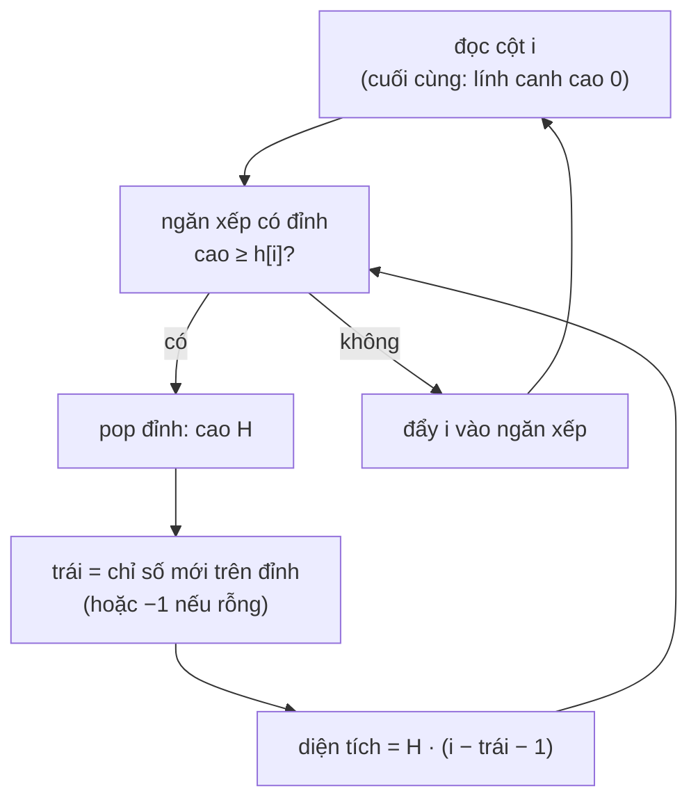

> [!tldr] Đọc nhanh
> - Đề: các cột rộng 1, cao `heights[i]`, đứng sát nhau. Tìm diện tích hình chữ nhật lớn nhất nằm trọn trong biểu đồ.
> - Mấu chốt: hình lớn nhất có chiều cao bằng **một cột nào đó**, và kéo sang hai bên tới khi gặp cột **thấp hơn**. Với cột i: diện tích = `h[i] · (phải − trái − 1)`, với trái, phải là chỉ số cột thấp hơn gần nhất hai bên.
> - Một [[concepts/monotonic-stack|ngăn xếp đơn điệu]] chỉ số, chiều cao **tăng dần**, tìm cả hai phía trong một lượt: khi cột mới thấp hơn đỉnh, đỉnh bị lấy ra; cột mới là "phải", phần tử bên dưới đỉnh là "trái".
> - Mỗi chỉ số được đẩy một lần và lấy ra một lần, nên dù có `while` lồng trong `for`, tổng là O(n) ([[concepts/aggregate-analysis|phân tích gộp]]). Một cột **lính canh** cao 0 ở cuối đẩy hết các cột còn lại ra.
> - Đo: vét cạn 176 ms ở n = 16 000, ngăn xếp 0,17 ms. Chia để trị nhanh với dữ liệu ngẫu nhiên nhưng O(n²) và tràn ngăn xếp gọi hàm với cột tăng dần: JS ở 8 000 cột, Python ở 2 000.

> [!info] Bối cảnh
> Bài LeetCode 84 (Hard), thuộc [[posts/2026-11-23-neetcode-monotonic-stack|ga 7: Ngăn xếp đơn điệu]] trên **tuyến NeetCode: Mảng và chuỗi**. Lời giải có đủ TypeScript, Python, Go, Java và JavaScript. Nên đọc [[problems/trapping-rain-water|Trapping Rain Water]] trước: hai bài nhìn giống nhau nhưng tìm hai thứ ngược nhau.

> [!abstract]- Từ điển nhanh cho bài này (bấm để mở)
> - **Biểu đồ cột (histogram)**: dãy cột rộng 1 đứng sát nhau trên cùng một đáy.
> - **Cột thấp hơn gần nhất (nearest smaller)**: với cột i, chỉ số j gần i nhất về một phía mà `h[j] < h[i]`.
> - **Ngăn xếp đơn điệu**: ngăn xếp mà các phần tử luôn tăng (hoặc giảm) dần từ đáy lên đỉnh; phần tử phá thứ tự thì đẩy các phần tử cũ ra. Xem [[concepts/monotonic-stack|Monotonic Stack]].
> - **Lính canh (sentinel)**: một phần tử giả thêm vào đầu hoặc cuối để vòng lặp xử lý ca biên như ca thường.
> - **Ngăn xếp gọi hàm (call stack)**: vùng nhớ chứa các lần gọi hàm đang dở. Đệ quy quá sâu làm nó tràn.

## Hình dung trước: dán băng giấy lên dãy tòa nhà

Nhìn một dãy tòa nhà sát nhau từ xa. Bạn muốn dán một băng giấy hình chữ nhật thật to lên mặt tiền, không được thò ra ngoài nóc nhà nào. Băng giấy cao bao nhiêu thì bị giới hạn bởi tòa **thấp nhất** nó che. Vậy hãy thử lần lượt từng tòa làm "tòa thấp nhất", rồi kéo băng giấy sang hai bên tới khi đụng một tòa còn thấp hơn.

| Đời thường | Khái niệm |
|---|---|
| Chọn tòa i làm tòa thấp nhất mà băng giấy che | chiều cao hình = `h[i]` |
| Kéo băng giấy sang trái tới khi đụng tòa thấp hơn | cột thấp hơn gần nhất bên trái |
| Kéo sang phải tương tự | cột thấp hơn gần nhất bên phải |
| Đi dọc phố, ghi tên các tòa cao dần; gặp tòa thấp hơn thì gạch tên các tòa cao hơn nó | ngăn xếp đơn điệu, pop khi cột mới thấp hơn |
| Một bức tường cao 0 dựng ở cuối phố | cột lính canh |



## Vấn đề

**Đề (tóm tắt bằng lời của mình):** cho mảng `heights` (1 ≤ n ≤ 10⁵, `0 ≤ heights[i] ≤ 10⁴`), mỗi phần tử là chiều cao một cột rộng 1. Trả diện tích hình chữ nhật lớn nhất nằm trọn trong biểu đồ. Đề gốc: [LeetCode 84](https://leetcode.com/problems/largest-rectangle-in-histogram/).

| Input | Output | Vì sao |
|---|---|---|
| `[2, 1, 5, 6, 2, 3]` | 10 | cao 5, rộng 2 (cột 5 và 6) |
| `[2, 4]` | 4 | một cột cao 4 |
| `[2, 2, 2, 2]` | 8 | cao 2, rộng 4 |
| `[6, 2, 5, 4, 5, 1, 6]` | 12 | cao 4, rộng 3 (cột 5, 4, 5) |

Diện tích lớn nhất là 10⁴ · 10⁵ = 10⁹, vẫn vừa `int` 32 bit.

Mình từng nghĩ phải thử mọi cặp (trái, phải). Hóa ra chỉ cần thử n chiều cao: hình tối ưu luôn bị một cột "chặn trần", và với chiều cao đó, kéo rộng hết cỡ luôn tốt hơn.

## Cơ chế

<figure class="figure-map" style="--ar: 3 / 4">
<div class="frame"><iframe data-archify="../diagrams/neetcode-largest-rectangle-in-histogram/worked-example.html" title="Cột thấp chốt chiều rộng" loading="lazy"></iframe></div>
<figcaption><span><b>Hình 1.</b> Cột thấp chốt chiều rộng.</span><a href="../diagrams/neetcode-largest-rectangle-in-histogram/worked-example.html" target="_blank" rel="noopener">Mở toàn màn hình</a></figcaption>
</figure>

<details>
<summary>Đọc từng bước</summary>
<ol>
<li>Giữ chỉ số của các cột đang tăng. <code>[2, 4, 3, 1]</code></li>
<li>Gặp 3 thì chốt cột cao 4. <code>4 × 1 = 4</code></li>
<li>Gặp 1 thì chốt cột cao 3. <code>3 × 2 = 6</code></li>
<li>Cột cao 2 trải qua ba vị trí. <code>2 × 3 = 6</code></li>
<li>Diện tích lớn nhất là 6. <code>max(4, 6, 6) = 6</code></li>
</ol>
</details>

### Cách 1, vét cạn: O(n²)

Cố định cột trái i, kéo cột phải j từ i sang phải, giữ chiều cao nhỏ nhất của đoạn: diện tích là `min · (j − i + 1)`. Nhờ giữ min chạy, mỗi cặp chỉ tốn O(1), tổng O(n²).

### Cách 2, chia để trị

Trong đoạn `[lo, hi]`, gọi m là cột thấp nhất. Hình lớn nhất hoặc đi qua m (khi đó nó rộng cả đoạn, cao `h[m]`), hoặc nằm hẳn bên trái m, hoặc nằm hẳn bên phải m. Đệ quy hai nửa. Với dữ liệu ngẫu nhiên, m thường gần giữa và độ sâu đệ quy khoảng log n. Nhưng với cột **tăng dần**, m luôn ở mép trái, mỗi tầng chỉ bớt một cột: O(n²) thời gian và **n tầng đệ quy**.

### Cách 3, ngăn xếp đơn điệu

Giữ một ngăn xếp **chỉ số** sao cho chiều cao tăng dần từ đáy lên đỉnh. Đọc cột i:
- chừng nào đỉnh cao **≥** `h[i]`: lấy đỉnh ra, gọi chiều cao của nó là H. Cột i là cột thấp hơn gần nhất **bên phải** của nó (mọi cột giữa hai cột đều cao hơn H, nếu không chúng đã đẩy H ra trước). Phần tử mới trên đỉnh là cột thấp hơn gần nhất **bên trái** (hoặc −1 nếu ngăn xếp rỗng). Diện tích `H · (i − trái − 1)`;
- đẩy i vào.

Sau cột cuối, các cột còn lại trong ngăn xếp chưa gặp cột nào thấp hơn bên phải. Thay vì viết thêm một vòng dọn dẹp, cho i chạy tới n với chiều cao **lính canh** 0: nó thấp hơn mọi cột, nên đẩy hết ra.

| Bước | i, h[i] | pop (H, trái) → diện tích | ngăn xếp sau bước (chỉ số) |
|---|---|---|---|
| 1 | 0, 2 | | [0] |
| 2 | 1, 1 | (2, −1) → 2·1 = 2 | [1] |
| 3 | 2, 5 | | [1, 2] |
| 4 | 3, 6 | | [1, 2, 3] |
| 5 | 4, 2 | (6, 2) → 6·1 = 6; (5, 1) → 5·2 = **10** | [1, 4] |
| 6 | 5, 3 | | [1, 4, 5] |
| 7 | 6, 0 (lính canh) | (3, 4) → 3; (2, 1) → 2·4 = 8; (1, −1) → 1·6 = 6 | [6] |

### Vì sao `while` lồng trong `for` vẫn là O(n)

Đếm theo [[concepts/aggregate-analysis|phân tích gộp]]: mỗi chỉ số được đẩy vào **đúng một lần** và lấy ra **nhiều nhất một lần**. Tổng số lần pop qua cả thuật toán không quá n, dù một bước có thể pop nhiều. File TypeScript đếm: 100 000 lần pop cho 100 000 cột, cả với dữ liệu ngẫu nhiên lẫn tăng dần.

### Khác gì Trapping Rain Water

Cả hai đều hỏi "hai bên cột i có gì". [[problems/trapping-rain-water|Trapping Rain Water]] tìm cột **cao nhất** mỗi bên ([[concepts/prefix-maximum|max tiền tố]]), vì nước dâng tới bức tường thấp hơn trong hai bức cao nhất. Bài này tìm cột **thấp hơn gần nhất** mỗi bên, vì đó là nơi hình chữ nhật cao `h[i]` phải dừng. "Cao nhất cả đoạn" giữ được bằng một biến chạy; "thấp hơn gần nhất" thì không, nên cần ngăn xếp.

### Đo

TypeScript, trung vị, chiều cao ngẫu nhiên 0..10⁴:

| n | vét cạn | chia để trị | ngăn xếp |
|---|---|---|---|
| 2 000 | 2,9 ms | 0,09 ms | 0,04 ms |
| 4 000 | 10,8 ms | 0,14 ms | 0,07 ms |
| 8 000 | 44,1 ms | 0,28 ms | 0,09 ms |
| 16 000 | 175,5 ms | 0,69 ms | 0,17 ms |
| 10⁵ | (không chạy) | 4,86 ms | 1,19 ms |
| 10⁶ | (không chạy) | 88,76 ms | 12,15 ms |

Chia để trị trên cột **tăng dần** `1, 2, …, n`:

| n | 1 000 | 2 000 | 4 000 | 8 000 |
|---|---|---|---|---|
| ms | 0,6 | 2,1 | 8,1 | `RangeError: Maximum call stack size exceeded` |

Với dữ liệu ngẫu nhiên, chia để trị chỉ chậm hơn ngăn xếp vài lần. Với cột tăng dần, nó vừa đi đúng dáng n² (gấp đôi n, gấp 4 thời gian) vừa làm tràn ngăn xếp gọi hàm của Node từ 8 000 cột, chưa tới giới hạn 10⁵ của đề.

### Bên dưới năm ngôn ngữ

| | Ngăn xếp | Đệ quy sâu (chia để trị, cột tăng dần) |
|---|---|---|
| TypeScript / JavaScript | mảng, `push`/`pop` | `RangeError` ở 8 000 cột |
| Python | list, `append`/`pop`; lính canh viết gọn `h + [0]` | giới hạn mặc định 1 000 tầng: `RecursionError` ở 2 000 cột |
| Go | slice, `append` và cắt `st[:len(st)-1]` | ngăn xếp goroutine tự nới: 10⁵ cột vẫn chạy xong (chậm vì O(n²)) |
| Java | `int[]` và một biến `top`, tránh đóng hộp của `Deque<Integer>` | `StackOverflowError` với 10⁵ cột bằng nhau |

## Ví dụ chạy được

[TypeScript](../code/neetcode-largest-rectangle-in-histogram/largest-rectangle.ts) · [Python](../code/neetcode-largest-rectangle-in-histogram/largest_rectangle.py) · [Go](../code/neetcode-largest-rectangle-in-histogram/largest_rectangle.go) · [Java](../code/neetcode-largest-rectangle-in-histogram/largest-rectangle.java) · [JavaScript](../code/neetcode-largest-rectangle-in-histogram/largest-rectangle.js) · [PHP](../code/neetcode-largest-rectangle-in-histogram/largest-rectangle.php) · [Rust](../code/neetcode-largest-rectangle-in-histogram/largest_rectangle.rs)

Mỗi file trong năm bản đầu có vét cạn, chia để trị và ngăn xếp, chạy 9 ca (gồm cột tăng dần, giảm dần, bằng nhau và cột cao 0). Dưới đây là chia để trị và ngăn xếp.

```ts
// Chia để trị: hình lớn nhất hoặc đi qua cột thấp nhất (rộng cả đoạn), hoặc nằm hẳn bên trái/phải nó.
function divideConquer(h: number[], lo = 0, hi = h.length - 1): number {
  if (lo > hi) return 0;
  let m = lo;
  for (let i = lo + 1; i <= hi; i++) if (h[i] < h[m]) m = i;
  return Math.max(h[m] * (hi - lo + 1), divideConquer(h, lo, m - 1), divideConquer(h, m + 1, hi));
}

// Một lượt, ngăn xếp chỉ số với chiều cao TĂNG dần. Cột lính canh cao 0 ở cuối đẩy mọi thứ còn lại ra.
function monotonicStack(h: number[]): number {
  const st: number[] = [];
  let best = 0;
  for (let i = 0; i <= h.length; i++) {
    const cur = i === h.length ? 0 : h[i]; // lính canh
    while (st.length && h[st[st.length - 1]] >= cur) {
      const height = h[st.pop()!];
      const left = st.length ? st[st.length - 1] : -1; // cột thấp hơn gần nhất bên trái, sau khi pop
      best = Math.max(best, height * (i - left - 1));
    }
    st.push(i);
  }
  return best;
}
```

```python
def divide_conquer(h: list[int], lo: int = 0, hi: int | None = None) -> int:
    if hi is None:
        hi = len(h) - 1
    if lo > hi:
        return 0
    m = min(range(lo, hi + 1), key=h.__getitem__)  # chỉ số cột thấp nhất trong đoạn
    return max(h[m] * (hi - lo + 1), divide_conquer(h, lo, m - 1), divide_conquer(h, m + 1, hi))

def monotonic_stack(h: list[int]) -> int:
    st: list[int] = []
    best = 0
    for i, cur in enumerate(h + [0]):  # h + [0]: cột lính canh cao 0 ở cuối
        while st and h[st[-1]] >= cur:
            height = h[st.pop()]
            left = st[-1] if st else -1
            best = max(best, height * (i - left - 1))
        st.append(i)
    return best
```

```go
func divideConquer(h []int, lo, hi int) int {
	if lo > hi {
		return 0
	}
	m := lo
	for i := lo + 1; i <= hi; i++ {
		if h[i] < h[m] {
			m = i
		}
	}
	return max(h[m]*(hi-lo+1), divideConquer(h, lo, m-1), divideConquer(h, m+1, hi))
}

func monotonicStack(h []int) int {
	st := []int{}
	best := 0
	for i := 0; i <= len(h); i++ {
		cur := 0 // lính canh khi i == len(h)
		if i < len(h) {
			cur = h[i]
		}
		for len(st) > 0 && h[st[len(st)-1]] >= cur {
			height := h[st[len(st)-1]]
			st = st[:len(st)-1]
			left := -1
			if len(st) > 0 {
				left = st[len(st)-1]
			}
			best = max(best, height*(i-left-1))
		}
		st = append(st, i)
	}
	return best
}
```

```java
static int divideConquer(int[] h, int lo, int hi) {
    if (lo > hi) return 0;
    int m = lo;
    for (int i = lo + 1; i <= hi; i++) if (h[i] < h[m]) m = i;
    return Math.max(h[m] * (hi - lo + 1), Math.max(divideConquer(h, lo, m - 1), divideConquer(h, m + 1, hi)));
}

static int monotonicStack(int[] h) {
    int[] st = new int[h.length + 1]; // mảng int làm ngăn xếp: không đóng hộp như Deque<Integer>
    int top = 0, best = 0;
    for (int i = 0; i <= h.length; i++) {
        int cur = i == h.length ? 0 : h[i]; // lính canh
        while (top > 0 && h[st[top - 1]] >= cur) {
            int height = h[st[--top]];
            int left = top > 0 ? st[top - 1] : -1;
            best = Math.max(best, height * (i - left - 1));
        }
        st[top++] = i;
    }
    return best;
}
```

```js
function divideConquer(h, lo = 0, hi = h.length - 1) {
  if (lo > hi) return 0;
  let m = lo;
  for (let i = lo + 1; i <= hi; i++) if (h[i] < h[m]) m = i;
  return Math.max(h[m] * (hi - lo + 1), divideConquer(h, lo, m - 1), divideConquer(h, m + 1, hi));
}

function monotonicStack(h) {
  const st = [];
  let best = 0;
  for (let i = 0; i <= h.length; i++) {
    const cur = i === h.length ? 0 : h[i]; // lính canh
    while (st.length && h[st[st.length - 1]] >= cur) {
      const height = h[st.pop()];
      const left = st.length ? st[st.length - 1] : -1;
      best = Math.max(best, height * (i - left - 1));
    }
    st.push(i);
  }
  return best;
}
```

```php
<?php
declare(strict_types=1);

function largestRectangleArea(array $height): int {
    $stack = [];
    $best = 0;
    $height[] = 0;
    foreach ($height as $right => $current) {
        while ($stack && $height[end($stack)] > $current) {
            $h = $height[array_pop($stack)];
            $left = $stack ? end($stack) : -1;
            $best = max($best, $h * ($right - $left - 1));
        }
        $stack[] = $right;
    }
    return $best;
}
```

```rust
fn largest_rectangle_area(height: &[i32]) -> i32 {
    let mut stack: Vec<usize> = Vec::new();
    let mut best = 0;
    for (right, current) in height.iter().copied().chain(std::iter::once(0)).enumerate() {
        while stack.last().is_some_and(|&i| height[i] > current) {
            let h = height[stack.pop().unwrap()];
            let start = stack.last().map_or(0, |&i| i + 1);
            best = best.max(h * (right - start) as i32);
        }
        stack.push(right);
    }
    best
}
```


File TypeScript chạy thêm cách hai mảng (`prevNextSmaller`: một lượt tìm trái, một lượt tìm phải) và hai bản sai, rồi đo:

```text
$ node largest-rectangle.ts
bruteForce       9/9 ca đúng
divideConquer    9/9 ca đúng
prevNextSmaller  9/9 ca đúng
monotonicStack   9/9 ca đúng
noSentinel       4/9 ca đúng; sai ở [2,4] → 0 [1] → 0 [1,2,3,4,5] → 0 [2,2,2,2] → 6 [4,2,0,3,2,5] → 4
widthFromPopped  5/9 ca đúng; sai ở [5,4,3,2,1] → 5 [2,2,2,2] → 2 [4,2,0,3,2,5] → 5 [6,2,5,4,5,1,6] → 8

n = 100 000 ngẫu nhiên: 100000 lần pop; n = 100 000 tăng dần: 100000 lần pop

n          vét cạn   chia để trị   ngăn xếp   (ms, trung vị; chiều cao ngẫu nhiên)
2000           2.9          0.09       0.04
4000          10.8          0.14       0.07
8000          44.1          0.28       0.09
16000        175.5          0.69       0.17
100000           —          4.86       1.19
1000000          —         88.76      12.15

chia để trị trên cột TĂNG dần (cột thấp nhất luôn ở mép, đệ quy sâu n tầng)
n = 1000        0.6 ms
n = 2000        2.1 ms
n = 4000        8.1 ms
n = 8000    RangeError: Maximum call stack size exceeded
n = 100000  RangeError: Maximum call stack size exceeded
```

`noSentinel` bỏ cột lính canh: với cột tăng dần `[1, 2, 3, 4, 5]` không cột nào bị pop trong vòng lặp, nên nó trả 0. `widthFromPopped` lấy chiều rộng là `i − (chỉ số vừa pop)`, tức chỉ tính phần bên phải cột bị pop, quên rằng hình còn kéo sang trái tới cột thấp hơn gần nhất: với `[2, 2, 2, 2]` nó ra 2 thay vì 8. Các ngôn ngữ khác cho thấy đệ quy sâu đi tới đâu:

```text
$ python3 largest_rectangle.py
brute_force      9/9 ca đúng
divide_conquer   9/9 ca đúng
monotonic_stack  9/9 ca đúng

sys.getrecursionlimit() = 1000
chia để trị, 500 cột tăng dần: chạy xong
chia để trị, 2000 cột tăng dần: RecursionError: maximum recursion depth exceeded

$ go run largest_rectangle.go
bruteForce      9/9 ca đúng
divideConquer   9/9 ca đúng
monotonicStack  9/9 ca đúng

chia để trị, 100 000 cột tăng dần: 2500050000

$ java largest-rectangle.java
bruteForce      9/9 ca đúng
divideConquer   9/9 ca đúng
monotonicStack  9/9 ca đúng

chia để trị, 100 000 cột bằng nhau: StackOverflowError
monotonicStack cùng dữ liệu: 100000
```

Go chạy xong 10⁵ tầng đệ quy (cả biên dịch lẫn chạy khoảng 2,9 giây, vì vẫn O(n²)). Dòng Java dùng 10⁵ cột **bằng nhau**: phép so `h[i] < h[m]` là nhỏ hơn hẳn, nên m luôn là cột đầu đoạn và đệ quy sâu n tầng như cột tăng dần. JavaScript in `9/9 ca đúng` cho cả ba cách.

Hai bản bổ sung dùng ngăn xếp đơn điệu. Rust nối cột canh bằng iterator để giữ nguyên lát cắt đầu vào. PHP `5/5 ca đúng` · Rust `5/5 ca đúng`.

## Hiểu lầm và bẫy hay gặp

- **"Phải thử mọi cặp trái, phải."** Chỉ cần thử n chiều cao: hình tối ưu luôn cao bằng một cột nào đó, và với chiều cao đó, kéo rộng tới cột thấp hơn gần nhất là tốt nhất.
- **Quên các cột còn lại trong ngăn xếp.** Không có lính canh hay vòng dọn dẹp, mọi biểu đồ có đoạn cuối tăng dần đều bị tính thiếu.
- **Sai chiều rộng.** Chiều rộng là `i − trái − 1` với trái là phần tử **mới** trên đỉnh sau khi pop, không phải `i − (chỉ số vừa pop)`. Khi ngăn xếp rỗng, trái là −1: hình kéo tới tận mép trái.
- **Pop với `>` thay vì `≥`.** Vẫn ra đúng đáp án: cột bằng nhau sẽ được tính khi cột cuối của nhóm bị pop. Nhưng ngăn xếp giữ nhiều phần tử hơn; dùng `≥` gọn hơn.
- **Tin chia để trị là O(n log n).** Chỉ khi cột thấp nhất rơi gần giữa. Cột tăng dần, giảm dần hay bằng nhau đẩy nó về O(n²) và đệ quy sâu n tầng.
- **Nhầm với Trapping Rain Water.** Bài kia tìm cột cao nhất hai bên; bài này tìm cột thấp hơn gần nhất hai bên.

## Câu hỏi tự kiểm tra

> [!question]- Với `[3, 1, 3, 2, 2]`, đáp án là bao nhiêu và hình đó ứng với cột nào?
> 6: cao 2, rộng 3 (ba cột cuối 3, 2, 2), hoặc cao 1 rộng 5 cho 5. Lớn nhất là 6, ứng với một trong hai cột cao 2.

> [!question]- Khi một cột bị pop, vì sao phần tử mới trên đỉnh chính là cột thấp hơn gần nhất bên trái của nó?
> Ngăn xếp tăng dần nên phần tử bên dưới thấp hơn (hoặc bằng) cột bị pop. Mọi cột nằm giữa hai cột đó đã bị pop trước, tức là cao hơn hoặc bằng cột bị pop, nên không cột nào giữa chúng thấp hơn.

> [!question]- Tổng số lần pop trên một mảng n cột là bao nhiêu, kể cả khi có lính canh?
> Đúng n: mỗi cột thật bị pop đúng một lần (lính canh đẩy hết các cột còn lại ra), còn lính canh được đẩy vào nhưng không bị pop.

> [!question]- Muốn giữ chia để trị mà tránh O(n²), cần đổi gì?
> Tìm cột thấp nhất trong đoạn nhanh hơn O(độ dài đoạn), ví dụ bằng segment tree hay sparse table cho truy vấn min (O(log n) hoặc O(1)). Thời gian thành O(n log n), nhưng độ sâu đệ quy vẫn có thể là n, nên vẫn cần đổi đệ quy thành vòng lặp hoặc tăng giới hạn ngăn xếp.

## Tham khảo

- [LeetCode 84: Largest Rectangle in Histogram](https://leetcode.com/problems/largest-rectangle-in-histogram/) (đề gốc)
- [Python: `sys.setrecursionlimit`](https://docs.python.org/3/library/sys.html#sys.setrecursionlimit) (giới hạn độ sâu đệ quy, mặc định 1 000)
- [Java 21: `StackOverflowError`](https://docs.oracle.com/en/java/javase/21/docs/api/java.base/java/lang/StackOverflowError.html) (ném khi đệ quy quá sâu)
- [Go FAQ: Why goroutines instead of threads?](https://go.dev/doc/faq#goroutines) (ngăn xếp goroutine bắt đầu nhỏ và tự lớn dần khi cần)
- Cormen, Leiserson, Rivest, Stein, *Introduction to Algorithms*, chương "Amortized Analysis", mục ngăn xếp có thao tác multipop (cùng lập luận phân tích gộp)
