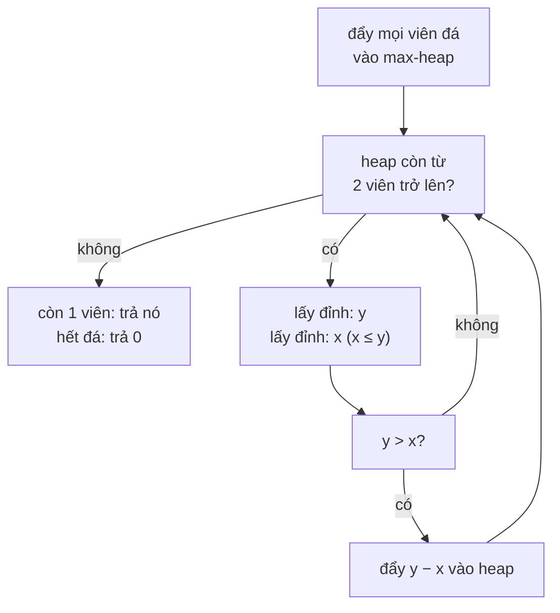

> [!tldr] Đọc nhanh
> - Đề: mỗi lượt lấy hai viên đá nặng nhất y ≥ x đập nhau; bằng nhau thì cả hai vỡ, khác nhau thì còn một viên nặng y − x. Hỏi viên cuối nặng bao nhiêu (không còn viên nào thì 0).
> - Mỗi lượt cần "phần tử lớn nhất" của một tập đang thay đổi: đó là việc của [[concepts/heap|heap]]. Max-heap lấy đỉnh và thêm phần tử đều O(log n), cả bài O(n log n).
> - Sắp xếp lại cả mảng mỗi lượt cũng đúng nhưng O(n² log n): 10⁴ viên mất 215,9 ms, heap mất 1,26 ms.
> - Đề cho cân nặng ≤ 1000 nên còn cách thứ ba: đếm số viên theo từng cân nặng. Hai viên cùng cân nặng triệt tiêu nhau, nên mỗi ô chỉ cần chẵn lẻ.
> - Ba bẫy chạy thật: `sort()` không hàm so sánh của JS xếp `[10, 2, 9]` theo chuỗi (7/9 ca); `heapq` quên đổi dấu thì đập hai viên nhẹ nhất (5/9); Go gọi `h.Pop()` thay cho `heap.Pop(&h)` thì lấy phần tử cuối mảng chứ không phải đỉnh (5/9).

> [!info] Bối cảnh
> Bài LeetCode 1046, bài dễ của [[posts/2026-11-23-neetcode-heap-top-k|ga 3: Heap và top K]] trong **tuyến NeetCode: Tìm kiếm và heap**. Đây là bài "dùng heap đúng nghĩa đen": không có mẹo, chỉ có thao tác lấy lớn nhất lặp đi lặp lại. Lời giải có đủ TypeScript, Python, Go, Java và JavaScript. Bạn cần biết mảng và vòng lặp; heap được giải thích ngay trong bài.

> [!abstract]- Từ điển nhanh cho bài này (bấm để mở)
> - **Heap (đống)**: cây nhị phân cất trong mảng, phần tử lớn nhất (max-heap) hoặc nhỏ nhất (min-heap) luôn ở đỉnh `a[0]`. Xem [[concepts/heap|Heap]].
> - **Hàng đợi ưu tiên (priority queue)**: kiểu dữ liệu "lấy ra phần tử ưu tiên nhất"; heap là cách cài phổ biến nhất. Xem [[concepts/heap|Heap]].
> - **Nổi lên, chìm xuống (sift up, sift down)**: đổi chỗ một phần tử với cha (hoặc con) tới khi đúng thứ tự heap; mỗi lần đi tối đa chiều cao cây, O(log n).
> - **Hàm so sánh (comparator)**: hàm nhận a, b và trả số âm, 0 hoặc dương để nói a đứng trước, ngang hay sau b.
> - **Đếm theo giá trị**: dùng mảng `cnt[w]` đếm số phần tử bằng w, như [[concepts/counting-array|Counting Array]].

## Hình dung trước: giải đấu vật mà hai người nặng ký nhất luôn lên sàn

Một câu lạc bộ vật có luật lạ: mỗi trận, hai người nặng ký nhất lên sàn. Ngang ký thì cả hai bị loại; chênh ký thì người nhẹ bị loại, người nặng ở lại nhưng mất đúng số ký của đối thủ. Trọng tài không muốn cân lại cả câu lạc bộ trước mỗi trận. Họ xếp hàng chờ theo kiểu "người nặng nhất luôn đứng đầu", và khi có người quay lại hàng thì chỉ cần chen vào đúng chỗ.

| Đời thường | Khái niệm |
|---|---|
| Mỗi võ sĩ và số ký của họ | mỗi viên đá và cân nặng |
| Hai người nặng nhất lên sàn | lấy đỉnh max-heap hai lần |
| Ngang ký: cả hai bị loại | `y == x`: không đẩy gì lại |
| Chênh ký: người nặng ở lại với số ký `y − x` | đẩy `y − x` vào heap |
| Cân lại cả câu lạc bộ mỗi trận | sắp xếp lại mỗi lượt, O(n log n) mỗi lượt |
| Hàng chờ "người nặng nhất đứng đầu" | max-heap: lấy đỉnh, thêm phần tử O(log n) |
| Người cuối cùng còn lại | đáp án; không còn ai thì 0 |



## Vấn đề

Cách đầu tiên ai cũng nghĩ: mỗi lượt sắp xếp mảng rồi lấy hai phần tử cuối. Đúng, nhưng mỗi lượt sắp xếp lại O(n log n), và có tới n − 1 lượt. Tổng O(n² log n). Đề chỉ cho tối đa 30 viên nên cách này qua LeetCode, nhưng với 10⁴ viên đo được 215,9 ms, gấp gần 170 lần heap.

Điều lãng phí: sau mỗi lượt, chỉ hai viên biến mất và nhiều nhất một viên mới xuất hiện, mà ta lại sắp xếp lại tất cả. Ta không cần thứ tự đầy đủ; ta chỉ cần biết **viên nặng nhất** là viên nào, lặp đi lặp lại trên một tập thay đổi từng chút. Đó đúng là hợp đồng của hàng đợi ưu tiên.

## Cơ chế

<figure class="figure-map" style="--ar: 3 / 4">
<div class="frame"><iframe data-archify="../diagrams/neetcode-last-stone-weight/worked-example.html" title="Luôn lấy hai viên nặng nhất" loading="lazy"></iframe></div>
<figcaption><span><b>Hình 1.</b> Luôn lấy hai viên nặng nhất.</span><a href="../diagrams/neetcode-last-stone-weight/worked-example.html" target="_blank" rel="noopener">Mở toàn màn hình</a></figcaption>
</figure>

<details>
<summary>Đọc từng bước</summary>
<ol>
<li>Nạp trọng lượng bốn viên. <code>{10, 7, 4, 3}</code></li>
<li>Đập 10 với 7 và đưa 3 trở lại. <code>{4, 3, 3}</code></li>
<li>Đập 4 với 3 và đưa 1 trở lại. <code>{3, 1}</code></li>
<li>Viên cuối nặng 2. <code>3 - 1 = 2</code></li>
</ol>
</details>

### Max-heap trong một mảng

Heap là cây nhị phân gần đầy, cất trong mảng không cần con trỏ: phần tử ở chỉ số i có cha ở `(i − 1) / 2` (chia nguyên) và hai con ở `2i + 1`, `2i + 2`. Luật duy nhất: **cha không nhỏ hơn con**. Từ luật đó suy ra phần tử lớn nhất nằm ở gốc `a[0]`, nhưng phần còn lại của mảng **không** sắp xếp. `[8, 7, 4, 1, 2, 1]` là một max-heap hợp lệ; nó không tăng, không giảm.

| Thao tác | Cách làm | Chi phí |
|---|---|---|
| xem đỉnh | đọc `a[0]` | O(1) |
| thêm x | đặt x cuối mảng, **nổi lên**: đổi với cha khi lớn hơn cha | O(log n) |
| lấy đỉnh | đưa phần tử cuối lên gốc, **chìm xuống**: đổi với con lớn hơn khi nhỏ hơn nó | O(log n) |
| dựng từ n phần tử | chìm xuống từng nút, từ nút cha cuối cùng ngược về gốc | O(n) |

Chiều cao cây n phần tử là ⌊log₂ n⌋, nên nổi và chìm mỗi lần đi tối đa chừng ấy bước. Dựng heap bằng cách chìm từ dưới lên chỉ tốn O(n), không phải O(n log n), vì một nửa số nút là lá và không phải chìm, một phần tư chỉ chìm một bước, và cứ thế; tổng hội tụ về khoảng 2n. `heapq.heapify` của Python và `heap.Init` của Go làm đúng như vậy.

Bài này cần max-heap. JavaScript không có heap sẵn, nên file TypeScript tự viết:

```ts
// Max-heap trên mảng: cha ở i, hai con ở 2i+1 và 2i+2; phần tử lớn nhất luôn ở đỉnh a[0].
class MaxHeap {
  a: number[] = [];
  get size(): number { return this.a.length; }
  push(x: number): void {
    const a = this.a;
    a.push(x);
    let i = a.length - 1;
    while (i > 0) { // nổi lên: đổi chỗ với cha khi lớn hơn cha
      const p = (i - 1) >> 1;
      if (a[p] >= a[i]) break;
      [a[p], a[i]] = [a[i], a[p]];
      i = p;
    }
  }
  pop(): number {
    const a = this.a, top = a[0], last = a.pop()!;
    if (a.length > 0) {
      a[0] = last;
      let i = 0;
      for (;;) { // chìm xuống: đổi chỗ với con lớn hơn khi nhỏ hơn nó
        const l = 2 * i + 1, r = l + 1;
        let m = i;
        if (l < a.length && a[l] > a[m]) m = l;
        if (r < a.length && a[r] > a[m]) m = r;
        if (m === i) break;
        [a[m], a[i]] = [a[i], a[m]];
        i = m;
      }
    }
    return top;
  }
}

// Max-heap: lấy hai viên nặng nhất, đẩy phần dư (nếu có) trở lại. O(n log n).
function heapSim(stones: number[]): number {
  const h = new MaxHeap();
  for (const s of stones) h.push(s);
  while (h.size > 1) {
    const y = h.pop(), x = h.pop(); // y >= x
    if (y > x) h.push(y - x);
  }
  return h.size === 1 ? h.pop() : 0;
}
```


Mỗi lượt lấy đỉnh hai lần, đẩy lại nhiều nhất một lần: ba thao tác O(log n). Có tối đa n − 1 lượt vì mỗi lượt số viên giảm ít nhất 1. Tổng O(n log n), bộ nhớ O(n).

Chạy tay ví dụ của đề `[2, 7, 4, 1, 8, 1]`:

| Lượt | Heap trước (đỉnh trước) | y, x | Đẩy lại |
|---|---|---|---|
| 1 | 8, 7, 4, 2, 1, 1 | 8, 7 | 1 |
| 2 | 4, 2, 1, 1, 1 | 4, 2 | 2 |
| 3 | 2, 1, 1, 1 | 2, 1 | 1 |
| 4 | 1, 1, 1 | 1, 1 | không |
| 5 | 1 | | còn một viên: đáp án 1 |

(Cột heap ghi theo thứ tự giảm cho dễ đọc; trong mảng heap, chúng không xếp như thế.)

### Cách thứ ba: đếm theo cân nặng

Đề cho mỗi viên nặng 1 tới 1000. Khi giá trị nằm trong một khoảng nhỏ, ta đếm thay vì so sánh, như [[concepts/bucket-sort|Bucket Sort]]: `cnt[w]` là số viên nặng w. Đi từ cân nặng lớn xuống:

- Hai viên cùng cân nặng đập nhau thì cả hai vỡ, nên một ô có c viên chỉ để lại `c % 2` viên.
- Ô cao nhất còn 1 viên (nặng i) thì tìm ô khác rỗng kế tiếp bên dưới (j), đập chúng: bớt một ở i và j, thêm một ở `i − j`.
- Mọi ô giữa j và i đều rỗng, trừ ô `i − j` vừa thêm, nên con trỏ nhảy thẳng tới `max(j, i − j)`.

```ts
// Đếm theo cân nặng (đề cho cân nặng <= 1000): cnt[w] là số viên nặng w.
// Hai viên cùng cân nặng đập nhau thì cùng mất, nên chỉ cần cnt[w] % 2.
function countingBuckets(stones: number[], maxW = 1000): number {
  const cnt = new Array(maxW + 1).fill(0);
  for (const s of stones) cnt[s]++;
  let i = maxW;
  for (;;) {
    while (i > 0 && cnt[i] === 0) i--;
    if (i === 0) return 0;
    cnt[i] %= 2; // các cặp bằng nhau triệt tiêu nhau
    if (cnt[i] === 0) continue;
    let j = i - 1; // viên nặng thứ hai
    while (j > 0 && cnt[j] === 0) j--;
    if (j === 0) return i; // chỉ còn một viên
    cnt[i] = 0; cnt[j]--; cnt[i - j]++;
    i = Math.max(j, i - j); // mọi ô trong (j, i) đều rỗng, trừ ô i - j vừa thêm
  }
}
```


Không có so sánh giữa các viên đá, không có heap. Mỗi lần đập, phần quét xuống tìm j có thể đi lại một đoạn đã quét, nên chặn trên đơn giản nhất là O(n + W · số lần đập), với W = 1000. Trên dữ liệu ngẫu nhiên nó nhanh hơn heap 100 tới 160 lần, phần lớn vì các cặp cùng cân nặng triệt tiêu ngay từ đầu (10⁶ viên chỉ có 1000 cân nặng khác nhau). Cách này chỉ dùng được vì đề giới hạn cân nặng; cân nặng tới 10⁹ thì mảng đếm không khả thi.

### Bẫy 1 (JavaScript): `sort()` không truyền hàm so sánh

Đặc tả ECMAScript nói: `Array.prototype.sort` không có hàm so sánh thì đổi từng phần tử thành chuỗi rồi so sánh chuỗi. `"10" < "2"` vì ký tự `'1'` đứng trước `'2'`, nên `[10, 2, 9].sort()` ra `[10, 2, 9]`. Bản "sắp xếp mỗi lượt" dùng `s.sort()` lấy hai phần tử cuối là 9 và 2 thay vì 10 và 9:

```ts
// SAI: sort() không truyền hàm so sánh thì JS so sánh theo chuỗi: [10, 2, 9] giữ nguyên thứ tự, "10" < "2".
function wrongDefaultSort(stones: number[]): number {
  const s = [...stones];
  while (s.length > 1) {
    s.sort();
    const y = s.pop()!, x = s.pop()!;
    if (y !== x) s.push(Math.abs(y - x));
  }
  return s.length === 1 ? s[0] : 0;
}
```


Nó sai 2/9 ca: `[10, 2, 9]` ra 3 thay vì 1, `[31, 26, 33, 21, 40]` ra 19 thay vì 9. Mọi ca chỉ có số một chữ số đều qua, nên ví dụ của đề không bắt được lỗi này. Luôn viết `sort((a, b) => a - b)` cho số.

### Bẫy 2 (Python): `heapq` chỉ có min-heap

`heapq` cài min-heap trên một list thường: `h[0]` là phần tử **nhỏ** nhất. Cách quen thuộc để có max-heap là lưu số đối `-s`: phần tử nhỏ nhất của các số đối là số đối của phần tử lớn nhất.

```python
# heapq chỉ có min-heap: lưu -s thì viên nặng nhất nằm ở đỉnh.
def last_stone_weight(stones):
    h = [-s for s in stones]
    heapq.heapify(h)  # O(n), không phải O(n log n)
    while len(h) > 1:
        y = -heapq.heappop(h)
        x = -heapq.heappop(h)
        if y > x:
            heapq.heappush(h, -(y - x))
    return -h[0] if h else 0
```


Quên đổi dấu thì code vẫn chạy, không lỗi, nhưng mỗi lượt đập hai viên **nhẹ** nhất: sai 5/9 ca, ví dụ của đề ra 3 thay vì 1. Python 3.14 thêm các hàm max-heap công khai (`heapq.heappush_max`, `heapq.heappop_max`, `heapq.heapify_max`…); máy mình chạy Python 3.12 nên file vẫn dùng mẹo đổi dấu, và mẹo này chạy trên mọi phiên bản.

### Bẫy 3 (Go): `h.Pop()` không phải `heap.Pop(&h)`

Gói `container/heap` không cho sẵn một kiểu heap. Bạn khai báo kiểu của mình và cài năm phương thức `Len`, `Less`, `Swap`, `Push`, `Pop`; rồi gọi các **hàm** `heap.Init`, `heap.Push`, `heap.Pop` của gói. `Less(i, j)` trả `h[i] > h[j]` thì thành max-heap.

```go
// maxHeap cài đủ heap.Interface: sort.Interface (Len, Less, Swap) cộng Push và Pop.
// Less(i, j) trả a[i] > a[j] nên đỉnh là phần tử LỚN nhất.
type maxHeap []int

func (h maxHeap) Len() int           { return len(h) }
func (h maxHeap) Less(i, j int) bool { return h[i] > h[j] }
func (h maxHeap) Swap(i, j int)      { h[i], h[j] = h[j], h[i] }

// Push và Pop chỉ thêm, bớt ở CUỐI slice; heap.Push và heap.Pop lo phần nổi lên, chìm xuống.
func (h *maxHeap) Push(x any) { *h = append(*h, x.(int)) }
func (h *maxHeap) Pop() any {
	old := *h
	x := old[len(old)-1]
	*h = old[:len(old)-1]
	return x
}

func lastStoneWeight(stones []int) int {
	h := maxHeap(append([]int(nil), stones...))
	heap.Init(&h) // O(n)
	for h.Len() > 1 {
		y := heap.Pop(&h).(int)
		x := heap.Pop(&h).(int)
		if y > x {
			heap.Push(&h, y-x)
		}
	}
	if h.Len() == 1 {
		return h[0]
	}
	return 0
}
```


Chỗ dễ nhầm: phương thức `Pop` bạn viết chỉ cắt phần tử **cuối** slice. Hàm `heap.Pop(&h)` mới đổi đỉnh xuống cuối, cho chìm xuống, rồi mới gọi phương thức `Pop` của bạn. Gọi nhầm `h.Pop()` thì lấy ra một phần tử tùy vị trí, không phải lớn nhất:

```text
sau heap.Init: [8 7 4 1 2 1]
h.Pop() trả 1 (phần tử cuối), rồi heap.Pop(&h) trả 8 (đỉnh)
```

Bản dùng `h.Pop()` sai 5/9 ca. Tài liệu gói nói rõ: `Push` và `Pop` trong interface là để gói gọi; người dùng gọi `heap.Push` và `heap.Pop`.

### Bẫy 4 (Java): hàm so sánh bằng phép trừ

`PriorityQueue` của Java là min-heap. Hai cách phổ biến để đổi thành max-heap: `Collections.reverseOrder()` và lambda `(a, b) -> b - a`. Ở bài này cả hai đúng (9/9 ca), vì cân nặng dương và hiệu hai số dương không tràn `int`. Nhưng phép trừ không phải phép so sánh: với giá trị trái dấu và lớn, `b − a` tràn và đảo chiều. File Java đẩy `1, Integer.MIN_VALUE, 5` vào hai hàng đợi:

```text
b - a:                lấy ra [-2147483648, 5, 1]
Integer.compare(b, a): lấy ra [5, 1, -2147483648]
vì Integer.MIN_VALUE - 1 = 2147483647
```

Hàng đợi dùng phép trừ coi `Integer.MIN_VALUE` là lớn nhất. Viết `Integer.compare(b, a)` hoặc `Collections.reverseOrder()` thì không phải nghĩ khi nào phép trừ an toàn.

### Bên dưới năm ngôn ngữ

| | Heap có sẵn | Mặc định | Max-heap | Bẫy riêng |
|---|---|---|---|---|
| TypeScript / JavaScript | không có | | tự viết (khoảng 30 dòng) hoặc mảng giữ thứ tự | `sort()` không hàm so sánh so sánh theo chuỗi |
| Python | `heapq` (hàm trên list) | min-heap | lưu `-s`; từ 3.14 có `heappush_max`… | quên đổi dấu vẫn chạy, ra sai; `heapify` O(n) |
| Go | `container/heap` (bạn cài interface) | theo `Less` của bạn | `Less` trả `h[i] > h[j]` | gọi `h.Pop()` thay cho `heap.Pop(&h)`; `Pop` trả `any`, phải ép kiểu |
| Java | `PriorityQueue<Integer>` | min-heap | `Collections.reverseOrder()` | `(a, b) -> b - a` tràn với giá trị trái dấu lớn; `Integer` đóng hộp tốn bộ nhớ |

### Đo

TypeScript, cân nặng ngẫu nhiên 1..1000, trung vị 5 lần chạy:

| n | Sắp xếp mỗi lượt | Max-heap | Đếm theo cân nặng |
|---|---|---|---|
| 1 000 | 3,13 ms | 0,11 ms | 0,01 ms |
| 3 000 | 22,5 ms | 0,31 ms | 0,01 ms |
| 10 000 | 215,9 ms | 1,26 ms | 0,02 ms |
| 100 000 | (không chạy) | 13,8 ms | 0,11 ms |
| 1 000 000 | (không chạy) | 165,0 ms | 1,03 ms |

Sắp xếp mỗi lượt gấp khoảng 7 lần khi n gấp 3, gấp khoảng 10 lần nữa khi n từ 3 000 lên 10 000: đúng dáng n² log n. Heap tăng gần tuyến tính theo n.

Một cách giữa hai cực: giữ mảng luôn tăng dần, lấy hai phần tử cuối, chèn phần dư vào đúng chỗ bằng [[concepts/binary-search|tìm kiếm nhị phân]]. Tìm chỗ O(log n), nhưng `splice` phải dời các phần tử phía sau. File JavaScript đo với cân nặng tới 10⁹:

| n | Max-heap | Mảng giữ thứ tự |
|---|---|---|
| 10 000 | 2,1 ms | 5,2 ms |
| 30 000 | 6,7 ms | 46,2 ms |
| 100 000 | 21,9 ms | 446,1 ms |
| 300 000 | 72,0 ms | 6 343,2 ms |

Ở 10⁴ phần tử, dời mảng bằng một lệnh chép bộ nhớ còn rẻ; tới 3 · 10⁵ thì chi phí O(n) mỗi lần chèn lộ ra, chậm hơn heap gần 90 lần.

Python, 10⁵ viên: `heapq` 30,2 ms, đếm theo cân nặng 2,0 ms.

## Ví dụ chạy được

[TypeScript](../code/neetcode-last-stone-weight/last-stone.ts) · [Python](../code/neetcode-last-stone-weight/last_stone.py) · [Go](../code/neetcode-last-stone-weight/last_stone.go) · [Java](../code/neetcode-last-stone-weight/last-stone.java) · [JavaScript](../code/neetcode-last-stone-weight/last-stone.js) · [PHP](../code/neetcode-last-stone-weight/last-stone.php) · [Rust](../code/neetcode-last-stone-weight/last_stone.rs)

Mỗi file trong năm bản đầu chạy 9 ca: ví dụ của đề, một viên, hai viên bằng nhau (đáp án 0), ba viên bằng nhau, hai cặp triệt tiêu, `[10, 2, 9]` để bắt lỗi so sánh chuỗi, chênh lệch lớn `[1000, 1]`, và hai ca nhiều lượt.

```ts
// Max-heap: lấy hai viên nặng nhất, đẩy phần dư (nếu có) trở lại. O(n log n).
function heapSim(stones: number[]): number {
  const h = new MaxHeap();
  for (const s of stones) h.push(s);
  while (h.size > 1) {
    const y = h.pop(), x = h.pop(); // y >= x
    if (y > x) h.push(y - x);
  }
  return h.size === 1 ? h.pop() : 0;
}
```

```python
# heapq chỉ có min-heap: lưu -s thì viên nặng nhất nằm ở đỉnh.
def last_stone_weight(stones):
    h = [-s for s in stones]
    heapq.heapify(h)  # O(n), không phải O(n log n)
    while len(h) > 1:
        y = -heapq.heappop(h)
        x = -heapq.heappop(h)
        if y > x:
            heapq.heappush(h, -(y - x))
    return -h[0] if h else 0
```

```go
func lastStoneWeight(stones []int) int {
	h := maxHeap(append([]int(nil), stones...))
	heap.Init(&h) // O(n)
	for h.Len() > 1 {
		y := heap.Pop(&h).(int)
		x := heap.Pop(&h).(int)
		if y > x {
			heap.Push(&h, y-x)
		}
	}
	if h.Len() == 1 {
		return h[0]
	}
	return 0
}
```

```java
// PriorityQueue là min-heap; truyền Collections.reverseOrder() để đỉnh là phần tử lớn nhất.
static int lastStoneWeight(int[] stones) {
    PriorityQueue<Integer> pq = new PriorityQueue<>(Collections.reverseOrder());
    for (int s : stones) pq.add(s);
    while (pq.size() > 1) {
        int y = pq.poll(), x = pq.poll(); // poll() trả Integer, tự mở hộp thành int
        if (y > x) pq.add(y - x);
    }
    return pq.isEmpty() ? 0 : pq.peek();
}
```

```js
function heapSim(stones) {
  const h = new MaxHeap();
  for (const s of stones) h.push(s);
  while (h.size > 1) {
    const y = h.pop(), x = h.pop();
    if (y > x) h.push(y - x);
  }
  return h.size === 1 ? h.pop() : 0;
}
```

```php
<?php
declare(strict_types=1);

function lastStoneWeight(array $stones): int
{
    $heap = new SplMaxHeap();
    foreach ($stones as $stone) {
        $heap->insert($stone);
    }

    while ($heap->count() > 1) {
        $heavier = $heap->extract();
        $lighter = $heap->extract();
        if ($heavier > $lighter) {
            $heap->insert($heavier - $lighter);
        }
    }

    return $heap->isEmpty() ? 0 : $heap->extract();
}
```

```rust
use std::collections::BinaryHeap;

fn last_stone_weight(stones: Vec<i32>) -> i32 {
    let mut heap = BinaryHeap::from(stones);
    while heap.len() > 1 {
        let heavier = heap.pop().unwrap();
        let lighter = heap.pop().unwrap();
        if heavier > lighter {
            heap.push(heavier - lighter);
        }
    }
    heap.pop().unwrap_or(0)
}
```


Kết quả `node last-stone.ts`:

```text
sortEachRound    9/9 ca đúng
heapSim          9/9 ca đúng
countingBuckets  9/9 ca đúng
wrongDefaultSort 7/9 ca đúng; sai ở [10,2,9] → 3, [31,26,33,21,40] → 19

ngẫu nhiên: ba cách khớp nhau ở 2000/2000 bộ
```

`python3 last_stone.py`:

```text
last_stone_weight  9/9 ca đúng
sort_each_round    9/9 ca đúng
counting           9/9 ca đúng
forgot_negate      5/9 ca đúng; sai ở [2, 7, 4, 1, 8, 1] → 3, [10, 2, 9] → 3, [7, 6, 7, 6, 9] → 9, [31, 26, 33, 21, 40] → 33
```

`go run last_stone.go`:

```text
lastStoneWeight  9/9 ca đúng
sortEachRound    9/9 ca đúng
wrongDirectPop   5/9 ca đúng; sai ở [2 7 4 1 8 1] → 5, [10 2 9] → 3, [7 6 7 6 9] → 9, [31 26 33 21 40] → 37
```

`java last-stone.java` cho `lastStoneWeight`, `subtractComparator`, `counting` đều 9/9; `node last-stone.js` cho `heapSim` và `sortedInsert` đều 9/9.

Hai bản dùng max-heap có sẵn (`SplMaxHeap` và `BinaryHeap`). PHP in `7/7 ca đúng` và Rust in `7/7 ca đúng`.

## Hiểu lầm và bẫy hay gặp

- **"Heap là mảng đã sắp xếp."** Chỉ đỉnh là đúng chỗ; phần còn lại chỉ thỏa "cha không nhỏ hơn con". Duyệt mảng heap từ đầu tới cuối không cho thứ tự giảm dần.
- **"Dựng heap từ n phần tử tốn O(n log n)."** Đẩy từng phần tử thì đúng là vậy, nhưng `heapify` chìm từ dưới lên chỉ tốn O(n).
- **`sort()` trong JS không có hàm so sánh.** So sánh theo chuỗi; `[10, 2, 9]` không đổi thứ tự.
- **`heapq` là min-heap.** Muốn lớn nhất ở đỉnh thì lưu số đối.
- **Go: gọi phương thức `Pop` của chính mình.** Phải gọi hàm `heap.Pop(&h)`.
- **Java: `(a, b) -> b - a`.** An toàn khi mọi giá trị không âm (hiệu hai số không âm luôn vừa `int`), tràn khi giá trị trái dấu và lớn.
- **Quên ca hết đá.** Hai viên cuối bằng nhau thì heap rỗng; trả 0, đừng đọc `a[0]` của mảng rỗng (JS trả `undefined`, Java `peek()` trả `null` rồi mở hộp ném `NullPointerException`).

## Câu hỏi tự kiểm tra

> [!question]- Vì sao số lượt đập không quá n − 1?
> Mỗi lượt lấy ra hai viên và đẩy lại nhiều nhất một, nên số viên giảm ít nhất 1. Bắt đầu với n viên, dừng khi còn 0 hoặc 1 viên: tối đa n − 1 lượt.

> [!question]- `[8, 7, 4, 1, 2, 1]` có phải max-heap hợp lệ không? Còn `[8, 1, 7, 2, 4, 1]`?
> Cái đầu hợp lệ: 8 ≥ 7, 4; 7 ≥ 1, 2; 4 ≥ 1. Cái sau không: nút ở chỉ số 1 là 1 có con ở chỉ số 3 và 4 là 2 và 4, đều lớn hơn nó.

> [!question]- Có cần heap không nếu chỉ hỏi "viên nặng nhất ban đầu nặng bao nhiêu"?
> Không. Một lần duyệt O(n) là đủ. Heap đáng giá khi phải lấy phần tử lớn nhất **lặp lại** trên một tập vừa bớt vừa thêm.

> [!question]- Trong cách đếm theo cân nặng, vì sao sau khi đập ta nhảy con trỏ tới `max(j, i − j)` mà không bỏ sót?
> Mọi ô giữa j và i đều rỗng (ta vừa quét qua chúng để tìm j), ô i vừa về 0, và chỉ ô `i − j` vừa có thêm một viên. Viên lớn nhất còn lại vì thế nằm ở j hoặc ở `i − j`, tức không vượt `max(j, i − j)`.

## Tham khảo

- [LeetCode 1046: Last Stone Weight](https://leetcode.com/problems/last-stone-weight/) (đề gốc và giới hạn)
- [Python `heapq`](https://docs.python.org/3/library/heapq.html) (min-heap trên list, `heapify` tuyến tính, các hàm `_max` từ 3.14)
- [Go `container/heap`](https://pkg.go.dev/container/heap) (heap.Interface; gọi `heap.Push` và `heap.Pop`, không gọi phương thức trực tiếp)
- [Java `PriorityQueue`](https://docs.oracle.com/en/java/javase/21/docs/api/java.base/java/util/PriorityQueue.html) (min-heap theo thứ tự tự nhiên hoặc theo comparator)
- [ECMAScript: `Array.prototype.sort`](https://tc39.es/ecma262/#sec-array.prototype.sort) (không có comparator thì so sánh chuỗi)
- Cormen, Leiserson, Rivest, Stein, *Introduction to Algorithms*, chương 6 Heapsort (dựng heap O(n))
