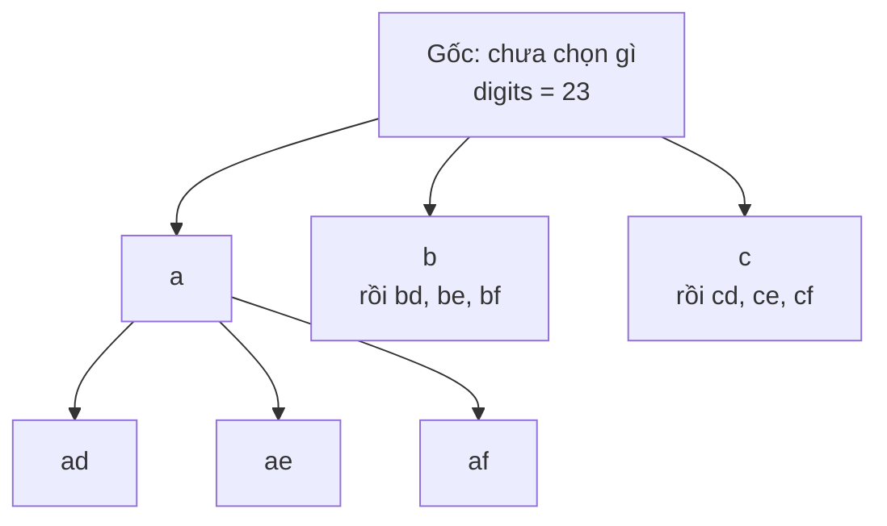
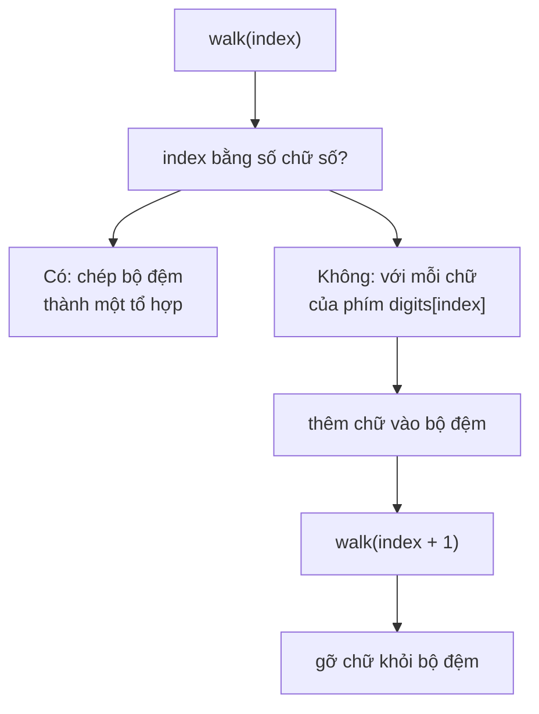

> [!tldr] Đọc nhanh
> - Mỗi chữ số là một tầng của [[concepts/choice-tree|cây lựa chọn]], mỗi chữ cái trên phím là một nhánh. Mỗi lá là một tổ hợp.
> - [[concepts/backtracking|Quay lui]] đi xuống cây với một bộ đệm: thêm một chữ, đi tiếp, rồi gỡ chữ đó ra để thử chữ kế.
> - Cây có đúng tích số chữ cái của các phím, tối đa 4⁴ = 256 lá. Kết quả đã lớn cỡ đó, nên không có cách nào nhanh hơn O(4ⁿ·n).
> - Hai bẫy hay gặp: đầu vào rỗng phải trả `[]`, không phải `[""]`, và phím 7, 9 có bốn chữ chứ không phải ba.

> [!info] Bối cảnh
> Đây là bài LeetCode 17 tại [[posts/2026-11-28-neetcode-subsets-combinations|ga MISC-01: Quay lui: tập con và tổ hợp]] trên **tuyến NeetCode: Kỹ thuật tổng hợp**. Mình hình dung một ổ khóa số kiểu vali, nhưng mỗi vòng khắc chữ thay vì số. Bạn chỉ cần biết chuỗi, mảng và hàm đệ quy.

> [!abstract]- Từ điển nhanh cho bài này (bấm để mở)
> - Bàn phím điện thoại gắn chữ cái vào phím 2 đến 9: `2` là abc, `3` là def, …, `7` là pqrs, `8` là tuv, `9` là wxyz. Phím 0 và 1 không có chữ.
> - [[concepts/choice-tree|Cây lựa chọn]] (choice tree) vẽ mỗi quyết định thành một tầng; đường từ gốc tới lá là một lời giải.
> - [[concepts/backtracking|Quay lui]] (backtracking) đi thử một nhánh, đến cuối thì lùi lại một bước và thử nhánh kế.
> - Bộ đệm (buffer) là một mảng ký tự dùng chung cho cả lần duyệt. Mỗi tầng thêm một ký tự vào cuối rồi gỡ ra.
> - Tích Descartes (cartesian product) của các tập chữ là mọi cách chọn một chữ từ mỗi tập.
> - Bộ đếm hỗn cơ số (mixed radix) là cách đếm mà mỗi vị trí có cơ số riêng, như đồng hồ đếm km nếu mỗi bánh xe có số nấc khác nhau.

## Hình dung trước: ổ khóa vali khắc chữ

Ổ khóa có một vòng xoay cho mỗi phím được bấm. Vòng của phím `5` khắc ba chữ `j k l`, vòng của phím `7` khắc bốn chữ `p q r s`. Mình cố định vòng thứ nhất ở `j`, xoay hết vòng thứ hai, đọc ra `jp jq jr js`. Rồi nhả vòng thứ nhất sang `k` và xoay lại vòng thứ hai từ đầu. Hết vòng thứ nhất là đã đọc đủ 3 × 4 = 12 dãy.

| Đời thường | Khái niệm |
|---|---|
| Một vòng xoay | Một chữ số trong `digits`, một tầng của [[concepts/choice-tree\|cây lựa chọn]] |
| Chữ khắc trên vòng | Chữ cái của phím, một nhánh |
| Dãy chữ đọc được khi mọi vòng đã đặt | Một lá, một tổ hợp |
| Nhả vòng cuối để thử chữ kế | Gỡ ký tự khỏi bộ đệm (`pop`) |
| Đếm hết các vị trí như đồng hồ km | Bộ đếm hỗn cơ số |
| Số dãy đọc được | Tích số chữ cái của các phím |



## Vấn đề: một dãy phím ra những chữ nào?

Cho chuỗi `digits` dài từ 0 đến 4, mỗi ký tự là một chữ số từ `2` đến `9`. Trả về mọi chuỗi chữ cái mà dãy phím đó có thể gõ ra trên bàn phím điện thoại, theo thứ tự nào cũng được. Ví dụ, `57` cho 12 chuỗi: `jp jq jr js kp kq kr ks lp lq lr ls`. Nếu `digits` rỗng, kết quả là danh sách rỗng. [Đề gốc LeetCode 17](https://leetcode.com/problems/letter-combinations-of-a-phone-number/)

Mình từng nghĩ cần một mẹo gì đó để "sinh nhanh" các tổ hợp. Hóa ra bài này không có chỗ để nhanh hơn: chính đầu ra đã có tới 256 chuỗi, nên việc của mình là đi qua cây lựa chọn một cách gọn, không sót, không trùng.

## Cơ chế

### Cây lựa chọn và số lá

Gọi n là số chữ số. Tầng i của cây quyết định chữ cái thứ i, với 3 hoặc 4 nhánh. Số lá là tích số chữ cái của các phím, nhiều nhất 4ⁿ. Mỗi lá dựng một chuỗi dài n, nên tổng thời gian là O(4ⁿ·n). Bộ nhớ phụ ngoài kết quả là O(n) cho bộ đệm và ngăn xếp đệ quy. Đầu ra đã chiếm O(4ⁿ·n), vậy đây là cận dưới: không thuật toán nào tránh được việc viết ra từng chuỗi.

Số lần gọi hàm là số nút của cây. Với `7999`, cây có 1 + 4 + 16 + 64 + 256 = 341 nút, đúng con số chương trình đếm được ở phần dưới.

### Quay lui với một bộ đệm

Hàm `walk(index)` đứng ở tầng `index`. Nếu `index` bằng độ dài `digits`, bộ đệm đã có đủ n chữ: chép nó thành một chuỗi và lưu lại. Nếu chưa, lần lượt thêm từng chữ cái của phím `digits[index]` vào cuối bộ đệm, gọi `walk(index + 1)`, rồi gỡ chữ đó ra. Bước gỡ trả bộ đệm về đúng trạng thái trước khi thử nhánh, nên nhánh kế bắt đầu sạch.

Cách khác là truyền chuỗi `prefix + letter` xuống mỗi lần gọi. Cách đó cũng đúng và cùng độ phức tạp, nhưng mỗi nút của cây tạo một chuỗi mới. Bộ đệm dùng chung chỉ chép ở lá.



### Dựng lặp theo từng lớp

Bắt đầu với một lớp chỉ có chuỗi rỗng. Với mỗi chữ số, lớp mới gồm mọi tiền tố của lớp cũ nối với mọi chữ của phím đó. Sau n chữ số, lớp cuối là kết quả. Thứ tự ra giống hệt cách quay lui. Cách này không dùng đệ quy nhưng giữ cả lớp trước trong bộ nhớ, nên bộ nhớ phụ tỉ lệ với kích thước đầu ra. Chương trình dùng nó làm mốc đối chiếu cho hai cách còn lại.

### Bộ đếm hỗn cơ số

Mỗi vị trí giữ chỉ số chữ cái đang chọn, như một bánh xe của đồng hồ đếm km. Đọc ra tổ hợp hiện tại, rồi tăng bánh xe cuối. Bánh xe nào vượt chữ cuối của phím thì quay về 0 và nhớ sang bánh bên trái. Khi cả bánh đầu tiên cũng tràn, đã đếm xong. Cách đếm này cho phép tính thẳng tổ hợp thứ k: viết k theo các cơ số là số chữ của từng phím.

## Ví dụ chạy được

[TypeScript](../code/neetcode-letter-combinations-of-a-phone-number/keypad.ts) · [Python](../code/neetcode-letter-combinations-of-a-phone-number/keypad.py) · [Go](../code/neetcode-letter-combinations-of-a-phone-number/keypad.go) · [Java](../code/neetcode-letter-combinations-of-a-phone-number/keypad.java) · [JavaScript](../code/neetcode-letter-combinations-of-a-phone-number/keypad.js) · [PHP](../code/neetcode-letter-combinations-of-a-phone-number/keypad.php) · [Rust](../code/neetcode-letter-combinations-of-a-phone-number/phone_keypad.rs)

```ts
function combineBacktrack(digits: string): string[] {
    const result: string[] = []
    if (digits.length === 0) return result // chuỗi rỗng cho [], không phải [""]
    const buffer: string[] = []
    function walk(index: number): void {
        calls++
        if (index === digits.length) {
            result.push(buffer.join(""))
            return
        }
        for (const letter of KEYS[digits[index]]) {
            buffer.push(letter)
            walk(index + 1)
            buffer.pop()
        }
    }
    walk(0)
    return result
}
```

```python
def combine_backtrack(digits):
    result = []
    if not digits:
        return result  # chuỗi rỗng cho [], không phải [""]
    buffer = []

    def walk(index):
        global calls
        calls += 1
        if index == len(digits):
            result.append("".join(buffer))
            return
        for letter in KEYS[digits[index]]:
            buffer.append(letter)
            walk(index + 1)
            buffer.pop()

    walk(0)
    return result
```

```go
func combineBacktrack(digits string) []string {
	result := []string{}
	if len(digits) == 0 {
		return result // chuỗi rỗng cho [], không phải [""]
	}
	buffer := make([]byte, 0, len(digits))
	var walk func(index int)
	walk = func(index int) {
		calls++
		if index == len(digits) {
			result = append(result, string(buffer))
			return
		}
		letters := keys[digits[index]]
		for i := 0; i < len(letters); i++ {
			buffer = append(buffer, letters[i])
			walk(index + 1)
			buffer = buffer[:len(buffer)-1]
		}
	}
	walk(0)
	return result
}
```

```java
static List<String> combineBacktrack(String digits) {
    List<String> result = new ArrayList<>();
    if (digits.isEmpty()) return result; // chuỗi rỗng cho [], không phải [""]
    walk(digits, 0, new StringBuilder(), result);
    return result;
}

static void walk(String digits, int index, StringBuilder buffer, List<String> result) {
    calls++;
    if (index == digits.length()) {
        result.add(buffer.toString());
        return;
    }
    for (char letter : KEYS[digits.charAt(index) - '0'].toCharArray()) {
        buffer.append(letter);
        walk(digits, index + 1, buffer, result);
        buffer.deleteCharAt(buffer.length() - 1);
    }
}
```

```js
function combineBacktrack(digits) {
    const result = []
    if (digits.length === 0) return result // chuỗi rỗng cho [], không phải [""]
    const buffer = []
    function walk(index) {
        calls++
        if (index === digits.length) {
            result.push(buffer.join(""))
            return
        }
        for (const letter of KEYS[digits[index]]) {
            buffer.push(letter)
            walk(index + 1)
            buffer.pop()
        }
    }
    walk(0)
    return result
}
```

```php
function combineBacktrack(string $digits): array {
    $result = [];
    if ($digits === '') return $result; // chuỗi rỗng cho [], không phải [""]
    $buffer = [];
    walk($digits, 0, $buffer, $result);
    return $result;
}

function walk(string $digits, int $index, array &$buffer, array &$result): void {
    global $calls;
    $calls++;
    if ($index === strlen($digits)) {
        $result[] = implode('', $buffer);
        return;
    }
    foreach (str_split(KEYS[$digits[$index]]) as $letter) {
        $buffer[] = $letter;
        walk($digits, $index + 1, $buffer, $result);
        array_pop($buffer);
    }
}
```

```rust
fn combine_backtrack(digits: &str) -> Vec<String> {
    let mut result = Vec::new();
    if digits.is_empty() {
        return result; // chuỗi rỗng cho [], không phải [""]
    }
    let mut buffer = Vec::with_capacity(digits.len());
    walk(digits.as_bytes(), 0, &mut buffer, &mut result);
    result
}

fn walk(digits: &[u8], index: usize, buffer: &mut Vec<u8>, result: &mut Vec<String>) {
    CALLS.with(|c| c.set(c.get() + 1));
    if index == digits.len() {
        result.push(String::from_utf8(buffer.clone()).unwrap());
        return;
    }
    for &letter in keys(digits[index]) {
        buffer.push(letter);
        walk(digits, index + 1, buffer, result);
        buffer.pop();
    }
}
```

Các tab trích cách quay lui. Dòng `calls` chỉ đếm số lần gọi để in phép đo. File tải về còn có cách dựng lặp và bộ đếm hỗn cơ số. 11 ca kiểm tra cả ba cách: đầu vào rỗng, một phím ba chữ, phím 7 và 9 bốn chữ, phím lặp `22`, và `7999` có 256 tổ hợp. Dòng thứ hai đối chiếu cách quay lui và bộ đếm với cách dựng lặp trên mọi chuỗi chữ số 2–9 dài 0–4, tổng cộng 4.681 chuỗi.

```text
11/11 ca đúng
4681/4681 ca đúng (đối chiếu tích Descartes lặp)
7999: 256 tổ hợp, 341 lượt gọi quay lui
```

Chạy bằng `node keypad.ts`, `python3 keypad.py`, `go run keypad.go`, `java keypad.java`, `node keypad.js`, `php -d xdebug.mode=off keypad.php` hoặc `rustc --edition 2021 -O phone_keypad.rs -o /tmp/phone_keypad && /tmp/phone_keypad`. Cả bảy ngôn ngữ in cùng ba dòng.

## Hiểu lầm và bẫy hay gặp

- Đầu vào rỗng trả `[""]`. Nếu không chặn riêng, cả hai cách đều rơi vào bẫy này: quay lui đứng ngay ở lá khi `index = 0 = n` và lưu một chuỗi rỗng, còn cách dựng lặp trả nguyên lớp khởi đầu `[""]`. Đề muốn danh sách rỗng.
- Coi mọi phím đều có ba chữ, hoặc tính chữ bằng công thức `'a' + 3·(d − 2)`. Công thức đúng tới phím 6 rồi lệch từ phím 7, vì `7` có thêm `s` và `9` có thêm `z`. Dùng một bảng tra.
- Quên gỡ chữ sau khi đi xuống. Bộ đệm cứ dài ra và các tổ hợp sau sai hết.
- Lưu chính bộ đệm thay vì một bản chép. Python `result.append(buffer)` và JS `result.push(buffer)` lưu cùng một mảng; cuối cùng mọi phần tử đều là mảng rỗng. Phải lưu `"".join(buffer)` hoặc `buffer.join("")`. Go thì `string(buffer)` đã chép sẵn, nhưng nếu lưu lát `buffer` thì mọi phần tử dùng chung một vùng nhớ.
- Java: nối `prefix + letter` trong vòng lặp tạo một `String` mới mỗi lần. Bản trên dùng `StringBuilder` với `append` và `deleteCharAt`.
- PHP: mảng truyền theo giá trị. Thiếu dấu `&` ở `array &$result` thì mỗi lời gọi ghi vào bản sao riêng và kết quả về tay rỗng. Chuỗi PHP không đổi được, nên bộ đệm ở đây là một mảng ký tự.
- Rust: bộ đệm là `Vec<u8>` vì mọi chữ đều là ASCII; `String::from_utf8` đổi nó thành chuỗi ở lá. Hàm đệ quy nhận `&mut` để không phải chép bộ đệm.
- Độ sâu đệ quy chỉ tới n + 1 ≤ 5 tầng, xa mọi giới hạn ngăn xếp.

## Câu hỏi tự kiểm tra

> [!question]- `7999` cho bao nhiêu tổ hợp và cây quay lui có bao nhiêu nút?
> 4 · 4 · 4 · 4 = 256 lá. Cộng thêm các tầng trên: 1 + 4 + 16 + 64 + 256 = 341 nút, cũng là 341 lần gọi `walk`.

> [!question]- Vì sao không có thuật toán nào nhanh hơn O(4ⁿ·n) cho bài này?
> Vì kết quả có tới 4ⁿ chuỗi, mỗi chuỗi dài n. Chỉ việc viết kết quả ra đã tốn chừng đó.

> [!question]- Với `234`, bộ đếm hỗn cơ số cho tổ hợp thứ 9 (đếm từ 0) là gì?
> Ba phím đều có ba chữ. Viết 9 theo cơ số 3, 3, 3 được (1, 0, 0), tức chữ thứ hai của `2`, chữ đầu của `3` và của `4`: `bdg`.

> [!question]- Nếu bỏ bước gỡ chữ trong quay lui, kết quả với `23` sẽ ra sao?
> Bộ đệm không về lại trạng thái cũ, nên sau `ad` nó thành `ade`, `adef`, … Chỉ tổ hợp đầu tiên đúng.

## Tham khảo

- [LeetCode 17](https://leetcode.com/problems/letter-combinations-of-a-phone-number/)
- [Jeff Erickson, Algorithms, chương 2: quay lui](https://jeffe.cs.illinois.edu/teaching/algorithms/book/02-backtracking.pdf)
- [ITU-T E.161, cách gán chữ cái cho phím số](https://www.itu.int/rec/T-REC-E.161)
- [Mixed radix (Wikipedia)](https://en.wikipedia.org/wiki/Mixed_radix)
- [Java StringBuilder](https://docs.oracle.com/en/java/javase/21/docs/api/java.base/java/lang/StringBuilder.html) · [PHP truyền tham chiếu](https://www.php.net/manual/en/language.references.pass.php)
