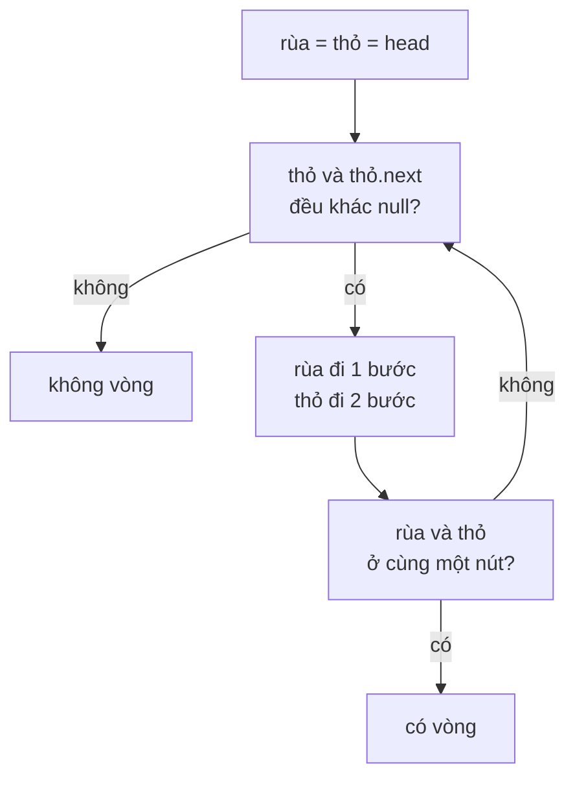

> [!tldr] Đọc nhanh
> - Đề: cho đầu một [[concepts/linked-list|danh sách liên kết]]; hỏi có nút nào mà đi theo `next` mãi sẽ quay lại nó không, tức danh sách có **vòng**.
> - Cách dễ nghĩ: nhớ mọi nút đã đi qua trong một [[concepts/hash-set|Set]]; gặp lại nút cũ là có vòng. O(n) thời gian, O(n) bộ nhớ. Set phải nhớ **chính nút**, không phải giá trị: nhớ giá trị thì `[1, 1, 1]` không vòng vẫn bị báo có vòng.
> - [[concepts/fast-slow-pointers|Rùa và thỏ]] (Floyd): rùa đi 1 bước, thỏ đi 2 bước. Không vòng thì thỏ chạm `null`; có vòng thì thỏ đuổi kịp rùa. O(1) bộ nhớ. Trang chứng minh hai con gặp nhau sau đúng bội nhỏ nhất của λ không nhỏ hơn μ, tức không quá μ + λ bước, và chạy kiểm trên 40 200 cặp (μ, λ).
> - Đo ở 10⁶ nút: Set mất 58–63 ms và 21 MB, Floyd mất 2,6 ms và không cấp phát gì.
> - Ba bản sai chạy thật: so sánh trước khi bước (7/10), quên kiểm `fast.next` (ném lỗi ở mọi danh sách không vòng có số nút lẻ), nhớ giá trị thay vì nút (9/10).

> [!info] Bối cảnh
> Bài LeetCode 141 của [[posts/2026-11-24-neetcode-linked-list|ga 1: Con trỏ trên danh sách liên kết]] trong **tuyến NeetCode: Cấu trúc liên kết**. Ga này tập đi trên danh sách bằng con trỏ: [[problems/reverse-linked-list|Reverse Linked List]] lật chiều các mũi tên, [[problems/merge-two-sorted-lists|Merge Two Sorted Lists]] khâu hai danh sách, còn bài này dùng hai con trỏ chạy khác tốc độ. Cùng kỹ thuật đó tìm điểm giữa trong [[problems/reorder-list|Reorder List]] và giữ khoảng cách cố định trong [[problems/remove-nth-node-from-end-of-list|Remove Nth Node From End of List]]. Lời giải có đủ TypeScript, Python, Go, Java và JavaScript. Bạn chỉ cần biết vòng lặp và object.

> [!abstract]- Từ điển nhanh cho bài này (bấm để mở)
> - **Danh sách liên kết**: chuỗi nút, mỗi nút giữ một giá trị và một mũi tên `next` tới nút sau; nút cuối trỏ `null`. Xem [[concepts/linked-list|Linked List]].
> - **Vòng (cycle)**: một nút nào đó trỏ ngược về nút đã có phía trước, nên đi theo `next` không bao giờ gặp `null`.
> - **Danh tính và giá trị**: hai nút khác nhau có thể cùng giá trị 7. "Cùng một nút" nghĩa là cùng một object trong bộ nhớ (`===`, `is`, `==` trên con trỏ), không phải cùng giá trị.
> - **Set**: tập hợp kiểm "đã có chưa" trong O(1) trung bình. Xem [[concepts/hash-set|Hash Set]].
> - **μ và λ**: μ là số nút **trước** vòng (phần đuôi), λ là số nút **trong** vòng. Danh sách có vòng thì có μ + λ nút.
> - **Rùa và thỏ**: hai con trỏ cùng xuất phát, một con đi 1 bước, con kia đi 2 bước mỗi lượt. Xem [[concepts/fast-slow-pointers|Fast and Slow Pointers]].

## Hình dung trước: hai người chạy bộ trên con đường có thể dẫn vào sân vận động

Hai người cùng xuất phát ở đầu một con đường mòn. Rùa chạy 1 cột mốc mỗi phút, thỏ chạy 2. Có hai khả năng. Con đường cụt: thỏ tới chỗ cụt trước và biết ngay là không có vòng. Con đường dẫn vào một sân vận động tròn rồi không bao giờ ra nữa: thỏ vào sân trước, chạy vòng vòng, và vì nhanh hơn mỗi phút một cột mốc, sớm muộn nó sẽ đuổi kịp rùa từ phía sau. Không ai cần mang sổ ghi các cột mốc đã qua.

| Đời thường | Khái niệm |
|---|---|
| Cột mốc trên đường | một nút |
| Biển chỉ tới cột mốc kế tiếp | con trỏ `next` |
| Đường cụt | `next` là `null`, danh sách không vòng |
| Sân vận động tròn | vòng, dài λ nút |
| Đoạn đường trước khi vào sân | phần đuôi, dài μ nút |
| Sổ ghi mọi cột mốc đã qua | Set các nút đã thăm, O(n) bộ nhớ |
| Thỏ đuổi kịp rùa từ phía sau | `slow === fast`, có vòng |
| Thỏ tới đường cụt | `fast` hoặc `fast.next` là `null`, không vòng |



## Vấn đề

Danh sách không vòng thì đi theo `next` sẽ gặp `null` sau n bước. Danh sách có vòng thì đi mãi không dừng, và từ bên trong vòng lặp ta không biết mình đang ở vòng hay chỉ đang ở một danh sách rất dài. Muốn kết luận "có vòng", ta phải **nhận ra mình đã ở nút này rồi**. Hai cách: nhớ lại (tốn bộ nhớ), hoặc cho hai con trỏ chạy khác tốc độ để vòng tự lộ ra (không tốn gì).

## Cơ chế

### Cách 1: nhớ các nút đã thăm

Đi từ đầu, mỗi nút kiểm tra đã có trong Set chưa. Có rồi thì danh sách có vòng; gặp `null` thì không. Mỗi nút vào Set đúng một lần, nên O(n) thời gian và O(n) bộ nhớ.

```ts
// Cách 1: nhớ mọi nút đã đi qua. Set so sánh object theo danh tính, không theo giá trị.
function hasCycleSet(head: ListNode | null): boolean {
  const seen = new Set<ListNode>();
  for (let cur = head; cur !== null; cur = cur.next) {
    if (seen.has(cur)) return true;
    seen.add(cur);
  }
  return false;
}
```


Chữ quan trọng nhất ở đây là **nút**. Set của JavaScript so object theo danh tính, nên `seen.has(cur)` hỏi "đúng object này đã vào chưa". Nếu viết `seen.add(cur.val)` thì Set nhớ giá trị, và hai nút khác nhau cùng giá trị 1 bị coi là một:

```ts
// SAI: nhớ giá trị thay vì nút. Hai nút khác nhau cùng giá trị bị coi là "đã thăm".
function wrongValueSet(head: ListNode | null): boolean {
  const seen = new Set<number>();
  for (let cur = head; cur !== null; cur = cur.next) {
    if (seen.has(cur.val)) return true;
    seen.add(cur.val);
  }
  return false;
}
```


Bản này sai ở `[1, 1, 1]` không vòng: tới nút thứ hai đã báo có vòng. Nó vẫn đúng ở 9/10 ca thử vì các ca còn lại có giá trị khác nhau, nên test ít ca dễ bỏ lọt.

### Cách 2: rùa và thỏ

Hai con trỏ cùng xuất phát ở `head`. Mỗi lượt rùa đi 1 bước, thỏ đi 2. Thỏ luôn đi trước, nên nếu có `null` thì thỏ chạm nó trước; điều kiện vòng lặp kiểm cả `fast` lẫn `fast.next` vì thỏ cần đi qua hai mũi tên.

```ts
// Cách 2: rùa đi 1 bước, thỏ đi 2 bước. Có vòng thì thỏ đuổi kịp rùa; không vòng thì thỏ chạm null.
function hasCycleFloyd(head: ListNode | null): boolean {
  let slow = head, fast = head;
  while (fast !== null && fast.next !== null) {
    slow = slow!.next;
    fast = fast.next.next;
    if (slow === fast) return true;
  }
  return false;
}
```


Không có Set, không có mảng: O(1) bộ nhớ thêm. Câu hỏi còn lại là vì sao chắc chắn hai con **gặp nhau** chứ không phải thỏ cứ nhảy qua đầu rùa mãi, và mất bao lâu.

### Vì sao thỏ không nhảy qua rùa, và gặp nhau sau bao lâu

Đánh số các nút theo khoảng cách từ `head`: đuôi là các nút 0..μ − 1, vòng là các nút μ..μ + λ − 1, và nút cuối trỏ về nút μ. Sau t lượt, rùa đã đi t bước, thỏ đi 2t bước.

- Khi t ≥ μ, cả hai đã ở trong vòng. Vị trí trong vòng của rùa là (t − μ) mod λ, của thỏ là (2t − μ) mod λ.
- Hai vị trí bằng nhau khi và chỉ khi hiệu của chúng, (2t − μ) − (t − μ) = t, chia hết cho λ.
- Vậy hai con gặp nhau lần đầu ở **t nhỏ nhất vừa chia hết cho λ vừa không nhỏ hơn μ** (và t ≥ 1, vì ở t = 0 chúng chưa bước).

Bội nhỏ nhất của λ không nhỏ hơn μ nằm trong khoảng [μ, μ + λ − 1] khi μ ≥ 1, và bằng λ khi μ = 0. Trong mọi trường hợp t ≤ μ + λ = số nút. Mỗi lượt tốn hằng số phép tính, nên Floyd chạy O(n).

Một cách nhìn khác cho cùng ý: khi cả hai đã trong vòng, mỗi lượt thỏ rút ngắn khoảng cách tới rùa (đo theo chiều chạy) đúng **1** nút. Khoảng cách giảm từng nút một nên phải chạm 0, không thể nhảy từ 1 sang −1.

File TypeScript kiểm chứng điều này bằng vét cạn: với mọi 0 ≤ μ ≤ 200 và 1 ≤ λ ≤ 200, nó dựng danh sách, đếm số lượt tới khi gặp và so với công thức. Kết quả khớp ở 40 200/40 200 cặp, và t/(μ + λ) lớn nhất là đúng 1 (đạt khi μ = 0).

### Mở rộng: tìm nút bắt đầu vòng (LC 142)

LC 142 Linked List Cycle II hỏi thêm: vòng bắt đầu ở nút nào? Floyd trả lời luôn mà không tốn bộ nhớ: khi gặp nhau, đưa một con trỏ về `head`, giữ con kia ở chỗ gặp, rồi cho **cả hai đi 1 bước** mỗi lượt. Chỗ chúng gặp lại chính là đầu vòng.

```ts
// LC 142: tìm nút bắt đầu vòng. Gặp nhau xong, đưa một con về đầu; cả hai cùng đi 1 bước, chỗ gặp lại là đầu vòng.
function detectCycle(head: ListNode | null): ListNode | null {
  let slow = head, fast = head;
  while (fast !== null && fast.next !== null) {
    slow = slow!.next;
    fast = fast.next.next;
    if (slow === fast) {
      let a = head;
      while (a !== slow) { a = a!.next; slow = slow!.next; }
      return a;
    }
  }
  return null;
}
```


Vì sao: lúc gặp nhau, rùa đã đi t bước với t chia hết cho λ. Đi thêm μ bước nữa, rùa ở vị trí t + μ, tức (t + μ − μ) mod λ = 0 trong vòng: đúng đầu vòng. Con trỏ xuất phát từ `head` cũng cần đúng μ bước để tới đầu vòng. Hai con tới đầu vòng cùng lượt thứ μ, và trước đó không gặp nhau vì một con còn ở đuôi, con kia đã trong vòng. File chạy kiểm trên 10 ca cố định và 2 000 danh sách ngẫu nhiên: `detectCycle` trả đúng nút ở cả hai.

Cùng ý tưởng giải LC 287 Find the Duplicate Number ở ga sau: coi mảng là danh sách liên kết với `i → nums[i]`, số bị trùng là đầu vòng.

### Thuật toán Brent

Floyd đi theo `next` 3 lần mỗi lượt (rùa 1, thỏ 2). Richard Brent (1980) đề xuất cách tiết kiệm hơn: rùa **đứng yên** ở một mốc, thỏ đi từng bước; sau 1, 2, 4, 8… bước mà chưa gặp, rùa nhảy tới chỗ thỏ và lũy thừa tăng gấp đôi. Thỏ quay về chỗ rùa đứng nghĩa là có vòng.

```ts
// Cách 3: Brent. Rùa đứng yên ở một mốc, thỏ đi từng bước; sau mỗi lũy thừa của 2 bước thì rùa nhảy tới chỗ thỏ.
function hasCycleBrent(head: ListNode | null): boolean {
  if (head === null) return false;
  let power = 1, steps = 1;
  let tortoise: ListNode = head, hare = head.next;
  while (hare !== null && hare !== tortoise) {
    if (steps === power) { tortoise = hare; power *= 2; steps = 0; }
    hare = hare.next;
    steps++;
  }
  return hare !== null;
}
```


Số lần đi theo `next` tới khi phát hiện vòng:

| μ (đuôi) | λ (vòng) | Floyd | Brent |
|---|---|---|---|
| 0 | 1 000 | 3 000 | 2 023 |
| 1 000 | 1 | 3 000 | 1 024 |
| 1 000 | 1 000 | 3 000 | 2 023 |
| 100 000 | 3 | 300 006 | 131 074 |
| 3 | 100 000 | 300 000 | 231 071 |
| 50 000 | 50 000 | 150 000 | 115 535 |

Brent đi ít hơn ở mọi dạng, nhiều nhất khi vòng ngắn. Với bài này mỗi lần đi là một phép đọc bộ nhớ rẻ nên khác biệt thời gian nhỏ (bảng đo bên dưới); Brent có ích hơn khi mỗi "bước" là một phép tính đắt, như trong thuật toán phân tích thừa số Pollard rho mà Brent cải tiến.

### Ba bản sai

So sánh trước khi bước. Ở lượt đầu, rùa và thỏ cùng đứng ở `head`, nên điều kiện đúng ngay:

```ts
// SAI: so sánh trước khi bước. Lúc đầu rùa và thỏ cùng ở head nên trả true ngay.
function wrongCompareFirst(head: ListNode | null): boolean {
  let slow = head, fast = head;
  while (fast !== null && fast.next !== null) {
    if (slow === fast) return true;
    slow = slow!.next;
    fast = fast.next.next;
  }
  return false;
}
```


Bản này báo có vòng cho mọi danh sách không vòng từ 2 nút trở lên: 7/10 ca. Phải bước rồi mới so.

Quên kiểm `fast.next`:

```ts
// SAI: chỉ kiểm fast, quên fast.next. Danh sách không vòng có số nút lẻ thì thỏ dừng ở nút cuối, fast.next là null và fast.next.next ném lỗi.
function wrongNoNextCheck(head: ListNode | null): boolean {
  let slow = head, fast = head;
  while (fast !== null) {
    slow = slow!.next;
    fast = (fast.next as ListNode).next;
    if (slow === fast) return true;
  }
  return false;
}
```


Với số nút chẵn, thỏ đi `head → 3 → 5 → null` và dừng gọn. Với số nút lẻ, thỏ dừng ở **nút cuối**, `fast.next` là `null`, và `fast.next.next` ném `TypeError`. Kết quả: 7/10 ca, lỗi ở cả ví dụ 3 của đề (một nút).

Bản thứ ba là nhớ giá trị thay vì nút, đã chạy ở Cách 1.

### Bên dưới năm ngôn ngữ

| | Tập các nút | So hai con trỏ | Bẫy riêng |
|---|---|---|---|
| TypeScript / JavaScript | `Set<ListNode>`, so object theo danh tính | `===` | dùng object thường `{}` làm tập: khóa bị đổi thành chuỗi `"[object Object]"`, mọi nút trùng nhau, sai 3/10 |
| Python | `set()`, object thường băm theo `id` | `is` | `@dataclass` mặc định `eq=True`: không băm được (`TypeError` ở 9/10 ca), và `slow == fast` so theo `(val, next)` nên đệ quy mãi trong vòng toàn số 0 (`RecursionError`) |
| Go | `map[*ListNode]bool`, khóa là địa chỉ | `==` trên con trỏ | quên `fast.Next != nil` thì panic nil pointer ở danh sách lẻ |
| Java | `HashSet<ListNode>`, mặc định `Object.equals` là `==` | `==` | lớp nút ghi đè `equals`/`hashCode` theo `val` thì HashSet thành tập giá trị: sai ở `[1, 1, 1]`; Floyd dùng `==` nên vẫn đúng |

Bẫy của Python đáng nói kỹ vì nhiều người viết `ListNode` bằng `@dataclass` cho gọn. Dataclass mặc định sinh `__eq__` so từng trường và đặt `__hash__ = None`. Hệ quả chạy thật trong [file Python](../code/neetcode-linked-list-cycle/list_cycle.py): `set().add(node)` ném `TypeError: unhashable type`, còn Floyd viết `slow == fast` thì với hai nút khác nhau cùng giá trị, Python so tiếp `next` của chúng, rồi `next` của `next`… vòng không có điểm dừng nên ném `RecursionError`. Viết `slow is fast` thì đúng cả 10/10 ca dù nút là dataclass.

### Đo

TypeScript, danh sách toàn số 0, trung vị 5 lần chạy; bộ nhớ là phần heap tăng thêm khi Set còn sống (sau khi chạy GC):

| n nút | Dạng | Set | Floyd | Brent | Bộ nhớ Set |
|---|---|---|---|---|---|
| 10⁵ | không vòng | 4,56 ms | 0,14 ms | 0,13 ms | 2,6 MB |
| 10⁵ | vòng ở giữa | 4,69 ms | 0,13 ms | 0,17 ms | 2,6 MB |
| 10⁶ | không vòng | 62,57 ms | 2,65 ms | 2,33 ms | 21,0 MB |
| 10⁶ | vòng ở giữa | 57,64 ms | 2,63 ms | 2,21 ms | 21,0 MB |

- Floyd nhanh hơn Set khoảng 20–30 lần dù cả hai là O(n): Set phải băm và cấp phát cho từng nút, Floyd chỉ đọc con trỏ.
- Set tốn khoảng 21 byte mỗi nút trong V8. Floyd không cấp phát gì.
- Brent nhỉnh hơn Floyd một chút ở 10⁶ nút, đúng như số lần đi `next` ít hơn, nhưng chênh lệch nằm trong vài phần mười mili giây.

Các ngôn ngữ khác ở 10⁶ nút (không vòng / vòng ở giữa): Python set 46,2 / 48,1 ms và 50,3 MB đỉnh, Floyd 13,4 / 13,4 ms; Go map 77,5 / 70,6 ms và 75,6 MB cấp phát, Floyd 2,2 / 1,9 ms; Java HashSet 72,4 / 71,8 ms, Floyd 1,6 / 1,6 ms. Đề giới hạn 10⁴ nút nên mọi cách đều dưới 1 ms trên LeetCode; khác biệt bộ nhớ mới là lý do đề hỏi "O(1) bộ nhớ được không".

## Ví dụ chạy được

[TypeScript](../code/neetcode-linked-list-cycle/list-cycle.ts) · [Python](../code/neetcode-linked-list-cycle/list_cycle.py) · [Go](../code/neetcode-linked-list-cycle/list_cycle.go) · [Java](../code/neetcode-linked-list-cycle/list-cycle.java) · [JavaScript](../code/neetcode-linked-list-cycle/list-cycle.js)

Mỗi file chạy 10 ca chung: ba ví dụ của đề, danh sách rỗng, một nút tự trỏ, `[1, 1, 1]` không vòng (bắt lỗi nhớ giá trị), danh sách chẵn và lẻ không vòng (bắt lỗi quên `fast.next`), nút cuối tự trỏ, và `[0, 0, 0, 0, 0]` có vòng (bắt lỗi `==` của dataclass). Đề LeetCode cho `pos` để mô tả vòng nhưng không truyền nó vào hàm; các file dùng `pos` chỉ để dựng danh sách.

Set các nút đã thăm:

```ts
// Cách 1: nhớ mọi nút đã đi qua. Set so sánh object theo danh tính, không theo giá trị.
function hasCycleSet(head: ListNode | null): boolean {
  const seen = new Set<ListNode>();
  for (let cur = head; cur !== null; cur = cur.next) {
    if (seen.has(cur)) return true;
    seen.add(cur);
  }
  return false;
}
```

```python
# Cách 1: set các nút đã thăm. Object thường băm theo id, nên set nhớ danh tính nút.
def has_cycle_set(head):
    seen = set()
    cur = head
    while cur:
        if cur in seen:
            return True
        seen.add(cur)
        cur = cur.next
    return False
```

```go
// Cách 1: map khóa là con trỏ *ListNode, tức là địa chỉ nút, không phải giá trị.
func hasCycleSet(head *ListNode) bool {
	seen := map[*ListNode]bool{}
	for cur := head; cur != nil; cur = cur.Next {
		if seen[cur] {
			return true
		}
		seen[cur] = true
	}
	return false
}
```

```java
// Cách 1: HashSet các nút. Mặc định Object.equals là so danh tính (==), nên set nhớ đúng nút.
static boolean hasCycleSet(ListNode head) {
    Set<ListNode> seen = new HashSet<>();
    for (ListNode cur = head; cur != null; cur = cur.next) {
        if (!seen.add(cur)) return true;
    }
    return false;
}
```

```js
// Cách 1: Set nhớ object theo danh tính.
function hasCycleSet(head) {
  const seen = new Set();
  for (let cur = head; cur !== null; cur = cur.next) {
    if (seen.has(cur)) return true;
    seen.add(cur);
  }
  return false;
}
```


Rùa và thỏ:

```ts
// Cách 2: rùa đi 1 bước, thỏ đi 2 bước. Có vòng thì thỏ đuổi kịp rùa; không vòng thì thỏ chạm null.
function hasCycleFloyd(head: ListNode | null): boolean {
  let slow = head, fast = head;
  while (fast !== null && fast.next !== null) {
    slow = slow!.next;
    fast = fast.next.next;
    if (slow === fast) return true;
  }
  return false;
}
```

```python
# Cách 2: rùa và thỏ. So sánh bằng `is` (cùng một nút), không bằng `==`.
def has_cycle_floyd(head):
    slow = fast = head
    while fast and fast.next:
        slow = slow.next
        fast = fast.next.next
        if slow is fast:
            return True
    return False
```

```go
// Cách 2: rùa và thỏ. Kiểm cả fast và fast.Next trước khi nhảy hai bước.
func hasCycleFloyd(head *ListNode) bool {
	slow, fast := head, head
	for fast != nil && fast.Next != nil {
		slow = slow.Next
		fast = fast.Next.Next
		if slow == fast {
			return true
		}
	}
	return false
}
```

```java
// Cách 2: rùa và thỏ, so sánh bằng == (cùng một object).
static boolean hasCycleFloyd(ListNode head) {
    ListNode slow = head, fast = head;
    while (fast != null && fast.next != null) {
        slow = slow.next;
        fast = fast.next.next;
        if (slow == fast) return true;
    }
    return false;
}
```

```js
// Cách 2: rùa và thỏ.
function hasCycleFloyd(head) {
  let slow = head, fast = head;
  while (fast !== null && fast.next !== null) {
    slow = slow.next;
    fast = fast.next.next;
    if (slow === fast) return true;
  }
  return false;
}
```


Tìm đầu vòng (LC 142):

```ts
// LC 142: tìm nút bắt đầu vòng. Gặp nhau xong, đưa một con về đầu; cả hai cùng đi 1 bước, chỗ gặp lại là đầu vòng.
function detectCycle(head: ListNode | null): ListNode | null {
  let slow = head, fast = head;
  while (fast !== null && fast.next !== null) {
    slow = slow!.next;
    fast = fast.next.next;
    if (slow === fast) {
      let a = head;
      while (a !== slow) { a = a!.next; slow = slow!.next; }
      return a;
    }
  }
  return null;
}
```

```python
# LC 142: gặp nhau xong, đưa một con về đầu; cùng đi 1 bước, chỗ gặp lại là đầu vòng.
def detect_cycle(head):
    slow = fast = head
    while fast and fast.next:
        slow = slow.next
        fast = fast.next.next
        if slow is fast:
            a = head
            while a is not slow:
                a = a.next
                slow = slow.next
            return a
    return None
```

```go
// LC 142: gặp nhau xong, đưa một con về đầu; cùng đi 1 bước, chỗ gặp lại là đầu vòng.
func detectCycle(head *ListNode) *ListNode {
	slow, fast := head, head
	for fast != nil && fast.Next != nil {
		slow = slow.Next
		fast = fast.Next.Next
		if slow == fast {
			a := head
			for a != slow {
				a = a.Next
				slow = slow.Next
			}
			return a
		}
	}
	return nil
}
```

```java
// LC 142: gặp nhau xong, đưa một con về đầu; cùng đi 1 bước, chỗ gặp lại là đầu vòng.
static ListNode detectCycle(ListNode head) {
    ListNode slow = head, fast = head;
    while (fast != null && fast.next != null) {
        slow = slow.next;
        fast = fast.next.next;
        if (slow == fast) {
            ListNode a = head;
            while (a != slow) { a = a.next; slow = slow.next; }
            return a;
        }
    }
    return null;
}
```

```js
// LC 142: gặp nhau xong, đưa một con về đầu; cùng đi 1 bước, chỗ gặp lại là đầu vòng.
function detectCycle(head) {
  let slow = head, fast = head;
  while (fast !== null && fast.next !== null) {
    slow = slow.next;
    fast = fast.next.next;
    if (slow === fast) {
      let a = head;
      while (a !== slow) { a = a.next; slow = slow.next; }
      return a;
    }
  }
  return null;
}
```


Kết quả `node list-cycle.ts`:

```text
hasCycleSet       10/10 ca đúng
hasCycleFloyd     10/10 ca đúng
hasCycleBrent     10/10 ca đúng
wrongValueSet     9/10 ca đúng; sai ở giá trị trùng, không vòng → true
wrongCompareFirst 7/10 ca đúng; sai ở giá trị trùng, không vòng → true, chẵn, không vòng → true, lẻ, không vòng → true
wrongNoNextCheck  7/10 ca đúng; sai ở ví dụ 3 của đề → ném TypeError, giá trị trùng, không vòng → ném TypeError, lẻ, không vòng → ném TypeError
detectCycle       10/10 ca đúng (LC 142: trả nút đầu vòng)

ngẫu nhiên: Set, Floyd, Brent khớp nhau và khớp đáp án ở 2000/2000 danh sách; detectCycle đúng ở 2000/2000
chứng minh: mọi (μ, λ) với 0 ≤ μ ≤ 200, 1 ≤ λ ≤ 200: số bước tới lúc gặp đúng bằng bội nhỏ nhất của λ không nhỏ hơn max(μ, 1) ở 40200/40200 bộ; t/(μ + λ) lớn nhất 1.000

số lần đi next tới khi phát hiện vòng:
μ (đuôi)   λ (vòng)    Floyd      Brent
0          1000           3000       2023
1000       1              3000       1024
1000       1000           3000       2023
100000     3            300006     131074
3          100000       300000     231071
50000      50000        150000     115535

n nút      dạng            Set         Floyd       Brent       bộ nhớ Set
100000     không vòng          4.56 ms     0.14 ms     0.13 ms      2.6 MB
100000     vòng ở giữa         4.69 ms     0.13 ms     0.17 ms      2.6 MB
1000000    không vòng         62.57 ms     2.65 ms     2.33 ms     21.0 MB
1000000    vòng ở giữa        57.64 ms     2.63 ms     2.21 ms     21.0 MB
```

`python3 list_cycle.py`:

```text
has_cycle_set              10/10 ca đúng
has_cycle_floyd            10/10 ca đúng
has_cycle_set (DataNode)   1/10 ca đúng; sai ở 9 ca, đều → ném TypeError
floyd_eq (DataNode)        9/10 ca đúng; sai ở toàn số 0, có vòng → ném RecursionError
has_cycle_floyd (DataNode) 10/10 ca đúng
detect_cycle               10/10 ca đúng (LC 142)

n nút      dạng            set          Floyd        bộ nhớ set (đỉnh)
100000     không vòng          3.15 ms      1.22 ms       6.3 MB
100000     vòng ở giữa         3.07 ms      1.27 ms       6.3 MB
1000000    không vòng         46.16 ms     13.44 ms      50.3 MB
1000000    vòng ở giữa        48.10 ms     13.43 ms      50.3 MB
```

`go run list_cycle.go`:

```text
hasCycleSet       10/10 ca đúng
hasCycleFloyd     10/10 ca đúng
wrongNoNextCheck  7/10 ca đúng; sai ở ví dụ 3 của đề → panic, giá trị trùng, không vòng → panic, lẻ, không vòng → panic
detectCycle       10/10 ca đúng (LC 142)

n nút      dạng            map          Floyd        bộ nhớ map
100000     không vòng          5.52 ms      0.09 ms       4.7 MB cấp phát
100000     vòng ở giữa         5.17 ms      0.18 ms       4.7 MB cấp phát
1000000    không vòng         77.53 ms      2.15 ms      75.6 MB cấp phát
1000000    vòng ở giữa        70.64 ms      1.87 ms      75.6 MB cấp phát
```

`java list-cycle.java`:

```text
hasCycleSet                10/10 ca đúng
hasCycleFloyd              10/10 ca đúng
hasCycleSet (ValueNode)    9/10 ca đúng; sai ở giá trị trùng, không vòng → true
hasCycleFloyd (ValueNode)  10/10 ca đúng
wrongNoNextCheck           7/10 ca đúng; sai ở ví dụ 3 của đề → ném NullPointerException, giá trị trùng, không vòng → ném NullPointerException, lẻ, không vòng → ném NullPointerException
detectCycle                10/10 ca đúng (LC 142)

n nút      dạng            HashSet      Floyd
100000     không vòng          5.60 ms      0.19 ms
100000     vòng ở giữa         7.04 ms      0.27 ms
1000000    không vòng         72.41 ms      1.59 ms
1000000    vòng ở giữa        71.75 ms      1.61 ms
```

`node list-cycle.js`:

```text
hasCycleSet     10/10 ca đúng
hasCycleFloyd   10/10 ca đúng
wrongObjectSet  7/10 ca đúng; sai ở giá trị trùng, không vòng, chẵn, không vòng, lẻ, không vòng
detectCycle     10/10 ca đúng (LC 142)
khóa object của một nút: ["[object Object]"]
```

## Hiểu lầm và bẫy hay gặp

- **"Gặp lại một giá trị đã thấy là có vòng."** Giá trị được phép trùng. Vòng là gặp lại **chính nút** đó.
- **"Thỏ có thể nhảy qua rùa mãi mà không gặp."** Trong vòng, mỗi lượt khoảng cách giữa hai con giảm đúng 1 nút, nên phải chạm 0. Thỏ đi 3 bước một lượt thì khoảng cách giảm 2 và có thể nhảy qua; tốc độ 1 và 2 là lựa chọn đơn giản nhất bảo đảm gặp.
- **"Floyd chậm vì phải chạy nhiều vòng quanh sân."** Rùa chưa đi hết một vòng thì đã bị bắt: tổng số lượt không quá μ + λ, tức không quá số nút.
- **So sánh trước khi bước.** Lượt đầu hai con đứng cùng chỗ; so trước thì luôn báo có vòng.
- **Chỉ kiểm `fast`.** Thỏ nhảy hai mũi tên một lúc, nên phải kiểm cả `fast.next`; thiếu thì danh sách lẻ ném lỗi.
- **Ghi đè bằng nhau theo giá trị.** Dataclass của Python, `equals` tự viết trong Java: Set và `==` khi đó so giá trị, không còn so danh tính.
- **Sửa danh sách để đánh dấu** (ví dụ gán `val` thành một giá trị lạ). Chạy được với O(1) bộ nhớ nhưng phá dữ liệu của người gọi, và sai nếu giá trị lạ đó tình cờ có trong danh sách.

## Câu hỏi tự kiểm tra

> [!question]- Danh sách có đuôi μ = 5 và vòng λ = 3. Rùa và thỏ gặp nhau sau mấy lượt?
> Bội nhỏ nhất của 3 không nhỏ hơn 5 là 6. Vậy 6 lượt, nhỏ hơn μ + λ = 8.

> [!question]- Vì sao điều kiện vòng lặp của Floyd phải là `fast && fast.next` chứ không chỉ `fast`?
> Mỗi lượt thỏ đọc `fast.next.next`. Nếu `fast` là nút cuối của danh sách không vòng, `fast.next` là `null` và đọc `.next` của nó ném lỗi. Kiểm `fast.next` trước bảo đảm cả hai mũi tên tồn tại.

> [!question]- Ở LC 142, vì sao đưa một con về `head` rồi cho cả hai đi 1 bước thì gặp nhau đúng ở đầu vòng?
> Lúc gặp nhau rùa đã đi t bước với t chia hết cho λ. Đi thêm μ bước, nó ở vị trí (t + μ − μ) mod λ = 0 trong vòng, tức đầu vòng. Con từ `head` cũng cần đúng μ bước để tới đầu vòng. Trước lượt thứ μ một con còn ở đuôi, con kia trong vòng, nên lần gặp đầu tiên là ở đầu vòng.

> [!question]- Cho Python `ListNode` là một `@dataclass`. Vì sao `set().add(node)` lỗi?
> Dataclass với `eq=True` (mặc định) và không `frozen` đặt `__hash__ = None`, vì object có thể đổi trường sau khi vào set. Object không băm được thì không vào set được: `TypeError: unhashable type`.

> [!question]- Khi nào nên dùng Set thay vì Floyd?
> Khi cần biết thêm điều mà Floyd không cho sẵn, ví dụ đếm số nút khác nhau đã đi qua, hoặc khi "nút" là trạng thái phức tạp mà ta vẫn phải lưu để làm việc khác. Chỉ để trả lời có vòng hay không thì Floyd vừa nhanh hơn vừa không tốn bộ nhớ.

## Tham khảo

- [LeetCode 141: Linked List Cycle](https://leetcode.com/problems/linked-list-cycle/) (đề gốc: 0 ≤ số nút ≤ 10⁴, `pos` là −1 hoặc một chỉ số hợp lệ) và [LeetCode 142: Linked List Cycle II](https://leetcode.com/problems/linked-list-cycle-ii/)
- Donald E. Knuth, *The Art of Computer Programming*, tập 2, mục 3.1, bài tập 6 (thuật toán tìm chu kỳ dùng hai con trỏ, Knuth ghi công cho R. W. Floyd)
- Richard P. Brent, "An improved Monte Carlo factorization algorithm", *BIT Numerical Mathematics* 20 (1980) (thuật toán tìm chu kỳ bằng lũy thừa của 2)
- [Python `dataclasses`](https://docs.python.org/3/library/dataclasses.html) (`eq=True` mặc định và quy tắc đặt `__hash__`)
- [Java `Object.equals`](https://docs.oracle.com/en/java/javase/21/docs/api/java.base/java/lang/Object.html#equals(java.lang.Object)) (mặc định là so danh tính)
- [Go: Comparison operators](https://go.dev/ref/spec#Comparison_operators) (hai con trỏ bằng nhau khi trỏ cùng một biến)
