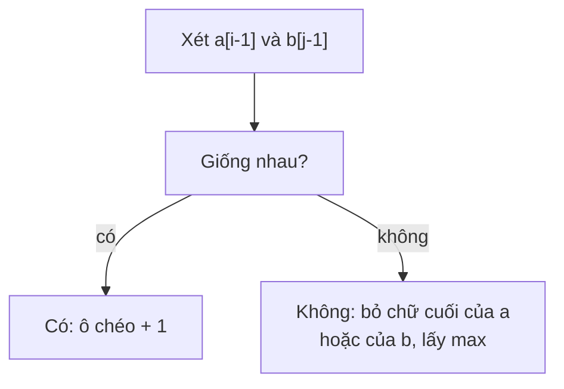
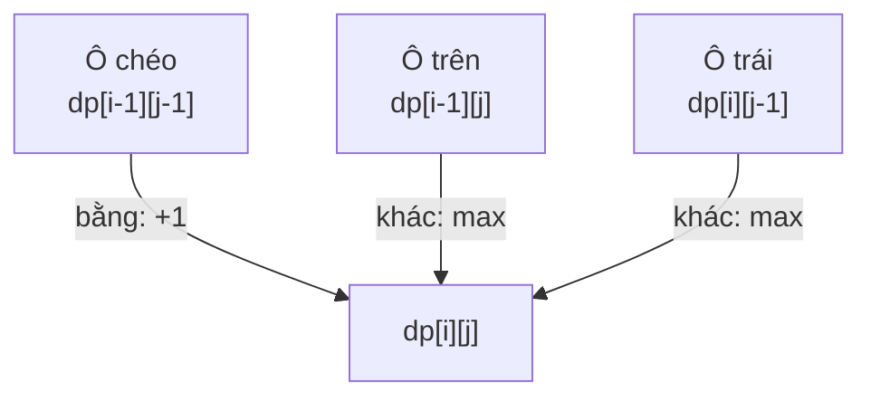

> [!tldr] Đọc nhanh
> - Trạng thái là một cặp tiền tố: `dp[i][j]` là độ dài LCS của `a[:i]` và `b[:j]`. Bảng có (n + 1) × (m + 1) ô, hàng 0 và cột 0 là tiền tố rỗng.
> - Hai chữ cuối bằng nhau thì ghép chúng lại: `dp[i][j] = dp[i-1][j-1] + 1`. Khác nhau thì một trong hai chữ chắc chắn bị bỏ: `max(dp[i-1][j], dp[i][j-1])`.
> - Thời gian O(n·m). Muốn có độ dài thôi thì một hàng cộng một biến giữ ô chéo là đủ. Muốn in ra dãy con thì giữ cả bảng và lần ngược từ góc dưới phải.
> - Đây là khuôn [[concepts/two-sequence-dp|Two-Sequence DP]] gọn nhất. Interleaving String, Distinct Subsequences và Edit Distance đều đổi công thức trên cùng bảng này.

> [!info] Bối cảnh
> Đây là bài LeetCode 1143 tại [[posts/2026-11-27-neetcode-grid-two-strings|ga DP-05: Lưới và hai chuỗi]] trên **tuyến NeetCode: Quy hoạch động**. Mình hình dung hai bản nháp của cùng một đoạn văn và muốn biết bản sau giữ lại được bao nhiêu chữ của bản trước, đúng thứ tự. Bạn chỉ cần biết chuỗi, mảng hai chiều và vòng lặp lồng nhau.

> [!abstract]- Từ điển nhanh cho bài này (bấm để mở)
> - Dãy con (subsequence) lấy một số ký tự theo đúng thứ tự, được bỏ qua ký tự ở giữa. Chuỗi con (substring) thì phải liền nhau.
> - Tiền tố `a[:i]` là i ký tự đầu của `a`. Tiền tố rỗng có i = 0.
> - [[concepts/lcs-table|LCS Table]] là bảng `dp[i][j]` trên mọi cặp tiền tố của hai chuỗi.
> - [[concepts/dp-state|Trạng thái DP]] nói rõ một ô của bảng lưu điều gì.
> - [[concepts/memoization|Ghi nhớ kết quả]] (memoization) lưu đáp án của một trạng thái ở lần hỏi đầu tiên.
> - [[concepts/rolling-state|Rolling State]] dùng lại chỗ chứa của những hàng không còn cần đọc.

## Hình dung trước: so hai bản nháp

Mình có bản nháp cũ `bread` và bản mới `boardgame`. Mình muốn tô màu những chữ của bản cũ còn sống sót trong bản mới, theo đúng thứ tự, càng nhiều càng tốt. Mình đọc từ cuối hai bản. Nếu hai chữ cuối giống nhau thì tô cả hai và cùng lùi một chữ. Nếu khác nhau thì ít nhất một trong hai chữ không được tô, nên thử bỏ chữ cuối của bản này hoặc bản kia, lấy kết quả tốt hơn.

| Đời thường | Khái niệm |
|---|---|
| Đã đọc i chữ đầu bản cũ và j chữ đầu bản mới | Trạng thái `(i, j)`, ô `dp[i][j]` |
| Hai chữ đang xét giống nhau, tô cả hai | Đi chéo: `dp[i-1][j-1] + 1` |
| Hai chữ khác nhau, bỏ một chữ của bản cũ | Ô trên `dp[i-1][j]` |
| Hai chữ khác nhau, bỏ một chữ của bản mới | Ô trái `dp[i][j-1]` |
| Một bản nháp còn trống | Hàng 0 hoặc cột 0, giá trị 0 |
| Đọc lại các chữ đã tô từ cuối lên | Lần ngược bảng để dựng dãy con |



## Vấn đề: dãy con chung dài nhất

Cho hai chuỗi `a` và `b`, mỗi chuỗi dài từ 1 tới 1.000 ký tự, chỉ gồm chữ thường tiếng Anh. Trả về độ dài của dãy con dài nhất xuất hiện trong cả hai chuỗi. Không có ký tự chung thì trả 0. Ví dụ `bread` và `boardgame` có dãy con chung dài 3, chẳng hạn `bre` hoặc `brd`. [Đề gốc LeetCode 1143](https://leetcode.com/problems/longest-common-subsequence/)

Ban đầu mình định đi qua `a`, gặp chữ nào thì tìm nó trong `b` sau vị trí đã khớp trước đó. Cách tham lam này sai ngay với `cab` và `abc`: nó khớp `c` với chữ cuối của `abc` rồi hết chỗ, trả 1, trong khi `ab` dài 2.

## Cơ chế

### Vét cạn: hai cách

Cách thô nhất là liệt kê mọi tập con ký tự của `a`, 2ⁿ tập, rồi kiểm tra mỗi tập có là dãy con của `b` không. Thời gian O(2ⁿ·m), không dùng được khi n = 1.000. File chạy dùng nó làm chuẩn đối chiếu trên chuỗi ngắn.

Cách thứ hai là đệ quy trên cặp vị trí `solve(i, j)`: nếu `a[i] == b[j]` thì lấy cả hai và đi tiếp `solve(i+1, j+1)`, nếu không thì lấy max của `solve(i+1, j)` và `solve(i, j+1)`. Khi hai chuỗi không có chữ chung, mỗi lần gọi đều tách đôi, và cây gọi có 2·C(n + m, n) − 1 nút. Hai chuỗi 10 ký tự đã tốn 369.511 lượt gọi.

### Ghi nhớ theo cặp vị trí

Chỉ có (n + 1)·(m + 1) cặp `(i, j)` khác nhau, và kết quả `solve(i, j)` chỉ phụ thuộc vào hai hậu tố `a[i:]`, `b[j:]`. Lưu nó theo cặp thì mỗi cặp tính một lần. Thời gian và bộ nhớ O(n·m). Cùng hai chuỗi 10 ký tự trên chỉ còn 201 lượt gọi. Nhưng độ sâu đệ quy có thể tới n + m = 2.000 tầng.

### Điền bảng theo tiền tố

Đảo sang tiền tố để khỏi đệ quy. `dp[i][j]` là độ dài LCS của `a[:i]` và `b[:j]`. Hàng 0 và cột 0 bằng 0 vì một bên rỗng.

- **Hai chữ cuối bằng nhau** (`a[i-1] == b[j-1]`): luôn có một LCS tối ưu dùng cặp này. Lấy một LCS tối ưu bất kỳ. Nếu nó chưa dùng chữ cuối của cả hai chuỗi, cặp khớp cuối cùng của nó nằm ở vị trí sớm hơn, và mình đổi cặp đó thành cặp hai chữ cuối mà độ dài không đổi. Phần còn lại là LCS của hai tiền tố ngắn hơn, nên `dp[i][j] = dp[i-1][j-1] + 1`.
- **Hai chữ cuối khác nhau**: một LCS không thể ghép hai chữ cuối với nhau, nên ít nhất một trong hai không được dùng. Bỏ chữ cuối của `a` cho `dp[i-1][j]`, bỏ chữ cuối của `b` cho `dp[i][j-1]`. Lấy max.

Duyệt i tăng, trong mỗi i duyệt j tăng, thì ba ô trên, trái và chéo đều có trước. Thời gian O(n·m), bộ nhớ O(n·m). Với n = m = 1.000 là một triệu ô.



### Một hàng và ô chéo

Mỗi ô chỉ đọc hàng trên và ô trái, như [[problems/unique-paths|Unique Paths]], cộng thêm ô chéo. Một mảng `row` dài m + 1 giữ được hàng trên. Khi ghi đè `row[j]`, mình làm mất `dp[i-1][j]`, mà ô kế tiếp `j + 1` lại cần chính giá trị đó làm ô chéo. Nên trước khi ghi, cất `row[j]` vào `above`, và sau khi ghi thì chuyển nó sang `diagonal`. Đổi chỗ để chuỗi ngắn hơn là chiều của mảng thì bộ nhớ còn O(min(n, m)).

### Dựng lại dãy con

Bảng đầy đủ còn cho biết **dãy con nào** đạt độ dài đó. Đi từ `dp[n][m]` về: hai chữ bằng nhau thì ghi chữ đó lại và đi chéo; khác nhau thì đi về phía ô có giá trị lớn hơn (bằng nhau thì chọn ô trên). Đọc ngược các chữ đã ghi. Với `bread` và `boardgame`, quy tắc này cho `bre`. Bản một hàng không làm được bước này, vì nó đã xóa các hàng cũ.

| Cách | Thời gian | Bộ nhớ phụ |
|---|---|---|
| Liệt kê tập con | O(2ⁿ·m) | O(n) |
| Đệ quy trên (i, j) | O(C(n + m, n)), hàm mũ | O(n + m) ngăn xếp |
| Ghi nhớ | O(n·m) | O(n·m) + O(n + m) ngăn xếp |
| Bảng tiền tố | O(n·m) | O(n·m) |
| Một hàng | O(n·m) | O(min(n, m)) |

## Ví dụ chạy được

[TypeScript](../code/neetcode-longest-common-subsequence/common.ts) · [Python](../code/neetcode-longest-common-subsequence/common.py) · [Go](../code/neetcode-longest-common-subsequence/common.go) · [Java](../code/neetcode-longest-common-subsequence/common.java) · [JavaScript](../code/neetcode-longest-common-subsequence/common.js) · [PHP](../code/neetcode-longest-common-subsequence/common.php) · [Rust](../code/neetcode-longest-common-subsequence/common.rs)

```ts
function lcsTable(a: string, b: string): number[][] {
    // dp[i][j]: LCS của a[:i] và b[:j]; hàng 0 và cột 0 là tiền tố rỗng
    const dp = Array.from({ length: a.length + 1 }, () => Array(b.length + 1).fill(0))
    for (let i = 1; i <= a.length; i++) {
        for (let j = 1; j <= b.length; j++) {
            dp[i][j] = a[i - 1] === b[j - 1]
                ? dp[i - 1][j - 1] + 1
                : Math.max(dp[i - 1][j], dp[i][j - 1])
        }
    }
    return dp
}
```

```python
def lcs_table(a, b):
    # dp[i][j]: LCS của a[:i] và b[:j]; hàng 0 và cột 0 là tiền tố rỗng
    dp = [[0] * (len(b) + 1) for _ in range(len(a) + 1)]
    for i in range(1, len(a) + 1):
        for j in range(1, len(b) + 1):
            if a[i - 1] == b[j - 1]:
                dp[i][j] = dp[i - 1][j - 1] + 1
            else:
                dp[i][j] = max(dp[i - 1][j], dp[i][j - 1])
    return dp
```

```go
func lcsTable(a, b string) [][]int {
	// dp[i][j]: LCS của a[:i] và b[:j]; hàng 0 và cột 0 là tiền tố rỗng
	dp := make([][]int, len(a)+1)
	for i := range dp {
		dp[i] = make([]int, len(b)+1)
	}
	for i := 1; i <= len(a); i++ {
		for j := 1; j <= len(b); j++ {
			if a[i-1] == b[j-1] {
				dp[i][j] = dp[i-1][j-1] + 1
			} else {
				dp[i][j] = max(dp[i-1][j], dp[i][j-1])
			}
		}
	}
	return dp
}
```

```java
static int[][] lcsTable(String a, String b) {
    // dp[i][j]: LCS của a[:i] và b[:j]; hàng 0 và cột 0 là tiền tố rỗng
    int[][] dp = new int[a.length() + 1][b.length() + 1];
    for (int i = 1; i <= a.length(); i++) {
        for (int j = 1; j <= b.length(); j++) {
            dp[i][j] = a.charAt(i - 1) == b.charAt(j - 1)
                ? dp[i - 1][j - 1] + 1
                : Math.max(dp[i - 1][j], dp[i][j - 1]);
        }
    }
    return dp;
}
```

```js
function lcsTable(a, b) {
    // dp[i][j]: LCS của a[:i] và b[:j]; hàng 0 và cột 0 là tiền tố rỗng
    const dp = Array.from({ length: a.length + 1 }, () => Array(b.length + 1).fill(0))
    for (let i = 1; i <= a.length; i++) {
        for (let j = 1; j <= b.length; j++) {
            dp[i][j] = a[i - 1] === b[j - 1]
                ? dp[i - 1][j - 1] + 1
                : Math.max(dp[i - 1][j], dp[i][j - 1])
        }
    }
    return dp
}
```

```php
function lcsTable(string $a, string $b): array {
    // dp[i][j]: LCS của a[:i] và b[:j]; hàng 0 và cột 0 là tiền tố rỗng
    $n = strlen($a);
    $m = strlen($b);
    $dp = array_fill(0, $n + 1, array_fill(0, $m + 1, 0));
    for ($i = 1; $i <= $n; $i++) {
        for ($j = 1; $j <= $m; $j++) {
            $dp[$i][$j] = $a[$i - 1] === $b[$j - 1]
                ? $dp[$i - 1][$j - 1] + 1
                : max($dp[$i - 1][$j], $dp[$i][$j - 1]);
        }
    }
    return $dp;
}
```

```rust
fn lcs_table(a: &[u8], b: &[u8]) -> Vec<Vec<usize>> {
    // dp[i][j]: LCS của a[:i] và b[:j]; hàng 0 và cột 0 là tiền tố rỗng
    let mut dp = vec![vec![0usize; b.len() + 1]; a.len() + 1];
    for i in 1..=a.len() {
        for j in 1..=b.len() {
            dp[i][j] = if a[i - 1] == b[j - 1] {
                dp[i - 1][j - 1] + 1
            } else {
                dp[i - 1][j].max(dp[i][j - 1])
            };
        }
    }
    dp
}
```

Các tab trích hàm điền bảng; đáp án là `dp[n][m]`. File tải về còn có vét cạn, bản ghi nhớ, bản một hàng và hàm dựng lại dãy con. Dòng đầu là 9 ca, gồm hai chuỗi giống hệt, hai chuỗi không chung chữ và hai cặp chuỗi dài đúng 1.000. Mỗi ca kiểm tra cả việc dãy con dựng lại có đúng độ dài và thật sự là dãy con của hai chuỗi. Dòng thứ hai so mọi cặp chuỗi `a/b` dài 1–5 với cách liệt kê tập con. Bản ghi nhớ chỉ chạy trên chuỗi ngắn để tránh giới hạn đệ quy. Dòng lượt gọi đếm số lần đi vào hàm, không phải thời gian chạy.

```text
9/9 ca đúng
3844/3844 ca đúng (đối chiếu mọi tập con, chuỗi a/b dài 1–5)
Hai chuỗi 10 ký tự không chung chữ: vét cạn 369511 lượt gọi, memo 201 lượt gọi
Một LCS của bread và boardgame: bre
```

## Hiểu lầm và bẫy hay gặp

- Nhầm dãy con với chuỗi con. `bre` không liền nhau trong `boardgame` nhưng vẫn là dãy con. Bài chuỗi con chung dài nhất dùng một công thức khác: lệch chữ thì ô về 0.
- Khớp tham lam chữ đầu tiên gặp được. Với `cab` và `abc` nó trả 1, đáp án là 2.
- Lệch chữ mà vẫn lấy ô chéo. Ô chéo bỏ cả hai chữ, nên không bao giờ lớn hơn ô trên hay ô trái. Dùng nó thay cho max làm mất trường hợp chỉ một trong hai chữ bị bỏ.
- Bảng kích thước n × m thay vì (n + 1) × (m + 1). Khi đó không có chỗ cho tiền tố rỗng và phải viết thêm các nhánh kiểm tra biên.
- Bản một hàng quên cất ô chéo. `row[j-1]` lúc đó đã là giá trị của hàng mới, nên không còn là `dp[i-1][j-1]`.
- Python: đệ quy có ghi nhớ trên hai chuỗi dài 1.000 cần tới 2.000 tầng, vượt giới hạn mặc định khoảng 1.000 của `sys.getrecursionlimit()`. Dùng bảng, hoặc tăng giới hạn có chủ đích. PHP có Xdebug cũng dừng đệ quy sâu, nên chạy file bằng `php -d xdebug.mode=off`.
- Rust: không đánh chỉ số trực tiếp vào `&str`. Đổi sang `as_bytes()`. Đề chỉ dùng chữ thường tiếng Anh nên mỗi ký tự đúng một byte. Go cũng đánh chỉ số theo byte với cùng lý do.
- Java: so ký tự bằng `charAt(i) == charAt(j)`. So chuỗi con một ký tự bằng `==` là so tham chiếu.

## Câu hỏi tự kiểm tra

> [!question]- Khi hai chữ cuối bằng nhau, vì sao không cần xét ô trên và ô trái?
> Luôn có một LCS tối ưu dùng cặp chữ cuối này: đổi cặp khớp cuối của một lời giải tối ưu bất kỳ sang cặp này thì độ dài không giảm. Nên `dp[i-1][j-1] + 1` đã là lớn nhất.

> [!question]- Bảng của `abc` và `ac` có giá trị ở góc dưới phải bằng bao nhiêu, và đường lần ngược đi qua đâu?
> Bằng 2. Từ (3, 2): `c` khớp `c`, đi chéo tới (2, 1). `b` khác `a`, ô trên (1, 1) bằng 1 và ô trái (2, 0) bằng 0, nên đi lên (1, 1). `a` khớp `a`. Dãy con là `ac`.

> [!question]- Bản một hàng cần cất mấy giá trị cũ, và vì sao?
> Một giá trị: ô chéo `dp[i-1][j-1]`. Ô trên còn nằm trong `row[j]` trước khi ghi, ô trái là `row[j-1]` vừa ghi xong. Chỉ ô chéo đã bị ghi đè ở bước trước.

> [!question]- Muốn biết bản mới phải xóa và thêm bao nhiêu chữ để thành bản cũ thì dùng LCS thế nào?
> Nếu chỉ cho xóa và thêm, số thao tác là (n − L) + (m − L) với L là độ dài LCS. Có thêm thao tác thay chữ thì cần [[problems/edit-distance|Edit Distance]].

## Tham khảo

- [LeetCode 1143](https://leetcode.com/problems/longest-common-subsequence/)
- [Longest common subsequence (Wikipedia)](https://en.wikipedia.org/wiki/Longest_common_subsequence)
- [MIT 6.006, DP trên hai chuỗi và edit distance](https://ocw.mit.edu/courses/6-006-introduction-to-algorithms-fall-2011/3484e876d81aba07911a1109f5b5e81e_MIT6_006F11_lec21.pdf)
- [Python sys.setrecursionlimit](https://docs.python.org/3/library/sys.html#sys.setrecursionlimit) · [Rust Book, không đánh chỉ số vào String](https://doc.rust-lang.org/book/ch08-02-strings.html#indexing-into-strings)
