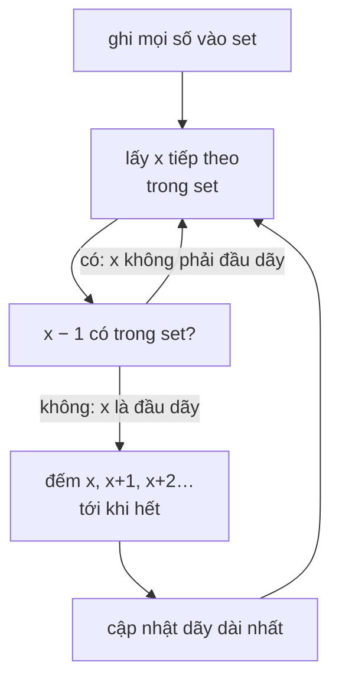

> [!tldr] Đọc nhanh
> - Đề: cho mảng số nguyên chưa sắp xếp, trả độ dài dãy **giá trị** liên tiếp dài nhất (`[100, 4, 200, 1, 3, 2]` → 4, vì có 1, 2, 3, 4). Đề đòi O(n).
> - [[concepts/brute-force|Vét cạn]] tìm `x + 1, x + 2…` bằng cách duyệt lại cả mảng: O(n³) ở ca tệ nhất, 2 000 số đã mất 1,5 giây.
> - [[concepts/sort-then-scan|Sắp xếp rồi quét]]: O(n log n), nhưng số **trùng** phải được bỏ qua chứ không làm đứt dãy, và JS phải có hàm so sánh.
> - [[concepts/hash-set|Hash set]] + **đầu dãy**: chỉ đếm từ x khi `x − 1` không có trong set. Mỗi giá trị được bước qua một lần, nên tổng O(n) dù có vòng `while` lồng trong `for` ([[concepts/aggregate-analysis|phân tích gộp]]).
> - Đo thật: với 10⁶ số, hash set nhanh hơn sắp xếp 14 lần trong TypeScript, nhưng chỉ 1,3 lần trong Python khi dữ liệu ngẫu nhiên.

> [!info] Bối cảnh
> Bài LeetCode 128, thuộc [[posts/2026-11-22-neetcode-hash-lookup|ga 1: Tra cứu bằng hash]] trên **tuyến NeetCode: Mảng và chuỗi**. Post của ga đã giới thiệu khuôn "ghi hết vào set rồi hỏi `x − 1`"; trang này đi sâu vào vì sao khuôn đó là O(n) và so nó với hai cách còn lại. Lời giải có đủ TypeScript, Python, Go, Java và JavaScript. Bạn chỉ cần biết vòng lặp, mảng và hàm.

> [!abstract]- Từ điển nhanh cho bài này (bấm để mở)
> - **Dãy liên tiếp**: các **giá trị** nối tiếp nhau (5, 6, 7), không cần đứng cạnh nhau trong mảng.
> - **Đầu dãy**: giá trị x mà `x − 1` không có trong dữ liệu. Mỗi dãy có đúng một đầu.
> - **Set**: cấu trúc trả lời "có x không?" trong O(1) trung bình. Xem [[problems/contains-duplicate|Contains Duplicate]].
> - **Phân tích gộp (aggregate analysis)**: đếm tổng số bước của cả thuật toán, thay vì nhân số vòng lặp với số bước tệ nhất của mỗi vòng. Xem [[concepts/aggregate-analysis|Aggregate Analysis]].
> - **Đóng hộp (boxing)**: Java bọc một `int` thành object `Integer` để bỏ được vào `List` hay `Set`.

## Hình dung trước: xếp hàng theo số thứ tự

Một lớp học có thẻ số thứ tự, nhưng nhiều bạn vắng và vài bạn cầm hai thẻ trùng số. Cô giáo muốn biết nhóm các bạn có số thứ tự **liền nhau** dài nhất.

| Đời thường | Khái niệm |
|---|---|
| Với mỗi bạn, gọi to "ai số tiếp theo?" rồi chờ cả lớp trả lời | Vét cạn: tìm `x + 1` bằng cách duyệt lại cả mảng |
| Bảo cả lớp xếp hàng theo số, rồi đi dọc hàng đếm | Sắp xếp rồi quét, O(n log n) |
| Hai bạn cầm cùng một số đứng cạnh nhau trong hàng | Số trùng: bỏ qua, không làm đứt dãy |
| Dán danh sách lớp lên bảng, tra tên theo số trong một giây | Set, tra O(1) |
| Chỉ bạn nào **không** có bạn số trước mình mới bắt đầu đếm nhóm | Đầu dãy: `x − 1` không có trong set |
| Mỗi bạn chỉ được đếm một lần, dù nhóm dài cỡ nào | Phân tích gộp: tổng O(n) |



## Vấn đề

**Đề (tóm tắt bằng lời của mình):** cho mảng số nguyên `nums` chưa sắp xếp, trả về độ dài của dãy dài nhất gồm các giá trị nguyên liên tiếp có mặt trong mảng. Thứ tự trong mảng không quan trọng; giá trị lặp lại chỉ tính một lần. Đề yêu cầu thuật toán **O(n)**. Đề gốc: [LeetCode 128](https://leetcode.com/problems/longest-consecutive-sequence/).

| Input | Output | Vì sao |
|---|---|---|
| `[100, 4, 200, 1, 3, 2]` | `4` | có 1, 2, 3, 4 |
| `[0, 3, 7, 2, 5, 8, 4, 6, 0, 1]` | `9` | có 0 tới 8; số 0 lặp không làm dãy dài thêm |
| `[1, 0, 1, 2]` | `3` | 0, 1, 2; số 1 thứ hai không làm đứt dãy |
| `[]` | `0` | mảng rỗng |

Giới hạn: tới **100 000** phần tử, mỗi số trong khoảng **±10⁹**. Khoảng giá trị rộng loại mẹo "mảng đánh dấu theo giá trị" (cần 2·10⁹ ô).

Mình từng nghĩ "đòi O(n) mà dãy liên tiếp thì phải sắp xếp, vô lý". Hóa ra không cần thứ tự của cả mảng: chỉ cần trả lời nhanh "x + 1 có không?", và đó là việc của một set.

## Cơ chế

### Cách 1, vét cạn: O(n³) ở ca tệ nhất

Với mỗi x, hỏi "`x + 1` có trong mảng không?" bằng cách duyệt cả mảng (`includes`, `in` trên list, `slices.Contains`), rồi `x + 2`, … Mỗi câu hỏi O(n), một dãy dài tới n bước, và có n điểm xuất phát: O(n³). Đo trên một dãy `0..n−1` đã xáo trộn:

| n | 250 | 500 | 1 000 | 2 000 |
|---|---|---|---|---|
| ms (TypeScript) | 3,5 | 24,5 | 190,9 | 1 513,2 |

n gấp đôi thì thời gian gấp khoảng 8 lần: đúng dáng của n³.

### Cách 2, sắp xếp rồi quét: O(n log n)

Sau khi sắp xếp, các giá trị liên tiếp đứng cạnh nhau. Đi một lượt: phần tử bằng phần tử trước thì **bỏ qua**; lớn hơn đúng 1 thì dãy dài thêm; còn lại thì dãy mới bắt đầu từ 1.

Hai chỗ dễ sai:
- **Coi số trùng là đứt dãy.** `[0, 1, 1, 2]` sẽ ra 2 thay vì 3. Bản sai này qua 6/7 ca test và chỉ hỏng ở `[1, 0, 1, 2]`.
- **JS: `sort()` không có hàm so sánh** so các số **như chuỗi**. `[100, 4, 200, 1, 3, 2]` thành `[1, 100, 2, 200, 3, 4]`, và mọi dãy bị cắt vụn. Bản này chỉ qua 4/7 ca.

### Cách 3, hash set và đầu dãy: O(n)

Ghi mọi số vào một set. Duyệt từng giá trị x **trong set**:
- nếu `x − 1` có trong set thì x nằm giữa một dãy: bỏ qua, dãy đó sẽ được đếm từ đầu của nó;
- nếu không, x là **đầu dãy**: đếm `x + 1, x + 2, …` tới khi hết.

### Vì sao vòng `while` lồng vẫn là O(n)

Đếm kiểu "vòng ngoài n lần × vòng trong tới n lần" cho ra O(n²), nhưng đó là cận trên quá thô. Đếm theo kiểu [[concepts/aggregate-analysis|phân tích gộp]]: mỗi bước của vòng `while` đi từ một giá trị sang giá trị kế tiếp **trong cùng một dãy**, và vòng `while` chỉ chạy từ đầu dãy. Mỗi dãy chỉ có một đầu, nên mỗi giá trị bị bước qua **đúng một lần** trên toàn bộ thuật toán. Tổng số bước `while` ≤ số giá trị khác nhau ≤ n. Cộng với n lần kiểm tra `x − 1`, tổng là O(n).

Lập luận này cần hai điều kiện. Nếu thiếu một trong hai, nó sụp:
- **Duyệt set, không duyệt mảng.** Nếu đầu dãy lặp lại k lần trong mảng, dãy đó bị đi lại k lần. Post của ga đo đúng ca này: 2,7 ms thành gần 4 giây.
- **Kiểm tra `x − 1` trước khi đếm.** Bỏ dòng đó thì mỗi giá trị lại đếm phần còn lại của dãy mình: O(n²) với một dãy dài.

### Đo: O(n) có luôn thắng O(n log n) xa không

Hai loại dữ liệu: 10⁶ số **ngẫu nhiên** trong ±10⁹ (gần như không có dãy nào dài), và **một dãy dài** `0..n−1` đã xáo trộn. Trung vị 5 lần, ms:

| n = 10⁶ | sắp xếp | hash set | hash set nhanh hơn |
|---|---|---|---|
| TypeScript, ngẫu nhiên | 209,65 | 14,51 | 14 lần |
| TypeScript, một dãy dài | 247,07 | 136,69 | 1,8 lần |
| Python, ngẫu nhiên | 370,71 | 279,47 | 1,3 lần |
| Python, một dãy dài | 352,89 | 128,51 | 2,7 lần |

Hash set thắng ở mọi ô, nhưng khoảng cách phụ thuộc nhiều vào ngôn ngữ và dữ liệu. `sorted` của Python viết bằng C và chạy trọn trong C; vòng lặp hash set thì mỗi bước là một lệnh Python. Big-O nói đường cong nào dốc hơn khi n lớn dần, không nói ở n = 10⁶ chênh bao nhiêu.

### Bên dưới năm ngôn ngữ

| | Tra "có x không" | Bẫy riêng |
|---|---|---|
| TypeScript / JavaScript | `Set.has` | `sort()` không hàm so sánh so theo chuỗi |
| Python | `x in s` với `s` là set: O(1) trung bình | `x in nums` với `nums` là **list** cũng chạy, nhưng O(n) |
| Go | `_, ok := m[x]` trên `map[int]struct{}` | `slices.Sort` sửa tại chỗ; thứ tự duyệt map ngẫu nhiên (không ảnh hưởng kết quả) |
| Java | `HashSet<Integer>.contains` | `Integer == Integer` so **tham chiếu**; đúng với −128..127, sai từ 128 trở lên |

## Ví dụ chạy được

[TypeScript](../code/neetcode-longest-consecutive-sequence/longest-consecutive.ts) · [Python](../code/neetcode-longest-consecutive-sequence/longest_consecutive.py) · [Go](../code/neetcode-longest-consecutive-sequence/longest_consecutive.go) · [Java](../code/neetcode-longest-consecutive-sequence/longest-consecutive.java) · [JavaScript](../code/neetcode-longest-consecutive-sequence/longest-consecutive.js)

Mỗi file có cả ba cách và tự chạy các ca kiểm tra. Dưới đây là cách sắp xếp và cách hash set.

```ts
function sortScan(nums: number[]): number {
  if (nums.length === 0) return 0;
  const a = [...nums].sort((p, q) => p - q); // sao chép: không sửa mảng của người gọi; PHẢI có hàm so sánh
  let best = 1, len = 1;
  for (let i = 1; i < a.length; i++) {
    if (a[i] === a[i - 1]) continue; // số trùng: bỏ qua, KHÔNG đứt dãy
    len = a[i] === a[i - 1] + 1 ? len + 1 : 1;
    best = Math.max(best, len);
  }
  return best;
}

function hashSet(nums: number[]): number {
  const all = new Set(nums);
  let best = 0;
  for (const x of all) {
    if (all.has(x - 1)) continue;
    let len = 1;
    while (all.has(x + len)) len++;
    best = Math.max(best, len);
  }
  return best;
}
```

```python
def sort_scan(nums: list[int]) -> int:
    if not nums:
        return 0
    a = sorted(nums)  # sorted trả list mới; nums.sort() thì sửa mảng của người gọi
    best = length = 1
    for prev, cur in zip(a, a[1:]):
        if cur == prev:
            continue  # số trùng: bỏ qua, không đứt dãy
        length = length + 1 if cur == prev + 1 else 1
        best = max(best, length)
    return best


def hash_set(nums: list[int]) -> int:
    all_ = set(nums)
    best = 0
    for x in all_:
        if x - 1 in all_:  # "in" trên SET: O(1) trung bình
            continue
        length = 1
        while x + length in all_:
            length += 1
        best = max(best, length)
    return best
```

```go
func sortScan(nums []int) int {
	if len(nums) == 0 {
		return 0
	}
	a := slices.Clone(nums) // slices.Sort sửa tại chỗ; sao chép để không đụng mảng của người gọi
	slices.Sort(a)
	best, length := 1, 1
	for i := 1; i < len(a); i++ {
		if a[i] == a[i-1] {
			continue // số trùng: bỏ qua, không đứt dãy
		}
		if a[i] == a[i-1]+1 {
			length++
		} else {
			length = 1
		}
		best = max(best, length)
	}
	return best
}

func hashSet(nums []int) int {
	all := make(map[int]struct{}, len(nums))
	for _, x := range nums {
		all[x] = struct{}{}
	}
	best := 0
	for x := range all { // thứ tự duyệt map ngẫu nhiên mỗi lần chạy; kết quả không phụ thuộc thứ tự
		if _, ok := all[x-1]; ok {
			continue
		}
		length := 1
		for {
			if _, ok := all[x+length]; !ok {
				break
			}
			length++
		}
		best = max(best, length)
	}
	return best
}
```

```java
static int sortScan(int[] nums) {
    if (nums.length == 0) return 0;
    int[] a = nums.clone(); // Arrays.sort sửa tại chỗ
    Arrays.sort(a); // mảng int nguyên thủy: Dual-Pivot Quicksort, không đóng hộp
    int best = 1, len = 1;
    for (int i = 1; i < a.length; i++) {
        if (a[i] == a[i - 1]) continue; // số trùng: bỏ qua, không đứt dãy
        len = a[i] == a[i - 1] + 1 ? len + 1 : 1;
        best = Math.max(best, len);
    }
    return best;
}

static int hashSet(int[] nums) {
    Set<Integer> all = new HashSet<>();
    for (int x : nums) all.add(x); // mỗi int bị đóng hộp thành một Integer
    int best = 0;
    for (int x : all) {
        if (all.contains(x - 1)) continue;
        int len = 1;
        while (all.contains(x + len)) len++;
        best = Math.max(best, len);
    }
    return best;
}
```

```js
function sortScan(nums) {
  if (nums.length === 0) return 0;
  const a = [...nums].sort((p, q) => p - q); // thiếu hàm so sánh thì sort so theo chuỗi: [1, 100, 2, 200, 3, 4]
  let best = 1, len = 1;
  for (let i = 1; i < a.length; i++) {
    if (a[i] === a[i - 1]) continue;
    len = a[i] === a[i - 1] + 1 ? len + 1 : 1;
    best = Math.max(best, len);
  }
  return best;
}

function hashSet(nums) {
  const all = new Set(nums);
  let best = 0;
  for (const x of all) {
    if (all.has(x - 1)) continue;
    let len = 1;
    while (all.has(x + len)) len++;
    best = Math.max(best, len);
  }
  return best;
}
```

File TypeScript chạy thêm hai bản sai để test chỉ ra chỗ hỏng, rồi đo:

```text
$ node longest-consecutive.ts
bruteForce                7/7 ca đúng
sortScan                  7/7 ca đúng
hashSet                   7/7 ca đúng
sortScanResetOnDuplicate  6/7 ca đúng; sai ở [1,0,1,2]
sortScanNoComparator      4/7 ca đúng; sai ở [100,4,200,1,3,2] [-3,-1,-2,5] [9,10,8]

vét cạn, một dãy dài xáo trộn (ms, một lần chạy)
n = 250         3.5
n = 500        24.5
n = 1000      190.9
n = 2000     1513.2

n          dữ liệu           sắp xếp  hash set   (ms, trung vị 5 lần)
10000      ngẫu nhiên ±10⁹       1.67      1.05
10000      một dãy dài           1.53      0.73
100000     ngẫu nhiên ±10⁹      18.81      2.04
100000     một dãy dài          20.18      9.06
1000000    ngẫu nhiên ±10⁹     209.65     14.51
1000000    một dãy dài         247.07    136.69
```

File Java có thêm một bản sắp xếp `List<Integer>` rồi so số trùng bằng `==`:

```text
$ java longest-consecutive.java
bruteForce     8/8 ca đúng
sortScan       8/8 ca đúng
hashSet        8/8 ca đúng
sortScanBoxed  7/8 ca đúng; sai ở [1000, 1001, 1001, 1002] → 2
```

Hai số `1001` là hai object `Integer` khác nhau, nên `==` coi chúng là khác nhau, và dãy bị cắt ở giữa. Với số nhỏ như `[1, 0, 1, 2]` thì bản này lại đúng, vì Java dùng chung object cho −128..127. Python, Go và JavaScript in `7/7 ca đúng` cho cả ba cách.

## Hiểu lầm và bẫy hay gặp

- **"Vòng lặp lồng thì O(n²)."** Phải đếm tổng công. Ở đây vòng `while` chỉ chạy từ đầu dãy, nên mỗi giá trị bị bước qua một lần: O(n).
- **Duyệt mảng gốc thay vì duyệt set.** Đúng kết quả nhưng mất O(n) khi đầu dãy bị lặp lại; xem phép đo ở [[posts/2026-11-22-neetcode-hash-lookup|post của ga]].
- **Coi số trùng là đứt dãy khi sắp xếp.** `[1, 0, 1, 2]` ra 2 thay vì 3.
- **JS: quên hàm so sánh trong `sort()`.** Số âm và số nhiều chữ số bị xếp sai thứ tự; bản sai chỉ qua 4/7 ca.
- **Java: so `Integer` bằng `==`.** Đúng với số nhỏ, sai từ 128 trở lên, nên test với số nhỏ không bắt được. Dùng `equals`, hoặc sắp xếp `int[]` thay vì `List<Integer>`.
- **Python: viết `x + 1 in nums` với `nums` là list.** Chạy đúng, nhưng mỗi lần tra là O(n), và lời giải thành O(n²) hoặc tệ hơn mà không có gì báo.
- **"O(n) chắc chắn nhanh hơn nhiều O(n log n)."** Trong Python với dữ liệu ngẫu nhiên, hash set chỉ nhanh hơn `sorted` 1,3 lần ở 10⁶ phần tử. Cả hai đều qua giới hạn của LeetCode; chỉ đề bài mới bắt buộc O(n).

## Câu hỏi tự kiểm tra

> [!question]- Vì sao chỉ cần bắt đầu đếm từ những x mà `x − 1` không có trong set?
> Vì x như vậy là đầu của dãy chứa nó. Mọi phần tử khác của dãy đều có `x − 1` trong set, và dãy của chúng sẽ được đếm trọn khi bắt đầu từ đầu dãy. Đếm từ giữa dãy chỉ ra một dãy ngắn hơn.

> [!question]- Tổng số bước của mọi vòng `while` bị chặn bởi gì, và vì sao?
> Bởi số giá trị khác nhau. Mỗi bước `while` chuyển sang giá trị kế tiếp trong cùng một dãy, vòng `while` chỉ chạy từ đầu dãy, và mỗi dãy có một đầu, nên mỗi giá trị bị bước qua đúng một lần.

> [!question]- Ở cách sắp xếp, `[1, 0, 1, 2]` cho ra 2. Lỗi ở đâu?
> Hai số 1 đứng cạnh nhau sau khi sắp xếp, và vòng lặp coi "bằng nhau" là "không liên tiếp" nên đặt lại độ dài về 1. Phải bỏ qua phần tử bằng phần tử trước.

> [!question]- Trong Java, `sortScanBoxed` đúng với `[1, 0, 1, 2]` nhưng sai với `[1000, 1001, 1001, 1002]`. Vì sao?
> `==` giữa hai `Integer` so tham chiếu. Java bắt buộc dùng chung object cho giá trị đóng hộp trong −128..127, nên hai số 1 là cùng một object; hai số 1001 là hai object khác nhau.

> [!question]- Đề đổi: mảng có 10⁹ phần tử, không đủ RAM cho một set. Bạn chọn cách nào?
> Sắp xếp tại chỗ (hoặc sắp xếp ngoài, trên đĩa) rồi quét: O(n log n) thời gian nhưng gần như không tốn bộ nhớ phụ. Hash set cần bộ nhớ tỉ lệ với số giá trị khác nhau.

## Tham khảo

- [LeetCode 128: Longest Consecutive Sequence](https://leetcode.com/problems/longest-consecutive-sequence/) (đề gốc)
- Cormen, Leiserson, Rivest, Stein, *Introduction to Algorithms*, chương "Amortized Analysis", mục phương pháp gộp (aggregate analysis)
- [Java Language Specification SE 21, §5.1.7 Boxing Conversion](https://docs.oracle.com/javase/specs/jls/se21/html/jls-5.html#jls-5.1.7) (giá trị đóng hộp trong −128..127 phải là cùng một object)
- [ECMAScript 2025](https://tc39.es/ecma262/2025/) (`Array.prototype.sort` so theo chuỗi khi không có hàm so sánh)
- [Go: package slices](https://pkg.go.dev/slices) (`slices.Sort` sắp xếp tại chỗ, `slices.Clone`, `slices.Contains`)
- [Python: Set types](https://docs.python.org/3/library/stdtypes.html#set-types-set-frozenset) và [Time complexity (Python wiki)](https://wiki.python.org/moin/TimeComplexity) (`x in list` là O(n), `x in set` là O(1) trung bình)
