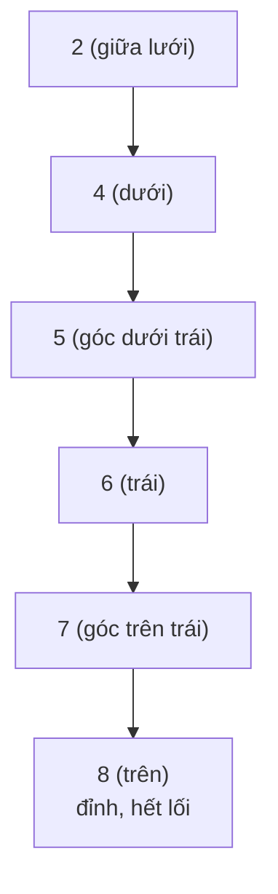
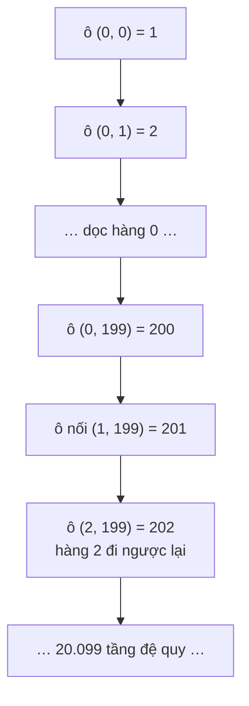
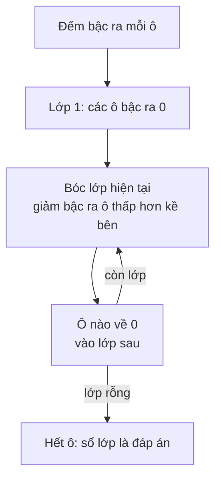

> [!tldr] Đọc nhanh
> - Mỗi ô là một đỉnh, có cạnh từ ô sang ô kề có giá trị **lớn hơn hẳn**. Vì giá trị tăng dọc mọi cạnh, đồ thị này không có vòng: nó là một [[concepts/directed-acyclic-graph|DAG]].
> - Không có vòng nên [[concepts/memoized-dfs|DFS ghi nhớ]] không cần tập "đang thăm". `memo[ô]` = độ dài đường tăng dài nhất bắt đầu ở ô đó, tính một lần rồi dùng lại.
> - Cách thứ hai không đệ quy: bóc các "đỉnh núi" (ô không còn ô kề lớn hơn) thành từng lớp theo kiểu [[concepts/topological-sort|Kahn]]. Số lớp bóc được bằng độ dài đường dài nhất.
> - Cả hai tốn O(m·n) thời gian và bộ nhớ. Khác biệt nằm ở ngăn xếp: lưới 200×200 có thể bắt DFS đệ quy hơn 20.000 tầng, đủ làm Node.js, Python và Java tràn ngăn xếp ở cấu hình mặc định.

> [!info] Bối cảnh
> Đây là bài LeetCode 329 tại [[posts/2026-11-27-neetcode-state-machine-dp|ga DP-06: DP có trạng thái]] trên **tuyến NeetCode: Quy hoạch động**. Mình hình dung một tấm bản đồ địa hình chia ô, mỗi ô ghi độ cao, và một người leo núi chỉ chịu bước lên ô cao hơn. Bạn chỉ cần biết mảng hai chiều, vòng lặp và hàm đệ quy.

> [!abstract]- Từ điển nhanh cho bài này (bấm để mở)
> - Ô kề là bốn ô trên, dưới, trái, phải. Không đi chéo, không vòng sang mép bên kia.
> - [[concepts/grid-graph|Lưới như đồ thị]] coi mỗi ô là một đỉnh và mỗi cặp ô kề là một cạnh có thể đi.
> - [[concepts/directed-acyclic-graph|DAG]] là đồ thị có hướng không có vòng.
> - [[concepts/dp-state|Trạng thái DP]] nói rõ một ô của bảng nhớ lưu điều gì.
> - [[concepts/memoization|Ghi nhớ kết quả]] (memoization) lưu đáp án của một trạng thái ngay lần đầu tính.
> - Bậc ra (out-degree) của một ô ở đây là số ô kề cao hơn nó, tức số lối còn leo tiếp được.
> - Tràn ngăn xếp (stack overflow) xảy ra khi các lời gọi hàm lồng nhau quá sâu, vượt chỗ chứa mà hệ thống cấp cho luồng.

## Hình dung trước: leo dốc trên bản đồ địa hình

Tấm bản đồ chia ô, mỗi ô ghi độ cao. Người leo bắt đầu ở ô nào cũng được, mỗi bước sang một ô kề cao hơn hẳn. Mình muốn chuyến leo qua nhiều ô nhất. Mẹo của người đi trước: ở mỗi ô đã khảo sát, ghi một con số "từ đây leo tiếp được tối đa bao nhiêu ô". Người sau tới ô đó chỉ cần đọc số, không phải leo thử lại.

| Đời thường | Khái niệm |
|---|---|
| Ô bản đồ ghi độ cao | Ô `grid[r][c]` |
| Chỉ bước lên ô cao hơn hẳn | Cạnh có hướng sang ô kề lớn hơn |
| Không thể leo một vòng rồi về chỗ cũ | Đồ thị không có vòng (DAG) |
| Con số ghi tại ô đã khảo sát | `memo[ô]`, trạng thái DP |
| Đỉnh núi nhỏ, quanh đó toàn ô thấp hơn | Ô có bậc ra 0, lớp đầu khi bóc |
| Bóc dần từ các đỉnh xuống chân núi | Thứ tự topo theo Kahn |
| Chuyến leo dài nhất | Đáp án |

Lấy lưới 3×3 dưới đây làm ví dụ xuyên suốt:

```text
7 8 1
6 2 3
5 4 9
```

Chuyến dài nhất đi 6 ô: 2 → 4 → 5 → 6 → 7 → 8.



## Vấn đề: chuyến leo dài nhất trên lưới số

Cho lưới m × n số nguyên, 1 ≤ m, n ≤ 200, mỗi số từ 0 đến 2³¹ − 1. Từ một ô, mỗi bước sang một trong bốn ô kề có giá trị lớn hơn hẳn. Trả về số ô của đường dài nhất như vậy, bắt đầu ở bất kỳ ô nào. Một ô đứng riêng cũng là đường dài 1, nên đáp án luôn ít nhất là 1. [Đề gốc LeetCode 329](https://leetcode.com/problems/longest-increasing-path-in-a-matrix/)

Mình từng nghĩ đây là bài "tìm đường trên lưới" như [[problems/number-of-islands|Number of Islands]], nên định mang theo một mảng `visited` để khỏi đi vòng. Hóa ra không cần: giá trị tăng nghiêm ngặt dọc đường, nên không bao giờ quay lại được ô đã đi. Cái cần là nhớ **đáp án** của từng ô, không phải nhớ ô nào đã thăm.

## Cơ chế

### Vét cạn: DFS từ mọi ô

Gọi `climb(r, c)` là độ dài đường tăng dài nhất bắt đầu ở ô (r, c). Ô đó tự nó là đường dài 1. Với mỗi ô kề lớn hơn, có thể đi tiếp, được `1 + climb(ô kề)`. Lấy giá trị lớn nhất, rồi lấy lớn nhất qua mọi ô xuất phát.

Công thức đúng, nhưng các đường tăng chồng lên nhau rất nhiều. Trên lưới 10×10 có giá trị `r + c`, từ góc trên trái có C(18, 9) = 48.620 đường tới góc dưới phải. Vét cạn đi lại từng đường một: 705.310 lượt gọi cho 100 ô. Trong trường hợp xấu, số đường tăng tăng theo hàm mũ của kích thước lưới.

### DFS ghi nhớ: mỗi ô tính đúng một lần

`climb(r, c)` chỉ phụ thuộc vào (r, c): đường đi tiếp từ đây không quan tâm mình đến đây bằng cách nào. Vậy nên đây là một [[concepts/dp-state|trạng thái DP]] trọn vẹn, lưu vào `memo` theo ô. Lần sau gặp lại ô đó thì trả số đã lưu.

Hai điều làm cách này đúng mà không cần tập "đang thăm":

| Câu hỏi | Trả lời |
|---|---|
| DFS có thể đi vòng rồi gọi lại chính ô đang tính dở không? | Không. Một vòng sẽ cần a < b < … < a, vô lý. |
| Khi đọc `memo[ô kề]`, giá trị đó đã đầy đủ chưa? | Rồi. Ô kề lớn hơn được tính xong trước khi lời gọi trả về. |

Mỗi ô được tính một lần, mỗi lần xét 4 ô kề, nên thời gian là O(m·n), bộ nhớ `memo` là O(m·n). Trên lưới 10×10 ở trên, số lượt gọi giảm từ 705.310 xuống 280: 100 lượt từ vòng lặp ngoài và 180 lượt theo cạnh (mỗi cạnh tăng gọi một lần, phần lớn trả ngay từ `memo`). Mình dùng 0 để đánh dấu "chưa tính", an toàn vì đáp án của ô nào cũng ít nhất là 1.

Cái giá còn lại là **độ sâu đệ quy**. Đường tăng dài bao nhiêu ô thì ngăn xếp có thể sâu bấy nhiêu tầng, tối đa m·n = 40.000. File chạy thử dùng một lưới "hành lang" 200×200: hàng chẵn là lối đi zigzag đánh số tăng dần, hàng lẻ là tường giá trị 0 chừa một ô nối ở đầu mút. Từ ô (0, 0) chỉ có đúng một ô kề lớn hơn, nên DFS đi một mạch 20.099 tầng.



### Bóc lớp theo thứ tự topo: không đệ quy

Đảo góc nhìn: thay vì leo lên, bóc từ trên xuống. Đếm cho mỗi ô số ô kề lớn hơn nó, gọi là bậc ra. Ô có bậc ra 0 là đỉnh núi nhỏ: đường tăng nào đi qua nó cũng kết thúc ở đó. Các ô này là lớp 1.

Bóc lớp 1 đi. Mỗi ô nhỏ hơn kề bên một ô vừa bóc mất một lối lên. Ô nào hết lối thì mọi ô cao hơn nó đã bị bóc, nên nó thành đỉnh của phần còn lại và vào lớp 2. Cứ thế đến khi không còn ô. Đây là [[concepts/topological-sort|thuật toán Kahn]] chạy trên bậc ra thay vì bậc vào.

| Lớp | Ô bị bóc (lưới ví dụ) | Vì sao |
|---|---|---|
| 1 | 8, 9 | Không có ô kề nào cao hơn |
| 2 | 7, 3 | Lối lên duy nhất (8, 9) đã bị bóc |
| 3 | 6, 1 | Lối lên của 6 là 7, của 1 là 8 và 3, đều đã bóc |
| 4 | 5 | Lối lên duy nhất là 6 |
| 5 | 4 | Lối lên là 5 và 9, đều đã bóc |
| 6 | 2 | Bốn ô kề 8, 4, 6, 3 đều đã bóc |

Sáu lớp, đúng bằng đáp án. Lý do: một ô thuộc lớp k khi và chỉ khi đường tăng dài nhất bắt đầu ở nó dài đúng k ô. Ô thuộc lớp 1 thì không đi tiếp được. Ô thuộc lớp k chờ tới khi ô kề cao hơn cuối cùng của nó bị bóc ở lớp k − 1, nên đường dài nhất từ nó là 1 + (k − 1). Thời gian và bộ nhớ vẫn là O(m·n), nhưng chỉ dùng vòng lặp và hai mảng, không đụng tới ngăn xếp lời gọi.



## Ví dụ chạy được

[TypeScript](../code/neetcode-longest-increasing-path-in-a-matrix/climb.ts) · [Python](../code/neetcode-longest-increasing-path-in-a-matrix/climb.py) · [Go](../code/neetcode-longest-increasing-path-in-a-matrix/climb.go) · [Java](../code/neetcode-longest-increasing-path-in-a-matrix/climb.java) · [JavaScript](../code/neetcode-longest-increasing-path-in-a-matrix/climb.js) · [PHP](../code/neetcode-longest-increasing-path-in-a-matrix/climb.php) · [Rust](../code/neetcode-longest-increasing-path-in-a-matrix/climb.rs)

```ts
const DIRS = [[1, 0], [-1, 0], [0, 1], [0, -1]]

// DFS ghi nhớ: memo[ô] = độ dài đường tăng dài nhất bắt đầu ở ô đó.
// Không cần tập "đang thăm": cạnh chỉ đi lên giá trị lớn hơn nên không có vòng.
function longestPathMemo(grid: number[][], counter = { calls: 0 }): number {
    const rows = grid.length, cols = grid[0].length
    const memo = new Array(rows * cols).fill(0) // 0 = chưa tính, đáp án luôn ≥ 1
    const climb = (r: number, c: number): number => {
        counter.calls++
        const key = r * cols + c
        if (memo[key] !== 0) return memo[key]
        let best = 1
        for (const [dr, dc] of DIRS) {
            const nr = r + dr, nc = c + dc
            if (nr >= 0 && nr < rows && nc >= 0 && nc < cols && grid[nr][nc] > grid[r][c]) {
                best = Math.max(best, 1 + climb(nr, nc))
            }
        }
        memo[key] = best
        return best
    }
    let answer = 0
    for (let r = 0; r < rows; r++) for (let c = 0; c < cols; c++) answer = Math.max(answer, climb(r, c))
    return answer
}
```

```python
DIRS = ((1, 0), (-1, 0), (0, 1), (0, -1))


def longest_path_memo(grid, counter=None):
    """DFS ghi nhớ: memo[ô] = độ dài đường tăng dài nhất bắt đầu ở ô đó.
    Không cần tập "đang thăm": cạnh chỉ đi lên giá trị lớn hơn nên không có vòng."""
    rows, cols = len(grid), len(grid[0])
    memo = [0] * (rows * cols)  # 0 = chưa tính, đáp án luôn ≥ 1

    def climb(r, c):
        if counter is not None:
            counter[0] += 1
        key = r * cols + c
        if memo[key]:
            return memo[key]
        best = 1
        for dr, dc in DIRS:
            nr, nc = r + dr, c + dc
            if 0 <= nr < rows and 0 <= nc < cols and grid[nr][nc] > grid[r][c]:
                best = max(best, 1 + climb(nr, nc))
        memo[key] = best
        return best

    return max(climb(r, c) for r in range(rows) for c in range(cols))
```

```go
var dirs = [4][2]int{{1, 0}, {-1, 0}, {0, 1}, {0, -1}}

// DFS ghi nhớ: memo[ô] = độ dài đường tăng dài nhất bắt đầu ở ô đó.
// Không cần tập "đang thăm": cạnh chỉ đi lên giá trị lớn hơn nên không có vòng.
func longestPathMemo(grid [][]int, calls *int) int {
	rows, cols := len(grid), len(grid[0])
	memo := make([]int, rows*cols) // 0 = chưa tính, đáp án luôn ≥ 1
	var climb func(r, c int) int
	climb = func(r, c int) int {
		*calls++
		key := r*cols + c
		if memo[key] != 0 {
			return memo[key]
		}
		best := 1
		for _, d := range dirs {
			nr, nc := r+d[0], c+d[1]
			if nr >= 0 && nr < rows && nc >= 0 && nc < cols && grid[nr][nc] > grid[r][c] {
				best = max(best, 1+climb(nr, nc))
			}
		}
		memo[key] = best
		return best
	}
	answer := 0
	for r := 0; r < rows; r++ {
		for c := 0; c < cols; c++ {
			answer = max(answer, climb(r, c))
		}
	}
	return answer
}
```

```java
static final int[][] DIRS = {{1, 0}, {-1, 0}, {0, 1}, {0, -1}};

// DFS ghi nhớ: memo[r][c] = độ dài đường tăng dài nhất bắt đầu ở ô đó.
// Không cần tập "đang thăm": cạnh chỉ đi lên giá trị lớn hơn nên không có vòng.
static int longestPathMemo(int[][] grid) {
    int[][] memo = new int[grid.length][grid[0].length]; // 0 = chưa tính, đáp án luôn ≥ 1
    int answer = 0;
    for (int r = 0; r < grid.length; r++)
        for (int c = 0; c < grid[0].length; c++) answer = Math.max(answer, memoClimb(grid, memo, r, c));
    return answer;
}

static int memoClimb(int[][] grid, int[][] memo, int r, int c) {
    calls++;
    if (memo[r][c] != 0) return memo[r][c];
    int best = 1;
    for (int[] d : DIRS) {
        int nr = r + d[0], nc = c + d[1];
        if (nr >= 0 && nr < grid.length && nc >= 0 && nc < grid[0].length && grid[nr][nc] > grid[r][c]) {
            best = Math.max(best, 1 + memoClimb(grid, memo, nr, nc));
        }
    }
    return memo[r][c] = best;
}
```

```js
const DIRS = [[1, 0], [-1, 0], [0, 1], [0, -1]]

// DFS ghi nhớ: memo[ô] = độ dài đường tăng dài nhất bắt đầu ở ô đó.
// Không cần tập "đang thăm": cạnh chỉ đi lên giá trị lớn hơn nên không có vòng.
function longestPathMemo(grid, counter = { calls: 0 }) {
    const rows = grid.length, cols = grid[0].length
    const memo = new Array(rows * cols).fill(0) // 0 = chưa tính, đáp án luôn ≥ 1
    const climb = (r, c) => {
        counter.calls++
        const key = r * cols + c
        if (memo[key] !== 0) return memo[key]
        let best = 1
        for (const [dr, dc] of DIRS) {
            const nr = r + dr, nc = c + dc
            if (nr >= 0 && nr < rows && nc >= 0 && nc < cols && grid[nr][nc] > grid[r][c]) {
                best = Math.max(best, 1 + climb(nr, nc))
            }
        }
        memo[key] = best
        return best
    }
    let answer = 0
    for (let r = 0; r < rows; r++) for (let c = 0; c < cols; c++) answer = Math.max(answer, climb(r, c))
    return answer
}
```

```php
const DIRS = [[1, 0], [-1, 0], [0, 1], [0, -1]];

// DFS ghi nhớ: $memo[ô] = độ dài đường tăng dài nhất bắt đầu ở ô đó.
// Không cần tập "đang thăm": cạnh chỉ đi lên giá trị lớn hơn nên không có vòng.
function memoClimb(array $grid, array &$memo, int $r, int $c): int {
    global $calls;
    $calls++;
    $key = $r * count($grid[0]) + $c;
    if ($memo[$key] !== 0) return $memo[$key];
    $best = 1;
    foreach (DIRS as [$dr, $dc]) {
        $nr = $r + $dr; $nc = $c + $dc;
        if (isset($grid[$nr][$nc]) && $grid[$nr][$nc] > $grid[$r][$c]) {
            $best = max($best, 1 + memoClimb($grid, $memo, $nr, $nc));
        }
    }
    return $memo[$key] = $best;
}

function longestPathMemo(array $grid): int {
    $memo = array_fill(0, count($grid) * count($grid[0]), 0); // 0 = chưa tính, đáp án luôn ≥ 1
    $answer = 0;
    foreach ($grid as $r => $row) {
        foreach ($row as $c => $_) $answer = max($answer, memoClimb($grid, $memo, $r, $c));
    }
    return $answer;
}
```

```rust
const DIRS: [(i32, i32); 4] = [(1, 0), (-1, 0), (0, 1), (0, -1)];

fn larger_neighbors(grid: &[Vec<i32>], r: usize, c: usize) -> impl Iterator<Item = (usize, usize)> + '_ {
    DIRS.iter().filter_map(move |&(dr, dc)| {
        let nr = r as i32 + dr;
        let nc = c as i32 + dc;
        if nr < 0 || nc < 0 || nr as usize >= grid.len() || nc as usize >= grid[0].len() {
            return None;
        }
        let (nr, nc) = (nr as usize, nc as usize);
        (grid[nr][nc] > grid[r][c]).then_some((nr, nc))
    })
}

// DFS ghi nhớ: memo[ô] = độ dài đường tăng dài nhất bắt đầu ở ô đó.
// Không cần tập "đang thăm": cạnh chỉ đi lên giá trị lớn hơn nên không có vòng.
fn memo_climb(grid: &[Vec<i32>], memo: &mut Vec<i32>, r: usize, c: usize, calls: &Cell<u64>) -> i32 {
    calls.set(calls.get() + 1);
    let key = r * grid[0].len() + c;
    if memo[key] != 0 {
        return memo[key];
    }
    let mut best = 1;
    for (nr, nc) in larger_neighbors(grid, r, c) {
        best = best.max(1 + memo_climb(grid, memo, nr, nc, calls));
    }
    memo[key] = best;
    best
}

fn longest_path_memo(grid: &[Vec<i32>], calls: &Cell<u64>) -> i32 {
    let mut memo = vec![0; grid.len() * grid[0].len()]; // 0 = chưa tính, đáp án luôn ≥ 1
    let mut answer = 0;
    for r in 0..grid.len() {
        for c in 0..grid[0].len() {
            answer = answer.max(memo_climb(grid, &mut memo, r, c, calls));
        }
    }
    answer
}
```

Các tab trích bản DFS ghi nhớ; bộ đếm `calls` chỉ để đo số lượt gọi. File tải về còn có vét cạn và bản bóc lớp không đệ quy. 11 ca gồm lưới 1 ô, lưới toàn số bằng nhau, một hàng, một cột, giá trị 0 và 2³¹ − 1, lưới ví dụ ở trên, và ba lưới 200×200: toàn số 5 (đáp án 1), con rắn đánh số 0..39.999 (đáp án 40.000) và hành lang (đáp án 20.100). Ba lưới lớn được kiểm bằng bản bóc lớp.

Dòng thứ hai đối chiếu cả ba cách trên mọi lưới có tối đa 6 ô với giá trị 0..2 (3.720 lưới), cộng mọi lưới 2×3 và 3×2 xếp từ một hoán vị của 1..6 (1.440 lưới, có đường dài tới 6). Dòng thứ ba là số lần đi vào hàm, không phải thời gian. Dòng cuối chạy DFS ghi nhớ trên lưới hành lang ở cấu hình mặc định của từng ngôn ngữ. Kết quả của TypeScript:

```text
11/11 ca đúng
5160/5160 ca đúng (đối chiếu vét cạn)
Lưới 10×10 giá trị i+j: vét cạn 705310 lượt gọi, memo 280 lượt gọi
Lưới hành lang 200×200: bóc lớp 20100, memo đệ quy tràn ngăn xếp (RangeError)
```

Ba dòng đầu giống hệt nhau ở cả bảy ngôn ngữ. Dòng cuối thì khác:

| Ngôn ngữ | Memo đệ quy trên lưới hành lang |
|---|---|
| TypeScript, JavaScript (Node.js 24) | `tràn ngăn xếp (RangeError)` |
| Python 3.12 | `tràn ngăn xếp (RecursionError)`, rồi `20100` khi nâng giới hạn lên 50.000 và chạy trên luồng có ngăn xếp 256 MB |
| Java 21 | `tràn ngăn xếp (StackOverflowError)`, rồi `20100` trên luồng tạo với ngăn xếp 256 MB |
| Go 1.25 | `20100` |
| PHP 8.2 (tắt Xdebug) | `20100` |
| Rust 1.99 (`-O` và cả bản debug) | `20100` |

Python và Java in thêm một dòng cho lần chạy trên luồng riêng:

```text
Nâng giới hạn lên 50000 trên luồng ngăn xếp 256 MB: memo đệ quy 20100
Luồng ngăn xếp 256 MB: memo đệ quy 20100
```

## Hiểu lầm và bẫy hay gặp

- Mang theo mảng `visited` như các bài duyệt lưới khác. Thừa, và còn sai nếu quên bỏ đánh dấu khi quay lui: một ô đã thăm từ nhánh này vẫn có thể nằm trên đường dài nhất của nhánh khác. Thứ cần lưu là đáp án của ô, không phải trạng thái đã thăm.
- So bằng `>=` thay vì `>`. Bài đòi tăng nghiêm ngặt. Cho phép bằng nhau sẽ tạo vòng giữa hai ô cùng giá trị, và DFS ghi nhớ sẽ đệ quy vô tận.
- Chỉ bắt đầu từ ô nhỏ nhất. Lưới có thể có nhiều "thung lũng" tách rời, mỗi cái một đường riêng. Phải thử mọi ô xuất phát, `memo` lo việc không tính lặp.
- Nghĩ rằng O(m·n) là đủ an toàn. Thời gian thì đủ, ngăn xếp thì không. Độ sâu đệ quy bằng độ dài đường đang đi, có thể tới m·n.
- Node.js: ngăn xếp mặc định khoảng 1 MB, lưới hành lang 200×200 làm nó ném `RangeError`. Muốn giữ đệ quy thì chạy với `node --stack-size=…` (cờ của V8, không được bảo đảm ổn định) hoặc dùng bản bóc lớp.
- Python: giới hạn mặc định 1.000 tầng (`sys.setrecursionlimit`). Trên Python 3.12, chỉ nâng giới hạn lên 50.000 là đủ cho lưới hành lang, vì từ 3.11 lời gọi giữa hai hàm Python gần như không tốn ngăn xếp C. Với bản cũ hơn, nâng giới hạn mà không nới ngăn xếp có thể làm sập cả tiến trình, nên file chạy trong luồng có `threading.stack_size(256 MB)` cho chắc.
- Java: ngăn xếp luồng mặc định thường 512 KB–1 MB, đổi được bằng `-Xss` hoặc bằng tham số `stackSize` khi tạo `Thread`. Bắt `StackOverflowError` được nhưng không nên dựa vào.
- Go: ngăn xếp goroutine tự nới khi cần, mặc định tới 1 GB trên máy 64 bit (`debug.SetMaxStack`), nên 20.000 tầng không thành vấn đề.
- PHP: bản thân PHP 8.2 không giới hạn số tầng, nhưng Xdebug dừng ở 512 tầng (`xdebug.max_nesting_level`). Chạy file bằng `php -d xdebug.mode=off`.
- Rust: luồng main lấy ngăn xếp từ `ulimit -s` của hệ điều hành (8 MB trên máy chạy thử), luồng tạo bằng `std::thread::spawn` mặc định chỉ 2 MiB. Chuyển chỉ số `usize` sang `i32` trước khi cộng hướng âm, nếu không `0 - 1` sẽ panic ở bản debug.

## Câu hỏi tự kiểm tra

> [!question]- Vì sao DFS ghi nhớ ở đây không cần tập "đang thăm"?
> Mọi cạnh đi từ giá trị nhỏ sang giá trị lớn hơn hẳn, nên không có vòng. Một lời gọi không bao giờ quay về ô đang tính dở của chính nó.

> [!question]- Nếu bài cho phép bước sang ô bằng giá trị, cách ghi nhớ còn đúng không?
> Không. Hai ô bằng nhau kề nhau tạo vòng, đáp án của ô này phụ thuộc ô kia và ngược lại. Trạng thái "đường dài nhất từ ô này" không còn định nghĩa được bằng truy hồi trên DAG.

> [!question]- Vì sao số lớp bóc được bằng độ dài đường dài nhất?
> Ô ở lớp k có đường dài nhất bắt đầu từ nó dài đúng k ô. Lớp cuối chứa điểm bắt đầu của đường dài nhất toàn lưới.

> [!question]- Lưới 200×200 chỉ có 40.000 ô. Vì sao vẫn có thể tràn ngăn xếp?
> Độ sâu đệ quy bằng độ dài đường đang đi, có thể lên hàng chục nghìn tầng. Nhiều môi trường mặc định chỉ cho khoảng 1 MB ngăn xếp hoặc 1.000 tầng.

## Tham khảo

- [LeetCode 329](https://leetcode.com/problems/longest-increasing-path-in-a-matrix/)
- [Jeff Erickson, Algorithms, chương 6: DFS và quy hoạch động trên DAG](https://jeffe.cs.illinois.edu/teaching/algorithms/book/06-dfs.pdf)
- [A. B. Kahn, Topological sorting of large networks (1962)](https://dl.acm.org/doi/10.1145/368996.369025)
- [Python sys.setrecursionlimit](https://docs.python.org/3/library/sys.html#sys.setrecursionlimit) · [Python threading.stack_size](https://docs.python.org/3/library/threading.html#threading.stack_size) · [Python 3.11, lời gọi hàm Python được inline](https://docs.python.org/3/whatsnew/3.11.html#inlined-python-function-calls) · [Java Thread(…, stackSize)](https://docs.oracle.com/en/java/javase/21/docs/api/java.base/java/lang/Thread.html#%3Cinit%3E(java.lang.ThreadGroup,java.lang.Runnable,java.lang.String,long)) · [Go debug.SetMaxStack](https://pkg.go.dev/runtime/debug#SetMaxStack) · [Xdebug max_nesting_level](https://xdebug.org/docs/all_settings#max_nesting_level) · [Rust std::thread, kích thước ngăn xếp](https://doc.rust-lang.org/std/thread/index.html#stack-size)
