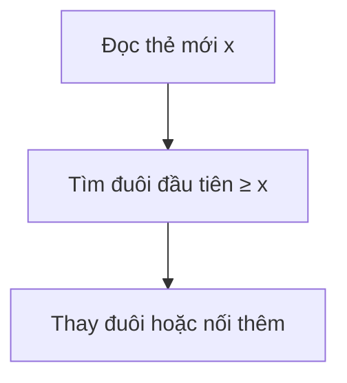

> [!tldr] Đọc nhanh
> - Dãy con giữ nguyên thứ tự chỉ số và có thể bỏ qua phần tử. Điều kiện tăng là `<`, nên hai giá trị bằng nhau không đứng liền nhau trong dãy tăng.
> - DP theo điểm kết thúc giữ độ dài tốt nhất kết thúc đúng tại i. Thử mọi j đứng trước i có giá trị nhỏ hơn, rồi lấy max trên toàn bộ i.
> - Mảng `tails` ghi đuôi nhỏ nhất cho mỗi độ dài. Thay ô đầu tiên có giá trị ≥ x, hoặc nối x nếu mọi đuôi đều nhỏ hơn x.
> - Kích thước `tails` là độ dài đáp án. Mỗi ô có thể đến từ một dãy con riêng.

> [!info] Bối cảnh
> Đây là bài LeetCode 300, thuộc [[posts/2026-11-27-neetcode-word-break-lis|ga DP-04: Cắt chuỗi và dãy con tăng]] trên **tuyến NeetCode: Quy hoạch động**. Mình có một xấp thẻ điểm theo thứ tự lấy ra và muốn giữ nhiều thẻ nhất mà điểm tăng nghiêm ngặt. Chỉ cần biết mảng và tìm nhị phân.

> [!abstract]- Từ điển nhanh cho bài này (bấm để mở)
> - [[concepts/increasing-subsequence|Dãy con tăng]] lấy các chỉ số tăng dần và các giá trị cũng tăng nghiêm ngặt.
> - [[concepts/dp-state|Trạng thái DP]] gắn câu hỏi cụ thể với mỗi ô.
> - [[concepts/lis-minimum-tail|Đuôi nhỏ nhất]] giữ giá trị kết thúc thấp nhất trong các dãy con tăng cùng độ dài.
> - [[concepts/lower-bound|Lower bound]] cho chỉ số đầu tiên có giá trị lớn hơn hoặc bằng ngưỡng.

## Hình dung trước: chọn thẻ theo điểm

Mình lật thẻ theo thứ tự. Có hai cách đã chọn đúng ba thẻ, một cách kết thúc ở điểm 8, cách kia kết thúc ở điểm 5. Khi một thẻ mới có điểm 7 xuất hiện, cách kết thúc ở 5 nối thêm được. Với số thẻ đã chọn bằng nhau, giữ điểm cuối thấp nhất giúp giữ mọi cơ hội nối tiếp.

| Đời thường | Khái niệm |
|---|---|
| Thẻ đến theo thứ tự lật | Chỉ số trong mảng đầu vào |
| Bỏ bớt thẻ và giữ thứ tự | Dãy con |
| Điểm nhỏ nhất ở cuối nhóm có k thẻ | `tails[k-1]` |
| Tìm ngăn đầu tiên có điểm ≥ x | Lower bound |



## Vấn đề: tìm độ dài dãy con tăng nghiêm ngặt dài nhất

Đầu vào có từ 1 đến 2.500 số nguyên, mỗi số trong đoạn [−10.000, 10.000]. Chọn vài vị trí theo thứ tự ban đầu để giá trị sau luôn lớn hơn giá trị trước. Trả số vị trí lớn nhất có thể chọn. Với `[4,8,1,6,9,2]`, có thể giữ `[1,6,9]`, nên đáp án ít nhất là 3. Bảng theo điểm kết thúc ở dưới cho thấy không thể chọn 4. [Đề gốc LeetCode 300](https://leetcode.com/problems/longest-increasing-subsequence/)

## Cơ chế

### Vét cạn bằng hai lựa chọn

Ở vị trí i, luôn có thể bỏ phần tử. Có thể lấy nếu chưa chọn phần tử nào hoặc giá trị ở i lớn hơn phần tử cuối đã chọn. Thử cả hai nhánh hợp lệ rồi giữ độ dài lớn hơn. Trên mảng tăng dần, mọi tập vị trí đều hợp lệ, cây có 2ⁿ lá. Thời gian O(2ⁿ), ngăn xếp O(n). Mình chạy bản này cho trường hợp nhỏ để làm đối chứng.

### DP theo vị trí kết thúc

Đặt `end[i]` là độ dài tốt nhất kết thúc **đúng tại i**. Dãy một phần tử cho giá trị ban đầu 1. Nếu `j < i` và `nums[j] < nums[i]`, nối i vào dãy tốt nhất kết thúc ở j cho ứng viên `end[j]+1`. Mọi dãy dài hơn 1 kết thúc ở i đều có một vị trí áp chót như vậy, nên chọn max trong các ứng viên. Đáp án là max của tất cả các ô, vì phần tử cuối mảng chưa chắc kết thúc dãy dài nhất.

| i | 0 | 1 | 2 | 3 | 4 | 5 |
|---|---:|---:|---:|---:|---:|---:|
| Giá trị | 4 | 8 | 1 | 6 | 9 | 2 |
| `end[i]` | 1 | 2 | 1 | 2 | 3 | 2 |

Thử đúng n(n−1)/2 cặp chỉ số. Thời gian O(n²), bộ nhớ O(n).

### Đuôi nhỏ nhất và tìm nhị phân

Sau mỗi tiền tố, `tails[k-1]` là giá trị cuối nhỏ nhất trong mọi dãy con tăng dài k. Với cùng độ dài, một đuôi nhỏ hơn nối được với mọi giá trị tương lai mà đuôi lớn nối được. Các đuôi nhỏ nhất tăng nghiêm ngặt theo độ dài. Lấy dãy tạo đuôi nhỏ nhất dài k+1 rồi bỏ phần tử cuối. Giá trị cuối còn lại nhỏ hơn đuôi vừa bỏ, còn đuôi nhỏ nhất dài k có thể thấp hơn nữa.

Khi đọc x, đặt p là chỉ số đầu tiên có `tails[p] ≥ x`, hoặc bằng độ dài mảng nếu mọi ô đều nhỏ hơn x. Nếu p > 0, `tails[p-1] < x`, nên có một dãy dài p để nối x. Nếu p = 0, bắt đầu dãy một phần tử. Các ô trước p đã thấp hơn x, nên x không cải thiện chúng. Một dãy dài hơn p+1 kết thúc bằng x cần dãy trước đó dài ít nhất p+1 với đuôi nhỏ hơn x. Khi ô p tồn tại, chính đuôi nhỏ nhất ở ô đó đã không thỏa điều kiện. Khi ô p chưa tồn tại, độ dài p+1 chưa thể có trong tiền tố cũ. Do đó chỉ cần cập nhật ô p.

| Giá trị mới | 4 | 8 | 1 | 6 | 9 | 2 |
|---|---|---|---|---|---|---|
| `tails` sau bước | `[4]` | `[4,8]` | `[1,8]` | `[1,6]` | `[1,6,9]` | `[1,2,9]` |

`[1,2,9]` được sắp theo **độ dài mà mỗi đuôi đại diện**. Trong mảng gốc, số 2 đứng sau 9, nên ba giá trị đang lưu không thể cùng tạo một dãy con theo thứ tự đó. Dãy `[1,6,9]` vẫn là chứng cứ độ dài 3.

Gọi L là độ dài đáp án. Tìm trên dãy đuôi đang tăng dùng O(n log(L+1)) thời gian, tức O(n log n) trong trường hợp xấu nhất. Các bản dùng mảng tăng dần theo số đuôi lưu O(L) ô. Bản Java cấp sẵn n ô và tìm trong đoạn có dữ liệu, nên dùng O(n) bộ nhớ.

## Ví dụ chạy được

[TypeScript](../code/neetcode-longest-increasing-subsequence/lis.ts) · [Python](../code/neetcode-longest-increasing-subsequence/lis.py) · [Go](../code/neetcode-longest-increasing-subsequence/lis.go) · [Java](../code/neetcode-longest-increasing-subsequence/lis.java) · [JavaScript](../code/neetcode-longest-increasing-subsequence/lis.js) · [PHP](../code/neetcode-longest-increasing-subsequence/lis.php) · [Rust](../code/neetcode-longest-increasing-subsequence/lis.rs)

```ts
function lisByTails(nums: number[], work: {comparisons:number} = {comparisons:0}) {
    const tails: number[] = []
    for (const x of nums) {
        let lo=0, hi=tails.length
        while (lo < hi) {
            const mid=lo+Math.floor((hi-lo)/2)
            work.comparisons++
            if (tails[mid] < x) lo=mid+1
            else hi=mid
        }
        tails[lo]=x
    }
    return tails.length
}
```

```python
def lis_by_tails(nums):
    tails = []
    for x in nums:
        lo, hi = 0, len(tails)
        while lo < hi:
            mid = lo + (hi - lo) // 2
            if tails[mid] < x:
                lo = mid + 1
            else:
                hi = mid
        if lo == len(tails):
            tails.append(x)
        else:
            tails[lo] = x
    return len(tails)
```

```go
func lisByTails(nums []int) int {
	var tails []int
	for _, x := range nums {
		lo, hi := 0, len(tails)
		for lo < hi {
			mid := lo + (hi-lo)/2
			if tails[mid] < x {
				lo = mid + 1
			} else {
				hi = mid
			}
		}
		if lo == len(tails) {
			tails = append(tails, x)
		} else {
			tails[lo] = x
		}
	}
	return len(tails)
}
```

```java
static int lisByTails(int[] nums) {
    int[] tails = new int[nums.length];
    int size = 0;
    for (int x : nums) {
        int lo = 0, hi = size;
        while (lo < hi) {
            int mid = lo + (hi - lo) / 2;
            if (tails[mid] < x) lo = mid + 1;
            else hi = mid;
        }
        tails[lo] = x;
        if (lo == size) size++;
    }
    return size;
}
```

```js
function lisByTails(nums, work = {comparisons:0}) {
    const tails = []
    for (const x of nums) {
        let lo=0, hi=tails.length
        while (lo < hi) {
            const mid=lo+Math.floor((hi-lo)/2)
            work.comparisons++
            if (tails[mid] < x) lo=mid+1
            else hi=mid
        }
        tails[lo]=x
    }
    return tails.length
}
```

```php
function lisByTails(array $nums): int {
    $tails = [];
    foreach ($nums as $x) {
        $lo = 0;
        $hi = count($tails);
        while ($lo < $hi) {
            $mid = $lo + intdiv($hi - $lo,2);
            if ($tails[$mid] < $x) $lo = $mid+1;
            else $hi = $mid;
        }
        $tails[$lo] = $x;
    }
    return count($tails);
}
```

```rust
fn lis_by_tails(nums: &[i32]) -> usize {
    let mut tails = Vec::new();
    for &x in nums {
        let (mut lo, mut hi) = (0, tails.len());
        while lo < hi {
            let mid = lo + (hi - lo) / 2;
            if tails[mid] < x {
                lo = mid + 1;
            } else {
                hi = mid;
            }
        }
        if lo == tails.len() {
            tails.push(x);
        } else {
            tails[lo] = x;
        }
    }
    tails.len()
}
```

Các tab hiển thị bản tìm theo đuôi. Các file tải về còn có bản vét cạn và DP theo điểm kết thúc. Mỗi file kiểm 12 ca, gồm số âm ở biên, giá trị trùng, đáp án kết thúc trước phần tử cuối, và hai mảng dài 2.500 theo hai chiều. Ca mảng rỗng kiểm thêm quy ước ngoài giới hạn đề. Vét cạn chỉ chạy khi độ dài không quá 10. Hai bản Node.js đối chiếu thêm 5.460 mảng vì chúng duyệt mọi mảng dài 1 đến 6 với phần tử trong `[-2,-1,0,1]`.

```text
12/12 ca đúng
5460 mảng nhỏ đối chiếu với vét cạn
n=2500, tăng dần: DP 3123750, tails 23417 so sánh giá trị
```

Phép đo Node.js đếm mỗi lần so hai giá trị đầu vào trong DP, hoặc so một đuôi với phần tử mới trong tìm nhị phân. Nó bỏ qua kiểm tra biên vòng lặp và chi phí cấp phát. Hai số này không dự đoán một tỉ lệ thời gian cố định.

## Hiểu lầm và bẫy hay gặp

- Đổi điều kiện nhị phân thành `tails[mid] <= x` sẽ bỏ qua ô bằng x. Với dãy tăng nghiêm ngặt, x phải thay ô bằng nó để không tăng độ dài giả.
- Dùng `end[n-1]` làm kết quả bỏ lỡ dãy kết thúc sớm. Với `[1,4,9,-1]`, ô cuối bằng 1 và đáp án bằng 3.
- Sắp xếp đầu vào xóa mất quan hệ giữa các chỉ số. Mảng giảm có thể thành mảng tăng sau khi sắp xếp, làm thay đổi đáp án.
- Python cần `append` khi vị trí chèn bằng độ dài hiện tại. PHP có thể gán khóa kế tiếp, còn Java phải đặt cận phải bằng `size` để tránh đọc các ô 0 chưa dùng.

## Câu hỏi tự kiểm tra

> [!question]- Đọc thêm một số 3 vào tails đang là [1,3] thì sao?
> Lower bound trả ô 1. Thay 3 bằng 3, nên độ dài vẫn là 2.

> [!question]- Vì sao có thể bỏ đuôi 8 khi đã có đuôi 6 cho cùng độ dài?
> Giá trị tương lai lớn hơn 8 cũng lớn hơn 6. Đuôi 6 còn có thể nối với một số nằm giữa 6 và 8.

> [!question]- Sau ví dụ, [1,2,9] có chứng minh đã tìm được chính dãy con tăng không?
> Mỗi ô lưu đại diện riêng theo độ dài. Số 2 đến sau số 9 trong đầu vào. Một dãy con thật dài 3 là [1,6,9].

## Tham khảo

- [LeetCode 300 và giới hạn đầu vào](https://leetcode.com/problems/longest-increasing-subsequence/)
- [Aldous và Diaconis, mục 1.2 về patience sorting](https://www.stat.berkeley.edu/~aldous/Papers/me86.pdf)
