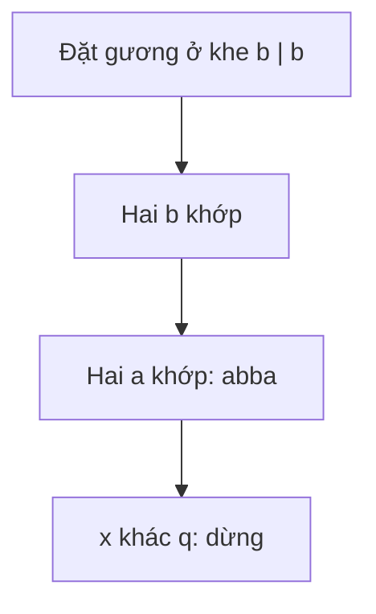

> [!tldr] Đọc nhanh
> - Một đoạn đối xứng có đúng một [[concepts/palindrome-center|tâm]], nằm ngay một ký tự hoặc ở khe giữa hai ký tự.
> - Mở đồng thời hai đầu từ từng tâm rồi giữ đoạn dài nhất. Cách này tốn O(n²) thời gian và O(1) bộ nhớ phụ.
> - Manacher khởi tạo [[concepts/palindrome-radius|bán kính]] bằng dữ liệu ở tâm đối chiếu để đạt O(n) thời gian với O(n) bộ nhớ.

> [!info] Bối cảnh
> Bài LeetCode 5 thuộc [[posts/2026-11-27-neetcode-palindrome-centers|ga 2: Palindrome mở từ tâm]] trên tuyến NeetCode Quy hoạch động. Bạn cần biết chỉ số mảng và phép chia nguyên. Phần đầu dùng hình một chiếc gương để chọn đúng nơi bắt đầu dò.

> [!abstract]- Từ điển nhanh cho bài này (bấm để mở)
> - **Đoạn con** là một dãy ký tự liên tiếp, lấy bằng hai vị trí đầu mút.
> - **Palindrome** là đoạn đọc xuôi và ngược giống nhau.
> - **Bán kính ảo** đo khoảng cách từ tâm tới biên trong dãy có khe, bằng độ dài đoạn khi đã mở tối đa.

## Hình dung trước: đặt gương giữa hai nút áo

Xâu `xabbaq` trông như sáu nút ghim. Đặt gương vào khe giữa hai nút b. Cặp b khớp, rồi cặp a khớp, cuối cùng x và q khác nhau nên dừng. Đáp án là `abba`.

| Đời thường | Khái niệm |
|---|---|
| Đặt gương lên một nút | Tâm lẻ |
| Đặt gương vào một khe | Tâm chẵn |
| Mỗi lượt đối chiếu hai nút đối diện | Mở khoảng thêm một cặp |
| Hai nút không khớp | Dừng ở palindrome lớn nhất tại tâm |



## Vấn đề: trả một đoạn dài nhất

Đề cho 1 đến 1.000 ký tự gồm chữ cái tiếng Anh và chữ số. Trả một đoạn đối xứng dài nhất. Khi hòa, đề chấp nhận bất kỳ đoạn dài nhất nào. Ví dụ, với `abab` có thể trả `aba` hoặc `bab`. Các file chọn đoạn xuất hiện trước khi hòa để có kết quả ổn định.

## Cơ chế

### Từ kiểm hai đầu đến mở từ tâm

Vét hết hai đầu cho O(n²) ứng viên. So ngược trong từng đoạn làm tổng chi phí O(n³) trong trường hợp mọi chữ giống nhau. Bảng quy hoạch động có thể nhớ đoạn bên trong đã đối xứng, dùng công thức `P[l,r] = s[l] == s[r] và (r-l < 2 hoặc P[l+1,r-1])`. Bảng tốn O(n²) thời gian và bộ nhớ. Khi chỉ cần một đoạn dài nhất, đổi hướng kiểm sẽ bỏ được bảng.

Kê một tâm vào từng ký tự và từng khe bên trong. Mở từ trong ra ngoài. Hai vị trí sát đầu mút mà không khớp thì mọi đoạn lớn hơn cùng tâm đều chứa cặp sai ấy. Giữ lại đoạn lớn nhất theo từng tâm rồi lấy cực đại toàn cục. Bản mở từ tâm chỉ giữ vài chỉ số, dùng O(n²) thời gian và O(1) bộ nhớ phụ.

### Một hệ tọa độ cho tâm lẻ và chẵn

Dãy ảo đặt ký tự thật ở vị trí lẻ `2k+1`, khe ở vị trí chẵn. Khe ngoài cùng tạo biên 0 và 2n. Khi mở hai vị trí đối xứng, chúng cùng chẵn hoặc cùng lẻ. Hai khe luôn khớp. Hai ký tự lấy tại chỉ số chia nguyên cho 2 mới cần so. Đến lúc dừng, bán kính `r` quanh `i` cho đoạn bắt đầu ở `(i-r)/2`, độ dài `r` trong xâu gốc. Bản demo dùng chỉ số ảo mà không chèn ký tự vào xâu.

### Manacher tái sử dụng gương

Giữ tâm `C` có biên phải xa nhất `R`. Nếu `i < R`, tâm phản chiếu là `2C-i`. Khởi tạo bán kính mới từ `min(radius[2C-i], R-i)`. Phần trong biên đã có chứng cứ khớp, còn phần ngoài biên cần thử. Nếu bán kính phản chiếu ngắn hơn khoảng còn lại, lần thử ngay sau đó gặp cặp khác nhau đã được phản chiếu. Nếu bán kính chạm biên, mỗi lần mở thành công ngoài vùng cũ tăng biên phải. Tính cả một lần thử thất bại cho mỗi tâm, tổng lượt dò là O(n), bảng bán kính dài O(n).

Trên [chuỗi 1.000 chữ a](../code/neetcode-palindrome-centers/compare.ts), mở từ tâm chạy 1.000.000 lượt dò và Manacher chạy 1.999, tính cả các cặp khe luôn khớp. Hai cách cùng trả đoạn dài 1.000. Đây là số lượt lặp, không phải mili giây.

## Ví dụ chạy được

Mỗi file kiểm cả hai chế độ mở độc lập và dùng phản chiếu. Tám ca có tâm chẵn, tâm lẻ, trường hợp hòa, chuỗi lặp dài và đầu vào rỗng ngoài giới hạn đề.

[TypeScript](../code/neetcode-longest-palindromic-substring/centers.ts) · [Python](../code/neetcode-longest-palindromic-substring/centers.py) · [Go](../code/neetcode-longest-palindromic-substring/centers.go) · [Java](../code/neetcode-longest-palindromic-substring/centers.java) · [JavaScript](../code/neetcode-longest-palindromic-substring/centers.js) · [PHP](../code/neetcode-longest-palindromic-substring/centers.php) · [Rust](../code/neetcode-longest-palindromic-substring/centers.rs)

```typescript
type Stats = { start: number; length: number; count: number };

function palindromes(text: string, reuseMirror: boolean): Stats {
  const last = 2 * text.length;
  const radius = reuseMirror ? Array<number>(last + 1).fill(0) : [];
  let center = 0, right = 0;
  const answer: Stats = { start: 0, length: 0, count: 0 };

  for (let i = 0; i <= last; i++) {
    let length = reuseMirror && i < right ? Math.min(radius[2 * center - i], right - i) : 0;
    while (i - length > 0 && i + length < last) {
      const left = i - length - 1;
      const next = i + length + 1;
      if (left % 2 && text[(left - 1) / 2] !== text[(next - 1) / 2]) break;
      length++;
    }
    if (reuseMirror) {
      radius[i] = length;
      if (i + length > right) {
        center = i;
        right = i + length;
      }
    }
    if (length > answer.length) {
      answer.start = (i - length) / 2;
      answer.length = length;
    }
    answer.count += Math.floor((length + 1) / 2);
  }
  return answer;
}

function longestPalindrome(text: string, reuseMirror = false): string {
  const { start, length } = palindromes(text, reuseMirror);
  return text.slice(start, start + length);
}
```

```python
def palindromes(text, reuse_mirror):
    last = 2 * len(text)
    radius = [0] * (last + 1) if reuse_mirror else []
    center = right = start = best = count = 0

    for i in range(last + 1):
        length = min(radius[2 * center - i], right - i) if reuse_mirror and i < right else 0
        while i - length > 0 and i + length < last:
            left, next_pos = i - length - 1, i + length + 1
            if left % 2 and text[left // 2] != text[next_pos // 2]:
                break
            length += 1
        if reuse_mirror:
            radius[i] = length
            if i + length > right:
                center, right = i, i + length
        if length > best:
            start, best = (i - length) // 2, length
        count += (length + 1) // 2
    return start, best, count


def longest_palindrome(text, reuse_mirror=False):
    start, length, _ = palindromes(text, reuse_mirror)
    return text[start:start + length]
```

```go
package main

import (
	"fmt"
	"strings"
)

type stats struct{ start, length, count int }

func palindromes(text string, reuseMirror bool) stats {
	last := 2 * len(text)
	var radius []int
	if reuseMirror {
		radius = make([]int, last+1)
	}
	center, right := 0, 0
	answer := stats{}

	for i := 0; i <= last; i++ {
		length := 0
		if reuseMirror && i < right {
			length = min(radius[2*center-i], right-i)
		}
		for i-length > 0 && i+length < last {
			left, next := i-length-1, i+length+1
			if left%2 != 0 && text[left/2] != text[next/2] {
				break
			}
			length++
		}
		if reuseMirror {
			radius[i] = length
			if i+length > right {
				center, right = i, i+length
			}
		}
		if length > answer.length {
			answer.start, answer.length = (i-length)/2, length
		}
		answer.count += (length + 1) / 2
	}
	return answer
}

func longestPalindrome(text string, reuseMirror bool) string {
	result := palindromes(text, reuseMirror)
	return text[result.start : result.start+result.length]
}
```

```java
class Centers {
    record Stats(int start, int length, int count) {}

    static Stats palindromes(String text, boolean reuseMirror) {
        int last = 2 * text.length();
        int[] radius = reuseMirror ? new int[last + 1] : new int[0];
        int center = 0, right = 0, start = 0, best = 0, count = 0;

        for (int i = 0; i <= last; i++) {
            int length = reuseMirror && i < right ? Math.min(radius[2 * center - i], right - i) : 0;
            while (i - length > 0 && i + length < last) {
                int left = i - length - 1, next = i + length + 1;
                if (left % 2 != 0 && text.charAt(left / 2) != text.charAt(next / 2)) break;
                length++;
            }
            if (reuseMirror) {
                radius[i] = length;
                if (i + length > right) {
                    center = i;
                    right = i + length;
                }
            }
            if (length > best) {
                start = (i - length) / 2;
                best = length;
            }
            count += (length + 1) / 2;
        }
        return new Stats(start, best, count);
    }

    static String longestPalindrome(String text, boolean reuseMirror) {
        Stats result = palindromes(text, reuseMirror);
        return text.substring(result.start(), result.start() + result.length());
    }
}
```

```javascript
function palindromes(text, reuseMirror) {
    const last = 2 * text.length;
    const radius = reuseMirror ? Array(last + 1).fill(0) : [];
    let center = 0, right = 0;
    const answer = {
        start: 0,
        length: 0,
        count: 0
    };
    for(let i = 0; i <= last; i++){
        let length = reuseMirror && i < right ? Math.min(radius[2 * center - i], right - i) : 0;
        while(i - length > 0 && i + length < last){
            const left = i - length - 1;
            const next = i + length + 1;
            if (left % 2 && text[(left - 1) / 2] !== text[(next - 1) / 2]) break;
            length++;
        }
        if (reuseMirror) {
            radius[i] = length;
            if (i + length > right) {
                center = i;
                right = i + length;
            }
        }
        if (length > answer.length) {
            answer.start = (i - length) / 2;
            answer.length = length;
        }
        answer.count += Math.floor((length + 1) / 2);
    }
    return answer;
}
function longestPalindrome(text, reuseMirror = false) {
    const { start, length } = palindromes(text, reuseMirror);
    return text.slice(start, start + length);
}
const cases = [
    [
        "",
        ""
    ],
    [
        "c",
        "c"
    ],
    [
        "xabbaq",
        "abba"
    ],
    [
        "tacocatx",
        "tacocat"
    ],
    [
        "abab",
        "aba"
    ],
    [
        "zzzz",
        "zzzz"
    ],
    [
        "xyz",
        "x"
    ],
    [
        "a".repeat(1000),
        "a".repeat(1000)
    ]
];
for (const [text, expected] of cases){
    if (longestPalindrome(text) !== expected || longestPalindrome(text, true) !== expected) {
        throw new Error("Sai đoạn đối xứng");
    }
}
console.log(`${cases.length}/${cases.length} ca đúng`);
```

```php
<?php
declare(strict_types=1);

function palindromes(string $text, bool $reuseMirror): array
{
    $last = 2 * strlen($text);
    $radius = $reuseMirror ? array_fill(0, $last + 1, 0) : [];
    $center = $right = $start = $best = $count = 0;

    for ($i = 0; $i <= $last; $i++) {
        $length = $reuseMirror && $i < $right ? min($radius[2 * $center - $i], $right - $i) : 0;
        while ($i - $length > 0 && $i + $length < $last) {
            $left = $i - $length - 1;
            $next = $i + $length + 1;
            if ($left % 2 && $text[intdiv($left, 2)] !== $text[intdiv($next, 2)]) {
                break;
            }
            $length++;
        }
        if ($reuseMirror) {
            $radius[$i] = $length;
            if ($i + $length > $right) {
                [$center, $right] = [$i, $i + $length];
            }
        }
        if ($length > $best) {
            [$start, $best] = [intdiv($i - $length, 2), $length];
        }
        $count += intdiv($length + 1, 2);
    }
    return [$start, $best, $count];
}

function longestPalindrome(string $text, bool $reuseMirror = false): string
{
    [$start, $length] = palindromes($text, $reuseMirror);
    return substr($text, $start, $length);
}
```

```rust
#[derive(Default)]
struct Stats {
    start: usize,
    length: usize,
    count: usize,
}

fn palindromes(text: &str, reuse_mirror: bool) -> Stats {
    let bytes = text.as_bytes();
    let last = 2 * bytes.len();
    let mut radius = if reuse_mirror {
        vec![0; last + 1]
    } else {
        Vec::new()
    };
    let (mut center, mut right) = (0, 0);
    let mut answer = Stats::default();

    for i in 0..=last {
        let mut length = if reuse_mirror && i < right {
            radius[2 * center - i].min(right - i)
        } else {
            0
        };
        while i > length && i + length < last {
            let (left, next) = (i - length - 1, i + length + 1);
            if left % 2 != 0 && bytes[left / 2] != bytes[next / 2] {
                break;
            }
            length += 1;
        }
        if reuse_mirror {
            radius[i] = length;
            if i + length > right {
                (center, right) = (i, i + length);
            }
        }
        if length > answer.length {
            (answer.start, answer.length) = ((i - length) / 2, length);
        }
        answer.count += (length + 1) / 2;
    }
    answer
}

fn longest_palindrome(text: &str, reuse_mirror: bool) -> &str {
    let result = palindromes(text, reuse_mirror);
    &text[result.start..result.start + result.length]
}
```

```text
8/8 ca đúng
```

## Hiểu lầm và bẫy hay gặp

- Chỉ thử tâm ngay một ký tự thì bỏ lỡ `abba`.
- Nối toàn bộ các ký tự phù hợp có thể tạo một dãy con thay vì đoạn liên tiếp. Kết quả cần một lần cắt theo khoảng chỉ số.
- Sao chép nguyên bán kính gương vượt `R` sẽ coi vùng chưa dò là đã khớp. Cắt ở `R-i` trước.
- JavaScript và Java dùng chỉ số UTF-16, Go và Rust ở đây dùng byte, PHP cũng dùng byte. Bảng chữ cái ASCII của đề hợp với mọi bản. Với UTF-8 tùy ý, kiểm đơn vị đối xứng trước khi dùng lát cắt Rust, vì cắt giữa một mã UTF-8 có thể panic.

## Câu hỏi tự kiểm tra

> [!question]- Khi hai đoạn dài nhất có cùng độ dài, code chọn đoạn nào?
> `length > best` giữ lần dài nhất đầu tiên. Các tâm được quét từ trái sang phải, nên đoạn cùng độ dài có tâm sớm hơn cũng bắt đầu sớm hơn.

> [!question]- Tại sao không dùng hết bán kính ở tâm phản chiếu?
> Đối xứng của cửa sổ lớn chỉ đảm bảo phần thuộc bên trong biên phải hiện tại. Chỗ vượt biên phải được dò.

## Tham khảo

- [Đề bài LC-0005](https://leetcode.com/problems/longest-palindromic-substring/)
- [Princeton Algorithms, Manacher](https://algs4.cs.princeton.edu/53substring/Manacher.java.html)
- [Bài báo gốc của Manacher](https://doi.org/10.1145/321892.321896)
