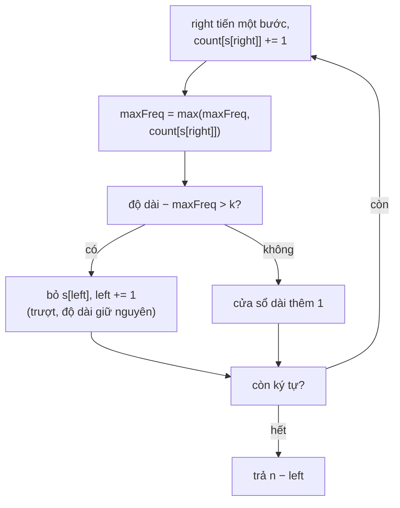

> [!tldr] Đọc nhanh
> - Đề: chuỗi chữ hoa `s` và số k. Được đổi tối đa k ký tự; trả độ dài đoạn con dài nhất có thể thành **toàn một chữ** (`"AABABBA"`, k = 1 → 4).
> - Một cửa sổ làm được khi `độ dài − maxFreq ≤ k`, với `maxFreq` là số lần của chữ xuất hiện nhiều nhất trong cửa sổ: giữ chữ đó, đổi phần còn lại. Đây là [[concepts/window-invariant|bất biến]] của [[concepts/sliding-window|cửa sổ trượt]].
> - Cách gọn nhất là [[concepts/non-shrinking-window|cửa sổ không co]]: mỗi bước cửa sổ dài thêm 1 hoặc trượt nguyên khối, và `maxFreq` **không bao giờ giảm** dù ký tự bên trái đã ra. Đáp án là độ dài cửa sổ lúc cuối.
> - `maxFreq` cũ lớn hơn giá trị thật ở 99 943/100 000 bước trong phép đo, mà đáp án vẫn đúng. Lý do: cửa sổ chỉ dài thêm khi một chữ đạt tần suất **mới cao nhất**, và lúc đó tần suất ấy là thật.
> - Bẫy: giữ chữ ở **đầu trái** thay vì chữ nhiều nhất (`"BAAAB"`, k = 2 ra 4 thay vì 5).

> [!info] Bối cảnh
> Bài LeetCode 424, thuộc [[posts/2026-11-23-neetcode-sliding-window|ga 5: Cửa sổ trượt]] trên **tuyến NeetCode: Mảng và chuỗi**. Bài này dùng lại bảng đếm 26 ô của [[posts/2026-11-22-neetcode-counting-keys|ga 2]] bên trong một cửa sổ co giãn như [[problems/longest-substring-without-repeating-characters|Longest Substring Without Repeating Characters]]. Lời giải có đủ TypeScript, Python, Go, Java và JavaScript. Bạn cần biết vòng lặp, chuỗi và mảng đếm.

> [!abstract]- Từ điển nhanh cho bài này (bấm để mở)
> - **Đoạn con**: các ký tự liền nhau trong chuỗi.
> - **Tần suất**: số lần một chữ xuất hiện. `maxFreq` là tần suất lớn nhất trong cửa sổ.
> - **Mảng đếm 26 ô**: `count[c − 'A']` thay cho Map khi chỉ có chữ hoa. Xem [[concepts/counting-array|Counting Array]].
> - **Cửa sổ không co**: cửa sổ mà mỗi bước chỉ dài thêm hoặc trượt, độ dài không bao giờ giảm. Xem [[concepts/non-shrinking-window|Non-shrinking Window]].

## Hình dung trước: hàng ghế sơn lại màu

Một dãy ghế sơn nhiều màu. Thợ sơn chỉ còn đủ sơn cho k chiếc. Bạn muốn khoanh một đoạn ghế liền nhau dài nhất để sau khi sơn lại, cả đoạn cùng một màu. Cách rẻ nhất: giữ màu đang **nhiều nhất** trong đoạn, sơn đè những chiếc còn lại.

| Đời thường | Khái niệm |
|---|---|
| Đoạn ghế đang khoanh | cửa sổ `[left, right]` |
| Màu nhiều nhất trong đoạn | `maxFreq` |
| Số ghế phải sơn lại | `độ dài − maxFreq` |
| Còn đủ sơn | `độ dài − maxFreq ≤ k` |
| Hết sơn: kéo cả khung sang phải một ghế thay vì thu nhỏ | cửa sổ trượt nguyên khối, không co |
| Kỷ lục "màu nhiều nhất từng thấy" ghi trên bảng, không xóa | `maxFreq` không giảm |



## Vấn đề

**Đề (tóm tắt bằng lời của mình):** cho chuỗi `s` chỉ gồm chữ hoa A–Z (1 ≤ độ dài ≤ 10⁵) và số nguyên `0 ≤ k ≤ độ dài`. Mỗi thao tác đổi một ký tự thành chữ hoa bất kỳ; được làm tối đa k thao tác. Trả độ dài đoạn con dài nhất có thể thành toàn một chữ. Đề gốc: [LeetCode 424](https://leetcode.com/problems/longest-repeating-character-replacement/).

| Input | Output | Vì sao |
|---|---|---|
| `"ABAB"`, k = 2 | 4 | đổi hai A thành B (hoặc ngược lại) |
| `"AABABBA"`, k = 1 | 4 | `"ABBB"` sau khi đổi A ở giữa: đoạn `"BBBB"` |
| `"BAAAB"`, k = 2 | 5 | giữ A (3 lần), đổi hai B |

Mình từng nghĩ phải thử từng chữ A..Z làm "chữ giữ lại". Hóa ra không cần chọn trước: chữ nào nhiều nhất trong cửa sổ thì giữ chữ đó, và chỉ một con số `maxFreq` là đủ.

## Cơ chế

### Cách 1, vét cạn: O(n²)

Từ mỗi điểm đầu i, kéo dài j và cập nhật bảng đếm; đoạn `[i, j]` làm được khi `j − i + 1 − maxFreq ≤ k`. Hai vòng lồng nhau, đo ở dưới đúng dáng n².

### Cách 2, cửa sổ co bằng while, đếm lại maxFreq

Thêm `s[right]`. Khi `độ dài − max(count) > k`, bỏ `s[left]` và tăng `left` cho tới khi hợp lệ, mỗi lần tính lại `max(count)` từ 26 ô. Đúng, O(26·n).

### Cách 3, cửa sổ không co

Hai thay đổi nhỏ so với cách 2:
1. `maxFreq` chỉ được **tăng** khi thêm ký tự, không bao giờ tính lại khi bỏ ký tự bên trái.
2. Dùng `if` thay cho `while`: khi hỏng, chỉ bỏ **một** ký tự bên trái. Cửa sổ vừa thêm một ký tự bên phải, nên độ dài giữ nguyên: nó trượt chứ không co.

Đáp án là `n − left`, độ dài cửa sổ lúc kết thúc, vì độ dài không bao giờ giảm.

### Vì sao maxFreq cũ vẫn cho đáp án đúng

Gọi L là độ dài cửa sổ. Lúc đầu cửa sổ dài thêm mỗi bước, chưa bỏ gì, nên mọi số đếm đều thật. Kể từ lần trượt đầu tiên, sau mỗi bước luôn có `L − maxFreq = k`: hỏng là `L + 1 − maxFreq = k + 1`, bỏ một ký tự thì quay về `k`. Từ đó:

- **Cửa sổ dài thêm chỉ khi maxFreq tăng.** Thêm một ký tự mà `maxFreq` không đổi thì `L + 1 − maxFreq = k + 1 > k`, nên phải trượt. `maxFreq` tăng nghĩa là ký tự **vừa thêm** có đúng `maxFreq` lần trong cửa sổ **hiện tại**, và các số đếm này là thật. Vậy mỗi độ dài mà cửa sổ đạt được đều ứng với một đoạn làm được thật: đáp án không bao giờ quá lớn.
- **Đáp án không quá nhỏ.** Muốn tìm đoạn dài hơn L, đoạn đó phải có một chữ xuất hiện ít nhất `L + 1 − k = maxFreq + 1` lần, tức nhiều hơn mọi tần suất đã thấy. Khi cửa sổ (dài L, trượt qua đoạn đó) gặp đủ chừng ấy lần, `maxFreq` tăng và cửa sổ dài ra. Một `maxFreq` thấp hơn thật không giúp gì thêm, nên không cần giảm nó.

Nói gọn: `maxFreq` không cần đúng cho cửa sổ hiện tại; nó chỉ cần là **kỷ lục**, vì chỉ một kỷ lục mới làm đáp án tăng. File TypeScript đếm: trên 100 000 ký tự ngẫu nhiên, `maxFreq` cũ lớn hơn giá trị thật ở 99 943 bước, kết quả vẫn bằng bản đếm lại, và 5 000 chuỗi ngẫu nhiên đối chiếu với vét cạn không lệch chuỗi nào.

### Đo

TypeScript, chữ ngẫu nhiên, k = 2, trung vị:

| n | số chữ | vét cạn | co + đếm lại | không co |
|---|---|---|---|---|
| 2 000 | 26 | 4,6 ms | 0,38 ms | 0,01 ms |
| 4 000 | 26 | 17,9 ms | 0,79 ms | 0,01 ms |
| 8 000 | 26 | 70,5 ms | 1,52 ms | 0,02 ms |
| 10⁶ | 26 | (không chạy) | 191,96 ms | 3,04 ms |
| 10⁶ | 2 | (không chạy) | 123,92 ms | 3,11 ms |

Ở 10⁶ ký tự, bỏ việc đếm lại nhanh hơn khoảng 60 lần: `Math.max(...count)` quét 26 ô và trải mảng thành 26 đối số mỗi lần gọi.

### Bên dưới năm ngôn ngữ

| | Đếm | Bẫy riêng |
|---|---|---|
| TypeScript / JavaScript | `count[s.charCodeAt(i) − 65]` | `Math.max(...count)` trải mảng mỗi lần gọi: đúng nhưng chậm |
| Python | `count[ord(ch) − 65]` | `max(count)` quét 26 ô; `Counter` tiện hơn nhưng chậm hơn mảng |
| Go | `var count [26]int`, `s[i] − 'A'` | `s[i]` là byte: đúng vì đề chỉ có chữ hoa ASCII |
| Java | `int[26]`, `s.charAt(i) − 'A'` | `char − char` ra `int`; không có hàm max cho mảng, phải tự viết |

## Ví dụ chạy được

[TypeScript](../code/neetcode-longest-repeating-character-replacement/character-replacement.ts) · [Python](../code/neetcode-longest-repeating-character-replacement/character_replacement.py) · [Go](../code/neetcode-longest-repeating-character-replacement/character_replacement.go) · [Java](../code/neetcode-longest-repeating-character-replacement/character-replacement.java) · [JavaScript](../code/neetcode-longest-repeating-character-replacement/character-replacement.js)

Mỗi file có vét cạn, cửa sổ co có đếm lại và cửa sổ không co, chạy 8 ca. Dưới đây là hai cách cửa sổ.

```ts
// Cách 2, cửa sổ co bằng while, tính lại maxFreq đúng từ 26 ô mỗi lần co. O(26·n).
function windowRecount(s: string, k: number): number {
  const count = new Array(26).fill(0);
  let left = 0, best = 0;
  for (let right = 0; right < s.length; right++) {
    count[idx(s, right)]++;
    while (right - left + 1 - Math.max(...count) > k) count[idx(s, left++)]--;
    best = Math.max(best, right - left + 1);
  }
  return best;
}

// Cách 3, cửa sổ không bao giờ co: maxFreq chỉ tăng, không giảm khi bỏ ký tự bên trái. O(n).
function windowStaleMax(s: string, k: number): number {
  const count = new Array(26).fill(0);
  let left = 0, maxFreq = 0;
  for (let right = 0; right < s.length; right++) {
    maxFreq = Math.max(maxFreq, ++count[idx(s, right)]);
    if (right - left + 1 - maxFreq > k) count[idx(s, left++)]--; // "if", không phải "while": cửa sổ trượt nguyên khối
  }
  return s.length - left; // cửa sổ không bao giờ co, nên độ dài cuối cùng là độ dài lớn nhất từng đạt
}
```

```python
def window_recount(s: str, k: int) -> int:
    count = [0] * 26
    left = best = 0
    for right, ch in enumerate(s):
        count[ord(ch) - 65] += 1
        while right - left + 1 - max(count) > k:  # max(count) quét 26 ô mỗi lần
            count[ord(s[left]) - 65] -= 1
            left += 1
        best = max(best, right - left + 1)
    return best

def window_stale_max(s: str, k: int) -> int:
    count = [0] * 26
    left = max_freq = 0
    for right, ch in enumerate(s):
        count[ord(ch) - 65] += 1
        max_freq = max(max_freq, count[ord(ch) - 65])
        if right - left + 1 - max_freq > k:  # "if": cửa sổ trượt nguyên khối, không co
            count[ord(s[left]) - 65] -= 1
            left += 1
    return len(s) - left
```

```go
func windowRecount(s string, k int) int {
	var count [26]int // mảng cố định: không cấp phát, tự điền 0
	left, best := 0, 0
	for right := 0; right < len(s); right++ {
		count[s[right]-'A']++
		for right-left+1-slices.Max(count[:]) > k {
			count[s[left]-'A']--
			left++
		}
		best = max(best, right-left+1)
	}
	return best
}

func windowStaleMax(s string, k int) int {
	var count [26]int
	left, maxFreq := 0, 0
	for right := 0; right < len(s); right++ { // s[right] là byte: đúng vì đề chỉ có chữ hoa ASCII
		count[s[right]-'A']++
		maxFreq = max(maxFreq, count[s[right]-'A'])
		if right-left+1-maxFreq > k {
			count[s[left]-'A']--
			left++
		}
	}
	return len(s) - left
}
```

```java
static int windowRecount(String s, int k) {
    int[] count = new int[26];
    int left = 0, best = 0;
    for (int right = 0; right < s.length(); right++) {
        count[s.charAt(right) - 'A']++;
        while (right - left + 1 - max(count) > k) count[s.charAt(left++) - 'A']--;
        best = Math.max(best, right - left + 1);
    }
    return best;
}

static int max(int[] a) {
    int m = 0;
    for (int x : a) m = Math.max(m, x);
    return m;
}

static int windowStaleMax(String s, int k) {
    int[] count = new int[26];
    int left = 0, maxFreq = 0;
    for (int right = 0; right < s.length(); right++) {
        maxFreq = Math.max(maxFreq, ++count[s.charAt(right) - 'A']); // char − 'A' ra int 0..25
        if (right - left + 1 - maxFreq > k) count[s.charAt(left++) - 'A']--;
    }
    return s.length() - left;
}
```

```js
function windowRecount(s, k) {
  const count = new Array(26).fill(0);
  let left = 0, best = 0;
  for (let right = 0; right < s.length; right++) {
    count[s.charCodeAt(right) - 65]++;
    while (right - left + 1 - Math.max(...count) > k) count[s.charCodeAt(left++) - 65]--;
    best = Math.max(best, right - left + 1);
  }
  return best;
}

function windowStaleMax(s, k) {
  const count = new Array(26).fill(0);
  let left = 0, maxFreq = 0;
  for (let right = 0; right < s.length; right++) {
    maxFreq = Math.max(maxFreq, ++count[s.charCodeAt(right) - 65]);
    if (right - left + 1 - maxFreq > k) count[s.charCodeAt(left++) - 65]--;
  }
  return s.length - left;
}
```


File TypeScript chạy thêm bản sai giữ chữ ở đầu trái, rồi đếm số bước maxFreq cũ, đối chiếu với vét cạn và đo:

```text
$ node character-replacement.ts
bruteForce        8/8 ca đúng
windowRecount     8/8 ca đúng
windowStaleMax    8/8 ca đúng
wrongKeepLeftChar 6/8 ca đúng; sai ở BAAAB k=2 → 4, ABBB k=2 → 3

n = 100000, 4 chữ, k = 3: maxFreq cũ lớn hơn max thật ở 99943 bước; windowStaleMax = 15, windowRecount = 15
đối chiếu 5000 chuỗi ngẫu nhiên với vét cạn: 0 chuỗi lệch

n          chữ   vét cạn   co + đếm lại   không co   (ms, trung vị)
2000        26       4.6           0.38       0.01
4000        26      17.9           0.79       0.01
8000        26      70.5           1.52       0.02
1000000     26         —         191.96       3.04
1000000      2         —         123.92       3.11
```

Bản sai giữ chữ đầu trái hỏng ở `"BAAAB"`: cửa sổ bắt đầu bằng B nên nó tính phải đổi ba chữ A, dù giữ A chỉ cần đổi hai chữ B. Python, Go, Java và JavaScript in `8/8 ca đúng` cho cả ba cách.

## Hiểu lầm và bẫy hay gặp

- **"Phải thử 26 chữ làm chữ giữ lại."** Được, O(26·n), nhưng không cần: chữ nhiều nhất trong cửa sổ luôn là lựa chọn rẻ nhất.
- **Giữ chữ ở đầu trái (hoặc chữ vừa thêm).** Chữ đó không chắc nhiều nhất; bản sai đạt 6/8.
- **"maxFreq phải giảm khi bỏ ký tự bên trái."** Không cần, vì chỉ một tần suất kỷ lục mới làm đáp án tăng. Giảm đúng thì phải quét lại 26 ô, chậm hơn 60 lần trong phép đo.
- **Dùng `while` với maxFreq cũ rồi lấy `best = max(best, độ dài)`.** Vẫn đúng, nhưng thừa: với maxFreq không giảm, cửa sổ không bao giờ hỏng quá một ký tự, nên `if` là đủ và đáp án chính là `n − left`.
- **Đếm bằng Map khi đề chỉ có chữ hoa.** Đúng nhưng chậm hơn mảng 26 ô; Map chỉ cần khi bảng chữ lớn hay không biết trước.

## Câu hỏi tự kiểm tra

> [!question]- Chạy cách không co trên `"AABABBA"`, k = 1, ghi `left`, độ dài và `maxFreq` sau mỗi bước.
> right 0..2: dài 1, 2, 3, maxFreq 1, 2, 2 (`"AAB"`: 3 − 2 = 1 ≤ 1). right 3 (A): maxFreq 3, dài 4. right 4 (B): 5 − 3 = 2 > 1, trượt: left = 1, dài 4. right 5 (B): maxFreq vẫn 3, 5 − 3 > 1, trượt: left = 2. right 6 (A): trượt: left = 3. Đáp án 7 − 3 = 4.

> [!question]- Vì sao cửa sổ chỉ dài thêm ở những bước maxFreq tăng?
> Sau lần trượt đầu tiên, luôn có `độ dài − maxFreq = k`. Thêm một ký tự mà maxFreq không đổi thì hiệu thành k + 1, nên phải trượt và độ dài giữ nguyên.

> [!question]- maxFreq cũ có thể làm cửa sổ hiện tại **không** hợp lệ không? Có làm đáp án sai không?
> Có, cửa sổ đang trượt có thể cần đổi hơn k ký tự. Nhưng đáp án không sai, vì độ dài của nó đã từng đạt được bởi một cửa sổ hợp lệ thật, và nó chỉ dài thêm khi có tần suất kỷ lục mới, lúc đó là thật.

> [!question]- Nếu đề cho cả chữ thường và chữ số, cần đổi gì?
> Bảng đếm lớn hơn (62 ô hoặc 128 ô ASCII, hay một Map). Lập luận về maxFreq giữ nguyên.

## Tham khảo

- [LeetCode 424: Longest Repeating Character Replacement](https://leetcode.com/problems/longest-repeating-character-replacement/) (đề gốc)
- [MDN: Spread syntax](https://developer.mozilla.org/en-US/docs/Web/JavaScript/Reference/Operators/Spread_syntax) (`Math.max(...arr)` trải mảng thành đối số mỗi lần gọi)
- [Python: Built-in `max`](https://docs.python.org/3/library/functions.html#max) và [`collections.Counter`](https://docs.python.org/3/library/collections.html#collections.Counter)
- [Java 21 `String.charAt`](https://docs.oracle.com/en/java/javase/21/docs/api/java.base/java/lang/String.html#charAt(int)) (trả một `char`, phép trừ hai `char` ra `int`)
