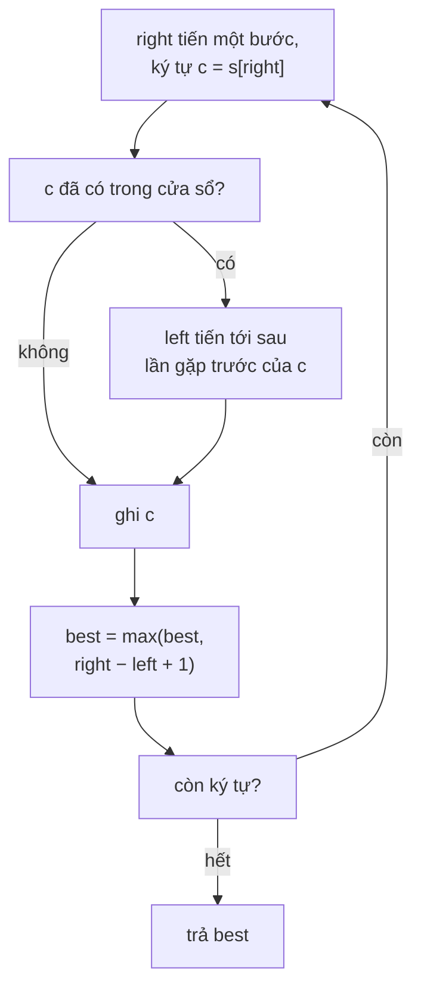

> [!tldr] Đọc nhanh
> - Đề: độ dài đoạn con **liên tiếp** dài nhất không có ký tự nào lặp lại (`"pwwkew"` → 3, đoạn `"wke"`).
> - Khuôn [[concepts/sliding-window|cửa sổ trượt]]: giữ cửa sổ `[left, right]` luôn thỏa [[concepts/window-invariant|bất biến]] "không ký tự nào lặp". Đầu phải thêm một ký tự; nếu phá bất biến thì đầu trái tiến cho tới khi bất biến đúng lại.
> - Co bằng Set: bỏ từng ký tự bên trái. Mỗi ký tự vào và ra Set tối đa một lần: O(n).
> - Co bằng [[concepts/last-seen-index|sổ vị trí gần nhất]]: nhảy `left` thẳng tới sau lần gặp trước. Nhanh hơn Set khoảng 3 lần khi đo, nhưng phải kiểm lần gặp trước còn **trong** cửa sổ, nếu không `"abba"` ra 3 thay vì 2.
> - Vét cạn ở đây là O(n·k) với k là số ký tự khác nhau, nên với bảng chữ nhỏ nó chậm hơn chỉ vài lần, không phải hàng nghìn lần.

> [!info] Bối cảnh
> Bài LeetCode 3, bài neo của [[posts/2026-11-23-neetcode-sliding-window|ga 5: Cửa sổ trượt]] trên **tuyến NeetCode: Mảng và chuỗi**. Post của ga dùng bài này để dựng khuôn cửa sổ co giãn; trang này đi sâu vào hai cách co và đo chúng. Lời giải có đủ TypeScript, Python, Go, Java, JavaScript, PHP và Rust. Bạn cần biết vòng lặp, chuỗi và Set ([[problems/contains-duplicate|Contains Duplicate]]).

> [!abstract]- Từ điển nhanh cho bài này (bấm để mở)
> - **Đoạn con (substring)**: các ký tự **liền nhau** trong chuỗi. `"wke"` là đoạn con của `"pwwkew"`; `"pwke"` thì không (đó là dãy con).
> - **Cửa sổ (window)**: đoạn con hiện tại, đánh dấu bằng hai chỉ số `left` và `right`.
> - **Bất biến (invariant)**: điều luôn đúng ở cuối mỗi bước lặp. Ở đây: cửa sổ không có ký tự lặp. Xem [[concepts/window-invariant|Window Invariant]].
> - **Sổ vị trí gần nhất**: bảng ký tự → chỉ số lần cuối gặp ký tự đó. Xem [[concepts/last-seen-index|Last-seen Index]].

## Hình dung trước: hàng người chụp ảnh không trùng áo

Một hàng người bước qua cổng từng người một. Bạn muốn khung ảnh dài nhất mà không có hai người mặc áo cùng màu. Khung ảnh chỉ được kéo về một phía: thêm người mới ở bên phải, bỏ người ở bên trái.

| Đời thường | Khái niệm |
|---|---|
| Khung ảnh đang chụp | cửa sổ `[left, right]` |
| Luật "không trùng màu áo trong khung" | bất biến |
| Người mới bước vào bên phải | `right++`, thêm `s[right]` |
| Người mới trùng màu với ai đó trong khung: mời từng người bên trái ra cho tới khi hết trùng | co bằng Set |
| Nhớ sẵn người cùng màu đứng ở đâu: kéo mép trái qua người đó một lần | nhảy bằng sổ vị trí |
| Người cùng màu đã ra khỏi khung từ trước: không cần làm gì | kiểm `prev ≥ left` |



## Vấn đề

**Đề (tóm tắt bằng lời của mình):** cho chuỗi `s` (0 ≤ độ dài ≤ 5·10⁴) gồm chữ cái, chữ số, ký hiệu và khoảng trắng, trả độ dài đoạn con liên tiếp dài nhất không có ký tự lặp. Đề gốc: [LeetCode 3](https://leetcode.com/problems/longest-substring-without-repeating-characters/).

| Input | Output | Đoạn dài nhất |
|---|---|---|
| `"abcabcbb"` | `3` | `"abc"` |
| `"bbbbb"` | `1` | `"b"` |
| `"pwwkew"` | `3` | `"wke"` |
| `""` | `0` | |
| `"abba"` | `2` | `"ab"` hoặc `"ba"` |

Mình từng nghĩ phải thử mọi đoạn con. Hóa ra khi một đoạn đã có ký tự lặp, mọi đoạn **dài hơn** chứa nó cũng có ký tự lặp, nên không bao giờ cần quay đầu phải lại.

## Cơ chế

<figure class="figure-map" style="--ar: 3 / 4">
<div class="frame"><iframe data-archify="../diagrams/neetcode-longest-substring-without-repeating-characters/worked-example.html" title="Dời mép trái qua lần lặp gần nhất" loading="lazy"></iframe></div>
<figcaption><span><b>Hình 1.</b> Dời mép trái qua lần lặp gần nhất.</span><a href="../diagrams/neetcode-longest-substring-without-repeating-characters/worked-example.html" target="_blank" rel="noopener">Mở toàn màn hình</a></figcaption>
</figure>

<details>
<summary>Đọc từng bước</summary>
<ol>
<li>Hai ký tự đầu đều khác nhau. <code>&quot;pqpra&quot; → &quot;pq&quot;</code></li>
<li>Gặp lại p ở chỉ số 2. <code>last[p] = 0</code></li>
<li>Dời trái qua p cũ. <code>left = 1, window = &quot;qp&quot;</code></li>
<li>Thêm r và a không gặp ký tự lặp. <code>&quot;qpra&quot; → 4</code></li>
</ol>
</details>

### Cách 1, vét cạn

Từ mỗi vị trí đầu i, kéo dài tới khi gặp ký tự lặp. Lần kéo dài dừng sau tối đa k + 1 bước (k là số ký tự khác nhau, ở đây ≤ 95), nên tổng là O(n·k), không phải O(n²) như nhìn hai vòng lặp. Với bảng chữ lớn (Unicode) thì k có thể bằng n.

### Cách 2, cửa sổ trượt với Set

Set chứa đúng các ký tự trong cửa sổ. Thêm `s[right]`: nếu đã có, xóa `s[left]` và tăng `left` cho tới khi hết trùng. Vòng `while` lồng trong `for` nhưng mỗi ký tự được thêm một lần và xóa tối đa một lần, nên tổng O(n) ([[concepts/aggregate-analysis|phân tích gộp]]).

### Cách 3, sổ vị trí gần nhất

Thay vì xóa từng ký tự, nhớ lần cuối gặp mỗi ký tự. Khi `s[right]` đã gặp ở `prev`, cửa sổ mới bắt đầu ở `prev + 1`, nhảy một lần.

Điều kiện quan trọng: **chỉ nhảy khi `prev ≥ left`**. Sổ vị trí không bao giờ xóa, nên nó còn nhớ các ký tự đã ra khỏi cửa sổ. Với `"abba"`:

| right | ký tự | `prev` | `left` đúng | `left` nếu nhảy không kiểm |
|---|---|---|---|---|
| 0 | a | (chưa) | 0 | 0 |
| 1 | b | (chưa) | 0 | 0 |
| 2 | b | 1 | 2 | 2 |
| 3 | a | 0 | 2 (0 < 2, không nhảy) | 1 (lùi lại) |

Bản sai cho cửa sổ `[1, 3] = "bba"`, dài 3, có ký tự lặp. Go và Java viết gọn bằng `left = max(left, last[c])`, với `last[c]` lưu vị trí + 1.

### Đo

TypeScript, chuỗi ngẫu nhiên trên bảng chữ 26 hoặc 95 ký tự ASCII, trung vị 5 lần:

| n | bảng chữ | vét cạn | Set | sổ vị trí |
|---|---|---|---|---|
| 10⁵ | 26 | 17,5 ms | 6,3 ms | 2,0 ms |
| 10⁵ | 95 | 38,7 ms | 7,1 ms | 1,9 ms |
| 10⁶ | 26 | 175,6 ms | 61,2 ms | 19,6 ms |
| 10⁶ | 95 | 392,6 ms | 61,9 ms | 20,8 ms |

Vét cạn tăng theo k (26 → 95 thì chậm gấp đôi), hai cách cửa sổ thì không. Sổ vị trí nhanh hơn Set khoảng 3 lần: mỗi ký tự một lần tra và một lần ghi, thay vì thêm rồi xóa.

### Bên dưới bảy ngôn ngữ

| | Sổ vị trí | Bẫy riêng |
|---|---|---|
| TypeScript / JavaScript | `Map<string, number>` | `s[i]` là một đơn vị UTF-16: `"a😀😀"` ra 3 thay vì 2 |
| Python | `dict` | `str` duyệt theo code point, nên emoji đúng |
| Go | mảng `[128]int` | `s[i]` là **byte**; chuỗi ngoài ASCII phải duyệt `range` để lấy rune |
| Java | mảng `int[128]` | `charAt` cũng là đơn vị UTF-16 như JS |
| PHP | mảng `array` dùng ký tự làm khóa | `$s[$i]` là một **byte**: `"a😀😀"` dài 9 byte và ra 5 thay vì 2 |
| Rust | `HashMap<char, usize>` | không có `s[i]` trên `&str`; phải chọn `as_bytes()` (byte) hay `chars()` (ký tự Unicode) |

Đề chỉ có ASCII nên cả bảy ngôn ngữ đều đúng trên LeetCode. Mảng 128 ô thay cho Map nhanh hơn, nhưng chỉ đúng khi chắc chắn đầu vào là ASCII.

## Ví dụ chạy được

[TypeScript](../code/neetcode-longest-substring-without-repeating-characters/longest-substring.ts) · [Python](../code/neetcode-longest-substring-without-repeating-characters/longest_substring.py) · [Go](../code/neetcode-longest-substring-without-repeating-characters/longest_substring.go) · [Java](../code/neetcode-longest-substring-without-repeating-characters/longest-substring.java) · [JavaScript](../code/neetcode-longest-substring-without-repeating-characters/longest-substring.js) · [PHP](../code/neetcode-longest-substring-without-repeating-characters/longest-substring.php) · [Rust](../code/neetcode-longest-substring-without-repeating-characters/longest_substring.rs)

Mỗi file có vét cạn và hai cách cửa sổ, chạy 8 ca gồm `""`, `" "`, `"abba"` và `"tmmzuxt"`. Dưới đây là hai cách cửa sổ.

```ts
// Cách 2, cửa sổ trượt với Set: thêm s[right]; nếu trùng thì bỏ dần từ bên trái tới khi hết trùng.
function windowSet(s: string): number {
  const inWindow = new Set<string>();
  let left = 0, best = 0;
  for (let right = 0; right < s.length; right++) {
    while (inWindow.has(s[right])) inWindow.delete(s[left++]); // co cửa sổ: mỗi ký tự bị xóa tối đa một lần
    inWindow.add(s[right]);
    best = Math.max(best, right - left + 1);
  }
  return best;
}

// Cách 3, cửa sổ trượt với vị trí gặp gần nhất: nhảy left thẳng qua ký tự trùng.
function windowLastSeen(s: string): number {
  const last = new Map<string, number>();
  let left = 0, best = 0;
  for (let right = 0; right < s.length; right++) {
    const prev = last.get(s[right]);
    if (prev !== undefined && prev >= left) left = prev + 1; // chỉ nhảy khi lần gặp trước nằm TRONG cửa sổ
    last.set(s[right], right);
    best = Math.max(best, right - left + 1);
  }
  return best;
}
```

```python
def window_set(s: str) -> int:
    in_window, left, best = set(), 0, 0
    for right, ch in enumerate(s):
        while ch in in_window:
            in_window.remove(s[left])
            left += 1
        in_window.add(ch)
        best = max(best, right - left + 1)
    return best

def window_last_seen(s: str) -> int:
    last: dict[str, int] = {}
    left = best = 0
    for right, ch in enumerate(s):
        if last.get(ch, -1) >= left:  # chỉ nhảy khi lần gặp trước nằm trong cửa sổ
            left = last[ch] + 1
        last[ch] = right
        best = max(best, right - left + 1)
    return best
```

```go
func windowSet(s string) int {
	var inWindow [128]bool // đề chỉ có ASCII: mảng 128 ô thay cho map
	left, best := 0, 0
	for right := 0; right < len(s); right++ {
		for inWindow[s[right]] {
			inWindow[s[left]] = false
			left++
		}
		inWindow[s[right]] = true
		best = max(best, right-left+1)
	}
	return best
}

func windowLastSeen(s string) int {
	var last [128]int // lưu vị trí + 1, để 0 nghĩa là "chưa gặp"
	left, best := 0, 0
	for right := 0; right < len(s); right++ { // s[right] là BYTE; với chuỗi ngoài ASCII phải duyệt bằng range để lấy rune
		c := s[right]
		left = max(left, last[c]) // last[c] = vị trí gặp trước + 1; max giữ left không lùi
		last[c] = right + 1
		best = max(best, right-left+1)
	}
	return best
}
```

```java
static int windowSet(String s) {
    Set<Character> inWindow = new HashSet<>();
    int left = 0, best = 0;
    for (int right = 0; right < s.length(); right++) {
        while (!inWindow.add(s.charAt(right))) inWindow.remove(s.charAt(left++));
        best = Math.max(best, right - left + 1);
    }
    return best;
}

static int windowLastSeen(String s) {
    int[] last = new int[128]; // vị trí + 1; mảng int mới toàn 0 nghĩa là "chưa gặp"
    int left = 0, best = 0;
    for (int right = 0; right < s.length(); right++) {
        char c = s.charAt(right);
        left = Math.max(left, last[c]);
        last[c] = right + 1;
        best = Math.max(best, right - left + 1);
    }
    return best;
}
```

```js
function windowSet(s) {
  const inWindow = new Set();
  let left = 0, best = 0;
  for (let right = 0; right < s.length; right++) {
    while (inWindow.has(s[right])) inWindow.delete(s[left++]);
    inWindow.add(s[right]);
    best = Math.max(best, right - left + 1);
  }
  return best;
}

function windowLastSeen(s) {
  const last = new Map();
  let left = 0, best = 0;
  for (let right = 0; right < s.length; right++) { // s[right] là một đơn vị UTF-16, không phải một ký tự emoji
    const prev = last.get(s[right]);
    if (prev !== undefined && prev >= left) left = prev + 1;
    last.set(s[right], right);
    best = Math.max(best, right - left + 1);
  }
  return best;
}
```

```php
function windowSet(string $s): int {
    $inWindow = [];
    $left = 0;
    $best = 0;
    for ($right = 0; $right < strlen($s); $right++) {
        while (isset($inWindow[$s[$right]])) unset($inWindow[$s[$left++]]);
        $inWindow[$s[$right]] = true;
        $best = max($best, $right - $left + 1);
    }
    return $best;
}

function windowLastSeen(string $s): int {
    $last = [];
    $left = 0;
    $best = 0;
    for ($right = 0; $right < strlen($s); $right++) { // $s[$right] là một BYTE, không phải một ký tự
        $prev = $last[$s[$right]] ?? -1;
        if ($prev >= $left) $left = $prev + 1;
        $last[$s[$right]] = $right;
        $best = max($best, $right - $left + 1);
    }
    return $best;
}
```

```rust
fn window_set(s: &str) -> usize {
    let c: Vec<char> = s.chars().collect(); // Rust không cho s[i] trên &str: chọn byte hay char
    let mut in_window = HashSet::new();
    let (mut left, mut best) = (0, 0);
    for right in 0..c.len() {
        while in_window.contains(&c[right]) {
            in_window.remove(&c[left]);
            left += 1;
        }
        in_window.insert(c[right]);
        best = best.max(right - left + 1);
    }
    best
}

fn window_last_seen(s: &str) -> usize {
    let mut last: HashMap<char, usize> = HashMap::new();
    let (mut left, mut best) = (0, 0);
    for (right, ch) in s.chars().enumerate() {
        if let Some(&prev) = last.get(&ch) {
            if prev >= left { left = prev + 1; }
        }
        last.insert(ch, right);
        best = best.max(right - left + 1);
    }
    best
}
```


```text
$ node longest-substring.ts
bruteForce      8/8 ca đúng
windowSet       8/8 ca đúng
windowLastSeen  8/8 ca đúng
windowJumpBack  6/8 ca đúng; sai ở "abba" → 3 "tmmzuxt" → 6

"a😀😀".length = 5; windowLastSeen("a😀😀") = 3 (đúng phải là 2)

n          bảng chữ   vét cạn   Set   vị trí gần nhất   (ms, trung vị 5 lần)
100000           26      17.5   6.3               2.0
100000           95      38.7   7.1               1.9
1000000          26     175.6  61.2              19.6
1000000          95     392.6  61.9              20.8
```

`windowJumpBack` là bản nhảy không kiểm `prev ≥ left`. Ở `"tmmzuxt"`, tới chữ `t` cuối, `left` lùi từ 2 về 1 và cửa sổ `"mmzuxt"` bị tính là dài 6. Dòng emoji: mỗi `😀` là hai đơn vị UTF-16, nửa sau của emoji đầu và nửa đầu của emoji thứ hai ghép thành một "đoạn không lặp" dài 3. Python duyệt theo code point nên đúng:

```text
$ python3 longest_substring.py
brute_force      8/8 ca đúng
window_set       8/8 ca đúng
window_last_seen 8/8 ca đúng

window_last_seen("a😀😀") = 2
```

Go, Java, JavaScript, PHP và Rust in `8/8 ca đúng` cho cả ba cách. Với chuỗi emoji, PHP đếm theo byte nên ra 5; Rust duyệt `chars()` nên ra 2 như Python.

## Hiểu lầm và bẫy hay gặp

- **Nhầm đoạn con với dãy con.** `"pwke"` không liên tiếp trong `"pwwkew"`, nên không tính.
- **Nhảy `left` mà không kiểm `prev ≥ left`.** `left` lùi lại và cửa sổ chứa ký tự lặp; sai ở `"abba"`, `"tmmzuxt"`.
- **Đặt lại cửa sổ về rỗng khi gặp ký tự trùng.** `"dvdf"`: tới `d` thứ hai, cửa sổ đúng là `"vd"`, không phải `"d"`; đáp án là 3 (`"vdf"`).
- **"Hai vòng lặp lồng là O(n²)."** Cách Set có `while` trong `for` nhưng là O(n); vét cạn có hai vòng nhưng thật ra O(n·k).
- **Dùng `s[i]` với chuỗi Unicode.** JS và Java cắt emoji làm đôi, Go cắt chữ có dấu thành nhiều byte. Duyệt theo code point (`for…of` trong JS, `range` trong Go) nếu đầu vào không chỉ là ASCII.
- **PHP: `strlen` và `$s[$i]` đếm byte.** Một emoji là 4 byte, một chữ có dấu tiếng Việt là 2–3 byte. Đề chỉ có ASCII nên không sao; với chuỗi Unicode phải tách bằng `mb_str_split($s)` trước.
- **Rust: `s[i]` không biên dịch.** `&str` là UTF-8 nên Rust bắt mình chọn: `s.as_bytes()` nhanh và đúng cho ASCII, `s.chars()` đúng cho mọi ký tự nhưng phải gom vào `Vec<char>` nếu cần truy cập theo chỉ số.

## Câu hỏi tự kiểm tra

> [!question]- Chạy cách sổ vị trí trên `"dvdf"`, ghi `left` và `best` sau mỗi bước.
> d: (0, 1); v: (0, 2); d: lần trước ở 0 ≥ 0 nên `left` = 1, (1, 2); f: (1, 3). Đáp án 3.

> [!question]- Ở cách Set, vì sao vòng `while` xóa ký tự không làm tổng thời gian thành O(n²)?
> Mỗi ký tự được thêm vào Set đúng một lần (khi `right` đi qua) và xóa tối đa một lần (khi `left` đi qua). `left` không bao giờ vượt `right`, nên tổng số lần xóa ≤ n.

> [!question]- Vì sao một khi cửa sổ `[left, right]` có ký tự lặp, không cần thử các cửa sổ `[left, right']` với `right' > right`?
> Chúng chứa cửa sổ `[left, right]`, nên cũng chứa ký tự lặp đó. Chỉ có tăng `left` mới có thể làm cửa sổ hợp lệ lại.

> [!question]- Go và Java viết `left = max(left, last[c])` với `last[c]` lưu vị trí + 1. Phép `max` thay cho điều kiện nào?
> Thay cho `if (prev >= left) left = prev + 1`. Nếu lần gặp trước nằm ngoài cửa sổ thì `last[c] ≤ left`, và `max` giữ nguyên `left`.

## Tham khảo

- [LeetCode 3: Longest Substring Without Repeating Characters](https://leetcode.com/problems/longest-substring-without-repeating-characters/) (đề gốc)
- [The Go Blog: Strings, bytes, runes and characters in Go](https://go.dev/blog/strings) (chỉ số chuỗi là byte, `range` cho rune)
- [MDN: `String` UTF-16 characters, Unicode code points](https://developer.mozilla.org/en-US/docs/Web/JavaScript/Reference/Global_Objects/String#utf-16_characters_unicode_code_points_and_grapheme_clusters) (`s[i]` là đơn vị UTF-16)
