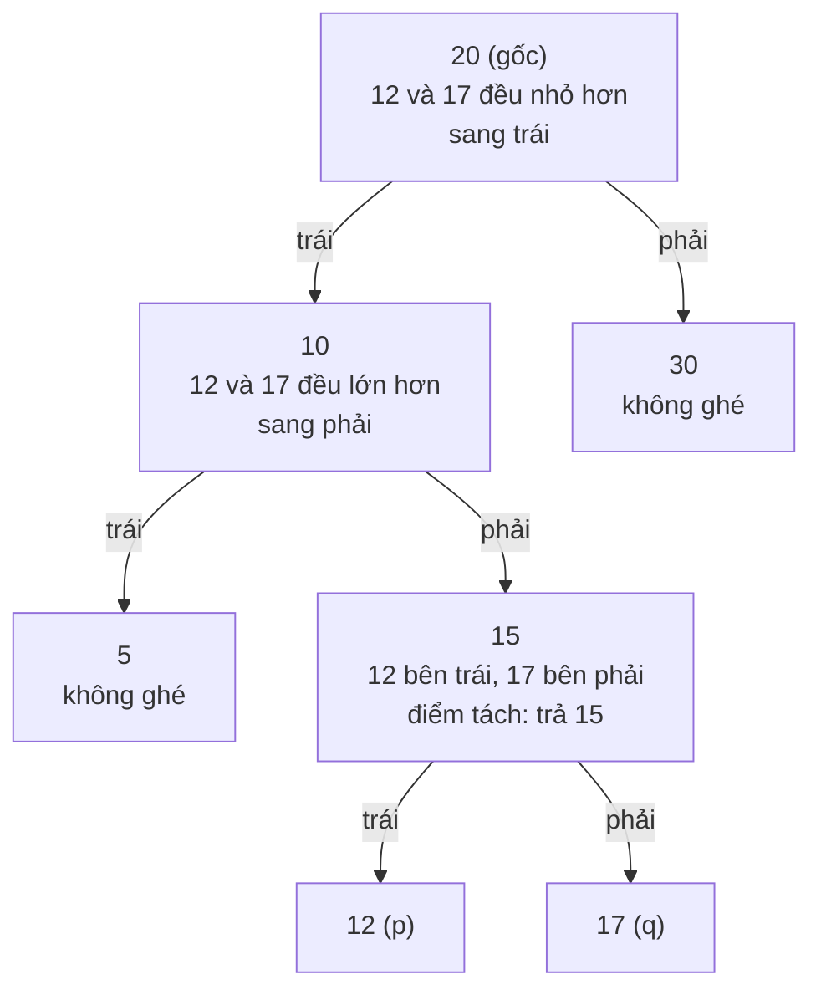
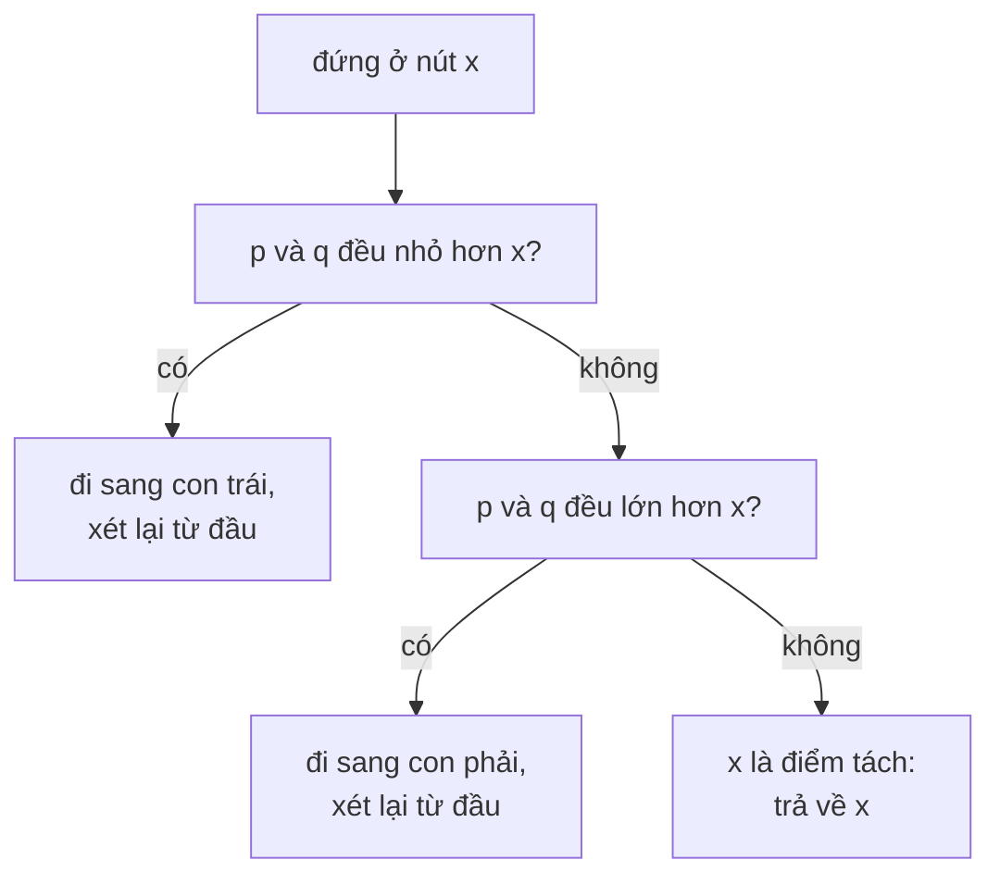

> [!tldr] Đọc nhanh
> - Đề: cho một [[concepts/binary-search-tree|cây nhị phân tìm kiếm (BST)]] và hai nút p, q có trong cây. Tìm [[concepts/lowest-common-ancestor|tổ tiên chung thấp nhất]]: nút sâu nhất nhận cả p lẫn q làm con cháu, trong đó một nút được tính là con cháu của chính nó.
> - Ý chính: đi xuống từ gốc. Nếu p và q **đều nhỏ hơn** nút hiện tại thì sang trái, **đều lớn hơn** thì sang phải. Lần đầu tiên hai nút không cùng phía (hoặc nút hiện tại chính là p hay q) là **điểm tách**, và đó là đáp án. O(h) thời gian, O(1) bộ nhớ với vòng lặp.
> - Lời giải tổng quát cho cây nhị phân thường (LC 236) cũng đúng ở đây nhưng ghé gần hết cây: trên BST cân 10⁶ nút, mỗi truy vấn ghé 1 048 566 nút (8,3 ms ở Node) so với trung bình 2 nút (0,07 µs).
> - Ba cách sai chạy thật: tưởng đề cho p < q (sai 4/10 ca), dùng `<=` thay cho `<` nên trượt qua chính p (sai 6/10), và mẹo "nhân hai hiệu, cùng dấu thì cùng phía" bằng `int` 32 bit: Java trả nút 0 thay vì 50000 vì 50000 · 50001 tràn thành số âm.
> - Đề cho tới 10⁵ nút và không hứa cây cân. Chuỗi tăng 10⁵ nút làm bản đệ quy ném `RangeError`, `RecursionError` và `StackOverflowError` ở TS, Python, Java; vòng lặp xong trong 0,19 ms.

> [!info] Bối cảnh
> Bài LeetCode 235 (Medium), thuộc [[posts/2026-11-25-neetcode-binary-search-tree|ga 4: Cây nhị phân tìm kiếm]] trên **tuyến NeetCode: Cấu trúc liên kết**. Ở [[posts/2026-11-25-neetcode-tree-recursion|ga 3]], mỗi bài phải ghé mọi nút vì cây không cho biết gì về vị trí các giá trị. Bài này là bài đầu tiên dùng **thứ tự** của BST để chỉ đi một đường từ gốc xuống, giống [[concepts/binary-search|tìm kiếm nhị phân]] trên mảng. Hai bài cùng ga, [[problems/validate-binary-search-tree|Validate BST]] và [[problems/kth-smallest-element-in-a-bst|Kth Smallest in a BST]], dùng cùng tính chất đó theo hai cách khác. Bạn không cần biết trước gì ngoài cây nhị phân và đệ quy.

> [!abstract]- Từ điển nhanh cho bài này (bấm để mở)
> - **Cây nhị phân**: mỗi nút có tối đa hai con, trái và phải. Xem [[concepts/binary-tree|Binary Tree]].
> - **Cây nhị phân tìm kiếm (BST)**: cây nhị phân mà ở mọi nút, mọi giá trị trong cây con trái nhỏ hơn nút, mọi giá trị trong cây con phải lớn hơn nút. Xem [[concepts/binary-search-tree|Binary Search Tree]].
> - **Tổ tiên**: nút nằm trên đường từ gốc xuống một nút. Đề này tính cả chính nút đó là tổ tiên của nó. Xem [[concepts/lowest-common-ancestor|Lowest Common Ancestor]].
> - **Điểm tách** (từ của trang này): nút đầu tiên trên đường từ gốc xuống mà p và q không còn cùng một phía.
> - **h**: chiều cao của cây. Cây cân n nút cao khoảng log₂ n; chuỗi lệch n nút cao n.
> - **Hậu thứ tự (post-order)**: xử lý hai cây con trước, rồi mới tới nút. Xem [[concepts/post-order-traversal|Post-order Traversal]].
> - **Ngăn xếp gọi hàm** và giới hạn độ sâu: xem [[concepts/recursion-depth-limit|Recursion Depth Limit]].
> - **Tràn số (overflow)**: kết quả phép tính vượt quá số bit của kiểu, nên chỉ giữ lại phần bit thấp và có thể đổi dấu.

## Hình dung trước: hai người bạn đi từ cổng làng

Một ngôi làng có đường mọc nhánh như cây: từ cổng làng, mỗi ngã ba rẽ thành hai đường. Ở mỗi ngã ba có một tấm biển ghi một số nhà: **nhà số nhỏ hơn thì rẽ trái, lớn hơn thì rẽ phải**. Hai người bạn cùng vào cổng, mỗi người về nhà mình. Họ đi chung cho tới ngã ba nơi một người phải rẽ trái còn người kia rẽ phải. Ngã ba đó là chỗ họ chia tay.

Không cần ai đi khắp làng. Cả hai chỉ nhìn biển, và chỗ chia tay hiện ra ngay khi hai số nhà nằm hai bên con số trên biển. Có một trường hợp đặc biệt: nhà của một người nằm ngay trên đường chung, nên người đó về tới nhà trước khi phải chia tay. Khi đó chỗ chia tay chính là nhà người ấy.

| Đời thường | Khái niệm |
|---|---|
| Cổng làng | gốc cây |
| Biển ở mỗi ngã ba: nhỏ hơn rẽ trái, lớn hơn rẽ phải | tính chất BST |
| Nhà của hai người bạn | hai nút p và q |
| Ngã ba nơi hai người phải rẽ khác nhau | điểm tách, tức tổ tiên chung thấp nhất |
| Một người về tới nhà trước khi phải chia tay | p là tổ tiên của q, đáp án là p |
| Làng không có biển, phải đi khắp nơi hỏi đường | LCA trên cây thường (LC 236), O(n) |
| Hai người đi chung, chỉ đọc biển | đi xuống theo thứ tự, O(h) |

Cây dưới đây là cây trong file chạy thử, với p = 12 và q = 17. Mỗi ô ghi việc cách đi xuống làm ở nút đó:



(Nút 30 còn hai con 25 và 35, không vẽ vì không được ghé.)

## Vấn đề

Đầu vào là gốc của một BST có từ 2 tới 10⁵ nút, giá trị đôi một khác nhau trong [−10⁹, 10⁹], cùng hai nút p ≠ q chắc chắn có trong cây. Trả về nút tổ tiên chung thấp nhất của p và q, với quy ước một nút là con cháu của chính nó. Đề gốc: [LeetCode 235](https://leetcode.com/problems/lowest-common-ancestor-of-a-binary-search-tree/).

Mình từng giải bài này bằng đúng lời giải của bài anh em [LeetCode 236](https://leetcode.com/problems/lowest-common-ancestor-of-a-binary-tree/) (cây nhị phân thường), và nó được chấp nhận. Nhưng lời giải đó không dùng tới chữ "tìm kiếm" trong tên cây. Câu hỏi của trang này là: thứ tự của BST mua được gì?

Ba chi tiết của đề quyết định cách viết:
- p và q **không** được hứa là p < q. Đề chỉ cho hai nút.
- Một nút có thể là tổ tiên của chính nó, nên nếu p nằm trên đường từ gốc tới q thì đáp án là p.
- Đề không hứa cây cân. 10⁵ giá trị chèn theo thứ tự tăng dần vào một BST thường cho ra chuỗi cao 10⁵.

## Cơ chế

### Vì sao điểm tách là đáp án

Đứng ở một nút x trên đường từ gốc xuống:
- Nếu p và q **đều nhỏ hơn** x, cả hai nằm trong cây con trái của x (tính chất BST). Mọi tổ tiên chung sâu hơn x đều ở bên trái, nên đi sang trái không bỏ sót gì.
- Nếu **đều lớn hơn**, tương tự với bên phải.
- Còn lại: hoặc một bên nhỏ hơn và một bên lớn hơn, hoặc x bằng p hay q. Khi đó x là tổ tiên của cả hai (cả hai nằm trong cây con gốc x), còn mọi nút sâu hơn x chỉ nằm trong **một** cây con của x nên không thể chứa cả hai. x là tổ tiên chung thấp nhất.

Vậy chỉ cần đi một đường từ gốc xuống, dừng ở nút đầu tiên rơi vào trường hợp thứ ba. Đó là cùng ý với [[concepts/binary-search|tìm kiếm nhị phân]]: mỗi phép so loại bỏ cả một nửa (ở đây là cả một cây con).



Chú ý hai phép so đều là **so ngặt**. Trường hợp x = p rơi vào nhánh "không", "không" và trả về x, đúng như quy ước tự là tổ tiên của mình.

### Cách 1: lời giải của cây thường (LC 236)

Không dùng thứ tự. [[concepts/post-order-traversal|Hậu thứ tự]]: mỗi lời gọi trả về p hoặc q nếu tìm thấy một trong hai trong cây con của mình, hoặc chính nút nếu hai bên đều tìm thấy.

```ts
// Cách 1: LCA của cây nhị phân bất kỳ (LC 236), không dùng thứ tự. Hậu thứ tự, ghé tới O(n) nút.
function lcaGeneral(root: TreeNode | null, p: TreeNode, q: TreeNode): TreeNode | null {
  if (root === null || root === p || root === q) return root;
  const l = lcaGeneral(root.left, p, q);
  const r = lcaGeneral(root.right, p, q);
  if (l !== null && r !== null) return root; // p một bên, q một bên
  return l !== null ? l : r;
}
```

Đúng, nhưng phải ghé mọi nút trừ phần nằm dưới p và q: O(n) thời gian, O(h) ngăn xếp. Dòng `root === p` có một giả định ngầm: nó dừng ngay khi gặp p mà không tìm q bên dưới, và chỉ đúng vì đề hứa q có trong cây.

### Cách 2: so hai đường đi

Ý tưởng đầu tiên khi đã biết cây có thứ tự: tìm p như tìm một giá trị trong BST, ghi lại đường đi; làm tương tự với q; nút chung cuối cùng của hai đường là đáp án.

```ts
// Cách 2: ghi đường từ gốc tới p và tới q (tìm kiếm BST), nút chung cuối cùng là đáp án. O(h) thời gian và bộ nhớ.
function pathTo(root: TreeNode | null, target: TreeNode): TreeNode[] {
  const path: TreeNode[] = [];
  let node = root;
  while (node !== null) {
    path.push(node);
    if (node === target) break;
    node = target.val < node.val ? node.left : node.right;
  }
  return path;
}
function lcaPaths(root: TreeNode | null, p: TreeNode, q: TreeNode): TreeNode | null {
  const a = pathTo(root, p), b = pathTo(root, q);
  let i = 0;
  while (i < a.length && i < b.length && a[i] === b[i]) i++;
  return a[i - 1];
}
```

O(h) thời gian, O(h) bộ nhớ cho hai mảng. Nó đã nhanh như cách tối ưu; chỉ còn thừa hai mảng. Nhìn kỹ thì hai đường trùng nhau cho tới điểm tách rồi rẽ khác nhau, nên không cần ghi lại: đi hai đường cùng lúc là đủ.

### Cách 3: đi xuống theo thứ tự, đệ quy

```ts
// Cách 3: đi xuống theo thứ tự, đệ quy. Cả hai nhỏ hơn thì sang trái, cả hai lớn hơn thì sang phải, còn lại là điểm tách.
function lcaRecursive(node: TreeNode | null, p: TreeNode, q: TreeNode): TreeNode | null {
  if (node === null) return null;
  if (p.val < node.val && q.val < node.val) return lcaRecursive(node.left, p, q);
  if (p.val > node.val && q.val > node.val) return lcaRecursive(node.right, p, q);
  return node;
}
```

O(h) thời gian. Lời gọi đệ quy là lệnh cuối (đệ quy đuôi), nhưng V8, CPython, JVM và Go đều **không** bỏ khung cũ đi, nên ngăn xếp vẫn sâu h tầng. Trên chuỗi 10⁵ nút, bản này ném lỗi ở TS, JS, Python và Java.

### Cách 4: vòng lặp, O(1) bộ nhớ

Vì mỗi bước chỉ đi xuống đúng một con và không cần quay lại, đệ quy đổi thẳng thành vòng lặp:

```ts
// Cách 4: cùng phép đi đó bằng vòng lặp. O(h) thời gian, O(1) bộ nhớ.
function lcaIterative(root: TreeNode | null, p: TreeNode, q: TreeNode): TreeNode | null {
  let node = root;
  while (node !== null) {
    if (p.val < node.val && q.val < node.val) node = node.left;
    else if (p.val > node.val && q.val > node.val) node = node.right;
    else return node;
  }
  return null;
}
```

| Cách | Thời gian | Bộ nhớ thêm | Dùng thứ tự BST |
|---|---|---|---|
| 1. Tổng quát (LC 236) | O(n) | O(h) ngăn xếp | không |
| 2. So hai đường đi | O(h) | O(h) hai mảng | có |
| 3. Đi xuống, đệ quy | O(h) | O(h) ngăn xếp | có |
| 4. Đi xuống, vòng lặp | O(h) | O(1) | có |

h là log₂ n với cây cân, nhưng là n với chuỗi lệch. Với chuỗi, cách 4 vẫn O(n) thời gian, chỉ là không tràn ngăn xếp.

### Biến thể: nhân hai hiệu

Một cách viết gọn hay gặp: p và q cùng phía với x khi `(x − p)·(x − q) > 0`, tức hai hiệu cùng dấu. Tích ≤ 0 nghĩa là x là điểm tách.

Về toán thì đúng, nhưng tích có thể tới (2·10⁹)² = 4·10¹⁸, vượt xa 32 bit. Java nhân hai `int` trong 32 bit và theo đặc tả chỉ giữ bit thấp, nên **dấu của kết quả có thể khác dấu của tích thật**. Không cần giá trị lớn: ở cây `[0, null, 50000, null, 50001]`, tại gốc 0 thì (0 − 50000)·(0 − 50001) = 2 500 050 000, lớn hơn 2³¹ − 1, thành −1 794 917 296 trong `int`, và hàm trả nút 0 thay vì 50000. Ép một thừa số sang `long` là đủ sửa. Go chỉ an toàn vì `int` rộng 64 bit trên máy 64 bit: chạy cùng file với `GOARCH=386` (int 32 bit) cho ra đúng lỗi của Java.

### LC 235 và LC 236 khác nhau ở đâu

| | LC 236 (cây thường) | LC 235 (BST) |
|---|---|---|
| Biết p ở bên nào? | không, phải tìm cả hai bên | có, so giá trị với nút |
| Số nút ghé | tới n | h + 1 |
| Cách viết | hậu thứ tự, kết quả đi từ dưới lên | đi từ trên xuống, dừng ở điểm tách |
| Cần đệ quy hay ngăn xếp? | có | không |

### Đo

Mỗi file dựng BST cân từ dãy 0…n − 1 (phần tử giữa làm gốc) và hỏi 2 000 cặp ngẫu nhiên. TypeScript, Node 24:

| n | Tổng quát: nút ghé | Tổng quát: µs/truy vấn | Đi xuống: nút ghé (trung bình) | Đi xuống: cặp sâu nhất | Đi xuống: µs/truy vấn |
|---|---|---|---|---|---|
| 1 023 | 1 009 | 5,8 | 2,0 | 9 | 0,064 |
| 131 071 | 131 050 | 792 | 2,0 | 16 | 0,172 |
| 1 048 575 | 1 048 566 | 8 324 | 2,0 | 19 | 0,073 |

- Cách tổng quát ghé gần đủ n nút ở mọi cỡ: nó chỉ bỏ được phần nằm dưới p và q.
- Với cặp ngẫu nhiên, cách đi xuống chỉ ghé trung bình **2 nút**: khoảng một nửa số cặp có p và q ở hai bên gốc, nên dừng ngay ở gốc. Cặp tệ nhất là hai lá kề nhau ở đáy (0 và 2), tốn h − 1 bước: 19 bước với 10⁶ nút.
- Thời gian mỗi truy vấn đi xuống dưới 0,2 µs ở mọi cỡ; dao động giữa các dòng là nhiễu đo, không phải xu hướng.

Ba ngôn ngữ còn lại, mỗi truy vấn: Python (2¹⁷ − 1 nút) tổng quát 8 578 µs, đi xuống 0,28 µs; Go (2²⁰ − 1 nút) 4 597 µs và 0,008 µs; Java (2²⁰ − 1 nút) 3 048 µs và 0,007 µs.

Trên chuỗi tăng 10⁵ nút (cây hợp lệ theo đề), với p = 99998 và q = 99999: vòng lặp đi hết 99 999 bước trong 0,19 ms; bản đệ quy ném `RangeError` ở Node.

### Bên dưới năm ngôn ngữ

| | So sánh nút | Bẫy riêng |
|---|---|---|
| TypeScript / JavaScript | `===` so tham chiếu đối tượng | chuỗi 10⁵ nút: cả hai bản đệ quy ném `RangeError`. Mẹo nhân hai hiệu thì an toàn: số 64 bit kiểu thực làm mất chữ số cuối ở 4·10¹⁸ nhưng giữ đúng dấu |
| Python | `is` so danh tính | `int` không tràn nên mẹo nhân an toàn; chuỗi 10⁵ nút vượt giới hạn 1 000 tầng, ném `RecursionError` |
| Go | `==` trên con trỏ | ngăn xếp goroutine tự lớn nên đệ quy 10⁵ tầng chạy được; `int` 32 bit trên `GOARCH=386` làm mẹo nhân sai 2/10 ca |
| Java | `==` so tham chiếu | `int * int` tràn im lặng: mẹo nhân sai 2/10 ca, sửa bằng `(long)`. `StackOverflowError` là `Error`, không phải `Exception`, nên `catch (Exception e)` không bắt được |

## Ví dụ chạy được

[TypeScript](../code/neetcode-lowest-common-ancestor-of-a-binary-search-tree/lca.ts) · [Python](../code/neetcode-lowest-common-ancestor-of-a-binary-search-tree/lca.py) · [Go](../code/neetcode-lowest-common-ancestor-of-a-binary-search-tree/lca.go) · [Java](../code/neetcode-lowest-common-ancestor-of-a-binary-search-tree/lca.java) · [JavaScript](../code/neetcode-lowest-common-ancestor-of-a-binary-search-tree/lca.js)

Mỗi file dựng cây từ mảng theo tầng kiểu LeetCode và chạy 10 ca chung trên cây `[20, 10, 30, 5, 15, 25, 35, null, null, 12, 17]` cùng vài cây riêng: p và q ở hai phía gốc, cùng bên trái, cùng bên phải, p là tổ tiên của q, p lớn hơn q, gốc là p, cây 2 nút (cỡ nhỏ nhất của đề), giá trị ±10⁹, hai giá trị cỡ 5·10⁴ cùng phía (bắt lỗi tràn), và chuỗi tăng 10⁵ nút (cỡ lớn nhất của đề). File TypeScript đối chiếu thêm năm cách trên 3 000 BST ngẫu nhiên.

Đi xuống theo thứ tự, bằng vòng lặp:

```ts
function lcaIterative(root: TreeNode | null, p: TreeNode, q: TreeNode): TreeNode | null {
  let node = root;
  while (node !== null) {
    if (p.val < node.val && q.val < node.val) node = node.left;
    else if (p.val > node.val && q.val > node.val) node = node.right;
    else return node;
  }
  return null;
}
```

```python
def lca_iterative(root, p, q):
    """Cách 4: cùng phép đi bằng vòng lặp. O(h) thời gian, O(1) bộ nhớ."""
    node = root
    while node is not None:
        if p.val < node.val and q.val < node.val:
            node = node.left
        elif p.val > node.val and q.val > node.val:
            node = node.right
        else:
            return node
    return None
```

```go
// Cách 4: vòng lặp, O(1) bộ nhớ.
func lcaIterative(root, p, q *TreeNode) *TreeNode {
	node := root
	for node != nil {
		if p.Val < node.Val && q.Val < node.Val {
			node = node.Left
		} else if p.Val > node.Val && q.Val > node.Val {
			node = node.Right
		} else {
			return node
		}
	}
	return nil
}
```

```java
// Cách 4: vòng lặp, O(1) bộ nhớ.
static TreeNode lcaIterative(TreeNode root, TreeNode p, TreeNode q) {
    TreeNode node = root;
    while (node != null) {
        if (p.val < node.val && q.val < node.val) node = node.left;
        else if (p.val > node.val && q.val > node.val) node = node.right;
        else return node;
    }
    return null;
}
```

```js
// Cách 4: vòng lặp, O(1) bộ nhớ.
function lcaIterative(root, p, q) {
  let node = root;
  while (node !== null) {
    if (p.val < node.val && q.val < node.val) node = node.left;
    else if (p.val > node.val && q.val > node.val) node = node.right;
    else return node;
  }
  return null;
}
```

Lời giải tổng quát của LC 236, để so sánh:

```ts
function lcaGeneral(root: TreeNode | null, p: TreeNode, q: TreeNode): TreeNode | null {
  if (root === null || root === p || root === q) return root;
  const l = lcaGeneral(root.left, p, q);
  const r = lcaGeneral(root.right, p, q);
  if (l !== null && r !== null) return root; // p một bên, q một bên
  return l !== null ? l : r;
}
```

```python
def lca_general(root, p, q):
    """Cách 1: LCA của cây nhị phân bất kỳ (LC 236), hậu thứ tự, O(n)."""
    if root is None or root is p or root is q:
        return root
    l = lca_general(root.left, p, q)
    r = lca_general(root.right, p, q)
    if l and r:
        return root
    return l or r
```

```go
// Cách 1: LCA của cây nhị phân bất kỳ (LC 236), hậu thứ tự, O(n).
func lcaGeneral(root, p, q *TreeNode) *TreeNode {
	if root == nil || root == p || root == q {
		return root
	}
	l := lcaGeneral(root.Left, p, q)
	r := lcaGeneral(root.Right, p, q)
	if l != nil && r != nil {
		return root
	}
	if l != nil {
		return l
	}
	return r
}
```

```java
// Cách 1: LCA của cây nhị phân bất kỳ (LC 236), hậu thứ tự, O(n).
static TreeNode lcaGeneral(TreeNode root, TreeNode p, TreeNode q) {
    if (root == null || root == p || root == q) return root;
    TreeNode l = lcaGeneral(root.left, p, q);
    TreeNode r = lcaGeneral(root.right, p, q);
    if (l != null && r != null) return root;
    return l != null ? l : r;
}
```

```js
// Cách 1: LCA của cây nhị phân bất kỳ (LC 236), hậu thứ tự, O(n).
function lcaGeneral(root, p, q) {
  if (root === null || root === p || root === q) return root;
  const l = lcaGeneral(root.left, p, q);
  const r = lcaGeneral(root.right, p, q);
  if (l !== null && r !== null) return root;
  return l !== null ? l : r;
}
```

Kết quả `node lca.ts`:

```text
lcaGeneral         9/10 ca đúng; sai ở chuỗi tăng 10⁵ nút (99998, 99999) → ném RangeError
lcaPaths           10/10 ca đúng
lcaRecursive       9/10 ca đúng; sai ở chuỗi tăng 10⁵ nút (99998, 99999) → ném RangeError
lcaIterative       10/10 ca đúng
lcaProduct         10/10 ca đúng
wrongAssumeOrdered 6/10 ca đúng; sai ở p lớn hơn q (17, 12) → null, gốc là p (20, 17) → null, cây 2 nút (2, 1) → null, giá trị ±10⁹ (10⁹, 10⁹ − 1) → null
wrongNonStrict     4/10 ca đúng; sai ở p là tổ tiên của q (10, 12) → null, gốc là p (20, 17) → null, cây 2 nút (2, 1) → null, giá trị ±10⁹ (10⁹, 10⁹ − 1) → null, cùng phía, hiệu cỡ 5·10⁴ (50000, 50001) → null, chuỗi tăng 10⁵ nút (99998, 99999) → null

đối chiếu 3000 BST ngẫu nhiên 2..31 nút: năm cách khớp nhau 3000/3000

BST cân, cặp (p, q) ngẫu nhiên: số nút ghé trung bình và thời gian mỗi truy vấn (µs)
n          tổng quát: ghé        µs   đi theo thứ tự: ghé   cặp sâu nhất      µs
1023                 1009       5.8                  2.0              9   0.064
131071             131050     791.8                  2.0             16   0.172
1048575           1048566    8324.2                  2.0             19   0.073

chuỗi tăng 10⁵ nút, (99998, 99999): vòng lặp → 99998 (0.19 ms), đệ quy → ném RangeError
```

`python3 lca.py`:

```text
lca_general          9/10 ca đúng; sai ở chuỗi tăng 10⁵ nút (99998, 99999) → ném RecursionError
lca_paths            10/10 ca đúng
lca_recursive        9/10 ca đúng; sai ở chuỗi tăng 10⁵ nút (99998, 99999) → ném RecursionError
lca_iterative        10/10 ca đúng
lca_product          10/10 ca đúng
wrong_assume_ordered 6/10 ca đúng; sai ở p lớn hơn q (17, 12) → None, gốc là p (20, 17) → None, cây 2 nút (2, 1) → None, giá trị ±10⁹ (10⁹, 10⁹ − 1) → None

BST cân 131071 nút, cặp ngẫu nhiên, mỗi truy vấn: tổng quát 8,578 µs, đi theo thứ tự 0.28 µs
```

`go run lca.go`:

```text
lcaGeneral          10/10 ca đúng
lcaPaths            10/10 ca đúng
lcaRecursive        10/10 ca đúng
lcaIterative        10/10 ca đúng
lcaProduct          10/10 ca đúng
wrongAssumeOrdered  6/10 ca đúng; sai ở p lớn hơn q (17, 12) → nil, gốc là p (20, 17) → nil, cây 2 nút (2, 1) → nil, giá trị ±10⁹ (10⁹, 10⁹ − 1) → nil

BST cân 1048575 nút, cặp ngẫu nhiên, mỗi truy vấn: tổng quát 4597 µs, đi theo thứ tự 0.008 µs
```

Cùng file với `GOARCH=386 go run lca.go` (int 32 bit), hai dòng khác đi:

```text
lcaProduct          8/10 ca đúng; sai ở cùng phía, hiệu cỡ 5·10⁴ (50000, 50001) → 0, chuỗi tăng 10⁵ nút (99998, 99999) → 7317
wrongAssumeOrdered  6/10 ca đúng; sai ở p lớn hơn q (17, 12) → nil, gốc là p (20, 17) → nil, cây 2 nút (2, 1) → nil, giá trị ±10⁹ (10⁹, 10⁹ − 1) → nil
```

`java lca.java`:

```text
lcaGeneral         9/10 ca đúng; sai ở chuỗi tăng 10⁵ nút (99998, 99999) → ném StackOverflowError
lcaPaths           10/10 ca đúng
lcaRecursive       9/10 ca đúng; sai ở chuỗi tăng 10⁵ nút (99998, 99999) → ném StackOverflowError
lcaIterative       10/10 ca đúng
lcaProductLong     10/10 ca đúng
wrongProductInt    8/10 ca đúng; sai ở cùng phía, hiệu cỡ 5·10⁴ (50000, 50001) → 0, chuỗi tăng 10⁵ nút (99998, 99999) → 7317

BST cân 1048575 nút, cặp ngẫu nhiên, mỗi truy vấn: tổng quát 3048 µs, đi theo thứ tự 0.007 µs
```

`node lca.js`:

```text
lcaGeneral         9/10 ca đúng; sai ở chuỗi tăng 10⁵ nút (99998, 99999) → ném RangeError
lcaPaths           10/10 ca đúng
lcaRecursive       9/10 ca đúng; sai ở chuỗi tăng 10⁵ nút (99998, 99999) → ném RangeError
lcaIterative       10/10 ca đúng
lcaProduct         10/10 ca đúng
wrongNonStrict     4/10 ca đúng; sai ở p là tổ tiên của q (10, 12) → null, gốc là p (20, 17) → null, cây 2 nút (2, 1) → null, giá trị ±10⁹ (10⁹, 10⁹ − 1) → null, cùng phía, hiệu cỡ 5·10⁴ (50000, 50001) → null, chuỗi tăng 10⁵ nút (99998, 99999) → null
```

Ở chuỗi tăng, bản `int` 32 bit dừng sai ở nút 7317: từ đó trở đi, (7317 − 99998)·(7317 − 99999) ≈ 8,6·10⁹ đã tràn thành một số ≤ 0 trong 32 bit.

## Hiểu lầm và bẫy hay gặp

- **"Đề cho p nhỏ hơn q."** Không có. Code chỉ so `q` khi rẽ trái và `p` khi rẽ phải đúng khi p < q, và trả `null` ở 4/10 ca khi p > q. Nếu muốn dùng giả định đó, đổi chỗ p và q ở đầu hàm.
- **Dùng `<=` và `>=`.** Nghe như "cẩn thận hơn", nhưng khi nút hiện tại là p, `p.val <= node.val` vẫn đúng nên vòng lặp đi tiếp xuống dưới p, trượt khỏi đáp án và rơi vào `null`. Sai 6/10 ca. Hai phép so phải là so ngặt để trường hợp "nút là p hay q" rơi vào nhánh trả về.
- **Mẹo nhân hai hiệu bằng `int` 32 bit.** Tích tới 4·10¹⁸; Java `int` và Go `int` trên máy 32 bit tràn và có thể đổi dấu. Chỉ 50000 · 50001 đã đủ. Dùng `long`, hoặc thay phép nhân bằng hai phép so.
- **"Bài này cần đệ quy vì là bài cây."** Mỗi bước chỉ đi xuống một con và không bao giờ quay lại, nên không cần ngăn xếp. Đệ quy đuôi không được tối ưu ở V8, CPython, JVM hay Go, nên bản đệ quy tốn O(h) ngăn xếp vô ích và ném lỗi ở chuỗi 10⁵ nút.
- **"O(h) nghĩa là O(log n)."** Chỉ khi cây cân. Đề không hứa thế; chuỗi tăng 10⁵ nút là BST hợp lệ và cách đi xuống tốn 10⁵ bước.
- **Dùng cách đi xuống khi p hoặc q có thể không có trong cây.** Nó vẫn trả về một điểm tách, dù q không tồn tại. Đề này hứa cả hai có mặt; biến thể không hứa (LeetCode 1644 cho cây thường) phải tìm xác nhận từng nút trước.
- **So giá trị hay so nút.** Ở đây giá trị khác nhau nên hai cách như nhau, nhưng lời giải tổng quát so **tham chiếu** (`root === p`), vì trên cây thường hai nút có thể cùng giá trị.

## Câu hỏi tự kiểm tra

> [!question]- Vì sao nút đầu tiên mà p và q không còn cùng một phía lại là tổ tiên chung **thấp nhất**, chứ không chỉ là một tổ tiên chung?
> Nó là tổ tiên chung vì mọi nút phía trên đều dẫn cả p lẫn q vào cùng một cây con, nên cả hai nằm trong cây con gốc ở nút này. Nó là thấp nhất vì p và q ở hai cây con khác nhau của nó (hoặc một trong hai chính là nó), còn mọi nút sâu hơn chỉ nằm trong một cây con, không thể chứa cả hai.

> [!question]- Với cặp p, q chọn ngẫu nhiên trên BST cân 10⁶ nút, vì sao cách đi xuống chỉ ghé trung bình khoảng 2 nút?
> Gốc chia giá trị làm hai nửa gần bằng nhau, nên khoảng một nửa số cặp có p và q ở hai bên gốc và dừng ngay ở bước đầu. Trong nửa còn lại, khoảng một nửa dừng ở bước hai, và cứ thế. Kỳ vọng là 1 + 1/2 + 1/4 + … ≈ 2. Chỉ cặp nằm sát nhau ở đáy mới tốn đủ h − 1 bước.

> [!question]- Trong các nút có giá trị nằm giữa min(p, q) và max(p, q) (tính cả hai đầu), nút nào là tổ tiên chung thấp nhất?
> Nút **gần gốc nhất** trong số đó. Trên đường đi xuống, mọi nút trước điểm tách đều nằm ngoài khoảng (cả p và q cùng phía nó), và điểm tách là nút đầu tiên nằm trong khoảng. Nói cách khác, cách đi xuống chính là tìm nút đầu tiên trên đường có giá trị nằm trong [min, max].

> [!question]- Trong Java, `(node.val - p.val) * (node.val - q.val)` có tràn ở bước trừ không, hay chỉ ở bước nhân?
> Chỉ ở bước nhân. Giá trị nằm trong [−10⁹, 10⁹] nên mỗi hiệu nằm trong [−2·10⁹, 2·10⁹], vẫn vừa `int` (giới hạn khoảng 2,147·10⁹). Vì thế `(long) (node.val - p.val) * (node.val - q.val)` là đủ: ép một thừa số sang `long` thì phép nhân chạy trong 64 bit.

> [!question]- Nếu chuyển bài sang cây nhị phân thường (LC 236), phần nào của lời giải phải bỏ, và cái giá là gì?
> Phải bỏ phép so giá trị để chọn bên, vì cây thường không có thứ tự: không biết p ở bên nào thì phải tìm cả hai bên. Lời giải trở thành hậu thứ tự O(n) với ngăn xếp O(h), như cách 1. Trên 10⁶ nút, đó là khác biệt giữa vài phần trăm micro giây và vài mili giây mỗi truy vấn.

## Tham khảo

- [LeetCode 235: Lowest Common Ancestor of a Binary Search Tree](https://leetcode.com/problems/lowest-common-ancestor-of-a-binary-search-tree/) (đề gốc: 2 tới 10⁵ nút, giá trị khác nhau trong [−10⁹, 10⁹], p và q có trong cây)
- [LeetCode 236: Lowest Common Ancestor of a Binary Tree](https://leetcode.com/problems/lowest-common-ancestor-of-a-binary-tree/)
- [Java Language Specification §15.17.1: Multiplication Operator](https://docs.oracle.com/javase/specs/jls/se21/html/jls-15.html#jls-15.17.1) (tràn chỉ giữ bit thấp, dấu kết quả có thể khác dấu tích thật)
- [The Go Programming Language Specification: Numeric types](https://go.dev/ref/spec#Numeric_types) (`int` rộng 32 hoặc 64 bit tùy nền tảng)
- Cormen, Leiserson, Rivest, Stein, *Introduction to Algorithms*, chương 12 (cây nhị phân tìm kiếm: tìm kiếm theo một đường từ gốc trong O(h))
