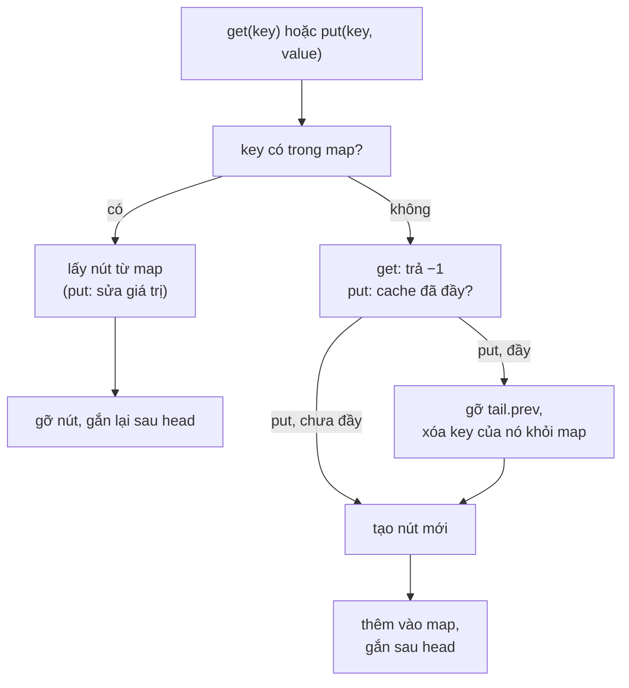

> [!tldr] Đọc nhanh
> - Đề: một cache có sức chứa cố định; `get(key)` trả giá trị hoặc −1, `put(key, value)` thêm hoặc sửa; đầy thì đẩy ra key **lâu nhất chưa được dùng**. Cả hai thao tác O(1).
> - Lời giải: [[concepts/hash-map|hash map]] trỏ từ key tới **nút**, và một [[concepts/doubly-linked-list|danh sách hai chiều]] có hai [[concepts/dummy-node|nút giả]] `head`, `tail` xếp các nút từ mới tới cũ. Dùng một key là gỡ nút đó ra và gắn lại sau `head`; đầy thì gỡ `tail.prev` và xóa key của nó khỏi map.
> - Mỗi ngôn ngữ có sẵn một cấu trúc làm được việc này: `Map` của JavaScript, `OrderedDict` của Python, `LinkedHashMap` của Java, `container/list` của Go. Đo 10⁶ thao tác: `Map` của JavaScript đạt 13,5 triệu thao tác/s ở sức chứa 100 nhưng tụt còn 1,4 triệu ở sức chứa 10⁴; danh sách tự viết giữ được 14,6 triệu.
> - Ba bản sai, mỗi bản quên đúng một bước, chạy trên 8 ca: `get` không đưa lên đầu (4/8), quên xóa key khỏi map khi đẩy ra (1/8, map phình tới 993 key với sức chứa 50), sửa key đã có mà không đưa lên đầu (4/8). Java quên `accessOrder = true` thì thành FIFO (đúng 3/8).

> [!info] Bối cảnh
> Bài LeetCode 146, bài neo của [[posts/2026-11-24-neetcode-advanced-linked-list|ga 2: Danh sách liên kết nâng cao]] trong **tuyến NeetCode: Cấu trúc liên kết**. Cùng ga có [[problems/copy-list-with-random-pointer|Copy List with Random Pointer]], [[problems/add-two-numbers|Add Two Numbers]], [[problems/find-the-duplicate-number|Find the Duplicate Number]], [[problems/merge-k-sorted-lists|Merge k Sorted Lists]] và [[problems/reverse-nodes-in-k-group|Reverse Nodes in k-Group]]. Bài này cần nút giả của [[posts/2026-11-24-neetcode-linked-list|ga 1]] và hash map của [[series/neetcode-arr|tuyến Mảng và chuỗi]]. Bạn không cần biết Redis hay bất kỳ hệ thống cache nào; lời giải có đủ TypeScript, Python, Go, Java và JavaScript.

> [!abstract]- Từ điển nhanh cho bài này (bấm để mở)
> - **Cache**: chỗ cất tạm một ít dữ liệu hay dùng để lần sau lấy nhanh hơn. Chỗ có hạn, nên đầy thì phải đẩy bớt.
> - **Đẩy ra (evict)**: bỏ một key khỏi cache để lấy chỗ cho key mới. Cách chọn key bị đẩy là [[concepts/eviction-policy|eviction policy]].
> - **LRU (Least Recently Used)**: đẩy key lâu nhất chưa được dùng. "Dùng" gồm cả đọc (`get`) lẫn ghi (`put`). Xem [[concepts/lru-va-lfu|LRU và LFU]].
> - **Danh sách hai chiều**: mỗi nút có `prev` và `next`, nên đang cầm một nút là gỡ được chính nó. Xem [[concepts/doubly-linked-list|Doubly Linked List]].
> - **Nút canh (sentinel)**: nút giả ở hai đầu danh sách, không mang dữ liệu, để danh sách không bao giờ rỗng thật. Xem [[concepts/dummy-node|Dummy Node]].
> - **O(1) trung bình**: thời gian không phụ thuộc số key, tính trung bình qua nhiều thao tác (hash map có lúc phải dựng lại bảng).

## Hình dung trước: bàn làm việc chỉ để được vài tập hồ sơ

Bàn của bạn chỉ để được vài tập hồ sơ, xếp thành một chồng. Tập nào vừa dùng thì đặt lên trên cùng. Bàn đầy mà cần lấy tập mới từ kho, bạn cất tập **dưới đáy** về kho, vì đó là tập lâu nhất không đụng tới. Để khỏi lục cả chồng mỗi lần tìm, trên tường dán một tờ mục lục: tập số 7 đang nằm ở đâu.

| Đời thường | Khái niệm |
|---|---|
| Bàn chỉ để được vài tập | sức chứa (`capacity`) |
| Tờ mục lục trên tường: tập nào ở đâu | hash map key → nút |
| Chồng hồ sơ, trên cùng là vừa dùng | danh sách hai chiều, sau `head` là mới nhất |
| Mỗi tập kẹp với tập trên và tập dưới nó, rút ra giữa chồng không làm đổ | `prev` và `next` |
| Tấm bìa cứng trên cùng và dưới cùng chồng | hai nút canh `head`, `tail` |
| Dùng một tập: rút ra, đặt lại lên trên | gỡ nút, gắn sau `head` |
| Bàn đầy: cất tập dưới đáy về kho, gạch dòng của nó trên mục lục | gỡ `tail.prev`, xóa key khỏi map |



## Vấn đề

Thiết kế lớp `LRUCache(capacity)` với `get(key)` và `put(key, value)`, cả hai O(1) trung bình. `put` một key đã có thì sửa giá trị; `put` key mới khi đã đủ `capacity` key thì đẩy key lâu nhất chưa dùng ra trước. Đề cho 1 ≤ capacity ≤ 3 000, key 0..10⁴, giá trị 0..10⁵, và tối đa 2 · 10⁵ lời gọi.

Ví dụ của đề với sức chứa 2: `put(1,1)`, `put(2,2)`, `get(1)` → 1, `put(3,3)` đẩy key 2 (vì 1 vừa được đọc), `get(2)` → −1, `put(4,4)` đẩy key 1, `get(1)` → −1, `get(3)` → 3, `get(4)` → 4.

Hai cách nghĩ đầu tiên đều vướng ở một chỗ:

- **Mảng các key theo thứ tự dùng**: biết ngay key cũ nhất (đầu mảng), nhưng dùng một key là phải tìm và dời nó ra cuối, O(capacity). Trang này dùng chính cách đó làm bản chuẩn chậm để kiểm các bản nhanh.
- **Hash map + "thời điểm dùng" của mỗi key**: `get` và `put` nhanh, nhưng lúc đầy, tìm key có thời điểm nhỏ nhất phải duyệt cả map, O(capacity).

Cần một cấu trúc vừa tìm theo key trong O(1), vừa chuyển một phần tử bất kỳ lên đầu trong O(1), vừa biết phần tử cuối trong O(1). Không cấu trúc đơn lẻ nào làm được cả ba.

## Cơ chế

<figure class="figure-map" style="--ar: 3 / 4">
<div class="frame"><iframe data-archify="../diagrams/neetcode-lru-cache/worked-example.html" title="Lượt truy cập đổi thứ tự bị đẩy" loading="lazy"></iframe></div>
<figcaption><span><b>Hình 1.</b> Lượt truy cập đổi thứ tự bị đẩy.</span><a href="../diagrams/neetcode-lru-cache/worked-example.html" target="_blank" rel="noopener">Mở toàn màn hình</a></figcaption>
</figure>

<details>
<summary>Đọc từng bước</summary>
<ol>
<li>Thêm A rồi B vào cache hai chỗ. <code>recent → B → A</code></li>
<li>Đọc A và đưa nó lên đầu. <code>recent → A → B</code></li>
<li>Thêm C và kiểm tra dung lượng. <code>recent → C → A → B</code></li>
<li>Loại B ở cuối danh sách. <code>recent → C → A</code></li>
</ol>
</details>

### Cách 1: hash map + danh sách hai chiều có hai nút canh

Ghép hai cấu trúc, mỗi cái che chỗ yếu của cái kia:

- **[[concepts/doubly-linked-list|Danh sách hai chiều]]** giữ thứ tự: nút ngay sau `head` là mới dùng nhất, nút ngay trước `tail` là cũ nhất. Đang cầm một nút thì `n.prev` và `n.next` cho biết hai hàng xóm, nên gỡ nút chỉ sửa 2 con trỏ, gắn nút sau `head` sửa 4. Danh sách một chiều không làm được: muốn gỡ một nút phải có nút đứng trước, mà tìm nó tốn O(n).
- **Hash map** trỏ từ key tới **nút**, không phải tới giá trị. Đó là cách tìm ra nút trong O(1).
- **Hai nút canh** `head` và `tail` không mang dữ liệu. Nhờ chúng, mọi nút thật luôn có nút đứng trước và đứng sau, nên `unlink` và `pushFront` không cần nhánh `if` cho danh sách rỗng hay nút ở biên.

```ts
class DNode {
  key: number; val: number;
  prev: DNode | null = null; next: DNode | null = null;
  constructor(key: number, val: number) { this.key = key; this.val = val; }
}

// Cách 1: Map tra key → nút; danh sách hai chiều có hai nút canh. Sau head là mới dùng nhất, trước tail là cũ nhất.
class LRUList implements Cache {
  map = new Map<number, DNode>();
  head = new DNode(0, 0);
  tail = new DNode(0, 0);
  capacity: number;
  constructor(capacity: number) { this.capacity = capacity; this.head.next = this.tail; this.tail.prev = this.head; }
  unlink(n: DNode) { n.prev!.next = n.next; n.next!.prev = n.prev; }
  pushFront(n: DNode) { n.next = this.head.next; n.prev = this.head; this.head.next!.prev = n; this.head.next = n; }
  get(key: number): number {
    const n = this.map.get(key);
    if (n === undefined) return -1;
    this.unlink(n); this.pushFront(n); // vừa dùng: đưa lên đầu
    return n.val;
  }
  put(key: number, val: number): void {
    const n = this.map.get(key);
    if (n !== undefined) { n.val = val; this.unlink(n); this.pushFront(n); return; }
    if (this.map.size === this.capacity) {
      const old = this.tail.prev!; // cũ nhất nằm ngay trước nút canh cuối
      this.unlink(old);
      this.map.delete(old.key);
    }
    const m = new DNode(key, val);
    this.map.set(key, m); this.pushFront(m);
  }
}
```


Mỗi nút lưu cả `key`: khi đẩy `tail.prev` ra, ta cần key của nó để xóa khỏi map. Theo dõi ví dụ của đề:

| Thao tác | Map | Danh sách (head → tail) | Trả |
|---|---|---|---|
| `put(1, 1)` | {1} | 1 | |
| `put(2, 2)` | {1, 2} | 2, 1 | |
| `get(1)` | {1, 2} | 1, 2 | 1 |
| `put(3, 3)`: đầy, đẩy `tail.prev` = 2 | {1, 3} | 3, 1 | |
| `get(2)` | {1, 3} | 3, 1 | −1 |
| `put(4, 4)`: đầy, đẩy 1 | {3, 4} | 4, 3 | |
| `get(1)`, `get(3)`, `get(4)` | {3, 4} | 4, 3 rồi 3, 4 rồi 4, 3 | −1, 3, 4 |

Mọi thao tác: một lần tra map, vài lần gán con trỏ. O(1) trung bình thời gian, O(capacity) bộ nhớ.

### Cách 2: cấu trúc có sẵn của mỗi ngôn ngữ

Bốn trong năm ngôn ngữ có sẵn một hash map nhớ thứ tự, hoặc một danh sách hai chiều:

- **JavaScript `Map`** nhớ thứ tự chèn. `delete` rồi `set` lại một key đưa nó xuống **cuối**; key đầu tiên (`keys().next().value`) là key cũ nhất. Thứ tự ngược với cách 1 (cuối là mới nhất) nhưng ý tưởng y hệt.
- **Python `OrderedDict`**: `move_to_end(key)` đưa key xuống cuối, `popitem(last=False)` lấy key đầu ra.
- **Java `LinkedHashMap`**: tạo với `accessOrder = true` thì mỗi lần `get` hay `put` tự đưa key xuống cuối; ghi đè `removeEldestEntry` để trả `true` khi `size() > capacity`, và map tự xóa key đầu sau mỗi `put`.
- **Go `container/list`**: một danh sách hai chiều có sẵn với `MoveToFront`, `Back`, `Remove`; vẫn phải tự giữ `map[int]*list.Element`.

```ts
// Cách 2: Map của JavaScript nhớ thứ tự chèn. Xóa rồi chèn lại là đưa key xuống cuối; key đầu tiên là cũ nhất.
class LRUMap implements Cache {
  map = new Map<number, number>();
  capacity: number;
  constructor(capacity: number) { this.capacity = capacity; }
  get(key: number): number {
    const v = this.map.get(key);
    if (v === undefined) return -1;
    this.map.delete(key); this.map.set(key, v);
    return v;
  }
  put(key: number, val: number): void {
    if (this.map.has(key)) this.map.delete(key);
    else if (this.map.size === this.capacity) this.map.delete(this.map.keys().next().value!);
    this.map.set(key, val);
  }
}
```


### Map của JavaScript chậm dần khi sức chứa lớn

Mình từng nghĩ cách `Map` là lời giải "miễn phí": ít code hơn và dùng cấu trúc viết bằng C++ trong engine. Đo 10⁶ thao tác (nửa `get` nửa `put`, key ngẫu nhiên trong 0..2 · capacity − 1, mulberry32, trung vị 5 lần):

| Sức chứa | Danh sách tự viết | `Map` xóa rồi chèn |
|---|---|---|
| 100 | 17,9 triệu thao tác/s | 13,5 triệu thao tác/s |
| 10 000 | 14,6 triệu thao tác/s | **1,4 triệu thao tác/s** |

Sức chứa tăng 100 lần thì bản `Map` chậm đi khoảng 10 lần, còn bản tự viết gần như giữ nguyên. File tách riêng hai việc mà bản `Map` làm:

```text
sức chứa   10⁶ lần xóa rồi chèn lại key ngẫu nhiên   10⁵ lần lấy key đầu, xóa, chèn key mới
100            60.4 ms                               9.4 ms
10000          81.6 ms                             479.8 ms
```

Đưa một key xuống cuối gần như không đổi giá. Chỗ chậm là **lấy key đầu** bằng `keys().next()`: khoảng 4,8 µs mỗi lần ở sức chứa 10⁴, so với 0,09 µs ở 100. Cách giải thích mình thấy hợp với số đo (mình chưa đọc mã nguồn V8 để khẳng định): bảng thứ tự của `Map` chỉ đánh dấu chỗ bị xóa là ô trống và dọn khi dựng lại bảng, nên sau nhiều lần xóa ở đầu, iterator mới phải bước qua một dải ô trống trước khi gặp key thật. Đề giới hạn sức chứa 3 000, nên trên LeetCode bản `Map` vẫn qua; nhưng nếu dùng làm cache thật với hàng chục nghìn key, danh sách tự viết an toàn hơn.

### Ba bản sai, mỗi bản quên một bước

Bản chuẩn có ba chỗ "đưa lên đầu" và một chỗ "xóa khỏi map". Bỏ từng chỗ một:

```ts
// SAI 1: get không đưa nút lên đầu. Key vừa đọc vẫn bị coi là cũ và bị đẩy ra trước.
class WrongNoMoveOnGet extends LRUList {
  get(key: number): number { const n = this.map.get(key); return n === undefined ? -1 : n.val; }
}
```

Với ví dụ của đề: `get(1)` không đưa 1 lên đầu, nên `put(3,3)` đẩy 1 thay vì 2, và `get(2)` trả 2 thay vì −1. Sai 4/8 ca: ví dụ của đề và cả ba ca ngẫu nhiên.

```ts
// SAI 2: đẩy nút cuối ra khỏi danh sách nhưng quên xóa khỏi Map.
class WrongKeepInMap extends LRUList {
  put(key: number, val: number): void {
    const n = this.map.get(key);
    if (n !== undefined) { n.val = val; this.unlink(n); this.pushFront(n); return; }
    if (this.map.size === this.capacity) this.unlink(this.tail.prev!); // thiếu this.map.delete(old.key)
    const m = new DNode(key, val);
    this.map.set(key, m); this.pushFront(m);
  }
}
```


Nút bị gỡ khỏi danh sách nhưng key vẫn trong map. Hai hậu quả: `get` key đã bị đẩy vẫn tìm thấy nút cũ và trả giá trị cũ; và `map.size` vượt sức chứa, nên điều kiện `map.size === capacity` không bao giờ đúng nữa và cache thôi đẩy hẳn. Sau 10⁴ thao tác ngẫu nhiên với sức chứa 50, map giữ 993 key, danh sách có 993 nút. Sai 7/8 ca; chỉ ca "get key chưa có" (không bao giờ đầy) là qua.

```ts
// SAI 3: put cho key đã có chỉ sửa giá trị, không đưa lên đầu.
class WrongUpdateNoMove extends LRUList {
  put(key: number, val: number): void {
    const n = this.map.get(key);
    if (n !== undefined) { n.val = val; return; }
    super.put(key, val);
  }
}
```


Sửa key đã có cũng là "dùng" key đó. Ca "cập nhật key cũ" của đề: `put(2,1)`, `put(1,1)`, `put(2,3)`, `put(4,1)`. Bản đúng đưa 2 lên đầu ở lần `put(2,3)`, nên `put(4,1)` đẩy 1. Bản sai để 2 ở cuối và đẩy 2: `get(1)` trả 1 thay vì −1, `get(2)` trả −1 thay vì 3. Sai 4/8 ca.

Java có một bẫy riêng: `new LinkedHashMap<>()` mặc định `accessOrder = false`, tức thứ tự là thứ tự **chèn**. `get` không đổi thứ tự, và `put` lại một key đã có cũng không đổi (tài liệu Java ghi rõ chèn lại không ảnh hưởng thứ tự). Kết quả là cache FIFO, không phải LRU: sai 5/8 ca.

### functools.lru_cache của Python

Python có sẵn LRU dưới dạng decorator gắn lên một hàm: kết quả của các lời gọi gần nhất được giữ lại, đầy thì bỏ kết quả lâu chưa dùng nhất.

```python
# functools.lru_cache: cùng ý tưởng, gắn lên một hàm. maxsize=2 nên gọi lại số đã bị đẩy ra là tính lại.
calls = []


@lru_cache(maxsize=2)
def slow_square(x):
    calls.append(x)
    return x * x


for x in [1, 2, 1, 3, 2, 1]:
    slow_square(x)
print(f"\nlru_cache(maxsize=2), gọi 1 2 1 3 2 1: hàm thật chạy cho {calls}; {slow_square.cache_info()}")
```


Gọi `1 2 1 3 2 1` với `maxsize=2`: lần gọi `1` thứ hai trúng cache; `3` đẩy `2` ra (vì `1` vừa dùng); `2` phải tính lại và đẩy `1`; nên `1` cuối cùng cũng tính lại. Hàm thật chạy 5 lần, `hits=1, misses=5`. Đây là công cụ để ghi nhớ kết quả hàm, không phải lời giải cho đề: đề đòi một lớp với `get` và `put` theo key.

### Bên dưới năm ngôn ngữ

| | Cấu trúc có sẵn | Đưa key thành mới nhất | Lấy key cũ nhất | Bẫy riêng |
|---|---|---|---|---|
| TypeScript / JavaScript | `Map` (nhớ thứ tự chèn) | `delete` rồi `set` | `keys().next().value` | chậm dần khi sức chứa lớn: 1,4 triệu thao tác/s ở 10⁴ |
| Python | `OrderedDict` | `move_to_end(key)` | `popitem(last=False)` | `dict` thường cũng nhớ thứ tự chèn nhưng không có `move_to_end`: phải `pop` rồi gán lại, và lấy key đầu bằng `next(iter(d))` |
| Go | `container/list` + `map[int]*list.Element` | `MoveToFront(e)` | `Back()` | `e.Value` có kiểu `any`, phải ép kiểu `e.Value.(*entry)` |
| Java | `LinkedHashMap(cap, 0.75f, true)` | tự động khi `get`/`put` | `removeEldestEntry` | quên `accessOrder = true` thì thành FIFO; `getOrDefault` cũng tính là một lần dùng |

### Đo

10⁶ thao tác, nửa `get` nửa `put`, key ngẫu nhiên (mulberry32) trong 0..2 · capacity − 1, nên khoảng một nửa số `get` trượt. Trung vị 5 lần; Java chạy 3 lần khởi động trước.

| Ngôn ngữ | Tự viết, sức chứa 100 | Tự viết, 10⁴ | Có sẵn, 100 | Có sẵn, 10⁴ |
|---|---|---|---|---|
| TypeScript (`Map`) | 17,9 triệu/s | 14,6 triệu/s | 13,5 triệu/s | 1,4 triệu/s |
| Python (`OrderedDict`) | 5,06 triệu/s | 4,16 triệu/s | 8,52 triệu/s | 6,29 triệu/s |
| Go (`container/list`) | 29,9 triệu/s | 20,6 triệu/s | 26,2 triệu/s | 18,5 triệu/s |
| Java (`LinkedHashMap`) | 42,3 triệu/s | 25,6 triệu/s | 35,0 triệu/s | 34,9 triệu/s |

- Python ngược với TypeScript: `OrderedDict` nhanh hơn bản tự viết khoảng 1,5–1,7 lần, vì các thao tác danh sách của nó chạy trong C, còn bản tự viết trả giá mỗi lần gán thuộc tính bằng bytecode.
- Java `LinkedHashMap` giữ tốc độ khi sức chứa tăng, còn bản tự viết (`HashMap` cộng một nút riêng cho mỗi key) chậm đi khoảng 40%. Mình chưa đo để tách nguyên nhân.
- Đề có tối đa 2 · 10⁵ lời gọi, nên mọi bản đều xong dưới 0,2 s, kể cả Python.

### Ngoài đời: Redis không làm LRU chính xác

Redis có chính sách `allkeys-lru`, nhưng [tài liệu eviction](https://redis.io/docs/latest/develop/reference/eviction/) ghi rõ đó là LRU **xấp xỉ**: mỗi lần cần đẩy, Redis lấy mẫu ngẫu nhiên vài key (`maxmemory-samples`, mặc định 5) và đẩy key lâu chưa dùng nhất trong mẫu; từ Redis 3.0 còn giữ thêm một nhóm ứng viên tốt. Lý do không dùng LRU thật là tốn thêm bộ nhớ, đúng hai con trỏ `prev`/`next` mỗi key mà lời giải trên cần. Tài liệu cũng cho biết với kiểu truy cập phân phối lũy thừa, khác biệt giữa LRU thật và bản xấp xỉ gần như không có. Xem thêm [[concepts/lru-va-lfu|LRU và LFU]] và [[concepts/eviction-policy|eviction policy]].

## Ví dụ chạy được

[TypeScript](../code/neetcode-lru-cache/lru-cache.ts) · [Python](../code/neetcode-lru-cache/lru_cache.py) · [Go](../code/neetcode-lru-cache/lru_cache.go) · [Java](../code/neetcode-lru-cache/lru-cache.java) · [JavaScript](../code/neetcode-lru-cache/lru-cache.js)

Mỗi file chạy 8 ca và so kết quả với bản chuẩn chậm (mảng key theo thứ tự dùng): ví dụ của đề, cập nhật key đã có, sức chứa 1, `get` key chưa có, đẩy ra rồi thêm lại, và ba chuỗi 2 000 thao tác ngẫu nhiên (mulberry32) với sức chứa 3, 10 và 50.

Cách 1, danh sách tự viết:

```ts
class DNode {
  key: number; val: number;
  prev: DNode | null = null; next: DNode | null = null;
  constructor(key: number, val: number) { this.key = key; this.val = val; }
}

// Cách 1: Map tra key → nút; danh sách hai chiều có hai nút canh. Sau head là mới dùng nhất, trước tail là cũ nhất.
class LRUList implements Cache {
  map = new Map<number, DNode>();
  head = new DNode(0, 0);
  tail = new DNode(0, 0);
  capacity: number;
  constructor(capacity: number) { this.capacity = capacity; this.head.next = this.tail; this.tail.prev = this.head; }
  unlink(n: DNode) { n.prev!.next = n.next; n.next!.prev = n.prev; }
  pushFront(n: DNode) { n.next = this.head.next; n.prev = this.head; this.head.next!.prev = n; this.head.next = n; }
  get(key: number): number {
    const n = this.map.get(key);
    if (n === undefined) return -1;
    this.unlink(n); this.pushFront(n); // vừa dùng: đưa lên đầu
    return n.val;
  }
  put(key: number, val: number): void {
    const n = this.map.get(key);
    if (n !== undefined) { n.val = val; this.unlink(n); this.pushFront(n); return; }
    if (this.map.size === this.capacity) {
      const old = this.tail.prev!; // cũ nhất nằm ngay trước nút canh cuối
      this.unlink(old);
      this.map.delete(old.key);
    }
    const m = new DNode(key, val);
    this.map.set(key, m); this.pushFront(m);
  }
}
```

```python
class DNode:
    __slots__ = ("key", "val", "prev", "next")

    def __init__(self, key=0, val=0):
        self.key, self.val, self.prev, self.next = key, val, None, None

# Cách 1: dict tra key → nút; danh sách hai chiều có hai nút canh. Sau head là mới dùng nhất.
class LRUList:
    def __init__(self, capacity):
        self.cap, self.map = capacity, {}
        self.head, self.tail = DNode(), DNode()
        self.head.next, self.tail.prev = self.tail, self.head

    def _unlink(self, n):
        n.prev.next, n.next.prev = n.next, n.prev

    def _push_front(self, n):
        n.prev, n.next = self.head, self.head.next
        self.head.next.prev = n
        self.head.next = n

    def get(self, key):
        n = self.map.get(key)
        if n is None:
            return -1
        self._unlink(n)
        self._push_front(n)
        return n.val

    def put(self, key, val):
        n = self.map.get(key)
        if n is not None:
            n.val = val
            self._unlink(n)
            self._push_front(n)
            return
        if len(self.map) == self.cap:
            old = self.tail.prev
            self._unlink(old)
            del self.map[old.key]
        n = DNode(key, val)
        self.map[key] = n
        self._push_front(n)
```

```go
type dnode struct {
	key, val   int
	prev, next *dnode
}

// Cách 1: map tra key → nút; danh sách hai chiều có hai nút canh. Sau head là mới dùng nhất.
type LRUList struct {
	cap        int
	m          map[int]*dnode
	head, tail *dnode
}

func NewLRUList(capacity int) *LRUList {
	c := &LRUList{cap: capacity, m: make(map[int]*dnode, capacity), head: &dnode{}, tail: &dnode{}}
	c.head.next, c.tail.prev = c.tail, c.head
	return c
}

func (c *LRUList) unlink(n *dnode) { n.prev.next, n.next.prev = n.next, n.prev }

func (c *LRUList) pushFront(n *dnode) {
	n.prev, n.next = c.head, c.head.next
	c.head.next.prev = n
	c.head.next = n
}

func (c *LRUList) Get(key int) int {
	n, ok := c.m[key]
	if !ok {
		return -1
	}
	c.unlink(n)
	c.pushFront(n)
	return n.val
}

func (c *LRUList) Put(key, val int) {
	if n, ok := c.m[key]; ok {
		n.val = val
		c.unlink(n)
		c.pushFront(n)
		return
	}
	if len(c.m) == c.cap {
		old := c.tail.prev
		c.unlink(old)
		delete(c.m, old.key)
	}
	n := &dnode{key: key, val: val}
	c.m[key] = n
	c.pushFront(n)
}
```

```java
// Cách 1: HashMap tra key → nút; danh sách hai chiều có hai nút canh. Sau head là mới dùng nhất.
static class LRUList implements Cache {
    static class DNode { int key, val; DNode prev, next; DNode(int k, int v) { key = k; val = v; } }
    final int cap;
    final Map<Integer, DNode> map = new HashMap<>();
    final DNode head = new DNode(0, 0), tail = new DNode(0, 0);
    LRUList(int capacity) { cap = capacity; head.next = tail; tail.prev = head; }
    void unlink(DNode n) { n.prev.next = n.next; n.next.prev = n.prev; }
    void pushFront(DNode n) { n.next = head.next; n.prev = head; head.next.prev = n; head.next = n; }
    public int get(int key) {
        DNode n = map.get(key);
        if (n == null) return -1;
        unlink(n); pushFront(n);
        return n.val;
    }
    public void put(int key, int val) {
        DNode n = map.get(key);
        if (n != null) { n.val = val; unlink(n); pushFront(n); return; }
        if (map.size() == cap) { DNode old = tail.prev; unlink(old); map.remove(old.key); }
        DNode m = new DNode(key, val);
        map.put(key, m); pushFront(m);
    }
}
```

```js
class DNode {
  constructor(key, val) { this.key = key; this.val = val; this.prev = null; this.next = null; }
}

// Cách 1: Map tra key → nút; danh sách hai chiều có hai nút canh. Sau head là mới dùng nhất, trước tail là cũ nhất.
class LRUList {
  constructor(capacity) {
    this.capacity = capacity;
    this.map = new Map();
    this.head = new DNode(0, 0);
    this.tail = new DNode(0, 0);
    this.head.next = this.tail; this.tail.prev = this.head;
  }
  unlink(n) { n.prev.next = n.next; n.next.prev = n.prev; }
  pushFront(n) { n.next = this.head.next; n.prev = this.head; this.head.next.prev = n; this.head.next = n; }
  get(key) {
    const n = this.map.get(key);
    if (n === undefined) return -1;
    this.unlink(n); this.pushFront(n); // vừa dùng: đưa lên đầu
    return n.val;
  }
  put(key, val) {
    const n = this.map.get(key);
    if (n !== undefined) { n.val = val; this.unlink(n); this.pushFront(n); return; }
    if (this.map.size === this.capacity) {
      const old = this.tail.prev; // cũ nhất nằm ngay trước nút canh cuối
      this.unlink(old);
      this.map.delete(old.key);
    }
    const m = new DNode(key, val);
    this.map.set(key, m); this.pushFront(m);
  }
}
```


Cách 2, cấu trúc có sẵn:

```ts
// Cách 2: Map của JavaScript nhớ thứ tự chèn. Xóa rồi chèn lại là đưa key xuống cuối; key đầu tiên là cũ nhất.
class LRUMap implements Cache {
  map = new Map<number, number>();
  capacity: number;
  constructor(capacity: number) { this.capacity = capacity; }
  get(key: number): number {
    const v = this.map.get(key);
    if (v === undefined) return -1;
    this.map.delete(key); this.map.set(key, v);
    return v;
  }
  put(key: number, val: number): void {
    if (this.map.has(key)) this.map.delete(key);
    else if (this.map.size === this.capacity) this.map.delete(this.map.keys().next().value!);
    this.map.set(key, val);
  }
}
```

```python
# Cách 2: OrderedDict giữ thứ tự; move_to_end đưa key xuống cuối, popitem(last=False) lấy key đầu (cũ nhất).
class LRUOrdered:
    def __init__(self, capacity):
        self.cap, self.d = capacity, OrderedDict()

    def get(self, key):
        if key not in self.d:
            return -1
        self.d.move_to_end(key)
        return self.d[key]

    def put(self, key, val):
        if key in self.d:
            self.d.move_to_end(key)
        elif len(self.d) == self.cap:
            self.d.popitem(last=False)
        self.d[key] = val
```

```go
// Cách 2: container/list là danh sách hai chiều có sẵn; Value là interface nên phải ép kiểu khi đọc.
type entry struct{ key, val int }

type LRUContainer struct {
	cap int
	m   map[int]*list.Element
	l   *list.List
}

func NewLRUContainer(capacity int) *LRUContainer {
	return &LRUContainer{cap: capacity, m: make(map[int]*list.Element, capacity), l: list.New()}
}

func (c *LRUContainer) Get(key int) int {
	e, ok := c.m[key]
	if !ok {
		return -1
	}
	c.l.MoveToFront(e)
	return e.Value.(*entry).val
}

func (c *LRUContainer) Put(key, val int) {
	if e, ok := c.m[key]; ok {
		e.Value.(*entry).val = val
		c.l.MoveToFront(e)
		return
	}
	if c.l.Len() == c.cap {
		old := c.l.Back()
		c.l.Remove(old)
		delete(c.m, old.Value.(*entry).key)
	}
	c.m[key] = c.l.PushFront(&entry{key, val})
}
```

```java
// Cách 2: LinkedHashMap với accessOrder = true tự đưa key vừa get/put xuống cuối;
// removeEldestEntry được gọi sau mỗi put, trả true thì key đầu (cũ nhất) bị xóa.
static class LRULinked extends LinkedHashMap<Integer, Integer> implements Cache {
    final int cap;
    LRULinked(int capacity) { this(capacity, true); }
    LRULinked(int capacity, boolean accessOrder) { super(16, 0.75f, accessOrder); cap = capacity; }
    @Override protected boolean removeEldestEntry(Map.Entry<Integer, Integer> eldest) { return size() > cap; }
    public int get(int key) { return getOrDefault(key, -1); }
    public void put(int key, int val) { super.put(key, val); }
}
```

```js
// Cách 2: Map của JavaScript nhớ thứ tự chèn. Xóa rồi chèn lại là đưa key xuống cuối; key đầu tiên là cũ nhất.
class LRUMap {
  constructor(capacity) { this.capacity = capacity; this.map = new Map(); }
  get(key) {
    const v = this.map.get(key);
    if (v === undefined) return -1;
    this.map.delete(key); this.map.set(key, v);
    return v;
  }
  put(key, val) {
    if (this.map.has(key)) this.map.delete(key);
    else if (this.map.size === this.capacity) this.map.delete(this.map.keys().next().value);
    this.map.set(key, val);
  }
}
```


Kết quả `node lru-cache.ts`:

```text
LRUList            8/8 ca đúng
LRUMap             8/8 ca đúng
WrongNoMoveOnGet   4/8 ca đúng; sai ở ví dụ của đề, ngẫu nhiên 1 (cap 3), ngẫu nhiên 2 (cap 10), ngẫu nhiên 3 (cap 50)
WrongKeepInMap     1/8 ca đúng; sai ở ví dụ của đề, cập nhật key cũ, sức chứa 1, đẩy ra rồi thêm lại, ngẫu nhiên 1 (cap 3), ngẫu nhiên 2 (cap 10), ngẫu nhiên 3 (cap 50)
WrongUpdateNoMove  4/8 ca đúng; sai ở cập nhật key cũ, ngẫu nhiên 1 (cap 3), ngẫu nhiên 2 (cap 10), ngẫu nhiên 3 (cap 50)

sau 10⁴ thao tác, sức chứa 50: LRUList giữ 50 key; WrongKeepInMap có 993 key trong Map, 993 nút trong danh sách

sức chứa   LRUList (danh sách tự viết)   LRUMap (Map xóa rồi chèn)
100           55.9 ms   17.9 triệu thao tác/s        73.9 ms   13.5 triệu thao tác/s
10000         68.3 ms   14.6 triệu thao tác/s       710.3 ms    1.4 triệu thao tác/s

sức chứa   10⁶ lần xóa rồi chèn lại key ngẫu nhiên   10⁵ lần lấy key đầu, xóa, chèn key mới
100            60.4 ms                               9.4 ms
10000          81.6 ms                             479.8 ms
```

`python3 lru_cache.py`:

```text
LRUList            8/8 ca đúng
LRUOrdered         8/8 ca đúng
WrongNoMoveOnGet   4/8 ca đúng; sai ở ví dụ của đề, ngẫu nhiên 1 (cap 3), ngẫu nhiên 2 (cap 10), ngẫu nhiên 3 (cap 50)
WrongKeepInMap     1/8 ca đúng; sai ở ví dụ của đề, cập nhật key cũ, sức chứa 1, đẩy ra rồi thêm lại, ngẫu nhiên 1 (cap 3), ngẫu nhiên 2 (cap 10), ngẫu nhiên 3 (cap 50)
WrongUpdateNoMove  4/8 ca đúng; sai ở cập nhật key cũ, ngẫu nhiên 1 (cap 3), ngẫu nhiên 2 (cap 10), ngẫu nhiên 3 (cap 50)

lru_cache(maxsize=2), gọi 1 2 1 3 2 1: hàm thật chạy cho [1, 2, 3, 2, 1]; CacheInfo(hits=1, misses=5, maxsize=2, currsize=2)

sức chứa   LRUList (tự viết)          LRUOrdered (OrderedDict)
100          197.5 ms  5.06 triệu/s       117.4 ms  8.52 triệu/s
10000        240.3 ms  4.16 triệu/s       159.1 ms  6.29 triệu/s
```

`go run lru_cache.go`:

```text
LRUList         8/8 ca đúng
LRUContainer    8/8 ca đúng
WrongKeepInMap  1/8 ca đúng; sai ở ví dụ của đề, cập nhật key cũ, sức chứa 1, đẩy ra rồi thêm lại, ngẫu nhiên 1 (cap 3), ngẫu nhiên 2 (cap 10), ngẫu nhiên 3 (cap 50)

sức chứa   LRUList (tự viết)          LRUContainer (container/list)
100           33.4 ms   29.9 triệu/s        38.1 ms   26.2 triệu/s
10000         48.6 ms   20.6 triệu/s        54.1 ms   18.5 triệu/s
```

`java lru-cache.java`:

```text
LRUList              8/8 ca đúng
LRULinked            8/8 ca đúng
wrongInsertionOrder  3/8 ca đúng; sai ở ví dụ của đề, cập nhật key cũ, ngẫu nhiên 1 (cap 3), ngẫu nhiên 2 (cap 10), ngẫu nhiên 3 (cap 50)

sức chứa   LRUList (tự viết)          LRULinked (LinkedHashMap)
100           23.6 ms   42.3 triệu/s        28.6 ms   35.0 triệu/s
10000         39.1 ms   25.6 triệu/s        28.7 ms   34.9 triệu/s
```

`node lru-cache.js`:

```text
LRUList            8/8 ca đúng
LRUMap             8/8 ca đúng
WrongNoMoveOnGet   4/8 ca đúng; sai ở ví dụ của đề, ngẫu nhiên 1 (cap 3), ngẫu nhiên 2 (cap 10), ngẫu nhiên 3 (cap 50)
WrongKeepInMap     1/8 ca đúng; sai ở ví dụ của đề, cập nhật key cũ, sức chứa 1, đẩy ra rồi thêm lại, ngẫu nhiên 1 (cap 3), ngẫu nhiên 2 (cap 10), ngẫu nhiên 3 (cap 50)
WrongUpdateNoMove  4/8 ca đúng; sai ở cập nhật key cũ, ngẫu nhiên 1 (cap 3), ngẫu nhiên 2 (cap 10), ngẫu nhiên 3 (cap 50)

sau 10⁴ thao tác, sức chứa 50: LRUList giữ 50 key; WrongKeepInMap có 993 key trong Map, 993 nút trong danh sách

sức chứa   LRUList (danh sách tự viết)   LRUMap (Map xóa rồi chèn)
100           58.7 ms   17.0 triệu thao tác/s        77.7 ms   12.9 triệu thao tác/s
10000         70.0 ms   14.3 triệu thao tác/s       731.9 ms    1.4 triệu thao tác/s

sức chứa   10⁶ lần xóa rồi chèn lại key ngẫu nhiên   10⁵ lần lấy key đầu, xóa, chèn key mới
100            60.3 ms                               9.6 ms
10000          82.3 ms                             485.5 ms
```

## Hiểu lầm và bẫy hay gặp

- **"Map lưu key → giá trị là đủ."** Phải lưu key → nút. Có nút mới gỡ được nó khỏi danh sách trong O(1).
- **"Danh sách một chiều cũng được."** Gỡ nút cần nút đứng trước; danh sách một chiều phải đi từ đầu để tìm.
- **Nút không lưu key.** Khi đẩy `tail.prev` ra, không biết xóa key nào khỏi map.
- **Quên một trong ba lần "đưa lên đầu".** `get` trúng, `put` key mới, `put` key đã có: cả ba đều làm key thành mới nhất.
- **Đẩy ra mà quên xóa khỏi map.** Map phình ra, cache thôi đẩy, và `get` trả giá trị đã bị đẩy.
- **Java `LinkedHashMap` không có `accessOrder = true`.** Thành FIFO.
- **"`Map` của JavaScript luôn O(1)."** Lấy key đầu sau nhiều lần xóa ở đầu chậm dần theo sức chứa: 1,4 triệu thao tác/s ở 10⁴.

## Câu hỏi tự kiểm tra

> [!question]- Vì sao cần hai nút canh `head` và `tail`?
> Để mọi nút thật luôn có nút đứng trước và đứng sau. Khi đó `unlink` luôn là `n.prev.next = n.next; n.next.prev = n.prev`, và `pushFront` luôn chèn giữa `head` và `head.next`, kể cả khi danh sách rỗng hay chỉ có một nút. Không có nút canh thì cần `if` cho đầu, cuối và rỗng.

> [!question]- Sức chứa 2: `put(1,1)`, `put(2,2)`, `put(1,10)`, `put(3,3)`. Key nào bị đẩy, và `get(1)` trả gì?
> `put(1,10)` sửa giá trị và đưa 1 lên đầu, nên thứ tự là 1, 2. `put(3,3)` đẩy 2. `get(1)` trả 10.

> [!question]- Bản quên xóa key khỏi map: vì sao cache thôi đẩy hẳn chứ không chỉ sai một lần?
> Điều kiện đầy là `map.size === capacity`. Lần đẩy đầu tiên gỡ nút nhưng giữ key, rồi thêm key mới, nên `map.size` thành capacity + 1. Từ đó `map.size` chỉ tăng, không bao giờ bằng capacity nữa.

> [!question]- Dùng `Map` của JavaScript, cuối `Map` là key mới nhất hay cũ nhất? Vì sao?
> Mới nhất. `Map` lặp theo thứ tự chèn, và `delete` rồi `set` đặt key vào cuối. Key đầu tiên khi lặp là key được chèn (hay chèn lại) lâu nhất, tức key cũ nhất.

> [!question]- Redis có chính sách `allkeys-lru`. Nó có dùng hash map + danh sách hai chiều như bài này không?
> Không. Redis lấy mẫu ngẫu nhiên vài key (mặc định 5) và đẩy key lâu chưa dùng nhất trong mẫu, vì giữ một danh sách hai chiều cho mọi key tốn thêm bộ nhớ. Kết quả là LRU xấp xỉ.

## Tham khảo

- [LeetCode 146: LRU Cache](https://leetcode.com/problems/lru-cache/) (đề gốc: 1 ≤ capacity ≤ 3 000, tối đa 2 · 10⁵ lời gọi)
- [Redis: Key eviction](https://redis.io/docs/latest/develop/reference/eviction/) (LRU xấp xỉ, `maxmemory-samples`, nhóm ứng viên từ Redis 3.0)
- [Python `collections.OrderedDict`](https://docs.python.org/3/library/collections.html#collections.OrderedDict) (`move_to_end`, `popitem(last=False)`)
- [Python `functools.lru_cache`](https://docs.python.org/3/library/functools.html#functools.lru_cache)
- [Java `LinkedHashMap`](https://docs.oracle.com/en/java/javase/21/docs/api/java.base/java/util/LinkedHashMap.html) (`accessOrder`, `removeEldestEntry`; chèn lại một key không đổi thứ tự chèn)
- [Go `container/list`](https://pkg.go.dev/container/list)
- [MDN: `Map`](https://developer.mozilla.org/en-US/docs/Web/JavaScript/Reference/Global_Objects/Map) (lặp theo thứ tự chèn)
- Cormen, Leiserson, Rivest, Stein, *Introduction to Algorithms*, mục 10.2 (danh sách liên kết hai chiều có nút canh)
