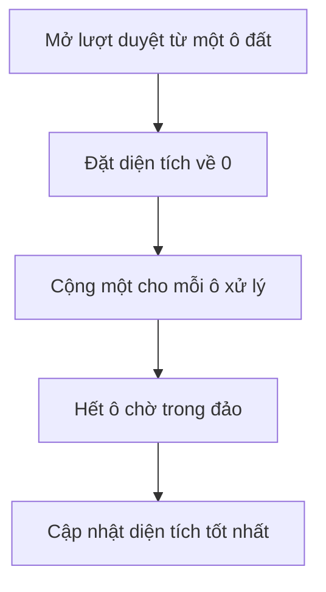

> [!tldr] Đọc nhanh
> - [[concepts/flood-fill|Duyệt lan]] từ một ô đất chưa đánh dấu, cộng một cho mỗi ô xử lý để lấy diện tích của đảo đó.
> - Mỗi lượt duyệt có một bộ đếm diện tích riêng. So kết quả của lượt đó với diện tích tốt nhất đã gặp.
> - [[concepts/mark-on-enqueue|Đánh dấu ngay khi thêm ô]] giữ cho diện tích đếm đúng trên đảo có nhiều đường đi tới cùng một ô.
> - BFS giữ nguyên lưới. DFS lặp đánh dấu trực tiếp trên lưới. Cả hai duyệt trong `O(mn)`.

> [!info] Bối cảnh
> Bài LeetCode 695, thuộc [[posts/2026-11-26-neetcode-grid-traversal|ga 1: Duyệt lưới]] trên **tuyến NeetCode: Đồ thị**. Mình dùng lại bản đồ từ [[problems/number-of-islands|LC-0200]]. Khi đã biết cách đi hết từng đảo, mình có thể đếm các ô trong mỗi lượt đi để tìm đảo lớn nhất. Bạn chỉ cần biết hàng đợi, ngăn xếp và cách đọc tọa độ.

> [!abstract]- Từ điển nhanh cho bài này (bấm để mở)
> - [[concepts/grid-graph|Đồ thị lưới]]: các ô đất nối với nhau khi có chung cạnh ngang hoặc dọc.
> - Một [[concepts/connected-component|thành phần liên thông]] là tập lớn nhất các ô nối được với nhau bằng các đường qua đất.
> - **Diện tích** là số ô trong một thành phần. **Cực đại** là diện tích lớn nhất qua các thành phần.
> - **Danh sách chờ** chứa các ô đã được phát hiện và đang chờ xử lý.

## Hình dung trước: kiểm kê các căn phòng có cửa thông nhau

Mình vào một cụm phòng và dùng một bộ đếm cầm tay. Mỗi lần kiểm tra một phòng, mình bấm thêm một. Khi hết phòng trong cụm, mình so số vừa đếm với kỷ lục ghi trong sổ. Sang cụm tiếp theo, mình đặt bộ đếm cầm tay về 0.

| Đời thường | Khái niệm |
|---|---|
| Cửa nối hai phòng chung tường | Cạnh giữa hai ô đất |
| Một cụm phòng thông nhau | Một thành phần, tương ứng một đảo |
| Bộ đếm cầm tay | Diện tích của lượt duyệt hiện tại |
| Kỷ lục trong sổ | Diện tích lớn nhất đến thời điểm này |



## Vấn đề: cần đo từng đảo rồi lấy lớn nhất

Lưới `m × n` chứa số `1` cho đất và `0` cho nước. Cả hai chiều từ 1 đến 50. Chỉ các ô chung cạnh ngang hoặc dọc nối với nhau, và ngoài lưới được coi là nước. Trả số ô của đảo lớn nhất, hoặc 0 khi không có đất. [Đề LC-0695](https://leetcode.com/problems/max-area-of-island/)

```text
1 0 0 1 1
0 0 0 1 1
0 1 0 1 0
1 1 0 0 0
```

Dùng tọa độ từ 0, các lượt bắt đầu ở `(0,0)`, `(0,3)`, `(2,1)` và lần lượt đếm được 1, 5, 3 ô. Tổng số ô đất là 9. Kỷ lục sau ba lượt là 1, 5, 5, nên đáp án là **5**.

## Cơ chế

<figure class="figure-map" style="--ar: 3 / 4">
<div class="frame"><iframe data-archify="../diagrams/neetcode-max-area-of-island/worked-example.html" title="Cộng diện tích cho từng đảo riêng" loading="lazy"></iframe></div>
<figcaption><span><b>Hình 1.</b> Cộng diện tích cho từng đảo riêng.</span><a href="../diagrams/neetcode-max-area-of-island/worked-example.html" target="_blank" rel="noopener">Mở toàn màn hình</a></figcaption>
</figure>

<details>
<summary>Đọc từng bước</summary>
<ol>
<li>Bắt đầu (0,0), đảo có một ô. <code>area = 1; best = 1</code></li>
<li>Bắt đầu lại bộ đếm tại (0,3). <code>area = 0</code></li>
<li>Lượt tô thứ hai thăm năm ô. <code>area = 5; best = 5</code></li>
<li>Đảo cuối tại (2,1) có ba ô. <code>area = 3</code></li>
<li>Giữ số lớn nhất từng đo. <code>max(1, 5, 3) = 5</code></li>
</ol>
</details>

### Tách số đếm của một đảo khỏi kỷ lục toàn lưới

Quét cả lưới. Ở ô nước hoặc ô đã đánh dấu, đi tiếp. Gặp đất chưa đánh dấu thì mở một lượt duyệt mới. Chỉ thêm các ô đất kề cạnh, nên mọi ô thêm vào đều thuộc đảo của ô gốc. Ngược lại, nếu một ô cùng đảo còn thiếu khi danh sách chờ rỗng, trên đường từ ô gốc tới ô đó sẽ có một bước đi từ ô đã xử lý sang ô chưa phát hiện. Bước kiểm hàng xóm đã phải thêm ô kế tiếp. Thế nên duyệt đủ đảo.

Đánh dấu tại lúc phát hiện giúp mỗi ô có đúng một lượt xử lý. Bắt đầu phép đếm diện tích từ 0 cho mỗi đảo, cộng một cho từng ô được xử lý, rồi cập nhật `best = max(best, area)`. Số đếm của một đảo hết vai trò sau phép so này.

### Cách 1 — BFS giữ nguyên lưới

Dùng mảng `seen` theo chỉ số `id = r*n+c`. Đánh dấu khi đưa vào hàng đợi, rồi lấy đầu để xử lý. Với thứ tự trên, dưới, trái, phải, đảo bắt đầu tại `(0,3)` được lấy ra theo thứ tự `(0,3)`, `(1,3)`, `(0,4)`, `(2,3)`, `(1,4)`. Lúc `(0,4)` kiểm tra `(1,4)`, ô sau đã được thêm bởi `(1,3)`. Diện tích dừng ở 5.

Python và Java lấy đầu từ deque rồi tăng `area` theo từng ô lấy ra. Các bản TypeScript, JavaScript và Go dùng chỉ số đầu. Chúng còn giữ các mục đã xử lý, nên lúc hoàn tất, độ dài mảng hàng đợi bằng số ô của đảo. Nếu đổi sang deque thật, độ dài hàng đợi rỗng lúc hoàn tất và cần giữ biến `area`.

### Cách 2 — DFS lặp và đổi đất thành nước

Đưa ô gốc vào ngăn xếp và đổi thành `0`. Mỗi lần lấy đỉnh, cộng một vào diện tích và kiểm tra bốn ô lân cận. Ô nào còn là `1` thì đổi thành `0` ngay trước khi đẩy vào ngăn xếp. Sau khi đảo bị xóa hết, vòng quét thăm các ô tiếp theo. DFS có thể lấy `(0,4)` trước `(1,3)`, nhưng vẫn đếm đúng năm ô của đảo giữa. Cách tại chỗ cần quyền sửa đầu vào. Nếu cần giữ bản đồ, dùng mảng dấu hoặc sao chép từng hàng.

### Chi phí và số mục chờ đo được

Gọi `L` là số ô của đảo lớn nhất. Quét và duyệt đều tuyến tính theo số ô `mn`, vì mỗi ô đất được thêm đúng một lần và mỗi lần xử lý thử bốn hướng. BFS giữ `O(mn)` dấu cùng tối đa `O(L)` mục trong hàng đợi. DFS tại chỗ giữ ngăn xếp tối đa `O(L)`; trường hợp xấu nhất vẫn là `O(mn)`. Bản lặp tránh đặt chuỗi lời gọi dài theo đường đi của DFS lên call stack. [Giới hạn đệ quy của Python](https://docs.python.org/3/library/sys.html#sys.getrecursionlimit)

Trên lưới toàn đất `50 × 50`, cả hai lấy ra đúng 2.500 ô. Đếm công việc chờ thật với cùng thứ tự kiểm bốn hướng và quy tắc đánh dấu sớm cho kết quả sau.

| Thứ tự lấy ô | Tổng ô xử lý | Số mục đang chờ lớn nhất |
|---|---:|---:|
| BFS, lấy đầu | 2.500 | 50 |
| DFS, lấy đỉnh | 2.500 | 1.226 |

Đây là kích thước danh sách chờ, phụ thuộc hình đảo và thứ tự hàng xóm. Các bản dùng chỉ số đầu vẫn giữ cả 2.500 mục trong mảng của lượt BFS này. Bảng không đo số byte được cấp phát và không khẳng định DFS luôn cần nhiều chỗ hơn BFS.

## Ví dụ chạy được

Năm file cùng chạy sáu ca: bản đồ mẫu, các ô chạm chéo, toàn nước, chỉ một hàng, đảo hình vuông có chu trình và lưới toàn đất `50 × 50`. Bộ kiểm tra còn so từng ô sau BFS với đầu vào và xác nhận DFS tại chỗ đã xóa hết đất.

[TypeScript](../code/neetcode-max-area-of-island/max-area.ts) · [Python](../code/neetcode-max-area-of-island/max_area.py) · [Go](../code/neetcode-max-area-of-island/max_area.go) · [Java](../code/neetcode-max-area-of-island/max-area.java) · [JavaScript](../code/neetcode-max-area-of-island/max-area.js)

```ts
const directions = [[-1, 0], [1, 0], [0, -1], [0, 1]]

function floodBfs(grid: number[][]): number {
  const rows = grid.length, cols = grid[0].length
  const seen = new Uint8Array(rows * cols)
  let result = 0

  for (let start = 0; start < seen.length; start++) {
    if (grid[Math.floor(start / cols)][start % cols] !== 1 || seen[start]) continue

    const queue = [start]
    seen[start] = 1
    for (let head = 0; head < queue.length; head++) {
      const cell = queue[head]
      const row = Math.floor(cell / cols), col = cell % cols
      for (const [dr, dc] of directions) {
        const r = row + dr, c = col + dc
        if (r < 0 || r >= rows || c < 0 || c >= cols || grid[r][c] !== 1) continue
        const next = r * cols + c
        if (seen[next]) continue
        seen[next] = 1
        queue.push(next)
      }
    }
    result = Math.max(result, queue.length)
  }
  return result
}

function floodDfsInPlace(grid: number[][]): number {
  const rows = grid.length, cols = grid[0].length
  let result = 0

  for (let start = 0; start < rows * cols; start++) {
    const row = Math.floor(start / cols), col = start % cols
    if (grid[row][col] !== 1) continue

    const stack = [start]
    grid[row][col] = 0
    let area = 0
    while (stack.length > 0) {
      const cell = stack.pop()!
      area++
      const cr = Math.floor(cell / cols), cc = cell % cols
      for (const [dr, dc] of directions) {
        const r = cr + dr, c = cc + dc
        if (r < 0 || r >= rows || c < 0 || c >= cols || grid[r][c] !== 1) continue
        grid[r][c] = 0
        stack.push(r * cols + c)
      }
    }
    result = Math.max(result, area)
  }
  return result
}

const cases = [
  {grid: ["10011", "00011", "01010", "11000"], want: 5},
  {grid: ["100", "010", "001"], want: 1},
  {grid: ["000", "000"], want: 0},
  {grid: ["11111"], want: 5},
  {grid: ["11", "11"], want: 4},
  {grid: Array.from({length: 50}, () => "1".repeat(50)), want: 2500},
]
for (const {grid, want} of cases) {
  const cells = grid.map(row => Array.from(row, Number))
  if (floodBfs(cells) !== want || cells.some((row, i) => row.join("") !== grid[i])) {
    throw new Error("BFS sai")
  }
  if (floodDfsInPlace(cells) !== want || cells.some(row => row.some(value => value !== 0))) {
    throw new Error("DFS sai")
  }
}
console.log(`${cases.length}/${cases.length} ca đúng`)
```
```python
from collections import deque

DIRECTIONS = ((-1, 0), (1, 0), (0, -1), (0, 1))


def flood_bfs(grid):
    rows, cols = len(grid), len(grid[0])
    seen = bytearray(rows * cols)
    result = 0
    for start in range(len(seen)):
        row, col = divmod(start, cols)
        if grid[row][col] != 1 or seen[start]:
            continue
        queue = deque([start])
        seen[start] = 1
        area = 0
        while queue:
            row, col = divmod(queue.popleft(), cols)
            area += 1
            for dr, dc in DIRECTIONS:
                r, c = row + dr, col + dc
                if not (0 <= r < rows and 0 <= c < cols) or grid[r][c] != 1:
                    continue
                index = r * cols + c
                if seen[index]:
                    continue
                seen[index] = 1
                queue.append(index)
        result = max(result, area)
    return result


def flood_dfs_in_place(grid):
    rows, cols = len(grid), len(grid[0])
    result = 0
    for start in range(rows * cols):
        row, col = divmod(start, cols)
        if grid[row][col] != 1:
            continue
        stack = [start]
        grid[row][col] = 0
        area = 0
        while stack:
            row, col = divmod(stack.pop(), cols)
            area += 1
            for dr, dc in DIRECTIONS:
                r, c = row + dr, col + dc
                if not (0 <= r < rows and 0 <= c < cols) or grid[r][c] != 1:
                    continue
                grid[r][c] = 0
                stack.append(r * cols + c)
        result = max(result, area)
    return result


cases = [
    (["10011", "00011", "01010", "11000"], 5),
    (["100", "010", "001"], 1),
    (["000", "000"], 0),
    (["11111"], 5),
    (["11", "11"], 4),
    (["1" * 50] * 50, 2500),
]
for grid, want in cases:
    cells = [list(map(int, row)) for row in grid]
    assert flood_bfs(cells) == want and ["".join(map(str, row)) for row in cells] == grid
    assert flood_dfs_in_place(cells) == want and not any(map(any, cells))
print(f"{len(cases)}/{len(cases)} ca đúng")
```
```go
package main

import (
	"fmt"
	"strings"
)

var directions = [][2]int{{-1, 0}, {1, 0}, {0, -1}, {0, 1}}

func floodBFS(grid [][]int) int {
	rows, cols := len(grid), len(grid[0])
	seen := make([]bool, rows*cols)
	result := 0
	for start := range seen {
		row, col := start/cols, start%cols
		if grid[row][col] != 1 || seen[start] {
			continue
		}

		queue := []int{start}
		seen[start] = true
		for head := 0; head < len(queue); head++ {
			cell := queue[head]
			row, col := cell/cols, cell%cols
			for _, d := range directions {
				r, c := row+d[0], col+d[1]
				if r < 0 || r >= rows || c < 0 || c >= cols || grid[r][c] != 1 {
					continue
				}
				next := r*cols + c
				if seen[next] {
					continue
				}
				seen[next] = true
				queue = append(queue, next)
			}
		}
		result = max(result, len(queue))
	}
	return result
}

func floodDFSInPlace(grid [][]int) int {
	rows, cols := len(grid), len(grid[0])
	result := 0
	for start := 0; start < rows*cols; start++ {
		row, col := start/cols, start%cols
		if grid[row][col] != 1 {
			continue
		}

		stack := []int{start}
		grid[row][col] = 0
		area := 0
		for len(stack) > 0 {
			top := len(stack) - 1
			cell := stack[top]
			stack = stack[:top]
			area++
			row, col := cell/cols, cell%cols
			for _, d := range directions {
				r, c := row+d[0], col+d[1]
				if r < 0 || r >= rows || c < 0 || c >= cols || grid[r][c] != 1 {
					continue
				}
				grid[r][c] = 0
				stack = append(stack, r*cols+c)
			}
		}
		result = max(result, area)
	}
	return result
}

func main() {
	full := make([]string, 50)
	for i := range full {
		full[i] = strings.Repeat("1", 50)
	}
	cases := []struct {
		grid []string
		want int
	}{
		{[]string{"10011", "00011", "01010", "11000"}, 5},
		{[]string{"100", "010", "001"}, 1},
		{[]string{"000", "000"}, 0},
		{[]string{"11111"}, 5},
		{[]string{"11", "11"}, 4},
		{full, 2500},
	}
	for _, example := range cases {
		cells := make([][]int, len(example.grid))
		for r, row := range example.grid {
			cells[r] = make([]int, len(row))
			for c := range row {
				cells[r][c] = int(row[c] - '0')
			}
		}
		if floodBFS(cells) != example.want {
			panic("BFS sai")
		}
		for r, row := range cells {
			for c, value := range row {
				if value != int(example.grid[r][c]-'0') {
					panic("BFS sai")
				}
			}
		}
		if floodDFSInPlace(cells) != example.want {
			panic("DFS sai")
		}
		for _, row := range cells {
			for _, value := range row {
				if value != 0 {
					panic("DFS sai")
				}
			}
		}
	}
	fmt.Printf("%d/%d ca đúng\n", len(cases), len(cases))
}
```
```java
import java.util.ArrayDeque;
import java.util.Arrays;

class MaxArea {
    static final int[][] DIRECTIONS = {{-1, 0}, {1, 0}, {0, -1}, {0, 1}};

    static int floodBfs(int[][] grid) {
        int rows = grid.length, cols = grid[0].length;
        boolean[] seen = new boolean[rows * cols];
        int result = 0;
        for (int start = 0; start < seen.length; start++) {
            int row = start / cols, col = start % cols;
            if (grid[row][col] != 1 || seen[start]) continue;

            var queue = new ArrayDeque<Integer>();
            seen[start] = true;
            queue.addLast(start);
            int area = 0;
            while (!queue.isEmpty()) {
                int cell = queue.removeFirst();
                area++;
                for (int[] d : DIRECTIONS) {
                    int r = cell / cols + d[0], c = cell % cols + d[1];
                    if (r < 0 || r >= rows || c < 0 || c >= cols || grid[r][c] != 1) continue;
                    int next = r * cols + c;
                    if (seen[next]) continue;
                    seen[next] = true;
                    queue.addLast(next);
                }
            }
            result = Math.max(result, area);
        }
        return result;
    }

    static int floodDfsInPlace(int[][] grid) {
        int rows = grid.length, cols = grid[0].length;
        int result = 0;
        for (int start = 0; start < rows * cols; start++) {
            int row = start / cols, col = start % cols;
            if (grid[row][col] != 1) continue;

            var stack = new ArrayDeque<Integer>();
            grid[row][col] = 0;
            stack.addLast(start);
            int area = 0;
            while (!stack.isEmpty()) {
                int cell = stack.removeLast();
                area++;
                for (int[] d : DIRECTIONS) {
                    int r = cell / cols + d[0], c = cell % cols + d[1];
                    if (r < 0 || r >= rows || c < 0 || c >= cols || grid[r][c] != 1) continue;
                    grid[r][c] = 0;
                    stack.addLast(r * cols + c);
                }
            }
            result = Math.max(result, area);
        }
        return result;
    }

    record Case(String[] grid, int want) {}

    public static void main(String[] args) {
        String[] full = new String[50];
        Arrays.fill(full, "1".repeat(50));
        Case[] cases = {
            new Case(new String[]{"10011", "00011", "01010", "11000"}, 5),
            new Case(new String[]{"100", "010", "001"}, 1),
            new Case(new String[]{"000", "000"}, 0),
            new Case(new String[]{"11111"}, 5),
            new Case(new String[]{"11", "11"}, 4),
            new Case(full, 2500),
        };
        for (Case example : cases) {
            int[][] cells = Arrays.stream(example.grid)
                .map(row -> row.chars().map(ch -> ch - '0').toArray()).toArray(int[][]::new);
            if (floodBfs(cells) != example.want) throw new AssertionError("BFS sai");
            for (int r = 0; r < cells.length; r++) {
                for (int c = 0; c < cells[r].length; c++) {
                    if (cells[r][c] != example.grid[r].charAt(c) - '0') throw new AssertionError("BFS sai");
                }
            }
            if (floodDfsInPlace(cells) != example.want) throw new AssertionError("DFS sai");
            for (int[] row : cells) {
                for (int cell : row) {
                    if (cell != 0) throw new AssertionError("DFS sai");
                }
            }
        }
        System.out.printf("%d/%d ca đúng%n", cases.length, cases.length);
    }
}
```
```js
const directions = [[-1, 0], [1, 0], [0, -1], [0, 1]]

function floodBfs(grid) {
  const rows = grid.length, cols = grid[0].length
  const seen = new Uint8Array(rows * cols)
  let result = 0

  for (let start = 0; start < seen.length; start++) {
    if (grid[Math.floor(start / cols)][start % cols] !== 1 || seen[start]) continue

    const queue = [start]
    seen[start] = 1
    for (let head = 0; head < queue.length; head++) {
      const cell = queue[head]
      const row = Math.floor(cell / cols), col = cell % cols
      for (const [dr, dc] of directions) {
        const r = row + dr, c = col + dc
        if (r < 0 || r >= rows || c < 0 || c >= cols || grid[r][c] !== 1) continue
        const next = r * cols + c
        if (seen[next]) continue
        seen[next] = 1
        queue.push(next)
      }
    }
    result = Math.max(result, queue.length)
  }
  return result
}

function floodDfsInPlace(grid) {
  const rows = grid.length, cols = grid[0].length
  let result = 0

  for (let start = 0; start < rows * cols; start++) {
    const row = Math.floor(start / cols), col = start % cols
    if (grid[row][col] !== 1) continue

    const stack = [start]
    grid[row][col] = 0
    let area = 0
    while (stack.length > 0) {
      const cell = stack.pop()
      area++
      const cr = Math.floor(cell / cols), cc = cell % cols
      for (const [dr, dc] of directions) {
        const r = cr + dr, c = cc + dc
        if (r < 0 || r >= rows || c < 0 || c >= cols || grid[r][c] !== 1) continue
        grid[r][c] = 0
        stack.push(r * cols + c)
      }
    }
    result = Math.max(result, area)
  }
  return result
}

const cases = [
  {grid: ["10011", "00011", "01010", "11000"], want: 5},
  {grid: ["100", "010", "001"], want: 1},
  {grid: ["000", "000"], want: 0},
  {grid: ["11111"], want: 5},
  {grid: ["11", "11"], want: 4},
  {grid: Array.from({length: 50}, () => "1".repeat(50)), want: 2500},
]
for (const {grid, want} of cases) {
  const cells = grid.map(row => Array.from(row, Number))
  if (floodBfs(cells) !== want || cells.some((row, i) => row.join("") !== grid[i])) {
    throw new Error("BFS sai")
  }
  if (floodDfsInPlace(cells) !== want || cells.some(row => row.some(value => value !== 0))) {
    throw new Error("DFS sai")
  }
}
console.log(`${cases.length}/${cases.length} ca đúng`)
```

```text
6/6 ca đúng
```

## Hiểu lầm và bẫy hay gặp

- **Cộng dồn từ đảo trước.** Mỗi ô gốc mở một bộ đếm diện tích mới. Kỷ lục mới tồn tại xuyên suốt vòng quét.
- **Lấy diện tích ngay lúc hàng đợi lớn nhất.** Độ dài đang chờ chỉ cho biết biên công việc. Diện tích đếm các mục đã xử lý, hoặc lấy chiều dài cuối của mảng còn giữ toàn bộ mục.
- **Đếm từ lúc phát hiện và đếm lại lúc xử lý.** Chọn đúng một thời điểm cộng cho mỗi ô. Dấu khi thêm đảm bảo cùng một ô chỉ có một mục.
- **Cho rằng tại chỗ đồng nghĩa với `O(1)` bộ nhớ.** Ngăn xếp vẫn giữ những ô đang chờ.
- **Đổi hàng đợi thành `shift()` hoặc `pop(0)`.** Lấy đầu kiểu này có thể dời nhiều phần tử. Giữ chỉ số đầu hoặc dùng deque như các bản chạy.

## Câu hỏi tự kiểm tra

> [!question]- Hai đảo có 2 và 7 ô, duyệt đảo 7 ô trước thì kỷ lục lần lượt là bao nhiêu?
> 7 rồi 7. Lượt hai cho diện tích 2 và không hạ kỷ lục.

> [!question]- Với một đảo hình vuông 2 × 2, vì sao dấu sớm giữ diện tích ở 4?
> Hai ô cạnh ô gốc đều có thể phát hiện góc đối diện. Lần đầu đã đặt dấu, nên chỉ thêm và cộng góc đó một lần.

> [!question]- Sau khi BFS với Python xử lý hết một đảo, có thể trả `len(queue)` làm diện tích không?
> Không. `popleft()` đã lấy hết phần tử. Biến đếm đã tăng trong quá trình lấy ô mới là diện tích.

## Tham khảo

- [LeetCode · Max Area of Island](https://leetcode.com/problems/max-area-of-island/) — cách tính diện tích, quy tắc kề cạnh và giới hạn lưới.
- [Princeton · Connected components](https://github.com/kevin-wayne/algs4/blob/master/src/main/java/edu/princeton/cs/algs4/CC.java) — lưu kích thước trên từng thành phần khi duyệt DFS.
- [Princeton · Breadth-first paths](https://github.com/kevin-wayne/algs4/blob/master/src/main/java/edu/princeton/cs/algs4/BreadthFirstPaths.java) — hàng đợi và đánh dấu sớm của BFS.
- [Python · Giới hạn đệ quy](https://docs.python.org/3/library/sys.html#sys.getrecursionlimit) và [Java · ArrayDeque](https://docs.oracle.com/en/java/javase/21/docs/api/java.base/java/util/ArrayDeque.html).
