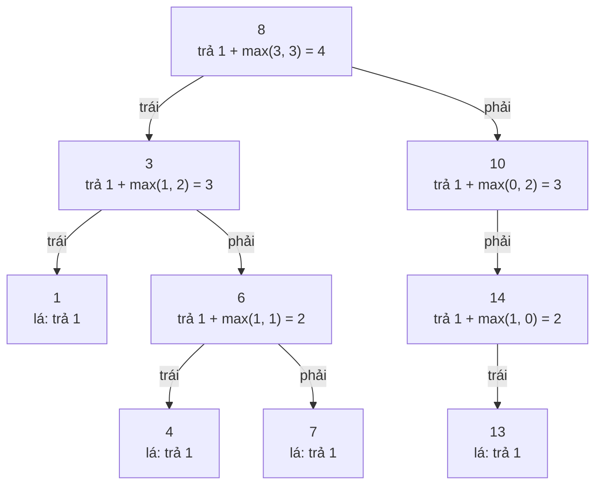
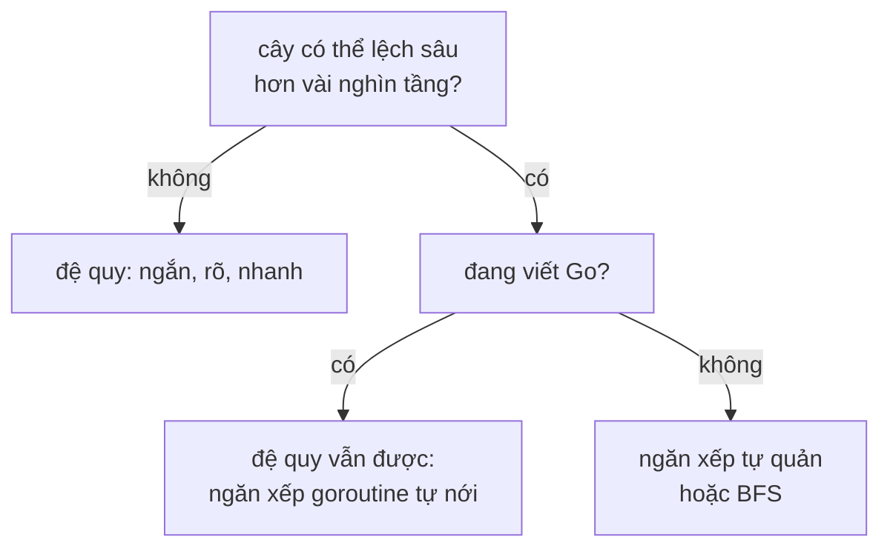

> [!tldr] Đọc nhanh
> - Đề: cho gốc của một [[concepts/binary-tree|cây nhị phân]], trả về số nút trên đường dài nhất từ gốc xuống một lá. Cây rỗng có độ sâu 0. Cây có 0 tới 10⁴ nút.
> - Lời giải gọn nhất là một dòng đệ quy: độ sâu = 1 + độ sâu lớn hơn của hai cây con. Mỗi nút **trả về** một con số cho nút cha, tức là duyệt [[concepts/post-order-traversal|hậu thứ tự]]. O(n) thời gian, O(h) ngăn xếp với h là chiều cao.
> - Hai cách không đệ quy: DFS với ngăn xếp tự quản, mỗi phần tử mang theo độ sâu của nút; và BFS theo tầng, đếm số tầng. Cả hai cũng O(n).
> - Đo ngưỡng thật trên một chuỗi lệch: Python dừng ở 998 tầng, Node ở 7 827 tầng khi hàm chưa được tối ưu và 13 909 khi đã tối ưu, Java ở 39 299, còn Go chạy được 10⁷ tầng. Với cây 10⁴ nút của đề, Python và (đôi khi) Node có thể tràn nếu cây lệch thành chuỗi.
> - Năm bản sai được chạy thật: BFS tăng độ sâu mỗi nút thay vì mỗi tầng (5/8), `best=[0]` làm giá trị mặc định trong Python (6/8, đúng ở lần gọi đầu), Go quên kiểm `root == nil` (panic ở cây rỗng), Java `ArrayDeque.offer(null)` (1/8), JavaScript `root && …` trả `null` cho cây rỗng (7/8).

> [!info] Bối cảnh
> Bài LeetCode 104 (Easy) của [[posts/2026-11-25-neetcode-tree-recursion|ga 3: Đệ quy trên cây]] trên **tuyến NeetCode: Cấu trúc liên kết**. Đây là bài cho thấy khuôn của cả ga rõ nhất: mỗi nút hỏi hai cây con một con số, gộp lại, trả lên trên. Bài trước trong ga, [[problems/invert-binary-tree|Invert Binary Tree]], đi khắp cây để **sửa** nó; bài này đi khắp cây để **tính** một con số. Bạn chỉ cần biết hàm gọi lại chính nó. Lời giải có đủ TypeScript, Python, Go, Java và JavaScript.

> [!abstract]- Từ điển nhanh cho bài này (bấm để mở)
> - **Cây nhị phân**: mỗi nút có một giá trị và tối đa hai con `left`, `right`. Xem [[concepts/binary-tree|Binary Tree]].
> - **Độ sâu tối đa (chiều cao)**: số nút trên đường dài nhất từ gốc xuống lá. Có tài liệu đếm số **cạnh** thay vì số nút (lá có chiều cao 0); bài này đếm số nút (một nút có độ sâu 1).
> - **Hậu thứ tự (post-order)**: xử lý hai cây con trước, nút hiện tại sau. Hợp với bài cần kết quả của con mới tính được của cha. Xem [[concepts/post-order-traversal|Post-order Traversal]].
> - **Ngăn xếp gọi hàm (call stack)**: mỗi lời gọi hàm chưa xong giữ một khung trên ngăn xếp; đệ quy sâu h tầng giữ h khung cùng lúc. Xem [[concepts/stack|Stack]] và [[concepts/recursion-depth-limit|Recursion Depth Limit]].
> - **Chuỗi lệch**: cây mà mỗi nút chỉ có một con, nên trông như danh sách liên kết; chiều cao bằng số nút. Đây là ca xấu nhất cho đệ quy.
> - **JIT**: trình biên dịch lúc chạy của Node và Java. Hàm chạy nhiều lần được dịch lại thành mã máy tối ưu, thường có khung nhỏ hơn, nên chịu được đệ quy sâu hơn.

## Hình dung trước: hỏi gia phả dài mấy đời

Một dòng họ muốn biết gia phả dài nhất bao nhiêu đời. Không ai nhìn được cả cây, nên cụ tổ hỏi hai người con: "nhánh của con dài mấy đời?". Mỗi người con lại hỏi con của mình, cứ thế xuống tới những người chưa có con, họ trả lời "một đời: chỉ có con". Câu trả lời đi ngược lên: mỗi người lấy số lớn hơn trong hai câu trả lời của con, cộng thêm một (chính mình), rồi báo cho cha.

Cách khác là điểm danh theo đời: gọi hết đời thứ nhất ra sân, rồi đời thứ hai, … đếm xem gọi được mấy lượt thì hết người.

| Đời thường | Khái niệm |
|---|---|
| Một người cùng con cháu của họ | một cây con |
| "Nhánh của con dài mấy đời?" | lời gọi đệ quy trên cây con |
| Người chưa có con trả lời "một đời" | lá trả về 1 (vì cây con rỗng trả về 0) |
| Lấy số lớn hơn của hai con, cộng một | `1 + max(trái, phải)` |
| Câu trả lời đi ngược lên | hậu thứ tự: con xong rồi mới tới cha |
| Ai đang chờ con trả lời | khung trên ngăn xếp gọi hàm |
| Điểm danh theo đời, đếm số lượt | BFS theo tầng |
| Một dòng chỉ toàn con một, 10 000 đời | chuỗi lệch: ngăn xếp gọi hàm phải giữ 10 000 người đang chờ |



Mỗi ô chỉ tính được sau khi các ô con đã trả lời. Hai nhánh của gốc 8 đều trả 3 (đường 3, 6, 4 và đường 10, 14, 13), nên gốc trả 1 + 3 = 4.

## Vấn đề

Đầu vào là gốc của một cây nhị phân có từ 0 tới 10⁴ nút, giá trị trong [−100, 100]. Đầu ra là độ sâu tối đa: số nút trên đường dài nhất từ gốc xuống một lá. Cây rỗng trả 0, cây một nút trả 1. Đề gốc: [LeetCode 104](https://leetcode.com/problems/maximum-depth-of-binary-tree/).

Bài này dễ tới mức lời giải đệ quy chỉ một dòng. Chỗ đáng học nằm ở hai câu hỏi phía sau: vì sao một dòng đó đúng (mỗi nút tin vào câu trả lời của con), và khi nào nó **không** chạy được (khi cây sâu hơn ngăn xếp gọi hàm của ngôn ngữ). Câu hỏi thứ hai có con số khác nhau ở mỗi ngôn ngữ, nên mình đo.

## Cơ chế

<figure class="figure-map" style="--ar: 3 / 4">
<div class="frame"><iframe data-archify="../diagrams/neetcode-maximum-depth-of-binary-tree/worked-example.html" title="Chiều sâu lấy nhánh dài hơn" loading="lazy"></iframe></div>
<figcaption><span><b>Hình 1.</b> Chiều sâu lấy nhánh dài hơn.</span><a href="../diagrams/neetcode-maximum-depth-of-binary-tree/worked-example.html" target="_blank" rel="noopener">Mở toàn màn hình</a></figcaption>
</figure>

<details>
<summary>Đọc từng bước</summary>
<ol>
<li>Cây rỗng có chiều sâu 0. <code>null → 0</code></li>
<li>Lá có hai nhánh rỗng. <code>leaf → 1 + max(0, 0) = 1</code></li>
<li>Tại gốc nhận chiều sâu 2 và 1. <code>left = 2; right = 1</code></li>
<li>Tính thêm nút gốc. <code>1 + max(2, 1) = 3</code></li>
</ol>
</details>

### Cách 1: đệ quy hậu thứ tự

```ts
// Cách 1: đệ quy. Độ sâu = 1 + độ sâu lớn hơn của hai cây con; cây rỗng sâu 0. O(n) thời gian, O(h) ngăn xếp.
function maxDepthRecursive(root: TreeNode | null): number {
  if (root === null) return 0;
  return 1 + Math.max(maxDepthRecursive(root.left), maxDepthRecursive(root.right));
}
```

Ca dừng là cây rỗng trả 0, không phải lá trả 1. Nhờ vậy nút chỉ có một con không cần xử lý riêng: phía rỗng trả 0, `max` tự chọn phía còn lại. Mỗi nút được gọi một lần (cộng một lần gọi trên mỗi chỗ `null`, tổng cộng n + 1 lần), nên O(n). Bộ nhớ thêm là số khung đang chờ, bằng chiều cao h.

### Cách 2: DFS với ngăn xếp tự quản

Bỏ đệ quy thì nút không còn "chờ con trả lời" được nữa. Thay vào đó, mỗi nút trên ngăn xếp mang theo độ sâu của chính nó (độ sâu cha cộng một), và ta giữ một kỷ lục.

```ts
// Cách 2: DFS với ngăn xếp tự quản; mỗi nút đi kèm độ sâu của nó. Không dùng ngăn xếp gọi hàm.
function maxDepthStack(root: TreeNode | null): number {
  if (root === null) return 0;
  const nodes: TreeNode[] = [root];
  const depths: number[] = [1];
  let best = 0;
  while (nodes.length > 0) {
    const node = nodes.pop()!;
    const d = depths.pop()!;
    if (d > best) best = d;
    if (node.left !== null) { nodes.push(node.left); depths.push(d + 1); }
    if (node.right !== null) { nodes.push(node.right); depths.push(d + 1); }
  }
  return best;
}
```

Để ý thông tin đã đổi chiều: bản đệ quy truyền **lên** (con báo cho cha), bản này truyền **xuống** (cha cho con biết con ở tầng mấy). Bài này làm được cả hai chiều vì độ sâu của một nút chỉ phụ thuộc đường từ gốc tới nó. Các bài sau trong ga, như [[problems/diameter-of-binary-tree|Diameter of Binary Tree]] hay [[problems/balanced-binary-tree|Balanced Binary Tree]], cần thông tin từ **dưới lên**, và khi đó bản không đệ quy khó viết hơn nhiều.

### Cách 3: BFS đếm tầng

```ts
// Cách 3: BFS theo tầng. Mỗi vòng ngoài xử lý trọn một tầng, nên số vòng chính là độ sâu.
function maxDepthBfs(root: TreeNode | null): number {
  if (root === null) return 0;
  let level: TreeNode[] = [root];
  let depth = 0;
  while (level.length > 0) {
    depth++;
    const next: TreeNode[] = [];
    for (const node of level) {
      if (node.left !== null) next.push(node.left);
      if (node.right !== null) next.push(node.right);
    }
    level = next;
  }
  return depth;
}
```

Chỗ mấu chốt là vòng ngoài đi **từng tầng**, không phải từng nút. Bản Python và Java làm điều đó bằng cách đọc kích thước hàng đợi ở đầu mỗi vòng (`for _ in range(len(queue))`) rồi lấy ra đúng chừng ấy nút.

| Cách | Thời gian | Bộ nhớ thêm | Thông tin đi theo chiều |
|---|---|---|---|
| Đệ quy | O(n) | O(h) trên ngăn xếp gọi hàm | lên: con báo cha |
| Ngăn xếp tự quản | O(n) | O(h) trên heap | xuống: cha báo con |
| BFS theo tầng | O(n) | O(chiều rộng), tới n/2 | đếm tầng |

Chọn cách nào:



### Năm bản sai

**BFS đếm nút thay vì đếm tầng** (TypeScript). Quên vòng trong theo tầng, tăng `depth` mỗi lần lấy một nút ra: kết quả là số nút. Đúng 5/8 ca, vì ở cây rỗng, cây một nút và mọi chuỗi (mỗi tầng một nút) thì số nút bằng số tầng. Cây đủ 3 tầng ra 7.

**`best=[0]` làm giá trị mặc định** (Python). Muốn giữ kỷ lục chung cho mọi lời gọi đệ quy, có người viết:

```python
# SAI: giữ kỷ lục trong một list làm giá trị mặc định. Python tạo list đó MỘT lần lúc định nghĩa hàm,
# nên kỷ lục của lần gọi trước vẫn còn ở lần gọi sau. Gọi lần đầu thì đúng.
def wrong_mutable_default(root, depth=1, best=[0]):
    if root is None:
        return best[0]
    best[0] = max(best[0], depth)
    wrong_mutable_default(root.left, depth + 1, best)
    wrong_mutable_default(root.right, depth + 1, best)
    return best[0]
```

Giá trị mặc định được tính **một lần**, lúc chạy câu `def`, và mọi lời gọi không truyền `best` dùng chung list đó. Chạy 8 ca liên tiếp: sáu ca đầu có độ sâu tăng dần (0, 1, 2, 3, 4, 6) nên vẫn đúng; ca thứ bảy sâu 5 nhưng kỷ lục cũ là 6, trả 6. Đúng 6/8, và một bài kiểm tra chạy từng ca riêng sẽ không bao giờ thấy lỗi. Trình chấm nào chạy nhiều ca trong cùng một tiến trình sẽ thấy lỗi này.

**Go quên kiểm nil ở gốc.** Bản kiểm `root.Left != nil` trước khi gọi đệ quy, nhưng không kiểm `root`. Cây rỗng thì `root.Left` là truy cập con trỏ nil: panic `invalid memory address or nil pointer dereference`. Đúng 7/8.

**Java `ArrayDeque` không nhận null.** Bản BFS đẩy cả hai con vào hàng đợi rồi định bỏ qua `null` khi lấy ra. Nhưng `ArrayDeque.offer(null)` ném `NullPointerException` ngay lập tức, nên mọi cây có ít nhất một nút thiếu con đều lỗi: 1/8, chỉ cây rỗng qua. `LinkedList` nhận `null` nên bản này chạy được với `LinkedList`, nhưng kiểm `null` trước khi đẩy vẫn gọn hơn.

**JavaScript `root && …`** (bản JS). `const f = (root) => root && 1 + Math.max(f(root.left), f(root.right))` trông gọn, nhưng với cây rỗng nó trả `null`, không phải `0`: toán tử `&&` trả về chính vế trái khi vế trái là giá trị "falsy". Bên trong cây vẫn đúng, vì `Math.max(null, null)` đổi `null` thành 0. Đúng 7/8.

### Ngưỡng đệ quy, đo thật

Đề cho tới 10⁴ nút và không hứa cây cân đối. Một chuỗi lệch 10⁴ nút cần 10⁴ khung gọi hàm cùng lúc. Mình dựng chuỗi lệch trái và tìm độ sâu lớn nhất bản đệ quy chạy được (chia đôi), trên Node 24, Python 3.12, Go 1.25 và Java 21, mọi thứ để mặc định:

| Ngôn ngữ | Độ sâu tối đa đo được | Khi vượt | Chuỗi 10⁴ nút của đề |
|---|---|---|---|
| Python | 998 | `RecursionError` (bắt được) | tràn |
| Node (hàm chưa tối ưu, chạy mới) | 7 827 | `RangeError: Maximum call stack size exceeded` | tràn |
| Node (sau khi JIT tối ưu) | 13 909 | như trên | qua |
| Java (luồng main) | 39 299 | `StackOverflowError` (là `Error`, không phải `Exception`) | qua |
| Go | không chạm ngưỡng ở 10⁷ | vượt 1 GB thì chết cả chương trình, không bắt được | qua |
| PHP 8.2 (tắt Xdebug) | không đếm tầng; khung hàm nằm trên heap | hết `memory_limit` thì lỗi fatal; Xdebug bật thì dừng ở 512 tầng | qua |
| Rust (luồng main, 8 MB) | không đo ngưỡng | tiến trình chết với `has overflowed its stack`, không bắt được | qua |

- **Python** đếm số khung, không đo bộ nhớ: giới hạn mặc định là 1 000, trừ vài khung của phần gọi bên ngoài còn 998. `sys.setrecursionlimit(200_000)` cho chuỗi 10⁵ nút chạy trong khoảng 20 ms. Từ Python 3.11, hàm Python gọi hàm Python gần như không tốn ngăn xếp C nên nâng giới hạn khá an toàn; ở bản cũ hơn, nâng quá tay có thể làm sập cả tiến trình.
- **Node** có ngăn xếp cố định (khoảng 1 MB mặc định), và số tầng phụ thuộc kích thước khung. Lần chạy đầu, hàm còn chạy bằng trình thông dịch, khung lớn, chỉ được 7 827 tầng; file JavaScript gọi thẳng trên chuỗi 10⁴ nút và nhận `RangeError`. File TypeScript chạy hàm nhiều lần trước rồi mới đo, khung nhỏ lại, được 13 909 tầng. Cùng một hàm, cùng một máy, hai con số.
- **Java** cũng phụ thuộc JIT; khung của mã đã biên dịch nhỏ, nên luồng main chịu được 39 299 tầng. Cách chữa khi buộc phải đệ quy: chạy trong một `Thread` tự chọn kích thước ngăn xếp. Với 512 MB, chuỗi 10⁶ nút chạy được.
- **Go** cho mỗi goroutine một ngăn xếp nhỏ ban đầu và tự chép sang vùng lớn hơn khi cần, tối đa 1 GB trên máy 64 bit. Chuỗi 10⁷ nút chạy đệ quy được, chậm hơn ngăn xếp tự quản khoảng 5 lần, một phần vì ngăn xếp phải được chép sang vùng lớn hơn nhiều lần.

Trang [[problems/reverse-linked-list|Reverse Linked List]] đo cùng chuyện này trên danh sách liên kết và ra số hơi khác (Node khoảng 15 650, Java 29 470), vì khung của mỗi hàm một cỡ.

### Đo tốc độ

Trên cây đầy đủ 2²⁰ − 1 = 1 048 575 nút (cao 20, không có rủi ro tràn), trung vị 5 lần, ms:

| Ngôn ngữ | Đệ quy | Ngăn xếp | BFS |
|---|---|---|---|
| TypeScript | 9,13 | 6,63 | 17,67 |
| Python | 129,14 | 149,71 | 51,19 |
| Go | 3,31 | 5,61 | 8,28 |
| Java | 4,10 | 8,85 | 8,53 |

Cùng O(n), chênh nhau trong vòng 3 lần. Đáng chú ý nhất là Python: BFS nhanh hơn đệ quy hơn 2 lần, vì vòng trong `for _ in range(len(queue))` với `deque` ít thao tác Python hơn mỗi nút so với một lời gọi hàm Python. Ở Go và Java, đệ quy nhanh nhất vì lời gọi hàm rẻ và không có cấp phát. Số đo trên máy cá nhân lúc có việc khác chạy song song, nên chỉ nên đọc thứ tự, đừng đọc chữ số lẻ.

## Ví dụ chạy được

[TypeScript](../code/neetcode-maximum-depth-of-binary-tree/max-depth.ts) · [Python](../code/neetcode-maximum-depth-of-binary-tree/max_depth.py) · [Go](../code/neetcode-maximum-depth-of-binary-tree/max_depth.go) · [Java](../code/neetcode-maximum-depth-of-binary-tree/max-depth.java) · [JavaScript](../code/neetcode-maximum-depth-of-binary-tree/max-depth.js) · [PHP](../code/neetcode-maximum-depth-of-binary-tree/max-depth.php) · [Rust](../code/neetcode-maximum-depth-of-binary-tree/max_depth.rs)

Mỗi file dựng cây từ mảng theo tầng và chạy 8 ca chung: cây rỗng, một nút, chỉ có con phải, cây đủ 3 tầng, nhánh sâu bên phải, chuỗi trái 6 nút, zigzag 5 tầng, giá trị âm và 0. Các file TypeScript, Python, Go và Java đối chiếu thêm 2 000 cây ngẫu nhiên (mulberry32, tới 40 nút), với độ sâu đúng được ghi lại ngay lúc dựng cây.

Đệ quy:

```ts
// Cách 1: đệ quy. Độ sâu = 1 + độ sâu lớn hơn của hai cây con; cây rỗng sâu 0. O(n) thời gian, O(h) ngăn xếp.
function maxDepthRecursive(root: TreeNode | null): number {
  if (root === null) return 0;
  return 1 + Math.max(maxDepthRecursive(root.left), maxDepthRecursive(root.right));
}
```

```python
# Cách 1: đệ quy. Độ sâu = 1 + độ sâu lớn hơn của hai cây con; cây rỗng sâu 0.
def max_depth_recursive(root):
    if root is None:
        return 0
    return 1 + max(max_depth_recursive(root.left), max_depth_recursive(root.right))
```

```go
// Cách 1: đệ quy. Độ sâu = 1 + độ sâu lớn hơn của hai cây con; cây rỗng (nil) sâu 0.
func maxDepthRecursive(root *TreeNode) int {
	if root == nil {
		return 0
	}
	return 1 + max(maxDepthRecursive(root.Left), maxDepthRecursive(root.Right))
}
```

```java
// Cách 1: đệ quy. Độ sâu = 1 + độ sâu lớn hơn của hai cây con; cây rỗng sâu 0.
static int maxDepthRecursive(TreeNode root) {
    if (root == null) return 0;
    return 1 + Math.max(maxDepthRecursive(root.left), maxDepthRecursive(root.right));
}
```

```js
// Cách 1: đệ quy. Độ sâu = 1 + độ sâu lớn hơn của hai cây con; cây rỗng sâu 0.
function maxDepthRecursive(root) {
  if (root === null) return 0;
  return 1 + Math.max(maxDepthRecursive(root.left), maxDepthRecursive(root.right));
}
```

```php
// Cách 1: đệ quy. Độ sâu = 1 + độ sâu lớn hơn của hai cây con; cây rỗng sâu 0.
function maxDepthRecursive(?TreeNode $root): int
{
    if ($root === null) return 0;
    return 1 + max(maxDepthRecursive($root->left), maxDepthRecursive($root->right));
}
```

```rust
// Cách 1: đệ quy. Độ sâu = 1 + độ sâu lớn hơn của hai cây con; cây rỗng (None) sâu 0.
fn max_depth_recursive(root: &Node) -> i32 {
    match root {
        None => 0,
        Some(n) => {
            let b = n.borrow();
            1 + max_depth_recursive(&b.left).max(max_depth_recursive(&b.right))
        }
    }
}
```

BFS đếm tầng:

```ts
// Cách 3: BFS theo tầng. Mỗi vòng ngoài xử lý trọn một tầng, nên số vòng chính là độ sâu.
function maxDepthBfs(root: TreeNode | null): number {
  if (root === null) return 0;
  let level: TreeNode[] = [root];
  let depth = 0;
  while (level.length > 0) {
    depth++;
    const next: TreeNode[] = [];
    for (const node of level) {
      if (node.left !== null) next.push(node.left);
      if (node.right !== null) next.push(node.right);
    }
    level = next;
  }
  return depth;
}
```

```python
# Cách 3: BFS theo tầng; mỗi vòng ngoài lấy ra đúng số nút của một tầng.
def max_depth_bfs(root):
    if root is None:
        return 0
    queue, depth = deque([root]), 0
    while queue:
        depth += 1
        for _ in range(len(queue)):
            node = queue.popleft()
            if node.left:
                queue.append(node.left)
            if node.right:
                queue.append(node.right)
    return depth
```

```go
// Cách 3: BFS theo tầng; số vòng ngoài là độ sâu.
func maxDepthBfs(root *TreeNode) int {
	if root == nil {
		return 0
	}
	level, depth := []*TreeNode{root}, 0
	for len(level) > 0 {
		depth++
		var next []*TreeNode
		for _, node := range level {
			if node.Left != nil {
				next = append(next, node.Left)
			}
			if node.Right != nil {
				next = append(next, node.Right)
			}
		}
		level = next
	}
	return depth
}
```

```java
// Cách 3: BFS theo tầng; mỗi vòng ngoài lấy ra đúng số nút của một tầng.
static int maxDepthBfs(TreeNode root) {
    if (root == null) return 0;
    Deque<TreeNode> queue = new ArrayDeque<>();
    queue.offer(root);
    int depth = 0;
    while (!queue.isEmpty()) {
        depth++;
        for (int k = queue.size(); k > 0; k--) {
            TreeNode node = queue.poll();
            if (node.left != null) queue.offer(node.left);
            if (node.right != null) queue.offer(node.right);
        }
    }
    return depth;
}
```

```js
// Cách 3: BFS theo tầng; số vòng ngoài là độ sâu.
function maxDepthBfs(root) {
  if (root === null) return 0;
  let level = [root], depth = 0;
  while (level.length > 0) {
    depth++;
    const next = [];
    for (const node of level) {
      if (node.left !== null) next.push(node.left);
      if (node.right !== null) next.push(node.right);
    }
    level = next;
  }
  return depth;
}
```

```php
// Cách 3: BFS theo tầng với SplQueue; mỗi vòng ngoài lấy ra đúng số nút của một tầng.
function maxDepthBfs(?TreeNode $root): int
{
    if ($root === null) return 0;
    $queue = new SplQueue();
    $queue->enqueue($root);
    $depth = 0;
    while (!$queue->isEmpty()) {
        $depth++;
        for ($k = $queue->count(); $k > 0; $k--) {
            $node = $queue->dequeue();
            if ($node->left !== null) $queue->enqueue($node->left);
            if ($node->right !== null) $queue->enqueue($node->right);
        }
    }
    return $depth;
}
```

```rust
// Cách 3: BFS theo tầng với VecDeque; mỗi vòng ngoài lấy ra đúng số nút của một tầng.
fn max_depth_bfs(root: &Node) -> i32 {
    let mut queue: std::collections::VecDeque<Rc<RefCell<TreeNode>>> = root.iter().cloned().collect();
    let mut depth = 0;
    while !queue.is_empty() {
        depth += 1;
        for _ in 0..queue.len() {
            let n = queue.pop_front().unwrap();
            let b = n.borrow();
            queue.extend(b.left.iter().cloned());
            queue.extend(b.right.iter().cloned());
        }
    }
    depth
}
```

Bản ngăn xếp tự quản của cả bảy ngôn ngữ nằm trong các file ở trên.

Kết quả `node max-depth.ts`:

```text
maxDepthRecursive  8/8 ca đúng
maxDepthStack      8/8 ca đúng
maxDepthBfs        8/8 ca đúng
wrongBfsPerNode    5/8 ca đúng; sai ở cây đủ 3 tầng → 7 (đúng là 3), nhánh sâu bên phải → 9 (đúng là 4), giá trị âm và 0 → 4 (đúng là 3)

ngẫu nhiên: maxDepthRecursive 2000/2000, maxDepthStack 2000/2000, maxDepthBfs 2000/2000

Chuỗi lệch trái d nút, trung vị 5 lần (ms)
d          đệ quy   ngăn xếp        BFS
1000           0.02       0.00       0.05
10000          0.18       0.04       0.26
100000   RangeError       0.42       3.28
1000000  RangeError       6.67      25.20
đệ quy chịu được tối đa 13909 tầng (ngăn xếp mặc định của Node)

Cây đầy đủ 1048575 nút, trung vị 5 lần (ms)
maxDepthRecursive      9.13
maxDepthStack          6.63
maxDepthBfs           17.67
```

`python3 max_depth.py`:

```text
max_depth_recursive    8/8 ca đúng
max_depth_stack        8/8 ca đúng
max_depth_bfs          8/8 ca đúng
wrong_mutable_default  6/8 ca đúng; sai ở zigzag 5 tầng → 6 (đúng là 5), giá trị âm và 0 → 6 (đúng là 3)

ngẫu nhiên: max_depth_recursive 2000/2000, max_depth_stack 2000/2000, max_depth_bfs 2000/2000

Chuỗi lệch trái d nút, trung vị 5 lần (ms), giới hạn đệ quy 1000
d          đệ quy   ngăn xếp        BFS
500                0.10           0.07           0.05
1000     RecursionError           0.14           0.10
10000    RecursionError           1.46           1.01
100000   RecursionError          15.10          10.88
sau setrecursionlimit(200000): chuỗi 100000 nút, đệ quy 21.49 ms

Cây đầy đủ 1048575 nút, trung vị 5 lần (ms)
max_depth_recursive      129.14
max_depth_stack          149.71
max_depth_bfs             51.19
```

`go run max_depth.go`:

```text
maxDepthRecursive  8/8 ca đúng
maxDepthStack      8/8 ca đúng
maxDepthBfs        8/8 ca đúng
wrongNoRootCheck   7/8 ca đúng; sai ở cây rỗng → panic

ngẫu nhiên: maxDepthRecursive 2000/2000, maxDepthStack 2000/2000, maxDepthBfs 2000/2000

Chuỗi lệch trái d nút, trung vị 5 lần (ms)
d            đệ quy   ngăn xếp        BFS
1000             0.01       0.00       0.03
100000           1.25       0.28       2.14
1000000         17.68       3.42      21.82
10000000       184.28      38.03     199.44

Cây đầy đủ 1048575 nút, trung vị 5 lần (ms)
maxDepthRecursive      3.31
maxDepthStack          5.61
maxDepthBfs            8.28
```

`java max-depth.java`:

```text
maxDepthRecursive  8/8 ca đúng
maxDepthStack      8/8 ca đúng
maxDepthBfs        8/8 ca đúng
wrongOfferNull     1/8 ca đúng; sai ở một nút → ném NullPointerException, chỉ có con phải → ném NullPointerException, cây đủ 3 tầng → ném NullPointerException, nhánh sâu bên phải → ném NullPointerException, chuỗi trái 6 nút → ném NullPointerException, zigzag 5 tầng → ném NullPointerException, giá trị âm và 0 → ném NullPointerException

ngẫu nhiên: maxDepthRecursive 2000/2000, maxDepthStack 2000/2000, maxDepthBfs 2000/2000

Chuỗi lệch trái d nút, trung vị 5 lần (ms), luồng main
d                đệ quy   ngăn xếp        BFS
1000                 0.01           0.02           0.01
10000                0.08           0.25           0.15
100000      StackOverflow           0.53           0.60
1000000     StackOverflow           9.65           6.11
đệ quy chịu được tối đa 39299 tầng (ngăn xếp mặc định của luồng main)
luồng riêng ngăn xếp 512 MB: chuỗi 1000000 nút, đệ quy 14.06 ms

Cây đầy đủ 1048575 nút, trung vị 5 lần (ms)
maxDepthRecursive      4.10
maxDepthStack          8.85
maxDepthBfs            8.53
```

`node max-depth.js`:

```text
maxDepthRecursive  8/8 ca đúng
maxDepthStack      8/8 ca đúng
maxDepthBfs        8/8 ca đúng
wrongShortCircuit  7/8 ca đúng; sai ở cây rỗng → null (đúng là 0)

chuỗi 10000 nút, maxDepthRecursive: ném RangeError: Maximum call stack size exceeded
chuỗi 10000 nút, maxDepthStack: 10000
chuỗi 100000 nút, maxDepthRecursive: ném RangeError: Maximum call stack size exceeded
chuỗi 100000 nút, maxDepthStack: 100000
```

`php -d xdebug.mode=off max-depth.php`:

```text
maxDepthRecursive  8/8 ca đúng
maxDepthStack      8/8 ca đúng
maxDepthBfs        8/8 ca đúng
wrongBfsPerNode    5/8 ca đúng; sai ở cây đủ 3 tầng → 7 (đúng là 3), nhánh sâu bên phải → 9 (đúng là 4), giá trị âm và 0 → 4 (đúng là 3)

ngẫu nhiên: maxDepthRecursive 2000/2000, maxDepthStack 2000/2000, maxDepthBfs 2000/2000
chuỗi trái 10000 nút: đệ quy → 10000, ngăn xếp → 10000
```

`rustc --edition 2021 -O max_depth.rs && ./max_depth`:

```text
max_depth_recursive 8/8 ca đúng
max_depth_stack     8/8 ca đúng
max_depth_bfs       8/8 ca đúng
wrong_bfs_per_node  5/8 ca đúng; sai ở cây đủ 3 tầng → 7 (đúng là 3), nhánh sâu bên phải → 9 (đúng là 4), giá trị âm và 0 → 4 (đúng là 3)

ngẫu nhiên: max_depth_recursive 2000/2000, max_depth_stack 2000/2000, max_depth_bfs 2000/2000
chuỗi trái 10000 nút: đệ quy → 10000, ngăn xếp → 10000
```

PHP và Rust không đo thời gian; hai file kiểm đúng sai, đối chiếu ngẫu nhiên (bộ sinh số riêng của từng ngôn ngữ) và chạy thử chuỗi 10⁴ nút, cỡ lớn nhất của đề.

## Hiểu lầm và bẫy hay gặp

- **"Ca dừng là lá, trả 1."** Chọn cây rỗng trả 0 thì gọn hơn: không phải xử lý riêng nút một con, và cây rỗng ở đầu vào tự đúng.
- **Đếm cạnh thay vì đếm nút.** Có sách định nghĩa chiều cao của lá là 0. Đề này đếm nút: một nút sâu 1.
- **BFS tăng độ sâu mỗi nút.** Phải tăng mỗi tầng: đọc kích thước hàng đợi ở đầu vòng, hoặc giữ mảng tầng hiện tại và tầng kế.
- **"Đệ quy trên cây không bao giờ tràn."** Chỉ đúng khi cây cân đối. Với chuỗi lệch 10⁴ nút của đề, Python tràn ở 998 tầng và Node có thể tràn ở 7 827 tầng.
- **"Node chịu được N tầng" là một con số cố định.** Cùng một hàm ra 7 827 khi chưa tối ưu và 13 909 sau khi JIT tối ưu.
- **`catch (Exception e)` trong Java bắt được tràn ngăn xếp.** Không: `StackOverflowError` là `Error`.
- **Giá trị mặc định là list trong Python.** Được tạo một lần và dùng chung giữa các lời gọi; dùng `None` rồi tạo list mới trong thân hàm, hoặc trả kết quả qua giá trị trả về như bản đệ quy chuẩn.
- **PHP: tưởng PHP có giới hạn đệ quy như Python.** PHP 8.2 không đếm tầng: chuỗi 10⁴ nút chạy đệ quy bình thường. Thứ chặn bạn là Xdebug (512 tầng, báo "possible infinite loop") hoặc `memory_limit`. Chạy file với `-d xdebug.mode=off` nếu máy có Xdebug.
- **Rust: dùng `match` mà quên mượn.** Viết `match root { Some(n) => … n.left … }` trên `Option<Rc<RefCell<TreeNode>>>` thì phải qua `n.borrow()` mới đọc được `left`; truyền `&Node` thay vì `Node` để khỏi phải `clone()` mỗi tầng.

## Câu hỏi tự kiểm tra

> [!question]- Vì sao `1 + max(trái, phải)` không cần xử lý riêng nút chỉ có một con?
> Vì cây con rỗng trả 0. Nút có một con nhận 0 từ phía rỗng và k từ phía kia, `max` chọn k, kết quả k + 1, đúng. Nếu ca dừng là "lá trả 1" thì phải kiểm riêng từng con có `null` hay không.

> [!question]- Bản đệ quy truyền thông tin lên, bản ngăn xếp truyền xuống. Vì sao bài này làm được cả hai, còn bài đường kính thì không dễ như vậy?
> Độ sâu của một nút chỉ phụ thuộc đường từ gốc tới nó, nên cha có thể báo xuống. Đường kính đi qua một nút cần chiều cao của **cả hai** cây con, thứ chỉ biết được sau khi đã đi hết bên dưới; đó là thông tin từ dưới lên, hợp với đệ quy hậu thứ tự.

> [!question]- Cây đầy đủ 10⁶ nút có nguy cơ tràn ngăn xếp không? Còn chuỗi 10⁴ nút?
> Cây đầy đủ 10⁶ nút chỉ cao 20, đệ quy giữ tối đa khoảng 21 khung: an toàn ở mọi ngôn ngữ. Chuỗi 10⁴ nút cao 10⁴: Python mặc định tràn (998), Node lúc chưa tối ưu tràn (7 827), Java và Go qua.

> [!question]- Hàm `wrong_mutable_default` đúng ở ca đầu tiên. Vì sao các ca sau sai, và sửa thế nào mà vẫn giữ kiểu "kỷ lục chung"?
> List `[0]` được tạo một lần lúc chạy `def` và dùng chung cho mọi lời gọi không truyền `best`, nên kỷ lục cũ còn lại. Sửa: `def f(root, depth=1, best=None)` rồi `if best is None: best = [0]` ở lần gọi ngoài cùng, hoặc bọc trong một hàm ngoài có biến cục bộ và dùng `nonlocal`.

> [!question]- Trong BFS, hàng đợi giữ tối đa bao nhiêu nút với cây đầy đủ 10⁶ nút, và với chuỗi 10⁶ nút?
> Cây đầy đủ: cả tầng cuối, khoảng 5 · 10⁵ nút. Chuỗi: mỗi tầng một nút, nên chỉ 1 nút. BFS tốn bộ nhớ theo chiều rộng, đệ quy và ngăn xếp tự quản tốn theo chiều cao; hai loại cây xấu nhất của chúng ngược nhau.

## Tham khảo

- [LeetCode 104: Maximum Depth of Binary Tree](https://leetcode.com/problems/maximum-depth-of-binary-tree/) (đề gốc: 0 tới 10⁴ nút, giá trị trong [−100, 100])
- [Python `sys.setrecursionlimit`](https://docs.python.org/3/library/sys.html#sys.setrecursionlimit)
- [Python tutorial: giá trị mặc định của tham số](https://docs.python.org/3/tutorial/controlflow.html#default-argument-values) ("The default value is evaluated only once")
- [What's New in Python 3.11: lời gọi hàm Python được gộp vào vòng thông dịch](https://docs.python.org/3/whatsnew/3.11.html#inlined-python-function-calls)
- [Go FAQ: goroutine và ngăn xếp tự nới](https://go.dev/doc/faq#goroutines)
- [Go `runtime/debug.SetMaxStack`](https://pkg.go.dev/runtime/debug#SetMaxStack) (mặc định 1 GB trên hệ 64 bit; goroutine vượt giới hạn thì chương trình sập)
- [Java `ArrayDeque`](https://docs.oracle.com/en/java/javase/21/docs/api/java.base/java/util/ArrayDeque.html) ("Null elements are prohibited")
- [Java `Thread(ThreadGroup, Runnable, String, long stackSize)`](https://docs.oracle.com/en/java/javase/21/docs/api/java.base/java/lang/Thread.html)
- Bài cùng ga: [[problems/invert-binary-tree|Invert Binary Tree]]; cùng câu chuyện tràn ngăn xếp trên danh sách: [[problems/reverse-linked-list|Reverse Linked List]]
