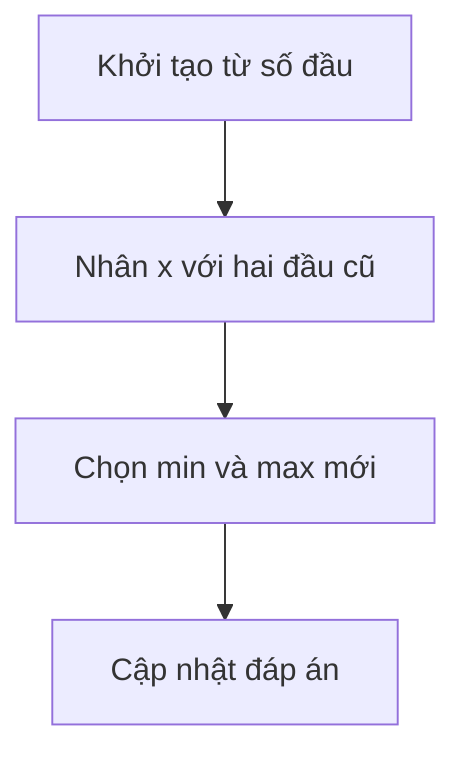

> [!tldr] Đọc nhanh
> - Một số âm có thể biến tích nhỏ nhất ở vị trí trước thành tích lớn nhất ở vị trí sau.
> - Mỗi bước xét ba lựa chọn `x`, `x × high`, `x × low` với hai giá trị cũ.
> - Đáp án toàn mảng là giá lớn nhất trong mọi `high`, kể cả khi kết thúc trước cuối mảng.

> [!info] Bối cảnh
> Bài LeetCode 152, thuộc [[posts/2026-11-27-neetcode-linear-dp|ga 1: Truy hồi một chiều]] trên tuyến NeetCode Quy hoạch động. Bạn chỉ cần biết vòng lặp và mảng để bắt đầu.

> [!abstract]- Từ điển nhanh cho bài này (bấm để mở)
> - Đoạn con là khúc liên tiếp và không rỗng.
> - `high` và `low` lần lượt là tích cực đại và cực tiểu của các đoạn kết thúc ngay tại ô đang xét.
> - Thêm hệ số âm đảo thứ tự. Thêm 0 đưa cả hai đầu về 0.

## Hình dung trước: chọn một chuỗi hệ số trên băng giấy

Trên băng giấy `[-2, 3, -4]`, mình cắt một đoạn rồi nhân mọi hệ số. Sau hai ô, đoạn có tích thấp nhất là `[-2, 3]` với −6. Khi kéo thêm `−4`, chính đoạn đó lên 24.

| Đời thường | Khái niệm |
| --- | --- |
| Vị trí cuối của miếng giấy | Vị trí kết thúc đoạn con |
| Giá trị thấp nhất đang giữ | low |
| Thêm một hệ số âm | Hai đầu đổi vai |
| Giá cao nhất từng thấy | Đáp án |



## Vấn đề: tích lớn nhất trong mọi đoạn liên tiếp

Mảng có từ 1 đến 20.000 phần tử, mỗi giá trị từ −10 đến 10. Tìm tích lớn nhất của một đoạn con không rỗng. Theo đề, tích của mọi đoạn con vừa số nguyên có dấu 32 bit.

## Cơ chế

### Vét cạn theo đầu trái

Với mỗi đầu trái, đặt tích ban đầu là 1 và kéo đầu phải sang từng ô, cập nhật tích đúng một phép nhân mỗi lần. Như vậy tốn O(n²) thời gian, O(1) bộ nhớ.

### Giữ hai đầu của tập tích

Mọi đoạn kết thúc ở `i` hoặc chỉ gồm `x = nums[i]`, hoặc là một đoạn cũ kết thúc ở `i−1` nối thêm x. Tích của tập cũ sau khi nhân x đạt cực biên ở một trong hai đầu của tập cũ. Với x dương thứ tự giữ nguyên, với x âm thứ tự đảo, với x bằng 0 cả hai đầu bằng 0.

Cập nhật `high ← max(x, x × high_cũ, x × low_cũ)` và `low ← min(...)`. Ở ví dụ, hai đầu đi từ `(−2, −2)` tới `(3, −6)`, rồi `(24, −12)`. Phải lấy giá cao nhất qua **mọi** vị trí vì đoạn tốt nhất có thể kết thúc sớm.

Hai đầu và đáp án dùng O(1) bộ nhớ, vòng lặp O(n). Các tích trung gian đều tương ứng một đoạn liên tiếp, nên vừa phạm vi bảo đảm của đề. Với mảng 1.000 số `1` và `−1` xen kẽ, bản vét cạn trong TypeScript đếm 500.500 phép nhân, so với 1.998 phép nhân của DP.

## Ví dụ chạy được

[TypeScript](../code/neetcode-maximum-product-subarray/maximum-product.ts) · [Python](../code/neetcode-maximum-product-subarray/maximum_product.py) · [Go](../code/neetcode-maximum-product-subarray/maximum_product.go) · [Java](../code/neetcode-maximum-product-subarray/maximum-product.java) · [JavaScript](../code/neetcode-maximum-product-subarray/maximum-product.js) · [PHP](../code/neetcode-maximum-product-subarray/maximum-product.php) · [Rust](../code/neetcode-maximum-product-subarray/maximum_product.rs)

Tab hiển thị hàm chính. File tải về còn chạy các cách so sánh trên những ca nhỏ. File TypeScript chạy thêm phép đối chiếu ngẫu nhiên.

```ts
function maximumProduct(values: number[]): number {
  let high = values[0]
  let low = values[0]
  let best = values[0]
  for (let i = 1; i < values.length; i++) {
    const x = values[i]
    const extendHigh = high * x
    const extendLow = low * x
    high = Math.max(x, extendHigh, extendLow)
    low = Math.min(x, extendHigh, extendLow)
    best = Math.max(best, high)
  }
  return best
}
```

```python
def maximum_product(values):
    high = low = best = values[0]
    for index in range(1, len(values)):
        x = values[index]
        extend_high, extend_low = high * x, low * x
        high = max(x, extend_high, extend_low)
        low = min(x, extend_high, extend_low)
        best = max(best, high)
    return best
```

```go
func maximumProduct(values []int) int {
	high, low, best := values[0], values[0], values[0]
	for _, x := range values[1:] {
		extendHigh, extendLow := high*x, low*x
		high = max(x, extendHigh, extendLow)
		low = min(x, extendHigh, extendLow)
		best = max(best, high)
	}
	return best
}
```

```java
static int maximumProduct(int[] values) {
    int high = values[0], low = values[0], best = values[0];
    for (int index = 1; index < values.length; index++) {
        int x = values[index];
        int extendHigh = high * x, extendLow = low * x;
        high = Math.max(x, Math.max(extendHigh, extendLow));
        low = Math.min(x, Math.min(extendHigh, extendLow));
        best = Math.max(best, high);
    }
    return best;
}
```

```js
function maximumProduct(values) {
  let high = values[0]
  let low = values[0]
  let best = values[0]
  for (let i = 1; i < values.length; i++) {
    const x = values[i]
    const extendHigh = high * x
    const extendLow = low * x
    high = Math.max(x, extendHigh, extendLow)
    low = Math.min(x, extendHigh, extendLow)
    best = Math.max(best, high)
  }
  return best
}
```

```php
function maximumProduct(array $values): int {
    $high = $low = $best = $values[0];
    for ($i = 1; $i < count($values); $i++) {
        $x = $values[$i];
        $extendHigh = $high * $x;
        $extendLow = $low * $x;
        $high = max($x, $extendHigh, $extendLow);
        $low = min($x, $extendHigh, $extendLow);
        $best = max($best, $high);
    }
    return $best;
}
```

```rust
fn maximum_product(values: &[i32]) -> i32 {
    let (mut high, mut low, mut best) = (values[0], values[0], values[0]);
    for &x in &values[1..] {
        let (extend_high, extend_low) = (high * x, low * x);
        high = x.max(extend_high).max(extend_low);
        low = x.min(extend_high).min(extend_low);
        best = best.max(high);
    }
    best
}
```

```text
7/7 ca đúng
201/201 ca đối chiếu; mảng 1000 số: vét cạn 500500 phép nhân, DP 1998
```

## Hiểu lầm và bẫy hay gặp

- **Chỉ giữ `high`.** Với ví dụ trên, sau hai vị trí `high = 3` không mang theo đường đưa tới 24.
- **Cập nhật `high` trước khi dùng nó tính `low`.** Cả hai phải đọc hai tích cũ để mỗi lần chỉ nối thêm một ô.
- **Khởi tạo đáp án là 0.** Mảng `[-3]` có đáp án −3 vì đoạn phải không rỗng.
- **Dùng `0` như dấu dừng vòng lặp.** Có thể có đoạn lớn hơn sau vị trí 0.

## Câu hỏi tự kiểm tra

> [!question]- Khi đọc `0`, hai đầu trở thành gì?
> Đều bằng 0. Các tích nối thêm 0 đều bằng 0 và đoạn chỉ chứa ô này cũng bằng 0.

> [!question]- Vì sao không trả `high` của vị trí cuối?
> Nó chỉ đại diện các đoạn chạm cuối mảng. Tích tốt nhất có thể nằm trước một số 0.

## Tham khảo

- [LeetCode 152 · Maximum Product Subarray](https://leetcode.com/problems/maximum-product-subarray/)
- [MIT 6.006 · Dynamic Programming](https://ocw.mit.edu/courses/6-006-introduction-to-algorithms-spring-2020/resources/lecture-notes/)
