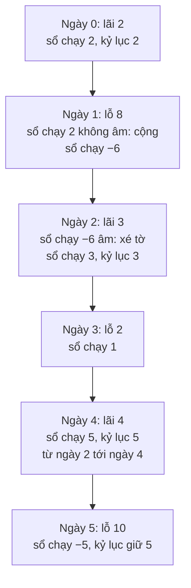
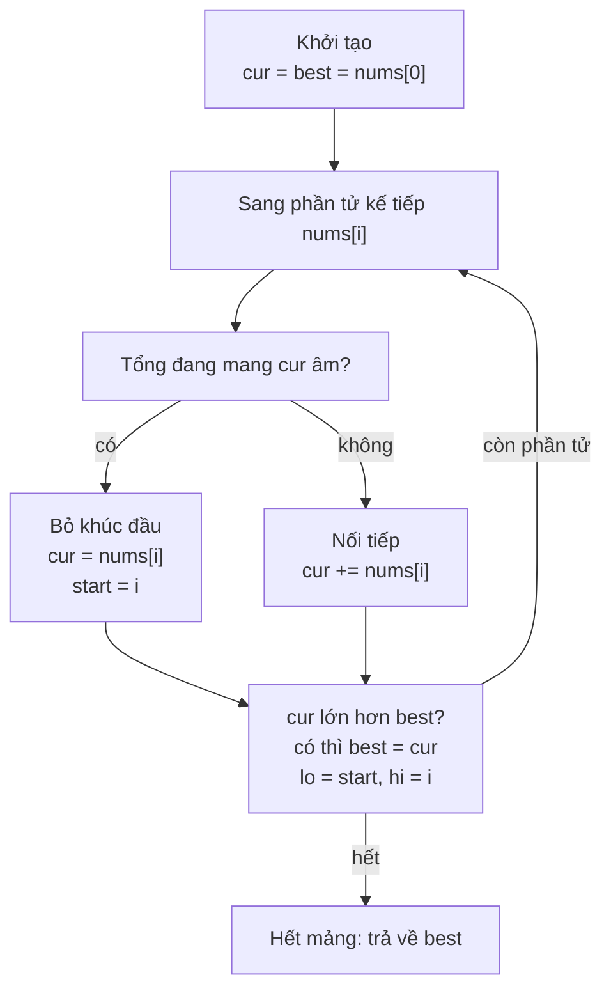

> [!tldr] Đọc nhanh
> - Đoạn con có tổng lớn nhất kết thúc tại vị trí i chỉ có hai khả năng: chỉ gồm `nums[i]`, hoặc nối `nums[i]` vào đoạn tốt nhất kết thúc tại i − 1. Chọn cái lớn hơn là xong một bước.
> - Phát biểu kiểu [[concepts/greedy-choice|lựa chọn tham lam]]: tổng đang mang mà âm thì bỏ nó đi, bắt đầu lại từ phần tử hiện tại. Đó là [[concepts/kadane-algorithm|thuật toán Kadane]], một lượt, O(n) thời gian, O(1) bộ nhớ.
> - Muốn biết đoạn nào, chỉ cần nhớ thêm chỗ bắt đầu lại, và chép biên mỗi khi phá kỷ lục.
> - Khởi tạo kỷ lục bằng 0 là bẫy kinh điển: mảng toàn số âm sẽ ra 0, trong khi đề bắt chọn ít nhất một phần tử.
> - Với n = 10.000, cách vét O(n²) làm 50.005.000 phép cộng; Kadane làm 10.000. Trên máy mình, Python mất khoảng 1,8 giây so với 0,23 mili giây.

> [!info] Bối cảnh
> Đây là bài LeetCode 53, bài neo của [[posts/2026-11-28-neetcode-greedy-array|ga MISC-03: Tham lam trên mảng]] trên **tuyến NeetCode: Kỹ thuật tổng hợp**. Mình hình dung sổ lãi lỗ từng ngày của một quầy hàng và muốn tìm chuỗi ngày liền nhau làm ăn tốt nhất. Bạn chỉ cần biết mảng và vòng lặp; đoạn chia để trị có dùng đệ quy.

> [!abstract]- Từ điển nhanh cho bài này (bấm để mở)
> - Đoạn con (subarray) là một khúc liền nhau của mảng, ít nhất một phần tử. `[3, -2, 4]` là đoạn con của `[2, -8, 3, -2, 4, -10]`; `[2, 3]` thì không, vì nó nhảy cóc.
> - Tham lam (greedy) là ở mỗi bước chọn ngay cái có vẻ tốt nhất lúc đó và không bao giờ quay lại xét lại. Nó chỉ đúng khi chứng minh được rằng lựa chọn đó không làm mất đáp án.
> - `cur` là tổng của đoạn tốt nhất **kết thúc tại** vị trí đang xét; `best` là kỷ lục từ đầu tới giờ.
> - [[concepts/prefix-sum|Tổng tiền tố]] P[k] là tổng k phần tử đầu, nên tổng đoạn i..j bằng P[j + 1] − P[i].
> - Chia để trị (divide and conquer) cắt bài làm đôi, giải mỗi nửa, rồi ghép kết quả.

## Hình dung trước: sổ lãi lỗ của quầy hàng

Mình có sổ ghi lãi (số dương) hoặc lỗ (số âm) của một quầy hàng qua từng ngày, và muốn khoe chuỗi ngày liền nhau có tổng lãi cao nhất. Mình lật sổ từ ngày đầu, cầm một tờ "sổ chạy" cộng dồn từ ngày bắt đầu đếm. Sáng mỗi ngày, mình nhìn sổ chạy: nếu nó đang âm, tức là mấy ngày vừa rồi cộng lại là lỗ, thì mang khoản lỗ đó sang hôm nay chỉ làm tổng thấp đi. Mình xé tờ đó, bắt đầu đếm lại từ hôm nay. Bên cạnh, một tấm bảng ghi kỷ lục cao nhất từng thấy, kèm ngày bắt đầu và ngày kết thúc của nó.

| Đời thường | Khái niệm |
|---|---|
| Lãi hoặc lỗ của mỗi ngày | `nums[i]` |
| Chuỗi ngày liền nhau | Đoạn con `nums[lo..hi]` |
| Tờ sổ chạy cộng dồn từ ngày bắt đầu đếm | `cur` |
| Sổ chạy đang âm: xé, đếm lại từ hôm nay | `cur < 0` thì `cur = nums[i]`, `start = i` |
| Sổ chạy không âm: cộng tiếp hôm nay | `cur += nums[i]` |
| Bảng kỷ lục kèm ngày đầu và ngày cuối | `best`, `lo`, `hi` |

Với sổ `[2, -8, 3, -2, 4, -10]`, mình đi từng ngày như sau:



## Vấn đề: khúc liền nhau có tổng lớn nhất

Cho mảng số nguyên `nums` dài từ 1 đến 100.000, mỗi phần tử nằm trong khoảng −10.000 đến 10.000. Hãy chọn một đoạn con liền nhau, **không rỗng**, sao cho tổng các phần tử của nó lớn nhất, và trả về tổng đó. Ví dụ với `[3, -2, 5, -1]`, đoạn `[3, -2, 5]` cho tổng 6. LeetCode gợi ý thử thêm cách chia để trị sau khi đã có lời giải O(n). [Đề gốc LeetCode 53](https://leetcode.com/problems/maximum-subarray/)

Giới hạn cho biết hai điều. Thứ nhất, n tới 100.000 nên O(n²) là 5·10⁹ phép cộng, quá chậm. Thứ hai, tổng lớn nhất có thể là 100.000 × 10.000 = 10⁹, vẫn vừa số nguyên 32 bit (giới hạn khoảng 2,147·10⁹), nên không cần `long`.

Lần đầu mình nghĩ: "số âm thì bỏ qua". Nhưng `[3, -2, 5]` cho thấy một số âm nằm giữa hai số dương lớn vẫn đáng giữ, vì bỏ nó là đứt đoạn. Thứ cần bỏ không phải từng số âm, mà là cả một **khúc đầu** có tổng âm.

## Cơ chế

### Vét cạn: O(n³) rồi O(n²)

Cách thô nhất xét mọi cặp (i, j) với i ≤ j và cộng lại từ đầu `nums[i..j]`. Có khoảng n²/2 cặp, mỗi cặp cộng tới n số: O(n³) thời gian. Mình giữ cách này làm trọng tài trong file chạy, vì nó không dùng chung dòng nào với các cách còn lại.

Bỏ được một tầng vòng lặp: cố định điểm đầu i, rồi đi j từ i sang phải và cộng dồn `sum += nums[j]`. Tổng của `nums[i..j]` có ngay từ tổng của `nums[i..j-1]`. Còn n(n + 1)/2 phép cộng: O(n²) thời gian, O(1) bộ nhớ.

### Tổng tiền tố

Tổng đoạn i..j là P[j + 1] − P[i]. Với mỗi điểm cuối j, đoạn tốt nhất kết thúc tại j là P[j + 1] trừ đi tiền tố **nhỏ nhất** đứng trước nó (kể cả P[0] = 0, tiền tố rỗng). Một lượt quét, giữ `minPrefix` chạy: O(n) thời gian, O(1) bộ nhớ. Đây cũng là bài [[problems/best-time-to-buy-and-sell-stock|Best Time to Buy and Sell Stock]] đội lốt: mua ở tiền tố thấp nhất, bán ở tiền tố hiện tại.

### Chia để trị: O(n log n)

Cắt mảng ở giữa `mid`. Đoạn tốt nhất hoặc nằm hẳn bên trái, hoặc nằm hẳn bên phải, hoặc vắt qua `mid`. Hai trường hợp đầu giải đệ quy. Trường hợp vắt qua thì phải chứa cả `nums[mid]` lẫn `nums[mid + 1]`, nên nó bằng tổng lớn nhất của đoạn **kết thúc tại** `mid` (đi từ `mid` sang trái) cộng tổng lớn nhất của đoạn **bắt đầu tại** `mid + 1` (đi sang phải). Phần ghép tốn O(n) mỗi tầng, có log n tầng: T(n) = 2T(n/2) + O(n) = O(n log n). Ngăn xếp gọi hàm sâu O(log n), khoảng 17 tầng khi n = 100.000.

### Kadane: O(n), O(1)

Gọi `cur` là tổng của đoạn tốt nhất **kết thúc tại** i. Đoạn đó hoặc chỉ là `nums[i]`, hoặc là đoạn tốt nhất kết thúc tại i − 1 nối thêm `nums[i]`. Vậy `cur = max(nums[i], cur + nums[i])`. Đáp án là `cur` lớn nhất từng thấy. Đây là một [[concepts/rolling-state|trạng thái cuộn]]: mỗi bước chỉ đọc giá trị `cur` của bước trước.

`max(nums[i], cur + nums[i])` chọn `nums[i]` đúng khi `cur < 0`. Nên mình viết lại theo kiểu tham lam: nhìn tổng đang mang trước khi cộng; âm thì bỏ, bắt đầu lại tại i. Vì sao bỏ được mà không mất đáp án? Đó là [[concepts/restart-argument|lập luận bắt đầu lại]]: một khúc đầu có tổng âm, gắn vào trước bất kỳ đoạn nào phía sau, chỉ làm đoạn đó nhỏ đi. Còn những điểm bắt đầu nằm **bên trong** khúc vừa bỏ cũng không cứu được gì: khi khúc bắt đầu tại `start` vừa thành âm, mọi khúc đầu ngắn hơn của nó đều không âm (nếu không thì đã bắt đầu lại sớm hơn), nên phần đuôi từ một điểm giữa tới i có tổng còn âm hơn, cũng đáng bỏ.



**Lấy cả biên đoạn.** Thêm biến `start`: mỗi lần bắt đầu lại thì `start = i`. Mỗi khi `cur` phá kỷ lục thì chép `lo = start`, `hi = i`. Chỉ chép biên lúc phá kỷ lục, không chép lúc bắt đầu lại, vì đoạn mới có thể không bao giờ vượt kỷ lục cũ.

**Khác gì Maximum Product Subarray.** Ở [[problems/maximum-product-subarray|Maximum Product Subarray]], một số âm nhân với tích âm lại thành dương lớn, nên "tích đang mang xấu thì bỏ" không còn đúng: tích âm nhất hôm nay có thể thành tích lớn nhất ngày mai. Bài đó phải giữ **hai** trạng thái, tích lớn nhất và nhỏ nhất kết thúc tại i. Với tổng thì cộng một số không đổi chiều thứ tự, nên một trạng thái là đủ.

| Cách | Thời gian | Bộ nhớ phụ | Ghi chú |
|---|---|---|---|
| Cộng lại mọi đoạn | O(n³) | O(1) | Trọng tài trong file chạy |
| Cố định điểm đầu, cộng dồn | O(n²) | O(1) | 5·10⁹ phép cộng khi n = 100.000 |
| Chia để trị | O(n log n) | O(log n) | Ngăn xếp gọi hàm; LeetCode gợi ý thử |
| Tổng tiền tố trừ tiền tố nhỏ nhất | O(n) | O(1) | Cùng ý với bài mua bán cổ phiếu |
| Kadane | O(n) | O(1) | Cách chính; thêm `start` để có biên |

### Đo thật: O(n²) so với O(n)

Mình sinh một mảng 10.000 số trong khoảng −10.000..10.000 bằng bộ sinh MINSTD với cùng hạt giống, nên cả bảy ngôn ngữ cùng một mảng và cùng ra tổng 352094. Bản O(n²) đếm được 50.005.000 phép cộng, đúng n(n + 1)/2; Kadane cộng 10.000 lần. Chạy `kadane.<đuôi> bench` thì file in thêm thời gian mỗi lượt. Cách nhanh chạy nhiều lượt rồi chia trung bình, vì một lượt Kadane ngắn hơn độ phân giải của đồng hồ. Trên máy mình (Intel i7-12700H; Node 24, Python 3.12, Go 1.25, Java 21, PHP 8.2, Rust 1.99):

| Ngôn ngữ | O(n²) | Chia để trị | Kadane |
|---|---|---|---|
| TypeScript, JavaScript | 54 ms | 0,34 ms | 0,013 ms |
| Python | 1.770 ms | 16 ms | 0,23 ms |
| Go | 22 ms | 0,093 ms | 0,008 ms |
| Java | 11 ms | 0,15 ms | 0,004 ms |
| PHP | 415 ms | 3,5 ms | 0,097 ms |
| Rust | 22 ms | 0,091 ms | 0,004 ms |

Khoảng cách O(n²) và Kadane là ba đến bốn bậc độ lớn ở mọi ngôn ngữ, gần với tỉ lệ 5.000 lần của số phép cộng. Ở n = 100.000, số phép cộng của O(n²) tăng 100 lần; mình không đo cỡ đó, nhưng nhân thẳng ra thì Python mất cỡ ba phút, còn Kadane vẫn dưới 3 mili giây. Thời gian lệch theo máy và theo lần chạy; con số đếm phép cộng thì không.

## Ví dụ chạy được

[TypeScript](../code/neetcode-maximum-subarray/kadane.ts) · [Python](../code/neetcode-maximum-subarray/kadane.py) · [Go](../code/neetcode-maximum-subarray/kadane.go) · [Java](../code/neetcode-maximum-subarray/kadane.java) · [JavaScript](../code/neetcode-maximum-subarray/kadane.js) · [PHP](../code/neetcode-maximum-subarray/kadane.php) · [Rust](../code/neetcode-maximum-subarray/kadane.rs)

```ts
// Cách chính: Kadane. Tổng đang mang mà âm thì bỏ, bắt đầu lại từ phần tử hiện tại
function maxSubArray(nums: number[]): number {
    let cur = nums[0] // tổng tốt nhất của đoạn kết thúc tại i
    let best = nums[0]
    for (let i = 1; i < nums.length; i++) {
        cur = cur < 0 ? nums[i] : cur + nums[i] // phần đầu âm chỉ kéo tổng xuống
        if (cur > best) best = cur
    }
    return best
}

// Kadane kèm biên: nhớ chỗ bắt đầu lại, chép biên mỗi khi phá kỷ lục
function maxSubArrayBounds(nums: number[]): [number, number, number] {
    let cur = nums[0]
    let best = nums[0]
    let start = 0
    let lo = 0
    let hi = 0
    for (let i = 1; i < nums.length; i++) {
        if (cur < 0) {
            cur = nums[i]
            start = i // đoạn mới bắt đầu tại i
        } else {
            cur += nums[i]
        }
        if (cur > best) {
            best = cur
            lo = start
            hi = i
        }
    }
    return [best, lo, hi]
}
```

```python
# Cách chính: Kadane. Tổng đang mang mà âm thì bỏ, bắt đầu lại từ phần tử hiện tại
def max_sub_array(nums):
    cur = nums[0]  # tổng tốt nhất của đoạn kết thúc tại i
    best = nums[0]
    for x in nums[1:]:
        cur = x if cur < 0 else cur + x  # phần đầu âm chỉ kéo tổng xuống
        if cur > best:
            best = cur
    return best


# Kadane kèm biên: nhớ chỗ bắt đầu lại, chép biên mỗi khi phá kỷ lục
def max_sub_array_bounds(nums):
    cur = best = nums[0]
    start = lo = hi = 0
    for i in range(1, len(nums)):
        if cur < 0:
            cur = nums[i]
            start = i  # đoạn mới bắt đầu tại i
        else:
            cur += nums[i]
        if cur > best:
            best, lo, hi = cur, start, i
    return best, lo, hi
```

```go
// Cách chính: Kadane. Tổng đang mang mà âm thì bỏ, bắt đầu lại từ phần tử hiện tại
func maxSubArray(nums []int) int {
	cur := nums[0] // tổng tốt nhất của đoạn kết thúc tại i
	best := nums[0]
	for _, x := range nums[1:] {
		if cur < 0 {
			cur = x // phần đầu âm chỉ kéo tổng xuống
		} else {
			cur += x
		}
		if cur > best {
			best = cur
		}
	}
	return best
}

// Kadane kèm biên: nhớ chỗ bắt đầu lại, chép biên mỗi khi phá kỷ lục
func maxSubArrayBounds(nums []int) (best, lo, hi int) {
	cur := nums[0]
	best = nums[0]
	start := 0
	for i := 1; i < len(nums); i++ {
		if cur < 0 {
			cur = nums[i]
			start = i // đoạn mới bắt đầu tại i
		} else {
			cur += nums[i]
		}
		if cur > best {
			best, lo, hi = cur, start, i
		}
	}
	return best, lo, hi
}
```

```java
// Cách chính: Kadane. Tổng đang mang mà âm thì bỏ, bắt đầu lại từ phần tử hiện tại
static int maxSubArray(int[] nums) {
    int cur = nums[0]; // tổng tốt nhất của đoạn kết thúc tại i
    int best = nums[0];
    for (int i = 1; i < nums.length; i++) {
        cur = cur < 0 ? nums[i] : cur + nums[i]; // phần đầu âm chỉ kéo tổng xuống
        if (cur > best) best = cur;
    }
    return best;
}

// Kadane kèm biên: nhớ chỗ bắt đầu lại, chép biên mỗi khi phá kỷ lục
static int[] maxSubArrayBounds(int[] nums) {
    int cur = nums[0], best = nums[0];
    int start = 0, lo = 0, hi = 0;
    for (int i = 1; i < nums.length; i++) {
        if (cur < 0) {
            cur = nums[i];
            start = i; // đoạn mới bắt đầu tại i
        } else {
            cur += nums[i];
        }
        if (cur > best) {
            best = cur;
            lo = start;
            hi = i;
        }
    }
    return new int[]{best, lo, hi};
}
```

```js
// Cách chính: Kadane. Tổng đang mang mà âm thì bỏ, bắt đầu lại từ phần tử hiện tại
function maxSubArray(nums) {
    let cur = nums[0] // tổng tốt nhất của đoạn kết thúc tại i
    let best = nums[0]
    for (let i = 1; i < nums.length; i++) {
        cur = cur < 0 ? nums[i] : cur + nums[i] // phần đầu âm chỉ kéo tổng xuống
        if (cur > best) best = cur
    }
    return best
}

// Kadane kèm biên: nhớ chỗ bắt đầu lại, chép biên mỗi khi phá kỷ lục
function maxSubArrayBounds(nums) {
    let cur = nums[0]
    let best = nums[0]
    let start = 0
    let lo = 0
    let hi = 0
    for (let i = 1; i < nums.length; i++) {
        if (cur < 0) {
            cur = nums[i]
            start = i // đoạn mới bắt đầu tại i
        } else {
            cur += nums[i]
        }
        if (cur > best) {
            best = cur
            lo = start
            hi = i
        }
    }
    return [best, lo, hi]
}
```

```php
// Cách chính: Kadane. Tổng đang mang mà âm thì bỏ, bắt đầu lại từ phần tử hiện tại
function maxSubArray(array $nums): int {
    $cur = $nums[0]; // tổng tốt nhất của đoạn kết thúc tại i
    $best = $nums[0];
    for ($i = 1, $n = count($nums); $i < $n; $i++) {
        $cur = $cur < 0 ? $nums[$i] : $cur + $nums[$i]; // phần đầu âm chỉ kéo tổng xuống
        if ($cur > $best) $best = $cur;
    }
    return $best;
}

// Kadane kèm biên: nhớ chỗ bắt đầu lại, chép biên mỗi khi phá kỷ lục
function maxSubArrayBounds(array $nums): array {
    $cur = $best = $nums[0];
    $start = $lo = $hi = 0;
    for ($i = 1, $n = count($nums); $i < $n; $i++) {
        if ($cur < 0) {
            $cur = $nums[$i];
            $start = $i; // đoạn mới bắt đầu tại i
        } else {
            $cur += $nums[$i];
        }
        if ($cur > $best) {
            [$best, $lo, $hi] = [$cur, $start, $i];
        }
    }
    return [$best, $lo, $hi];
}
```

```rust
// Cách chính: Kadane. Tổng đang mang mà âm thì bỏ, bắt đầu lại từ phần tử hiện tại
fn max_sub_array(nums: &[i32]) -> i32 {
    let mut cur = nums[0]; // tổng tốt nhất của đoạn kết thúc tại i
    let mut best = nums[0];
    for &x in &nums[1..] {
        cur = if cur < 0 { x } else { cur + x }; // phần đầu âm chỉ kéo tổng xuống
        best = best.max(cur);
    }
    best
}

// Kadane kèm biên: nhớ chỗ bắt đầu lại, chép biên mỗi khi phá kỷ lục
fn max_sub_array_bounds(nums: &[i32]) -> (i32, usize, usize) {
    let (mut cur, mut best) = (nums[0], nums[0]);
    let (mut start, mut lo, mut hi) = (0, 0, 0);
    for i in 1..nums.len() {
        if cur < 0 {
            cur = nums[i];
            start = i; // đoạn mới bắt đầu tại i
        } else {
            cur += nums[i];
        }
        if cur > best {
            (best, lo, hi) = (cur, start, i);
        }
    }
    (best, lo, hi)
}
```

Các tab trích Kadane và bản kèm biên. File tải về còn có bản tổng tiền tố, chia để trị, vét O(n²), trọng tài O(n³) và bản sai khởi tạo `best = 0`. Chín ca kiểm tra gồm một phần tử dương, một phần tử âm, toàn số âm, toàn số 0, kỷ lục ở giữa, kỷ lục ở cuối, và giá trị ở biên ±10.000. Với mỗi ca, cả năm cách phải ra đúng tổng mong đợi, và biên `lo..hi` của Kadane phải cộng lại đúng bằng tổng đó.

Dòng thứ hai đối chiếu 3.000 mảng ngẫu nhiên dài 1–12, giá trị −10..10, với trọng tài O(n³). Hai dòng cuối là bẫy khởi tạo bằng 0 trên mảng toàn âm, và phép đếm phép cộng ở n = 10.000.

```text
9/9 ca đúng
3000/3000 ca đúng (đối chiếu vét O(n³))
Khởi tạo best = 0 với [-3,-1,-2]: ra 0, đúng là -1
n = 10000: O(n²) cộng 50005000 lần, Kadane 10000 lần, cùng ra 352094
```

Cả bảy ngôn ngữ in đúng bốn dòng này; dòng thời gian chỉ hiện khi thêm tham số `bench`.

## Hiểu lầm và bẫy hay gặp

- Khởi tạo `best = 0` (hoặc `cur = max(0, cur + x)`). Cách này ngầm cho phép chọn đoạn rỗng, nên `[-3, -1, -2]` ra 0 thay vì −1, như dòng thứ ba ở trên. Khởi tạo bằng `nums[0]`.
- Trả về `cur` lúc kết thúc thay vì `best`. `cur` chỉ là đoạn tốt nhất **kết thúc tại** phần tử cuối: với `[2, -8, 3, -2, 4, -10]` nó là −5, còn đáp án là 5.
- Bỏ từng số âm. Số âm ở giữa hai khúc dương lớn vẫn đáng giữ: `[3, -2, 5]` cho 6, còn bỏ −2 thì chỉ còn 5. Thứ cần bỏ là khúc đầu có tổng âm.
- Chép `lo = start` ngay lúc bắt đầu lại. Với `[5, -10, 1]`, bắt đầu lại ở chỉ số 2 sẽ đặt `lo = 2` trong khi `hi` vẫn là 0 của kỷ lục cũ. Chỉ chép cả cặp biên khi phá kỷ lục.
- Mang Kadane sang bài tích. Với `[-2, 3, -4]`, "tích âm thì bỏ" cho 3, còn tích cả mảng là 24. Bài đó cần thêm tích nhỏ nhất, như trang [[problems/maximum-product-subarray|Maximum Product Subarray]].
- Java, Go, Rust: khởi tạo `cur` bằng số nhỏ nhất của kiểu (`Integer.MIN_VALUE`, `math.MinInt`, `i32::MIN`) rồi viết `cur + x`. Cộng với số âm là tràn số. Java và Go lặng lẽ quay vòng: `Integer.MIN_VALUE + (-3)` ra `2147483645`, thành "kỷ lục" giả. Rust báo lỗi `attempt to add with overflow` khi build debug, nhưng với `-O` thì cũng quay vòng im lặng. Khởi tạo bằng `nums[0]` tránh được cả ba. Trong chia để trị, `leftBest + rightBest` an toàn vì mỗi nửa có ít nhất một phần tử nên không biến nào còn giữ giá trị nhỏ nhất.
- Python: `for x in nums[1:]` chép cả mảng, tốn thêm O(n) bộ nhớ. Với n = 100.000 thì không sao, nhưng nếu cần đúng O(1) thì đi theo chỉ số hoặc dùng `itertools.islice`.
- PHP: `($lo + $hi) / 2` trả về số thực (`1.5`), không phải số nguyên. Mình dùng `intdiv($lo + $hi, 2)`.
- JavaScript, TypeScript: `-Infinity` là số, so sánh với số nguyên bình thường, nên dùng làm giá trị khởi đầu được. Nhưng nếu hàm nhận mảng rỗng, Kadane khởi tạo bằng `nums[0]` sẽ ra `undefined` chứ không ném lỗi. Đề hứa n ≥ 1; code dùng lại ở chỗ khác thì nên kiểm tra.

## Câu hỏi tự kiểm tra

> [!question]- Vì sao điều kiện bắt đầu lại là `cur < 0` chứ không phải `nums[i] < 0`?
> Thứ kéo tổng xuống là khúc đầu đang mang, không phải phần tử hiện tại. Phần tử âm vẫn nên được nối nếu khúc trước nó đủ dương để bù, như −2 trong `[3, -2, 5]`.

> [!question]- Với `[-5, -1, -8]`, Kadane đi qua những giá trị `cur` và `best` nào?
> Bắt đầu `cur = best = −5`. Tại −1: `cur` âm nên bắt đầu lại, `cur = −1`, `best = −1`. Tại −8: `cur` âm nên `cur = −8`, `best` giữ −1. Đáp án −1, đoạn chỉ gồm phần tử ở chỉ số 1.

> [!question]- Trong chia để trị, vì sao đoạn vắt qua giữa phải tính bằng hai lượt quét riêng ra hai phía?
> Đoạn vắt qua chứa cả `nums[mid]` và `nums[mid + 1]`, nên nó tách thành một khúc kết thúc tại `mid` và một khúc bắt đầu tại `mid + 1`. Hai khúc chọn độc lập, nên lấy khúc tốt nhất của mỗi phía rồi cộng lại.

> [!question]- Cách tổng tiền tố và Kadane liên hệ với nhau thế nào?
> `cur` của Kadane tại j bằng P[j + 1] trừ tiền tố nhỏ nhất trước nó. Bắt đầu lại khi `cur < 0` cũng chính là lúc tiền tố hiện tại xuống dưới tiền tố nhỏ nhất cũ, nên mốc trừ dời sang đây.

## Tham khảo

- [LeetCode 53](https://leetcode.com/problems/maximum-subarray/)
- [Wikipedia, Maximum subarray problem](https://en.wikipedia.org/wiki/Maximum_subarray_problem)
- [Java JLS 15.18.2, tràn số khi cộng](https://docs.oracle.com/javase/specs/jls/se21/html/jls-15.html#jls-15.18.2) · [Rust Book, integer overflow](https://doc.rust-lang.org/book/ch03-02-data-types.html#integer-overflow) · [Go spec, integer overflow](https://go.dev/ref/spec#Integer_overflow) · [PHP intdiv](https://www.php.net/manual/en/function.intdiv.php)
