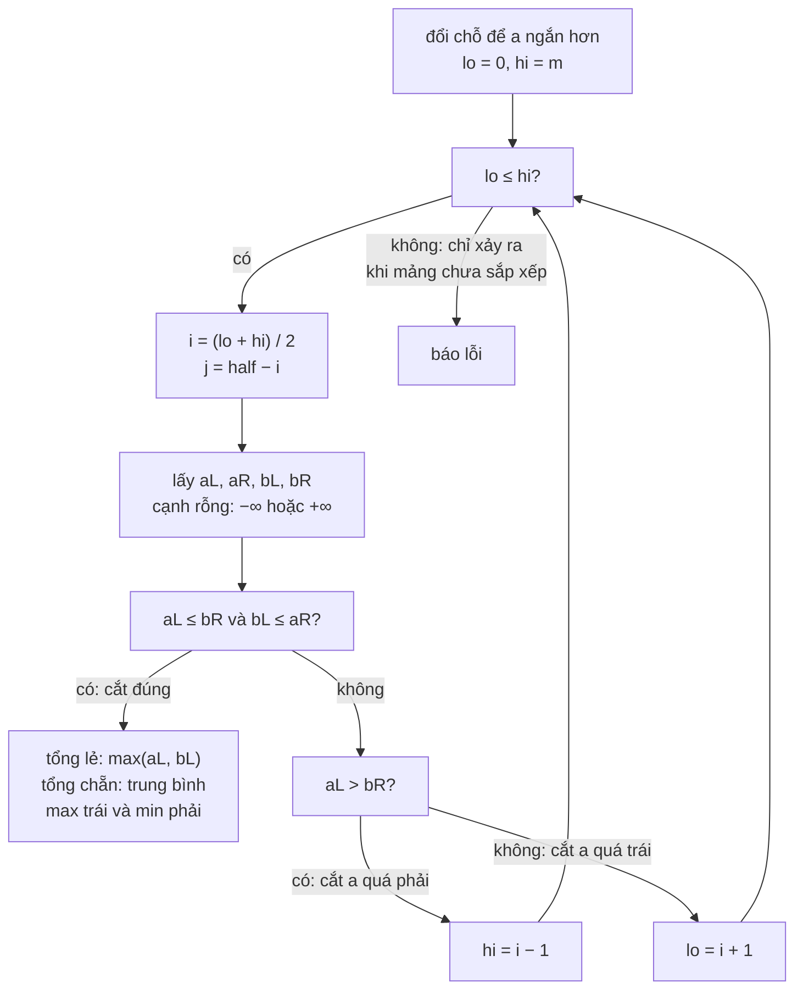

> [!tldr] Đọc nhanh
> - Đề: hai mảng tăng dần `a` (m phần tử) và `b` (n phần tử). Trả **trung vị** của cả hai gộp lại, trong O(log(m + n)).
> - Ý chính: không cần trộn. Cắt `a` ở vị trí `i` và `b` ở `j = half − i` sao cho nửa trái có đúng `half = ⌈(m + n) / 2⌉` phần tử. Vết cắt đúng khi `aL ≤ bR` và `bL ≤ aR`. Câu hỏi "`aL > bR`?" đổi từ "không" sang "có" đúng một lần khi `i` tăng, nên [[concepts/binary-search|chia đôi]] được trên `i`.
> - Phải chia đôi trên mảng **ngắn hơn**: nếu không, `j` ra khỏi `[0, n]`. Bản không đổi chỗ ném `ArrayIndexOutOfBoundsException` trong Java và sai 13 477 trên 100 000 cặp ngẫu nhiên.
> - Cạnh rỗng dùng [[concepts/sentinel-value|phần tử canh]] `−∞`/`+∞`. Dùng 0 thay vào sai 9 800 cặp. Chia nguyên khi tổng chẵn (`/` giữa hai `int` trong Java, Go; `//` trong Python) sai khoảng một phần tư số cặp.
> - Đo ở m = n = 10⁶: trộn 36,8 ms, hai con trỏ 5,2 ms, loại bỏ tìm phần tử thứ k 0,12 µs, cắt 0,07 µs. Với m = 10, n = 10⁶, cách cắt chỉ cần 1 vòng (tối đa 4, vì chỉ có 11 vị trí cắt).

> [!info] Bối cảnh
> Bài LeetCode 4, bài khó nhất của [[posts/2026-11-23-neetcode-binary-search-answer|ga 2: Tìm kiếm nhị phân trên đáp án]] trên **tuyến NeetCode: Tìm kiếm và heap**. Ở [[posts/2026-11-23-neetcode-binary-search|ga 1]] ta chia đôi trên các ô của một mảng; ở đây ta chia đôi trên **các vị trí cắt có thể**, tức là trên không gian đáp án, đúng tinh thần của ga 2. Lời giải có đủ TypeScript, Python, Go, Java và JavaScript. Bạn cần biết vòng lặp, mảng và đã đọc [[problems/binary-search|Binary Search]].

> [!abstract]- Từ điển nhanh cho bài này (bấm để mở)
> - **Trung vị (median)**: phần tử đứng giữa khi xếp tăng dần. Số phần tử lẻ: đúng một ô giữa. Số phần tử chẵn: trung bình cộng hai ô giữa, nên có thể là số lẻ thập phân như 2,5.
> - **Tìm kiếm nhị phân (binary search)**: mỗi bước nhìn điểm giữa của khoảng còn nghi, rồi bỏ hẳn một nửa. Xem [[concepts/binary-search|Binary Search]].
> - **Bất biến vòng lặp (loop invariant)**: điều luôn đúng ở đầu mỗi vòng. Ở đây: "vết cắt đúng nằm trong `[lo, hi]`". Xem [[concepts/loop-invariant|Loop Invariant]].
> - **Phần tử canh (sentinel)**: giá trị giả đặt ở biên để khỏi viết nhánh riêng cho ca rỗng. Ở đây là `−∞` bên trái và `+∞` bên phải. Xem [[concepts/sentinel-value|Sentinel Value]].
> - **Phần tử thứ k (k-th smallest)**: phần tử đứng ở vị trí k khi gộp và xếp tăng dần. Trung vị là phần tử thứ `⌈t/2⌉` (t lẻ), hoặc trung bình của phần tử thứ `t/2` và `t/2 + 1` (t chẵn).
> - **O(log min(m, n))**: số bước tăng theo log của độ dài mảng **ngắn hơn**. Xem [[concepts/big-o-notation|Big-O]].

## Hình dung trước: hai hàng học sinh đã xếp theo chiều cao

Hai lớp đứng thành hai hàng, mỗi hàng đã xếp từ thấp đến cao. Cô giáo cần chiều cao "đứng giữa" của cả hai lớp gộp lại, nhưng không muốn trộn hai hàng thành một. Cô làm thế này: kéo một sợi dây cắt ngang hàng ngắn hơn, rồi kéo sợi thứ hai cắt hàng kia sao cho **tổng số em bên trái hai sợi dây đúng bằng một nửa**. Nếu em cao nhất bên trái mỗi sợi đều không cao hơn em thấp nhất bên phải sợi kia, thì bên trái chính là "nửa thấp" của cả hai lớp.

| Đời thường | Khái niệm |
|---|---|
| Hai hàng học sinh, mỗi hàng xếp từ thấp đến cao | hai mảng `a`, `b` đã sắp xếp |
| Sợi dây cắt hàng ngắn hơn ở chỗ `i`, sợi kia cắt hàng dài ở chỗ `j` | vị trí cắt `i` và `j = half − i` |
| Hai bên trái gộp lại có đúng một nửa số em | `i + j = half` |
| Em cao nhất bên trái sợi một không cao hơn em thấp nhất bên phải sợi hai, và ngược lại | `aL ≤ bR` và `bL ≤ aR` |
| Em bên trái sợi một cao quá: dời sợi một sang trái | `aL > bR` thì `hi = i − 1` |
| Một bên sợi dây không có ai: coi như có một em "thấp vô cùng" hoặc "cao vô cùng" | phần tử canh `−∞`, `+∞` |
| Chiều cao đứng giữa: em cao nhất bên trái (lẻ), hoặc trung bình em đó với em thấp nhất bên phải (chẵn) | `max(aL, bL)` hoặc `(max(aL, bL) + min(aR, bR)) / 2` |



## Vấn đề

**Đề (tóm tắt bằng lời của mình):** cho hai mảng tăng dần `nums1` (m phần tử) và `nums2` (n phần tử), 0 ≤ m, n ≤ 1 000, m + n ≥ 1, mỗi số trong `[−10⁶, 10⁶]`. Trả trung vị của hai mảng gộp lại. Độ phức tạp phải là O(log(m + n)). Đề gốc: [LeetCode 4](https://leetcode.com/problems/median-of-two-sorted-arrays/).

| Input | Output | Vì sao |
|---|---|---|
| `[1, 3]`, `[2]` | `2.0` | gộp lại `[1, 2, 3]`, ô giữa là 2 |
| `[1, 2]`, `[3, 4]` | `2.5` | gộp lại `[1, 2, 3, 4]`, trung bình của 2 và 3 |
| `[]`, `[1]` | `1.0` | một mảng rỗng là hợp lệ |
| `[-2, -1]`, `[3]` | `-1.0` | có số âm |

Mình từng nghĩ chia đôi chỉ dùng để tìm **một giá trị** trong **một mảng**. Ở bài này không có giá trị nào để tìm, và có tới hai mảng. Hóa ra thứ được chia đôi là **vị trí cắt** `i` trên mảng ngắn: có `m + 1` vị trí, và câu hỏi "`a[i − 1] > b[j]`?" trả lời "không" ở các vị trí bên trái vết cắt đúng, "có" ở bên phải. Một câu hỏi có/không đổi đúng một lần là đủ để chia đôi.

## Cơ chế

<figure class="figure-map" style="--ar: 3 / 4">
<div class="frame"><iframe data-archify="../diagrams/neetcode-median-of-two-sorted-arrays/worked-example.html" title="Cắt sao cho mọi số trái đều nhỏ hơn" loading="lazy"></iframe></div>
<figcaption><span><b>Hình 1.</b> Cắt sao cho mọi số trái đều nhỏ hơn.</span><a href="../diagrams/neetcode-median-of-two-sorted-arrays/worked-example.html" target="_blank" rel="noopener">Mở toàn màn hình</a></figcaption>
</figure>

<details>
<summary>Đọc từng bước</summary>
<ol>
<li>Chọn số phần tử cần bên trái. <code>A = [2, 8], B = [1, 4, 9, 12]; left = 3</code></li>
<li>Lấy hai số A và một số B. <code>left max = 8, right min = 4</code></li>
<li>Dời vết cắt A sang trái. <code>left = [2] + [1, 4]</code></li>
<li>Hai biên đều đúng thứ tự. <code>left max = 4, right min = 8</code></li>
<li>Lấy trung bình hai số giữa. <code>(4 + 8) / 2 = 6</code></li>
</ol>
</details>

### Trung vị qua một vết cắt

Gọi `t = m + n` và `half = ⌈t / 2⌉ = (t + 1) / 2` (chia nguyên). Nếu ta biết "nửa trái" của mảng gộp, gồm `half` phần tử nhỏ nhất, thì:

- `t` lẻ: trung vị là phần tử **lớn nhất** của nửa trái (nửa trái có thêm một phần tử so với nửa phải).
- `t` chẵn: trung vị là trung bình của phần tử lớn nhất bên trái và nhỏ nhất bên phải.

Nửa trái của mảng gộp luôn là "`i` phần tử đầu của `a`" cộng "`j` phần tử đầu của `b`" với `i + j = half`, vì mỗi mảng đã tăng dần. Vậy bài toán chỉ còn: tìm `i`.

### Cách 1, trộn rồi lấy giữa: O(m + n)

Trộn như bước cuối của merge sort, rồi đọc ô giữa. Dễ đúng, tốn thêm O(m + n) bộ nhớ. Không đạt yêu cầu O(log) của đề, nhưng là bản đối chiếu tốt.

### Cách 2, hai con trỏ: O(m + n) thời gian, O(1) bộ nhớ

Vẫn trộn, nhưng không lưu: đi `⌊t/2⌋ + 1` bước, chỉ nhớ hai giá trị cuối (`prev`, `cur`). Nhanh hơn cách 1 khoảng 6 tới 20 lần trong phép đo vì không cấp phát mảng và chỉ đi tới giữa, nhưng vẫn tuyến tính.

### Cách 3, loại bỏ để tìm phần tử thứ k: O(log(m + n))

Viết hàm tìm phần tử thứ `k` (đếm từ 1) của hai mảng. Mỗi bước, lấy `h = ⌊k/2⌋`, so phần tử thứ `h` còn lại của mỗi mảng: `a[ni]` với `ni = i + h − 1`, `b[nj]` với `nj = j + h − 1` (cắt bớt nếu mảng không đủ dài). Nếu `a[ni] ≤ b[nj]`, thì **mọi phần tử từ `a[i]` tới `a[ni]` đều đứng trước phần tử thứ k**, nên bỏ hết chúng và trừ k tương ứng.

Vì sao bỏ được? Gọi `p = ni − i + 1` và `q = nj − j + 1` (cả hai ≤ h). Những phần tử có thể đứng trước `a[ni]` trong mảng gộp chỉ gồm `p − 1` phần tử `a[i..ni−1]` và tối đa `q − 1` phần tử `b[j..nj−1]` (vì `b[nj] ≥ a[ni]`). Vậy hạng của `a[ni]` không quá `p + q − 1 ≤ 2h − 1 ≤ k − 1`: nó và mọi phần tử trước nó trong `a` đều đứng **trước** phần tử thứ k. Mỗi bước k giảm gần một nửa, nên có O(log k) bước. Với t chẵn phải gọi hai lần (phần tử thứ `t/2` và `t/2 + 1`): 42 vòng ở m = n = 10⁶.

### Cách 4, chia đôi vị trí cắt: O(log min(m, n))

Đặt `a` là mảng ngắn hơn. Với mỗi `i ∈ [0, m]`, đặt `j = half − i` và bốn giá trị quanh hai vết cắt:

| Tên | Giá trị | Khi cạnh đó rỗng |
|---|---|---|
| `aL` | `a[i − 1]` | `i = 0`: `−∞` |
| `aR` | `a[i]` | `i = m`: `+∞` |
| `bL` | `b[j − 1]` | `j = 0`: `−∞` |
| `bR` | `b[j]` | `j = n`: `+∞` |

`aL ≤ aR` và `bL ≤ bR` luôn đúng vì mỗi mảng đã sắp xếp. Vết cắt đúng khi thêm hai điều kiện chéo: `aL ≤ bR` và `bL ≤ aR`. Khi một điều kiện chéo hỏng:

| Quan sát | Nghĩa là | Bước |
|---|---|---|
| `aL > bR` | lấy quá nhiều từ `a`: phần tử cuối bên trái của `a` lớn hơn một phần tử bên phải | `hi = i − 1` |
| `bL > aR` | lấy quá ít từ `a` | `lo = i + 1` |

Hai điều kiện không thể hỏng cùng lúc: `aL > bR ≥ bL > aR` mâu thuẫn với `aL ≤ aR`. Khi `i` tăng, `aL` chỉ tăng còn `bR` chỉ giảm, nên "`aL > bR`?" trả lời "không… không, có… có": đây là câu hỏi đơn điệu mà chia đôi cần. [[concepts/loop-invariant|Bất biến]]: vết cắt đúng nằm trong `[lo, hi]`. Nó luôn tồn tại với input đã sắp xếp, nên dòng `throw` ở cuối chỉ chạy khi input sai.

**Phần tử canh** `−∞`/`+∞` làm cạnh rỗng không bao giờ cản: `−∞ ≤` mọi thứ, mọi thứ `≤ +∞`. Nhờ đó không cần nhánh riêng cho `i = 0`, `i = m`, `j = 0`, `j = n`, và cũng không cần nhánh riêng cho một mảng rỗng.

### Vì sao phải chia đôi trên mảng ngắn hơn

`i` chạy trong `[0, m]`, nên `j = half − i` chạy trong `[half − m, half]`. Cần `0 ≤ j ≤ n`:

- Nếu `m ≤ n`: `half − m = ⌈(m + n)/2⌉ − m ≥ 0` vì n ≥ m, và `half ≤ n` cũng vì n ≥ m. `j` luôn hợp lệ.
- Nếu `m > n`: với `a = [1, 2, 3, 4, 5, 6]`, `b = [7]`, `half = 4`, khi `i = 5` thì `j = −1`; với `a = [2]`, `b = []` thì `i = 0` cho `j = 1 > n`.

File TypeScript chạy bản không đổi chỗ và in đúng hai ca đó: `j = -1 ra ngoài b`. Java ném `ArrayIndexOutOfBoundsException`. Trên 100 000 cặp ngẫu nhiên, bản này sai 13 477 cặp (TS) và 13 357 cặp (Java, bộ sinh ngẫu nhiên khác). Lợi ích thứ hai: số vòng chỉ phụ thuộc mảng ngắn. Với m = 10, n = 10⁶, cách cắt mất 1 vòng (tối đa 4); loại bỏ tìm phần tử thứ k mất 40.

### Tổng lẻ, tổng chẵn, và chia nguyên

Trung vị của tổng chẵn có thể là `.5`. Bốn ngôn ngữ trong bảy có phép chia nguyên khi hai toán hạng là số nguyên:

| | `(2 + 3) / 2` | Số âm | Cách đúng |
|---|---|---|---|
| Java | `2` (`int / int`, cắt về 0) | `-3 / 2 = -1` | chia cho `2.0`, cộng trong `long` |
| Go | `2` | `-3 / 2 = -1` | `float64(x + y) / 2` |
| Python | `/` cho `2.5`; `//` cho `2` (làm tròn xuống) | `-3 // 2 = -2` | dùng `/` |
| TS, JS | `2.5` (mọi số là double) | `-1.5` | không cần gì |
| Rust | `2` (`i32 / i32`, cắt về 0) | `-3 / 2 = -1`; `div_euclid` cho `-2` | đổi sang `f64` rồi chia cho `2.0` |
| PHP | `2.5`; `intdiv` cho `2` | `intdiv(-3, 2) = -1`, `-3 / 2 = -1.5` | dùng `/`, nhưng `(2 + 4) / 2` ra **int** `3`, không phải float |

Bản chia nguyên sai 8/10 ca test, và khoảng một phần tư số cặp ngẫu nhiên: 24 681 (TS), 24 994 (Python), 24 791 (Go), 25 047 (Java), 24 999 (PHP), 24 856 (Rust). Một phần tư là hợp lý: nó chỉ sai khi tổng chẵn **và** hai ô giữa có tổng lẻ.

Trong Java còn một bẫy nữa: `(x + y) / 2.0` cộng **trước** trong `int`, rồi mới đổi sang double. Với `x = y = 2 000 000 000`, file Java in `-1.47483648E8`; `((long) x + y) / 2.0` in `2.0E9`. Giới hạn `|x| ≤ 10⁶` của đề làm lỗi này không lộ trên LeetCode, nhưng code dùng lại ở chỗ khác thì có.

### Phần tử canh: chọn sai giá trị

Bản dùng `0` thay cho `−∞` đúng khi mọi số đều dương, và sai khi một mảng không góp phần tử nào vào nửa trái còn phần của mảng kia toàn số âm: với `[-2, -1]`, `[3]`, vết cắt đúng là `i = 0` trên `[3]`, nên `aL` là phần tử canh 0 và thắng `bL = -1`, cho `0` thay vì `-1`. Trên 100 000 cặp ngẫu nhiên (giá trị trong `[-50, 50]`), nó sai 9 800 cặp.

Trong Java và Go, phần tử canh là `Integer.MIN_VALUE`/`MAX_VALUE` và `math.MinInt`/`math.MaxInt`. Chúng an toàn vì chỉ được **so sánh**, không bao giờ bị **cộng**: khi tổng chẵn và t ≥ 2, `max(aL, bL)` và `min(aR, bR)` luôn là phần tử thật (nửa trái và nửa phải đều không rỗng). Nếu bạn đổi công thức, ví dụ tính `aL + bR` để so sánh, thì phần tử canh sẽ làm tràn số.

### Đo

TypeScript, hai mảng số nguyên ngẫu nhiên đã sắp xếp, trung vị 7 lần, µs mỗi lần gọi; hai cột cuối là số vòng lặp:

| m | n | trộn | hai con trỏ | thứ k | cắt | vòng thứ k | vòng cắt |
|---|---|---|---|---|---|---|---|
| 1 000 | 1 000 | 12,3 | 1,3 | 0,059 | 0,033 | 22 | 9 |
| 100 000 | 100 000 | 3 183,4 | 518,4 | 0,103 | 0,064 | 36 | 16 |
| 1 000 000 | 1 000 000 | 36 810,2 | 5 192,1 | 0,121 | 0,069 | 42 | 19 |
| 10 | 1 000 000 | 11 479,5 | 547,8 | 0,103 | 0,009 | 40 | 1 |

Hai cách tuyến tính tăng gấp khoảng 10 khi n gấp 10. Hai cách logarit gần như đứng yên, và ở hàng cuối cách cắt nhanh gấp khoảng 11 lần cách thứ k vì nó chỉ chia đôi trên 11 vị trí cắt của mảng 10 phần tử. Hai con trỏ ở hàng cuối cũng nhanh hơn trộn khoảng 21 lần: nó chỉ đi tới giữa và không cấp phát mảng 10⁶ phần tử.

Ngoài 10 ca test, mỗi file đối chiếu bốn cách với "nối rồi sort" trên 100 000 cặp ngẫu nhiên (mỗi mảng 0 tới 20 phần tử, giá trị trong `[-50, 50]`, nên có rất nhiều số trùng và mảng rỗng). Cả bốn cách sai 0 cặp ở cả bảy ngôn ngữ.

### Bên dưới bảy ngôn ngữ

| | Phần tử canh | Chia khi tổng chẵn | Bẫy riêng |
|---|---|---|---|
| TypeScript / JavaScript | `-Infinity`, `Infinity` | `/ 2` luôn ra số thực | `[...a, ...b].sort()` không có hàm so sánh sẽ so như **chuỗi**: `[10, 9, 1].sort()` ra `[1, 10, 9]`. Bản đối chiếu phải viết `sort((x, y) => x - y)` |
| Python | `float("-inf")`, `float("inf")`, so sánh được với `int` | `/` | `//` làm tròn xuống: `-3 // 2 = -2`. `heapq.merge` trộn hai dãy đã sắp xếp mà không sort lại |
| Go | `math.MinInt`, `math.MaxInt` | `float64(x+y) / 2` | `float64((x+y)/2)` chia nguyên trước rồi mới đổi kiểu. `min`, `max` dựng sẵn từ Go 1.21 |
| Java | `Integer.MIN_VALUE`, `Integer.MAX_VALUE` | `((long) x + y) / 2.0` | `(x + y) / 2` mất `.5`; `(x + y) / 2.0` vẫn tràn vì phép cộng làm trong `int`. Không đổi chỗ thì `b[j]` với `j = −1` ném `ArrayIndexOutOfBoundsException` |
| PHP | `PHP_INT_MIN`, `PHP_INT_MAX` | `/` ra float khi không chia hết | `/` giữa hai int chia hết trả **int**: `(2 + 4) / 2` là `3`, nên so `===` với `3.0` sẽ sai nếu hàm không khai báo kiểu trả `float`. Mảng được chép khi gán, nên `[$a, $b] = [$b, $a]` không đụng mảng của người gọi |
| Rust | `i64::MIN`, `i64::MAX` (đổi phần tử `i32` lên `i64`) | `as f64` rồi `/ 2.0` | chỉ số là `usize`, không âm được: không đổi chỗ thì `j = half − i` trừ tràn, bản debug panic `attempt to subtract with overflow`, bản `-O` cuộn vòng rồi panic vì chỉ số ngoài slice |

## Ví dụ chạy được

[TypeScript](../code/neetcode-median-of-two-sorted-arrays/median-two-arrays.ts) · [Python](../code/neetcode-median-of-two-sorted-arrays/median_two_arrays.py) · [Go](../code/neetcode-median-of-two-sorted-arrays/median_two_arrays.go) · [Java](../code/neetcode-median-of-two-sorted-arrays/median-two-arrays.java) · [JavaScript](../code/neetcode-median-of-two-sorted-arrays/median-two-arrays.js) · [PHP](../code/neetcode-median-of-two-sorted-arrays/median-two-arrays.php) · [Rust](../code/neetcode-median-of-two-sorted-arrays/median_two_arrays.rs)

Mỗi file có bốn cách, chạy 10 ca test và đối chiếu 100 000 cặp ngẫu nhiên. File TypeScript có thêm ba bản sai và phép đo; Python, Go, Java, PHP và Rust có bản chia nguyên; Java có thêm bản không đổi chỗ. Cách chính, chia đôi vị trí cắt:

```ts
// Cách 4, chia đôi vị trí cắt trên mảng ngắn hơn: O(log min(m, n)).
// Cắt a ở i và b ở j = half − i sao cho nửa trái có half phần tử; cắt đúng khi aL ≤ bR và bL ≤ aR.
function partition(a: number[], b: number[]): number {
  if (a.length > b.length) [a, b] = [b, a]; // luôn chia đôi trên mảng ngắn hơn, để j = half − i luôn nằm trong [0, n]
  const m = a.length, n = b.length, half = (m + n + 1) >> 1;
  let lo = 0, hi = m;
  while (lo <= hi) {
    steps++;
    const i = (lo + hi) >> 1, j = half - i;
    const aL = i > 0 ? a[i - 1] : -Infinity, aR = i < m ? a[i] : Infinity; // phần tử canh: cạnh rỗng không bao giờ cản
    const bL = j > 0 ? b[j - 1] : -Infinity, bR = j < n ? b[j] : Infinity;
    if (aL <= bR && bL <= aR) {
      return (m + n) % 2 ? Math.max(aL, bL) : (Math.max(aL, bL) + Math.min(aR, bR)) / 2;
    }
    if (aL > bR) hi = i - 1; // cắt a quá phải
    else lo = i + 1; // cắt a quá trái
  }
  throw new Error("mảng chưa sắp xếp");
}
```

```python
# Cách 4, chia đôi vị trí cắt trên mảng ngắn hơn. float("inf") làm phần tử canh, so sánh được với int.
def partition(a: list[int], b: list[int]) -> float:
    if len(a) > len(b):
        a, b = b, a
    m, n = len(a), len(b)
    half = (m + n + 1) // 2
    lo, hi = 0, m
    while lo <= hi:
        i = (lo + hi) // 2
        j = half - i
        a_l = a[i - 1] if i > 0 else float("-inf")
        a_r = a[i] if i < m else float("inf")
        b_l = b[j - 1] if j > 0 else float("-inf")
        b_r = b[j] if j < n else float("inf")
        if a_l <= b_r and b_l <= a_r:
            if (m + n) % 2:
                return max(a_l, b_l)
            return (max(a_l, b_l) + min(a_r, b_r)) / 2
        if a_l > b_r:
            hi = i - 1
        else:
            lo = i + 1
    raise ValueError("mảng chưa sắp xếp")
```

```go
// Cách 4, chia đôi vị trí cắt trên mảng ngắn hơn. math.MinInt và math.MaxInt làm phần tử canh:
// chúng chỉ được so sánh, không bao giờ bị cộng (tổng chẵn ≥ 2 luôn có thật cả hai phía), nên không tràn.
func partition(a, b []int) float64 {
	if len(a) > len(b) {
		a, b = b, a
	}
	m, n := len(a), len(b)
	half := (m + n + 1) / 2
	lo, hi := 0, m
	for lo <= hi {
		i := (lo + hi) / 2
		j := half - i
		aL, aR, bL, bR := math.MinInt, math.MaxInt, math.MinInt, math.MaxInt
		if i > 0 {
			aL = a[i-1]
		}
		if i < m {
			aR = a[i]
		}
		if j > 0 {
			bL = b[j-1]
		}
		if j < n {
			bR = b[j]
		}
		if aL <= bR && bL <= aR {
			if (m+n)%2 == 1 {
				return float64(max(aL, bL))
			}
			return float64(max(aL, bL)+min(aR, bR)) / 2
		}
		if aL > bR {
			hi = i - 1
		} else {
			lo = i + 1
		}
	}
	panic("mảng chưa sắp xếp")
}
```

```java
// Cách 4, chia đôi vị trí cắt trên mảng ngắn hơn. Integer.MIN_VALUE/MAX_VALUE làm phần tử canh:
// chỉ dùng để so sánh; với tổng chẵn, hai số được cộng luôn là phần tử thật.
static double partition(int[] a, int[] b) {
    if (a.length > b.length) { int[] tmp = a; a = b; b = tmp; }
    int m = a.length, n = b.length, half = (m + n + 1) / 2, lo = 0, hi = m;
    while (lo <= hi) {
        int i = (lo + hi) >>> 1, j = half - i;
        int aL = i > 0 ? a[i - 1] : Integer.MIN_VALUE, aR = i < m ? a[i] : Integer.MAX_VALUE;
        int bL = j > 0 ? b[j - 1] : Integer.MIN_VALUE, bR = j < n ? b[j] : Integer.MAX_VALUE;
        if (aL <= bR && bL <= aR) {
            if ((m + n) % 2 == 1) return Math.max(aL, bL);
            return ((long) Math.max(aL, bL) + Math.min(aR, bR)) / 2.0; // cộng trong long: không tràn dù giá trị gần 2³¹
        }
        if (aL > bR) hi = i - 1;
        else lo = i + 1;
    }
    throw new IllegalArgumentException("mảng chưa sắp xếp");
}
```

```js
// Cách 4, chia đôi vị trí cắt trên mảng ngắn hơn. -Infinity và Infinity là phần tử canh.
function partition(a, b) {
  if (a.length > b.length) [a, b] = [b, a];
  const m = a.length, n = b.length, half = (m + n + 1) >> 1;
  let lo = 0, hi = m;
  while (lo <= hi) {
    const i = (lo + hi) >> 1, j = half - i;
    const aL = i > 0 ? a[i - 1] : -Infinity, aR = i < m ? a[i] : Infinity;
    const bL = j > 0 ? b[j - 1] : -Infinity, bR = j < n ? b[j] : Infinity;
    if (aL <= bR && bL <= aR) {
      return (m + n) % 2 ? Math.max(aL, bL) : (Math.max(aL, bL) + Math.min(aR, bR)) / 2;
    }
    if (aL > bR) hi = i - 1;
    else lo = i + 1;
  }
  throw new Error("mảng chưa sắp xếp");
}
```

```php
// Cách 4, chia đôi vị trí cắt trên mảng ngắn hơn: O(log min(m, n)).
// Cắt a ở i và b ở j = half − i; cắt đúng khi aL ≤ bR và bL ≤ aR. Phần tử canh là PHP_INT_MIN / PHP_INT_MAX.
function partition(array $a, array $b): float
{
    if (count($a) > count($b)) [$a, $b] = [$b, $a]; // mảng PHP được chép khi gán: đổi chỗ không đụng tới mảng của người gọi
    $m = count($a);
    $n = count($b);
    $half = ($m + $n + 1) >> 1;
    $lo = 0;
    $hi = $m;
    while ($lo <= $hi) {
        $i = ($lo + $hi) >> 1;
        $j = $half - $i;
        $aL = $i > 0 ? $a[$i - 1] : PHP_INT_MIN;
        $aR = $i < $m ? $a[$i] : PHP_INT_MAX;
        $bL = $j > 0 ? $b[$j - 1] : PHP_INT_MIN;
        $bR = $j < $n ? $b[$j] : PHP_INT_MAX;
        if ($aL <= $bR && $bL <= $aR) {
            return ($m + $n) % 2 ? (float) max($aL, $bL) : (max($aL, $bL) + min($aR, $bR)) / 2; // / ra float khi tổng lẻ
        }
        if ($aL > $bR) $hi = $i - 1;
        else $lo = $i + 1;
    }
    throw new RuntimeException("mảng chưa sắp xếp");
}
```

```rust
// Cách 4, chia đôi vị trí cắt trên mảng ngắn hơn: O(log min(m, n)).
// Cắt a ở i và b ở j = half − i; cắt đúng khi aL ≤ bR và bL ≤ aR. Phần tử canh là i64::MIN / i64::MAX.
fn partition(a: &[i32], b: &[i32]) -> f64 {
    let (a, b) = if a.len() > b.len() { (b, a) } else { (a, b) }; // đổi hai tham chiếu, không chép mảng
    let (m, n) = (a.len(), b.len());
    let half = (m + n + 1) / 2;
    let (mut lo, mut hi) = (0, m);
    loop {
        let i = (lo + hi) / 2;
        let j = half - i; // usize: không âm được vì m ≤ n bảo đảm half ≥ i
        let a_l = if i > 0 { a[i - 1] as i64 } else { i64::MIN };
        let a_r = if i < m { a[i] as i64 } else { i64::MAX };
        let b_l = if j > 0 { b[j - 1] as i64 } else { i64::MIN };
        let b_r = if j < n { b[j] as i64 } else { i64::MAX };
        if a_l <= b_r && b_l <= a_r {
            let left = a_l.max(b_l) as f64;
            return if (m + n) % 2 == 1 { left } else { (left + a_r.min(b_r) as f64) / 2.0 };
        }
        if a_l > b_r { hi = i - 1 } else { lo = i + 1 }
    }
}
```


Cách loại bỏ để tìm phần tử thứ k:

```ts
// Cách 3, loại bỏ để tìm phần tử thứ k: mỗi bước bỏ k/2 phần tử chắc chắn đứng trước phần tử thứ k. O(log(m + n)).
function kth(a: number[], b: number[], k: number): number {
  let i = 0, j = 0; // a[i..] và b[j..] là phần còn lại; k đếm từ 1
  while (true) {
    steps++;
    if (i === a.length) return b[j + k - 1];
    if (j === b.length) return a[i + k - 1];
    if (k === 1) return Math.min(a[i], b[j]);
    const h = k >> 1;
    const ni = Math.min(i + h, a.length) - 1, nj = Math.min(j + h, b.length) - 1;
    if (a[ni] <= b[nj]) { k -= ni - i + 1; i = ni + 1; } // a[i..ni] đều đứng trước phần tử thứ k: bỏ
    else { k -= nj - j + 1; j = nj + 1; }
  }
}

function kthElimination(a: number[], b: number[]): number {
  const t = a.length + b.length;
  return t % 2 ? kth(a, b, (t >> 1) + 1) : (kth(a, b, t / 2) + kth(a, b, t / 2 + 1)) / 2;
}
```

```python
# Cách 3, loại bỏ để tìm phần tử thứ k (k đếm từ 1): mỗi bước bỏ khoảng k/2 phần tử.
def kth(a: list[int], b: list[int], k: int) -> int:
    i = j = 0
    while True:
        if i == len(a):
            return b[j + k - 1]
        if j == len(b):
            return a[i + k - 1]
        if k == 1:
            return min(a[i], b[j])
        h = k // 2
        ni, nj = min(i + h, len(a)) - 1, min(j + h, len(b)) - 1
        if a[ni] <= b[nj]:
            k -= ni - i + 1; i = ni + 1
        else:
            k -= nj - j + 1; j = nj + 1

def kth_elimination(a: list[int], b: list[int]) -> float:
    t = len(a) + len(b)
    return kth(a, b, t // 2 + 1) if t % 2 else (kth(a, b, t // 2) + kth(a, b, t // 2 + 1)) / 2
```

```go
// Cách 3, loại bỏ để tìm phần tử thứ k (k đếm từ 1).
func kth(a, b []int, k int) int {
	i, j := 0, 0
	for {
		if i == len(a) {
			return b[j+k-1]
		}
		if j == len(b) {
			return a[i+k-1]
		}
		if k == 1 {
			return min(a[i], b[j])
		}
		h := k / 2
		ni, nj := min(i+h, len(a))-1, min(j+h, len(b))-1
		if a[ni] <= b[nj] {
			k -= ni - i + 1
			i = ni + 1
		} else {
			k -= nj - j + 1
			j = nj + 1
		}
	}
}

func kthElimination(a, b []int) float64 {
	t := len(a) + len(b)
	if t%2 == 1 {
		return float64(kth(a, b, t/2+1))
	}
	return float64(kth(a, b, t/2)+kth(a, b, t/2+1)) / 2
}
```

```java
// Cách 3, loại bỏ để tìm phần tử thứ k (k đếm từ 1).
static int kth(int[] a, int[] b, int k) {
    int i = 0, j = 0;
    while (true) {
        if (i == a.length) return b[j + k - 1];
        if (j == b.length) return a[i + k - 1];
        if (k == 1) return Math.min(a[i], b[j]);
        int h = k / 2;
        int ni = Math.min(i + h, a.length) - 1, nj = Math.min(j + h, b.length) - 1;
        if (a[ni] <= b[nj]) { k -= ni - i + 1; i = ni + 1; }
        else { k -= nj - j + 1; j = nj + 1; }
    }
}

static double kthElimination(int[] a, int[] b) {
    int t = a.length + b.length;
    return t % 2 == 1 ? kth(a, b, t / 2 + 1) : (kth(a, b, t / 2) + kth(a, b, t / 2 + 1)) / 2.0;
}
```

```js
// Cách 3, loại bỏ để tìm phần tử thứ k (k đếm từ 1).
function kth(a, b, k) {
  let i = 0, j = 0;
  while (true) {
    if (i === a.length) return b[j + k - 1];
    if (j === b.length) return a[i + k - 1];
    if (k === 1) return Math.min(a[i], b[j]);
    const h = k >> 1;
    const ni = Math.min(i + h, a.length) - 1, nj = Math.min(j + h, b.length) - 1;
    if (a[ni] <= b[nj]) { k -= ni - i + 1; i = ni + 1; }
    else { k -= nj - j + 1; j = nj + 1; }
  }
}

function kthElimination(a, b) {
  const t = a.length + b.length;
  return t % 2 ? kth(a, b, (t >> 1) + 1) : (kth(a, b, t / 2) + kth(a, b, t / 2 + 1)) / 2;
}
```

```php
// Cách 3, loại bỏ để tìm phần tử thứ k (k đếm từ 1): mỗi bước bỏ k/2 phần tử chắc chắn đứng trước. O(log(m + n)).
function kth(array $a, array $b, int $k): int
{
    $i = $j = 0;
    while (true) {
        if ($i === count($a)) return $b[$j + $k - 1];
        if ($j === count($b)) return $a[$i + $k - 1];
        if ($k === 1) return min($a[$i], $b[$j]);
        $h = $k >> 1;
        $ni = min($i + $h, count($a)) - 1;
        $nj = min($j + $h, count($b)) - 1;
        if ($a[$ni] <= $b[$nj]) { $k -= $ni - $i + 1; $i = $ni + 1; } // a[i..ni] đều đứng trước phần tử thứ k: bỏ
        else { $k -= $nj - $j + 1; $j = $nj + 1; }
    }
}

function kthElimination(array $a, array $b): float
{
    $t = count($a) + count($b);
    return $t % 2 ? (float) kth($a, $b, ($t >> 1) + 1) : (kth($a, $b, intdiv($t, 2)) + kth($a, $b, intdiv($t, 2) + 1)) / 2;
}
```

```rust
// Cách 3, loại bỏ để tìm phần tử thứ k (k đếm từ 1). O(log(m + n)).
// Slice làm việc này gọn: bỏ phần đầu bằng cách cắt a = &a[h..], không cần giữ chỉ số i, j.
fn kth(mut a: &[i32], mut b: &[i32], mut k: usize) -> i32 {
    loop {
        if a.is_empty() {
            return b[k - 1];
        }
        if b.is_empty() {
            return a[k - 1];
        }
        if k == 1 {
            return a[0].min(b[0]);
        }
        let (ha, hb) = ((k / 2).min(a.len()), (k / 2).min(b.len()));
        if a[ha - 1] <= b[hb - 1] {
            k -= ha; // a[..ha] đều đứng trước phần tử thứ k: bỏ
            a = &a[ha..];
        } else {
            k -= hb;
            b = &b[hb..];
        }
    }
}

fn kth_elimination(a: &[i32], b: &[i32]) -> f64 {
    let t = a.len() + b.len();
    if t % 2 == 1 { kth(a, b, t / 2 + 1) as f64 } else { (kth(a, b, t / 2) as f64 + kth(a, b, t / 2 + 1) as f64) / 2.0 }
}
```


Kết quả của file TypeScript:

```text
mergeThenPick         10/10 ca đúng
twoPointer            10/10 ca đúng
kthElimination        10/10 ca đúng
partition             10/10 ca đúng
partitionNoSwap       8/10 ca đúng; sai ở [2] [] → j = 1 ra ngoài b, [1,2,3,4,5,6] [7] → j = -1 ra ngoài b
partitionZeroSentinel 9/10 ca đúng; sai ở [-2,-1] [3] → 0
partitionIntMedian    8/10 ca đúng; sai ở [1,2] [3,4] → 2, [] [2,3] → 2

Đối chiếu với nối rồi sort, 100000 cặp ngẫu nhiên:
mergeThenPick         sai 0 cặp
twoPointer            sai 0 cặp
kthElimination        sai 0 cặp
partition             sai 0 cặp
partitionNoSwap       sai 13477 cặp
partitionZeroSentinel sai 9800 cặp
partitionIntMedian    sai 24681 cặp

m          n          trộn (µs)  hai con trỏ (µs)  thứ k (µs)  cắt (µs)  bước thứ k  bước cắt
1000       1000            12.3               1.3       0.059     0.033          22         9
100000     100000        3183.4             518.4       0.103     0.064          36        16
1000000    1000000      36810.2            5192.1       0.121     0.069          42        19
10         1000000      11479.5             547.8       0.103     0.009          40         1
```

File Java in thêm phép cộng tràn:

```text
mergeThenPick    10/10 ca đúng
twoPointer       10/10 ca đúng
kthElimination   10/10 ca đúng
partition        10/10 ca đúng
partitionNoSwap  8/10 ca đúng; sai ở [2] [] → ArrayIndexOutOfBoundsException, [1, 2, 3, 4, 5, 6] [7] → ArrayIndexOutOfBoundsException
wrongIntDivision 8/10 ca đúng; sai ở [1, 2] [3, 4] → 2.0, [] [2, 3] → 2.0

Đối chiếu với nối rồi sort, 100000 cặp ngẫu nhiên:
mergeThenPick    sai 0 cặp
twoPointer       sai 0 cặp
kthElimination   sai 0 cặp
partition        sai 0 cặp
partitionNoSwap  sai 13357 cặp
wrongIntDivision sai 25047 cặp

(x + y) / 2.0 = -1.47483648E8, ((long) x + y) / 2.0 = 2.0E9
```

Python in `wrong_floor_div 8/10 ca đúng` và `sai 24994 cặp`, rồi `-3 // 2 = -2   -3 / 2 = -1.5`. Go in `wrongIntDivision sai 24791 cặp` và `chia nguyên trong Go: -3 / 2 = -1`. JavaScript in `10/10 ca đúng` và `sai 0 cặp` cho cả bốn cách, rồi `[10, 9, 1].sort() = [1,10,9]`.

PHP (`php median-two-arrays.php`) và Rust (`rustc --edition 2021 -O median_two_arrays.rs`) in `10/10 ca đúng` và `sai 0 cặp` cho cả bốn cách. Bản chia nguyên sai 8/10 ca ở cả hai, `sai 24999 cặp` (PHP) và `sai 24856 cặp` (Rust); dòng cuối là `intdiv(-3, 2) = -1   -3 / 2 = -1.5` (PHP) và `(-3) / 2 = -1   (-3).div_euclid(2) = -2` (Rust).

## Hiểu lầm và bẫy hay gặp

- **"Chia đôi cần một giá trị để tìm."** Ở đây không có giá trị nào cho trước. Thứ được chia đôi là vị trí cắt, và câu hỏi "`aL > bR`?" là câu hỏi đơn điệu.
- **Chia đôi trên mảng dài hơn.** `j` ra khỏi `[0, n]`: Java ném lỗi chỉ số, còn TS và JS lặng lẽ đọc ra `undefined` (file TS kiểm `j` và báo lỗi ngay chỗ đó). Luôn đổi chỗ để `a` ngắn hơn trước khi bắt đầu.
- **Phần tử canh bằng 0 hoặc −1.** Sai khi có số âm. Dùng `±Infinity` hoặc giá trị nhỏ nhất, lớn nhất của kiểu.
- **Chia nguyên khi tổng chẵn.** `(x + y) / 2` với hai `int` trong Java hay Go, `//` trong Python: mất `.5`. Với số âm, Python còn làm tròn **xuống** (`-3 // 2 = -2`) còn Java, Go cắt **về 0** (`-1`).
- **`half = (m + n) / 2` thay vì `(m + n + 1) / 2`.** Vẫn làm được, nhưng khi tổng lẻ trung vị nằm bên **phải** (`min(aR, bR)`), nên phải đổi cả công thức. Trộn hai quy ước là lỗi lệch một.
- **Nghĩ hai con trỏ đã là O(log).** Nó tiết kiệm bộ nhớ, không tiết kiệm thời gian: vẫn đi `(m + n) / 2` bước.
- **PHP: tưởng `/` luôn ra float.** `(2 + 4) / 2` trả int `3`; chỉ khi không chia hết mới ra float. Hàm khai báo `: float` thì PHP đổi giúp, còn so thẳng `=== 3.0` thì sai. Muốn chia nguyên phải gọi `intdiv`, cắt về 0 như Java.
- **Rust: quên đổi chỗ khi chỉ số là `usize`.** Bắt đầu với `a = [1..6]`, `b = [7]` thì `j = half − i` âm: bản debug panic `attempt to subtract with overflow`, bản `-O` cuộn vòng thành 18 446 744 073 709 551 614 rồi panic vì chỉ số ngoài slice. Đổi chỗ trước là đủ để `half ≥ i`.

## Câu hỏi tự kiểm tra

> [!question]- Chạy cách cắt trên `a = [1, 3, 8, 9, 15]`, `b = [7, 11, 18, 19, 21, 25]`. Ghi `i`, `j`, bốn giá trị và bước đi mỗi vòng.
> m = 5, n = 6, half = 6. Vòng 1: lo = 0, hi = 5, i = 2, j = 4: aL = 3, aR = 8, bL = 19, bR = 21. `bL = 19 > aR = 8`: lấy quá ít từ a, `lo = 3`. Vòng 2: i = 4, j = 2: aL = 9, aR = 15, bL = 11, bR = 18. `9 ≤ 18` và `11 ≤ 15`: cắt đúng. Tổng 11 lẻ, trung vị `max(9, 11) = 11`. Gộp lại `[1, 3, 7, 8, 9, 11, 15, 18, 19, 21, 25]`, ô thứ 6 đúng là 11.

> [!question]- Vì sao `half` là `(m + n + 1) / 2` mà không phải `(m + n) / 2`?
> Để khi tổng lẻ, nửa trái có nhiều hơn một phần tử và trung vị là `max(aL, bL)`. Với tổng chẵn hai công thức cho cùng kết quả. Dùng `(m + n) / 2` cũng được nếu đổi trung vị lẻ thành `min(aR, bR)`.

> [!question]- Ở cách loại bỏ, vì sao so `a[ni]` với `b[nj]` rồi bỏ phía **nhỏ hơn**, chứ không bỏ phía lớn hơn?
> Phía nhỏ hơn có hạng không quá `k − 1`, nên chắc chắn đứng trước phần tử thứ k. Phía lớn hơn có thể chứa chính phần tử thứ k (ví dụ khi phần tử thứ k là `b[nj]`), nên bỏ nó có thể mất đáp án.

> [!question]- Đổi đề: tìm phần tử thứ k của hai mảng đã sắp xếp, với k bất kỳ. Dùng cách cắt được không?
> Được: thay `half` bằng `k` và chia đôi `i` trong `[max(0, k − n), min(k, m)]` để `j = k − i` luôn hợp lệ. Đáp án là `max(aL, bL)`. Hàm `kth` ở cách 3 làm cùng việc theo kiểu loại bỏ.

## Tham khảo

- [LeetCode 4: Median of Two Sorted Arrays](https://leetcode.com/problems/median-of-two-sorted-arrays/) (đề gốc, giới hạn và yêu cầu O(log(m + n)))
- [Java Language Specification SE 21, §15.17.2 Division Operator](https://docs.oracle.com/javase/specs/jls/se21/html/jls-15.html#jls-15.17.2) (chia nguyên làm tròn về 0)
- [The Go Programming Language Specification: Arithmetic operators](https://go.dev/ref/spec#Arithmetic_operators) (chia nguyên cắt về 0)
- [Python Language Reference: Binary arithmetic operations](https://docs.python.org/3/reference/expressions.html#binary-arithmetic-operations) (`//` là chia lấy sàn) và [`heapq.merge`](https://docs.python.org/3/library/heapq.html#heapq.merge)
- [MDN: Array.prototype.sort()](https://developer.mozilla.org/en-US/docs/Web/JavaScript/Reference/Global_Objects/Array/sort) (mặc định so như chuỗi)
- Cormen, Leiserson, Rivest, Stein, *Introduction to Algorithms*, chương 9 "Medians and Order Statistics" (phần tử thứ k và trung vị)
