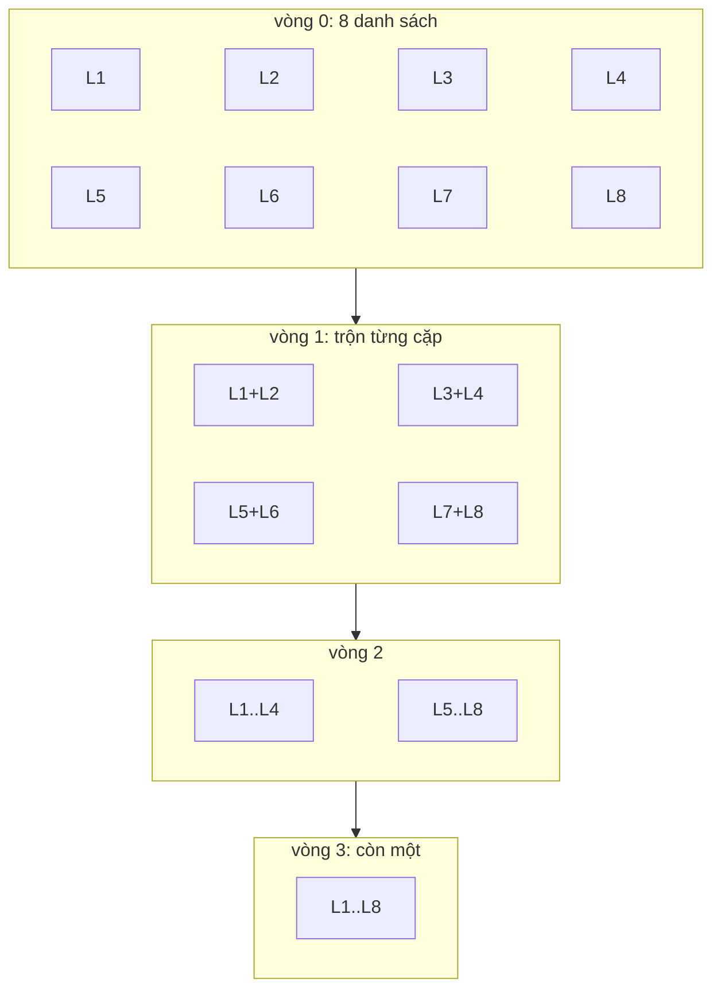

> [!tldr] Đọc nhanh
> - Đề: k danh sách liên kết, mỗi danh sách đã sắp tăng dần; gộp thành **một** danh sách sắp tăng dần. Gọi N là tổng số nút.
> - Hai cách O(N log k) đều đúng và đều nên biết: **heap** giữ nút đầu của mỗi danh sách (lấy nhỏ nhất, đẩy nút kế của nó vào), và **chia để trị**: trộn từng cặp, k danh sách thành k/2, rồi k/4, … sau log₂ k vòng còn một.
> - Cách dễ nghĩ nhất, **trộn lần lượt** từng danh sách vào kết quả, là O(kN): danh sách kết quả dài dần nên bị đi lại mãi. Với N = 10⁵ nút, nó mất 1,9 ms ở k = 10 nhưng 3,85 giây ở k = 10⁴.
> - Đo thật thì chia để trị thắng heap ở hầu hết các cỡ (15 ms so với 66 ms ở N = 10⁶, k = 10). Khi k rất lớn và mỗi danh sách rất ngắn, gom hết giá trị ra mảng rồi sắp lại nhanh nhất.
> - Bẫy chạy thật: đẩy danh sách rỗng vào heap (TypeScript `TypeError`, Go panic, Java `NullPointerException`); heap Python với bộ `(val, node)` ném `TypeError` khi hai giá trị bằng nhau; `sort()` mặc định của JavaScript sắp theo chuỗi.

> [!info] Bối cảnh
> Bài LeetCode 23 (Hard) của [[posts/2026-11-24-neetcode-advanced-linked-list|ga 2: Danh sách liên kết nâng cao]] trong **tuyến NeetCode: Cấu trúc liên kết**. Bài này là [[problems/merge-two-sorted-lists|Merge Two Sorted Lists]] mở rộng từ 2 lên k danh sách, và là chỗ gặp nhau của hai tuyến: heap đã học ở [[posts/2026-11-23-neetcode-heap-top-k|tuyến Tìm kiếm và heap]], kỹ thuật trộn k đường đã dùng ở [[problems/design-twitter|Design Twitter]]. Lời giải có đủ TypeScript, Python, Go, Java và JavaScript. Bạn cần biết danh sách liên kết và đã từng thấy heap. Bài cùng ga, [[problems/reverse-nodes-in-k-group|Reverse Nodes in k-Group]], cũng làm việc theo từng khúc nhưng đổi con trỏ thay vì so giá trị.

> [!abstract]- Từ điển nhanh cho bài này (bấm để mở)
> - **Danh sách liên kết**: chuỗi nút, mỗi nút có giá trị và mũi tên `next`. Xem [[concepts/linked-list|Linked List]].
> - **Nút giả (dummy)**: một nút không mang dữ liệu đứng trước đầu kết quả, để mọi lần nối đều là `tail.next = …`. Xem [[concepts/dummy-node|Dummy Node]].
> - **Heap (min-heap)**: cây nhị phân lưu trong mảng, phần tử nhỏ nhất luôn ở đỉnh; thêm và lấy đỉnh O(log k). Xem [[concepts/heap|Heap]]. Khác [[concepts/size-k-heap|Size-k Heap]] của bài top K (giữ k phần tử tốt nhất, đẩy bớt khi quá k): ở đây heap giữ một nút đầu cho mỗi danh sách.
> - **Trộn k đường (k-way merge)**: gộp k dãy đã sắp bằng cách liên tục lấy phần tử nhỏ nhất trong k phần tử đứng đầu. Xem [[concepts/k-way-merge|K-way Merge]].
> - **Chia để trị**: chia bài toán làm đôi, giải từng nửa, rồi ghép. Ở đây "ghép" là trộn hai danh sách. Xem [[concepts/divide-and-conquer-merge|Divide and Conquer Merge]].
> - **N, k**: N là tổng số nút của mọi danh sách, k là số danh sách.

## Hình dung trước: gộp k xấp hóa đơn đã xếp theo ngày

Cuối tháng, k nhân viên mỗi người nộp một xấp hóa đơn đã xếp theo ngày, tờ cũ nhất ở trên. Kế toán cần một xấp duy nhất theo ngày.

- **Trộn lần lượt**: kế toán gộp xấp 1 với xấp 2, rồi lấy xấp vừa gộp gộp tiếp với xấp 3, … Xấp trong tay dày dần, và lần gộp nào cũng phải lật lại cả xấp dày đó.
- **Heap**: bày k xấp ra bàn, chỉ nhìn tờ trên cùng của mỗi xấp, rút tờ cũ nhất bỏ vào xấp kết quả, tờ bên dưới của xấp đó lộ ra. Một cái khay luôn biết tờ nào cũ nhất trong k tờ đang lộ ra là cái heap.
- **Chia để trị**: chia k nhân viên thành từng cặp, mỗi cặp tự gộp hai xấp của mình. Rồi các xấp đôi lại ghép cặp, như một giải đấu loại trực tiếp. Mỗi vòng, mỗi tờ chỉ được lật một lần.

| Đời thường | Khái niệm |
|---|---|
| Một xấp hóa đơn đã xếp | một danh sách đã sắp |
| Tờ trên cùng của mỗi xấp | nút đầu hiện tại của mỗi danh sách |
| Gộp hai xấp | `mergeTwo` (bài 21) |
| Xấp trong tay dày dần, lật lại mãi | trộn lần lượt, O(kN) |
| Khay biết tờ cũ nhất trong k tờ đang lộ | min-heap k phần tử |
| Giải đấu loại trực tiếp | chia để trị, log₂ k vòng |
| Xấp rỗng của người nghỉ phép | danh sách `null` trong mảng đầu vào |



Mỗi vòng, mỗi nút nằm trong đúng một lần trộn, nên một vòng tốn O(N). Số vòng là log₂ k (8 danh sách cần 3 vòng). Tổng O(N log k).

## Vấn đề

Với hai danh sách, bài 21 đã giải: hai con trỏ, mỗi bước nối nút nhỏ hơn. Với k danh sách, mỗi bước phải biết nút nhỏ nhất trong **k** nút đầu. So cả k nút mỗi bước thì O(k) một bước, O(kN) tổng. Câu hỏi là làm sao biết nút nhỏ nhất nhanh hơn O(k), hoặc làm sao sắp xếp công việc để mỗi nút bị đụng ít lần hơn.

## Cơ chế

<figure class="figure-map" style="--ar: 3 / 4">
<div class="frame"><iframe data-archify="../diagrams/neetcode-merge-k-sorted-lists/worked-example.html" title="Heap giữ đầu của từng danh sách" loading="lazy"></iframe></div>
<figcaption><span><b>Hình 1.</b> Heap giữ đầu của từng danh sách.</span><a href="../diagrams/neetcode-merge-k-sorted-lists/worked-example.html" target="_blank" rel="noopener">Mở toàn màn hình</a></figcaption>
</figure>

<details>
<summary>Đọc từng bước</summary>
<ol>
<li>Nạp phần tử đầu của ba danh sách. <code>[1, 6], [3, 4], [2, 9]</code></li>
<li>Lấy 1 rồi đưa 6 vào heap. <code>heap = {2, 3, 6}</code></li>
<li>Lấy 2 rồi đưa 9 vào heap. <code>heap = {3, 6, 9}</code></li>
<li>Tiếp tục lấy gốc để trộn. <code>[1, 2, 3, 4, 6, 9]</code></li>
</ol>
</details>

### Cách 1: gom rồi sắp

Đọc mọi giá trị ra một mảng, sắp, dựng danh sách mới. O(N log N) thời gian, O(N) bộ nhớ thêm, và tạo N nút mới thay vì nối lại nút cũ. Không tận dụng chuyện các danh sách đã sắp sẵn, nhưng ngắn và khó sai, và như phần đo sẽ cho thấy, không chậm như ta tưởng.

```ts
// Cách 1: gom mọi giá trị, sắp, dựng danh sách mới. O(N log N), tạo N nút mới.
function mergeCollectSort(lists: (ListNode | null)[]): ListNode | null {
  const vals: number[] = [];
  for (const l of lists) for (let cur = l; cur !== null; cur = cur.next) vals.push(cur.val);
  vals.sort((x, y) => x - y);
  return build(vals);
}
```


### Cách 2: trộn lần lượt

```ts
// Cách 2: trộn lần lượt vào một danh sách kết quả. Danh sách kết quả dài dần, nên O(kN).
function mergeOneByOne(lists: (ListNode | null)[]): ListNode | null {
  let acc: ListNode | null = null;
  for (const l of lists) acc = mergeTwo(acc, l);
  return acc;
}
```


Mỗi lần gọi `mergeTwo(acc, l)` đi hết `acc` cộng `l`. Nếu mỗi danh sách có N/k nút, lần thứ i đi khoảng i · N/k nút, tổng là N/k · (1 + 2 + … + k) ≈ kN/2. Với N cố định, thời gian tăng **tuyến tính theo k**: k gấp 10 thì chậm gấp khoảng 10 (đo được 1,9 → 12,7 → 257 → 3 852 ms; bước cuối gấp 15 vì danh sách quá dài không còn vừa cache).

### Cách 3: heap k đầu danh sách

Bỏ mọi nút đầu khác `null` vào một min-heap theo `val`. Mỗi bước lấy đỉnh (nút nhỏ nhất), nối vào kết quả, và đẩy `node.next` (nếu có) vào heap. Heap không bao giờ giữ quá k nút, nên mỗi bước O(log k), tổng O(N log k).

```ts
// Cách 3: heap giữ tối đa k nút (đầu hiện tại của mỗi danh sách). O(N log k).
function mergeHeap(lists: (ListNode | null)[]): ListNode | null {
  const heap = new NodeHeap();
  for (const l of lists) if (l !== null) heap.push(l);
  const dummy = new ListNode(0);
  let tail = dummy;
  while (heap.size > 0) {
    const node = heap.pop();
    tail.next = node;
    tail = node;
    if (node.next !== null) heap.push(node.next);
  }
  return dummy.next;
}
```


Bất biến: heap luôn chứa đúng nút đầu chưa dùng của mỗi danh sách chưa hết. Nút nhỏ nhất còn lại của cả k danh sách nhất định là đầu của một danh sách nào đó (mỗi danh sách đã sắp), nên nó nằm trong heap, và đỉnh heap chính là nó.

### Cách 4: chia để trị từng cặp

```ts
// Cách 4: chia để trị, trộn từng cặp theo vòng: k → k/2 → … → 1 danh sách. O(N log k), không cần heap.
function mergeDivide(lists: (ListNode | null)[]): ListNode | null {
  if (lists.length === 0) return null;
  let cur = lists.slice();
  while (cur.length > 1) {
    const next: (ListNode | null)[] = [];
    for (let i = 0; i < cur.length; i += 2) next.push(i + 1 < cur.length ? mergeTwo(cur[i], cur[i + 1]) : cur[i]);
    cur = next;
  }
  return cur[0];
}
```


Không cần heap, chỉ cần `mergeTwo` của bài 21. Mỗi vòng giảm số danh sách đi một nửa, mỗi nút đi qua đúng một lần trộn mỗi vòng, nên tổng O(N log k), bằng heap. Viết đệ quy (chia đôi mảng danh sách) cũng được: độ sâu chỉ khoảng log₂ k, với k = 10⁴ là 14 tầng, không có rủi ro tràn ngăn xếp như các bài đệ quy theo số nút.

| Cách | Thời gian | Bộ nhớ thêm | Ghi chú |
|---|---|---|---|
| Gom rồi sắp | O(N log N) | O(N) | tạo nút mới |
| Trộn lần lượt | O(kN) | O(1) | chậm dần khi k lớn |
| Heap | O(N log k) | O(k) | cần heap; JS/TS phải tự viết |
| Chia để trị | O(N log k) | O(1) lặp, O(log k) đệ quy | chỉ cần `mergeTwo` |

### Bốn cái bẫy

**Danh sách rỗng trong mảng.** Đầu vào `[[], [1], [], [0, 2]]` là hợp lệ. Bỏ qua bước lọc `null` khi dựng heap thì heap so `null.val`: TypeScript ném `TypeError`, Go panic trong `Less`, còn Java ném `NullPointerException` ngay ở `offer(null)` vì `PriorityQueue` không nhận `null`. Cả ba bản sai đều đúng 7/9 ca, chỉ sai ở hai ca có danh sách rỗng, đúng kiểu lỗi lọt qua ví dụ của đề.

**Python và bộ `(val, node)`.** `heapq` so các phần tử bằng `<`. Bộ `(1, nodeA)` so với `(1, nodeB)`: phần tử đầu bằng nhau, Python so tiếp `nodeA < nodeB`, mà `ListNode` không định nghĩa `<`, nên ném `TypeError`. Bản sai đúng 7/9: ví dụ của đề có hai số 1 nên hỏng ngay. Cách sửa trong tài liệu `heapq` là thêm một số phá hòa ở giữa: `(val, i, node)`, với i là chỉ số danh sách, không bao giờ trùng.

```python
# SAI: phần tử heap là (val, node). Hai val bằng nhau thì Python so tiếp hai ListNode và ném TypeError.
def merge_heap_no_index(lists):
    heap = [(node.val, node) for node in lists if node]
    heapq.heapify(heap)
    dummy = tail = ListNode()
    while heap:
        _, node = heapq.heappop(heap)
        tail.next = tail = node
        if node.next:
            heapq.heappush(heap, (node.next.val, node.next))
    return dummy.next
```


**`sort()` mặc định của JavaScript.** Gom giá trị rồi gọi `vals.sort()` không truyền hàm so sánh thì JavaScript đổi mọi số thành chuỗi rồi so theo thứ tự UTF-16: `[-10, -3, -5, 0, 10]` (vì "-3" < "-5") và `[10, 2, 9]`. Đúng 6/9 ca.

**Hàm so sánh trừ trong Java.** `(a, b) -> a.val - b.val` an toàn ở bài này vì giá trị nằm trong [−10⁴, 10⁴], hiệu không bao giờ tràn `int`. Nhưng `Integer.compare(a.val, b.val)` không bao giờ tràn, nên là thói quen tốt hơn (bài [[problems/kth-largest-element-in-an-array|Kth Largest Element in an Array]] chạy ca tràn thật).

### Bên dưới năm ngôn ngữ

| | Heap | Bẫy riêng |
|---|---|---|
| TypeScript / JavaScript | không có sẵn: tự viết mảng nhị phân | đẩy `null` vào heap: `TypeError`; `sort()` mặc định so chuỗi |
| Python | `heapq` trên list, phần tử là bộ | `(val, node)` ném `TypeError` khi hai `val` bằng nhau: dùng `(val, i, node)` |
| Go | `container/heap` với kiểu cài `heap.Interface` | `Push`, `Pop` phải có receiver con trỏ; đưa `nil` vào heap thì `Less` panic |
| Java | `PriorityQueue<ListNode>` với `Comparator` | `offer(null)` ném `NullPointerException`; ưu tiên `Integer.compare` hơn phép trừ |

### Đo

TypeScript, N nút chia đều cho k danh sách, giá trị ngẫu nhiên (mulberry32), trung vị 5 lần; mỗi lần dựng lại danh sách và không tính giờ phần dựng:

| N | k | Gom rồi sắp | Trộn lần lượt | Heap | Chia để trị |
|---|---|---|---|---|---|
| 10⁵ | 10 | 9,9 ms | 1,9 ms | 6,1 ms | 1,8 ms |
| 10⁵ | 100 | 10,5 ms | 12,7 ms | 13,5 ms | 3,8 ms |
| 10⁵ | 1 000 | 13,9 ms | 257 ms | 12,5 ms | 6,6 ms |
| 10⁵ | 10 000 | 19,6 ms | 3 852 ms | 18,2 ms | 10,0 ms |
| 10⁶ | 10 | 107 ms | | 66 ms | 15 ms |
| 10⁶ | 1 000 | 160 ms | | 147 ms | 105 ms |
| 10⁶ | 100 000 | 257 ms | | 369 ms | 276 ms |

- Trộn lần lượt đúng dáng O(kN): k gấp 10, thời gian gấp 7 tới 20 lần.
- Chia để trị thắng heap ở mọi hàng trừ hàng cuối. Cả hai cùng O(N log k), nhưng mỗi bước của chia để trị chỉ là một phép so sánh và một lần nối, còn heap phải đổi chỗ vài phần tử trong mảng.
- Ở hàng cuối (10⁵ danh sách, mỗi danh sách 10 nút), gom rồi sắp nhanh nhất: sắp một mảng số liền nhau rẻ hơn 17 vòng trộn đi theo con trỏ rải khắp bộ nhớ.

Các ngôn ngữ khác ở N = 10⁶: Go heap 28,4 / 136,6 / 297,6 ms và chia để trị 9,3 / 67,1 / 236,2 ms ở k = 10 / 1 000 / 10⁵; Java heap 17,2 / 125,5 / 272,6 ms và chia để trị 10,4 / 83,3 / 245,0 ms. Python ở N = 10⁵ đảo ngược thứ hạng khi k lớn: `sorted` viết bằng C nên gom rồi sắp mất 46 ms ở k = 10⁴, còn heap 66 ms và chia để trị 90 ms (vòng lặp Python chậm hơn C nhiều lần). Đề giới hạn k ≤ 10⁴ và N ≤ 10⁴, nên trên LeetCode cả bốn cách trừ trộn lần lượt đều dưới 1 ms.

## Ví dụ chạy được

[TypeScript](../code/neetcode-merge-k-sorted-lists/merge-k-lists.ts) · [Python](../code/neetcode-merge-k-sorted-lists/merge_k_lists.py) · [Go](../code/neetcode-merge-k-sorted-lists/merge_k_lists.go) · [Java](../code/neetcode-merge-k-sorted-lists/merge-k-lists.java) · [JavaScript](../code/neetcode-merge-k-sorted-lists/merge-k-lists.js) · [PHP](../code/neetcode-merge-k-sorted-lists/merge-k-lists.php) · [Rust](../code/neetcode-merge-k-sorted-lists/merge_k_lists.rs)

Mỗi file trong năm bản đầu chạy 9 ca chung: ví dụ của đề, mảng rỗng, một danh sách rỗng, danh sách rỗng xen kẽ, một danh sách, số âm, `9` với `10` (bẫy sắp theo chuỗi), 20 danh sách một phần tử, và toàn giá trị trùng. File TypeScript đối chiếu thêm 2 000 bộ ngẫu nhiên.

Heap k đầu danh sách:

```ts
// Cách 3: heap giữ tối đa k nút (đầu hiện tại của mỗi danh sách). O(N log k).
function mergeHeap(lists: (ListNode | null)[]): ListNode | null {
  const heap = new NodeHeap();
  for (const l of lists) if (l !== null) heap.push(l);
  const dummy = new ListNode(0);
  let tail = dummy;
  while (heap.size > 0) {
    const node = heap.pop();
    tail.next = node;
    tail = node;
    if (node.next !== null) heap.push(node.next);
  }
  return dummy.next;
}
```

```python
# Heap k đầu danh sách. Phần tử heap là (val, i, node): i phá hòa khi hai val bằng nhau,
# nên Python không bao giờ phải so hai ListNode.
def merge_heap(lists):
    heap = [(node.val, i, node) for i, node in enumerate(lists) if node]
    heapq.heapify(heap)
    dummy = tail = ListNode()
    while heap:
        _, i, node = heapq.heappop(heap)
        tail.next = tail = node
        if node.next:
            heapq.heappush(heap, (node.next.val, i, node.next))
    return dummy.next
```

```go
// nodeHeap cài heap.Interface; Push và Pop phải có receiver con trỏ vì chúng đổi độ dài slice.
type nodeHeap []*ListNode

func (h nodeHeap) Len() int           { return len(h) }

func (h nodeHeap) Less(i, j int) bool { return h[i].Val < h[j].Val }

func (h nodeHeap) Swap(i, j int)      { h[i], h[j] = h[j], h[i] }

func (h *nodeHeap) Push(x any)        { *h = append(*h, x.(*ListNode)) }

func (h *nodeHeap) Pop() any {
	old := *h
	n := old[len(old)-1]
	*h = old[:len(old)-1]
	return n
}

// Heap k đầu danh sách: bỏ qua danh sách rỗng (nil) khi dựng heap.
func mergeHeap(lists []*ListNode) *ListNode {
	h := nodeHeap{}
	for _, l := range lists {
		if l != nil {
			h = append(h, l)
		}
	}
	heap.Init(&h)
	dummy := &ListNode{}
	tail := dummy
	for h.Len() > 0 {
		node := heap.Pop(&h).(*ListNode)
		tail.Next = node
		tail = node
		if node.Next != nil {
			heap.Push(&h, node.Next)
		}
	}
	return dummy.Next
}
```

```java
// Heap k đầu danh sách. Integer.compare không tràn số, khác với a.val - b.val.
static ListNode mergeHeap(ListNode[] lists) {
    PriorityQueue<ListNode> pq = new PriorityQueue<>((x, y) -> Integer.compare(x.val, y.val));
    for (ListNode l : lists) if (l != null) pq.offer(l);
    ListNode dummy = new ListNode(0, null), tail = dummy;
    while (!pq.isEmpty()) {
        ListNode node = pq.poll();
        tail.next = node;
        tail = node;
        if (node.next != null) pq.offer(node.next);
    }
    return dummy.next;
}
```

```js
// Heap k đầu danh sách, mảng nhị phân tự viết.
function mergeHeap(lists) {
  const h = lists.filter((l) => l !== null);
  const less = (i, j) => h[i].val < h[j].val;
  const swap = (i, j) => { const t = h[i]; h[i] = h[j]; h[j] = t; };
  const down = (i) => {
    for (;;) {
      const l = 2 * i + 1, r = l + 1;
      let m = i;
      if (l < h.length && less(l, m)) m = l;
      if (r < h.length && less(r, m)) m = r;
      if (m === i) return;
      swap(m, i);
      i = m;
    }
  };
  for (let i = (h.length >> 1) - 1; i >= 0; i--) down(i);
  const dummy = new ListNode(0);
  let tail = dummy;
  while (h.length > 0) {
    const node = h[0];
    tail.next = node;
    tail = node;
    // thay đỉnh bằng nút kế của chính danh sách đó; hết thì lấy phần tử cuối lên
    if (node.next !== null) h[0] = node.next;
    else { const last = h.pop(); if (h.length > 0) h[0] = last; }
    if (h.length > 0) down(0);
  }
  return dummy.next;
}
```

```php
<?php
declare(strict_types=1);

final class ListNode {
    public function __construct(public int $val, public ?ListNode $next = null) {}
}

function mergeKLists(array $lists): ?ListNode {
    $heap = new SplPriorityQueue();
    foreach ($lists as $node) {
        if ($node !== null) $heap->insert($node, -$node->val);
    }
    $dummy = $tail = new ListNode(0);
    while (!$heap->isEmpty()) {
        $node = $heap->extract();
        if ($node->next !== null) $heap->insert($node->next, -$node->next->val);
        $tail->next = $node;
        $tail = $node;
    }
    return $dummy->next;
}

function listFrom(array $values): ?ListNode {
    $head = null;
    foreach (array_reverse($values) as $val) $head = new ListNode($val, $head);
    return $head;
}

function valuesOf(?ListNode $head): array {
    $values = [];
    for (; $head !== null; $head = $head->next) $values[] = $head->val;
    return $values;
}
```

```rust
type Link = Option<Box<ListNode>>;

struct ListNode {
    val: i32,
    next: Link,
}

use std::cmp::Ordering;
use std::collections::BinaryHeap;

struct Entry(Box<ListNode>);

impl Ord for Entry {
    fn cmp(&self, other: &Self) -> Ordering {
        other.0.val.cmp(&self.0.val)
    }
}

impl PartialOrd for Entry {
    fn partial_cmp(&self, other: &Self) -> Option<Ordering> {
        Some(self.cmp(other))
    }
}

impl PartialEq for Entry {
    fn eq(&self, other: &Self) -> bool {
        self.0.val == other.0.val
    }
}

impl Eq for Entry {}

fn merge_k_lists(lists: Vec<Link>) -> Link {
    let mut heap: BinaryHeap<_> = lists.into_iter().flatten().map(Entry).collect();
    let mut result = None;
    let mut tail = &mut result;
    while let Some(Entry(mut node)) = heap.pop() {
        if let Some(next) = node.next.take() {
            heap.push(Entry(next));
        }
        tail = &mut tail.insert(node).next;
    }
    result
}

fn list_from(values: &[i32]) -> Link {
    values
        .iter()
        .rev()
        .fold(None, |next, &val| Some(Box::new(ListNode { val, next })))
}

fn values_of(head: &Link) -> Vec<i32> {
    let mut out = Vec::new();
    let mut current = head.as_deref();
    while let Some(node) = current {
        out.push(node.val);
        current = node.next.as_deref();
    }
    out
}
```


Chia để trị từng cặp:

```ts
// Cách 4: chia để trị, trộn từng cặp theo vòng: k → k/2 → … → 1 danh sách. O(N log k), không cần heap.
function mergeDivide(lists: (ListNode | null)[]): ListNode | null {
  if (lists.length === 0) return null;
  let cur = lists.slice();
  while (cur.length > 1) {
    const next: (ListNode | null)[] = [];
    for (let i = 0; i < cur.length; i += 2) next.push(i + 1 < cur.length ? mergeTwo(cur[i], cur[i + 1]) : cur[i]);
    cur = next;
  }
  return cur[0];
}
```

```python
# Chia để trị: trộn từng cặp, mỗi vòng số danh sách giảm một nửa.
def merge_divide(lists):
    if not lists:
        return None
    cur = list(lists)
    while len(cur) > 1:
        cur = [merge_two(cur[i], cur[i + 1]) if i + 1 < len(cur) else cur[i] for i in range(0, len(cur), 2)]
    return cur[0]
```

```go
// Chia để trị: trộn từng cặp cho tới khi còn một danh sách.
func mergeDivide(lists []*ListNode) *ListNode {
	if len(lists) == 0 {
		return nil
	}
	cur := slices.Clone(lists)
	for len(cur) > 1 {
		next := []*ListNode{}
		for i := 0; i < len(cur); i += 2 {
			if i+1 < len(cur) {
				next = append(next, mergeTwo(cur[i], cur[i+1]))
			} else {
				next = append(next, cur[i])
			}
		}
		cur = next
	}
	return cur[0]
}
```

```java
// Chia để trị: trộn từng cặp với bước nhảy gấp đôi, ngay trên mảng lists.
static ListNode mergeDivide(ListNode[] lists) {
    if (lists.length == 0) return null;
    for (int step = 1; step < lists.length; step *= 2)
        for (int i = 0; i + step < lists.length; i += 2 * step)
            lists[i] = mergeTwo(lists[i], lists[i + step]);
    return lists[0];
}
```

```js
// Chia để trị: trộn từng cặp cho tới khi còn một danh sách.
function mergeDivide(lists) {
  if (lists.length === 0) return null;
  let cur = lists.slice();
  while (cur.length > 1) {
    const next = [];
    for (let i = 0; i < cur.length; i += 2) next.push(i + 1 < cur.length ? mergeTwo(cur[i], cur[i + 1]) : cur[i]);
    cur = next;
  }
  return cur[0];
}
```


Trộn hai danh sách (bài 21), dùng chung cho chia để trị và trộn lần lượt:

```ts
// Trộn hai danh sách đã sắp bằng nút giả (bài 21).
function mergeTwo(a: ListNode | null, b: ListNode | null): ListNode | null {
  const dummy = new ListNode(0);
  let tail = dummy;
  while (a !== null && b !== null) {
    if (a.val <= b.val) { tail.next = a; a = a.next; } else { tail.next = b; b = b.next; }
    tail = tail.next;
  }
  tail.next = a !== null ? a : b;
  return dummy.next;
}
```

```python
def merge_two(a, b):
    dummy = tail = ListNode()
    while a and b:
        if a.val <= b.val:
            tail.next, a = a, a.next
        else:
            tail.next, b = b, b.next
        tail = tail.next
    tail.next = a or b
    return dummy.next
```

```go
func mergeTwo(a, b *ListNode) *ListNode {
	dummy := &ListNode{}
	tail := dummy
	for a != nil && b != nil {
		if a.Val <= b.Val {
			tail.Next, a = a, a.Next
		} else {
			tail.Next, b = b, b.Next
		}
		tail = tail.Next
	}
	if a != nil {
		tail.Next = a
	} else {
		tail.Next = b
	}
	return dummy.Next
}
```

```java
static ListNode mergeTwo(ListNode a, ListNode b) {
    ListNode dummy = new ListNode(0, null), tail = dummy;
    while (a != null && b != null) {
        if (a.val <= b.val) { tail.next = a; a = a.next; } else { tail.next = b; b = b.next; }
        tail = tail.next;
    }
    tail.next = a != null ? a : b;
    return dummy.next;
}
```

```js
function mergeTwo(a, b) {
  const dummy = new ListNode(0);
  let tail = dummy;
  while (a !== null && b !== null) {
    if (a.val <= b.val) { tail.next = a; a = a.next; } else { tail.next = b; b = b.next; }
    tail = tail.next;
  }
  tail.next = a !== null ? a : b;
  return dummy.next;
}
```


Kết quả `node merge-k-lists.ts`:

```text
mergeCollectSort     9/9 ca đúng
mergeOneByOne        9/9 ca đúng
mergeHeap            9/9 ca đúng
mergeDivide          9/9 ca đúng
mergeDivideRecursive 9/9 ca đúng
wrongPushNull        7/9 ca đúng; sai ở một danh sách rỗng → ném TypeError, rỗng xen kẽ → ném TypeError
wrongDefaultSort     6/9 ca đúng; sai ở số âm → [-10,-3,-5,0,10], 9 và 10 → [10,2,9], 20 danh sách 1 phần tử → [0,1,10,11,12,13,14,15,16,17,18,19,2,3,4,5,6,7,8,9]

ngẫu nhiên: mergeCollectSort 2000/2000, mergeOneByOne 2000/2000, mergeHeap 2000/2000, mergeDivide 2000/2000, mergeDivideRecursive 2000/2000

N = 100000 nút, trung vị 5 lần (ms)
k          gom+sắp   lần lượt     heap   chia đôi
10            9.86      1.91      6.10      1.80
100          10.54     12.74     13.54      3.75
1000         13.89    256.97     12.46      6.63
10000        19.64   3851.57     18.16      9.97

N = 1000000 nút, trung vị 5 lần (ms)
k          gom+sắp     heap   chia đôi
10          107.13     65.90     15.11
1000        160.23    146.70    104.78
100000      256.98    369.36    276.37
```

`python3 merge_k_lists.py`:

```text
merge_heap           9/9 ca đúng
merge_divide         9/9 ca đúng
merge_collect_sort   9/9 ca đúng
merge_heap_no_index  7/9 ca đúng; sai ở ví dụ của đề → ném TypeError, trùng hết → ném TypeError

N = 100000 nút, trung vị 5 lần (ms)
k          gom+sắp     heap   chia đôi
10           33.29     18.90     16.55
1000         38.21     41.02     75.59
10000        46.17     66.23     90.05
```

`go run merge_k_lists.go`:

```text
mergeHeap       9/9 ca đúng
mergeDivide     9/9 ca đúng
wrongNilInHeap  7/9 ca đúng; sai ở một danh sách rỗng → panic, rỗng xen kẽ → panic

N = 1000000 nút, trung vị 5 lần (ms)
k           heap   chia đôi
10           28.37      9.27
1000        136.61     67.09
100000      297.63    236.21
```

`java merge-k-lists.java`:

```text
mergeHeap       9/9 ca đúng
mergeDivide     9/9 ca đúng
wrongOfferNull  7/9 ca đúng; sai ở một danh sách rỗng → ném NullPointerException, rỗng xen kẽ → ném NullPointerException

N = 1000000 nút, trung vị 5 lần (ms)
k           heap   chia đôi
10           17.17     10.44
1000        125.46     83.34
100000      272.56    244.98
```

`node merge-k-lists.js`:

```text
mergeHeap         9/9 ca đúng
mergeDivide       9/9 ca đúng
wrongDefaultSort  6/9 ca đúng; sai ở số âm → [-10,-3,-5,0,10], 9 và 10 → [10,2,9], 20 danh sách 1 phần tử → [0,1,10,11,12,13,14,15,16,17,18,19,2,3,4,5,6,7,8,9]
```

Hai bản bổ sung dùng heap và chuyển các nút gốc vào kết quả. PHP đổi dấu độ ưu tiên, Rust đảo thứ tự trong `Ord` để giá trị nhỏ nhất lên đỉnh. PHP `4/4 ca đúng` · Rust `4/4 ca đúng`.

## Hiểu lầm và bẫy hay gặp

- **"Gộp lần lượt cũng là trộn hai danh sách, nên cũng O(N)."** Mỗi lần trộn đi lại cả danh sách kết quả đang dài dần; tổng là O(kN).
- **"Heap luôn nhanh nhất vì O(N log k)."** Chia để trị cùng độ phức tạp và nhanh hơn ở hầu hết các cỡ đo được; khi k rất lớn và danh sách rất ngắn, sắp một mảng số lại thắng.
- **Quên danh sách rỗng.** Mảng đầu vào có thể chứa danh sách rỗng hoặc rỗng hẳn. Lọc `null` trước khi đưa vào heap.
- **Bộ `(val, node)` trong `heapq`.** Hai giá trị bằng nhau làm Python so hai nút. Thêm chỉ số phá hòa.
- **`sort()` không truyền hàm so sánh trong JavaScript.** Sắp theo chuỗi; luôn truyền `(a, b) => a - b`.
- **Đệ quy chia để trị sợ tràn ngăn xếp.** Độ sâu là log₂ k, không phải k hay N.

## Câu hỏi tự kiểm tra

> [!question]- Với k danh sách, mỗi danh sách N/k nút, trộn lần lượt đi qua tổng cộng bao nhiêu nút?
> Lần trộn thứ i đi qua khoảng i · N/k nút (danh sách kết quả đã có (i − 1) · N/k nút, cộng danh sách mới). Tổng N/k · (1 + 2 + … + k) = N(k + 1)/2, tức O(kN).

> [!question]- Vì sao heap chỉ cần giữ k phần tử chứ không phải N?
> Nút nhỏ nhất còn lại luôn là nút đầu của một danh sách nào đó, vì mỗi danh sách đã sắp. Nên chỉ cần so các nút đầu, mỗi danh sách một nút. Khi lấy một nút ra, nút kế của chính danh sách đó trở thành nút đầu mới và được đẩy vào.

> [!question]- Chia để trị và heap cùng O(N log k). Vì sao chia để trị không cần phần tử phá hòa như bộ `(val, i, node)` của Python?
> Chia để trị chỉ so hai `val` bằng `<=` trong `mergeTwo`, không bao giờ so hai nút. Heap của Python so cả bộ, nên khi `val` bằng nhau nó so tiếp phần tử thứ hai.

> [!question]- Đầu vào `[[], [], []]` thì mỗi cách trả gì, và cách nào dễ ném lỗi?
> Kết quả đúng là danh sách rỗng. Gom rồi sắp, trộn lần lượt và chia để trị đều tự nhiên trả `null`. Heap chỉ đúng nếu lọc `null` trước khi đẩy vào; không lọc thì heap chứa ba `null`, và lần so hoặc lần đọc `node.next` đầu tiên ném lỗi.

> [!question]- Khi nào nên chọn gom rồi sắp dù nó O(N log N)?
> Khi code cần ngắn và chắc đúng, khi được phép tạo nút mới, hoặc khi k rất lớn và mỗi danh sách rất ngắn (số đo ở 10⁵ danh sách 10 nút). Trong Python, `sorted` viết bằng C thường thắng vòng lặp heap viết bằng Python.

## Tham khảo

- [LeetCode 23: Merge k Sorted Lists](https://leetcode.com/problems/merge-k-sorted-lists/) (đề gốc: k ≤ 10⁴, mỗi danh sách ≤ 500 nút, tổng số nút ≤ 10⁴, giá trị trong [−10⁴, 10⁴])
- [Python `heapq`](https://docs.python.org/3/library/heapq.html) (mục "Priority Queue Implementation Notes": thêm số đếm vào bộ để phá hòa khi hai độ ưu tiên bằng nhau)
- [Java `PriorityQueue`](https://docs.oracle.com/en/java/javase/21/docs/api/java.base/java/util/PriorityQueue.html) ("A priority queue does not permit null elements")
- [Go `container/heap`](https://pkg.go.dev/container/heap)
- [ECMAScript: `Array.prototype.sort`](https://tc39.es/ecma262/#sec-array.prototype.sort) (không có hàm so sánh thì so theo chuỗi)
- Cormen, Leiserson, Rivest, Stein, *Introduction to Algorithms*, ấn bản 3, bài tập 6.5-9 (trộn k danh sách đã sắp trong O(n lg k) bằng min-heap)
- Donald Knuth, *The Art of Computer Programming*, tập 3, §5.4.1 (trộn nhiều đường, dùng cây chọn để lấy phần tử nhỏ nhất)
