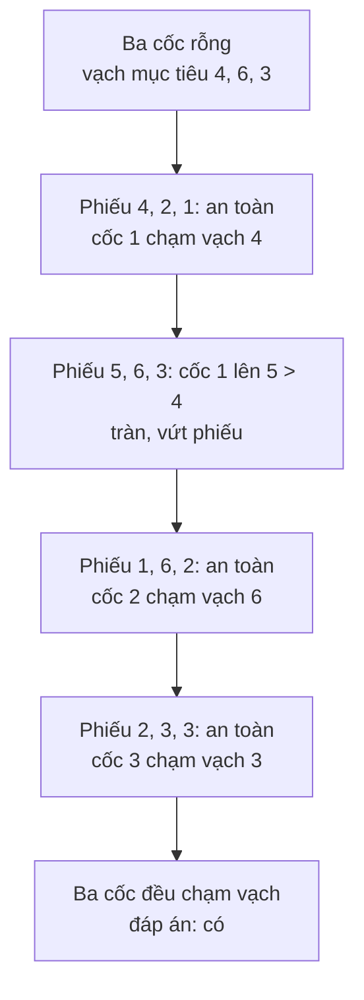
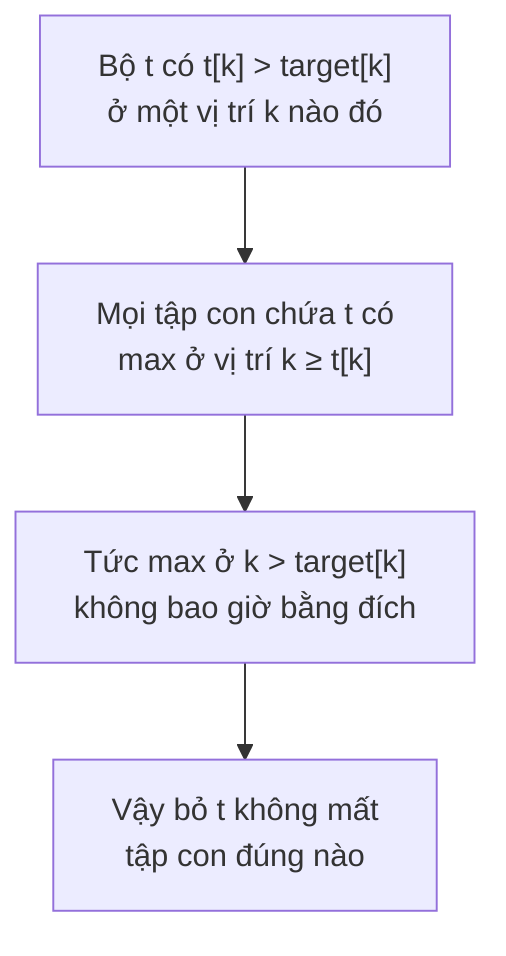
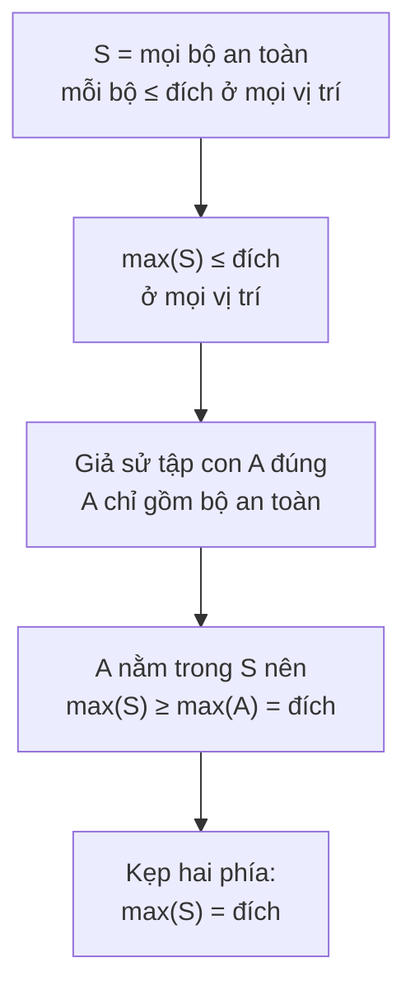

> [!tldr] Đọc nhanh
> - Gộp hai bộ ba là lấy max từng thành phần. Gộp bao nhiêu lần, theo thứ tự nào, kết quả vẫn chỉ là max của một tập con các bộ ban đầu. Bài hỏi: có tập con khác rỗng nào có max đúng bằng `target` không.
> - Bộ nào có một thành phần lớn hơn đích là bộ **không an toàn**: dùng nó thì vị trí đó vượt đích mãi mãi, vì max không bao giờ giảm. Bỏ hết những bộ này.
> - Các bộ còn lại đều nằm dưới hoặc bằng đích ở mọi vị trí, nên gộp **tất cả** chúng chỉ có lợi. Đáp án là "có" đúng khi với mỗi vị trí k, có một bộ an toàn mang đúng `target[k]`. Đây là [[concepts/safe-candidate-filter|bộ lọc ứng viên an toàn]].
> - Một lượt O(n), bộ nhớ O(1). Vét cạn thử 2ⁿ − 1 tập con: ở n = 18 đã là 4.718.574 bước, trong khi một lượt lọc chỉ cần 18.

> [!info] Bối cảnh
> Đây là bài LeetCode 1899 tại [[posts/2026-11-28-neetcode-greedy-grouping|ga MISC-04: Tham lam theo nhóm]] trên **tuyến NeetCode: Kỹ thuật tổng hợp**. Mình hình dung ba cái cốc chỉ được rót thêm, không được đổ bớt. Bạn chỉ cần biết mảng, vòng lặp và hàm `max`; không cần đọc bài nào khác trước.

> [!abstract]- Từ điển nhanh cho bài này (bấm để mở)
> - Bộ ba (triplet): một mảng đúng ba số nguyên, ví dụ `[4, 2, 1]`. Thành phần thứ k là `t[k]`, với k = 0, 1, 2.
> - Max từng thành phần (component-wise max): gộp `[4, 2, 1]` với `[1, 6, 2]` ra `[max(4, 1), max(2, 6), max(1, 2)] = [4, 6, 2]`.
> - Tập con (subset): chọn một số phần tử bất kỳ trong danh sách, không quan tâm thứ tự. Danh sách n phần tử có 2ⁿ − 1 tập con khác rỗng.
> - [[concepts/brute-force|Vét cạn]]: thử mọi khả năng. Ở đây là thử mọi tập con, dùng làm trọng tài trong file chạy.
> - [[concepts/greedy-choice|Lựa chọn tham lam]]: quyết định ngay ở từng phần tử (giữ hay bỏ) mà không quay lại, rồi chứng minh quyết định đó không làm mất đáp án.

## Hình dung trước: ba cốc nước chỉ rót thêm

Trên bàn có ba cái cốc, mỗi cốc có một vạch mục tiêu. Mình có một xấp phiếu rót; mỗi phiếu ghi ba vạch, một vạch cho mỗi cốc. Dùng một phiếu nghĩa là rót từng cốc lên tới vạch ghi trên phiếu, nếu cốc đang thấp hơn vạch đó; cốc nào đã cao hơn thì để nguyên. Nước rót vào rồi không múc ra được. Câu hỏi: có cách chọn vài phiếu để ba cốc dừng **đúng** ở ba vạch mục tiêu không.

Mình không thử từng cách chọn phiếu. Mình lật từng phiếu: phiếu nào có một vạch cao hơn mục tiêu của cốc tương ứng thì vứt luôn, vì rót nó là tràn cốc đó, không cứu được. Phiếu nào an toàn thì dùng hết, vì nó không bao giờ đẩy cốc nào quá vạch. Cuối cùng chỉ cần xem mỗi cốc đã chạm đúng vạch chưa.

| Đời thường | Khái niệm |
|---|---|
| Mức nước trong ba cốc | bộ đang gộp `[a, b, c]` |
| Một phiếu rót | một triplet `t` |
| Rót từng cốc lên tới vạch của phiếu | gộp bằng max từng thành phần |
| Vạch mục tiêu trên ba cốc | `target = [x, y, z]` |
| Nước rót rồi không múc ra được | max không bao giờ giảm |
| Phiếu có vạch cao hơn mục tiêu | bộ không an toàn: có k với `t[k] > target[k]` |
| Phiếu an toàn chạm đúng vạch của cốc k | `t[k] == target[k]`, đánh dấu `found[k]` |
| Ba cốc đều chạm vạch | `found` đủ cả ba |

Với `target = [4, 6, 3]` và bốn phiếu `[4, 2, 1]`, `[5, 6, 3]`, `[1, 6, 2]`, `[2, 3, 3]`:



Phiếu `[5, 6, 3]` trông rất hấp dẫn: nó chạm đúng hai vạch 6 và 3 cùng lúc. Nhưng nó kéo cốc 1 lên 5, quá vạch 4, và không gì kéo xuống lại được.

## Vấn đề: gộp bằng max có ra đúng bộ đích không

Có một danh sách n bộ ba số nguyên và một bộ đích `target = [x, y, z]`. Mỗi bước, mình chọn hai vị trí khác nhau i và j rồi thay bộ ở j bằng max từng thành phần của bộ i và bộ j. Được làm bao nhiêu bước tùy ý, kể cả không bước nào. Trả về `true` nếu có cách làm cho `target` xuất hiện như một phần tử trong danh sách, `false` nếu không. Giới hạn: 1 ≤ n ≤ 10⁵, mọi giá trị từ 1 đến 1000. Ví dụ của mình: `[[3, 1, 1], [1, 4, 1], [1, 1, 6]]` với đích `[3, 4, 6]` cho `true`, gộp cả ba bộ vào một. [Đề gốc LeetCode 1899](https://leetcode.com/problems/merge-triplets-to-form-target-triplet/)

Lần đầu mình nghĩ phải tìm đúng **một cặp** gộp ra đích, và còn lo thứ tự gộp. Ví dụ ở phần Hình dung trước bác cả hai: không cặp nào trong ba phiếu an toàn ra `[4, 6, 3]` (`[4, 6, 2]`, `[4, 3, 3]`, `[2, 6, 3]`), phải gộp cả ba. Còn thứ tự thì không quan trọng, vì max có tính giao hoán, kết hợp và lấy max với chính mình không đổi gì. Gộp đi gộp lại cách nào, mỗi phần tử trong danh sách vẫn luôn là max của một tập con các bộ ban đầu (tập con chứa chính nó). Ngược lại, muốn có max của một tập con bất kỳ, cứ gộp lần lượt từng bộ trong tập con vào một bộ của nó. Vậy bài chỉ còn là: **có tập con khác rỗng nào có max từng thành phần bằng đúng `target`**.

## Cơ chế

### Vét cạn: thử mọi tập con

Duyệt mọi mask từ 1 tới 2ⁿ − 1, mỗi mask là một tập con. Với mỗi mask, đi qua n bit, gộp bằng max những bộ có bit bật, rồi so với đích. Thời gian O(2ⁿ · n), bộ nhớ O(1). Ở n = 18 đã là (2¹⁸ − 1) · 18 = 4.718.574 bước; ở n = 10⁵ thì số tập con là 2¹⁰⁰⁰⁰⁰, cỡ 10³⁰¹⁰³, không bao giờ chạy xong. Mình giữ cách này làm trọng tài trên các danh sách nhỏ.

Cái phí của vét cạn: nó thử cả những tập con chứa một bộ vượt đích, dù chỉ cần nhìn bộ đó một lần là biết mọi tập con chứa nó đều hỏng.

### Lọc bộ an toàn: một lượt

Gọi một bộ `t` là **an toàn** khi `t[0] ≤ x`, `t[1] ≤ y` và `t[2] ≤ z`. Thuật toán: đi một lượt, bỏ qua mọi bộ không an toàn; với mỗi bộ an toàn, vị trí k nào có `t[k] == target[k]` thì đánh dấu `found[k]`. Cuối lượt, trả `true` khi cả ba dấu đều bật. Thời gian O(n), bộ nhớ O(1).

Cần hai lập luận, cả hai đều dựa trên một tính chất: thêm phần tử vào tập con chỉ làm max **tăng hoặc giữ nguyên**, không bao giờ giảm.





Hình thứ nhất nói bộ không an toàn không bao giờ dùng được: nó làm hỏng mọi tập con chứa nó. Hình thứ hai nói gộp **mọi** bộ an toàn không bao giờ hại: nếu có một tập con đúng thì nó chỉ gồm bộ an toàn (theo hình thứ nhất), và thêm các bộ an toàn khác vào chỉ đẩy max lên tới tối đa là đích. Nên chỉ cần thử đúng một tập con: S. Theo kiểu cốc nước: phiếu an toàn rót thêm bao nhiêu cũng không tràn, nên cứ dùng hết.

Còn bước cuối: max(S) ở vị trí k bằng `target[k]` khi nào? Mọi bộ trong S đều có `t[k] ≤ target[k]`, nên max ở k chạm `target[k]` đúng khi có ít nhất một bộ an toàn mang đúng giá trị đó. Đó là lý do đánh dấu `found[k]` là đủ, và cũng là lý do ba dấu có thể đến từ ba bộ khác nhau.

Hai cách viết ra cùng một kết quả: đánh dấu `found`, hoặc tính thẳng max của mọi bộ an toàn rồi so với đích. File chạy giữ cả hai và kiểm tra chúng luôn khớp nhau.

Truy vết với ví dụ ở phần Hình dung trước, đích `[4, 6, 3]`:

| Bộ | An toàn? | `found` sau bước | max các bộ an toàn |
|---|---|---|---|
| `[4, 2, 1]` | có | ✓ · · | `[4, 2, 1]` |
| `[5, 6, 3]` | không, 5 > 4 | ✓ · · | `[4, 2, 1]` |
| `[1, 6, 2]` | có | ✓ ✓ · | `[4, 6, 2]` |
| `[2, 3, 3]` | có | ✓ ✓ ✓ | `[4, 6, 3]` |

Đây là một [[concepts/greedy-choice|lựa chọn tham lam]] ở dạng gọn nhất: mỗi bộ chỉ có một quyết định, giữ hay bỏ, và quyết định đó chỉ cần nhìn chính bộ ấy với đích.

| Cách | Thời gian | Bộ nhớ phụ | Ghi chú |
|---|---|---|---|
| Vét cạn mọi tập con | O(2ⁿ · n) | O(1) | Trọng tài; chỉ chạy được với n nhỏ |
| Lọc an toàn, đánh dấu `found` | O(n) | O(1) | Cách chính |
| Lọc an toàn, max rồi so | O(n) | O(1) | Cùng kết quả, nhìn theo mức nước |

### Đo: vét cạn và lọc an toàn

Mình dựng 18 bộ an toàn với đích `[1000, 1000, 1000]`: bộ thứ i là `[i + 1, i + 1, i + 1]`, riêng bộ 0 có thành phần đầu bằng 1000 và bộ 1 có thành phần giữa bằng 1000. Không bộ nào có thành phần cuối bằng 1000, nên đáp án là `false` và vét cạn phải thử hết 2¹⁸ − 1 tập con, tức 4.718.574 bước. Lọc an toàn đi 18 bước. Rồi mình chạy riêng cách lọc ở giới hạn của đề, n = 100.000, bộ thứ i là `[(7i mod 1000) + 1, (13i mod 1000) + 1, (31i mod 1000) + 1]`, đích `[700, 800, 900]` (đáp án `true`). Mỗi ngôn ngữ đo một lần trên máy mình:

| Ngôn ngữ | Vét cạn, n = 18 | Lọc, n = 18 | Lọc, n = 100.000 |
|---|---|---|---|
| TypeScript (Node) | 18,1 ms | 0,001 ms | 0,48 ms |
| Python | 683,5 ms | 0,008 ms | 8,87 ms |
| Go | 17,7 ms | dưới 0,001 ms | 0,23 ms |
| Java | 11,8 ms | dưới 0,001 ms | 0,16 ms |
| JavaScript (Node) | 18,7 ms | 0,001 ms | 0,38 ms |
| PHP | 163,4 ms | 0,004 ms | 11,09 ms |
| Rust | 8,8 ms | dưới 0,001 ms | 0,08 ms |

Mỗi bộ thêm vào làm số tập con gấp đôi. Ước tính (không đo): ở n = 30, vét cạn cần khoảng 3,2·10¹⁰ bước, với tốc độ của Node ở trên là cỡ hai phút. Ở n = 10⁵ thì không có máy nào chạy nổi. Cách lọc ở n = 10⁵ vẫn dưới 12 ms với cả ngôn ngữ chậm nhất.

## Ví dụ chạy được

[TypeScript](../code/neetcode-merge-triplets-to-form-target-triplet/triplets.ts) · [Python](../code/neetcode-merge-triplets-to-form-target-triplet/triplets.py) · [Go](../code/neetcode-merge-triplets-to-form-target-triplet/triplets.go) · [Java](../code/neetcode-merge-triplets-to-form-target-triplet/triplets.java) · [JavaScript](../code/neetcode-merge-triplets-to-form-target-triplet/triplets.js) · [PHP](../code/neetcode-merge-triplets-to-form-target-triplet/triplets.php) · [Rust](../code/neetcode-merge-triplets-to-form-target-triplet/triplets.rs)

```ts
// Cách chính: bỏ mọi bộ có thành phần vượt target, trong số còn lại đánh dấu thành phần nào khớp đúng
function mergeTriplets(triplets: number[][], target: number[], counter = { steps: 0 }): boolean {
    const [x, y, z] = target
    const found = [false, false, false]
    for (const t of triplets) {
        counter.steps++
        if (t[0] > x || t[1] > y || t[2] > z) continue // bộ không an toàn: gộp vào là vượt, không gỡ được
        for (let k = 0; k < 3; k++) {
            if (t[k] === target[k]) found[k] = true // bộ an toàn này mang đúng giá trị cần ở vị trí k
        }
    }
    return found[0] && found[1] && found[2]
}
```

```python
# Cách chính: bỏ mọi bộ có thành phần vượt target, trong số còn lại đánh dấu thành phần nào khớp đúng
def merge_triplets(triplets, target, counter=None):
    x, y, z = target
    found = [False, False, False]
    for t in triplets:
        if counter is not None:
            counter["steps"] += 1
        if t[0] > x or t[1] > y or t[2] > z:
            continue  # bộ không an toàn: gộp vào là vượt, không gỡ được
        for k in range(3):
            if t[k] == target[k]:
                found[k] = True  # bộ an toàn này mang đúng giá trị cần ở vị trí k
    return all(found)
```

```go
// Cách chính: bỏ mọi bộ có thành phần vượt target, trong số còn lại đánh dấu thành phần nào khớp đúng
func mergeTriplets(triplets [][]int, target []int, steps *int64) bool {
	x, y, z := target[0], target[1], target[2]
	var found [3]bool
	for _, t := range triplets {
		*steps++
		if t[0] > x || t[1] > y || t[2] > z {
			continue // bộ không an toàn: gộp vào là vượt, không gỡ được
		}
		for k := 0; k < 3; k++ {
			if t[k] == target[k] {
				found[k] = true // bộ an toàn này mang đúng giá trị cần ở vị trí k
			}
		}
	}
	return found[0] && found[1] && found[2]
}
```

```java
    // Cách chính: bỏ mọi bộ có thành phần vượt target, trong số còn lại đánh dấu thành phần nào khớp đúng
    static boolean mergeTriplets(int[][] triplets, int[] target) {
        int x = target[0], y = target[1], z = target[2];
        boolean[] found = new boolean[3];
        for (int[] t : triplets) {
            steps++;
            if (t[0] > x || t[1] > y || t[2] > z) continue; // bộ không an toàn: gộp vào là vượt, không gỡ được
            for (int k = 0; k < 3; k++) {
                if (t[k] == target[k]) found[k] = true; // bộ an toàn này mang đúng giá trị cần ở vị trí k
            }
        }
        return found[0] && found[1] && found[2];
    }
```

```js
// Cách chính: bỏ mọi bộ có thành phần vượt target, trong số còn lại đánh dấu thành phần nào khớp đúng
function mergeTriplets(triplets, target, counter = { steps: 0 }) {
    const [x, y, z] = target
    const found = [false, false, false]
    for (const t of triplets) {
        counter.steps++
        if (t[0] > x || t[1] > y || t[2] > z) continue // bộ không an toàn: gộp vào là vượt, không gỡ được
        for (let k = 0; k < 3; k++) {
            if (t[k] === target[k]) found[k] = true // bộ an toàn này mang đúng giá trị cần ở vị trí k
        }
    }
    return found[0] && found[1] && found[2]
}
```

```php
// Cách chính: bỏ mọi bộ có thành phần vượt target, trong số còn lại đánh dấu thành phần nào khớp đúng
function mergeTriplets(array $triplets, array $target): bool {
    global $steps;
    [$x, $y, $z] = $target;
    $found = [false, false, false];
    foreach ($triplets as $t) {
        $steps++;
        if ($t[0] > $x || $t[1] > $y || $t[2] > $z) continue; // bộ không an toàn: gộp vào là vượt, không gỡ được
        for ($k = 0; $k < 3; $k++) {
            if ($t[$k] === $target[$k]) $found[$k] = true; // bộ an toàn này mang đúng giá trị cần ở vị trí k
        }
    }
    return $found[0] && $found[1] && $found[2];
}
```

```rust
// Cách chính: bỏ mọi bộ có thành phần vượt target, trong số còn lại đánh dấu thành phần nào khớp đúng
fn merge_triplets(triplets: &[[i32; 3]], target: &[i32; 3], steps: &mut u64) -> bool {
    let [x, y, z] = *target;
    let mut found = [false; 3];
    for t in triplets {
        *steps += 1;
        if t[0] > x || t[1] > y || t[2] > z {
            continue; // bộ không an toàn: gộp vào là vượt, không gỡ được
        }
        for k in 0..3 {
            if t[k] == target[k] {
                found[k] = true; // bộ an toàn này mang đúng giá trị cần ở vị trí k
            }
        }
    }
    found.iter().all(|&f| f)
}
```

Các tab trích cách chính; dòng tăng `steps` chỉ để đếm cho phép đo. File tải về còn có vét cạn mọi tập con, cách tính max của mọi bộ an toàn và bản sai bỏ bước lọc. Bản Rust dùng `[i32; 3]` thay cho `Vec<Vec<i32>>` trong chữ ký LeetCode để so sánh và tách bộ gọn hơn; thân hàm giống hệt. Bảy ca tự dựng gồm một bộ đã bằng đích, một bộ chạm hai vạch nhưng vượt vạch thứ ba, ba bộ mỗi bộ góp một vị trí, một bộ không an toàn đứng cạnh bộ đúng, đích cao hơn mọi bộ, và hai bộ trùng nhau thiếu một vị trí. Mỗi ca, cả ba cách phải ra đúng đáp án mong đợi.

Dòng thứ hai đối chiếu trên mọi danh sách 1–4 bộ, mỗi thành phần lấy trong {1, 2, 3}, đích `[2, 2, 2]`: 27 + 27² + 27³ + 27⁴ = 551.880 danh sách. Với đích ở giữa như vậy, mỗi thành phần có thể thấp hơn, bằng hoặc cao hơn đích, nên mọi kiểu an toàn và không an toàn đều có mặt. Một danh sách tính là đúng khi cả cách đánh dấu lẫn cách tính max đều ra giống vét cạn. Dòng thứ ba chạy bản sai trên cùng các danh sách. Hai dòng cuối là phép đo ở trên (đây là số của TypeScript).

```text
7/7 ca đúng
551880/551880 ca đúng (đối chiếu vét cạn)
Bỏ bước lọc: sai 163218/551880 ca
n = 18, đáp án false/false: vét cạn 4718574 bước (18.1 ms), tham lam 18 bước (0.001 ms)
n = 100000, đáp án true: tham lam 100000 bước (0.48 ms)
```

Cả bảy ngôn ngữ in đúng ba dòng đầu, cùng đáp án và cùng số bước ở hai dòng cuối; chỉ thời gian khác nhau, như bảng ở phần Cơ chế.

## Hiểu lầm và bẫy hay gặp

- Chỉ tìm một bộ đã bằng đích, hoặc một cặp gộp ra đích. Ví dụ `[4, 2, 1]`, `[1, 6, 2]`, `[2, 3, 3]` với đích `[4, 6, 3]` cần cả ba bộ.
- Bỏ bước lọc: thấy thành phần nào bằng đích là đánh dấu. Với `[[2, 9, 5], [1, 7, 1]]` và đích `[2, 7, 5]`, bản sai thấy 2 và 5 ở bộ đầu, 7 ở bộ sau, nên trả `true`; nhưng bộ đầu có 9 > 7, không dùng được, đáp án là `false`. Trên 551.880 danh sách đối chiếu, bản sai trả sai 163.218 lần.
- Lọc bằng `>=` thay vì `>`. Bộ mang đúng giá trị đích bị vứt, mà đó lại chính là bộ cần giữ: `[[1, 2, 3]]` với đích `[1, 2, 3]` sẽ ra `false`.
- Chỉ kiểm tra vị trí đang xét. Bộ `[5, 6, 3]` với đích `[4, 6, 3]` khớp vị trí 1 và 2 nhưng vẫn không an toàn vì vị trí 0. An toàn là điều kiện trên **cả ba** vị trí, xét trước khi đánh dấu bất cứ gì.
- Lo thứ tự gộp hay chuyện bộ đích phải nằm ở vị trí nào. Max giao hoán và kết hợp, còn đề chỉ hỏi đích có xuất hiện ở đâu đó trong danh sách.
- TypeScript, JavaScript: `1 << n` là phép dịch trên số nguyên 32 bit. Trên máy mình, Node in `1 << 31` ra −2147483648 và `1 << 32` ra 1. Vòng `mask < 1 << n` của vét cạn khi đó không chạy lần nào và trọng tài âm thầm trả `false`. Ở đây n chỉ tới 18 nên an toàn, nhưng đừng đem trọng tài này lên n ≥ 31.
- Java: cùng chuyện `1 << 31` với `int` (mình chạy thử ra −2147483648 và 1, như Node). Bộ đếm bước dùng `long`, vì ở n = 27 vét cạn đã cần khoảng 3,6·10⁹ bước, vượt `Integer.MAX_VALUE`.
- Python: so một list với một tuple luôn ra `False`, kể cả khi cùng phần tử: `[4, 6, 3] == (4, 6, 3)` là `False`. Nếu đích đến dưới dạng tuple, cách tính max phải so `m == list(target)`, như file chạy.
- PHP: `===` trên mảng so cả kiểu từng phần tử, nên `[4, 6, 3] === [4, 6, "3"]` là `false` trong khi `==` là `true`. File dùng `===` vì mọi giá trị đều là số nguyên; nếu đích đọc từ chuỗi, ép về `int` trước.
- Go: hàm có sẵn `max` chỉ có từ Go 1.21. File chạy được trên máy mình với Go 1.25; bản cũ hơn phải tự viết hàm max.
- Rust: chữ ký LeetCode nhận `Vec<Vec<i32>>`, nên `let [x, y, z] = *target` không biên dịch được với `Vec`; phải viết `target[0]`, `target[1]`, `target[2]`. File dùng mảng cố định `[i32; 3]` để viết được kiểu đó.

## Câu hỏi tự kiểm tra

> [!question]- Vì sao một bộ không an toàn không bao giờ nằm trong tập con đúng?
> Nếu `t[k] > target[k]` thì max ở vị trí k của mọi tập con chứa t ít nhất là `t[k]`, tức lớn hơn đích. Max không bao giờ giảm, nên không gộp thêm bộ nào cứu được.

> [!question]- Vì sao gộp **mọi** bộ an toàn không làm hỏng một tập con đúng?
> Mỗi bộ an toàn ≤ đích ở mọi vị trí, nên max của tất cả vẫn ≤ đích. Tập con đúng nằm trong tập các bộ an toàn, nên max của tất cả ≥ đích. Hai phía kẹp lại thành đúng bằng đích.

> [!question]- Với đích `[3, 5, 2]` và các bộ `[3, 1, 2]`, `[2, 5, 3]`, `[1, 5, 1]`, đáp án là gì?
> `true`. `[2, 5, 3]` không an toàn vì 3 > 2. Còn lại `[3, 1, 2]` (chạm vị trí 0 và 2) và `[1, 5, 1]` (chạm vị trí 1). Max của hai bộ là `[3, 5, 2]`.

> [!question]- Ba dấu `found` có cần đến từ cùng một bộ không?
> Không. Mỗi dấu chỉ cần một bộ an toàn mang đúng giá trị ở vị trí đó; gộp các bộ ấy lại sẽ ra đích, vì không bộ nào trong số đó vượt đích ở vị trí nào.

## Tham khảo

- [LeetCode 1899](https://leetcode.com/problems/merge-triplets-to-form-target-triplet/)
- [Go 1.21 release notes: built-in min and max](https://go.dev/doc/go1.21)
- [Rust error codes: E0005 (refutable pattern)](https://doc.rust-lang.org/error_codes/E0005.html)
