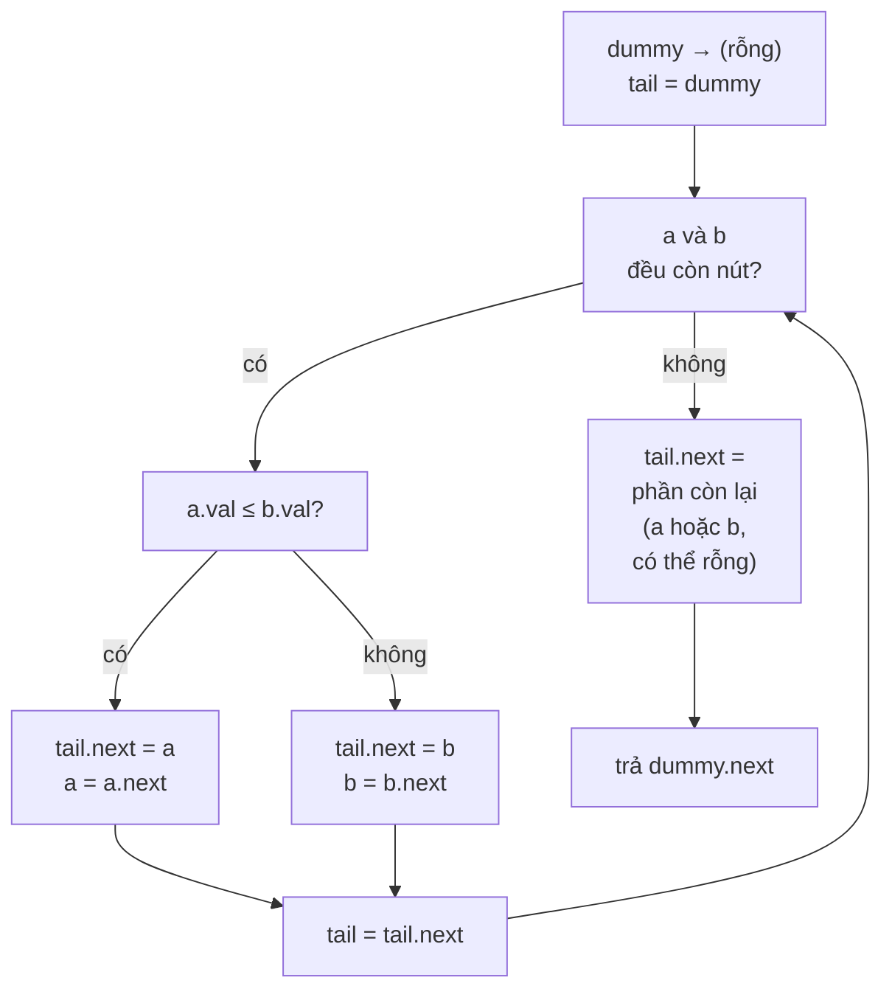

> [!tldr] Đọc nhanh
> - Đề: hai [[concepts/linked-list|danh sách liên kết]] đã sắp tăng dần; trộn thành một danh sách đã sắp **bằng chính các nút của hai danh sách**, trả về đầu.
> - Cách chuẩn: một [[concepts/dummy-node|nút giả]] đứng trước đầu kết quả, con trỏ `tail` chỉ nút cuối. Mỗi bước so hai đầu, nối nút nhỏ hơn vào sau `tail`. Hết một danh sách thì nối **nguyên phần còn lại** của danh sách kia một lần. O(m + n) thời gian, O(1) bộ nhớ thêm.
> - Đệ quy ngắn hơn nhưng sâu bằng tổng số nút: Node 24 vấp ở **12 289** nút, Python ở **1 000**, Java 21 ở khoảng 18 000 (lần đầu) tới 29 475 (sau JIT). Go chạy 2·10⁶ nút không sao.
> - Bốn bản sai chạy thật: bỏ nút giả mà quên danh sách rỗng (5/8, `TypeError`), quên nối phần còn lại (1/8), quên tiến `tail` (3/8), gom rồi `sort()` không hàm so sánh trong JS (7/8).

> [!info] Bối cảnh
> Bài LeetCode 21 của [[posts/2026-11-24-neetcode-linked-list|ga 1: Con trỏ trên danh sách liên kết]] trong **tuyến NeetCode: Cấu trúc liên kết**. Nó là bài "trộn" nhỏ nhất: [[problems/reorder-list|Reorder List]] dùng lại đúng vòng trộn này ở bước cuối, và bài LeetCode 23 (Merge k Sorted Lists, ga 2) mở rộng nó thành [[concepts/k-way-merge|trộn k danh sách]] bằng heap. Lời giải có đủ TypeScript, Python, Go, Java và JavaScript. Bạn chỉ cần biết vòng lặp và khái niệm con trỏ (tham chiếu tới một đối tượng).

> [!abstract]- Từ điển nhanh cho bài này (bấm để mở)
> - **Danh sách liên kết đơn**: chuỗi nút, mỗi nút giữ một giá trị và con trỏ `next` tới nút sau; nút cuối có `next = null`. Xem [[concepts/linked-list|Linked List]].
> - **Nút giả (dummy node)**: một nút không mang dữ liệu đặt trước đầu danh sách, để thao tác trên đầu giống hệt thao tác ở giữa. Xem [[concepts/dummy-node|Dummy Node]] và ý tưởng gần với nó, [[concepts/sentinel-value|Sentinel Value]].
> - **Nối lại (splice)**: đổi con trỏ `next` của nút có sẵn thay vì tạo nút mới.
> - **Ổn định (stable)**: khi hai giá trị bằng nhau, phần tử đến từ danh sách thứ nhất vẫn đứng trước.
> - **Khung gọi hàm (stack frame)**: vùng nhớ cho một lần gọi hàm đang chờ; đệ quy sâu n tầng giữ n khung cùng lúc.

## Hình dung trước: hai hàng người xếp theo chiều cao nhập thành một hàng

Hai lớp đã xếp hàng từ thấp tới cao. Cô giáo muốn nhập thành một hàng vẫn từ thấp tới cao. Cô cắm một cái cọc mốc ở đầu sân (nút giả), rồi mỗi lần nhìn hai bạn đứng đầu hai hàng, gọi bạn thấp hơn ra đứng sau người cuối của hàng mới. Khi một lớp hết người, cô không gọi từng bạn của lớp kia nữa: cả đoạn hàng còn lại đã xếp sẵn, chỉ cần bảo bạn đầu đoạn nắm tay người cuối hàng mới.

| Đời thường | Khái niệm |
|---|---|
| Hai hàng đã xếp từ thấp tới cao | hai danh sách liên kết đã sắp |
| Mỗi bạn nắm vai bạn đứng sau | con trỏ `next` |
| Cọc mốc ở đầu sân | nút giả `dummy` |
| Người cuối của hàng mới | con trỏ `tail` |
| Gọi bạn thấp hơn ra sau người cuối | `tail.next = nút nhỏ hơn` rồi tiến `tail` |
| Hai bạn cao bằng nhau, gọi bạn lớp 1 trước | so `<=` để giữ ổn định |
| Một lớp hết, nối cả đoạn còn lại | `tail.next = a ?? b`, O(1) |
| Không ai đổi lớp, không ai được "nhân bản" | nối lại nút cũ, không tạo nút mới |



## Vấn đề

Trộn hai **mảng** đã sắp thì quen: hai chỉ số, mỗi bước chép phần tử nhỏ hơn sang mảng mới. Với danh sách liên kết, ta không cần mảng mới: các nút đã có sẵn, chỉ cần **đổi con trỏ** để chúng xếp thành một chuỗi. Cái khó không nằm ở phép so sánh mà ở hai chỗ dễ trượt tay: **nút đầu** của kết quả (trước khi có nút nào thì nối vào đâu?) và **phần đuôi** (một danh sách hết trước thì phần còn lại của danh sách kia đi đâu?).

## Cơ chế

<figure class="figure-map" style="--ar: 3 / 4">
<div class="frame"><iframe data-archify="../diagrams/neetcode-merge-two-sorted-lists/worked-example.html" title="Mỗi lần chỉ lấy đầu nhỏ hơn" loading="lazy"></iframe></div>
<figcaption><span><b>Hình 1.</b> Mỗi lần chỉ lấy đầu nhỏ hơn.</span><a href="../diagrams/neetcode-merge-two-sorted-lists/worked-example.html" target="_blank" rel="noopener">Mở toàn màn hình</a></figcaption>
</figure>

<details>
<summary>Đọc từng bước</summary>
<ol>
<li>So hai đầu 1 và 2. <code>[1, 5], [2, 4]</code></li>
<li>Nối 1 và tiến danh sách thứ nhất. <code>[1]; heads = 5, 2</code></li>
<li>Nối 2 rồi nối 4. <code>[1, 2, 4]; right = null</code></li>
<li>Nối phần còn lại một lần. <code>[1, 2, 4, 5]</code></li>
</ol>
</details>

### Nút giả bỏ trường hợp riêng cho đầu

Không có nút giả, nút đầu của kết quả phải được chọn **trước** vòng lặp, và vì vậy phải kiểm tra trước cả hai danh sách rỗng:

```ts
// Không có nút giả: phải chọn đầu kết quả trước vòng lặp, và phải lo cả hai danh sách rỗng.
function mergeNoDummy(a: ListNode | null, b: ListNode | null): ListNode | null {
  if (!a) return b;
  if (!b) return a;
  let head: ListNode;
  if (a.val <= b.val) { head = a; a = a.next; } else { head = b; b = b.next; }
  let tail = head;
  while (a && b) {
    if (a.val <= b.val) { tail.next = a; a = a.next; } else { tail.next = b; b = b.next; }
    tail = tail.next;
  }
  tail.next = a ?? b;
  return head;
}
```


Có nút giả, mọi nút thật đều là "nút được nối vào sau `tail`", kể cả nút đầu; cuối cùng trả `dummy.next`:

```ts
// Nút giả (dummy) đứng trước đầu kết quả: mọi nút thật đều được nối vào "sau một nút nào đó",
// nên không cần trường hợp riêng cho đầu danh sách.
function mergeDummy(a: ListNode | null, b: ListNode | null): ListNode | null {
  const dummy = new ListNode(0);
  let tail = dummy;
  while (a && b) {
    if (a.val <= b.val) { tail.next = a; a = a.next; } // <= giữ nút của a trước khi bằng nhau
    else { tail.next = b; b = b.next; }
    tail = tail.next;
  }
  tail.next = a ?? b; // phần còn lại đã sắp sẵn: nối nguyên đuôi, O(1)
  return dummy.next;
}
```


Hai bản cùng đúng 8/8 ca. Khác biệt là bản không có nút giả có **hai** chỗ phải nhớ (kiểm tra rỗng, chọn đầu), và chỉ cần quên một chỗ là sai. Bản sai dưới đây bỏ hai dòng `if (!a) return b; if (!b) return a;`:

```ts
// SAI: bỏ nút giả nhưng quên trường hợp một danh sách rỗng: đọc .val của null.
function wrongNoDummy(a: ListNode | null, b: ListNode | null): ListNode | null {
  let head: ListNode;
  if (a!.val <= b!.val) { head = a!; a = a!.next; } else { head = b!; b = b!.next; }
  let tail = head;
  while (a && b) {
    if (a.val <= b.val) { tail.next = a; a = a.next; } else { tail.next = b; b = b.next; }
    tail = tail.next;
  }
  tail.next = a ?? b;
  return head;
}
```


Nó qua 5/8 ca và ném `TypeError` ở đúng ba ca có danh sách rỗng, trong đó có ví dụ 2 và 3 của đề.

### Phần còn lại nối một lần, O(1)

Khi vòng `while (a && b)` dừng, ít nhất một danh sách đã hết. Danh sách còn lại đã sắp, và mọi giá trị của nó đều ≥ nút vừa nối (vì nó thua mọi phép so sánh trước đó hoặc chưa được so). Nên không cần duyệt tiếp: `tail.next = a ?? b` gắn cả đoạn bằng một phép gán. Bản sai `wrongForgetTail` bỏ dòng đó và chỉ còn qua 1/8 ca (ca hai danh sách rỗng), vì gần như ca nào cũng còn đuôi.

Bất biến của vòng lặp: **`dummy.next … tail` là một danh sách đã sắp gồm đúng các nút đã lấy ra, và mọi nút còn lại trong `a`, `b` đều ≥ `tail.val`**. Bản sai `wrongNoAdvance` quên `tail = tail.next`: mỗi lần nối đè lên `dummy.next`, nên kết quả chỉ còn nút nối cuối cùng cộng phần đuôi, qua 3/8 ca.

### `<=` hay `<`: chuyện ổn định

Với LeetCode, so `<` hay `<=` đều qua vì chỉ so giá trị. Nhưng khi nút mang thêm dữ liệu (như các bản ghi khi sắp xếp trộn), thứ tự giữa hai nút bằng nhau có nghĩa. Gắn nhãn `a`, `b` vào nút và trộn `[1,2,2]` với `[2,3]`:

```text
ổn định, [1,2,2] (a) với [2,3] (b):
  <= : 1a 2a 2a 2b 3b
  <  : 1a 2b 2a 2a 3b
```

`<=` giữ hai số 2 của `a` trước số 2 của `b`, tức ổn định; `<` đưa số 2 của `b` lên trước. Merge sort ổn định chính là nhờ dấu `<=` ở bước trộn này.

### Đệ quy: ngắn, nhưng sâu bằng tổng số nút

```ts
// Đệ quy: đầu nhỏ hơn đứng trước, phần sau là kết quả trộn của phần còn lại. Sâu bằng tổng số nút.
function mergeRecursive(a: ListNode | null, b: ListNode | null): ListNode | null {
  if (!a) return b;
  if (!b) return a;
  if (a.val <= b.val) { a.next = mergeRecursive(a.next, b); return a; }
  b.next = mergeRecursive(a, b.next);
  return b;
}
```


Mỗi lần gọi lấy đi đúng một nút, nên trộn m + n nút cần m + n khung gọi hàm cùng lúc. Đề giới hạn mỗi danh sách 50 nút, tổng 100 tầng, mọi ngôn ngữ đều qua. Với danh sách dài hơn, mình đo độ sâu tối đa bằng tìm kiếm nhị phân trên tổng số nút (hai danh sách xen kẽ chẵn, lẻ):

| Ngôn ngữ | Chạy được tới | Lỗi khi vượt |
|---|---|---|
| Node 24 (TS, JS) | 12 288 nút (cả ba lần chạy) | `RangeError: Maximum call stack size exceeded` |
| Python 3.12 | 999 nút (giới hạn mặc định 1 000 khung) | `RecursionError` |
| Java 21 | 18 432 nút lần đo đầu, 29 475 sau khi JIT biên dịch | `StackOverflowError` |
| Go 1.25 | 2·10⁶ nút vẫn chạy | (stack của goroutine tự nới) |

Con số của Java đổi giữa lần đo đầu và các lần sau vì khi code còn chạy bằng trình thông dịch, mỗi khung lớn hơn; sau khi JIT biên dịch, khung nhỏ lại và cùng một stack chứa được nhiều tầng hơn. Python dừng ở 999 chứ không 1 000 vì chính chương trình đã dùng vài khung trước khi gọi hàm trộn.

### Bên dưới bảy ngôn ngữ

| | Nút giả | Nối phần còn lại | Bẫy riêng |
|---|---|---|---|
| TypeScript / JavaScript | `new ListNode(0)` | `tail.next = a ?? b` | đệ quy vấp ở 12 289 nút; gom vào mảng rồi `sort()` không hàm so sánh thì `10` đứng trước `2` (7/8 ca) |
| Python | `dummy = tail = ListNode()` | `tail.next = l1 or l2` | đệ quy vấp ở 1 000 nút; gán bộ `tail.next, l1 = l1, l1.next` an toàn vì vế phải được tính hết trước khi gán |
| Go | `dummy := ListNode{}` là **giá trị**, `tail := &dummy` | `if a != nil { tail.Next = a } else { tail.Next = b }` | khai báo `var dummy *ListNode` (con trỏ nil) thì ghi `tail.Next` là panic: *nil pointer dereference* |
| Java | `new ListNode(0, null)` | `tail.next = (a != null) ? a : b` | đệ quy `StackOverflowError`, ngưỡng đổi theo JIT và kích thước stack của luồng (`-Xss`) |
| PHP | `new ListNode()` (đối tượng đi theo handle, gán là chia sẻ) | `$tail->next = $a ?? $b` | đọc thuộc tính của `null` chỉ cảnh báo; đệ quy 10⁶ nút vẫn chạy |
| Rust | `Box::new(ListNode { val: 0, next: None })`, `tail = &mut dummy` | `tail.next = if a.is_some() { a } else { b }` | phải `take()` nút khỏi nguồn trước khi gắn; đệ quy tràn ở 10⁶ nút |

### Đo

TypeScript, giá trị ngẫu nhiên đã sắp (bộ sinh mulberry32), hai danh sách mỗi bên m = n nút, trung vị 5 lần:

| m = n | Nút giả (nối lại) | Đệ quy | Tạo nút mới | Gom rồi sắp |
|---|---|---|---|---|
| 1 000 | 0,04 ms | 0,02 ms | 0,06 ms | 0,08 ms |
| 4 000 | 0,05 ms | 0,12 ms | 0,08 ms | 0,28 ms |
| 100 000 | 1,64 ms | `RangeError` | 2,61 ms | 8,84 ms |
| 1 000 000 | 18,33 ms | `RangeError` | 79,22 ms | 201,34 ms |

- Nối lại nút cũ nhanh nhất ở cỡ lớn: tạo 2·10⁶ nút mới chậm hơn khoảng 4 lần vì phải cấp phát.
- Gom rồi sắp bỏ phí việc hai danh sách đã sắp: O((m + n) log(m + n)) và chậm hơn khoảng 11 lần ở 10⁶.
- Ở 1 000 nút mọi cách đều dưới 0,1 ms; các số nhỏ cỡ đó dao động theo JIT, đừng đọc thứ hạng từ chúng.

Các ngôn ngữ khác, cách nút giả: Go 9,87 ms, Java 10,35 ms ở m = n = 10⁶. Go đệ quy chạy được nhưng chậm hơn khoảng 8 lần (75,48 ms), vì mỗi tầng là một lời gọi hàm thật và stack phải nới dần. Python 237,94 ms; dùng `heapq.merge` rồi dựng lại danh sách mất 2 005 ms, chậm hơn khoảng 8 lần vì tạo 2·10⁶ nút mới và đi qua lớp iterator.

## Ví dụ chạy được

[TypeScript](../code/neetcode-merge-two-sorted-lists/merge-two-lists.ts) · [Python](../code/neetcode-merge-two-sorted-lists/merge_two_lists.py) · [Go](../code/neetcode-merge-two-sorted-lists/merge_two_lists.go) · [Java](../code/neetcode-merge-two-sorted-lists/merge-two-lists.java) · [JavaScript](../code/neetcode-merge-two-sorted-lists/merge-two-lists.js) · [PHP](../code/neetcode-merge-two-sorted-lists/merge-two-lists.php) · [Rust](../code/neetcode-merge-two-sorted-lists/merge_two_lists.rs)

Mỗi file chạy 8 ca chung: ba ví dụ của đề, một danh sách rỗng ở mỗi phía, số âm, toàn số bằng nhau, và hai danh sách xen kẽ dài ngắn khác nhau.

Cách lặp với nút giả:

```ts
// Nút giả (dummy) đứng trước đầu kết quả: mọi nút thật đều được nối vào "sau một nút nào đó",
// nên không cần trường hợp riêng cho đầu danh sách.
function mergeDummy(a: ListNode | null, b: ListNode | null): ListNode | null {
  const dummy = new ListNode(0);
  let tail = dummy;
  while (a && b) {
    if (a.val <= b.val) { tail.next = a; a = a.next; } // <= giữ nút của a trước khi bằng nhau
    else { tail.next = b; b = b.next; }
    tail = tail.next;
  }
  tail.next = a ?? b; // phần còn lại đã sắp sẵn: nối nguyên đuôi, O(1)
  return dummy.next;
}
```

```python
# Nút giả đứng trước đầu kết quả; "l1 or l2" nối nguyên phần còn lại.
def merge_dummy(l1: Optional[ListNode], l2: Optional[ListNode]) -> Optional[ListNode]:
    dummy = tail = ListNode()
    while l1 and l2:
        if l1.val <= l2.val:
            tail.next, l1 = l1, l1.next
        else:
            tail.next, l2 = l2, l2.next
        tail = tail.next
    tail.next = l1 or l2
    return dummy.next
```

```go
// Nút giả là một giá trị trên stack, tail là con trỏ tới nó.
func mergeDummy(a, b *ListNode) *ListNode {
	dummy := ListNode{}
	tail := &dummy
	for a != nil && b != nil {
		if a.Val <= b.Val {
			tail.Next, a = a, a.Next
		} else {
			tail.Next, b = b, b.Next
		}
		tail = tail.Next
	}
	if a != nil {
		tail.Next = a
	} else {
		tail.Next = b
	}
	return dummy.Next
}
```

```java
// Nút giả đứng trước đầu kết quả; hết vòng thì nối nguyên phần còn lại.
static ListNode mergeDummy(ListNode a, ListNode b) {
    ListNode dummy = new ListNode(0, null), tail = dummy;
    while (a != null && b != null) {
        if (a.val <= b.val) { tail.next = a; a = a.next; }
        else { tail.next = b; b = b.next; }
        tail = tail.next;
    }
    tail.next = (a != null) ? a : b;
    return dummy.next;
}
```

```js
// Nút giả đứng trước đầu kết quả; "a ?? b" nối nguyên phần còn lại.
function mergeDummy(a, b) {
  const dummy = new ListNode(0);
  let tail = dummy;
  while (a && b) {
    if (a.val <= b.val) { tail.next = a; a = a.next; }
    else { tail.next = b; b = b.next; }
    tail = tail.next;
  }
  tail.next = a ?? b;
  return dummy.next;
}
```

```php
// Nút giả đứng trước đầu kết quả: không cần trường hợp riêng cho đầu danh sách.
function mergeDummy(?ListNode $a, ?ListNode $b): ?ListNode
{
    $dummy = new ListNode();
    $tail = $dummy;
    while ($a !== null && $b !== null) {
        if ($a->val <= $b->val) { $tail->next = $a; $a = $a->next; } // <= giữ nút của a trước khi bằng nhau
        else { $tail->next = $b; $b = $b->next; }
        $tail = $tail->next;
    }
    $tail->next = $a ?? $b; // phần còn lại đã sắp sẵn: nối nguyên đuôi
    return $dummy->next;
}
```

```rust
// Nút giả: tail là một &mut trỏ vào ô next cuối cùng của kết quả.
fn merge_dummy(mut a: List, mut b: List) -> List {
    let mut dummy = Box::new(ListNode { val: 0, next: None });
    let mut tail = &mut dummy;
    while let (Some(x), Some(y)) = (&a, &b) {
        let src = if x.val <= y.val { &mut a } else { &mut b }; // <= giữ nút của a trước khi bằng nhau
        let mut node = src.take().unwrap();
        *src = node.next.take(); // danh sách nguồn tiến một nút
        tail.next = Some(node);
        tail = tail.next.as_mut().unwrap();
    }
    tail.next = if a.is_some() { a } else { b }; // nối nguyên phần còn lại
    dummy.next
}
```


Cách đệ quy:

```ts
// Đệ quy: đầu nhỏ hơn đứng trước, phần sau là kết quả trộn của phần còn lại. Sâu bằng tổng số nút.
function mergeRecursive(a: ListNode | null, b: ListNode | null): ListNode | null {
  if (!a) return b;
  if (!b) return a;
  if (a.val <= b.val) { a.next = mergeRecursive(a.next, b); return a; }
  b.next = mergeRecursive(a, b.next);
  return b;
}
```

```python
# Đệ quy: mỗi nút tốn một khung gọi hàm, giới hạn mặc định của Python là 1000 khung.
def merge_recursive(l1, l2):
    if not l1:
        return l2
    if not l2:
        return l1
    if l1.val <= l2.val:
        l1.next = merge_recursive(l1.next, l2)
        return l1
    l2.next = merge_recursive(l1, l2.next)
    return l2
```

```go
// Đệ quy: stack của goroutine tự nới, nên Go không vấp giới hạn độ sâu như JS hay Python.
func mergeRecursive(a, b *ListNode) *ListNode {
	if a == nil {
		return b
	}
	if b == nil {
		return a
	}
	if a.Val <= b.Val {
		a.Next = mergeRecursive(a.Next, b)
		return a
	}
	b.Next = mergeRecursive(a, b.Next)
	return b
}
```

```java
// Đệ quy: mỗi nút một khung trên stack của luồng; danh sách dài thì StackOverflowError.
static ListNode mergeRecursive(ListNode a, ListNode b) {
    if (a == null) return b;
    if (b == null) return a;
    if (a.val <= b.val) { a.next = mergeRecursive(a.next, b); return a; }
    b.next = mergeRecursive(a, b.next);
    return b;
}
```

```js
function mergeRecursive(a, b) {
  if (!a) return b;
  if (!b) return a;
  if (a.val <= b.val) { a.next = mergeRecursive(a.next, b); return a; }
  b.next = mergeRecursive(a, b.next);
  return b;
}
```

```php
// Đệ quy: đầu nhỏ hơn đứng trước, phần sau là kết quả trộn phần còn lại.
function mergeRecursive(?ListNode $a, ?ListNode $b): ?ListNode
{
    if ($a === null) return $b;
    if ($b === null) return $a;
    if ($a->val <= $b->val) { $a->next = mergeRecursive($a->next, $b); return $a; }
    $b->next = mergeRecursive($a, $b->next);
    return $b;
}
```

```rust
// Đệ quy: đầu nhỏ hơn đứng trước, phần sau là kết quả trộn phần còn lại.
fn merge_recursive(a: List, b: List) -> List {
    match (a, b) {
        (None, r) | (r, None) => r,
        (Some(mut x), Some(mut y)) => {
            if x.val <= y.val {
                x.next = merge_recursive(x.next.take(), Some(y));
                Some(x)
            } else {
                y.next = merge_recursive(Some(x), y.next.take());
                Some(y)
            }
        }
    }
}
```


Kết quả `node merge-two-lists.ts`:

```text
mergeDummy      8/8 ca đúng
mergeNoDummy    8/8 ca đúng
mergeRecursive  8/8 ca đúng
mergeCopy       8/8 ca đúng
concatSort      8/8 ca đúng
wrongNoDummy    5/8 ca đúng; sai ở []+[] → TypeError, []+[0] → TypeError, [1,2,3]+[] → TypeError
wrongForgetTail 1/8 ca đúng; sai ở [1,2,4]+[1,3,4] → [1,1,2,3,4], []+[0] → [], [5]+[1,2,3] → [1,2,3], [1,2,3]+[] → [], [-100,0,100]+[-100,-50] → [-100,-100,-50], [2,2,2]+[2,2] → [2,2,2], [1,5,9]+[2,3,4,6,7,8,10] → [1,2,3,4,5,6,7,8,9]
wrongNoAdvance  3/8 ca đúng; sai ở [1,2,4]+[1,3,4] → [4], [5]+[1,2,3] → [5], [-100,0,100]+[-100,-50] → [0,100], [2,2,2]+[2,2] → [2,2], [1,5,9]+[2,3,4,6,7,8,10] → [10]

ổn định, [1,2,2] (a) với [2,3] (b):
  <= : 1a 2a 2a 2b 3b
  <  : 1a 2b 2a 2a 3b

đệ quy chạy được tới tổng 12288 nút; 12289 nút ném RangeError

m = n      dummy     đệ quy    tạo nút mới  gom rồi sắp
1000        0.04 ms    0.02 ms      0.06 ms      0.08 ms
4000        0.05 ms    0.12 ms      0.08 ms      0.28 ms
100000      1.64 ms RangeError      2.61 ms      8.84 ms
1000000    18.33 ms RangeError     79.22 ms    201.34 ms
```

`python3 merge_two_lists.py`:

```text
merge_dummy      8/8 ca đúng
merge_recursive  8/8 ca đúng
merge_heapq      8/8 ca đúng

đệ quy chạy được tới tổng 999 nút (giới hạn 1000); 1000 nút ném RecursionError

m = n      dummy      heapq.merge
10000        0.72 ms      4.98 ms
100000       9.37 ms     89.32 ms
1000000    237.94 ms   2005.42 ms
```

`go run merge_two_lists.go`:

```text
mergeDummy      8/8 ca đúng
mergeRecursive  8/8 ca đúng
wrongNilDummy    runtime error: invalid memory address or nil pointer dereference

m = n      dummy      đệ quy
10000        0.11 ms     0.29 ms
100000       0.92 ms     9.26 ms
1000000      9.87 ms    75.48 ms
```

`java merge-two-lists.java`:

```text
mergeDummy      8/8 ca đúng
mergeRecursive  8/8 ca đúng
đệ quy chạy được tới tổng 18432 nút (lần đo 1)
đệ quy chạy được tới tổng 29475 nút (lần đo 2)
đệ quy chạy được tới tổng 29475 nút (lần đo 3)

m = n      dummy
10000        0.40 ms
100000       1.13 ms
1000000     10.35 ms
```

`node merge-two-lists.js`:

```text
mergeDummy             8/8 ca đúng
mergeRecursive         8/8 ca đúng
wrongConcatDefaultSort 7/8 ca đúng; sai ở [1,5,9]+[2,3,4,6,7,8,10] → [1,10,2,3,4,5,6,7,8,9]
```

PHP (`php -d xdebug.mode=off merge-two-lists.php`; Xdebug ở chế độ develop chặn đệ quy ở 512 tầng). Bản sai `wrongNoDummy` ở đây được bắt nhờ một `set_error_handler` biến cảnh báo thành ngoại lệ:

```text
mergeDummy      8/8 ca đúng
mergeNoDummy    8/8 ca đúng
mergeRecursive  8/8 ca đúng
mergeCopy       8/8 ca đúng
concatSort      8/8 ca đúng
wrongNoDummy    5/8 ca đúng; sai ở []+[] → ErrorException (Attempt to read property "val" on null), []+[0] → ErrorException (Attempt to read property "val" on null), [1,2,3]+[] → ErrorException (Attempt to read property "val" on null)
wrongForgetTail 1/8 ca đúng; sai ở [1,2,4]+[1,3,4] → [1,1,2,3,4], []+[0] → [], [5]+[1,2,3] → [1,2,3], [1,2,3]+[] → [], [-100,0,100]+[-100,-50] → [-100,-100,-50], [2,2,2]+[2,2] → [2,2,2], [1,5,9]+[2,3,4,6,7,8,10] → [1,2,3,4,5,6,7,8,9]
wrongNoAdvance  3/8 ca đúng; sai ở [1,2,4]+[1,3,4] → [4], [5]+[1,2,3] → [5], [-100,0,100]+[-100,-50] → [0,100], [2,2,2]+[2,2] → [2,2], [1,5,9]+[2,3,4,6,7,8,10] → [10]

ổn định, [1,2,2] (a) với [2,3] (b):
  <= : 1a 2a 2a 2b 3b

đệ quy, tổng 10000 nút: chạy xong
đệ quy, tổng 100000 nút: chạy xong
đệ quy, tổng 1000000 nút: chạy xong
```

Rust (`rustc --edition 2021 -O merge_two_lists.rs`). Bản sai không có nút giả gọi `unwrap()` trên `None` nên panic, cùng ba ca như các ngôn ngữ kia:

```text
merge_dummy       8/8 ca đúng
merge_recursive   8/8 ca đúng
concat_sort       8/8 ca đúng
wrong_no_dummy    5/8 ca đúng; sai ở []+[] → panic (unwrap trên None), []+[0] → panic (unwrap trên None), [1,2,3]+[] → panic (unwrap trên None)
wrong_forget_tail 1/8 ca đúng; sai ở [1,2,4]+[1,3,4] → [1,1,2,3,4], []+[0] → [], [5]+[1,2,3] → [1,2,3], [1,2,3]+[] → [], [-100,0,100]+[-100,-50] → [-100,-100,-50], [2,2,2]+[2,2] → [2,2,2], [1,5,9]+[2,3,4,6,7,8,10] → [1,2,3,4,5,6,7,8,9]
wrong_no_advance  3/8 ca đúng; sai ở [1,2,4]+[1,3,4] → [4], [5]+[1,2,3] → [5], [-100,0,100]+[-100,-50] → [0,100], [2,2,2]+[2,2] → [2,2], [1,5,9]+[2,3,4,6,7,8,10] → [10]

đệ quy, tổng 10000 nút: chạy xong
đệ quy, tổng 100000 nút: chạy xong
đệ quy, tổng 1000000 nút: tiến trình sập (tràn ngăn xếp)
```

Hai ngôn ngữ mới cho hai giới hạn đệ quy rất khác. PHP 8.2 đặt khung gọi hàm trên heap, nên trộn đệ quy 10⁶ nút vẫn chạy (miễn là sau đó cắt từng mũi tên trước khi bỏ danh sách, xem `freeList`). Rust dùng ngăn xếp 8 MiB của luồng chính; `merge_recursive` không phải lời gọi đuôi (còn phải gán `x.next` sau khi gọi), nên 10⁵ nút qua được nhưng 10⁶ thì tràn.

## Hiểu lầm và bẫy hay gặp

- **"Trộn thì phải tạo danh sách mới."** Đề muốn nối lại nút có sẵn. Tạo nút mới vẫn đúng giá trị nhưng tốn m + n lần cấp phát, chậm hơn khoảng 4 lần ở 10⁶ nút.
- **"Hết vòng lặp là xong."** Phần còn lại của danh sách chưa hết phải được nối vào; thiếu dòng đó chỉ qua 1/8 ca.
- **"Phần còn lại phải duyệt từng nút để nối."** Nó đã sắp và đã nối sẵn với nhau; một phép gán là đủ.
- **Bỏ nút giả để "tiết kiệm một nút".** Một nút giả là O(1) bộ nhớ; đổi lại bạn có hai chỗ phải nhớ kiểm tra rỗng. Quên chúng là `TypeError` ở ví dụ 2 và 3 của đề.
- **"Đệ quy cũng O(m + n) nên tương đương."** Thời gian thì có, bộ nhớ thì không: O(m + n) khung gọi hàm. Trong giới hạn đề (100 nút) thì qua; với danh sách vài chục nghìn nút thì JS, Python, Java đều vỡ stack.
- **Trả `dummy` thay vì `dummy.next`.** Kết quả có thêm một số 0 ở đầu.
- **Go: `var dummy *ListNode`.** Đó là con trỏ nil, không phải một nút; cần `dummy := ListNode{}` hoặc `&ListNode{}`.
- **PHP: đọc `->val` của `null` chỉ là cảnh báo.** PHP in `Warning: Attempt to read property "val" on null`, trả `null` rồi chạy tiếp; phải tới lúc **ghi** `$tail->next` mới ném `Error`. Bản thiếu nút giả vì thế chạy lan thêm vài dòng với giá trị rác trước khi dừng. Kiểm `=== null` trước, đừng trông vào lỗi.
- **Rust: giữ `&mut` tới `tail` trong khi đọc `a`, `b`.** Cách viết quen tay `tail.next = a; a = a.next` không biên dịch được vì `a` đã chuyển chủ cho `tail.next`. Thứ tự đúng là `take()` nút ra khỏi danh sách nguồn, đưa `node.next.take()` về lại nguồn, rồi mới gắn nút vào `tail`.

## Câu hỏi tự kiểm tra

> [!question]- Vì sao sau vòng lặp có thể nối nguyên phần còn lại mà không cần so sánh thêm?
> Vòng lặp dừng khi một danh sách hết. Danh sách kia đã sắp, và nút đầu của nó ≥ mọi nút đã nối (nếu không, nó đã được chọn sớm hơn). Nên cả đoạn còn lại nối vào cuối vẫn giữ thứ tự.

> [!question]- Nút giả giúp gì, cụ thể?
> Nó cho nút đầu của kết quả một "nút đứng trước", nên dòng `tail.next = …` đúng cho mọi nút, kể cả nút đầu. Không cần chọn đầu trước vòng lặp và không cần kiểm tra riêng hai danh sách rỗng: trả `dummy.next` tự ra `null`.

> [!question]- Đổi `<=` thành `<` thì LeetCode có báo sai không? Ở đâu thì nó quan trọng?
> Không, vì chỉ so giá trị. Nó quan trọng khi các nút bằng giá trị nhưng khác danh tính (bản ghi có thêm trường): `<=` giữ thứ tự gốc, tức ổn định. Merge sort dựa vào điều này.

> [!question]- Trộn đệ quy hai danh sách 10 000 nút mỗi bên trong Node có chạy không?
> Không. Tổng 20 000 nút cần 20 000 tầng, vượt ngưỡng 12 288 đo được ở Node 24, nên ném `RangeError`. Cách lặp chạy được mọi độ dài.

> [!question]- Bộ nhớ thêm của cách lặp là bao nhiêu?
> O(1): một nút giả và vài con trỏ. Kết quả dùng lại đúng các nút của hai danh sách đầu vào.

## Tham khảo

- [LeetCode 21: Merge Two Sorted Lists](https://leetcode.com/problems/merge-two-sorted-lists/) (đề gốc: mỗi danh sách 0 tới 50 nút, giá trị trong [−100, 100], cả hai đã sắp tăng dần)
- [Python `heapq.merge`](https://docs.python.org/3/library/heapq.html#heapq.merge) (trộn nhiều đầu vào đã sắp thành một iterator) và [`sys.getrecursionlimit`](https://docs.python.org/3/library/sys.html#sys.getrecursionlimit) (giới hạn độ sâu, mặc định 1 000)
- [Go FAQ: goroutines](https://go.dev/doc/faq#goroutines) (stack của goroutine bắt đầu nhỏ và tự nới khi cần)
- [JVM Specification SE 21, §2.5.2 Java Virtual Machine Stacks](https://docs.oracle.com/javase/specs/jvms/se21/html/jvms-2.html#jvms-2.5.2) (stack của luồng có giới hạn; vượt thì `StackOverflowError`)
- [ECMAScript: `Array.prototype.sort`](https://tc39.es/ecma262/#sec-array.prototype.sort) (không có hàm so sánh thì so theo chuỗi)
- Knuth, *The Art of Computer Programming*, tập 3, mục 5.2.4 (sắp xếp bằng trộn) và Cormen và cộng sự, *Introduction to Algorithms*, ấn bản 3, mục 2.3.1 (thủ tục MERGE)
